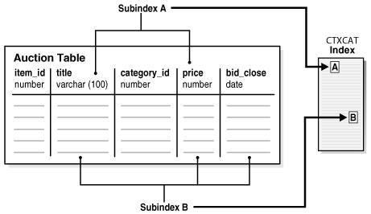

Learn how to create Oracle Text indexes.

This chapter contains the following topics:

- Summary of the Procedure for Creating an Oracle Text Index

- Creating Preferences

- Section Searching Example: Creating HTML Sections

- Using Stopwords and Stoplists

- Creating a CONTEXT Index

- Creating a CTXCAT Index

- Creating a CTXRULE Index

- Creating a Search Index for JSON

### 4.1 Summary of the Procedure for Creating an Oracle Text Index

With Oracle Text, you can create indexes of type `CONTEXT`, `CTXCAT`, and `CTXRULE`.

You can choose to keep old index entries to search on original content by using the `ASYNCHRONOUS_UPDATE` parameter string option.

By default, the system expects your documents to be stored in a text column. After you satisfy this requirement, you can create an Oracle Text index by using the `CREATE` `INDEX` SQL statement as an extensible index of type `CONTEXT`, without explicitly specifying preferences. The system automatically detects your language, the data type of the text column, and the format of the documents. Next, the system sets indexing preferences.

To create an Oracle Text index:

1.  (Optional) Determine your custom indexing preferences, section groups, or stoplists if you do not use the defaults. The following table describes these indexing classes:

    | Class         | Description                                      |
    |:--------------|:-------------------------------------------------|
    | Datastore     | How are your documents stored?                   |
    | Filter        | How can the documents be converted to plaintext? |
    | Lexer         | What language is being indexed?                  |
    | Wordlist      | How should stem and fuzzy queries be expanded?   |
    | Storage       | How should the index data be stored?             |
    | Stoplist      | What words or themes are not to be indexed?      |
    | Section Group | How are document sections defined?               |

2.  (Optional) Create custom preferences, section groups, or stoplists.

3.  Create the Oracle Text index with the `CREATE` `INDEX` SQL statement. Name your index and, if necessary, specify preferences.

**Related Topics**

- [Considerations for Oracle Text Indexing](indexing-with-oracle-text.md)
- Creating a CONTEXT Index
- Creating Preferences
- [Oracle Text Reference](../ccref/oracle-text-SQL-statements-and-operators.md)

### 4.2 Creating Preferences

If you want, you can create custom index preferences to override the defaults. Use the preferences to specify index information, such as where your files are stored and how to filter your documents. You create the preferences and then set the attributes.

**See Also:**

"[Custom Index Preference Examples](custom-index-preference-examples.md)"

### 4.3 Section Searching Example: Creating HTML Sections

When documents have internal structure such as in HTML and XML, you can define document sections by using embedded tags before you index. This approach enables you to query within the sections by using the `WITHIN` operator. You define sections as part of a section group.

This example defines a section group called `htmgroup`of type `HTML_SECTION_GROUP.` It then creates a zone section in `htmgroup` called `heading` identified by the `<H1>` tag:

    begin
    ctx_ddl.create_section_group('htmgroup', 'HTML_SECTION_GROUP');
    ctx_ddl.add_zone_section('htmgroup', 'heading', 'H1');
    end;

**See Also:**

[Searching Document Sections in Oracle Text](searching-document-sections-in-oracle-text.md)

### 4.4 Using Stopwords and Stoplists

A stopword is a word that is not to be indexed, such as this or that in English.

The system supplies a stoplist for every language. By default during indexing, the system uses the Oracle Text default stoplist for your language.

You can edit the default `CTXSYS.DEFAULT_STOPLIST` or create your own with the following PL/SQL procedures:

- `CTX_DDL.CREATE_STOPLIST`

- `CTX_DDL.ADD_STOPWORD`

- `CTX_DDL.REMOVE_STOPWORD`

You specify your custom stoplists in the parameter clause of `CREATE INDEX.`

You can also dynamically add stopwords after indexing with the `ALTER INDEX` statement.

- Multi-Language Stoplists

- Stopthemes and Stopclasses

- PL/SQL Procedures for Managing Stoplists

#### 4.4.1 Multilanguage Stoplists

You can create multilanguage stoplists to hold language-specific stopwords. This stoplist is useful when you use `MULTI_LEXER` to index a table that contains documents in different languages, such as English, German, and Japanese.

To create a multilanguage stoplist, use the `CTX_DDL.CREATE_STOPLIST` procedure and specify a stoplist type of `MULTI_STOPLIST.` You add language-specific stopwords with `CTX_DDL.ADD_STOPWORD.`

#### 4.4.2 Stopthemes and Stopclasses

In addition to defining your own stopwords, you can define stopthemes, which are themes that are not indexed. This feature is available only for English and French.

You can also specify that numbers are not indexed. A class of alphanumeric characters such a numbers that is not to be indexed is a stopclass.

You create a single stoplist, to which you add the stopwords, stopthemes, and stopclasses, and specify the stoplist in the `paramstring` for `CREATE INDEX.`

#### 4.4.3 PL/SQL Procedures for Managing Stoplists

Use the following procedures to manage stoplists, stopwords, stopthemes, and stopclasses:

- `CTX_DDL.CREATE_STOPLIST`

- `CTX_DDL.ADD_STOPWORD`

- `CTX_DDL.ADD_STOPTHEME`

- `CTX_DDL.ADD_STOPCLASS`

- `CTX_DDL.REMOVE_STOPWORD`

- `CTX_DDL.REMOVE_STOPTHEME`

- `CTX_DDL.REMOVE_STOPCLASS`

- `CTX_DDL.DROP_STOPLIST`

  **See Also:**

  [Oracle Text Reference](../ccref/CTX_DDL-package.md) to learn more about using these procedures

### 4.5 Creating a CONTEXT Index

The `CONTEXT` index type is well suited for indexing large, coherent documents in formats such as Microsoft Word, HTML, or plain text.

With a `CONTEXT` index, you can also customize your index in a variety of ways. The documents must be loaded in a text table.

- CONTEXT Index and DML

- Default CONTEXT Index Example

- Incrementally Creating a CONTEXT Index

- Custom CONTEXT Index Example: Indexing HTML Documents

- CONTEXT Index Example: Query Processing with FILTER BY and ORDER BY

#### 4.5.1 CONTEXT Index and DML

A `CONTEXT` index is not transactional. When you delete a record, the index is changed immediately. That is, your session no longer finds the record from the moment you make the change, and other users cannot find the record after you commit. For inserts and updates, the new information is not visible to text searches until an index synchronization has occurred. Therefore, when you perform inserts or updates on the base table, you must explicitly synchronize the index with `CTX_DDL.SYNC_INDEX.`

**See Also:**

"[Synchronizing the Index](maintaining-oracle-text-indexes.md)"

#### 4.5.2 Default CONTEXT Index Example

The following statement creates a default `CONTEXT` index called `myindex` on the `text` column in the `docs`table:

    CREATE INDEX myindex ON docs(text) INDEXTYPE IS CTXSYS.CONTEXT;

When you use the `CREATE INDEX` statement without explicitly specifying parameters, the system completes the following actions by default for all languages:

- Assumes that the text to be indexed is stored directly in a text column. The text column can be of type `CLOB,` `BLOB,` `BFILE,` `VARCHAR2,` or `CHAR.`

- Detects the column type and uses filtering for the binary column types of `BLOB` and `BFILE.` Most document formats are supported for filtering. If your column is plain text, the system does not use filtering.

  **Note:**

  For document filtering to work correctly in your system, you must ensure that your environment is set up correctly to support the `AUTO_FILTER` filter.

- Assumes that the language of the text to index is the language specified in your database setup.

- Uses the default stoplist for the language specified in your database setup. Stoplists identify the words that the system ignores during indexing.

- Enables fuzzy and stemming queries for your language, if this feature is available for your language.

You can always change the default indexing behavior by customizing your preferences and specifying those preferences in the parameter string of `CREATE` `INDEX.`

**See Also:**

[Oracle Text Reference](../ccref/oracle-text-supported-document-formats.md) to learn more about configuring your environment to use the `AUTO_FILTER` filter

#### 4.5.3 Incrementally Creating a CONTEXT Index

The `ALTER INDEX` and `CREATE INDEX` statements support incrementally creating a `CONTEXT` index.

You can incrementally create Oracle Text indexes, which means that the index structure is immediately created but the data is not populated during the index creation or rebuild process. You populate the index later at a suitable time. This procedure is useful for creating indexes in large installations that cannot afford to have the indexing process running continuously. It provides finer control over the creation of indexes, allowing you to avoid building indexes in a single operation.

Incremental index creation involves the following steps:

1.  Create an empty index:

    If you specify the `NOPOPULATE` keyword at the time of index creation or rebuild, it only creates metadata for the index tables but does not populate them.

    - Global index:

      For a global index, use `CREATE` `INDEX` to support the `NOPOPULATE` keyword in the `REPLACE` parameter of the `REBUILD` clause.

    - Local index partition:

      For a local index partition, modify the `ALTER` `INDEX` ... `REBUILD` `partition` ... `parameters` ('`REPLACE` ...') parameter string to support the `NOPOPULATE` keyword.

      For a partition on a local index, `CREATE` `INDEX` ... `LOCAL` ... (`partition` ... `parameters` ('`NOPOPULATE`')) is supported. The partition-level `POPULATE` or `NOPOPULATE` keywords override any `POPULATE` or `NOPOPULATE` specified at the index level.

2.  Place all ROWIDs into the pending queue:

    Use the `CTX_DDL.POPULATE_PENDING` procedure to populate the pending queues with every ROWID in the base table or table partition.

3.  Populate the index:

    Use the `CTX_DDL.SYNC_INDEX` procedure to populate the index with the queued data.

    The `SYNC_INDEX` procedure includes the `maxtime` argument that indicates a suggested time limit in minutes for the operation. The indexing process runs in an estimate of the given `maxtime` instead of running to completion. You might need to run multiple `SYNC_INDEX` calls until the index is fully synced.

    You can choose to run both the `POPULATE_PENDING` and `SYNC_INDEX` calls separately so that the population of the pending queue and the population of the index happen at different times, thereby optimizing system performance.

Example 4-1 Incrementally Build an Empty Global Index

    -- Create an empty index

    CREATE INDEX ctx_ind ON ctx_tab(doc) INDEXTYPE IS CTXSYS.CONTEXT
       PARAMETERS ('NOPOPULATE');

    declare
     n_pending number;
     function get_pending return number is
        n_pending number;

     begin
       execute immediate 'SELECT COUNT(*) FROM CTX_USER_PENDING WHERE PND_INDEX_NAME = :1'
           into n_pending using 'CTX_IND';
       return n_pending;
     end get_pending;

    begin
     -- Fill in the pending queue
     CTX_DDL.POPULATE_PENDING('CTX_IND');
     n_pending := get_pending;
     while (n_pending > 0) loop
     -- Populate the index through sync_index
        CTX_DDL.SYNC_INDEX('CTX_IND', maxtime => 1);
        n_pending := get_pending;
     end loop;
    end;
    /

**Related Topics**

- [CREATE INDEX](../ccref/oracle-text-SQL-statements-and-operators.md)
- [ALTER INDEX](../ccref/oracle-text-SQL-statements-and-operators.md)
- [CTX_DDL.POPULATE_PENDING](../ccref/CTX_DDL-package.md)
- [CTX_DDL.SYNC_INDEX](../ccref/CTX_DDL-package.md)

#### 4.5.4 Custom CONTEXT Index Example: Indexing HTML Documents

To index an HTML document set located by URLs, specify the system-defined preference for the `NULL_FILTER` in the `CREATE INDEX` statement.

You can also specify your `htmgroup` section group that uses `HTML_SECTION_GROUP` and `NETWORK_PREF` datastore that uses `NETWORK_DATASTORE`:

    begin
     ctx_ddl.create_preference('NETWORK_PREF','NETWORK_DATASTORE');
     ctx_ddl.set_attribute('NETWORK_PREF','HTTP_PROXY','www-proxy.us.example.com');
     ctx_ddl.set_attribute('NETWORK_PREF','NO_PROXY','us.example.com');
     ctx_ddl.set_attribute('NETWORK_PREF','TIMEOUT','300');
    end;

    begin
    ctx_ddl.create_section_group('htmgroup', 'HTML_SECTION_GROUP');
    ctx_ddl.add_zone_section('htmgroup', 'heading', 'H1');
    end;

You can then index your documents:

    CREATE INDEX myindex on docs(htmlfile) indextype is ctxsys.context
    parameters(
    'datastore NETWORK_PREF filter ctxsys.null_filter section group htmgroup'
    );

**Note:**

Starting with Oracle Database 19c, the Oracle Text type `URL_DATASTORE` is deprecated. Use `NETWORK_DATASTORE` instead.

**Related Topics**

- Creating Preferences

#### 4.5.5 CONTEXT Index Example: Query Processing with FILTER BY and ORDER BY

To enable more efficient query processing and better response time for mixed queries, use `FILTER` `BY` and `ORDER` `BY` clauses as shown in the following example:

    CREATE INDEX myindex on docs(text) INDEXTYPE is CTXSYS.CONTEXT
    FILTER BY category, publisher, pub_date
    ORDER BY pub_date desc;

Because you specified the `FILTER` `BY` `category,` `publisher,` `pub_date` clause at query time, Oracle Text also considers pushing a relational predicate on any of these columns into the Oracle Text index row source.

Also, when the query has matching `ORDER` `BY` criteria, by specifying `ORDER` `BY` `pub_date desc,` Oracle Text determines whether to push `SORT` into the Oracle Text index row source for better response time.

### 4.6 Creating a CTXCAT Index

The `CTXCAT` index type is well-suited for indexing small text fragments and related information. This index type provides better structured query performance than a `CONTEXT` index.

- CTXCAT Index and DML

- About CTXCAT Sub-Indexes and Their Costs

- Creating CTXCAT Sub-indexes

- Creating CTXCAT Index

#### 4.6.1 CTXCAT Index and DML Operations

A `CTXCAT` index is transactional. When you perform inserts, updates, and deletes on the base table, Oracle Text automatically synchronizes the index. Unlike a `CONTEXT` index, no `CTX_DDL.SYNC_INDEX` is necessary.

**Note:**

Applications that insert without invoking triggers, such as SQL\*Loader, do not result in automatic index synchronization as described in this section.

#### 4.6.2 About CTXCAT Subindexes and Their Costs

A `CTXCAT` index contains subindexes that you define as part of your index set. You create a subindex on one or more columns to improve mixed query performance. However, the time Oracle Text takes to create a `CTXCAT` index depends on its total size, and the total size of a `CTXCAT` index is directly related to the following factors:

- Total text to be indexed

- Number of subindexes in the index set

- Number of columns in the base table that make up the subindexes

Many component indexes in your index set also degrade the performance of insert, update, and delete operations, because more indexes must be updated.

Because of the added index time and disk space costs for creating a `CTXCAT` index, before adding it to your index set, carefully consider the query performance benefit that each component index gives your application.

**Note:**

You can use `I_ROWID_INDEX_CLAUSE` of `BASIC_STORAGE` to speed up creation of a `CTXCAT` index. This clause is described in [Oracle Text Reference](../ccref/oracle-text-indexing-elements.md).

#### 4.6.3 Creating CTXCAT Subindexes

An online auction site that must store item descriptions, prices, and bid-close dates for ordered look-up is a good example for creating a `CTXCAT` index.

Figure 4-1 Auction Table Schema and CTXCAT Index

[Description of "Figure 4-1 Auction Table Schema and CTXCAT Index"](img_text/ccapp_pb_010a.md)

Figure 4-1 shows a table called `AUCTION` with the following schema:

    create table auction(
    item_id number,
    title varchar2(100),
    category_id number,
    price number,
    bid_close date);

To create your subindexes, create an index set to contain them:

    begin
    ctx_ddl.create_index_set('auction_iset');
    end;

Next, determine the structured queries that you are likely to enter. The `CATSEARCH` query operator takes a mandatory text clause and optional structured clause.

In the example, this means that all queries include a clause for the `title` column, which is the text column.

Assume that the structured clauses fall into the following categories:

| Structured Clauses                                              | Subindex Definition to Serve Query | Category |
|:----------------------------------------------------------------|:-----------------------------------|:---------|
| 'price \< 200' 'price = 150' 'order by price'             | 'price'                            | A        |
| 'price = 100 order by bid_close' 'order by price, bid_close' | 'price, bid_close'                 | B        |

##### Structured Query Clause Category A

The structured query clause contains an expression only for the `price` column as follows:

    SELECT FROM auction WHERE CATSEARCH(title, 'camera', 'price < 200')> 0;
    SELECT FROM auction WHERE CATSEARCH(title, 'camera', 'price = 150')> 0;
    SELECT FROM auction WHERE CATSEARCH(title, 'camera', 'order by price')> 0;

These queries can be served by using subindex B. However, for efficiency, you can also create a subindex only on `price` (subindex A):

    begin
    ctx_ddl.add_index('auction_iset','price'); /* sub-index A */
    end;

##### Structured Query Clause Category B

The structured query clause includes an equivalent expression for `price` ordered by `bid_close,` and an expression for ordering by `price` and `bid_close,` in that order:

    SELECT FROM auction WHERE CATSEARCH(
       title, 'camera','price = 100
       ORDER BY bid_close')> 0;
    SELECT FROM auction
       WHERE CATSEARCH(
       title, 'camera','order by price, bid_close')> 0;

These queries can be served with a subindex defined as follows:

    begin
    ctx_ddl.add_index('auction_iset','price, bid_close'); /* sub-index B */
    end;

Like a combined b-tree index, the column order that you specify with `CTX_DDL.ADD_INDEX` affects the efficiency and viability of the index scan which Oracle Text uses to serve specific queries. For example, if two structured columns `p` and `q` have a b-tree index specified as `'p,q'`, Oracle Text cannot scan this index to sort `'ORDER` `BY q,p'`.

#### 4.6.4 Creating CTXCAT Index

This example combines the previous examples and creates the index set preference with the two subindexes:

    begin
    ctx_ddl.create_index_set('auction_iset');
    ctx_ddl.add_index('auction_iset','price'); /* sub-index A */
    ctx_ddl.add_index('auction_iset','price, bid_close'); /* sub-index B */
    end;

Figure 4-1 shows how the subindexes A and B are created from the auction table. Each subindex is a b-tree index on the text column and the named structured columns. For example, subindex A is an index on the `title` column and the `bid_close` column.

You create the combined catalog index with the `CREATE` `INDEX` statement as follows:

    CREATE INDEX auction_titlex ON AUCTION(title)
      INDEXTYPE IS CTXSYS.CTXCAT
      PARAMETERS ('index set auction_iset')
    ;

**See Also:**

[Oracle Text Reference](../ccref/oracle-text-SQL-statements-and-operators.md) to learn more about creating a `CTXCAT` index with `CREATE``INDEX`

### 4.7 Creating a CTXRULE Index

To build a document classification application, use the `CTXRULE` index on a table or queries. The stream of incoming documents is classified by content, and the queries define your categories. You can use the `MATCHES` operator to classify single documents.

To create a `CTXRULE` index and a simple document classification application:

1.  Create a table of queries.

    Create a `myqueries` table to hold the category name and query text, and then populate the table with the classifications and the queries that define each classification.

        CREATE TABLE myqueries (
        queryid NUMBER PRIMARY KEY,
        category VARCHAR2(30),
        query VARCHAR2(2000)
        );

    For example, consider a classification for the US Politics, Music, and Soccer subjects:

        INSERT INTO myqueries VALUES(1, 'US Politics', 'democrat or republican');
        INSERT INTO myqueries VALUES(2, 'Music', 'ABOUT(music)');
        INSERT INTO myqueries VALUES(3, 'Soccer', 'ABOUT(soccer)');

    **Tip:**

    You can also generate a table of rules (or queries) with the `CTX_CLS.TRAIN` procedure, which takes as input a document training set.

2.  Create the `CTXRULE` index.

    Use the `CREATE INDEX` statement to create the `CTXRULE` index and specify lexer, storage, section group, and wordlist parameters if needed.

        CREATE INDEX myruleindex ON myqueries(query)
             INDEXTYPE IS CTXRULE PARAMETERS
                   ('lexer lexer_pref
                     storage storage_pref
                     section group section_pref
                     wordlist wordlist_pref');

3.  Classify a document.

    Use the `MATCHES` operator to classify a document.

    Assume that incoming documents are stored in the table `news`:

        CREATE TABLE news (
        newsid NUMBER,
        author VARCHAR2(30),
        source VARCHAR2(30),
        article CLOB);

    If you want, create a "before insert" trigger with `MATCHES` to route each document to a `news_route` table based on its classification:

        BEGIN
          -- find matching queries
          FOR c1 IN (select category
                       from myqueries
                      where MATCHES(query, :new.article)>0)
          LOOP
            INSERT INTO news_route(newsid, category)
              VALUES (:new.newsid, c1.category);
          END LOOP;
        END;

**See Also:**

- [Classifying Documents in Oracle Text](classifying-documents-in-oracle-text.md) for more information on document classification and the `CTXRULE` index

- [Oracle Text Reference](../ccref/CTX_CLS-package.md) for more information on `CTX_CLS.TRAIN`

### 4.8 Creating a Search Index for JSON

Oracle Text supports a simpler alternative syntax for creating a search index on JavaScript Object Notation (JSON). The JSON search index is created on the table column name.

**See Also:**

[Oracle Database JSON Developer's Guide](../adjsn/indexes-for-json-data.md)
