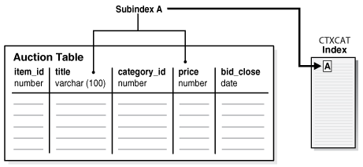
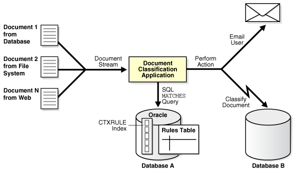

You can create an Oracle Text developer user account and build simple text query and catalog applications.

This chapter contains the following topics:

- Overview of Getting Started with Oracle Text

- Creating an Oracle Text User

- Query Application Quick Tour

- Catalog Application Quick Tour

- Classification Application Quick Tour

### 2.1 Overview of Getting Started with Oracle Text

This chapter provides basic information about how to configure Oracle Text, how to create an Oracle Text developer user account and how to build simple text query and catalog applications. It also provides information about basic SQL statements for each type of application to load, index, and query tables.

More complete application examples are given in the appendixes.

**Note:**

The `SQL>` prompt has been omitted in this chapter, in part to improve readability and in part to make it easier for you to cut and paste text.

**See Also:**

" [Classifying Documents in Oracle Text](classifying-documents-in-oracle-text.md)" to learn more about building document classification applications

### 2.2 Creating an Oracle Text User

Before you can create Oracle Text indexes and use Oracle Text PL/SQL packages, you need to create a user with the `CTXAPP` role. This role enables you to do the following:

- Create and delete Oracle Text indexing preferences

- Use the Oracle Text PL/SQL packages

To create an Oracle Text application developer user, perform the following steps as the system administrator user:

1.  Create the user.
    The following SQL statement creates a user called `MYUSER` with a password of `password`:

        CREATE USER myuser IDENTIFIED BY password;
2.  Grant roles to the user.
    The following SQL statement grants the required roles of `RESOURCE`, `CONNECT`, and `CTXAPP` to `MYUSER`:

        GRANT RESOURCE, CONNECT, CTXAPP TO MYUSER;
3.  Grant EXECUTE privileges on the `CTX PL/SQL` package.
    Oracle Text includes several packages that let you perform actions ranging from synchronizing an Oracle Text index to highlighting documents. For example, the `CTX_DDL` package includes the `SYNC_INDEX` procedure, which enables you to synchronize your index. The [Oracle Text Reference](../ccref/oracle-text-SQL-statements-and-operators.md) describes these packages.

    To call any of these procedures from a stored procedure, your application requires execute privileges on the packages. For example, to grant `execute` privileges to `MYUSER` on all Oracle Text packages, enter the following SQL statements:

        GRANT EXECUTE ON CTXSYS.CTX_CLS TO myuser;
        GRANT EXECUTE ON CTXSYS.CTX_DDL TO myuser;
        GRANT EXECUTE ON CTXSYS.CTX_DOC TO myuser;
        GRANT EXECUTE ON CTXSYS.CTX_OUTPUT TO myuser;
        GRANT EXECUTE ON CTXSYS.CTX_QUERY TO myuser;
        GRANT EXECUTE ON CTXSYS.CTX_REPORT TO myuser;
        GRANT EXECUTE ON CTXSYS.CTX_THES TO myuser;
        GRANT EXECUTE ON CTXSYS.CTX_ULEXER TO myuser;

    **Note:**

    These permissions are granted to the `CTXAPP` role. However, because role permissions do not always work in PL/SQL procedures, it is safest to explicitly grant these permissions to the user who already has the `CTXAPP` role.

### 2.3 Query Application Quick Tour

In a basic text query application, users enter query words or phrases and expect the application to return a list of documents that best match the query. Such an application involves creating a `CONTEXT` index and querying it with `CONTAINS.`

Typically, query applications require a user interface. An example of how to build such a query application using the `CONTEXT` index type is given in [CONTEXT Query Application](CONTEXT-query-application.md).

The examples in this section provide the basic SQL statements to load the text table, index the documents, and query the index.

- Creating the Text Table

- Using SQL\*Loader to Load the Table

#### 2.3.1 Creating the Text Table

Perform the following steps to create and load documents into a table.

1.  Connect as the new user.
    Before creating any tables, assume the identity of the user that you created.

        CONNECT myuser;
2.  Create your text table.
    The following example creates a table called `docs` with two columns, `id` and `text`, by using the `CREATE` `TABLE` statement. This example makes the `id` column the primary key. The `text` column is `VARCHAR2`.

        CREATE TABLE docs (id NUMBER PRIMARY KEY, text VARCHAR2(200));

    **Note:**

    Primary keys of the following type are supported: `NUMBER, VARCHAR2, DATE, CHAR, VARCHAR,` and `RAW.`
3.  Load documents into the table.
    Use the SQL `INSERT` statement to load text into a table.

    To populate the `docs` table, use the `INSERT` statement:

        INSERT INTO docs VALUES(1, '<HTML>California is a state in the US.</HTML>');
        INSERT INTO docs VALUES(2, '<HTML>Paris is a city in France.</HTML>');
        INSERT INTO docs VALUES(3, '<HTML>France is in Europe.</HTML>');

#### 2.3.2 Using SQL\*Loader to Load the Table

You can use SQL\*Loader to load a table in batches.

Perform the following steps to load your table in batches with SQL\*Loader:

1.  Create the `CONTEXT` index.
    Index the HTML files by creating a `CONTEXT` index on the text column as follows. Because you are indexing HTML, this example uses the `NULL_FILTER` preference type for no filtering and the `HTML_SECTION_GROUP` type. If you index PDF, Microsoft Word, or other formatted documents, then use the `CTXSYS.AUTO_FILTER` (the default) as your `FILTER` preference.

        CREATE INDEX idx_docs ON docs(text)
             INDEXTYPE IS CTXSYS.CONTEXT PARAMETERS
             ('FILTER CTXSYS.NULL_FILTER SECTION GROUP CTXSYS.HTML_SECTION_GROUP');

    This example also uses the `HTML_SECTION_GROUP` section group, which is recommended for indexing HTML documents. Using `HTML_SECTION_GROUP` enables you to search within specific HTML tags and eliminate unwanted markup, such as font information, from the index.
2.  Query your table with `CONTAINS.`
    First, set the format of the `SELECT` statement's output so that it is easily readable. Set the width of the `text` column to 40 characters:

        COLUMN text FORMAT a40;

    Next, query the table with the `SELECT` statement with `CONTAINS.` This query retrieves the document IDs that satisfy the query. The following query looks for all documents that contain the word France:

        SELECT SCORE(1), id, text FROM docs WHERE CONTAINS(text, 'France', 1) > 0;

          SCORE(1)         ID TEXT
        ---------- ---------- ----------------------------------------
                 4          3 <HTML>France is in Europe.</HTML>
                 4          2 <HTML>Paris is a city in France.</HTML>
3.  Present the document.
    In a real-world application, you could present the selected document with query terms highlighted. Oracle Text enables you to mark up documents with the `CTX_DOC` package.

    You can demonstrate HTML document markup with an anonymous PL/SQL block in SQL\*Plus. However, in a real-world application, you could present the document in a browser.

    This PL/SQL example uses the in-memory version of `CTX_DOC.MARKUP` to highlight the word France in document 3. It allocates a temporary `CLOB` (character large object data type) to store the markup text and reads it back to the standard output. The `CLOB` is then deallocated before exiting:

        SET SERVEROUTPUT ON;
        DECLARE
          2  mklob CLOB;
          3  amt NUMBER := 40;
          4  line VARCHAR2(80);
          5  BEGIN
          6    CTX_DOC.MARKUP('idx_docs','3','France', mklob);
          7    DBMS_LOB.READ(mklob, amt, 1, line);
          8    DBMS_OUTPUT.PUT_LINE('FIRST 40 CHARS ARE:'||line);
          9    DBMS_LOB.FREETEMPORARY(mklob);
         10    END;
         11  /
        FIRST 40 CHARS ARE:<HTML><<<France>>> is in Europe.</HTML>

        PL/SQL procedure successfully completed.
4.  Synchronize the index after data manipulation.
    When you create a `CONTEXT` index, you explicitly synchronize your index to update it with any inserts, updates, or deletions to the text table.

    Oracle Text enables you to do so with the `CTX_DDL.SYNC_INDEX` procedure.

    Add some rows to the `docs` table:

        INSERT INTO docs VALUES(4, '<HTML>Los Angeles is a city in California.</HTML>');
        INSERT INTO docs VALUES(5, '<HTML>Mexico City is big.</HTML>');

    Because the index is not synchronized, these new rows are not returned with a query on city:

        SELECT SCORE(1), id, text FROM docs WHERE CONTAINS(text, 'city', 1) > 0;

          SCORE(1)         ID TEXT
        ---------- ---------- --------------------------------------------------
                 4          2 <HTML>Paris is a city in France.</HTML>

    Therefore, synchronize the index with 2 Mb of memory and rerun the query:

        EXEC CTX_DDL.SYNC_INDEX('idx_docs', '2M');

        PL/SQL procedure successfully completed.

        COLUMN text FORMAT a50;
        SELECT SCORE(1), id, text FROM docs WHERE CONTAINS(text, 'city', 1) > 0;

          SCORE(1)         ID TEXT
        ---------- ---------- --------------------------------------------------
                 4          5 <HTML>Mexico City is big.</HTML>
                 4          4 <HTML>Los Angeles is a city in California.</HTML>
                 4          2 <HTML>Paris is a city in France.</HTML>

    **See Also:**

    "[Building the PSP Web Application](CONTEXT-query-application.md)" for an example of how to use SQL\*Loader to load a text table from a data file

### 2.4 Catalog Application Quick Tour

The examples in this section provide the basic SQL statements to create a catalog index for an auction site that sells electronic equipment, such as cameras and CD players. New inventory is added every day, and item descriptions, bid dates, and prices must be stored together.

The application requires good response time for mixed queries. The key is to determine what columns users frequently search to create a suitable `CTXCAT` index. Queries on this type of index use the `CATSEARCH` operator.

- Creating the Table

- Using SQL\*Loader to Load the Table

**Note:**

Typically, query applications require a user interface. An example of how to build such a query application using the `CATSEARCH` index type is given in [CATSEARCH Query Application](CATSEARCH-query-application.md) .

#### 2.4.1 Creating the Table

Perform the following steps to create and load the table:

1.  Connect as the appropriate user.
    Connect as the `myuser` with `CTXAPP` role:

        CONNECT myuser;
2.  Create your table.
    Set up an auction table to store your inventory:

        CREATE TABLE auction(
        item_id NUMBER,
        title VARCHAR2(100),
        category_id NUMBER,
        price NUMBER,
        bid_close DATE);
3.  Populate your table.
    Populate the table with various items, each with an `id, title, price` and `bid_date:`

        INSERT INTO AUCTION VALUES(1, 'NIKON CAMERA', 1, 400, '24-OCT-2002');
        INSERT INTO AUCTION VALUES(2, 'OLYMPUS CAMERA', 1, 300, '25-OCT-2002');
        INSERT INTO AUCTION VALUES(3, 'PENTAX CAMERA', 1, 200, '26-OCT-2002');
        INSERT INTO AUCTION VALUES(4, 'CANON CAMERA', 1, 250, '27-OCT-2002');

#### 2.4.2 Using SQL\*Loader to Load the Table

You can use SQL\*Loader to load a table in batches.

Perform the following steps to load your table in batches with SQL\*Loader:

1.  Determine your queries.
    Determine what criteria are likely to be retrieved. In this example, you determine that all queries search the title column for item descriptions, and most queries order by price. Later on, when you use the `CATSEARCH` operator, specify the terms for the text column and the criteria for the structured clause.
2.  Create the subindex to order by price.
    For Oracle Text to serve these queries efficiently, you need a subindex for the price column, because your queries are ordered by price.

    Therefore, create an index set called `auction_set` and add a subindex for the price column:

        EXEC CTX_DDL.CREATE_INDEX_SET('auction_iset');
        EXEC CTX_DDL.ADD_INDEX('auction_iset','price'); /* subindex A*/
3.  Create the `CTXCAT` index.
    Create the combined catalog index on the `AUCTION` table with the `CREATE` `INDEX` statement:

        CREATE INDEX auction_titlex ON AUCTION(title) INDEXTYPE IS CTXSYS.CTXCAT PARAMETERS ('index set auction_iset');

    The following figure shows how the `CTXCAT` index and its subindex relate to the columns.

    Figure 2-1 Auction table schema and CTXCAT index

    
    [Description of "Figure 2-1 Auction table schema and CTXCAT index"](img_text/ccapp_pb_019a.md)
4.  Query your table with `CATSEARCH.`
    After you create the `CTXCAT` index on the `AUCTION` table, query this index with the `CATSEARCH` operator.

    First, set the output format to make the output readable:

        COLUMN title FORMAT a40;

    Next, run the query:

        SELECT title, price FROM auction WHERE CATSEARCH(title, 'CAMERA', 'order by price')> 0;

        TITLE                PRICE
        --------------- ----------
        PENTAX CAMERA          200
        CANON CAMERA           250
        OLYMPUS CAMERA         300
        NIKON CAMERA           400

        SELECT title, price FROM auction WHERE CATSEARCH(title, 'CAMERA',
             'price <= 300')>0;

        TITLE                PRICE
        --------------- ----------
        PENTAX CAMERA          200
        CANON CAMERA           250
        OLYMPUS CAMERA         300
5.  Update your table.
    Update your catalog table by adding new rows. When you do so, the `CTXCAT` index is automatically synchronized to reflect the change.

    For example, add the following new rows to the table and then rerun the query:

        INSERT INTO AUCTION VALUES(5, 'FUJI CAMERA', 1, 350, '28-OCT-2002');
        INSERT INTO AUCTION VALUES(6, 'SONY CAMERA', 1, 310, '28-OCT-2002');

        SELECT title, price FROM auction WHERE CATSEARCH(title, 'CAMERA', 'order by price')> 0;

        TITLE                                    PRICE
        ----------------------------------- ----------
        PENTAX CAMERA                              200
        CANON CAMERA                               250
        OLYMPUS CAMERA                             300
        SONY CAMERA                                310
        FUJI CAMERA                                350
        NIKON CAMERA                               400

        6 rows selected.

    Note how the added rows show up immediately in the query.

    **See Also:**

    "[Building the PSP Web Application](CONTEXT-query-application.md)" for an example of how to use SQL\*Loader to load a text table from a data file

### 2.5 Classification Application Quick Tour

The function of a classification application is to perform some action based on document content. These actions can include assigning a category ID to a document or sending the document to a user. The result is classification of a document.

This section contains the following sections:

- About Classification of a Document

- Steps for Creating a Classification Application

#### 2.5.1 About Classification of a Document

Documents are classified according to predefined rules. These rules select documents for a category. For instance, a query rule of 'presidential elections' selects documents for a category about politics.

Oracle Text provides several types of classification. One type is simple, or rule-based classification, discussed here, where you create document categories and the rules for categorizing documents. With supervised classification, Oracle Text derives the rules from a set of training documents that you provide. With clustering, Oracle Text does all the work for you, deriving both rules and categories.

To create a simple classification application for document content using Oracle Text, you create rules. Rules are essentially a table of queries that categorize document content. You index these rules in a `CTXRULE` index. To classify an incoming stream of text, use the `MATCHES` operator in the `WHERE` clause of a `SELECT` statement. See the following image for the general flow of a classification application.

Figure 2-2 Overview of a Document Classification Application

[Description of "Figure 2-2 Overview of a Document Classification Application"](img_text/ccapp_pb_018a.md)

**See Also:**

"[Overview of Document Classification](classifying-documents-in-oracle-text.md)"

#### 2.5.2 Creating a Classification Application

The following example shows how to classify documents by using `myuser` with the `CTXAPP` role. You define simple categories, create a `CTXRULE` index, and use `MATCHES.`

1.  Connect as the appropriate user.
    Connect as the `myuser` with `CTXAPP` role:

        CONNECT myuser;
2.  Create the rule table.
    In this example, you create a table called `queries.` Each row defines a category with an ID and a rule that is a query string.

        CREATE TABLE queries (
              query_id      NUMBER,
              query_string  VARCHAR2(80)
            );

            INSERT INTO queries VALUES (1, 'oracle');
            INSERT INTO queries VALUES (2, 'larry or ellison');
            INSERT INTO queries VALUES (3, 'oracle and text');
            INSERT INTO queries VALUES (4, 'market share');
3.  Create your `CTXRULE` index.
        CREATE INDEX queryx ON queries(query_string) INDEXTYPE IS CTXSYS.CTXRULE;
4.  Classify with `MATCHES.`
    Use the `MATCHES` operator in the `WHERE` clause of a `SELECT` statement to match documents to queries and then classify the documents.

            COLUMN query_string FORMAT a35;
            SELECT query_id,query_string FROM queries
             WHERE MATCHES(query_string,
                           'Oracle announced that its market share in databases
                            increased over the last year.')>0;

          QUERY_ID QUERY_STRING
        ---------- -----------------------------------
                 1 oracle
                 4 market share

    As shown, the document string matches categories 1 and 4. With this classification, you can perform an action, such as writing the document to a specific table or emailing a user.

    **See Also:**

    [Classifying Documents in Oracle Text](classifying-documents-in-oracle-text.md) for more extended classification examples
