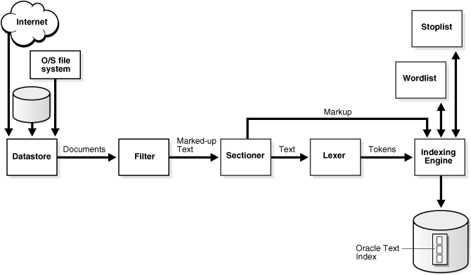
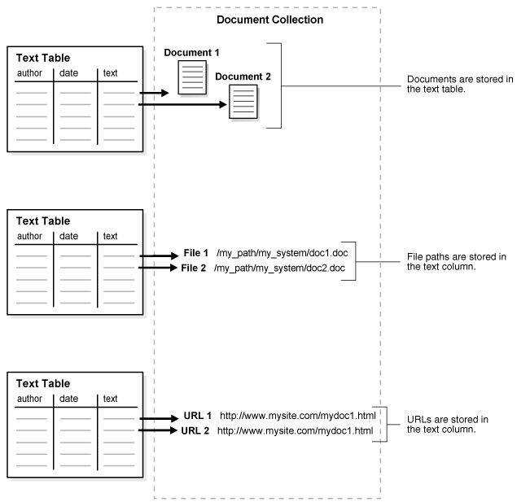

Oracle Text provides several types of indexes, which you create depending on the type of application that you develop.

This chapter contains the following topics:

- About Oracle Text Indexes

- Considerations for Oracle Text Indexing

- Document Language

- Indexing Special Characters

- Case-Sensitive Indexing and Querying

- Document Services Procedures Performance and Forward Index

- Language-Specific Features

- About Entity Extraction and CTX_ENTITY

- Fuzzy Matching and Stemming

- Better Wildcard Query Performance

- Document Section Searching

- Stopwords and Stopthemes

- Index Performance

- Query Performance and Storage of Large Object (LOB) Columns

- Mixed Query Performance

### 3.1 About Oracle Text Indexes

The discussion of Oracle Text indexes includes the different types of indexes, their structure, the indexing process, and limitations.

The following topics provide information about Oracle Text indexes:

- Types of Oracle Text Indexes

- Structure of the Oracle Text CONTEXT Index

- The Oracle Text Indexing Process

- Partitioned Tables and Indexes

- Creating an Index Online

- Parallel Indexing

- Indexing and Views

#### 3.1.1 Types of Oracle Text Indexes

With Oracle Text, you create indexes by using the `CREATE` `INDEX` statement. Table 3-1 describes each index type.

Table 3-1 Oracle Text Index Types

| Index Type | Description                                                                                                                                                                                                                                                                                                                                                                           | Supported Preferences and Parameters                                                                                                                                                                                          | Query Operator                                                                                                                                                                        | Notes                                                                                                                                                                                                                                                                                                                                                                                                                                                                                                                     |
|:-----------|:--------------------------------------------------------------------------------------------------------------------------------------------------------------------------------------------------------------------------------------------------------------------------------------------------------------------------------------------------------------------------------------|:------------------------------------------------------------------------------------------------------------------------------------------------------------------------------------------------------------------------------|:--------------------------------------------------------------------------------------------------------------------------------------------------------------------------------------|:--------------------------------------------------------------------------------------------------------------------------------------------------------------------------------------------------------------------------------------------------------------------------------------------------------------------------------------------------------------------------------------------------------------------------------------------------------------------------------------------------------------------------|
| `CONTEXT`  | Use this index to build a text retrieval application when your text consists of large, coherent documents in, for example, MS Word, HTML, or plain text. You can customize the index in a variety of ways. This index type requires `CTX_DDL.SYNC_INDEX` after insert, update, and delete operations to the base table.                                                         | All `CREATE` `INDEX` preferences and parameters are supported, except for `INDEX` `SET.` Supported parameters: index partition clause format, charset, and language columns                                                | `CONTAINS` The `CONTEXT` grammar supports a rich set of operations. Use the `CTXCAT` grammar with query templating.                                                             | Supports all documents services and query services. Supports indexing of partitioned text tables. Supports `FILTER` `BY` and `ORDER` `BY` clauses of `CREATE` `INDEX` to index structured column values for more efficient processing of mixed queries.                                                                                                                                                                                                                                                             |
| `CTXCAT`   | Use this index for better mixed query performance of small documents and text fragments. To improve mixed query performance, include other columns in the base table, such as item names, prices, and descriptions. This index type is transactional. It automatically updates itself after inserts, updates, or deletes to the base table. `CTX_DDL.SYNC_INDEX` is not necessary. | `INDEX` `SET` `LEXER` `STOPLIST` `STORAGE` `WORDLIST` (The `prefix_index` attribute is supported only for Japanese data.) Not supported: Format, charset, and language columns Table and index partitioning | `CATSEARCH` The `CTXCAT` grammar supports logical operations, phrase queries, and wildcarding. Use the `CONTEXT` grammar with query templating. Theme querying is supported. | This index is larger and takes longer to build than a `CONTEXT` index. The size of a `CTXCAT` index is related to the total amount of text to be indexed, the number of indexes in the index set, and the number of columns indexed. Carefully consider your queries and your resources before adding indexes to the index set. The `CTXCAT` index does not support index partitioning, documents services (highlighting, markup, themes, and gists) or query services (explain, query feedback, and browse words.) |
| `CTXRULE`  | Use this index to build a document classification or routing application. Create this index on a table of queries, where the queries define the classification or routing criteria..                                                                                                                                                                                                  | See "[CTXRULE Parameters and Limitations](classifying-documents-in-oracle-text.md)".                                                                                                                                          | `MATCHES`                                                                                                                                                                             | Use the `MATCHES` operator to classify single documents (plain text, HTML, or XML). `MATCHES` turns a document into a set of queries and finds the matching rows in the index. To build a document classification application by using simple or rule-based classification, create an index of type `CTXRULE.` This index classifies plain text, HTML, or XML documents by using the `MATCHES` operator. Store your defining query set in the text table that you index.                                               |

An Oracle Text index is an Oracle Database domain index. To build your query application, you can create an index of type `CONTEXT` with a mixture of text and structured data columns, and query it with the `CONTAINS` operator.

You create an index from a populated text table. In a query application, the table must contain the text or pointers to the location of the stored text. Text is usually a collection of documents, but it can also be small text fragments.

**Note:**

If you are building a new application that uses XML data, Oracle recommends that you use `XMLIndex,` not `CTXRULE.`

Create an Oracle Text index as a type of extensible index to Oracle Database by using standard SQL. This means that an Oracle Text index operates like an Oracle Database index. It has a name by which it is referenced and can be manipulated with standard SQL statements.

The benefit of creating an Oracle Text index is fast response time for text queries with the `CONTAINS`, `CATSEARCH`, and `MATCHES` operators. These operators query the `CONTEXT`, `CTXCAT`, and `CTXRULE` index types, respectively.

**Note:**

Because a Transparent Data Encryption-enabled column does not support domain indexes, do not use it with Oracle Text. However, you can create an Oracle Text index on a column in a table that is stored in a Transparent Data Encryption-enabled tablespace.

**See Also:**

- "[Creating Oracle Text Indexes](creating-oracle-text-indexes.md)"

- [Oracle XML DB Developer's Guide](../adxdb/indexes-for-XMLType-data.md) for information about `XMLIndex` and indexing `XMLType` data

#### 3.1.2 Structure of the Oracle Text CONTEXT Index

Oracle Text indexes text by converting all words into tokens. The general structure of an Oracle Text `CONTEXT` index is an inverted index, where each token contains the list of documents (rows) that contain the token.

For example, after a single initial indexing operation, the word DOG might have an entry as follows:

| Word | Appears in Document |
|:-----|:--------------------|
| DOG  | DOC1 DOC3 DOC5      |

This means that the word DOG is contained in the rows that store documents one, three, and five.

##### Merged Word and Theme Indexing

By default in English and French, Oracle Text indexes theme information with word information. You can query theme information with the `ABOUT` operator. You can also enable and disable theme indexing.

**See Also:**

"[Creating Preferences](creating-oracle-text-indexes.md) " to learn more about indexing theme information

#### 3.1.3 Oracle Text Indexing Process

This section describes the Oracle Text indexing process. Initiate the indexing process by using the `CREATE` `INDEX` statement to create an Oracle Text index of tokens, organized according to your parameters and preferences.

Figure 3-1 shows the indexing process. This process is a data stream that is acted upon by the different indexing objects. Each object corresponds to an indexing preference type or section group that you can specify in the parameter string of `CREATE` `INDEX` or `ALTER` `INDEX.`

Figure 3-1 Oracle Text Indexing Process

[Description of "Figure 3-1 Oracle Text Indexing Process"](img_text/ccapp011.md)

Oracle Text processes the data stream with the following objects and engine:

- Datastore Object

- Filter Object

- Sectioner Object

- Lexer Object

- Indexing Engine

##### 3.1.3.1 Datastore Object

The stream starts with the datastore reading in the documents as they are stored in the system according to your datastore preference.

For example, if you defined your datastore as `DIRECTORY_DATASTORE,` then the stream starts by reading the files from an Oracle directory object. You can also store your documents on the internet or in Oracle Database. Wherever your files reside physically, a text table in Oracle Database must always point to the files.

##### 3.1.3.2 Filter Object

The stream then passes through the filter. Your `FILTER` preference determines what happens. The stream can be acted upon in one of the following ways:

- No filtering takes place when you specify the `NULL_FILTER` preference type or when the value of the format column is `IGNORE.` Documents that are plain text, HTML, or XML need no filtering.

- Formatted documents (binary) are filtered to marked-up text when you specify the `AUTO_FILTER` preference type or when the value of the format column is `BINARY.`

##### 3.1.3.3 Sectioner Object

After being filtered, the marked-up text passes through the sectioner, which separates the stream into text and section information. Section information includes where sections begin and end in the text stream. The type of sections that are extracted is determined by your section group type.

The text is passed to the lexer. The section information is passed directly to the indexing engine, which uses it later.

##### 3.1.3.4 Lexer Object

You create a lexer preference by using one of the Oracle Text lexer types to specify the language of the text to be indexed. The lexer breaks the text into tokens according to your language. These tokens are usually words. To extract tokens, the lexer uses the parameters that are defined in your lexer preference. These parameters include the definitions for the characters that separate tokens, such as whitespace. Parameters also include whether to convert the text to all uppercase or to leave it in mixed case.

When you enable theme indexing, the lexer analyzes your text to create theme tokens for indexing.

##### 3.1.3.5 Indexing Engine

The indexing engine creates the inverted index that maps tokens to the documents that contain them. In this phase, Oracle Text uses the stoplist that you specify to exclude stopwords or stopthemes from the index. Oracle Text also uses the parameters that are defined in your `WORDLIST` preference. Those parameters tell the system how to create a prefix index or substring index, if enabled.

#### 3.1.4 About Updates to Indexed Columns

In releases prior to Oracle Database 12c Release 2 (12.2), when there is an update to the column on which an Oracle Text index is based, the document is unavailable for search operations until the index is synchronized. User queries cannot perform a search of this document. Starting with Oracle Database 12c Release 2 (12.2), you can specify that documents must be searchable after updates, without immediately performing index synchronization. Before the index is synchronized, queries use the old index entries to fetch the contents of the old document. After index synchronization, user queries fetch the contents of the updated document.

The `ASYNCHRONOUS_UPDATE` option for indexes enables you to retain the old contents of a document after an update and then use this index to answer user queries.

**See Also:**

- `ALTER INDEX` in the [Oracle Text Reference](../ccref/oracle-text-SQL-statements-and-operators.md)

- `CREATE INDEX` in the [Oracle Text Reference](../ccref/oracle-text-SQL-statements-and-operators.md)

#### 3.1.5 Partitioned Tables and Indexes

When you create a partitioned `CONTEXT` index on a partitioned text table, you must partition the table by range. Hash, composite, and list partitions are not supported.

You can create a partitioned text table to partition your data by date. For example, if your application maintains a large library of dated news articles, you can partition your information by month or year. Partitioning simplifies the manageability of large databases, because querying, insert, update, delete operations, and backup and recovery can act on a single partition.

On local `CONTEXT` indexes with multiple table sets, Oracle Text supports the number of partitions supported by Oracle Database.

**Note:**

The number of partitions that are supported in Oracle Text is approximately 1024K-1. This limit, which should be more than adequate, is not applicable to a `CONTEXT` index on partitioned tables.

**See Also:**

[Oracle Database Concepts](../cncpt/partitions-views-and-other-schema-objects.md) for more information about partitioning

To query a partitioned table, use `CONTAINS` in the `WHERE` clause of a `SELECT` statement as you query a regular table. You can query the entire table or a single partition. However, if you are using the `ORDER` `BY` `SCORE` clause, Oracle recommends that you query single partitions unless you include a range predicate that limits the query to a single partition.

#### 3.1.6 Online Indexes

When it is not practical to lock your base table for indexing because of ongoing updates, you can create your index online with the `ONLINE` parameter of `CREATE INDEX` statement. This way an application with frequent inserts, updates, or deletes does not have to stop updating the base table for indexing.

There are short periods, however, when the base table is locked at the beginning and end of the indexing process.

**See Also:**

[Oracle Text Reference](../ccref/oracle-text-SQL-statements-and-operators.md) to learn more about creating an index online

#### 3.1.7 Parallel Indexing

Oracle Text supports parallel indexing with the `CREATE` `INDEX` statement.

When you enter a parallel indexing statement on a nonpartitioned table, Oracle Text splits the base table into temporary partitions, spawns child processes, and assigns a child to a partition. Each child then indexes the rows in its partition. The method of slicing the base table into partitions is determined by Oracle and is not under your direct control. This is true as well for the number of child processes actually spawned, which depends on machine capabilities, system load, your `init.ora` settings, and other factors. Because of these variables, the actual parallel degree may not match the degree of parallelism requested.

Because indexing is an intensive I/O operation, parallel indexing is most effective in decreasing your indexing time when you have distributed disk access and multiple CPUs. Parallel indexing can affect the performance of an initial index only with the `CREATE` `INDEX` statement. It does not affect insert, update, and delete operations with `ALTER` `INDEX,` and has minimal effect on query performance.

Because parallel indexing decreases the initial indexing time, it is useful for the following scenarios:

- Data staging, when your product includes an Oracle Text index

- Rapid initial startup of applications based on large data collections

- Application testing, when you need to test different index parameters and schemas while developing your application

  **See Also:**

  - "[Parallel Queries on a Local Context Index](tuning-oracle-text.md)"

  - "[Frequently Asked Questions About Indexing Performance](tuning-oracle-text.md)"

#### 3.1.8 Indexing and Views

Oracle SQL standards do not support the creation of indexes on views. If you need to index documents whose contents are in different tables, create a data storage preference by using the `USER_DATASTORE` object. With this object, you can define a procedure that synthesizes documents from different tables at index time.

**See Also:**

[Oracle Text Reference](../ccref/oracle-text-indexing-elements.md) to learn more about `USER_DATASTORE`

Oracle Text supports the creation of `CONTEXT`, `CTXCAT`, and `CTXRULE` indexes on materialized views (`MVIEW`).

### 3.2 Considerations for Oracle Text Indexing

Use the `CREATE` `INDEX` statement to create an Oracle Text index. When you create an index but do not specify a parameter string, an index is created with default parameters. You can create a `CONTEXT` index, a `CTXCAT` index, or a `CTXRULE` index.

You can also override the defaults and customize your index to suit your query application. The parameters and preference types that you use to customize your index with the `CREATE` `INDEX` statement fall into the following general categories.

This section contains the following topics:

- Location of Text

- Supported Column Types

- Storing Text in the Text Table

- Storing File Path Names

- Storing URLs

- Storing Associated Document Information

- Format and Character Set Columns

- Supported Document Formats

- Summary of DATASTORE Types

- Document Formats and Filtering

- Bypass Rows

- Document Character Set

#### 3.2.1 Location of Text

The basic prerequisite for a text query application is a text table that is populated with your document collection. The text table is required for indexing.

When you create a `CONTEXT` index, populate rows in your text table with one of the following elements. `CTXCAT` and `CTXRULE` indexes support only the first method.

- Text information (Documents or text fragments. By default, the indexing operation expects your document text to be directly loaded in your text table.)

- Path names of documents in your file system

- URLs of web documents

Figure 3-2 illustrates these different methods.

Figure 3-2 Different Ways of Storing Text

[Description of "Figure 3-2 Different Ways of Storing Text"](img_text/ccapp_ap_002b.md)

#### 3.2.2 Supported Column Types

With Oracle Text, you can create a `CONTEXT` index with columns of type `VARCHAR2,` `CLOB` (limited to 4294967295 bytes), `BLOB,` `CHAR,` `BFILE,` `XMLType,` and `URIType.`

**Note:**

You cannot index the `NCLOB,` `DATE,` and `NUMBER` column types.

#### 3.2.3 Storing Text in the Text Table

For `CONTEXT` data storage, use these datastore types to store documents in your text table.

- `DIRECT_DATASTORE:` In one column

- `MULTI_COLUMN_DATASTORE:` In multiple columns (Oracle Text concatenates the columns into a virtual document, one document for each row.)

- `DETAIL_DATASTORE:` Primary-detail relationships (Store one document across a number of rows.)

- `NESTED_DATASTORE:` In a nested table

Oracle Text supports the indexing of the `XMLType` data type, which you use to store XML documents.

For `CTXCAT` data storage, you can store short text fragments, such as names, descriptions, and addresses, over a number of columns. A `CTXCAT` index improves performance for mixed queries.

#### 3.2.4 Storing File Path Names

In your text table, store path names to files stored in your file system. During indexing, use the `DIRECTORY_DATASTORE` preference type. This method of data storage is supported only for `CONTEXT` indexes.

**Note:**

Starting with Oracle Database 19c, the Oracle Text type `FILE_DATASTORE` is deprecated. Use `DIRECTORY_DATASTORE` instead.

Oracle recommends that you replace `FILE_DATASTORE` text indexes with the `DIRECTORY_DATASTORE` index type, which is available starting with Oracle Database 19c. `DIRECTORY_DATASTORE` provides greater security because it enables file access to be based on directory objects.

#### 3.2.5 Storing URLs

Store URL names to index websites. During indexing, use the `NETWORK_DATASTORE` preference type. This method of data storage is supported only for `CONTEXT` indexes.

**Note:**

Starting with Oracle Database 19c, the Oracle Text type `URL_DATASTORE` is deprecated. Use `NETWORK_DATASTORE` instead.

The `URL_DATASTORE` type is used for text stored in files on the internet (accessed through HTTP or FTP), and for text stored in local file system files (accessed through the file protocol). It is replaced with `NETWORK_DATASTORE`, which uses ACLs to allow access to specific servers. This change aligns Oracle Text more closely with the standard operating and security model for accessing URLs from the database.

#### 3.2.6 Storing Associated Document Information

In your text table, create additional columns to store structured information that your query application might need, such as primary key, date, description, or author.

#### 3.2.7 Format and Character Set Columns

If your documents consist of mixed formats or mixed character sets, create the following additional columns:

- A format column to record the format (`TEXT` or `BINARY`) to help filtering during indexing. You can also use the format column to ignore rows for indexing by setting the format column to `IGNORE.` `IGNORE` is useful for bypassing rows containing data that is incompatible with Oracle Text indexing, such as images.

- A character set column to record the document character set for each row.

When you create your index, specify the name of the format or character set column in the parameter clause of the `CREATE` `INDEX` statement.

For all rows containing the `AUTO` or `AUTOMATIC` keywords in character set or language columns, Oracle Text applies statistical techniques to determine the character set and language of the documents and modify document indexing appropriately.

#### 3.2.8 Supported Document Formats

Because the system can index most document formats, including HTML, PDF, Microsoft Word, and plain text, you can load any supported type into the text column.

When your text column has mixed formats, you can include a format column to help filtering during indexing, and you can specify whether a document is binary (formatted) or text (nonformatted, such as HTML). If you mix HTML and XML documents in one index, you might not be able to configure your index to your needs; you cannot prevent style sheet information from being added to the index.

**See Also:**

[Oracle Text Reference](../ccref/oracle-text-supported-document-formats.md) for more information about the supported document formats

#### 3.2.9 Summary of DATASTORE Types

When you use `CREATE INDEX`, specify the location that uses the datastore preference. Use an appropriate datastore according to your application.

These are the different ways that you can store your text with datastore preference types.

Table 3-2 Summary of DATASTORE Types

| Datastore Type           | Use When                                                                                                                                                                                                                                                    |
|:-------------------------|:------------------------------------------------------------------------------------------------------------------------------------------------------------------------------------------------------------------------------------------------------------|
| `DIRECT_DATASTORE`       | Data is stored internally in a text column. Each row is indexed as a single document. Your text column can be `VARCHAR2, CLOB, BLOB, CHAR, or BFILE`. `XMLType` columns are supported for the context index type.                                        |
| `MULTI_COLUMN_DATASTORE` | Data is stored in a text table in more than one column. Columns are concatenated to create a virtual document, one document for each row.                                                                                                                   |
| `DETAIL_DATASTORE`       | Data is stored internally in a text column. Document consists of one or more rows stored in a text column in a detail table, with header information stored in a primary table.                                                                             |
| `FILE_DATASTORE`         | Data is stored externally in operating system files. File names are stored in the text column, one for each row. **Note:** Starting with Oracle Database 19c, the Oracle Text type `FILE_DATASTORE` is deprecated. Use `DIRECTORY_DATASTORE` instead. |
| `DIRECTORY_DATASTORE`    | Data is stored externally in Oracle directory objects. File names are stored in the text column, one for each row.                                                                                                                                          |
| `NESTED_DATASTORE`       | Data is stored in a nested table.                                                                                                                                                                                                                           |
| `URL_DATASTORE`          | Data is stored externally in files located on an intranet or the internet. URLs are stored in the text column. **Note:** Starting with Oracle Database 19c, the Oracle Text type `URL_DATASTORE` is deprecated. Use `NETWORK_DATASTORE` instead.      |
| `NETWORK_DATASTORE`      | Data is stored externally in files located on an intranet or the internet. URLs are stored in the text column.                                                                                                                                              |
| `USER_DATASTORE`         | Documents are synthesized at index time by a user-defined stored procedure.                                                                                                                                                                                 |

Indexing time and document retrieval time increases for indexing URLs, because the system must retrieve the document from the network.

**Note:**

To troubleshoot issues with triggers and `MULTI_COLUMN_DATASTORE` or `USER_DATASTORE`, refer to My Oracle Support document 1613741.1.

**Related Topics**

- [MOS Document 1613741.1](https://support.oracle.com/epmos/faces/DocumentDisplay?id=1613741.1)
- [Datastore Examples](custom-index-preference-examples.md)
- [Oracle Text Reference](../ccref/oracle-text-indexing-elements.md)

#### 3.2.10 Document Formats and Filtering

To index formatted documents, such as Microsoft Word and PDF, you must filter them to text. The `FILTER` preference type determines the type of filtering that the system uses. By default, the system uses the `AUTO_FILTER` filter type, which automatically detects the format of your documents and filters them to text.

Oracle Text can index most formats. It can also index columns that contain mixed-format documents.

- No Filtering for HTML

- Filtering Mixed-Format Columns

- Custom Filtering

**See Also:**

[Oracle Text Reference](../ccref/oracle-text-supported-document-formats.md) for information about `AUTO_FILTER` supported document and graphics formats

##### 3.2.10.1 No Filtering for HTML

If you are indexing HTML or plain-text files, do not use the `AUTO_FILTER` type. For best results, use the `NULL_FILTER` preference type.

**See Also:**

"[NULL_FILTER Example: Indexing HTML Documents](custom-index-preference-examples.md)"

##### 3.2.10.2 Mixed-Format Columns Filtering

For a mixed-format column, such as one that contains Microsoft Word, plain text, and HTML documents, you can bypass filtering for plain text or HTML by including a format column in your text table. In the format column, tag each row `TEXT` or `BINARY.` Rows that are tagged `TEXT` are not filtered.

For example, tag the HTML and plain text rows as `TEXT` and the Microsoft Word rows as `BINARY.` You specify the format column in the `CREATE INDEX` parameter clause.

When you do not want a document to be indexed, you can use a third format column type, `IGNORE.` This column type is useful, for example, when a mixed-format table includes plain-text documents in Japanese and English, but you only want to process the English documents. This column type is also useful when a mixed-format table includes plain-text documents and images. Because `IGNORE` is implemented at the datastore level, you can use it with all filters.

##### 3.2.10.3 Custom Filtering

You can create a custom filter to filter documents for indexing. You can create either an external filter that is executed from the file system or an internal filter as a PL/SQL or Java-stored procedure.

For external custom filtering, use the `USER_FILTER` filter preference type.

For internal filtering, use the `PROCEDURE_FILTER` filter type.

**See Also:**

"[PROCEDURE_FILTER Example](custom-index-preference-examples.md)"

#### 3.2.11 Bypass Rows

In your text table, you can bypass rows that you do not want to index, such as rows that contain image data. To bypass rows, you create a format column, set it to `IGNORE,` and name the format column in the parameter clause of the `CREATE INDEX` statement.

#### 3.2.12 Document Character Set

The indexing engine expects filtered text to be in the database character set. When you use the `AUTO_FILTER` filter type, formatted documents are converted to text in the database character set.

If your source is text and your document character set is not the database character set, then you can use the `AUTO_FILTER` filter type to convert your text for indexing.

##### Character Set Detection

When you set the `CHARSET` column to `AUTO,` the `AUTO_FILTER` filter detects the character set of the document and converts it from the detected character set to the database character set, if there is a difference.

##### Mixed Character Set Columns

If your document set contains documents with different character sets, such as JA16EUC and JA16SJIS, you can index the documents, provided that you create a `CHARSET` column, populate this column with the name of the document character set for each row, and name the column in the parameter clause of the `CREATE INDEX` statement.

### 3.3 Document Language

Oracle Text can index most languages. By default, Oracle Text assumes that the language of the text to be indexed is the language that you specify in your database setup.

Depending on the language of your documents, use one of the following lexer types:

- `AUTO_LEXER`: To automatically detect the language being indexed by examining the content, and apply suitable options (including stemming) for that language. Works best where each document contains a single-language, and has at least a couple of paragraphs of text to aid identification.

- `BASIC_LEXER`: To index whitespace-delimited languages such as English, French, German, and Spanish. For some of these languages, you can enable alternate spelling, composite word indexing, and base-letter conversion.

- `MULTI_LEXER`: To index tables containing documents of different languages such as English, German, and Japanese.

- `CHINESE_VGRAM`: To extract tokens from Chinese text.

- `CHINESE_LEXER`: To extract tokens from Chinese text. This lexer offers the following benefits over the `CHINESE_VGRAM` lexer:

  - Generates a smaller index

  - Better query response time

  - Generates real world tokens resulting in better query precision

  - Supports stop words

- `JAPANESE_VGRAM`: To extract tokens from Japanese text.

- `JAPANESE_LEXER`: To extract tokens from Japanese text. This lexer offers the following advantages over the `JAPANESE_VGRAM` lexer:

  - Generates smaller index

  - Better query response time

  - Generates real world tokens resulting in better precision

- `KOREAN_MORPH_LEXER`: To extract tokens from Korean text.

- `USER_LEXER`: To create your own lexer for indexing a particular language.

- `WORLD_LEXER`: To index tables containing documents of different languages and to autodetect the languages in the document.

With the `BASIC_LEXER` preference, Oracle Text provides a lexing solution for most languages. For the Japanese, Chinese, and Korean languages, you can create your own lexing solution in the user-defined lexer interface.

- Language Features Outside BASIC_LEXER: The user-defined lexer interface enables you to create a PL/SQL or Java procedure to process your documents during indexing and querying. With the user-defined lexer, you can also create your own theme lexing solution or linguistic processing engine.

- Multilanguage Columns: Oracle Text can index text columns that contain documents in different languages, such as a column that contains documents written in English, German, and Japanese. To index a multilanguage column, you add a language column to your text table and use the `MULTI_LEXER` preference type. You can also incorporate a multilanguage stoplist when you index multilanguage columns.

**Related Topics**

- [Oracle Text Reference](../ccref/oracle-text-indexing-elements.md)
- [MULTI_LEXER Example: Indexing a Multilanguage Table](custom-index-preference-examples.md)

### 3.4 Special Characters

When you use the `BASIC_LEXER` preference type, you can specify how nonalphanumeric characters, such as hyphens and periods, are indexed in relation to the tokens that contain them. For example, you can specify that Oracle Text include or exclude the hyphen (-) when it indexes a word such as vice-president.

These characters fall into `BASIC_LEXER` categories according to the behavior that you require during indexing. The way you set the lexer to behave for indexing is the way it behaves for query parsing.

Some of the special characters you can set are as follows:

- Printjoin Characters: Define a nonalphanumeric character as `printjoin` when you want this character to be included in the token during indexing. For example, if you want your index to include hyphens and underscores, define them as printjoins. This means that a word such as vice-president is indexed as vice-president. A query on vicepresident does not find vice-president.

- Skipjoin Characters: Define a nonalphanumeric character as `skipjoin` when you do not want this character to be indexed with the token that contains it. For example, with the hyphen (-) defined as a skipjoin, vice-president is indexed as vicepresident. A query on vice-president finds documents containing vice-president and vicepresident.

- Other Characters: You can specify other characters to control other tokenization behavior, such as token separation (startjoins, endjoins, whitespace), punctuation identification (punctuations), number tokenization (numjoins), and word continuation after line breaks (continuation). These categories of characters have modifiable defaults.

**See Also:**

- "[BASIC_LEXER Example: Setting Printjoin Characters](custom-index-preference-examples.md)"

- [Oracle Text Reference](../ccref/oracle-text-indexing-elements.md) to learn more about the `BASIC_LEXER` type

### 3.5 Case-Sensitive Indexing and Querying

By default, all text tokens are converted to uppercase and then indexed. This conversion results in case-insensitive queries. For example, queries on cat, CAT, and Cat return the same documents.

You can change the default and have the index record tokens as they appear in the text. When you create a case-sensitive index, you must specify your queries with the exact case to match documents. For example, if a document contains Cat, you must specify your query as Cat to match this document. Specifying cat or CAT does not return the document.

To enable or disable case-sensitive indexing, use the `mixed_case` attribute of the `BASIC_LEXER` preference.

**See Also:**

[Oracle Text Reference](../ccref/oracle-text-indexing-elements.md) to learn more about the `BASIC_LEXER`

### 3.6 Improved Document Services Performance with a Forward Index

When it searches for a word in a document, Oracle Text uses an inverted index and then displays the results by calculating the snippet from that document. For calculating the snippet, each document returned as part of the search result is reindexed. The search operation slows down considerably when a document’s size is very large.

The forward index overcomes the performance problem of very large documents. It uses a `$O` mapping table that refers to the token offsets in the `$I` inverted index table. Each token offset is translated into the character offset in the original document, and the text surrounding the character offset is then used to generate the text snippet.

Because the forward index does not use in-memory indexing of the documents while calculating the snippet, it provides considerable improved performance over the inverted index while searching for a word in very large documents.

The forward index improves the performance of the following procedures in the Oracle Text `CTX_DOC` package:

- `CTX_DOC.SNIPPET`

- `CTX_DOC.HIGHLIGHT`

- `CTX_DOC.MARKUP`

**See Also:**

[Oracle Text Reference](../ccref/oracle-text-indexing-elements.md) for information about the `forward_index` parameter clause of the `BASIC_STORAGE` indexing type

#### 3.6.1 Enabling Forward Index

The following example enables the forward index feature by setting the `forward_index` attribute value of the `BASIC_STORAGE` storage type to `TRUE:`

    exec ctx_ddl.create_preference('mystore', 'BASIC_STORAGE');
    exec ctx_ddl.set_attribute('mystore','forward_index','TRUE');

#### 3.6.2 Forward Index with Snippets

In some cases, when you use the `forward_index` option, generated snippets may be slightly different from the snippets that are generated when you do not use the `forward_index` option. The differences are generally minimal, do not affect snippet quality, and are typically "few extra white spaces" and "newline."

#### 3.6.3 Forward Index with Save Copy

##### Using Forward Index with Save Copy

To use the forward index effectively, you should store copies of the documents in the `$D` table, either in plain-text format or filtered format, depending upon the `CTX_DOC` package procedure that you use. For example, store the document in plain-text when you use the `SNIPPET` procedure and store it in the filtered format when you use the `MARKUP` or `HIGHLIGHT` procedure.

You should use the Save Copy feature of Oracle Text to store the copies of the documents in the `$D` table. Implement the feature by using the `save_copy` attribute or the `save_copy` column parameter.

- `save_copy` basic storage attribute:

  The following example sets the `save_copy` attribute value of the `BASIC_STORAGE` storage type to `PLAINTEXT.` This example enables Oracle Text to save a copy of the text document in the `$D` table while it searches for a word in that document.

      exec ctx_ddl.create_preference('mystore', 'BASIC_STORAGE');
      exec ctx_ddl.set_attribute('mystore','save_copy','PLAINTEXT');

<!-- -->

- `save_copy column` index parameter:

  The following example uses the `save_copy column` index parameter to save a copy of a text document into the `$D` table. The `create index` statement creates the `$D` table and copies document 1 ( "hello world") into the `$D` table.

      create table docs(
        id       number,
        txt      varchar2(64),
        save     varchar2(10)
      );

      insert into docs values(1, 'hello world', 'PLAINTEXT');

      create index idx on docs(txt) indextype is ctxsys.context
          parameters('save_copy column save');

For the `save_copy` attribute or column parameter, you can specify one of the following values:

- `PLAINTEXT` saves the copy of the document in a plain-text format in the `$D` index table. The plain-text format is defined as the output format of the sectioner. Specify this value when you use the `SNIPPET` procedure.

- `FILTERED` saves a copy of a document in a filtered format in the `$D` index table. The filtered format is defined as the output format of the filter. Specify this value when you use the `MARKUP` or `HIGHLIGHT` procedure.

- `NONE` does not save the copy of the document in the `$D` index table. Specify this value when you do not use the `SNIPPET, MARKUP,` or `HIGHLIGHT` procedure and when the indexed column is either `VARCHAR2` or `CLOB.`

#### 3.6.4 Forward Index Without Save Copy

In the following scenarios, you can take advantage of the performance enhancement of forward index without saving copies of all documents in the `$D` table (that is, without using the Save Copy feature):

- The document set contains HTML and plain text: Store all documents in the base table by using the `DIRECT_DATASTORE` or the `MULTI_COLUMN_DATASTORE` datastore type.

- The document set contains HTML, plain text, and binary: Store all documents in the base table by using the `DIRECT_DATASTORE` datastore type. Store only the binary documents in the `$D` table in the filtered format.

#### 3.6.5 Save Copy Without Forward Index

Even if you do not enable the forward index feature, the Save Copy feature improves the performance of the following procedures of the `CTX_DOC` package:

- `CTX_DOC.FILTER`

- `CTX_DOC.GIST`

- `CTX_DOC.THEMES`

- `CTX_DOC.TOKENS`

### 3.7 Language-Specific Features

You can enable the following language-specific features:

- Indexing Themes

- Base-Letter Conversion for Characters with Diacritical Marks

- Alternate Spelling

- Composite Words

- Korean, Japanese, and Chinese Indexing

#### 3.7.1 Theme Indexing

By default, themes are indexed in English and French, for which you can index document theme information. A document theme is a concept that is sufficiently developed in the document.

Search document themes with the `ABOUT` operator and retrieve document themes programatically with the `CTX_DOC` PL/SQL package.

Enable and disable theme indexing with the `index_themes` attribute of the `BASIC_LEXER` preference type.

You can also index theme information in other languages, provided that you loaded and compiled a knowledge base for the language.

**See Also:**

- [Oracle Text Reference](../ccref/oracle-text-indexing-elements.md) to learn more about the `BASIC_LEXER`

- "[ABOUT Queries and Themes](querying-with-oracle-text.md)"

#### 3.7.2 Base-Letter Conversion for Characters with Diacritical Marks

Some languages contain characters with diacritical marks, such as tildes, umlauts, and accents. When your indexing operation converts words containing diacritical marks to their base-letter form, queries do not have to contain diacritical marks to score matches.

For example, in a Spanish base-letter index, a query of energía matches energía and energia. However, if you disable base-letter indexing, a query of energía only matches energía.

Enable and disable base-letter indexing for your language with the `base_letter` attribute of the `BASIC_LEXER` preference type.

**See Also:**

[Oracle Text Reference](../ccref/oracle-text-indexing-elements.md) to learn more about the `BASIC_LEXER`

#### 3.7.3 Alternate Spelling

Languages such as German, Danish, and Swedish contain words that have more than one accepted spelling. For example, in German, you can substitute ae for ä. The ae character pair is known as the alternate form.

By default, Oracle Text indexes words in their alternate forms for these languages. Query terms are also converted to their alternate forms. The result is that you can query these words with either spelling.

Enable and disable alternate spelling for your language with the `alternate_spelling` attribute in the `BASIC_LEXER` preference type.

**See Also:**

[Oracle Text Reference](../ccref/oracle-text-indexing-elements.md) to learn more about the `BASIC_LEXER`

#### 3.7.4 Composite Words

German and Dutch text contains composite words. By default, Oracle Text creates composite indexes for these languages. The result is that a query on a term returns words that contain the term as a subcomposite.

For example, in German, a query on the term Bahnhof (train station) returns documents that contain Bahnhof or any word containing Bahnhof as a subcomposite, such as Hauptbahnhof, Nordbahnhof, or Ostbahnhof.

Enable and disable composite indexes with the `composite` attribute of the `BASIC_LEXER` preference.

**See Also:**

[Oracle Text Reference](../ccref/oracle-text-indexing-elements.md) to learn more about the `BASIC_LEXER`

#### 3.7.5 Korean, Japanese, and Chinese Indexing

Index these languages with specific lexers:

Table 3-3 Lexers for Asian Languages

| Language | Lexer                                    |
|:---------|:-----------------------------------------|
| Korean   | `KOREAN_MORPH_LEXER`                     |
| Japanese | `JAPANESE_LEXER`, `JAPANESE_VGRAM_LEXER` |
| Chinese  | `CHINESE_LEXER,CHINESE_VGRAM_LEXER`      |

These lexers have their own sets of attributes to control indexing.

**See Also:**

[Oracle Text Reference](../ccref/index.md) to learn more about these lexers

### 3.8 About Entity Extraction and CTX_ENTITY

Entity extraction is the identification and extraction of named entities within text. Entities are mainly nouns and noun phrases, such as names, places, times, coded strings (such as phone numbers and zip codes), percentages, and monetary amounts. The `CTX_ENTITY` package implements entity extraction by means of a built-in dictionary and a set of rules for English text. You can extend the capabilities for English and other languages with user-provided add-on dictionaries and rule sets.

**See Also:**

- `CTX_ENTITY` Package in [Oracle Text Reference](../ccref/CTX_ENTITY-package.md)

- Entity Extraction User Dictionary Loader (ctxload) in [Oracle Text Reference](../ccref/oracle-text-utilities.md)

This section contains the following examples:

- Basic Example of Using Entity Extraction

- Example of Creating a New Entity Type Using a User-defined Rule

#### 3.8.1 Basic Example of Using Entity Extraction

The example in this section provides a very basic example of entity extraction. The example assumes that a CLOB contains the following text:

    New York, United States of America
    The Dow Jones Industrial Average climbed by 5% yesterday on news of a new software release from database giant Oracle Corporation.

The example uses `CTX_ENTITY.EXTRACT` to find the entities in CLOB value. (For now, do not worry about how the text got into the CLOB or how we provide the output CLOB.)

Entity extraction requires a new type of policy, an "extract policy," which enables you to specify options. For now, create a default policy:

    ctx_entity.create_extract_policy( 'mypolicy' );

Now you can call `extract` to do the work. It needs four arguments: the policy name, the document to process, the language, and the output CLOB (which you should have initialized, for example, by calling `dbms_lob.createtemporary`).

    ctx_entity.extract( 'mypolicy', mydoc, 'ENGLISH', outclob )

In the previous example, `outclob` contains the XML that identifies extracted entities. When you display the contents (preferably by selecting it as XMLTYPE so that it is formatted nicely), here is what you see:

    <entities>
      <entity id="0" offset="0" length="8" source="SuppliedDictionary">
        <text>New York</text>
        <type>city</type>
      </entity>
      <entity id="1" offset="150" length="18" source="SuppliedRule">
        <text>Oracle Corporation</text>
        <type>company</type>
      </entity>
      <entity id="2" offset="10" length="24" source="SuppliedDictionary">
        <text>United States of America</text>
        <type>country</type>
      </entity>
      <entity id="3" offset="83" length="2" source="SuppliedRule">
        <text>5%</text>
        <type>percent</type>
      </entity>
      <entity id="4" offset="113" length="8" source="SuppliedDictionary">
        <text>software</text>
        <type>product</type>
      </entity>
      <entity id="5" offset="0" length="8" source="SuppliedDictionary">
        <text>New York</text>
        <type>state</type>
      </entity>
    </entities>

This display is fine if you process it with an XML-aware program. However, if you want it in a more "SQL friendly" view, use Oracle XML Database (XML DB) functions to convert it as follows:

    select xtab.offset, xtab.text, xtab.type, xtab.source
    from xmltable( '/entities/entity'
    PASSING xmltype(outclob)
      COLUMNS
        offset number       PATH '@offset',
        lngth number        PATH '@length',
        text   varchar2(50) PATH 'text/text()',
        type   varchar2(50) PATH 'type/text()',
        source varchar2(50) PATH '@source'
    ) as xtab order by offset;

Here is the output:

        OFFSET TEXT                      TYPE                 SOURCE
    ---------- ------------------------- -------------------- --------------------
             0 New York                  city                 SuppliedDictionary
             0 New York                  state                SuppliedDictionary
            10 United States of America  country              SuppliedDictionary
            83 5%                        percent              SuppliedRule
           113 software                  product              SuppliedDictionary
           150 Oracle Corporation        company              SuppliedRule

If you do not want to fetch all entity types, you can select the types by adding a fourth argument to the "extract" procedure, with a comma-separated list of entity types. For example:

    ctx_entity.extract( 'mypolicy', mydoc, 'ENGLISH', outclob, 'city, country' )

    That would give us the XML

    <entities>
      <entity id="0" offset="0" length="8" source="SuppliedDictionary">
        <text>New York</text>
        <type>city</type>
      </entity>
      <entity id="2" offset="10" length="24" source="SuppliedDictionary">
        <text>United States of America</text>
        <type>country</type>
      </entity>
    </entities>

#### 3.8.2 Example of Creating a New Entity Type by Using a User-Defined Rule

The example in this section shows how to create a new entity type with a user-defined rule. You define rules with a regular-expression-based syntax and add the rules to an extraction policy. The policy is applied whenever it is used.

The following rule identifies increases in a stock index by matching any of the following expressions:

      climbed by 5%
      increased by over 30 percent
      jumped 5.5%

Therefore, you must create a new type of entity as well as a regular expression that matches any of the expressions. Because user-defined entities must start with the letter "x," call your entity "xPositiveGain" as follows:

      ctx_entity.add_extract_rule( 'mypolicy', 1,
        '<rule>'                                                          ||
          '<expression>'                                                  ||
             '((climbed|gained|jumped|increasing|increased|rallied)'      ||
             '( (by|over|nearly|more than))* \d+(\.\d+)?( percent|%))'    ||
          '</expression>'                                                 ||
          '<type refid="1">xPositiveGain</type>'                          ||
        '</rule>');

Notice the use of `refid` in the example. It tells you which part of the regular expression to match, by referencing a pair of parentheses within it. For the example, because you want the entire expression, that is the outermost (and first occurring) parentheses, which is `refid=1`.

In this case, you must compile the policy with `CTX_ENTITY.COMPILE:`

      ctx_entity.compile('mypolicy');

Then you can use it as before:

      ctx_entity.extract('mypolicy', mydoc, null, myresults)

Here is the (abbreviated) output:

    <entities>
      ...
      <entity id="6" offset="72" length="18" source="UserRule" ruleid="1">
        <text>climbed by over 5%</text>
        <type>xPositiveGain</type>
      </entity>
    </entities>

Finally, you add another user-defined entity, but this time it uses a dictionary. You want to recognize "Dow Jones Industrial Average" as an entity of type `xIndex.` You also add "S&P 500". To do that, create an XML file containing the following:

    <dictionary>
      <entities>
        <entity>
          <value>dow jones industrial average</value>
          <type>xIndex</type>
        </entity>
        <entity>
          <value>S&amp;P 500</value>
          <type>xIndex</type>
        </entity>
      </entities>
    </dictionary>

Case is not significant in this file, but notice how the "&" in "S&P" must be specified as the XML entity `&amp;`. Otherwise, the XML is not valid.

This XML file is loaded into the system with the `CTXLOAD` utility. If the file were called `dict.load`, you would use the following command:

    ctxload -user username/password -extract -name mypolicy -file dict.load

You must compile the policy with `CTX_ENTITY.COMPILE.`

### 3.9 Fuzzy Matching and Stemming

Fuzzy matching enables you to match similarly spelled words in queries. Oracle Text provides entity extraction for multiple languages.

Stemming enables you to match words with the same linguistic root. For example a query on \$speak, expands to search for all documents that contain speak, speaks, spoke, and spoken.

Fuzzy matching and stemming are automatically enabled in your index if Oracle Text supports this feature for your language.

Fuzzy matching is enabled with default parameters for its fuzzy score and for its maximum number of expanded terms. Fuzzy score is a measure of how closely the expanded word matches the query word. At index time, you can change these default parameters.

To automatically detect the language of a document and to have the necessary transformations performed, create a stem index by enabling the `index_stems` attribute of the `AUTO_LEXER.` Use the stemmer that corresponds to the document language and always configure the stemmer to maximize document recall. For compound words in languages such as German, Finnish, Swedish, and Dutch, if you set `index_stems` to `YES,` then compound word stemming is automatically performed in the documents. Compounds are always separated into their component stems.

To improve the performance of stem queries, create a stem index by enabling the `index_stems` attribute of `BASIC_LEXER.`

- Values For Language Attribute for index_stems of AUTO_LEXER

- Values For Language Attribute for index_stems of BASIC_LEXER

**See Also:**

[Oracle Text Reference](../ccref/oracle-text-indexing-elements.md) to learn more about fuzzy matching and stemming

#### 3.9.1 Language Attribute Values for index_stems of BASIC_LEXER

You can use the following values with the `index_stems` attribute of `BASIC_LEXER`:

- ARABIC

- BOKMAL

- CROATIAN

- DANISH

- FINNISH

- HEBREW

- CATALAN

- CZECH

- DERIVATIONAL

- DERIVATIONAL_NEW

- DUTCH

- DUTCH_NEW

- ENGLISH

- ENGLISH_NEW

- FRENCH

- FRENCH_NEW

- GERMAN

- GERMAN_NEW

- GREEK

- NYNORSK

- PERSIAN

- SERBIAN

- SLOVAK

- SLOVENIAN

- THAI

- HUNGARIAN

- ITALIAN

- ITALIAN_NEW

- NONE

- POLISH

- PORTUGUESE

- ROMANIAN

- RUSSIAN

- SPANISH

- SPANISH_NEW

- SWEDISH

- TURKISH

#### 3.9.2 Language Attribute Values for index_stems of AUTO_LEXER

The values for the `index_stems` attribute of `AUTO_LEXER` is `TRUE` or `FALSE.` The `index_stems` attribute of `AUTO_LEXER` supports the following languages:

- ARABIC

- BOKMAL

- CROATIAN

- DANISH

- FINNISH

- HEBREW

- CATALAN

- CZECH

- DUTCH

- ENGLISH

- FRENCH

- GERMAN

- GREEK

- HUNGARIAN

- ITALIAN

- JAPANESE

- NYNORSK

- PERSIAN

- SERBIAN

- SLOVAK

- SLOVENIAN

- THAI

- KOREAN

- POLISH

- PORTUGUESE

- ROMANIAN

- RUSSIAN

- SIMPLIFIED CHINESE

- SPANISH

- SWEDISH

- TRADITIONAL CHINESE

- TURKISH

### 3.10 Better Wildcard Query Performance

Wildcard queries enable you to enter left-truncated, right-truncated, and double-truncated queries, such as %ing, cos%, or %benz%. With normal indexing, these queries can sometimes expand into large word lists and degrade your query performance.

Wildcard queries have better response time when token prefixes and substrings are recorded in the index.

By default, token prefixes and substrings are not recorded in the Oracle Text index. If your query application makes heavy use of wildcard queries, consider indexing token prefixes and substrings. To do so, use the wordlist preference type. The trade-off is a bigger index for improved wildcard searching.

**See Also:**

- "[BASIC_WORDLIST Example: Enabling Substring and Prefix Indexing](custom-index-preference-examples.md)"

- [Oracle Text Reference](../ccref/oracle-text-indexing-elements.md) for more information on how to keep wildcard query performance within an acceptable limit

### 3.11 Document Section Searches

For documents that have internal structure, such as HTML and XML, you can define and index document sections. By indexing document sections, you can narrow the scope of your queries to predefined sections. For example, you can specify a query to find all documents that contain the term dog within a section defined as Headings.

Before indexing, you must define sections and specify them with the section group preference.

Oracle Text provides section groups with system-defined section definitions for HTML and XML. You can also specify that the system automatically create sections from XML documents during indexing.

**See Also:**

[Searching Document Sections in Oracle Text](searching-document-sections-in-oracle-text.md)

### 3.12 Stopwords and Stopthemes

A stopword is a word that you do not want indexed. Stopwords are typically low-information words in a given language, such as this and that in English.

By default, Oracle Text provides a stoplist for indexing a given language. Modify this list or create your own with the `CTX_DDL` package. Specify the stoplist in the parameter string of the `CREATE INDEX` statement.

A stoptheme is a word that is prevented from being theme-indexed or that is prevented from contributing to a theme. Add stopthemes with the `CTX_DDL` package.

- Language detection and stoplists: At query time, the language of the query is inherited from the query template or from the session language (if no language is specified through the query template).

- Multilanguage stoplists: You create multilanguage stoplists to hold language-specific stopwords. This stoplist is useful when you use `MULTI_LEXER` to index a table that contains documents in different languages, such as English, German, and Japanese. At index creation, the language column of each document is examined, and only the stopwords for that language are eliminated. At query time, the session language setting determines the active stopwords, just as it determines the active lexer with the multi-lexer.

### 3.13 Index Performance

Factors that influence indexing performance include memory allocation, document format, degree of parallelism, and partitioned tables.

**See Also:**

"[Frequently Asked Questions About Indexing Performance](tuning-oracle-text.md)"

### 3.14 Query Performance and Storage of Large Object (LOB) Columns

If your table contains large object (LOB) structured columns that are frequently accessed in queries but rarely updated, you can improve query performance by storing these columns out-of-line. However, you cannot map attributes to remote LOB columns.

**See Also:**

"[Does out-of-line LOB storage of wide base table columns improve performance?](tuning-oracle-text.md)"

### 3.15 Mixed Query Performance

If your `CONTAINS()` query also has structured predicates on the nontext columns, then consider indexing those column values. To do so, specify those columns in the `FILTER` `BY` clause of the `CREATE` `INDEX` statement. Oracle Text can then determine whether to have the structured predicates processed by the Oracle Text index for better performance.

Additionally, if your `CONTAINS()` query has `ORDER` `BY` criteria on one or more structured columns, then the Oracle Text index can also index those column values. Specify those columns in the `ORDER` `BY` clause of the `CREATE` `INDEX` statement. Oracle Text can then determine whether to push the sort into the Oracle Text index for better query response time.

**See Also:**

"[CONTEXT Index Example: Query Processing with FILTER BY and ORDER BY](creating-oracle-text-indexes.md)"
