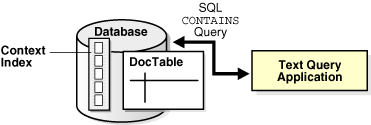
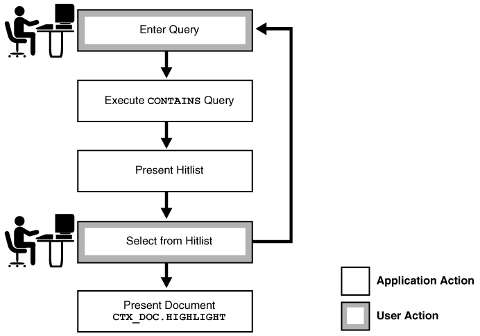
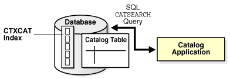
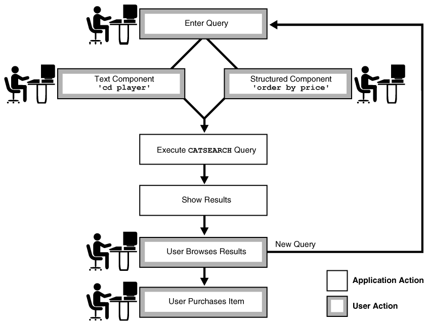
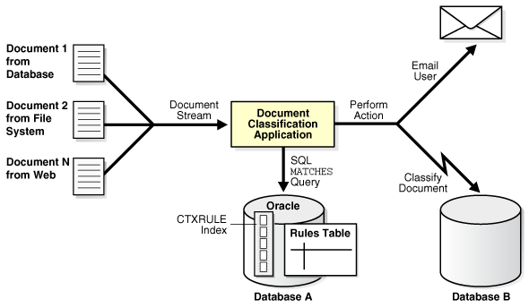

Oracle Text enables you to build text query applications and document classification applications.

This chapter contains the following topics:

- Introduction to Oracle Text

- Document Collection Applications

- Catalog Information Applications

- Document Classification Applications

- XML Search Applications

### 1.1 Introduction to Oracle Text

Oracle Text provides indexing, word and theme searching, and viewing capabilities for text in query applications and document classification applications.

To design an Oracle Text application, first determine the type of queries that you expect to run. When you know the types, you can choose the most suitable index for the task.

Oracle Text is used for the following categories of applications:

- Document Collection Applications

- Catalog Information Applications

- Document Classification Applications

- XML Search Applications

### 1.2 Document Collection Applications

A text query application enables users to search document collections, such as websites, digital libraries, or document warehouses.

This section contains the following topics.

- About Document Collection Applications

- Flowchart of Text Query Application

#### 1.2.1 About Document Collection Applications

The collection is typically static and has no significant change in content after the initial indexing run. Documents can be any size and format, such as HTML, PDF, or Microsoft Word. These documents are stored in a document table. Searching is enabled by first indexing the document collection.

Queries usually consist of words or phrases. Application users specify logical combinations of words and phrases by using operators such as `OR` and `AND.` Users can apply other query operations to improve the search results, such as stemming, proximity searching, and wildcarding.

For this type of application, you should retrieve documents that are most relevant to a query. The documents must rank high in the result list.

The queries are best served with a `CONTEXT` index on your document table. To query this index, the application uses the `SQL` `CONTAINS` operator in the `WHERE` clause of a `SELECT` statement.

Figure 1-1 Overview of Text Query Application

[Description of "Figure 1-1 Overview of Text Query Application"](img_text/ccapp014.md)

#### 1.2.2 Flowchart of Text Query Application

A typical text query application on a document collection lets the user enter a query. The application enters a `CONTAINS` query and returns a list, called a hitlist, of documents that satisfy the query. The results are usually ranked by relevance. The application enables the user to view one or more documents in the hitlist.

For example, an application might index URLs (HTML files) on the web and provide query capabilities across the set of indexed URLs. Hitlists returned by the query application are composed of URLs that the user can visit.

Figure 1-2 illustrates the flowchart of user interaction with a simple text query application:

1.  The user enters a query.

2.  The application runs a `CONTAINS` query.

3.  The application presents a hitlist.

4.  The user selects document from the hitlist.

5.  The application presents a document to the user for viewing.

Figure 1-2 Flowchart of a Text Query Application

[Description of "Figure 1-2 Flowchart of a Text Query Application"](img_text/ccapp_pb_015a.md)

### 1.3 Catalog Information Applications

Catalog information consists of inventory type information, such as for an online book store or auction site.

This section contains the following topics.

- About Catalog Information Applications

- Flowchart for Catalog Query Application

#### 1.3.1 About Catalog Information Applications

The stored catalog information consists of text information, such as book titles, and related structured information, such as price. The information is usually updated regularly to keep the online catalog up-to-date with the inventory.

Queries are usually a combination of a text component and a structured component. Results are almost always sorted by a structured component, such as date or price. Good response time is always an important factor with this type of query application.

Catalog applications are best served by a `CTXCAT` index. Query this index with the `CATSEARCH` operator in the `WHERE` clause of a `SELECT` statement.

Figure 1-3 illustrates the relationship of the catalog table, its `CTXCAT` index, and the catalog application that uses the `CATSEARCH` operator to query the index.

Figure 1-3 A Catalog Query Application

[Description of "Figure 1-3 A Catalog Query Application"](img_text/ccapp_pb_017a.md)

#### 1.3.2 Flowchart for Catalog Query Application

A catalog application enables users to search for specific items in catalogs. For example, an online store application enables users to search for and purchase items in inventory. Typically, the user query consists of a text component that searches across the textual descriptions plus some other ordering criteria, such as price or date.

Figure 1-4 illustrates the flowchart of a catalog query application for an online electronics store.

1.  The user enters the query, consisting of a text component (for example, cd player) and a structured component (for example, order by price).

2.  The application executes the `CATSEARCH` query.

3.  The application shows the results ordered accordingly.

4.  The user browses the results.

5.  The user enters another query or performs an action, such as purchasing the item.

Figure 1-4 Flowchart of a Catalog Query Application

[Description of "Figure 1-4 Flowchart of a Catalog Query Application"](img_text/ccapp_pb_016a.md)

### 1.4 Document Classification Applications

In a document classification application, an incoming stream or a set of documents is compared to a predefined set of rules. If a document matches one or more rules, then the application performs an action.

For example, assume an incoming stream of news articles. You define a rule to represent the Finance category. The rule is essentially one or more queries that select documents about the subject of Finance. The rule might have the form of 'stocks or bonds or earnings.'

When a document arrives at a Wall Street earnings forecast and satisfies the rules for this category, the application takes an action, such as tagging the document as Finance or emailing one or more users.

To create a document classification application, create a table of rules and then create a `CTXRULE` index. To classify an incoming stream of text, use the `MATCHES` operator in the `WHERE` clause of a `SELECT` statement. See Figure 1-5 for the general flow of a classification application.

Figure 1-5 Overview of a Document Classification Application

[Description of "Figure 1-5 Overview of a Document Classification Application"](img_text/ccapp_pb_018a.md)

### 1.5 XML Search Applications

An XML search application performs searches over XML documents. A regular document search usually searches across a set of documents to return documents that satisfy a text predicate; an XML search often uses the structure of the XML document to restrict the search. Typically, only the document part that satisfies the search is returned. For example, instead of finding all purchase orders that contain the word electric, the user might need only purchase orders in which the comment field contains electric.

Oracle Text enables you to perform XML searching by using the following approaches:

- The CONTAINS Operator with XML Search Applications

- Combining Oracle Text Features with Oracle XML DB (XML Search Index)

**See Also:**

[Using XML Query Result Set Interface](using-XML-query-result-set-interface.md)

#### 1.5.1 The CONTAINS Operator with XML Search Applications

The `CONTAINS` operator is well suited to structured searching, enabling you to perform restrictive searches with the `WITHIN`, `HASPATH`, and `INPATH` operators. If you use a `CONTEXT` index, then you can also benefit from the following characteristics of Oracle Text searches:

- Token-based, whitespace-normalized searches

- Hitlists ranked by relevance

- Case-sensitive searching

- Section searching

- Linguistic features such as stemming and fuzzy searching

- Performance-optimized queries for large document sets

**WARNING:**

If you manually uninstall Oracle Text, then drop the `DBMS_XDBT` package. If you manually install Oracle Text, then create the `DBMS_XDBT` package.

Starting with Oracle Database 12c, Oracle XML Database (XML DB) is automatically installed when you install the new Oracle Database software or when you upgrade.

**See Also:**

"[XML Section Searching with Oracle Text](searching-document-sections-in-oracle-text.md)"

#### 1.5.2 Combining Oracle Text Features with Oracle XML DB (XML Search Index)

When you want a full-text retrieval for applications, combine the features of Oracle Text and Oracle XML DB to create an XML Search Index. In this case, leverage the XML structure by entering queries such as "find all nodes that contain the word Pentium." Oracle Database 12c extends Oracle's support for the W3C XQuery specification by adding support for the XQuery full-text extension. This support lets you perform XML-aware, full-text searches on XML content that is stored in the database.

The following topics explain how to use Oracle XML DB with Oracle Text applications:

- Using the xml_enable Method for an XML Search Index

- Using the Text-on-XML Method

- Indexing JSON Data

**See Also:**

- "[XML Section Searching with Oracle Text](searching-document-sections-in-oracle-text.md)"

- [Oracle Text Reference](../ccref/CTX_DDL-package.md) for information about the `xml_enable` variable of `SET_SEC_GRP_ATTR` to enable XML awareness

- [Oracle XML DB Developer's Guide](../adxdb/index.md) for more information about XML full-text indexing and XML Search Index

##### 1.5.2.1 Using the xml_enable Method for an XML Search Index

An XML Search Index is an XML-enabled Oracle Text index (CTXSYS.CONTEXT). This index type supports information-retrieval searching and structured searching in one unified index. XML Search Index also stores a Binary Persistent Document Object Model (PDOM) internally within an Oracle Text table, so that XML operations can be functionally evaluated over the Binary PDOM. This XML Search Index is supported for XMLTYPE datastores. XMLEXISTS is seamlessly rewritten to a `CONTAINS` query in the presence of such an XML Search Index.

When you create an XML Search Index, a Binary PDOM of the XML document is materialized in an internal table of Oracle Text. Post evaluation from the Oracle Text index is redirected to go against the PDOM stored in this internal table.

**See Also:**

[Oracle Text Reference](../ccref/CTX_DDL-package.md) for information on `xml_enable` variable of `SET_SEC_GRP_ATTR` to enable XML awareness for XML Search Index

The following example creates an Oracle XML Search Index:

    exec
    CTX_DDL.CREATE_SECTION_GROUP('secgroup','PATH_SECTION_GROUP');
    exec
    CTX_DDL.SET_SEC_GRP_ATTR('secgroup','xml_enable','t');
    CREATE INDEX po_ctx_idx on T(X) indextype is ctxsys.context
    parameters (‘section group SECGROUP');

##### 1.5.2.2 Using the Text-on-XML Method

With Oracle Text, you can create a `CONTEXT` index on a column that contains XML data. The column type can be `XMLType` or any supported type, provided that you use the correct index preference for XML data.

With the Text-on-XML method, use the standard `CONTAINS` query and add a structured constraint to limit the scope of a search to a particular section, field, tag, or attribute. That is, specify the structure inside text operators, such as `WITHIN`, `HASPATH`, and `INPATH.`

For example, set up your `CONTEXT` index to create sections with XML documents. Consider the following XML document that defines a purchase order:

    <?xml version="1.0"?>
    <PURCHASEORDER pono="1">
       <PNAME>Po_1</PNAME>
       <CUSTNAME>John</CUSTNAME>
       <SHIPADDR>
          <STREET>1033 Main Street</STREET>
          <CITY>Sunnyvalue</CITY>
          <STATE>CA</STATE>
       </SHIPADDR>
       <ITEMS>
         <ITEM>
           <ITEM_NAME> Dell Computer </ITEM_NAME>
           <DESC> Pentium 2.0 Ghz 500MB RAM  </DESC>
         </ITEM>
         <ITEM>
           <ITEM_NAME> Norelco R100 </ITEM_NAME>
           <DESC>Electric Razor </DESC>
         </ITEM>
       </ITEMS>
    </PURCHASEORDER>

To query all purchase orders that contain Pentium within the item description section, use the `WITHIN` operator:

    SELECT id from po_tab where CONTAINS( doc, 'Pentium WITHIN desc') > 0;

Use the `INPATH` operator to specify more complex criteria with `XPATH` expressions:

    SELECT id from po_tab where  CONTAINS(doc, 'Pentium INPATH (/purchaseOrder/items/item/desc') > 0;

##### 1.5.2.3 Indexing JSON Data

JavaScript Object Notation (JSON) is a language-independent data format that is used for serializing structured data and exchanging this data over a network, typically between a server and web applications. JSON provides a text-based way of representing JavaScript object literals, arrays, and scalar data.

**See Also:**

- [Oracle Text Reference](../ccref/oracle-text-SQL-statements-and-operators.md) for information about creating a search index on JSON

- [Oracle Database JSON Developer's Guide](../adjsn/json-in-oracle-database.md) for more information about JSON
