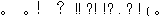
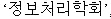
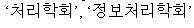
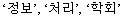

## 2  Oracle Text Indexing Elements

Oracle provides indexing types for storage, filtering, and lexers, and preferences and stoplists that you can use to create an Oracle Text index.

The chapter includes the following topics:

- Overview

- Creating Preferences

- Datastore Types

- Filter Types

- Lexer Types

- Wordlist Type

- Storage Types

- Section Group Types

- Classifier Types

- Cluster Types

- Stoplists

- System-Defined Preferences

- System Parameters

- Token Limitations for Oracle Text Indexes

### 2.1 Overview

When you use the [CREATE INDEX](oracle-text-SQL-statements-and-operators.md) statement to create an index or the [ALTER INDEX](oracle-text-SQL-statements-and-operators.md) statement to manage an index, you can optionally specify indexing preferences, stoplists, and section groups in the parameter string. Specifying a preference, stoplist, or section group answers one of the following questions about the way Oracle Text indexes text:

| Preference Class | Answers the Question                                                            |
|:-----------------|:--------------------------------------------------------------------------------|
| Datastore        | How are your documents stored?                                                  |
| Filter           | How can the documents be converted to plain text?                               |
| Lexer            | What language is being indexed?                                                 |
| Wordlist         | How should stem and fuzzy queries be expanded?                                  |
| Storage          | How should the index tables be stored?                                          |
| Stop List        | What words or themes are not to be indexed?                                     |
| Section Group    | Is querying within sections enabled, and how are the document sections defined? |

This chapter describes how to set each preference. Enable an option by creating a preference with one of the types described in this chapter.

For example, to specify that your documents are stored in external files, you can create a datastore preference called `mydatastore` using the FILE_DATASTORE type. Specify `mydatastore` as the datastore preference in the parameter clause of the `CREATE` `INDEX` statement.

### 2.2 Creating Preferences

To create a datastore, lexer, filter, classifier, wordlist, or storage preference, use the CTX_DDL.[CREATE_PREFERENCE](CTX_DDL-package.md) procedure and specify one of the types described in this chapter. For some types, you can also set attributes with the CTX_DDL.[SET_ATTRIBUTE](CTX_DDL-package.md) procedure.

An indexing type names a class of indexing objects that you can use to create an index preference. A type, therefore, is an abstract ID, while a preference is an entity that corresponds to a type. Many system-defined preferences have the same name as types (for example, `BASIC_LEXER`), but exact correspondence is not guaranteed. Be careful in assuming the existence or nature of either indexing types or system preferences.

You specify indexing preferences with the `CREATE` `INDEX` and `ALTER` `INDEX` statements. Indexing preferences determine how your index is created. For example, lexer preferences indicate the language of the text to be indexed. You can create and specify your own user-defined preferences, or you can use system-defined preferences.

To create a stoplist, use the CTX_DDL.[CREATE_STOPLIST](CTX_DDL-package.md) procedure. Add stopwords to a stoplist with `CTX_DDL.ADD_STOPWORD`.

To create section groups, use CTX_DDL.[CREATE_SECTION_GROUP](CTX_DDL-package.md) and specify a section group type. Add sections to section groups with the `CTX_DDL.ADD_ZONE_SECTION` or `CTX_DDL.ADD_FIELD_SECTION` procedures.

### 2.3 Datastore Types

Use the datastore types to create a datastore preference. This helps you specify how your text is stored.

Table 2-1 Datastore Types

| Datastore Type         | Use When                                                                                                                                                                                                                                                                           |
|:-----------------------|:-----------------------------------------------------------------------------------------------------------------------------------------------------------------------------------------------------------------------------------------------------------------------------------|
| DIRECT_DATASTORE       | Data is stored internally in the text column. Each row is indexed as a single document.                                                                                                                                                                                            |
| MULTI_COLUMN_DATASTORE | Data is stored in a text table in more than one column. Columns are concatenated to create a virtual document, one for each row.                                                                                                                                                   |
| DETAIL_DATASTORE       | Data is stored internally in the text column. Document consists of one or more rows stored in a text column in a detail table, with header information stored in the primary table.                                                                                                |
| FILE_DATASTORE         | Data is stored externally in operating system files. File names are stored in the text column, one for each row. **Note:** Starting with Oracle Database 19c, the Oracle Text type `FILE_DATASTORE` is deprecated. Use `DIRECTORY_DATASTORE` instead.                        |
| DIRECTORY_DATASTORE    | Data is stored in Oracle directory objects. File names are stored in the text column, one for each row.                                                                                                                                                                            |
| NESTED_DATASTORE       | Data is stored in a nested table.                                                                                                                                                                                                                                                  |
| URL_DATASTORE          | Data is stored externally in files located on an intranet or the Internet. Uniform Resource Locators (URLs) are stored in the text column. **Note:** Starting with Oracle Database 19c, the Oracle Text type `URL_DATASTORE` is deprecated. Use `NETWORK_DATASTORE` instead. |
| NETWORK_DATASTORE      | Data is stored externally in files located on an intranet or the Internet. Uniform Resource Locators (URLs) are stored in the text column.                                                                                                                                         |
| USER_DATASTORE         | Documents are synthesized at index time by a user-defined stored procedure.                                                                                                                                                                                                        |

#### 2.3.1 DIRECT_DATASTORE

Use the `DIRECT_DATASTORE` type for text stored directly in the text column, one document for each row. The `DIRECT_DATASTORE` type has no attributes.

The following column types are supported: `CHAR`, `VARCHAR`, `VARCHAR2`, `BLOB`, `CLOB`, `BFILE`, `XMLType`, and `URIType`.

**Note:**

If your column is a `BFILE`, then the index owner must have read permission on all directories used by the `BFILEs`.

The following example creates a table with a `CLOB` column to store text data. It then populates two rows with text data and indexes the table using the system-defined preference `CTXSYS.DEFAULT_DATASTORE`.

    create table mytable(id number primary key, docs clob);

    insert into mytable values(111555,'this text will be indexed');
    insert into mytable values(111556,'this is a direct_datastore example');
    commit;

    create index myindex on mytable(docs)
      indextype is ctxsys.context
      parameters ('DATASTORE CTXSYS.DEFAULT_DATASTORE');

#### 2.3.2 MULTI_COLUMN_DATASTORE

Use the `MULTI_COLUMN_DATASTORE` datastore when your text is stored in more than one column. During indexing, the system concatenates the text columns, tags the column text, and indexes the text as a single document. The XML-like tagging is optional. You can also set the system to filter and concatenate binary columns.

- MULTI_COLUMN_DATASTORE Attributes

- Indexing and DML

- MULTI_COLUMN_DATASTORE Restriction

- MULTI_COLUMN_DATASTORE Example

- MULTI_COLUMN_DATASTORE Filter Example

- Tagging Behavior

- Indexing Columns as Sections

##### 2.3.2.1 MULTI_COLUMN_DATASTORE Attributes

The data store `MULTI_COLUMN_DATASTORE` has the attributes shown in Table 2-2.

Table 2-2 MULTI_COLUMN_DATASTORE Attributes

| Attribute | Attribute Value                                                                                                                                                                                                                                                                                                                                                                                                                                                                                                                                                                                                                                                                                                  |
|:----------|:-----------------------------------------------------------------------------------------------------------------------------------------------------------------------------------------------------------------------------------------------------------------------------------------------------------------------------------------------------------------------------------------------------------------------------------------------------------------------------------------------------------------------------------------------------------------------------------------------------------------------------------------------------------------------------------------------------------------|
| columns   | Specify a comma-delimited list of columns to be concatenated during indexing. You can also specify any allowed expression for the `SELECT` statement column list for the base table. This includes expressions, PL/SQL functions, column aliases, and so on. The `NUMBER` and `DATE` column types are supported. They are converted to text before indexing using the default format mask. The `TO_CHAR` function can be used in the column list for formatting. The `RAW` and `BLOB` columns are directly concatenated as binary data. The `LONG`, `LONG` `RAW`, `NCHAR`, and `NCLOB` data types, nested table columns, and collections are not supported. The column list is limited to 500 bytes. |
| filter    | Specify a comma-delimited list of Y/N flags. Each flag corresponds to a column in the `COLUMNS` list and denotes whether to filter the column using the `AUTO_FILTER`. Specify one of the following allowed values: Y: Column is to be filtered with `AUTO_FILTER` N or no value: Column is not to be filtered (default)                                                                                                                                                                                                                                                                                                                                                                                |
| delimiter | Specify the delimiter that separates column text as follows: `COLUMN_NAME_TAG`: Column text is set off by XML-like open and close tags (default). `NEWLINE`: Column text is separated with a newline.                                                                                                                                                                                                                                                                                                                                                                                                                                                                                                      |

##### 2.3.2.2 Indexing and DML

To index, you must create a dummy column to specify in the `CREATE` `INDEX` statement. This column's contents are not made part of the virtual document, unless its name is specified in the columns attribute.

The index is synchronized only when the dummy column is updated. You can create triggers to propagate changes if needed.

##### 2.3.2.3 MULTI_COLUMN_DATASTORE Restriction

You cannot create a multicolumn datastore with `XMLType` columns. `MULTI_COLUMN_DATA_STORE` does not support `XMLType`. You can create a `CONTEXT` index with an `XMLType` column, as described in [Oracle Text SQL Statements and Operators](oracle-text-SQL-statements-and-operators.md) .

##### 2.3.2.4 MULTI_COLUMN_DATASTORE Example

The following example creates a multicolumn datastore preference called `my_multi` with three text columns:

    begin

    ctx_ddl.create_preference('my_multi', 'MULTI_COLUMN_DATASTORE');
    ctx_ddl.set_attribute('my_multi', 'columns', 'column1, column2, column3');

    end;

##### 2.3.2.5 MULTI_COLUMN_DATASTORE Filter Example

The following example creates a multicolumn datastore preference and denotes that the `bar` column is to be filtered with the `AUTO_FILTER`.

    ctx_ddl.create_preference('MY_MULTI','MULTI_COLUMN_DATASTORE');
    ctx_ddl.set_attribute('MY_MULTI', 'COLUMNS','foo,bar');
    ctx_ddl.set_attribute('MY_MULTI','FILTER','N,Y');

The multicolumn datastore fetches the content of the `foo` and `bar` columns, filters `bar`, then composes the compound document as:

    <FOO>
    foo contents
    </FOO>
    <BAR>
    bar filtered contents (probably originally HTML)
    </BAR>

The N flags do not need not be specified, and there does not need to be a flag for every column. Only the Y flags must be specified, with commas to denote which column they apply to. For example:

    ctx_ddl.create_preference('MY_MULTI','MULTI_COLUMN_DATASTORE');
    ctx_ddl.set_attribute('MY_MULTI', 'COLUMNS','foo,bar,zoo,jar');
    ctx_ddl.set_attribute('MY_MULTI','FILTER',',,Y');

This example filters only the column `zoo`.

##### 2.3.2.6 Tagging Behavior

During indexing, the system creates a virtual document for each row. The virtual document is composed of the contents of the columns concatenated in the listing order with column name tags automatically added.

For example:

    create table mc(id number primary key, name varchar2(10), address varchar2(80));
    insert into mc values(1, 'John Smith', '123 Main Street');

    exec ctx_ddl.create_preference('mymds', 'MULTI_COLUMN_DATASTORE');
    exec ctx_ddl.set_attibute('mymds', 'columns', 'name, address');

This produces the following virtual text for indexing:

    <NAME>
    John Smith
    </NAME>
    <ADDRESS>
    123 Main Street
    </ADDRESS>

##### 2.3.2.7 Indexing Columns as Sections

To index tags as sections, you can optionally create field sections with `BASIC_SECTION_GROUP`.

**Note:**

No section group is created when you use the `MULTI_COLUMN_DATASTORE`. To create sections for these tags, you must create a section group.

When you use expressions or functions, the tag is composed of the first 30 characters of the expression unless a column alias is used.

For example, if your expression is as follows:

    exec ctx_ddl.set_attibute('mymds', 'columns', '4 + 17');

then it produces the following virtual text:

    <4 + 17>
    21
    </4 + 17>

If your expression is as follows:

    exec ctx_ddl.set_attibute('mymds', 'columns', '4 + 17 col1');

then it produces the following virtual text:

    <col1>
    21
    <col1>

The tags are in uppercase unless the column name or column alias is in lowercase and surrounded by double quotation marks. For example:

    exec ctx_ddl.set_attibute('mymds', 'COLUMNS', 'foo');

This produces the following virtual text:

    <FOO>
    content of foo
    </FOO>

For lowercase tags, use the following:

    exec ctx_ddl.set_attibute('mymds', 'COLUMNS', 'foo "foo"');

This expression produces:

    <foo>
    content of foo
    </foo>

#### 2.3.3 DETAIL_DATASTORE

Use the `DETAIL_DATASTORE` type for text stored directly in the database in detail tables, with the indexed text column located in the primary table.

- DETAIL_DATASTORE Attributes

- Synchronizing Primary/Detail Indexes

- Example Primary/Detail Tables

##### 2.3.3.1 DETAIL_DATASTORE Attributes

The `DETAIL_DATASTORE` type has the attributes described in Table 2-3.

Table 2-3 DETAIL_DATASTORE Attributes

| Attribute     | Attribute Value                                                                                                                                                                           |
|:--------------|:------------------------------------------------------------------------------------------------------------------------------------------------------------------------------------------|
| binary        | Specify `TRUE` for Oracle Text to add no newline character after each detail row. Specify `FALSE` for Oracle Text to add a newline character (\n) after each detail row automatically. |
| detail_table  | Specify the name of the detail table (`OWNER.TABLE` if necessary).                                                                                                                        |
| detail_key    | Specify the name of the detail table foreign key column.                                                                                                                                  |
| detail_lineno | Specify the name of the detail table sequence column.                                                                                                                                     |
| detail_text   | Specify the name of the detail table text column.                                                                                                                                         |

##### 2.3.3.2 Synchronizing Primary/Detail Indexes

Changes to the detail table do not trigger re-indexing when you synchronize the index. Only changes to the indexed column in the primary table triggers a re-index when you synchronize the index.

You can create triggers on the detail table to propagate changes to the indexed column in the primary table row.

##### 2.3.3.3 Example Primary/Detail Tables

This example illustrates how primary and detail tables are related to each other.

- Primary Table Example

- Detail Table Example

- Detail Table Example Attributes

- Primary/Detail Index Example

###### 2.3.3.3.1 Primary Table Example

Primary tables define the documents in a primary/detail relationship. Assign an identifying number to each document. The following table is an example primary table, called `my_primary`:

| Column Name  | Column Type    | Description                                         |
|:-------------|:---------------|:----------------------------------------------------|
| `article_id` | `NUMBER`       | Document ID, unique for each document (primary key) |
| `author`     | `VARCHAR2(30)` | Author of document                                  |
| `title`      | `VARCHAR2(50)` | Title of document                                   |
| `body`       | `CHAR(1)`      | Dummy column to specify in `CREATE` `INDEX`         |

**Note:**

Your primary table must include a primary key column when you use the `DETAIL_DATASTORE` type.

###### 2.3.3.3.2 Detail Table Example

Detail tables contain the text for a document, whose content is usually stored across a number of rows.

The following detail table `my_detail` is related to the primary table `my_primary` with the `article_id` column. This column identifies the primary document to which each detail row (sub-document) belongs.

| Column Name  | Column Type | Description                                                          |
|:-------------|:------------|:---------------------------------------------------------------------|
| `article_id` | `NUMBER`    | Document ID that relates to primary table                            |
| `seq`        | `NUMBER`    | Sequence of document in the primary document defined by `article_id` |
| `text`       | `VARCHAR2`  | Document text                                                        |

###### 2.3.3.3.3 Detail Table Example Attributes

In this example, the `DETAIL_DATASTORE` attributes have the following values:

| Attribute       | Attribute Value |
|:----------------|:----------------|
| `binary`        | `TRUE`          |
| `detail_table`  | `my_detail`     |
| `detail_key`    | `article_id`    |
| `detail_lineno` | `seq`           |
| `detail_text`   | `text`          |

Use CTX_DDL.[CREATE_PREFERENCE](CTX_DDL-package.md) to create a preference with `DETAIL_DATASTORE`. Use CTX_DDL.[SET_ATTRIBUTE](CTX_DDL-package.md) to set the attributes for this preference as described earlier. The following example shows how this is done:

    begin

    ctx_ddl.create_preference('my_detail_pref', 'DETAIL_DATASTORE');
    ctx_ddl.set_attribute('my_detail_pref', 'binary', 'true');
    ctx_ddl.set_attribute('my_detail_pref', 'detail_table', 'my_detail');
    ctx_ddl.set_attribute('my_detail_pref', 'detail_key', 'article_id');
    ctx_ddl.set_attribute('my_detail_pref', 'detail_lineno', 'seq');
    ctx_ddl.set_attribute('my_detail_pref', 'detail_text', 'text');

    end;

###### 2.3.3.3.4 Primary/Detail Index Example

To index the document defined in this primary/detail relationship, specify a column in the primary table using the `CREATE INDEX` statement.

The column you specify must be one of the allowed types.

This example uses the `body` column, whose function is to enable the creation of the primary/detail index and to improve readability of the code. The `my_detail_pref` preference is set to `DETAIL_DATASTORE` with the required attributes:

    CREATE INDEX myindex on my_primary(body) indextype is ctxsys.context
    parameters('datastore my_detail_pref');

In this example, you can also specify the `title` or `author` column to create the index. However, if you do so, changes to these columns will trigger a re-index operation.

#### 2.3.4 FILE_DATASTORE

The `FILE_DATASTORE` type is used for text stored in files accessed through the local file system.

**Note:**

Starting with Oracle Database 19c, the Oracle Text type `FILE_DATASTORE` is deprecated. Use `DIRECTORY_DATASTORE` instead.

Oracle recommends that you replace `FILE_DATASTORE` text indexes with the `DIRECTORY_DATASTORE` index type, which is available starting with Oracle Database 19c. `DIRECTORY_DATASTORE` provides greater security because it enables file access to be based on directory objects.

**Note:**

- The `FILE_DATASTORE` type may not work with certain types of remote-mounted file systems.

- The character set of the file datastore is assumed to be the character set of the database.

<!-- -->

- FILE_DATASTORE Attributes

- FILE_DATASTORE and Security

- FILE_DATASTORE Example

##### 2.3.4.1 FILE_DATASTORE Attributes

The `FILE_DATASTORE` type has the attributes described Table 2-4.

Table 2-4 FILE_DATASTORE Attributes

| Attribute          | Attribute Value   |
|:-------------------|:------------------|
| `path`             | path1:path2:pathn |
| `filename_charset` | name              |

path
Specifies the full directory path name of the files stored externally in a file system. When you specify the full directory path as such, you need to include only file names in your text column.

You can specify multiple paths for the `path` attribute, with each path separated by a colon (:) on UNIX and semicolon(;) on Windows. File names are stored in the text column in the text table.

If you do not specify a path for external files with this attribute, then Oracle Text requires that the path be included in the file names stored in the text column.

The `PATH` attribute has the following limitations:

- If you specify a `PATH` attribute, then you can only use a simple file name in the indexed column. You cannot combine the `PATH` attribute with a path as part of the file name. If the files exist in multiple folders or directories, you must leave the `PATH` attribute unset, and include the full file name, with `PATH`, in the indexed column.

- On Windows systems, the files must be located on a local drive. They cannot be on a remote drive, whether the remote drive is mapped to a local drive letter.

filename_charset
Specifies a valid Oracle character set name (maximum length 30 characters) to be used by the file datastore for converting file names. In general, the Oracle database can use a different character set than the operating system. This can lead to problems in finding files (which may raise DRG-11513 errors) when the indexed column contains characters that are not convertible to the operating system character set. By default, the file datastore will convert the file name to WE8ISO8859p1 for ASCII platforms or WE8EBCDIC1047 for EBCDIC platforms.

However, this may not be sufficient for applications with multibyte character sets for both the database and the operating system, because neither WE8ISO8859p1 nor WE8EBCDIC1047 supports multibyte characters. The attribute `filename_charset` rectifies this problem. If specified, then the datastore will convert from the database character set to the specified character set rather than to ISO8859 or EBCDIC.

If the `filename_charset` attribute is the same as the database character set, then the file name is used as is. If `filename_charset` is not a valid character set, then the error "DRG-10763: value %s is not a valid character set" is raised.

##### 2.3.4.2 FILE_DATASTORE and Security

File and URL datastores enable access to files on the actual database disk. This may be undesirable when security is an issue since any user can browse the file system that is accessible to the Oracle user. Any user attempting to create an index using `FILE` or `URL` datastores must have the `TEXT DATASTORE ACCESS` system privilege granted to the user directly, or the index creation will fail. Granting the user `TEXT DATASTORE ACCESS` privilege indirectly by granting it to the user’s role does not work and the index creation will still fail. Thus, by default, users are not able to create indexes that use the `FILE` or `URL` datastores. Granting `TEXT DATASTORE ACCESS` to `PUBLIC` gives any user the privilege to index either an arbitrary file in the file system in the case of `FILE` datastore and an arbitrary URL in the case of `URL` datastore and is not recommended.

For example, the following statement grants `TEXT DATASTORE ACCESS` to the user SCOTT:

    grant TEXT DATASTORE ACCESS to SCOTT;

The CREATE INDEX operation will fail when a user that does not have `TEXT DATASTORE ACCESS` privilege tries to create an index on a `FILE` or `URL` datastore. For example:

    CREATE INDEX myindex ON mydocument(TEXT) INDEXTYPE IS ctxsys.context
    PARAMETERS('DATASTORE ctxsys.file_datastore')

In this case, if the user does not have the `TEXT DATASTORE ACCESS` privilege granted directly to it, then index creation will fail and returns an error. For users who have the `TEXT DATASTORE ACCESS` privilege, the index creation will proceed normally.

The user’s privilege is checked any time the datastore is accessed. This includes index creation, index sync, and calls to document services, such as `CTX_DOC.HIGHLIGHT`.

##### 2.3.4.3 FILE_DATASTORE Example

This example creates a file datastore preference called `COMMON_DIR` that has a path of `/mydocs`:

    begin
     ctx_ddl.create_preference('COMMON_DIR','FILE_DATASTORE');
     ctx_ddl.set_attribute('COMMON_DIR','PATH','/mydocs');
    end;

When you populate the table `mytable`, you need only insert file names. The `path` attribute tells the system where to look during the indexing operation.

    create table mytable(id number primary key, docs varchar2(2000));
    insert into mytable values(111555,'first.txt');
    insert into mytable values(111556,'second.txt');
    commit;

Create the index as follows:

    create index myindex on mytable(docs)
      indextype is ctxsys.context
      parameters ('datastore COMMON_DIR');

#### 2.3.5 DIRECTORY_DATASTORE

Use the `DIRECTORY_DATASTORE` type during indexing to access the text stored in files which can be accessed through Oracle directory objects.

Starting with Oracle Database 19c, the Oracle Text type `FILE_DATASTORE` is deprecated. Use `DIRECTORY_DATASTORE` instead.

Oracle recommends that you replace `FILE_DATASTORE` text indexes with the `DIRECTORY_DATASTORE` index type, which is available starting with Oracle Database 19c. `DIRECTORY_DATASTORE` provides greater security because it enables file access to be based on directory objects.

A directory object specifies an alias for a directory on the server file system where external binary file LOBs (`BFILE`s) and external table data are located. When you use `DIRECTORY_DATASTORE` type, another PDB user can not access directory objects in your PDB without read access to the directory objects.

Use the `DIRECTORY_DATASTORE` type to use an Oracle directory object as an attribute for the `CTX_DDL.SET_ATTRIBUTE` procedure. You must have read access to the Oracle directory object to access the files stored within the directory. If you have access, then during index creation, you can use the path stored in the Oracle directory object to access the files stored in the file system.

- DIRECTORY_DATASTORE Attributes
- DIRECTORY_DATASTORE Example

**Note:**

- To create an Oracle directory object, you must have the `CREATE ANY DIRECTORY` privilege. Typically, a system administrator user creates the directory and provides read access to the directory for an Oracle Text user.

- `DIRECTORY_DATASTORE` can be used with a context index on `CHAR` datatype column only if the file name fills the column.

##### 2.3.5.1 DIRECTORY_DATASTORE Attributes

`DIRECTORY_DATASTORE` has the following attributes:

Table 2-5 DIRECTORY_DATASTORE Attributes

| Attribute          | Attribute Values                                                                                                                                                                                                                                                                                                                                                                                                                                                                                                                                                                                                                                                                                                                                                                                                                                                                                                                                                                                                                                                                                                                                                                                                                                               |
|:-------------------|:---------------------------------------------------------------------------------------------------------------------------------------------------------------------------------------------------------------------------------------------------------------------------------------------------------------------------------------------------------------------------------------------------------------------------------------------------------------------------------------------------------------------------------------------------------------------------------------------------------------------------------------------------------------------------------------------------------------------------------------------------------------------------------------------------------------------------------------------------------------------------------------------------------------------------------------------------------------------------------------------------------------------------------------------------------------------------------------------------------------------------------------------------------------------------------------------------------------------------------------------------------------|
| `directory`        | Specify the name of the directory object where the data to be indexed is stored. The default is `NULL.` If you have access to the Oracle directory object, then you can also access the files in its sub-directories.                                                                                                                                                                                                                                                                                                                                                                                                                                                                                                                                                                                                                                                                                                                                                                                                                                                                                                                                                                                                                                       |
| `filename_charset` | Specify a valid Oracle character set name (maximum length 30 characters) to be used by the directory datastore for converting file names. In general, the Oracle database can use a different character set than the operating system. This can lead to problems in finding files (which may raise DRG-11513 errors) when the indexed column contains characters that are not convertible to the operating system character set. By default, the directory datastore will convert the file name to WE8ISO8859p1 for ASCII platforms or WE8EBCDIC1047 for EBCDIC platforms. However, this may not be sufficient for applications with multibyte character sets for both the database and the operating system, because neither WE8ISO8859p1 nor WE8EBCDIC1047 supports multibyte characters. The attribute `filename_charset` rectifies this problem. If specified, then the datastore will convert from the database character set to the specified character set rather than to ISO8859 or EBCDIC. If the `filename_charset` attribute is the same as the database character set, then the file name is used as is. If `filename_charset` is not a valid character set, then the error "DRG-10763: value %s is not a valid character set" is raised. |

##### 2.3.5.2 DIRECTORY_DATASTORE Example

This example shows you how to create an index with `DIRECTORY_DATASTORE` type by securely accessing files under an Oracle directory object.

Create an Oracle directory object to store the path of the files. You must have the `CREATE ANY DIRECTORY` privilege to create an Oracle directory object.

    create directory myhome as 'directory_path';

Create a directory datastore preference called `MYDS` and set the directory attribute with `myhome,` which is the Oracle directory object:

    exec ctx_ddl.create_preference('MYDS','DIRECTORY_DATASTORE')
    exec ctx_ddl.set_attribute('MYDS','DIRECTORY','myhome')

Create a table named `mytable` and populate it with file names only. The `directory` attribute tells the system where to look during the indexing operation.

    create table mytable(id number primary key, docs varchar2(2000));
    insert into mytable values(111555,'first.txt');
    insert into mytable values(111556,'second.txt');

Create the index as follows:

    create index myindex on mytable(docs)
      indextype is ctxsys.context
      parameters ('datastore MYDS');

#### 2.3.6 URL_DATASTORE

Use the `URL_DATASTORE` type for text stored in files on the World Wide Web (accessed through HTTP or FTP) and local file system (accessed through the file protocol).

Store each URL in a single text field.

**Note:**

Starting with Oracle Database 19c, the Oracle Text type `URL_DATASTORE` is deprecated. Use `NETWORK_DATASTORE` instead.

The `URL_DATASTORE` type is used for text stored in files on the internet (accessed through HTTP or FTP), and for text stored in local file system files (accessed through the file protocol). It is replaced with `NETWORK_DATASTORE`, which uses ACLs to allow access to specific servers. This change aligns Oracle Text more closely with the standard operating and security model for accessing URLs from the database.

- URL_DATASTORE URL Syntax

- URL_DATASTORE Attributes

- URL_DATASTORE and Security

- URL_DATASTORE Example

##### 2.3.6.1 URL_DATASTORE URL Syntax

The syntax of a URL you store in a text field is as follows (with brackets indicating optional parameters):

    [URL:]<access_scheme>://<host_name>[:<port_number>]/[<url_path>]

The `access_scheme` string can be either ftp, http, or file. For example:

    http://mycomputer.us.example.com/home.html

**Note:**

The `login:password@` syntax within the URL is supported only for the ftp access scheme.

Because this syntax is partially compliant with the RFC 1738 specification, the following restriction holds for the URL syntax: The URL must contain only printable ASCII characters. Non-printable ASCII characters and multibyte characters must be escaped with the%xx notation, where xx is the hexadecimal representation of the special character.

##### 2.3.6.2 URL_DATASTORE Attributes

`URL_DATASTORE` has the following attributes:

Table 2-6 URL_DATASTORE Attributes

| Attribute    | Attribute Value                                                                                                          |
|:-------------|:-------------------------------------------------------------------------------------------------------------------------|
| `timeout`    | The value of this attribute is ignored. This is provided for backward compatibility.                                     |
| `maxthreads` | The value of this attribute is ignored. `URL_DATASTORE` is single-threaded. This is provided for backward compatibility. |
| `urlsize`    | The value of this attribute is ignored. This is provided for backward compatibility.                                     |
| `maxurls`    | The value of this attribute is ignored. This is provided for backward compatibility.                                     |
| `maxdocsize` | The value of this attribute is ignored. This is provided for backward compatibility.                                     |
| `http_proxy` | Specify the host name of http proxy server. Optionally specify port number with a colon in the form `hostname:port`.     |
| `ftp_proxy`  | Specify the host name of ftp proxy server. Optionally specify port number with a colon in the form `hostname:port`.      |
| `no_proxy`   | Specify the domain for no proxy server. Use a comma-delimited string of up to 16 domain names.                           |

timeout
The value of this attribute is ignored. This is provided for backward compatibility.

maxthreads
The value of this attribute is ignored. `URL_DATASTORE` is single-threaded. This is provided for backward compatibility.

urlsize
The value of this attribute is ignored. This is provided for backward compatibility.

maxdocsize
The value of this attribute is ignored. This is provided for backward compatibility.

maxurls
The value of this attribute is ignored. This is provided for backward compatibility.

http_proxy
Specify the fully qualified name of the host computer that serves as the HTTP proxy (gateway) for the computer on which Oracle Text is installed. You can optionally specify port number with a colon in the form `hostname:port`.

You must set this attribute if the computer is in an intranet that requires authentication through a proxy server to access Web files located outside the firewall.

ftp_proxy
Specify the fully qualified name of the host computer that serves as the FTP proxy (gateway) for the server on whichOracle Text is installed. You can optionally specify a port number with a colon in the form `hostname:port`.

This attribute must be set if the computer is in an intranet that requires authentication through a proxy server to access Web files located outside the firewall.

no_proxy
Specify a string of domains (up to sixteen, separated by commas) that are found in most, if not all, of the computers in your intranet. When one of the domains is encountered in a host name, no request is sent to the server(s) specified for `ftp_proxy` and `http_proxy`. Instead, the request is processed directly by the host computer identified in the URL.

For example, if the string us.example.com, uk.example.com is entered for `no_proxy`, any URL requests to computers that contain either of these domains in their host names are not processed by your proxy server(s).

##### 2.3.6.3 URL_DATASTORE and Security

For a discussion of how to control file access security for file and URL datastores, refer to "FILE_DATASTORE and Security".

##### 2.3.6.4 URL_DATASTORE Example

This example creates a `URL_DATASTORE` preference called `URL_PREF` for which the `http_proxy`, `no_proxy`, and `timeout` attributes are set. The defaults are used for the attributes that are not set.

    begin
     ctx_ddl.create_preference('URL_PREF','URL_DATASTORE');
     ctx_ddl.set_attribute('URL_PREF','HTTP_PROXY','www-proxy.us.example.com');
     ctx_ddl.set_attribute('URL_PREF','NO_PROXY','us.example.com');
     ctx_ddl.set_attribute('URL_PREF','Timeout','300');
    end;

Create the table and insert values into it:

    create table urls(id number primary key, docs varchar2(2000));
    insert into urls values(111555,'http://context.us.example.com');
    insert into urls values(111556,'http://www.sun.com');
    commit;

To create the index, specify `URL_PREF` as the datastore:

    create index datastores_text on urls ( docs )
      indextype is ctxsys.context
      parameters ( 'Datastore URL_PREF' );

#### 2.3.7 NETWORK_DATASTORE

Use the `NETWORK_DATASTORE` type during indexing to access the files stored on the World Wide Web through HTTP and HTTPS.

Starting with Oracle Database 19c, the Oracle Text type `URL_DATASTORE` is deprecated. Use `NETWORK_DATASTORE` instead.

The `URL_DATASTORE` type is used for text stored in files on the internet (accessed through HTTP or FTP), and for text stored in local file system files (accessed through the file protocol). It is replaced with `NETWORK_DATASTORE`, which uses ACLs to allow access to specific servers. This change aligns Oracle Text more closely with the standard operating and security model for accessing URLs from the database.

When you use `NETWORK_DATASTORE` type, you can access a URL after the website certificate is verified in Oracle wallet and ACL package.

FTP and file protocol are not supported in `NETWORK_DATASTORE` type. To access the files stored in the local file system, use the `DIRECTORY_DATASTORE` type.

During index creation, the URL stored in the datastore is used to access the files stored in the World Wide Web. The access is granted after verifying the website certificate in Oracle wallet.

- NETWORK_DATASTORE URL Syntax

- NETWORK_DATASTORE Attributes

- NETWORK_DATASTORE Example

**Note:**

`NETWORK_DATASTORE` can be used with a context index on `CHAR` datatype column only if the file name fills the column.

##### 2.3.7.1 NETWORK_DATASTORE URL Syntax

The syntax of a URL you store in a datastore is as follows (with brackets indicating optional parameters):

    [URL:]<access_scheme>://<host_name>[:<port_number>]/[<url_path>]

The `access_scheme` string can be either http or https. For example:

    https://mycomputer.us.example.com/home.html

Because this syntax is partially compliant with the RFC 1738 specification, the following restriction holds for the URL syntax: The URL must contain only printable ASCII characters. Non-printable ASCII characters and multibyte characters must be escaped with the %xx notation, where xx is the hexadecimal representation of the special character.

##### 2.3.7.2 NETWORK_DATASTORE Attributes

`NETWORK_DATASTORE` has the following attributes:

Table 2-7 NETWORK_DATASTORE Attributes

| Attribute     | Attribute Value                                                                                                                                                                                                                                                                                                                                                                                                                                                                                                                                                                                                                                                                                                                                                                                                                                                                                                                                                                                                                                                                                                                                                      |
|:--------------|:---------------------------------------------------------------------------------------------------------------------------------------------------------------------------------------------------------------------------------------------------------------------------------------------------------------------------------------------------------------------------------------------------------------------------------------------------------------------------------------------------------------------------------------------------------------------------------------------------------------------------------------------------------------------------------------------------------------------------------------------------------------------------------------------------------------------------------------------------------------------------------------------------------------------------------------------------------------------------------------------------------------------------------------------------------------------------------------------------------------------------------------------------------------------|
| `timeout`     | Specify the time out value for all future HTTP requests that use the `UTL_HTTP` package to read the HTTP response from a web or proxy server. This attribute can be used to avoid being blocked by busy web servers or heavy network traffic when retrieving web pages. The default value is `30` seconds. The minimum value is `1` second and the maximum value is `3600` seconds.                                                                                                                                                                                                                                                                                                                                                                                                                                                                                                                                                                                                                                                                                                                                                                               |
| `http_proxy`  | Specify the fully qualified name of the host computer that serves as the HTTP proxy (gateway) for the computer on which Oracle Text is installed. You can optionally specify port number with a colon in the form `hostname:port.` You must set this attribute if the computer is in an intranet that requires authentication through a proxy server to access Web files located outside the firewall. For HTTP network connection, an ACL package is required so that the `UTL_HTTP` package can interact with the external host. You must have `EXECUTE` privilege for the `DBMS_NETWORK_ACL_ADMIN` package to grant the `CONNECT` privilege on the ACL to a user.                                                                                                                                                                                                                                                                                                                                                                                                                                                                                           |
| `https_proxy` | Specify the fully qualified name of the host computer that serves as the HTTPS proxy (gateway) for the computer on which Oracle Text is installed. You can optionally specify port number with a colon in the form `hostname:port.` You must set this attribute if the computer is in an intranet that requires authentication through a proxy server to access Web files located outside the firewall. For HTTPS network connection, in addition to the ACL package, an Oracle wallet is also required. You can create an Oracle wallet using either Oracle Wallet Manager or the `orapki` command-line utility. To create an Oracle wallet using the `orapki` command-line utility, use the `orapki wallet create` command: `orapki wallet create -wallet wallet_location -pwd password -auto_login` To add a trusted certificate to an Oracle wallet, use the `orapki wallet add` command: `orapki wallet add -wallet wallet_location -trusted_cert -cert certificate_location -pwd password` Use the `UTL_HTTP.SET_WALLET` procedure to configure the request to hold the wallet: `EXEC UTL_HTTP.SET_WALLET(wallet_location, password);` |
| `no_proxy`    | Specify a string of domains (up to sixteen, separated by commas) that are found in most, if not all, of the computers in your intranet. When one of the domains is encountered in a host name, no request is sent to the server(s) specified for `http_proxy` and `https_proxy`. Instead, the request is processed directly by the host computer identified in the URL. For example, if the string us.example.com, uk.example.com is entered for `no_proxy,` any URL requests to computers that contain either of these domains in their host names are not processed by your proxy server(s).                                                                                                                                                                                                                                                                                                                                                                                                                                                                                                                                                                    |

**See Also:**

- [Oracle Database PL/SQL Packages and Types Reference](../arpls/DBMS_NETWORK_ACL_ADMIN.md) for more information about `DBMS_NETWORK_ACL_ADMIN` package

- [Oracle Database PL/SQL Packages and Types Reference](../arpls/UTL_HTTP.md) for more information about `UTL_HTTP` package

- [Oracle Database Enterprise User Security Administrator's Guide](../dbimi/using-oracle-wallet-manager.md) for more information about Oracle Wallet Manager

##### 2.3.7.3 NETWORK_DATASTORE Example

This example shows you how to configure HTTP and HTTPS network connections and create an index based on the `NETWORK_DATASTORE` type to access the files stored on the World Wide Web.

Create a user and grant the necessary privileges:

    CREATE USER myuser IDENTIFIED by password;
    GRANT connect, resource, unlimited tablespace, ctxapp to myuser;

Append an access control entry (ACE) to the ACL of a network host. The ACL controls access to the given host from the database and the ACE specifies the privileges granted to or denied from the specified principal. When `host` is specified as `'*',` you can access any host through the network datastore which uses `UTL_HTTP` package internally to access data from websites through HTTP.

    begin
       DBMS_NETWORK_ACL_ADMIN.APPEND_HOST_ACE(
        host => '*',
        ace  =>  xs$ace_type(privilege_list => xs$name_list('connect', 'resolve'),
                             principal_name => 'MYUSER',
                             principal_type => xs_acl.ptype_db));
    end;
    /

Create a network datastore preference called `NETWORK_PREF:`

    begin
     ctx_ddl.create_preference('NETWORK_PREF','NETWORK_DATASTORE');
     ctx_ddl.set_attribute('NETWORK_PREF','HTTP_PROXY','www-proxy.us.example.com');
     ctx_ddl.set_attribute('NETWORK_PREF','NO_PROXY','us.example.com');
     ctx_ddl.set_attribute('NETWORK_PREF','TIMEOUT','300');
    end;
    /

Create a table named `mytable` and populate it with URLs:

    create table mytable(id number primary key, docs varchar2(2000));
    insert into mytable values(111555,'http://context.example.com');
    insert into mytable values(111556,'http://www.johndoe.com');

Create the index as follows:

    create index myindex on mytable(docs)
      indextype is ctxsys.context
      parameters ('datastore NETWORK_PREF');

**See Also:**

- [Oracle Database PL/SQL Packages and Types Reference](../arpls/DBMS_NETWORK_ACL_ADMIN.md) for more information about `DBMS_NETWORK_ACL_ADMIN` package

- [Oracle Database PL/SQL Packages and Types Reference](../arpls/UTL_HTTP.md) for more information about `UTL_HTTP` package

#### 2.3.8 USER_DATASTORE

Use the `USER_DATASTORE` type to define stored procedures that synthesize documents during indexing. For example, a user procedure might synthesize author, date, and text columns into one document to have the author and date information be part of the indexed text.

- USER_DATASTORE Attributes

- USER_DATASTORE Constraints

- USER_DATASTORE Editing Procedure after Indexing

- USER_DATASTORE with CLOB Example

- USER_DATASTORE with BLOB_LOC Example

##### 2.3.8.1 USER_DATASTORE Attributes

`USER_DATASTORE` has the following attributes:

Table 2-8 USER_DATASTORE Attributes

| Attribute     | Attribute Value                                                                                                                                                                                                                                                                                                                                |
|:--------------|:-----------------------------------------------------------------------------------------------------------------------------------------------------------------------------------------------------------------------------------------------------------------------------------------------------------------------------------------------|
| `procedure`   | Specify the procedure that synthesizes the document to be indexed. This procedure can be owned by any user and must be executable by the index owner.                                                                                                                                                                                       |
| `output_type` | Specify the data type of the second argument to `procedure`. Valid values are `CLOB`, `BLOB`, `CLOB_LOC`, `BLOB_LOC`, or `VARCHAR2`. The default is `CLOB`. When you specify `CLOB_LOC`, `BLOB_LOC`, you indicate that no temporary `CLOB` or `BLOB` is needed, because your procedure copies a locator to the `IN`/`OUT` second parameter. |

procedure
Specify the name of the procedure that synthesizes the document to be indexed. This specification must be in the form `PROCEDURENAME` or `PACKAGENAME.PROCEDURENAME`. You can also specify the schema owner name.

The procedure you specify must have two arguments defined as follows:

    procedure (r IN ROWID, c IN OUT NOCOPY output_type)

The first argument `r` must be of type `ROWID`. The second argument `c `must be of the type specified in the `output_type` attribute. `NOCOPY` is a compiler hint that instructs Oracle Text to pass parameter c by reference if possible.

**Note:**

Procedure names should not include the semicolon character.

The stored procedure is called once for each row indexed. Given the rowid of the current row, `procedure` must write the text of the document into its second argument, whose type you specify with `output_type`.

##### 2.3.8.2 USER_DATASTORE Constraints

The following constraints apply to `procedure`:

- It can be owned by any user, but the user must have database permissions to execute `procedure` correctly

- It must be executable by the index owner

- It must not enter DDL or transaction control statements, like `COMMIT`

##### 2.3.8.3 USER_DATASTORE Editing Procedure after Indexing

When you change or edit the stored procedure, indexes based on it will not be notified, so you must manually re-create such indexes. So if the stored procedure makes use of other columns, and those column values change, the row will not be re-indexed. The row is re-indexed only when the indexed column changes.

output_type
Specify the datatype of the second argument to `procedure`. You can use either `CLOB`, `BLOB`, `CLOB_LOC`, `BLOB_LOC`, or `VARCHAR2`.

##### 2.3.8.4 USER_DATASTORE with CLOB Example

Consider a table in which the author, title, and text fields are separate, as in the `articles` table defined as follows:

    create table articles(
        id       number,
        author   varchar2(80),
        title    varchar2(120),
        text     clob );

The author and title fields are to be part of the indexed document text. Assume user `appowner` writes a stored procedure with the user datastore interface that synthesizes a document from the text, author, and title fields:

    create procedure myproc(rid in rowid, tlob in out clob nocopy) is
      begin
          for c1 in (select author, title, text from articles
                      where rowid = rid)
          loop

       dbms_lob.writeappend(tlob, length(c1.title), c1.title);
       dbms_lob.writeappend(tlob, length(c1.author), c1.author);
       dbms_lob.writeappend(tlob, length(c1.text), c1.text);

           end loop;
        end;

This procedure takes in a rowid and a temporary `CLOB` locator, and concatenates all the article's columns into the temporary `CLOB`. The for loop executes only once.

The user `appowner` creates the preference as follows:

    begin

    ctx_ddl.create_preference('myud', 'user_datastore');
    ctx_ddl.set_attribute('myud', 'procedure', 'myproc');
    ctx_ddl.set_attribute('myud', 'output_type', 'CLOB');

    end;

When `appowner` creates the index on `articles(text)` using this preference, the indexing operation sees author and title in the document text.

##### 2.3.8.5 USER_DATASTORE with BLOB_LOC Example

The following procedure might be used with `OUTPUT_TYPE` `BLOB_LOC`:

    procedure myds(rid in rowid, dataout in out nocopy blob)
    is
      l_dtype varchar2(10);
      l_pk    number;
    begin
      select dtype, pk into l_dtype, l_pk from mytable where rowid = rid;
      if (l_dtype = 'MOVIE') then
        select movie_data into dataout from movietab where fk = l_pk;
      elsif (l_dtype = 'SOUND') then
        select sound_data into dataout from soundtab where fk = l_pk;
      end if;
    end;

The user `appowner` creates the preference as follows:

    begin

    ctx_ddl.create_preference('myud', 'user_datastore');
    ctx_ddl.set_attribute('myud', 'procedure', 'myproc');
    ctx_ddl.set_attribute('myud', 'output_type', 'blob_loc');

    end;

#### 2.3.9 NESTED_DATASTORE

Use the nested datastore type to index documents stored as rows in a nested table.

- NESTED_DATASTORE Attributes

- NESTED_DATASTORE Example

##### 2.3.9.1 NESTED_DATASTORE Attributes

`NESTED_DATASTORE` has the following attributes:

Table 2-9 NESTED_DATASTORE Attributes

| Attribute       | Attribute Value                                                                                                                                                                                                                             |
|:----------------|:--------------------------------------------------------------------------------------------------------------------------------------------------------------------------------------------------------------------------------------------|
| `nested_column` | Specify the name of the nested table column. This attribute is required. Specify only the column name. Do not specify schema owner or containing table name.                                                                                |
| `nested_type`   | Specify the type of nested table. This attribute is required. You must provide owner name and type.                                                                                                                                         |
| `nested_lineno` | Specify the name of the attribute in the nested table that orders the lines. This is like `DETAIL_LINENO` in detail datastore. This attribute is required.                                                                                  |
| `nested_text`   | Specify the name of the column in the nested table type that contains the text of the line. This is like `DETAIL_TEXT` in detail datastore. This attribute is required. `LONG` column types are not supported as nested table text columns. |
| `binary`        | Specify `FALSE` for Oracle Text to automatically insert a newline character when synthesizing the document text. If you specify `TRUE`, Oracle Text does not do this. This attribute is not required. The default is `FALSE`.               |

When using the nested table datastore, you must index a dummy column, because the extensible indexing framework disallows indexing the nested table column. See "NESTED_DATASTORE Example".

DML on the nested table is not automatically propagated to the dummy column used for indexing. For DML on the nested table to be propagated to the dummy column, your application code or trigger must explicitly update the dummy column.

Filter defaults for the index are based on the type of the `nested_text` column.

During validation, Oracle Text checks that the type exists and that the attributes you specify for `nested_lineno` and `nested_text` exist in the nested table type. Oracle Text does not check that the named nested table column exists in the indexed table.

##### 2.3.9.2 NESTED_DATASTORE Example

This section shows an example of using the `NESTED_DATASTORE` type to index documents stored as rows in a nested table.

- Create the Nested Table

- Insert Values into Nested Table

- Create Nested Table Preferences

- Create Index on Nested Table

- Query Nested Datastore

###### 2.3.9.2.1 Create the Nested Table

The following code creates a nested table and a storage table mytab for the nested table:

    create type nt_rec as object (
      lno number, -- line number
      ltxt varchar2(80) -- text of line
    );

    create type nt_tab as table of nt_rec;
    create table mytab (
       id number primary key, -- primary key
       dummy char(1), -- dummy column for indexing
       doc nt_tab -- nested table
    )
    nested table doc store as myntab;

###### 2.3.9.2.2 Insert Values into Nested Table

The following code inserts values into the nested table for the parent row with ID equal to 1.

    insert into mytab values (1, null, nt_tab());
    insert into table(select doc from mytab where id=1) values (1, 'the dog');
    insert into table(select doc from mytab where id=1) values (2, 'sat on mat ');
    commit;

###### 2.3.9.2.3 Create Nested Table Preferences

The following code sets the preferences and attributes for the `NESTED_DATASTORE` according to the definitions of the nested table type `nt_tab` and the parent table `mytab`:

    begin
    -- create nested datastore pref
    ctx_ddl.create_preference('ntds','nested_datastore');

    -- nest tab column in main table
    ctx_ddl.set_attribute('ntds','nested_column', 'doc');

    -- nested table type
    ctx_ddl.set_attribute('ntds','nested_type', 'scott.nt_tab');

    -- lineno column in nested table
    ctx_ddl.set_attribute('ntds','nested_lineno','lno');

    --text column in nested table
    ctx_ddl.set_attribute('ntds','nested_text', 'ltxt');
    end;

###### 2.3.9.2.4 Create Index on Nested Table

The following code creates the index using the nested table datastore:

    create index myidx on mytab(dummy) -- index dummy column, not nest table
    indextype is ctxsys.context parameters ('datastore ntds');

###### 2.3.9.2.5 Query Nested Datastore

The following select statement queries the index built from a nested table:

    select * from mytab where contains(dummy, 'dog and mat')>0;
    -- returns document 1, because it has dog in line 1 and mat in line 2.

### 2.4 Filter Types

Use the filter types to create preferences that determine how text is filtered for indexing. Filters enable word processor documents, formatted documents, plain text, HTML, and XML documents to be indexed.

For formatted documents, Oracle Text stores documents in their native format and uses filters to build interim plain text or HTML versions of the documents. Oracle Text indexes the words derived from the plain text or HTML version of the formatted document.

To create a filter preference, you must use one of the filter types shown in Table 2-10.

Table 2-10 Filter Types

| Filter           | When Used                                                                                     |
|:-----------------|:----------------------------------------------------------------------------------------------|
| AUTO_FILTER      | Auto filter for filtering formatted documents.                                                |
| NULL_FILTER      | No filtering required. Use for indexing plain text, HTML, or XML documents.                   |
| MAIL_FILTER      | Use the `MAIL_FILTER` to transform RFC-822, RFC-2045 messages in to text that can be indexed. |
| USER_FILTER      | User-defined external filter to be used for custom filtering.                                 |
| PROCEDURE_FILTER | User-defined stored procedure filter to be used for custom filtering.                         |

#### 2.4.1 AUTO_FILTER

The `AUTO_FILTER` is a universal filter that filters most document formats, including PDF and Microsoft Word documents. Use it for indexing both single-format and mixed-format columns. This filter automatically bypasses plain text, HTML, XHTML, SGML, and XML documents.

- AUTO_FILTER Attributes

- AUTO_FILTER and Indexing Formatted Documents

- AUTO_FILTER and Explicitly Bypassing Plain Text or HTML in Mixed Format Columns

- AUTO_FILTER and Character Set Conversion With AUTO_FILTER

**See Also:**

[Oracle Text Supported Document Formats](oracle-text-supported-document-formats.md), for a list of the formats supported by `AUTO_FILTER`, and to learn more about how to set up your environment

**Note:**

The `AUTO_FILTER` replaces the `INSO_FILTER`, which has been deprecated. While every effort has been made to ensure maximal backward compatibility between the two filters, so that applications using `INSO_FILTER` will continue to work without modification, some differences may arise. Users should therefore use `AUTO_FILTER` in their new programs and, when possible, replace instances of `INSO_FILTER`, and any system preferences or constants that make use of it, in older applications.

##### 2.4.1.1 AUTO_FILTER Attributes

The `AUTO_FILTER` preference has the attributes shown in Table 2-11.

Table 2-11 AUTO_FILTER Attributes

| Attribute           | Attribute Value                                                                                                                                                                                                                                                                                                                                                                                                                                                                                                                                                                                                                                                                                |
|:--------------------|:-----------------------------------------------------------------------------------------------------------------------------------------------------------------------------------------------------------------------------------------------------------------------------------------------------------------------------------------------------------------------------------------------------------------------------------------------------------------------------------------------------------------------------------------------------------------------------------------------------------------------------------------------------------------------------------------------|
| `timeout`           | Specify the `AUTO_FILTER` timeout in seconds. Use a number between 0 and 42,949,672. Default is 120. Setting this value to 0 disables the feature. How this wait period is used depends on how you set `timeout_type`. This feature is disabled for rows for which the corresponding charset and format column cause the `AUTO_FILTER` to bypass the row, such as when format is marked `TEXT`. Use this feature to prevent the Oracle Text indexing operation from waiting indefinitely on a hanging filter operation.                                                                                                                                                               |
| `timeout_type`      | Specify either `HEURISTIC` or `FIXED`. Default is `HEURISTIC`. Specify `HEURISTIC` for Oracle Text to check every `TIMEOUT` seconds if output from Outside In HTML Export has increased. The operation terminates for the document if output has not increased. An error is recorded in the `CTX_USER_INDEX_ERRORS` view and Oracle Text moves to the next document row to be indexed. Specify `FIXED` to terminate the Outside In HTML Export processing after `TIMEOUT` seconds regardless of whether filtering was progressing normally or just hanging. This value is useful when indexing throughput is more important than taking the time to successfully filter large documents. |
| `output_formatting` | Setting this attribute has no effect on filter performance or filter output. It is maintained for backward compatibility.                                                                                                                                                                                                                                                                                                                                                                                                                                                                                                                                                                      |

##### 2.4.1.2 AUTO_FILTER and Indexing Formatted Documents

Use `AUTO_FILTER` to index a text column containing formatted documents, such as Microsoft Word. This filter automatically detects the document format.

Use the `CTXSYS`.`AUTO_FILTER` system-defined preference in the parameter clause as follows:

    create index hdocsx on hdocs(text) indextype is ctxsys.context
      parameters ('datastore ctxsys.directory_datastore
      filter ctxsys.auto_filter');

**Note:**

The `CTXSYS.AUTO_FILTER` replaces `CTXSYS.INSO_FILTER`, which has been deprecated. Programs making use of `CTXSYS.INSO_FILTER` should still work. New programs should use `CTXSYS.AUTO_FILTER`.

##### 2.4.1.3 AUTO_FILTER and Explicitly Bypassing Plain Text or HTML in Mixed Format Columns

The `AUTO_FILTER` can index mixed-format columns, automatically bypassing plain text, HTML, and XML documents. However, if you prefer not to depend on the built-in bypass mechanism, you can explicitly tag your rows as text and cause the `AUTO_FILTER` to ignore the row and not process the document in any way.

A mixed-format column is a text column containing more than one document format, such as a column that contains Microsoft Word, PDF, plain text, and HTML documents.

The format column in the base table enables you to specify the type of document contained in the text column. You can specify the following document types: `TEXT`, `BINARY`, and `IGNORE`. During indexing, the `AUTO_FILTER` ignores any document typed `TEXT`, assuming the charset column is not specified. The difference between a document with a `TEXT` format column type and one with an `IGNORE` type is that the `TEXT` document is indexed, but ignored by the filter, while the `IGNORE` document is not indexed at all. Use `IGNORE` to overlook documents such as image files, or documents in a language that you do not want to index. `IGNORE` can be used with any filter type.

To set up the `AUTO_FILTER` bypass mechanism, you must create a format column in your base table.

For example:

    create table hdocs (
         id number primary key,
         fmt varchar2(10),
         text varchar2(80)
    );

Assuming you are indexing mostly Word documents, you specify `BINARY` in the format column to filter the Word documents. Alternatively, to have the `AUTO_FILTER` ignore an HTML document, specify `TEXT` in the format column.

For example, the following statements add two documents to the text table, assigning one format as `BINARY` and the other `TEXT`:

    insert into hdocs values(1, 'binary', '/docs/myword.doc');
    insert in hdocs values (2, 'text', '/docs/index.html');
    commit;

To create the index, use `CREATE INDEX` and specify the format column name in the parameter string:

    create index hdocsx on hdocs(text) indextype is ctxsys.context
      parameters ('datastore ctxsys.directory_datastore
      filter ctxsys.auto_filter
      format column fmt');

If you do not specify `TEXT` or `BINARY` for the format column, `BINARY` is used.

**Note:**

You need not specify the format column in `CREATE` `INDEX` when using the `AUTO_FILTER`.

##### 2.4.1.4 AUTO_FILTER and Character Set Conversion With AUTO_FILTER

The `AUTO_FILTER` converts documents to the database character set when the document format column is set to `TEXT`. In this case, the `AUTO_FILTER` looks at the charset column to determine the document character set.

If the charset column value is not an Oracle Text character set name, the document is passed through without any character set conversion.

**Note:**

You need not specify the charset column when using the `AUTO_FILTER`.

#### 2.4.2 NULL_FILTER

Use the `NULL_FILTER` type when plain text or HTML is to be indexed and no filtering needs to be performed. `NULL_FILTER` has no attributes.

##### NULL_FILTER and Indexing HTML Documents

If your document set is entirely HTML, Oracle recommends that you use the `NULL_FILTER` in your filter preference.

For example, to index an HTML document set, specify the system-defined preferences for `NULL_FILTER` and `HTML_SECTION_GROUP` as follows:

    create index myindex on docs(htmlfile) indextype is ctxsys.context
      parameters('filter ctxsys.null_filter
      section group ctxsys.html_section_group');

**See Also:**

For more information on section groups and indexing HTML documents, see "Section Group Types".

#### 2.4.3 MAIL_FILTER

Use `MAIL_FILTER` to transform RFC-822, RFC-2045 messages into indexable text.

The following limitations apply to the input:

- Documents must be US-ASCII

- Lines must not be longer than 1024 bytes

- Documents must be syntactically valid with regard to RFC-822.

Behavior for invalid input is not defined. Some deviations may be robustly handled by the filter without error. Others may result in a fetch-time or filter-time error.

- MAIL_FILTER Attributes

- MAIL_FILTER Behavior

- About the Mail Filter Configuration File

- Mail_Filter Example

**Note:**

Starting with Oracle Database 18c, the use of `MAIL_FILTER` in Oracle Text is deprecated. Before adding email to the database, filter e-mails to indexable plain text, or to HTML.`MAIL_FILTER` is based on an obsolete email protocol, RFC-822. Modern email systems do not support RFC-822. There is no replacement.

##### 2.4.3.1 MAIL_FILTER Attributes

The `MAIL_FILTER` has the attributes shown in Table 2-12.

Table 2-12 MAIL_FILTER Attributes

| Attribute                       | Attribute Value                                                                                                                                                                                                                                                                                                                                                                                                                                                                                                                                                                                                                                                                                                                                                                                                                                                              |
|:--------------------------------|:-----------------------------------------------------------------------------------------------------------------------------------------------------------------------------------------------------------------------------------------------------------------------------------------------------------------------------------------------------------------------------------------------------------------------------------------------------------------------------------------------------------------------------------------------------------------------------------------------------------------------------------------------------------------------------------------------------------------------------------------------------------------------------------------------------------------------------------------------------------------------------|
| `INDEX_FIELDS`                  | Specify a colon-separated list of fields to preserve in the output. These fields are transformed to tag markup. For example, if `INDEX_FIELDS` is set to "FROM": `From: Scott Tiger` becomes: `<FROM>Scott Tiger</FROM>` Only top-level fields are transformed in this way.                                                                                                                                                                                                                                                                                                                                                                                                                                                                                                                                                                                      |
| `AUTO_FILTER_TIMEOUT`           | Specify a timeout value for the `AUTO_FILTER` filtering invoked by the mail filter. Default is 60. (Replaces the `INSO_TIMEOUT` attribute and is backward compatible with `INSO_TIMEOUT`.)                                                                                                                                                                                                                                                                                                                                                                                                                                                                                                                                                                                                                                                                                   |
| `AUTO_FILTER_OUTPUT_FORMATTING` | Specify either `TRUE` or `FALSE`. Default is `TRUE`. This attribute replaces the previous `INSO_OUTPUT_FORMATTING` attribute. However, it has no effect in the current release.                                                                                                                                                                                                                                                                                                                                                                                                                                                                                                                                                                                                                                                                                           |
| `PART_FIELD_STYLE`              | Specify how fields occurring in lower-level parts and identified by the `INDEX_FIELDS` attribute should be transformed. The fields of the top-level message part identified by `INDEX_FIELDS` are always transformed to tag markup (see the previous description of `INDEX_FIELDS`); `PART_FIELD_STYLE` controls the transformation of subsequent parts; for example, attached e-mails. Possible values include `IGNORE` (the default), in which the part fields are not included for indexing; `TAG`, in which the part field names are transformed to tags, as occurs with top-level part fields; `FIELD`, in which the part field names are preserved as fields, not as tags; and `TEXT`, in which the part field names are eliminated and only the field content is preserved for indexing. See "Mail_Filter Example" for an example of how `PART_FIELD_STYLE` works. |

##### 2.4.3.2 MAIL_FILTER Behavior

This filter behaves in the following way for each document:

- Read and remove header fields

- Decode message body if needed, depending on Content-transfer-encoding field

- Take action depending on the Content-Type field value and the user-specified behavior specified in a mail filter configuration file. (See "About the Mail Filter Configuration File".) The possible actions are:

  - produce the body in the output text (`INCLUDE`). If no character set is encountered in the `INCLUDE` parts in the Content-Type header field, then Oracle defaults to the value specified in the character set column in the base table. Name your populated character set column in the parameter string of the `CREATE` `INDEX` command.

  - `AUTO_FILTER` the body contents (`AUTO_FILTER` directive).

  - remove the body contents from the output text (`IGNORE`)

- If no behavior is specified for the type in the configuration file, then the defaults are as follows:

  - text/\*: produce body in the output text

  - application/\*: `AUTO_FILTER` the body contents

  - image/\*, audio/\*, video/\*, model/\*: ignore

- Multipart messages are parsed, and the mail filter applied recursively to each part. Each part is appended to the output.

- All text produced will be charset-converted to the database character set, if needed.

##### 2.4.3.3 About the Mail Filter Configuration File

The `MAIL_FILTER` filter makes use of a mail filter configuration file, which contains directives specifying how a mail document should be filtered.

The mail filter configuration file is a editable text file. Here you can override default behavior for each Content-Type. The configuration file also contains IANA-to-Oracle Globalization Support character set name mappings.

The location of the file must be in `ORACLE_HOME`/ctx/config. The name of the file to use is stored in the new system parameter `MAIL_FILTER_CONFIG_FILE`. On install, this is set to drmailfl.txt, which has useful default contents.

Oracle recommends that you create your own mail filter configuration files to avoid overwrite by the installation of a new version or patch set. The mail filter configuration file should be in the database character set.

##### Mail File Configuration File Structure

The file has two sections, `BEHAVIOR` and `CHARSETS`. Indicate the start of the behavior section as follows:

    [behavior]

Each line following starts with a mime type, then whitespace, then behavior specification. The `MIME` type can be a full `TYPE`/`SUBTYPE` or just `TYPE`, which will apply to all subtypes of that type. `TYPE`/`SUBTYPE` specification overrides `TYPE` specification, which overrides default behavior. Behavior can be `INCLUDE`, `AUTO_FILTER`, or `IGNORE` (see "MAIL_FILTER Behavior" for definitions). For instance:

    application/zip     IGNORE
    application/msword  AUTO_FILTER
    model               IGNORE

You cannot specify behavior for "multipart" or "message" types. If you do, such lines are ignored. Duplicate specification for a type replaces earlier specifications.

Comments can be included in the mail configuration file by starting lines with the \# symbol.

The charset mapping section begins with

    [charsets]

Lines consist of an IANA name, then whitespace, then an Oracle Globalization Support charset name, like:

    US-ASCII     US7ASCI
    ISO-8859-1   WE8ISO8859P1

This file is the only way the mail filter gets the mappings. There are no defaults.

When you change the configuration file, the changes affect only the documents indexed after that point. You must flush the shared pool after changing the file.

##### 2.4.3.4 Mail_Filter Example

Suppose there is an e-mail with the following form, in which other e-mails with different subject lines are attached to this e-mail:

    To:  somebody@someplace
    Subject:  mainheader
    Content-Type:  multipart/mixed
    . . .
    Content-Type: text/plain
    X-Ref:  some_value
    Subject:  subheader 1
    . . .
    Content-Type:  text/plain
    X-Control:  blah blah blah
    Subject:  subheader 2
    . . .

Set `INDEX_FIELDS` to be "Subject" and, initially, `PART_FIELD_STYLE` to `IGNORE`.

    CTX_DDL.CREATE_PREFERENCE('my_mail_filt', 'mail_filter');
    CTX_DDL_SET_ATTRIBUTE(my_mail_filt', 'INDEX_FILES', 'subject');
    CTX_DDL.SET ATTRIBUTE ('my_mail_filt', 'PART_FIELD_STYLE', 'ignore');

Now when the index is created, the file will be indexed as follows:

    <SUBJECT>mainheader</SUBJECT>

If `PART_FIELD_STYLE` is instead set to `TAG`, this becomes:

    <SUBJECT>mainheader</SUBJECT>
    <SUBJECT>subheader1</SUBJECT>
    <SUBJECT>subheader2</SUBJECT>

If `PART_FIELD_STYLE` is set to `FIELD` instead, this is the result:

    <SUBJECT>mainheader<SUBJECT>
    SUBJECT:subheader1
    SUBJECT:subheader2

Finally, if `PART_FIELD_STYLE` is instead set to `TEXT`, then the result is:

    <SUBJECT>mainheader</SUBJECT>
    subheader1
    subheader2

#### 2.4.4 USER_FILTER

Use the `USER_FILTER` type to specify an external filter for filtering documents in a column.

This section contains the following topics.

- USER_FILTER Attributes

- Using USER_FILTER with Charset and Format Columns

- USER_FILTER and Explicitly Bypassing Plain Text or HTML in Mixed Format Columns

- Character Set Conversion with USER_FILTER

- User Filter Example

##### 2.4.4.1 USER_FILTER Attributes

`USER_FILTER` has the following attribute:

Table 2-13 USER_FILTER Attribute

| Attribute | Attribute Value                            |
|:----------|:-------------------------------------------|
| `command` | Specify the name of the filter executable. |

**WARNING:**

The `USER_FILTER` type introduces the potential for security threats. A database user granted the CTXAPP role could potentially use `USER_FILTER` to load a malicious application. Therefore, the DBA must safeguard against any combination of input and output file parameters that would enable the named filter executable to compromise system security.

command
Specify the executable for the single external filter that is used to filter all text stored in a column. If more than one document format is stored in the column, then the external filter specified for `command` must recognize and handle all such formats.

The executable that you specify must exist in the `$ORACLE_HOME/ctx/bin` directory on UNIX, and in the `%ORACLE_HOME%/ctx/bin` directory on Windows.

You must create your user-filter command with two parameters:

- The first parameter is the name of the input file to be read.

- The second parameter is the name of the output file to be written to.

If all the document formats are supported by `AUTO_FILTER`, then use `AUTO_FILTER` instead of `USER_FILTER`, unless additional tasks besides filtering are required for the documents.

##### 2.4.4.2 Using USER_FILTER with Charset and Format Columns

`USER_FILTER` bypasses documents that do not need to be filtered. Its behavior is sensitive to the values of the format and charset columns. In addition, `USER_FILTER` performs character set conversion according to the charset column values.

##### 2.4.4.3 USER_FILTER and Explicitly Bypassing Plain Text or HTML in Mixed Format Columns

A mixed-format column is a text column containing more than one document format, such as a column that contains Microsoft Word, PDF, plain text, and HTML documents.

The `USER_FILTER` executable can index mixed-format columns, automatically bypassing textual documents. However, if you prefer not to depend on the built-in bypass mechanism, you can explicitly tag your rows as text and cause the `USER_FILTER` executable to ignore the row and not process the document in any way.

The format column in the base table enables you to specify the type of document contained in the text column. You can specify the following document types: `TEXT`, `BINARY`, and `IGNORE`. During indexing, the `USER_FILTER` executable ignores any document typed `TEXT`, assuming the charset column is not specified. (The difference between a document with a `TEXT` format column type and one with an `IGNORE` type is that the `TEXT` document is indexed, but ignored by the filter, while the `IGNORE` document is not indexed at all. Use `IGNORE` to overlook documents such as image files, or documents in a language that you do not want to index. `IGNORE` can be used with any filter type.

To set up the `USER_FILTER` bypass mechanism, you must create a format column in your base table. For example:

    create table hdocs (
       id number primary key,
       fmt varchar2(10),
       text varchar2(80)
    );

Assuming you are indexing mostly Word documents, you specify `BINARY` in the format column to filter the Word documents. Alternatively, to have the `USER_FILTER` executable ignore an HTML document, specify `TEXT` in the format column.

For example, the following statements add two documents to the text table, assigning one format as `BINARY` and the other `TEXT`:

    insert into hdocs values(1, 'binary', '/docs/myword.doc');
    insert into hdocs values(2, 'text', '/docs/index.html');
    commit;

Assuming that this file is named `upcase.pl`, create the filter preference as follows:

    ctx_ddl.create_preference
       (
        preference_name => 'USER_FILTER_PREF',
        object_name     => 'USER_FILTER'
        );

    ctx_ddl.set_attribute ('USER_FILTER_PREF', 'COMMAND', 'upcase.pl');

To create the index, use `CREATE` `INDEX` and specify the format column name in the parameter string:

    create index hdocsx on hdocs(text) indextype is ctxsys.context
       parameters ('datastore ctxsys.file_datastore
       filter 'USER_FILTER_PREF'
       format column fmt');

If you do not specify `TEXT` or `BINARY` for the format column, `BINARY` is used.

##### 2.4.4.4 Character Set Conversion with USER_FILTER

The `USER_FILTER` executable converts documents to the database character set when the document format column is set to `TEXT`. In this case, the `USER_FILTER` executable looks at the charset column to determine the document character set.

If the charset column value is not an Oracle Text character set name, the document is passed through without any character set conversion.

##### 2.4.4.5 User Filter Example

The following example shows a Perl script to be used as the user filter. This script converts the input text file specified in the first argument to uppercase and writes the output to the location specified in the second argument.

    #!/usr/local/bin/perl

    open(IN, $ARGV[0]);
    open(OUT, ">".$ARGV[1]);

    while (<IN>)
    {
      tr/a-z/A-Z/;
      print OUT;
    }

    close (IN);
    close (OUT);

Assuming that this file is named `upcase.pl`, create the filter preference as follows:

    begin
      ctx_ddl.create_preference
        (
          preference_name => 'USER_FILTER_PREF',
          object_name     => 'USER_FILTER'
        );
      ctx_ddl.set_attribute
        ('USER_FILTER_PREF','COMMAND','upcase.pl');
    end;

Create the index in SQL\*Plus as follows:

    create index user_filter_idx on user_filter ( docs )
      indextype is ctxsys.context
      parameters ('FILTER USER_FILTER_PREF');

#### 2.4.5 PROCEDURE_FILTER

Use the `PROCEDURE_FILTER` type to filter your documents with a stored procedure. The stored procedure is called each time a document needs to be filtered.

This section contains the following topics.

- PROCEDURE_FILTER Attributes

- PROCEDURE_FILTER Parameter Order

- PROCEDURE_FILTER Execute Requirements

- PROCEDURE_FILTER Error Handling

- PROCEDURE_FILTER Preference Example

##### 2.4.5.1 PROCEDURE_FILTER Attributes

Table 2-14 lists the attributes for `PROCEDURE_FILTER`.

Table 2-14 PROCEDURE_FILTER Attributes

| Attribute           | Purpose                                       | Allowable Values                                               |
|:--------------------|:----------------------------------------------|:---------------------------------------------------------------|
| `procedure`         | Name of the filter stored procedure.          | Any procedure. The procedure can be a PL/SQL stored procedure. |
| `input_type`        | Type of input argument for stored procedure.  | `VARCHAR2, BLOB, CLOB, FILE`                                   |
| `output_type`       | Type of output argument for stored procedure. | `VARCHAR2, CLOB, FILE`                                         |
| `rowid_parameter`   | Include rowid parameter?                      | `TRUE/FALSE`                                                   |
| `format_parameter`  | Include format parameter?                     | `TRUE/FALSE`                                                   |
| `charset_parameter` | Include charset parameter?                    | `TRUE/FALSE`                                                   |

procedure
Specify the name of the stored procedure to use for filtering. The procedure can be a PL/SQL stored procedure. The procedure can be a safe callout, or call a safe callout.

With the `rowid_parameter`, `format_parameter`, and `charset_parameter` set to FALSE, the procedure can have one of the following signatures:

    PROCEDURE(IN BLOB, IN OUT NOCOPY CLOB)
    PROCEDURE(IN CLOB, IN OUT NOCOPY CLOB)
    PROCEDURE(IN VARCHAR, IN OUT NOCOPY CLOB)
    PROCEDURE(IN BLOB, IN OUT NOCOPY VARCHAR2)
    PROCEDURE(IN CLOB, IN OUT NOCOPY VARCHAR2)
    PROCEDURE(IN VARCHAR2, IN OUT NOCOPY VARCHAR2)
    PROCEDURE(IN BLOB, IN VARCHAR2)
    PROCEDURE(IN CLOB, IN VARCHAR2)
    PROCEDURE(IN VARCHAR2, IN VARCHAR2)

The first argument is the content of the unfiltered row, output by the datastore. The second argument is for the procedure to pass back the filtered document text.

The procedure attribute is mandatory and has no default.

input_type
Specify the type of the input argument of the filter procedure. You can specify one of the following types:

| Type              | Description                                   |
|:------------------|:----------------------------------------------|
| `procedure`       | Name of the filter stored procedure.          |
| `input_type`      | Type of input argument for stored procedure.  |
| `output_type`     | Type of output argument for stored procedure. |
| `rowid_parameter` | Include rowid parameter?                      |

The `input_type` attribute is not mandatory. If not specified, then `BLOB` is the default.

output_type
Specify the type of output argument of the filter procedure. You can specify one of the following types:

| Type       | Description                                                                                                                                                                                                                                                                                                                 |
|:-----------|:----------------------------------------------------------------------------------------------------------------------------------------------------------------------------------------------------------------------------------------------------------------------------------------------------------------------------|
| `CLOB`     | The output argument is `IN` `OUT` `NOCOPY` `CLOB`. Your procedure must write the filtered content to the `CLOB` passed in.                                                                                                                                                                                                  |
| `VARCHAR2` | The output argument is `IN` `OUT` `NOCOPY` `VARCHAR2`. Your procedure must write the filtered content to the `VARCHAR2` variable passed in.                                                                                                                                                                                 |
| `FILE`     | The output argument must be `IN` `VARCHAR2`. On entering the filter procedure, the output argument is the name of a temporary file. The filter procedure must write the filtered contents to this named file. Using a FILE output type is useful only when the procedure is a safe callout, which can write to the file. |

The `output_type` attribute is not mandatory. If not specified, then `CLOB` is the default.

rowid\_ parameter
When you specify TRUE, the rowid of the document to be filtered is passed as the first parameter, before the input and output parameters.

For example, with `INPUT_TYPE` `BLOB`, `OUTPUT_TYPE` `CLOB`, and `ROWID_PARAMETER` `TRUE`, the filter procedure must have the signature as follows:

    procedure(in rowid, in blob, in out nocopy clob)

This attribute is useful for when your procedure requires data from other columns or tables. This attribute is not mandatory. The default is `FALSE`.

format_parameter
When you specify `TRUE`, the value of the format column of the document being filtered is passed to the filter procedure before input and output parameters, but after the rowid parameter, if enabled.

Specify the name of the format column at index time in the parameters string, using the keyword `'format column <columnname>'`. The parameter type must be `IN` `VARCHAR2`.

The format column value can be read by means of the rowid parameter, but this attribute enables a single filter to work on multiple table structures, because the format attribute is abstracted and does not require the knowledge of the name of the table or format column.

`FORMAT_PARAMETER`is not mandatory. The default is `FALSE`.

charset_parameter
When you specify `TRUE`, the value of the charset column of the document being filtered is passed to the filter procedure before input and output parameters, but after the rowid and format parameter, if enabled.

Specify the name of the charset column at index time in the parameters string, using the keyword `'charset column <columnname>'`. The parameter type must be `IN` `VARCHAR2`.

The `CHARSET_PARAMETER` attribute is not mandatory. The default is FALSE.

##### 2.4.5.2 PROCEDURE_FILTER Parameter Order

`ROWID_PARAMETER`, `FORMAT_PARAMETER`, and `CHARSET_PARAMETER` are all independent. The order is rowid, the format, then charset. However, the filter procedure is passed only the minimum parameters required.

For example, assume that `INPUT_TYPE` is `BLOB` and `OUTPUT_TYPE` is `CLOB`. If your filter procedure requires all parameters, then the procedure signature must be:

    (id IN ROWID, format IN VARCHAR2, charset IN VARCHAR2, input IN BLOB, output IN
    OUT NOCOPY CLOB)

If your procedure requires only the `ROWID`, then the procedure signature must be:

    (id IN ROWID,input IN BLOB, output IN OUT NOCOPY CLOB)

##### 2.4.5.3 PROCEDURE_FILTER Execute Requirements

To create an index using a `PROCEDURE_FILTER` preference, the index owner must have execute permission on the procedure.

##### 2.4.5.4 PROCEDURE_FILTER Error Handling

The filter procedure can raise any errors needed through the normal PL/SQL `raise_application_error` facility. These errors are propagated to the [CTX_USER_INDEX_ERRORS](oracle-text-views.md) view or reported to the user, depending on how the filter is invoked.

##### 2.4.5.5 PROCEDURE_FILTER Preference Example

Consider a filter procedure `CTXSYS.NORMALIZE` that you define with the following signature:

    PROCEDURE NORMALIZE(id IN ROWID, charset IN VARCHAR2, input IN CLOB,
    output IN OUT NOCOPY VARCHAR2);

To use this procedure as your filter, set up your filter preference as follows:

    begin
    ctx_ddl.create_preference('myfilt', 'procedure_filter');
    ctx_ddl.set_attribute('myfilt', 'procedure', 'normalize');
    ctx_ddl.set_attribute('myfilt', 'input_type', 'clob');
    ctx_ddl.set_attribute('myfilt', 'output_type', 'varchar2');
    ctx_ddl.set_attribute('myfilt', 'rowid_parameter', 'TRUE');
    ctx_ddl.set_attribute('myfilt', 'charset_parameter', 'TRUE');
    end;

### 2.5 Lexer Types

Use the lexer preference to specify the language of the text to be indexed. To create a lexer preference, you must use one of these lexer types.

- AUTO_LEXER

- BASIC_LEXER

- MULTI_LEXER

- CHINESE_VGRAM_LEXER

- CHINESE_LEXER

- JAPANESE_VGRAM_LEXER

- JAPANESE_LEXER

- KOREAN_MORPH_LEXER

- USER_LEXER

- WORLD_LEXER

#### 2.5.1 AUTO_LEXER

Identifies the language being indexed by examining the content, and applies suitable options (including stemming) for that language. Works best where each document contains a single-language, and has at least a couple of paragraphs of text to aid identification.

Use the `AUTO_LEXER` type to index columns that contain documents of different languages. It performs language identification, word segmentation, document analysis, and stemming. The `AUTO_LEXER` also enables customization of these components. Although parts-of-speech information that is generated by the `AUTO_LEXER` is not exposed for your use, `AUTO_LEXER` uses it for context-sensitive or tagged stemming.

**Note:**

The `AUTO_LEXER` type is currently not supported on Oracle Database Express Edition (Oracle Database XE).

- AUTO_LEXER Language Support

- AUTO_LEXER Attributes Inherited from BASIC_LEXER

- AUTO_LEXER Language-Independent Attributes

- AUTO_LEXER Language-Dependent Attributes

- AUTO_LEXER Dictionary Attribute

##### 2.5.1.1 AUTO_LEXER Language Support

At index time, `AUTO_LEXER` automatically detects the language of the document, and tokenizes and stems the document appropriately. To specify an `AUTO_LEXER` dictionary, use the name of the dictionary you created instead of the filename for the dictionary.

At query time, the language of the query is inherited from the query template. If the query template is not used, or if no language is specified in the query template, then the language of the query is inherited from the session language. Table 2-15 lists the supported languages.

**Note:**

Note that dictionary data will not be processed until index/policy creation time or `ALTER INDEX` time. Errors in dictionary data format will be caught at index/policy creation time or `ALTER INDEX` time and reported as: DRG-13710: Syntax Error in Dictionary.

Table 2-15 Languages Supported for AUTO_LEXER

| Language  | Language                       |
|:----------|:-------------------------------|
| ARABIC    | NYNORSK                        |
| BOKMAL    | PERSIAN                        |
| CROATIAN  | SERBIAN                        |
| DANISH    | SLOVAK                         |
| FINNISH   | SLOVENIAN                      |
| HEBREW    | THAI                           |
| CATALAN   | KOREAN                         |
| CZECH     | POLISH                         |
| DUTCH     | PORTUGUESE                     |
| ENGLISH   | ROMANIAN                       |
| FRENCH    | RUSSIAN                        |
| GERMAN    | SIMPLIFIED CHINESE (See Note)  |
| GREEK     | SPANISH                        |
| HUNGARIAN | SWEDISH                        |
| ITALIAN   | TRADITIONAL CHINESE (See Note) |
| JAPANESE  | TURKISH                        |

**Note:**

Due to the limitation of 30 characters for the string, Traditional Chinese must be specified as `trad_chinese`. Simplified Chinese must be specified as `simp_chinese`.

##### 2.5.1.2 AUTO_LEXER Attributes Inherited from BASIC_LEXER

The following attributes are used in the same way and have the same effect on the `AUTO_LEXER` as their corresponding attributes in `BASIC_LEXER`:

- `printjoins`

- `skipjoins`

- `base_letter`

- `base_letter_type`

- `override_base_letter`

- `mixed_case`

- `alternate_spelling`

**See Also:**

"BASIC_LEXER" and Table 2-20

##### 2.5.1.3 AUTO_LEXER Language-Independent Attributes

Table 2-16 lists the language-independent attributes available in the `AUTO_LEXER`.

Table 2-16 AUTO_LEXER Language-Independent Attributes

| Attribute              | Attribute Value                         | Description                                                                                                                                                                                                                                                                                                                                                                                                                                                                                                                                                                                                                                                                                                                                                                                                                                |
|:-----------------------|:----------------------------------------|:-------------------------------------------------------------------------------------------------------------------------------------------------------------------------------------------------------------------------------------------------------------------------------------------------------------------------------------------------------------------------------------------------------------------------------------------------------------------------------------------------------------------------------------------------------------------------------------------------------------------------------------------------------------------------------------------------------------------------------------------------------------------------------------------------------------------------------------------|
| `language`             | \<characters\> (space-delimited string) | Specifies the possible languages of the input documents. If no language is specified, then `AUTO_LEXER` performs auto detection. If one language is specified, then the language is set manually and `AUTO_LEXER` does not perform auto detection. If more than one language is specified, then `AUTO_LEXER` performs auto detection but limits the detected language to be among the language set. Note: The automatic detection of language is statistically based and, thus, inherently imperfect.                                                                                                                                                                                                                                                                                                                          |
| `deriv_stems`          | NO (disabled)                           | Specifies whether the derivational stemming should be used or not. Currently, derivational stemming is only available for English. Hence, the `DERIV_STEMS` has no effect in other languages. Also, when derivational stemming is performed, tagging and tag stemming is not used. As a result, the tagging and tagged stemming client dictionary has no effect on the stemming result.                                                                                                                                                                                                                                                                                                                                                                                                                                                 |
| `deriv_stems`          | YES (default)                           | Specifies whether the derivational stemming should be used or not. Currently, derivational stemming is only available for English. Hence, the `DERIV_STEMS` has no effect in other languages. Also, when derivational stemming is performed, tagging and tag stemming is not used. As a result, the tagging and tagged stemming client dictionary has no effect on the stemming result.                                                                                                                                                                                                                                                                                                                                                                                                                                                 |
| `german_decompound`    | NO (disabled)                           | Specifies whether German de-compounding should be performed in the stemmer or not.                                                                                                                                                                                                                                                                                                                                                                                                                                                                                                                                                                                                                                                                                                                                                         |
| `german_decompound`    | YES (default, enabled for German only)  | Specifies whether German de-compounding should be performed in the stemmer or not.                                                                                                                                                                                                                                                                                                                                                                                                                                                                                                                                                                                                                                                                                                                                                         |
| `index_stems`          | NO (disabled)                           | Specifies whether an index stemmer should be used. If specified as YES, then the stemmer that corresponds to the document language will be used and the stemmer will always be configured to maximize document recall. Note that this means that the stemmer attribute of `BASIC_WORDLIST` will be ignored, and the stemmer used by the `AUTO_LEXER` will be used during query to determine the stem of the given query term. If specified as NO, then queries with stem operators will use the word list stemming to try to stem the tokens. If word list stemming is not available, then the stem operator will be ignored. For documents in Swedish and Dutch, if the `index_stems` is set to YES, then compound word stemming will automatically be performed, and compounds are always separated into their component stems. |
| `index_stems`          | YES (default)                           | Specifies whether an index stemmer should be used. If specified as YES, then the stemmer that corresponds to the document language will be used and the stemmer will always be configured to maximize document recall. Note that this means that the stemmer attribute of `BASIC_WORDLIST` will be ignored, and the stemmer used by the `AUTO_LEXER` will be used during query to determine the stem of the given query term. If specified as NO, then queries with stem operators will use the word list stemming to try to stem the tokens. If word list stemming is not available, then the stem operator will be ignored. For documents in Swedish and Dutch, if the `index_stems` is set to YES, then compound word stemming will automatically be performed, and compounds are always separated into their component stems. |
| `base_letter`          | NO (disabled)                           | Specify whether characters that have diacritical marks (umlauts, cedillas, acute accents, and so on) are converted to their base form before being stored in the Text index.                                                                                                                                                                                                                                                                                                                                                                                                                                                                                                                                                                                                                                                               |
| `base_letter`          | YES (enabled)                           | Specify whether characters that have diacritical marks (umlauts, cedillas, acute accents, and so on) are converted to their base form before being stored in the Text index.                                                                                                                                                                                                                                                                                                                                                                                                                                                                                                                                                                                                                                                               |
| `base_letter_type`     | GENERIC (default)                       | The `GENERIC` value is the default and means that base letter transformation uses one transformation table that applies to all languages.                                                                                                                                                                                                                                                                                                                                                                                                                                                                                                                                                                                                                                                                                                  |
| `base_letter_type`     | SPECIFIC                                | The `GENERIC` value is the default and means that base letter transformation uses one transformation table that applies to all languages.                                                                                                                                                                                                                                                                                                                                                                                                                                                                                                                                                                                                                                                                                                  |
| `override_base_letter` | TRUE FALSE (default)                 | When `base_letter` is enabled at the same time as `alternate_spelling`, it is sometimes necessary to override `base_letter` to prevent unexpected results from serial transformations.                                                                                                                                                                                                                                                                                                                                                                                                                                                                                                                                                                                                                                                     |
| `mixed_case`           | NO (disabled)                           | Specify whether the lexer leaves the tokens exactly as they appear in the text or converts the tokens to all uppercase. The default is NO (tokens are converted to all uppercase).                                                                                                                                                                                                                                                                                                                                                                                                                                                                                                                                                                                                                                                         |
| `mixed_case`           | YES (enabled)                           | Specify whether the lexer leaves the tokens exactly as they appear in the text or converts the tokens to all uppercase.                                                                                                                                                                                                                                                                                                                                                                                                                                                                                                                                                                                                                                                                                                                    |
| `alternate_spelling`   | GERMAN (German alternate spelling)      | Specifies whether German alternate spelling should be used or not.                                                                                                                                                                                                                                                                                                                                                                                                                                                                                                                                                                                                                                                                                                                                                                         |
| `alternate_spelling`   | SWEDISH (Swedish alternate spelling)    | Specifies whether Swedish alternate spelling should be used or not.                                                                                                                                                                                                                                                                                                                                                                                                                                                                                                                                                                                                                                                                                                                                                                        |
| `alternate_spelling`   | NONE (No alternate spelling, default)   | The default is NONE. No alternate spelling is specified.                                                                                                                                                                                                                                                                                                                                                                                                                                                                                                                                                                                                                                                                                                                                                                                   |
| `printjoins`           | characters                              | Specify the non alphanumeric characters that, when they appear anywhere in a word (beginning, middle, or end), are processed as alphanumeric and included with the token in the Text index. This includes printjoins that occur consecutively. See Basic Lexer ""printjoins"".                                                                                                                                                                                                                                                                                                                                                                                                                                                                                                                                                             |
| `skipjoins`            | characters                              | Specify the non-alphanumeric characters that, when they appear within a word, identify the word as a single token; however, the characters are not stored with the token in the Text index. See Basic Lexer ""skipjoins"".                                                                                                                                                                                                                                                                                                                                                                                                                                                                                                                                                                                                                 |

##### 2.5.1.4 AUTO_LEXER Language-Dependent Attributes

AUTO_LEXER provides language-dependent attributes for the languages specified in Table 2-15.

Table 2-17 lists the language-dependent attributes available in the `AUTO_LEXER`. The \<language\> variable in the attribute name refers to any of the supported language names that are listed in Table 2-15.

**Note:**

Attribute names must not exceed 30 characters. Therefore, where the \<language\> variable is specified, the language name may need to be abbreviated in certain instances. For example, `traditional_chinese` should be abbreviated to `trad_chinese` and `simplified_chinese` should be abbreviated to `simp_chinese`.

Table 2-17 AUTO_LEXER Language-Dependent Attributes

| Attribute                        | Attribute Value                     | Description                                                                                                                                      |
|:---------------------------------|:------------------------------------|:-------------------------------------------------------------------------------------------------------------------------------------------------|
| \<language\>`_prefix_morphemes`  | characters (space-delimited string) | Specifies the list of inflectional prefixes that, when enclosed by parentheses, are kept together with the base word. For example, (re) analyze. |
| \<language\>`_suffix_morphemes`  | characters (space-delimited string) | Specifies the list of inflectional suffixes that, when enclosed by parentheses are kept together with the base word. For example, file(s).       |
| \<language\>`_punctuations`      | characters (space-delimited string) | Specifies punctuation that breaks sentences.                                                                                                     |
| \<language\>`_non_sent_end_abbr` | characters (space-delimited string) | Specifies abbreviations that do not end sentences.                                                                                               |

Table 2-18 Default Values for AUTO_LEXER Language-Dependent Attributes

| Attribute                        | Language                                                                                                             | Default Value                                                                                                                                                                                                                                                                                             |
|:---------------------------------|:---------------------------------------------------------------------------------------------------------------------|:----------------------------------------------------------------------------------------------------------------------------------------------------------------------------------------------------------------------------------------------------------------------------------------------------------|
| \<language\>`_prefix_morphemes`  | All languages                                                                                                        | None                                                                                                                                                                                                                                                                                                      |
| \<language\>`_suffix_morphemes`  | English                                                                                                              | s es er                                                                                                                                                                                                                                                                                                   |
| \<language\>`_suffix_morphemes`  | Spanish                                                                                                              | ba n s es                                                                                                                                                                                                                                                                                                 |
| \<language\>`_suffix_morphemes`  | Portuguese                                                                                                           | s es                                                                                                                                                                                                                                                                                                      |
| \<language\>`_suffix_morphemes`  | German                                                                                                               | in innen                                                                                                                                                                                                                                                                                                  |
| \<language\>`_suffix_morphemes`  | French                                                                                                               | ne e                                                                                                                                                                                                                                                                                                      |
| \<language\>`_suffix_morphemes`  | All other languages                                                                                                  | None                                                                                                                                                                                                                                                                                                      |
| \<language\>`_punctuations`      | English                                                                                                              | . ? !                                                                                                                                                                                                                                                                                                     |
| \<language\>`_punctuations`      | Catalan, Czech, Dutch, Greek, Hungarian, Polish, Romanian, Russian, Turkish                                          | . ? ! - --                                                                                                                                                                                                                                                                                                |
| \<language\>`_punctuations`      | French, German, Italian, Korean, Portuguese, Spanish, Swedish                                                        | , ? !                                                                                                                                                                                                                                                                                                     |
| \<language\>`_punctuations`      | Japanese                                                                                                             |  [Description of the illustration imga.gif](img_text/imga.md)                                                                                                                                                                                          |
| \<language\>`_punctuations`      | Simplified Chinese Abbreviate to: simp_chinese                                                                    |  [Description of the illustration imgd.gif](img_text/imgd.md)                                                                                                                                                                                          |
| \<language\>`_punctuations`      | Traditional Chinese Abbreviate to: trad_chinese                                                                   |  [Description of the illustration imgf.gif](img_text/imgf.md)                                                                                                                                                                                          |
| \<language\>`_non_sent_end_abbr` | Polish, Romanian, Russian, Turkish                                                                                   | e.g. i.e. viz. a.k.a.                                                                                                                                                                                                                                                                                     |
| \<language\>`_non_sent_end_abbr` | Catalan                                                                                                              | R.D. pp.                                                                                                                                                                                                                                                                                                  |
| \<language\>`_non_sent_end_abbr` | Czech, Greek, Hungarian                                                                                              | e.g. i.e. viz. a.k.a.                                                                                                                                                                                                                                                                                     |
| \<language\>`_non_sent_end_abbr` | Dutch                                                                                                                | f.eks. f. eks. inkl. sr. skuesp. sekr. prof. mus. lrs. logr. kgl. insp. hr. hrs. gdr. frk. fr. forst. forf. fm. fmd. esq. d.æ d.æ. d.y. dr. dir. dept.chef civiling. bibl. ass. admn. adj. Skt. H.K.H.                                                                                                    |
| \<language\>`_non_sent_end_abbr` | English, Japanese, Simplified Chinese (abbreviate to simp_chinese), Traditional Chinese (abbreviate to trad_chinese) | e.g. i.e. viz. a.k.a. Adm. Br. Capt. Cdr. Cmdr. Col. Comdr. Comdt. Dr. Drs. Fr. Gen. Gov. Hon. Ins. Lieut. Lt. Maj. Messrs. Mdm. Mlle. Mlles. Mme. Mmes. Mr. Mrs. Ms. Pres. Prof. Profs. Pvt. Rep. Rev. Revd. Secy. Sen. Sgt. Sra. Srta. St. Ste.                                                         |
| \<language\>`_non_sent_end_abbr` | French                                                                                                               | c.-à-d. cf. e.g. ex. i.e. Pr. Prof. M. Mr. Mrs. Mme Mmes Mlle Mlles Mgr. MM. Lieut. Gén. Dr. Col.                                                                                                                                                                                                         |
| \<language\>`_non_sent_end_abbr` | German                                                                                                               | ca. bzw. e.g. i.e. inkl. Fr. Frl. Mme. Mile. Mag. Stud. Tel. Hr. Hrn. apl.Prof. Prof.                                                                                                                                                                                                                     |
| \<language\>`_non_sent_end_abbr` | Italian                                                                                                              | e.g. i.e. pag. pagg. tel. T.V. N.H. N.D. comm. col. cav. cap. geom. gen. ing. jr. mr. mons. mar. magg. prof. prof.ssa prof.sse proff. pres. perito ind. p. p.i. sr. s.ten. sottoten. sig. serg. sen. segr. sac. ten. uff. vicepres. vesc. S.S. S.E. avv. app. amm. arch. on. dir. dott. dott.ssa dr. rag. |
| \<language\>`_non_sent_end_abbr` | Korean                                                                                                               | e.g. i.e. a.k.a. Dr. Mr. Mrs. Ms. Prof.                                                                                                                                                                                                                                                                   |
| \<language\>`_non_sent_end_abbr` | Portuguese                                                                                                           | cf. Cf. e.g. E.g. i.é. I.é. p.ex. P.ex. pág. pag. Pág. Pag. tel. telef. Tel. Telef. sr. srs. sra. mr. eng. dr. dra. Dr. Dra. V.Ex. V.Exa. S. N. S. Mrs. Eng. Ex. Exa.                                                                                                                                     |
| \<language\>`_non_sent_end_abbr` | Spanish                                                                                                              | e.g. i.e. ej. p.ej. pág. págs. tel. tfno. Fr. Ldo. Lda. Lic. Pbro. D. Dña. Dr. Dres. Dra. Dras. Dn. Mons. Rvdo. Sto. Sta. Sr. Srs. Srta. Srtas. Sres. Sra. Sras. Excmo. Excma. Ilmo. Ilma. Sto. Sta.                                                                                                      |
| \<language\>`_non_sent_end_abbr` | Swedish                                                                                                              | inkl. prof. hrr. hr. Hrr. Hr. dr. Dr.                                                                                                                                                                                                                                                                     |

##### Examples for AUTO_LEXER Language-Dependent Attributes

Example 2-1 ctx_ddl.create_preference to associate a dictionary with an index

    exec CTX_DDL.CREATE_PREFERENCE('A_LEX', 'AUTO_LEXER');
    exec CTX_ANL. ADD_DICTIONARY('MY_ENGLISH', 'ENGLISH', lobloc);
    select * from CTX_USR_ANL_DICTS;
    exec CTX_DDL.SET_ATTRIBUTE('A_LEX', 'english_dictionary', 'MY_ENGLISH'
    );

Example 2-2 \<language\>\_prefix_morphemes

    ctx_ddl.set_attribute(
          'a_lex', 'english_prefix_morphemes', 're'
    );

Example 2-3 \<language\>\_suffix_morphemes

    ctx_ddl.set_attribute(
          'a_lex', 'english_suffix_morphemes', 's es'
    );

Example 2-4 \<language\>\_punctuations

    ctx_ddl.set_attribute(
          'a_lex', 'english_punctuations', '. ? !'
    );

Example 2-5 \<language\>\_non_sentence_ending_abbrev

    ctx_ddl.set_attribute(
          'a_lex', 'english_non_sentence_ending_abbrev', 'e.g. a.k.a. Dr.'
    );

##### 2.5.1.5 AUTO_LEXER Dictionary Attribute

The dictionary attribute is language-specific and is used to set the name of the language dictionary. The \<language\>`_dictionary` attribute specifies one language dictionary for the supported languages as listed in Table 2-19.

The \<language\>`_dictionary` attribute has the following behavior:

- The \<language\> value of the attribute specifies only the dictionary name, not the location. For example, `dutch_dictionary` specifies that the Dutch dictionary is to be used.

- The `set_attribute` method does not load the dictionary; it only records the dictionary name. Therefore, the dictionary must be at the specified location when the dictionary is needed. Otherwise, an error will be raised.

Table 2-19 Supported Languages for AUTO_LEXER Dictionary Attribute

| Language Attribute | Language Attribute  |
|:-------------------|:--------------------|
| Catalan            | Korean              |
| Czech              | Polish              |
| Dutch              | Portuguese          |
| English            | Romanian            |
| French             | Russian             |
| German             | Simplified Chinese  |
| Greek              | Spanish             |
| Hungarian          | Swedish             |
| Italian            | Traditional Chinese |
| Japanese           | Turkish             |

#### 2.5.2 BASIC_LEXER

Extracts tokens from text in languages, such as English and most of the western European languages that use whitespace-delimited words.

Use the `BASIC_LEXER` type to identify tokens for creating Text indexes for English and all other supported whitespace-delimited languages. The `BASIC_LEXER` also enables base-letter conversion, composite word indexing, case-sensitive indexing and alternate spelling for whitespace-delimited languages that have extended character sets.

In English and French, you can use the `BASIC_LEXER` to enable theme indexing.

**Note:**

Any processing that the lexer does to tokens before indexing (for example, removal of characters, and base-letter conversion) are also performed on query terms at query time. This ensures that the query terms match the form of the tokens in the Text index.

`BASIC_LEXER` supports any database character set.

This section contains the following topics.

- BASIC_LEXER Attributes

- Stemming User-Dictionaries

- BASIC_LEXER Example

##### 2.5.2.1 BASIC_LEXER Attributes

`BASIC_LEXER` has the attributes shown in Table 2-20.

Table 2-20 BASIC_LEXER Attributes

| Attribute                                                               | Attribute Value                                                                                                                                                                                                                                                                                                                                                                                                                                                                                                                                                                                                                                                                                                                                                       |
|:------------------------------------------------------------------------|:----------------------------------------------------------------------------------------------------------------------------------------------------------------------------------------------------------------------------------------------------------------------------------------------------------------------------------------------------------------------------------------------------------------------------------------------------------------------------------------------------------------------------------------------------------------------------------------------------------------------------------------------------------------------------------------------------------------------------------------------------------------------|
| `continuation`                                                          | characters                                                                                                                                                                                                                                                                                                                                                                                                                                                                                                                                                                                                                                                                                                                                                            |
| `numgroup`                                                              | characters                                                                                                                                                                                                                                                                                                                                                                                                                                                                                                                                                                                                                                                                                                                                                            |
| `numjoin`                                                               | characters                                                                                                                                                                                                                                                                                                                                                                                                                                                                                                                                                                                                                                                                                                                                                            |
| `printjoins`                                                            | characters                                                                                                                                                                                                                                                                                                                                                                                                                                                                                                                                                                                                                                                                                                                                                            |
| `punctuations`                                                          | characters                                                                                                                                                                                                                                                                                                                                                                                                                                                                                                                                                                                                                                                                                                                                                            |
| `skipjoins`                                                             | characters                                                                                                                                                                                                                                                                                                                                                                                                                                                                                                                                                                                                                                                                                                                                                            |
| `startjoins`                                                            | non alphanumeric characters that occur at the beginning of a token(string)                                                                                                                                                                                                                                                                                                                                                                                                                                                                                                                                                                                                                                                                                            |
| `endjoins`                                                              | non alphanumeric characters that occur at the end of a token (string)                                                                                                                                                                                                                                                                                                                                                                                                                                                                                                                                                                                                                                                                                                 |
| `whitespace`                                                            | characters (string)                                                                                                                                                                                                                                                                                                                                                                                                                                                                                                                                                                                                                                                                                                                                                   |
| `newline`                                                               | NEWLINE (\n) CARRIAGE_RETURN (\r)                                                                                                                                                                                                                                                                                                                                                                                                                                                                                                                                                                                                                                                                                                                                  |
| `base_letter`                                                           | NO (disabled)                                                                                                                                                                                                                                                                                                                                                                                                                                                                                                                                                                                                                                                                                                                                                         |
| `base_letter`                                                           | YES (enabled)                                                                                                                                                                                                                                                                                                                                                                                                                                                                                                                                                                                                                                                                                                                                                         |
| `base_letter_type`                                                      | GENERIC (default)                                                                                                                                                                                                                                                                                                                                                                                                                                                                                                                                                                                                                                                                                                                                                     |
| `base_letter_type`                                                      | SPECIFIC                                                                                                                                                                                                                                                                                                                                                                                                                                                                                                                                                                                                                                                                                                                                                              |
| `override_base_letter`                                                  | TRUE FALSE (default)                                                                                                                                                                                                                                                                                                                                                                                                                                                                                                                                                                                                                                                                                                                                               |
| `mixed_case`                                                            | NO (disabled)                                                                                                                                                                                                                                                                                                                                                                                                                                                                                                                                                                                                                                                                                                                                                         |
| `mixed_case`                                                            | YES (enabled)                                                                                                                                                                                                                                                                                                                                                                                                                                                                                                                                                                                                                                                                                                                                                         |
| `composite`                                                             | DEFAULT (no composite word indexing, default)                                                                                                                                                                                                                                                                                                                                                                                                                                                                                                                                                                                                                                                                                                                         |
| `composite`                                                             | GERMAN (German composite word indexing)                                                                                                                                                                                                                                                                                                                                                                                                                                                                                                                                                                                                                                                                                                                               |
| `composite`                                                             | DUTCH (Dutch composite word indexing)                                                                                                                                                                                                                                                                                                                                                                                                                                                                                                                                                                                                                                                                                                                                 |
| `index_stems` Use the numeric value in a string or the string value. | NONE ENGLISH DERIVATIONAL DUTCH FRENCH GERMAN ITALIAN SPANISH CATALAN CZECH GREEK HUNGARIAN POLISH PORTUGUESE ROMANIAN RUSSIAN SWEDISH (see Note) DERIVATIONAL_NEW (see Note) DUTCH_NEW (see Note) ENGLISH_NEW (see Note) FRENCH_NEW (see Note) GERMAN_NEW (see Note) ITALIAN_NEW (see Note) SPANISH_NEW (see Note) TURKISH Note: De-compounding word stemming is automatically performed when `index_stems` is set to SWEDISH, or DUTCH_NEW values. Note: Seven of the `index_stem` attributes that are new for this release have a "\_NEW" suffix to enable you to utilize the new stemmer attributes while maintaining backward compatibility with previous releases of Oracle Text. |
| `index_themes`                                                          | YES (enabled)                                                                                                                                                                                                                                                                                                                                                                                                                                                                                                                                                                                                                                                                                                                                                         |
| `index_themes`                                                          | NO (disabled, default)                                                                                                                                                                                                                                                                                                                                                                                                                                                                                                                                                                                                                                                                                                                                                |
| `index_text`                                                            | YES (enabled, default)                                                                                                                                                                                                                                                                                                                                                                                                                                                                                                                                                                                                                                                                                                                                                |
| `index_text`                                                            | NO (disabled)                                                                                                                                                                                                                                                                                                                                                                                                                                                                                                                                                                                                                                                                                                                                                         |
| `prove_themes`                                                          | YES (enabled, default)                                                                                                                                                                                                                                                                                                                                                                                                                                                                                                                                                                                                                                                                                                                                                |
| `prove_themes`                                                          | NO (disabled)                                                                                                                                                                                                                                                                                                                                                                                                                                                                                                                                                                                                                                                                                                                                                         |
| `theme_language`                                                        | AUTO (default)                                                                                                                                                                                                                                                                                                                                                                                                                                                                                                                                                                                                                                                                                                                                                        |
| `theme_language`                                                        | (any Globalization Support language)                                                                                                                                                                                                                                                                                                                                                                                                                                                                                                                                                                                                                                                                                                                                  |
| `alternate_spelling`                                                    | GERMAN (German alternate spelling)                                                                                                                                                                                                                                                                                                                                                                                                                                                                                                                                                                                                                                                                                                                                    |
| `alternate_spelling`                                                    | DANISH (Danish alternate spelling)                                                                                                                                                                                                                                                                                                                                                                                                                                                                                                                                                                                                                                                                                                                                    |
| `alternate_spelling`                                                    | SWEDISH (Swedish alternate spelling)                                                                                                                                                                                                                                                                                                                                                                                                                                                                                                                                                                                                                                                                                                                                  |
| `alternate_spelling`                                                    | NONE (No alternate spelling, default)                                                                                                                                                                                                                                                                                                                                                                                                                                                                                                                                                                                                                                                                                                                                 |
| `new_german_spelling`                                                   | YES NO (default)                                                                                                                                                                                                                                                                                                                                                                                                                                                                                                                                                                                                                                                                                                                                                   |

continuation
Specify the characters that indicate a word continues on the next line and should be indexed as a single token. The most common continuation characters are hyphen '-' and backslash '\\.

numgroup
Specify a single character that, when it appears in a string of digits, indicates that the digits are groupings within a larger single unit.

For example, comma ',' might be defined as a `numgroup` character because it often indicates a grouping of thousands when it appears in a string of digits.

numjoin
Specify the characters that, when they appear in a string of digits, cause Oracle Text to index the string of digits as a single unit or word.

For example, period '.' can be defined as a `numjoin` character because it often serves as a decimal point when it appears in a string of digits.

**Note:**

The default values for `numjoin` and `numgroup` are determined by the globalization support initialization parameters that are specified for the database.

In general, a value need not be specified for either `numjoin` or `numgroup` when creating a lexer preference for `BASIC_LEXER`.

printjoins
Specify the non alphanumeric characters that, when they appear anywhere in a word (beginning, middle, or end), are processed as alphanumeric and included with the token in the Text index. This includes `printjoins` that occur consecutively.

For example, if the hyphen '-' and underscore '\_' characters are defined as `printjoins`, terms such as pseudo-intellectual and \_file\_ are stored in the Text index as pseudo-intellectual and \_file\_.

**Note:**

If a `printjoins` character is also defined as a `punctuations` character, the character is only processed as an alphanumeric character if the character immediately following it is a standard alphanumeric character or has been defined as a `printjoins` or `skipjoins` character.

punctuations
Specify a list of non-alphanumeric characters that, when they appear at the end of a word, indicate the end of a sentence. The defaults are period '.', question mark '?', and exclamation point '!'.

Characters that are defined as `punctuations` are removed from a token before text indexing. However, if a `punctuations` character is also defined as a `printjoins` character, then the character is removed only when it is the last character in the token.

For example, if the period (.) is defined as both a `printjoins` and a `punctuations` character, then the following transformations take place during indexing and querying as well:

| Token    | Indexed Token |
|:---------|:--------------|
| .doc     | .doc          |
| dog.doc  | dog.doc       |
| dog..doc | dog..doc      |
| dog.     | dog           |
| dog...   | dog..         |

In addition, `BASIC_LEXER` use `punctuations` characters in conjunction with `newline` and `whitespace` characters to determine sentence and paragraph delimiters for sentence/paragraph searching.

skipjoins
Specify the non-alphanumeric characters that, when they appear within a word, identify the word as a single token; however, the characters are not stored with the token in the Text index.

For example, if the hyphen character '-' is defined as a `skipjoins`, then the word pseudo-intellectual is stored in the Text index as pseudointellectual.

**Note:**

`Printjoins` and `skipjoins` are mutually exclusive. The same characters cannot be specified for both attributes.

startjoins/endjoins
For `startjoins`, specify the characters that when encountered as the first character in a token explicitly identify the start of the token. The character, as well as any other `startjoins` characters that immediately follow it, is included in the Text index entry for the token. In addition, the first `startjoins` character in a string of `startjoins` characters implicitly ends the previous token.

For `endjoins`, specify the characters that when encountered as the last character in a token explicitly identify the end of the token. The character, as well as any other `startjoins` characters that immediately follow it, is included in the Text index entry for the token.

The following rules apply to both `startjoins` and `endjoins`:

- The characters specified for `startjoins`/`endjoins` cannot occur in any of the other attributes for `BASIC_LEXER`.

- `startjoins`/`endjoins` characters can occur only at the beginning or end of tokens

Printjoins differ from endjoins and startjoins in that position does not matter. For example, \$35 will be indexed as one token if \$ is a `startjoin` or a `printjoin`, but as two tokens if it is defined as an `endjoin`.

whitespace
Specify the characters that are treated as blank spaces between tokens. `BASIC_LEXER` uses `whitespace` characters in conjunction with `punctuations` and `newline` characters to identify character strings that serve as sentence delimiters for sentence and paragraph searching.

The predefined default values for `whitespace` are `space` and `tab`. These values cannot be changed. Specifying characters as `whitespace` characters adds to these defaults.

newline
Specify the characters that indicate the end of a line of text. `BASIC_LEXER` uses `newline` characters in conjunction with punctuations and whitespace characters to identify character strings that serve as paragraph delimiters for sentence and paragraph searching.

The only valid values for `newline` are `NEWLINE` and `CARRIAGE_RETURN` (for carriage returns). The default is `NEWLINE`.

base_letter
Specify whether characters that have diacritical marks (umlauts, cedillas, acute accents, and so on) are converted to their base form before being stored in the Text index. The default is NO (base-letter conversion disabled). For more information on base-letter conversions and `base_letter_type`, see [Base-Letter Conversion](oracle-text-alternative-spelling.md).

base_letter_type
Specify `GENERIC` or `SPECIFIC`.

The `GENERIC` value is the default and means that base letter transformation uses one transformation table that applies to all languages. For more information on base-letter conversions and `base_letter_type`, see "[Base-Letter Conversion](oracle-text-alternative-spelling.md)".

override_base_letter
When `base_letter` is enabled at the same time as `alternate_spelling`, it is sometimes necessary to override `base_letter` to prevent unexpected results from serial transformations. See "[Overriding Alternative Spelling Features](oracle-text-alternative-spelling.md)". Default is `FALSE`.

mixed_case
Specify whether the lexer leaves the tokens exactly as they appear in the text or converts the tokens to all uppercase. The default is NO (tokens are converted to all uppercase).

**Note:**

Oracle Text ensures that word queries match the case sensitivity of the index being queried. As a result, if you enable case sensitivity for your Text index, queries against the index are always case sensitive.

composite
Specify whether composite word indexing is disabled or enabled for either `GERMAN` or `DUTCH` text. The default is `DEFAULT` (composite word indexing disabled).

Words that are usually one entry in a German dictionary are not split into composite stems, while words that aren't dictionary entries are split into composite stems.

To retrieve the indexed composite stems, you must enter a stem query, such as \$bahnhof. The language of the wordlist stemmer must match the language of the composite stems.

##### 2.5.2.2 Stemming User-Dictionaries

You can create a user-dictionary for your own language to customize how words are decomposed. These dictionaries are shown in Table 2-21.

Table 2-21 Stemming User-Dictionaries

| Dictionary                            | Stemmer                  |
|:--------------------------------------|:-------------------------|
| `$ORACLE_HOME/ctx/data/frlx/drfr.dct` | French                   |
| `$ORACLE_HOME/ctx/data/delx/drde.dct` | German                   |
| `$ORACLE_HOME/ctx/data/nllx/drnl.dct` | Dutch                    |
| `$ORACLE_HOME/ctx/data/itlx/drit.dct` | Italian                  |
| `$ORACLE_HOME/ctx/data/eslx/dres.dct` | Spanish                  |
| `$ORACLE_HOME/ctx/data/enlx/dren.dct` | English and Derivational |

Stemming user-dictionaries are not supported for languages other than those listed in Table 2-21.

The format for the user dictionary is as follows:

    output term <tab> input term

The individual parts of the decomposed word must be separated by the \# character. The following example entries are for the German word Hauptbahnhof:

    Hauptbahnhof<tab>Haupt#Bahnhof
    Hauptbahnhofes<tab>Haupt#Bahnhof
    Hauptbahnhof<tab>Haupt#Bahnhof
    Hauptbahnhoefe<tab>Haupt#Bahnhof

index_themes
Specify `YES` to index theme information in English or French. This makes `ABOUT` queries more precise. The `index_themes` and `index_text` attributes cannot both be `NO`. The default is `NO`.

You can set this parameter to `TRUE` for any index type, including `CTXCAT`. To enter an `ABOUT` query with `CATSEARCH`, use the query template with `CONTEXT` grammar.

prove_themes
Specify `YES` to prove themes. Theme proving attempts to find related themes in a document. When no related themes are found, parent themes are eliminated from the document.

While theme proving is acceptable for large documents, short text descriptions with a few words rarely prove parent themes, resulting in poor recall performance with `ABOUT` queries.

Theme proving results in higher precision and less recall (less rows returned) for `ABOUT` queries. For higher recall in `ABOUT` queries and possibly less precision, you can disable theme proving. Default is `YES`.

The `prove_themes` attribute is supported for `CONTEXT` and `CTXRULE` indexes.

theme_language
Specify which knowledge base to use for theme generation when `index_themes` is set to `YES`. When `index_themes` is `NO`, setting this parameter has no effect on anything.

Specify any globalization support language or `AUTO`. You must have a knowledge base for the language you specify. This release provides a knowledge base in only English and French. In other languages, you can create your own knowledge base.

**See Also:**

"[Adding a Language-Specific Knowledge Base](oracle-text-utilities.md)" in [Oracle Text Utilities](oracle-text-utilities.md) .

The default is `AUTO`, which instructs the system to set this parameter according to the language of the environment.

index_stems
Specify the stemmer to use for stem indexing. Choose one of the following stemmers: NONE, ARABIC, CATALAN, CROATIAN, CZECH, DANISH, DERIVATIONAL, DUTCH, ENGLISH, FINNISH, FRENCH, GERMAN, HEBREW, HUNGARIAN, ITALIAN, NORWEGIAN, POLISH, PORTUGUESE, ROMANIAN, SLOVAK, SLOVENIAN, SPANISH, and SWEDISH.

Tokens are stemmed to a single base form at index time in addition to the normal forms. Indexing stems enables better query performance for stem (\$) queries, such as \$computed.

**Note:**

If the `index_stems` attribute is set to one of the languages with ID 8 to 33, which are listed Table 2-20, then the `stemmer` attribute of `BASIC_WORDLIST` will be ignored and the stemmer used by the `BASIC_LEXER` will be used during query to determine the stem of the given query term.

index_text
Specify `YES` to index word information. The `index_themes` and `index_text` attributes cannot both be `NO`.

The default is `YES`.

alternate_spelling
Specify either `GERMAN`, `DANISH`, or `SWEDISH` to enable the alternate spelling in one of these languages. Enabling alternate spelling enables you to query a word in any of its alternate forms.

Alternate spelling is off by default; however, in the language-specific scripts that Oracle provides in `admin/defaults` (`drdefd.sql` for German, `drdefdk.sql` for Danish, and `drdefs.sql` for Swedish), alternate spelling is turned on. If your installation uses these scripts, then alternate spelling is on. However, you can specify `NONE` for no alternate spelling. For more information about the alternate spelling conventions Oracle Text uses, see [Alternate Spelling](oracle-text-alternative-spelling.md).

new_german_spelling
Specify whether the queries using the `BASIC_LEXER` return both traditional and reformed (new) spellings of German words. If `new_german_spelling` is set to `YES`, then both traditional and new forms of words are indexed. If it is set to `NO`, then the word will be indexed only as it as provided in the query. The default is `NO`.

**See Also:**

"[New German Spelling](oracle-text-alternative-spelling.md)"

##### 2.5.2.3 BASIC_LEXER Example

The following example sets printjoin characters and disables theme indexing with the `BASIC_LEXER`:

    begin
    ctx_ddl.create_preference('mylex', 'BASIC_LEXER');
    ctx_ddl.set_attribute('mylex', 'printjoins', '_-');
    ctx_ddl.set_attribute ( 'mylex', 'index_themes', 'NO');
    ctx_ddl.set_attribute ( 'mylex', 'index_text', 'YES');
    end;

To create the index with no theme indexing and with printjoin characters set as described, enter the following statement:

    create index myindex on mytable ( docs )
      indextype is ctxsys.context
      parameters ( 'LEXER mylex' );

#### 2.5.3 MULTI_LEXER

Requires a `LANGUAGE` column in the table that identifies the language for each document. Each language has an associated sub-lexer, defined by the user. This lexer has no attributes.

Use `MULTI_LEXER` to index text columns that contain documents of different languages. For example, use this lexer to index a text column that stores English, German, and Japanese documents.

You must have a `LANGUAGE` column in your base table. To index multi-language tables, specify the `LANGUAGE` column when you create the index. You must also specify the language at query time (through Session settings or a Language settings in a query template), and the queries only look for documents that are indexed using the current language.

Create a multi-lexer preference with `CTX_DDL.CREATE_PREFERENCE`. Add language-specific lexers to the multi-lexer preference with the `CTX_DDL.ADD_SUB_LEXER` procedure.

During indexing, the `MULTI_LEXER` examines each row's language column value and switches in the language-specific lexer to process the document.

**Note:**

If you drop the language column from a multi-lexer indexed table, you must also drop the index and rebuild it.

The `WORLD_LEXER` lexer also performs multi-language indexing, but without the need for separate `LANGUAGE` columns (that is, it has automatic language detection). For more on `WORLD_LEXER`, see "WORLD_LEXER".

This section contains the following topics.

- MULTI_LEXER Restriction

- MULTI_LEXER Multi-language Stoplists

- MULTI_LEXER Example

- MULTI_LEXER and Querying Multi-Language Tables

##### 2.5.3.1 MULTI_LEXER Restriction

MULTI_LEXER must have a sublexer specified for different languages. If you already know the language, you can use BASIC_LEXER as the sublexer. If the language is not known, then you use AUTO_LEXER instead of MULTI_LEXER. Hence, using AUTO_LEXER as a sublexer of MULTI_LEXER is not useful and it is disabled.

Thus, the following statements will not work and throw error DRG-13003.

    exec ctx_ddl.create_preference ('multilexer', 'MULTI_LEXER');
    exec ctx_ddl..create_preference('autolexer', AUTO_LEXER);
    exec ctx_ddl.add_sub_lexer('multilexer', 'GERMAN', 'autolexer');

##### 2.5.3.2 MULTI_LEXER Multi-language Stoplists

When you use the `MULTI_LEXER`, you can also use a multi-language stoplist for indexing.

**See Also:**

"Multi-Language Stoplists".

##### 2.5.3.3 MULTI_LEXER Example

Create the multi-language table with a primary key, a text column, and a language column as follows:

    create table globaldoc (
       doc_id number primary key,
       lang varchar2(3),
       text clob
    );

Assume that the table holds mostly English documents, with the occasional German or Japanese document. To handle the three languages, you must create three sub-lexers, one for English, one for German, and one for Japanese:

    ctx_ddl.create_preference('english_lexer','basic_lexer');
    ctx_ddl.set_attribute('english_lexer','index_themes','yes');
    ctx_ddl.set_attribute('english_lexer','theme_language','english');

    ctx_ddl.create_preference('german_lexer','basic_lexer');
    ctx_ddl.set_attribute('german_lexer','composite','german');
    ctx_ddl.set_attribute('german_lexer','mixed_case','yes');
    ctx_ddl.set_attribute('german_lexer','alternate_spelling','german');

    ctx_ddl.create_preference('japanese_lexer','japanese_vgram_lexer');

Create the multi-lexer preference:

    ctx_ddl.create_preference('global_lexer', 'multi_lexer');

Because the stored documents are mostly English, make the English lexer the default using CTX_DDL.[ADD_SUB_LEXER](CTX_DDL-package.md) :

    ctx_ddl.add_sub_lexer('global_lexer','default','english_lexer');

Now add the German and Japanese lexers in their respective languages with CTX_DDL.[ADD_SUB_LEXER](CTX_DDL-package.md) procedure. Also assume that the language column is expressed in the standard ISO 639-2 language codes, so add those as alternative values.

    ctx_ddl.add_sub_lexer('global_lexer','german','german_lexer','ger');
    ctx_ddl.add_sub_lexer('global_lexer','japanese','japanese_lexer','jpn');

Now create the index `globalx`, specifying the multi-lexer preference and the language column in the parameter clause as follows:

    create index globalx on globaldoc(text) indextype is ctxsys.context
    parameters ('lexer global_lexer language column lang');

##### 2.5.3.4 MULTI_LEXER and Querying Multi-Language Tables

At query time, the multi-lexer examines the language setting and uses the sub-lexer preference for that language to parse the query.

If the language is not set, then the default lexer is used. Otherwise, the query is parsed and run as usual. The index contains tokens from multiple languages, so such a query can return documents in several languages. To limit your query to a given language, use a structured clause on the language column.

If the language column is set to `AUTO`, then the multi-lexer detects the language of the document for the supported languages shown in Table 2-22.

Table 2-22 Languages Supported for MULTI_LEXER Auto-detection

| Language           | Language            |
|:-------------------|:--------------------|
| Arabic             | Japanese            |
| Bokmal (Norwegian) | Korean              |
| Catalan            | Latin Serbian       |
| Croatian           | Nynorsk (Norwegian) |
| Czech              | Polish              |
| Danish             | Portuguese          |
| Dutch              | Romanian            |
| English            | Russian             |
| German             | Slovak              |
| Greek              | Swedish             |
| Hebrew             | Thai                |
| Hungarian          | Traditional Chinese |
| Italian            | Turkish             |

#### 2.5.4 CHINESE_VGRAM_LEXER

Extracts tokens in Chinese text for creating Oracle Text indexes.

Table 2-23 CHINESE_VGRAM_LEXER Attributes

| Attribute           | Attribute Value                                                                                                                              |
|:--------------------|:---------------------------------------------------------------------------------------------------------------------------------------------|
| `mixed_case_ASCII7` | Enable mixed-case (upper- and lower-case) searches of ASCII7 text (for example, cat and Cat). Allowable values are `YES` and `NO` (default). |

You can use this lexer if your database uses one of the following character sets:

- AL32UTF8

- ZHS16CGB231280

- ZHS16GBK

- ZHS32GB18030

- ZHT32EUC

- ZHT16BIG5

- ZHT32TRIS

- ZHT16HKSCS

- ZHT16MSWIN950

- UTF8

#### 2.5.5 CHINESE_LEXER

Identifies tokens in traditional and simplified Chinese text for creating Oracle Text indexes.

The `CHINESE_LEXER` type offers the following benefits over the `CHINESE_VGRAM_LEXER`:

- generates a smaller index

- better query response time

- generates real word tokens resulting in better query precision

- supports stop words

Because the `CHINESE_LEXER` uses a different algorithm to generate tokens, indexing time is longer than with `CHINESE_VGRAM_LEXER`.

You can use this lexer if your database character is one of the Chinese or Unicode character sets supported by Oracle.

The `CHINESE_LEXER` has the following attribute:

Table 2-24 CHINESE_LEXER Attributes

| Attribute           | Attribute Value                                                                                                                              |
|:--------------------|:---------------------------------------------------------------------------------------------------------------------------------------------|
| `mixed_case_ASCII7` | Enable mixed-case (upper- and lower-case) searches of ASCII7 text (for example, cat and Cat). Allowable values are `YES` and `NO` (default). |

You can modify the existing lexicon (dictionary) used by the Chinese lexer, or create your own Chinese lexicon, with the `ctxlc` command.

**See Also:**

"[Lexical Compiler (ctxlc)](oracle-text-utilities.md)" in [Oracle Text Utilities](oracle-text-utilities.md)

#### 2.5.6 JAPANESE_VGRAM_LEXER

Identifies tokens in Japanese for creating Oracle Text indexes. This lexer supports the stem (\$) operator.

Table 2-25 JAPANESE_VGRAM_LEXER Attributes

| Attribute           | Attribute Value                                                                                                                                                                                                                                                                                                                                                                                                                                         |
|:--------------------|:--------------------------------------------------------------------------------------------------------------------------------------------------------------------------------------------------------------------------------------------------------------------------------------------------------------------------------------------------------------------------------------------------------------------------------------------------------|
| `delimiter`         | Specify whether to consider certain Japanese blank characters, such as a full-width forward slash or a full-width middle dot, as part of the indexed token. `ALL` considers these characters as part of the token while `NONE` ignores them. The default is `NONE`.                                                                                                                                                                                     |
| `mixed_case_ASCII7` | Enable mixed-case (upper- and lower-case) searches of ASCII7 text (for example, cat and Cat). Allowable values are `YES` and `NO` (default).                                                                                                                                                                                                                                                                                                            |
| `bigram`            | Specify `TRUE` to enable the bigram mode for the Japanese VGRAM lexer. In the bigram mode, the Japanese queries run faster because only 2-gram tokens are generated, thus avoiding the internal wildcard search. But, in the bigram mode, the index size needs to be increased to accommodate the large number of tokens. Enable the bigram mode, if the performance of queries is of higher importance to you than the disk space. Default is `FALSE`. |
| `printjoins`        | Specify the non alphanumeric characters that, when they appear anywhere in a word (beginning, middle, or end), are processed as alphanumeric and included with the token in the Text index. This includes printjoins that occur consecutively. See Basic Lexer ""printjoins"".                                                                                                                                                                          |
| `skipjoins`         | Specify the non-alphanumeric characters that, when they appear within a word, identify the word as a single token; however, the characters are not stored with the token in the Text index. See Basic Lexer ""skipjoins"".                                                                                                                                                                                                                              |

You can use this lexer if your database uses one of the following character sets:

- JA16SJIS

- JA16EUC

- UTF8

- AL32UTF8

- JA16EUCTILDE

- JA16EUCYEN

- JA16SJISTILDE

- JA16SJISYEN

##### Rules for PRINTJOIN and SKIPJOIN Characters

- Only non-alphanumeric ASCII characters thatdo not include any Chinese, Japanese, or Korean characters or any full-width non-alphanumeric characters are accepted. 

- You can specify a single non-alphanumeric character or multiple non-alphanumeric characters at a time.

- The printjoin/skipjoin will be ignored if you enter any characters that are not allowed. This includes alphanumeric characters, CJK – Chinese, Japanese, Korean – characters or full-width non-alphanumeric characters.

- In case of duplicate non-alphanumeric characters, duplicate entries will be ignored.

##### Examples

Example 2-6 Using Printjoins with JAPANESE_VGRAM_LEXER

This example defines the hyphen and underscore characters as `printjoins` thereby indicating that these characters must be included with the token in the Text index. Therefore, words such as web-site or web_site as indexed as web-site and web_site. Queries that search for website will not return documents containing web-site or web_site.

    ctx_ddl.create_preference('mylex', 'JAPANESE_VGRAM_LEXER');
    ctx_ddl.set_attribute('mylex', 'printjoins', '_-');

Example 2-7 Using Skipjoins with JAPANESE_VGRAM_LEXER

This example defines the hyphen and underscore characters as `skipjoins` thereby indicating that these characters must not be included with the token in the Text index. Therefore, words such as web-site or web_site as indexed as website. Queries that search for website will return documents containing web-site or web_site.

    ctx_ddl.create_preference('mylex', 'JAPANESE_VGRAM_LEXER');
    ctx_ddl.set_attribute('mylex', 'skipjoins', '_-');

#### 2.5.7 JAPANESE_LEXER

Identifies tokens in Japanese for creating Oracle Text indexes. Offers advantages over `JAPANESE_VGRAM_LEXER`, such as generates a smaller index, has a better query response time, and generates real word tokens resulting in better query precision.

The `JAPANESE_LEXER` type supports the stem (\$) operator. Because the `JAPANESE_LEXER` uses a new algorithm to generate tokens, indexing time is longer than with `JAPANESE_VGRAM_LEXER`.

You can modify the existing lexicon (dictionary) used by the Japanese lexer, or create your own Japanese lexicon, with the `ctxlc` command.

**See Also:**

"[Lexical Compiler (ctxlc)](oracle-text-utilities.md)" in [Oracle Text Utilities](oracle-text-utilities.md)

This lexer has the following attributes:

Table 2-26 JAPANESE_LEXER Attributes

| Attribute           | Attribute Value                                                                                                                                        |
|:--------------------|:-------------------------------------------------------------------------------------------------------------------------------------------------------|
| `delimiter`         | Specify `NONE` or `ALL` to ignore certain Japanese blank characters, such as a full-width forward slash or a full-width middle dot. Default is `NONE`. |
| `mixed_case_ASCII7` | Enable mixed-case (upper- and lower-case) searches of ASCII7 text (for example, cat and Cat). Allowable values are `YES` and `NO` (default).           |

The `JAPANESE_LEXER` supports the following character sets:

- JA16SJIS

- JA16EUC

- UTF8

- AL32UTF8

- JA16EUCTILDE

- JA16EUCYEN

- JA16SJISTILDE

- JA16SJISYEN

When you specify `JAPANESE_LEXER` for creating text index, the `JAPANESE_LEXER` resolves a sentence into words.

For example, the following compound word (natural language institute)

[Description of the illustration nihongo1.gif](img_text/nihongo1.md)

is indexed as three tokens:

[Description of the illustration nihongo2.gif](img_text/nihongo2.md)

To resolve a sentence into words, the internal dictionary is referenced. When a word cannot be found in the internal dictionary, Oracle Text uses the `JAPANESE_VGRAM_LEXER` to resolve it.

#### 2.5.8 KOREAN_MORPH_LEXER

Identifies tokens in Korean text for creating Oracle Text indexes.

This section contains the following topics.

- KOREAN_MORPH\_ LEXER Dictionaries

- KOREAN_MORPH\_ LEXER Unicode Support

- KOREAN_MORPH_LEXER Attributes

- KOREAN_MORPH\_ LEXER Limitations

- KOREAN_MORPH_LEXER Example: Setting Composite Attribute

##### 2.5.8.1 KOREAN_MORPH\_ LEXER Dictionaries

The `KOREAN_MORPH_LEXER` uses four dictionaries:

Table 2-27 KOREAN_MORPH_LEXER Dictionaries

| Dictionary   | File                                      |
|:-------------|:------------------------------------------|
| System       | `$ORACLE_HOME/ctx/data/kolx/drk2sdic.dat` |
| Grammar      | `$ORACLE_HOME/ctx/data/kolx/drk2gram.dat` |
| Stopword     | `$ORACLE_HOME/ctx/data/kolx/drk2xdic.dat` |
| User-defined | `$ORACLE_HOME/ctx/data/kolx/drk2udic.dat` |

The grammar, user-defined, and stopword dictionaries should be written using the KSC 5601 or MSWIN949 character sets. You can modify these dictionaries using the defined rules. The system dictionary must not be modified.

You can add unregistered words to the user-defined dictionary file. The rules for specifying new words are in the file.

You can use `KOREAN_MORPH_LEXER` if your database uses one of the following character sets:

- KO16KSC5601

- KO16MSWIN949

- UTF8

- AL32UTF8

The `KOREAN_MORPH_LEXER` enables mixed-case searches.

##### 2.5.8.2 KOREAN_MORPH\_ LEXER Unicode Support

The `KOREAN_MORPH_LEXER` has the following Unicode support:

- Words in non-KSC5601 Korean characters defined in Unicode

- Supplementary characters

**See Also:**

For information on supplementary characters, see the [Oracle Database Globalization Support Guide](../nlspg/supporting-multilingual-databases-with-unicode.md)

Some Korean documents may have non-KSC5601 characters in them. As the `KOREAN_MORPH_LEXER` can recognize all possible 11,172 Korean (Hangul) characters, such documents can also be interpreted by using the UTF8 or AL32UTF8 character sets.

Use the AL32UTF8 character set for your database to extract surrogate characters. By default, the `KOREAN_MORPH_LEXER` extracts all series of surrogate characters in a document as one token for each series.

##### Limitations on Korean Unicode Support

For conversion from Hanja to Hangul (Korean), the `KOREAN_MORPH_LEXER` supports only the 4,888 Hanja characters defined in KSC5601.

##### 2.5.8.3 KOREAN_MORPH_LEXER Attributes

When you use the `KOREAN_MORPH_LEXER`, you can specify the following attributes:

Table 2-28 KOREAN_MORPH_LEXER Attributes

| Attribute        | Attribute Value                                                                                                                                                                                                                                                                                                                                                                                                                                         |
|:-----------------|:--------------------------------------------------------------------------------------------------------------------------------------------------------------------------------------------------------------------------------------------------------------------------------------------------------------------------------------------------------------------------------------------------------------------------------------------------------|
| `verb_adjective` | Specify `TRUE` or `FALSE` to index verbs, adjectives, and adverbs. Default is `FALSE`.                                                                                                                                                                                                                                                                                                                                                                  |
| `one_char_word`  | Specify `TRUE` or `FALSE` to index one syllable. Default is `FALSE`.                                                                                                                                                                                                                                                                                                                                                                                    |
| `number`         | Specify `TRUE` or `FALSE` to index number. Default is `FALSE`.                                                                                                                                                                                                                                                                                                                                                                                          |
| `user_dic`       | Specify `TRUE` or `FALSE` to index user dictionary. Default is `TRUE`.                                                                                                                                                                                                                                                                                                                                                                                  |
| `stop_dic`       | Specify `TRUE` of `FALSE` to use stop-word dictionary. Default is `TRUE`. The stop-word dictionary belongs to `KOREAN_MORPH_LEXER`.                                                                                                                                                                                                                                                                                                                     |
| `composite`      | Specify indexing style of composite noun. Specify `COMPOSITE_ONLY` to index only composite nouns. Specify `NGRAM` to index all noun components of a composite noun. Specify `COMPONENT_WORD` to index single noun components of composite nouns as well as the composite noun itself. Default is `COMPONENT_WORD`. "KOREAN_MORPH_LEXER Example: Setting Composite Attribute" describes the difference between `NGRAM` and `COMPONENT_WORD`. |
| `morpheme`       | Specify `TRUE` or `FALSE` for morphological analysis. If set to `FALSE`, tokens are created from the words that are divided by delimiters such as white space in the document. Default is `TRUE`.                                                                                                                                                                                                                                                       |
| `to_upper`       | Specify `TRUE` or `FALSE` to convert English to uppercase. Default is `TRUE`.                                                                                                                                                                                                                                                                                                                                                                           |
| `hanja`          | Specify `TRUE` to index hanja characters. If set to `FALSE`, hanja characters are converted to hangul characters. Default is `FALSE`.                                                                                                                                                                                                                                                                                                                   |
| `long_word`      | Specify `TRUE` to index long words that have more than 16 syllables in Korean. Default is `FALSE`.                                                                                                                                                                                                                                                                                                                                                      |
| `japanese`       | Specify `TRUE` to index Japanese characters in Unicode (only in the 2-byte area). Default is `FALSE`.                                                                                                                                                                                                                                                                                                                                                   |
| `english`        | Specify `TRUE` to index alphanumeric strings. Default is `TRUE`.                                                                                                                                                                                                                                                                                                                                                                                        |

##### 2.5.8.4 KOREAN_MORPH\_ LEXER Limitations

Sentence and paragraph sections are not supported with the `KOREAN_MORPH_LEXER`.

##### 2.5.8.5 KOREAN_MORPH_LEXER Example: Setting Composite Attribute

Use the composite attribute to control how composite nouns are indexed.

##### NGRAM Example

When you specify `NGRAM` for the composite attribute, composite nouns are indexed with all possible component tokens. For example, the following composite noun (information processing institute)

[Description of the illustration a1rev1.png](img_text/a1rev1.md)

is indexed as six tokens:

[Description of the illustration a2rev1.jpg](img_text/a2rev1.md)

[Description of the illustration a3rev1.jpg](img_text/a3rev1.md)

Specify `NGRAM` indexing as follows:

    begin
    ctx_ddl.create_preference('my_lexer','KOREAN_MORPH_LEXER');
    ctx_ddl.set_attribute('my_lexer','COMPOSITE','NGRAM');
    end

To create the index:

    create index koreanx on korean(text) indextype is ctxsys.context
    parameters ('lexer my_lexer');

##### COMPONENT_WORD Example

When you specify `COMPONENT_WORD` for the composite attribute, composite nouns and their components are indexed. For example, the following composite noun (information processing institute)

[Description of the illustration a1rev1.png](img_text/a1rev1.md)

is indexed as four tokens:

[Description of the illustration comp1.jpg](img_text/comp1.md)

Specify `COMPONENT_WORD` indexing as follows:

    begin
    ctx_ddl.create_preference('my_lexer','KOREAN_MORPH_LEXER');
    ctx_ddl.set_attribute('my_lexer','COMPOSITE','COMPONENT_WORD');
    end

To create the index:

    create index koreanx on korean(text) indextype is ctxsys.context
    parameters ('lexer my_lexer');

#### 2.5.9 USER_LEXER

Lexer you create to index a particular user-defined language.

Use `USER_LEXER` to plug in your own language-specific lexing solution. This enables you to define lexers for languages that are not supported by Oracle Text. It also enables you to define a new lexer for a language that is supported but whose lexer is inappropriate for your application.

This section contains the following topics.

- USER_LEXER Routines

- USER_LEXER Limitations

- USER_LEXER Attributes

- INDEX_PROCEDURE

- INPUT_TYPE

- QUERY_PROCEDURE

- Encoding Tokens as XML

- XML Schema for No-Location\_ User-defined Indexing Procedure

- XML Schema for User-defined Indexing Procedure with Location

- XML Schema for User-defined Lexer Query Procedure

##### 2.5.9.1 USER_LEXER Routines

The user-defined lexer you register with Oracle Text is composed of two routines that you must supply:

Table 2-29 User-Defined Routines for USER_LEXER

| User-Defined Routine | Description                                                                                                                                           |
|:---------------------|:------------------------------------------------------------------------------------------------------------------------------------------------------|
| Indexing Procedure   | Stored procedure (PL/SQL) which implements the tokenization of documents and stop words. Output must be an XML document as specified in this section. |
| Query Procedure      | Stored procedure (PL/SQL) which implements the tokenization of query words. Output must be an XML document as specified in this section.              |

##### 2.5.9.2 USER_LEXER Limitations

The following features are not supported with the `USER_LEXER`:

- `CTX_DOC.GIST` and `CTX_DOC.THEMES`

- `CTX_QUERY.HFEEDBACK`

- `ABOUT` query operator

- `CTXRULE` index type

- `VGRAM` indexing algorithm

##### 2.5.9.3 USER_LEXER Attributes

`USER_LEXER` has the following attributes:

Table 2-30 USER_LEXER Attributes

| Attribute         | Attribute Value                                  |
|:------------------|:-------------------------------------------------|
| `INDEX_PROCEDURE` | Name of a stored procedure. No default provided. |
| `INPUT_TYPE`      | `VARCHAR2`, `CLOB`. Default is `CLOB`.           |
| `QUERY_PROCEDURE` | Name of a stored procedure. No default provided. |

##### 2.5.9.4 INDEX_PROCEDURE

This callback stored procedure is called by Oracle Text as needed to tokenize a document or a stop word found in the stoplist object.

##### Requirements

This procedure can be a PL/SQL stored procedure.

The index owner must have `EXECUTE` privilege on this stored procedure.

This stored procedure must not be replaced or dropped after the index is created. You can replace or drop this stored procedure after the index is dropped.

##### Parameters

Two different interfaces are supported for the user-defined lexer indexing procedure:

- VARCHAR2 Interface

- CLOB Interface

##### Restrictions

This procedure must not perform any of the following operations:

- Rollback

- Explicitly or implicitly commit the current transaction

- Enter any other transaction control statement

- Alter the session language or territory

The child elements of the root element tokens of the XML document returned must be in the same order as the tokens occur in the document or stop word being tokenized.

The behavior of this stored procedure must be deterministic with respect to all parameters.

##### 2.5.9.5 INPUT_TYPE

Two different interfaces are supported for the User-defined lexer indexing procedure. One interface enables the document or stop word and the corresponding tokens encoded as XML to be passed as `VARCHAR2` datatype whereas the other interface uses the `CLOB` datatype. This attribute indicates the interface implemented by the stored procedure specified by the `INDEX_PROCEDURE` attribute.

- VARCHAR2 Interface

- CLOB Interface

###### 2.5.9.5.1 VARCHAR2 Interface

Table 2-31 describes the interface that enables the document or stop word from stoplist object to be tokenized to be passed as `VARCHAR2` from Oracle Text to the stored procedure and for the tokens to be passed as `VARCHAR2` as well from the stored procedure back to Oracle Text.

Your user-defined lexer indexing procedure should use this interface when all documents in the column to be indexed are smaller than or equal to 32512 bytes and the tokens can be represented by less than or equal to 32512 bytes. In this case the `CLOB` interface given in Table 2-32 can also be used, although the `VARCHAR2` interface will generally perform faster than the `CLOB` interface.

This procedure must be defined with the following parameters:

Table 2-31 VARCHAR2 Interface for INDEX_PROCEDURES

| Parameter Position | Parameter Mode | Parameter Datatype | Description                                                                                                                                                                                                                                                                                                                                                                                                                                                                                                                                                                                                                                                                                                                                                                                                                                                                                           |
|:-------------------|:---------------|:-------------------|:------------------------------------------------------------------------------------------------------------------------------------------------------------------------------------------------------------------------------------------------------------------------------------------------------------------------------------------------------------------------------------------------------------------------------------------------------------------------------------------------------------------------------------------------------------------------------------------------------------------------------------------------------------------------------------------------------------------------------------------------------------------------------------------------------------------------------------------------------------------------------------------------------|
| 1                  | `IN`           | `VARCHAR2`         | Document or stop word from stoplist object to be tokenized. If the document is larger than 32512 bytes then Oracle Text will report a document level indexing error.                                                                                                                                                                                                                                                                                                                                                                                                                                                                                                                                                                                                                                                                                                                               |
| 2                  | `IN` `OUT`     | `VARCHAR2`         | Tokens encoded as XML. If the document contains no tokens, then either NULL must be returned or the tokens element in the XML document returned must contain no child elements. Byte length of the data must be less than or equal to 32512. To improve performance, use the `NOCOPY` hint when declaring this parameter. This passes the data by reference, rather than passing data by value. The XML document returned by this procedure should not include unnecessary whitespace characters (typically used to improve readability). This reduces the size of the XML document which in turn minimizes the transfer time. To improve performance, index_procedure should not validate the XML document with the corresponding XML schema at run-time. Note that this parameter is `IN` `OUT` for performance purposes. The stored procedure has no need to use the `IN` value. |
| 3                  | `IN`           | `BOOLEAN`          | Oracle Text sets this parameter to `TRUE` when Oracle Text needs the character offset and character length of the tokens as found in the document being tokenized. Oracle Text sets this parameter to `FALSE` when Text is not interested in the character offset and character length of the tokens as found in the document being tokenized. This implies that the XML attributes off and len must not be used.                                                                                                                                                                                                                                                                                                                                                                                                                                                                                  |

###### 2.5.9.5.2 CLOB Interface

Table 2-32 describes the `CLOB` interface that enables the document or stop word from stoplist object to be tokenized to be passed as `CLOB` from Oracle Text to the stored procedure and for the tokens to be passed as `CLOB` as well from the stored procedure back to Oracle Text.

The user-defined lexer indexing procedure should use this interface when at least one of the documents in the column to be indexed is larger than 32512 bytes or the corresponding tokens are represented by more than 32512 bytes.

Table 2-32 CLOB Interface for INDEX_PROCEDURE

| Parameter Position | Parameter Mode | Parameter Datatype | Description                                                                                                                                                                                                                                                                                                                                                                                                                                                                                                                                                                                                                                                                                                                                                                                                                                                                           |
|:-------------------|:---------------|:-------------------|:--------------------------------------------------------------------------------------------------------------------------------------------------------------------------------------------------------------------------------------------------------------------------------------------------------------------------------------------------------------------------------------------------------------------------------------------------------------------------------------------------------------------------------------------------------------------------------------------------------------------------------------------------------------------------------------------------------------------------------------------------------------------------------------------------------------------------------------------------------------------------------------|
| 1                  | `IN`           | `CLOB`             | Document or stop word from stoplist object to be tokenized.                                                                                                                                                                                                                                                                                                                                                                                                                                                                                                                                                                                                                                                                                                                                                                                                                           |
| 2                  | `IN` `OUT`     | `CLOB`             | Tokens encoded as XML. If the document contains no tokens, then either NULL must be returned or the tokens element in the XML document returned must contain no child elements. To improve performance, use the `NOCOPY` hint when declaring this parameter. This passes the data by reference, rather than passing data by value. The XML document returned by this procedure should not include unnecessary whitespace characters (typically used to improve readability). This reduces the size of the XML document which in turn minimizes the transfer time. To improve performance, index_procedure should not validate the XML document with the corresponding XML schema at run-time. Note that this parameter is `IN` `OUT` for performance purposes. The stored procedure has no need to use the IN value. The `IN` value will always be a truncated `CLOB`. |
| 3                  | `IN`           | `BOOLEAN`          | Oracle Text sets this parameter to `TRUE` when Oracle Text needs the character offset and character length of the tokens as found in the document being tokenized. Oracle Text sets this parameter to `FALSE` when Text is not interested in the character offset and character length of the tokens as found in the document being tokenized. This implies that the XML attributes off and len must not be used.                                                                                                                                                                                                                                                                                                                                                                                                                                                                  |

The first and second parameters are temporary `CLOBS`. Avoid assigning these `CLOB` locators to other locator variables. Assigning the formal parameter `CLOB` locator to another locator variable causes a new copy of the temporary `CLOB` to be created resulting in a performance hit.

##### 2.5.9.6 QUERY_PROCEDURE

This callback stored procedure is called by Oracle Text as needed to tokenize words in the query. A space-delimited group of characters (excluding the query operators) in the query will be identified by Oracle Text as a word.

##### Requirements

This procedure can be a PL/SQL stored procedure.

The index owner must have `EXECUTE` privilege on this stored procedure.

This stored procedure must not be replaced or be dropped after the index is created. You can replace or drop this stored procedure after the index is dropped.

##### Restrictions

This procedure must not perform any of the following operations:

- Rollback

- Explicitly or implicitly commit the current transaction

- Enter any other transaction control statement

- Alter the session language or territory

The child elements of the root element tokens of the XML document returned must be in the same order as the tokens occur in the query word being tokenized.

The behavior of this stored procedure must be deterministic with respect to all parameters.

##### Parameters

Table 2-33 describes the interface for the user-defined lexer query procedure:

Table 2-33 User-defined Lexer Query Procedure XML Schema Attributes

| Parameter Position | Parameter Mode | Parameter Datatype        | Description                                                                                                                                                                                                                                                                                                                                                                                                                                         |
|:-------------------|:---------------|:--------------------------|:----------------------------------------------------------------------------------------------------------------------------------------------------------------------------------------------------------------------------------------------------------------------------------------------------------------------------------------------------------------------------------------------------------------------------------------------------|
| 1                  | `IN`           | `VARCHAR2`                | Query word to be tokenized.                                                                                                                                                                                                                                                                                                                                                                                                                         |
| 2                  | `IN`           | `CTX_ULEXER.WILDCARD_TAB` | Character offsets of wildcard characters (% and \_) in the query word. If the query word passed in by Oracle Text does not contain any wildcard characters then this index-by table will be empty. The wildcard characters in the query word must be preserved in the tokens returned in order for the wildcard query feature to work properly. The character offset is 0 (zero) based. Offset information follows USC-2 codepoint semantics. |
| 3                  | `IN` `OUT`     | `VARCHAR2`                | Tokens encoded as XML. If the query word contains no tokens then either NULL must be returned or the tokens element in the XML document returned must contain no child elements. The length of the data must be less-than or equal to 32512 bytes.                                                                                                                                                                                            |

##### 2.5.9.7 Encoding Tokens as XML

The sequence of tokens returned by your stored procedure must be represented as an XML 1.0 document. The XML document must be valid with respect to the XML Schemas given in the following sections.

- XML Schema for No-Location\_ User-defined Indexing Procedure

- XML Schema for User-defined Indexing Procedure with Location

- XML Schema for User-defined Lexer Query Procedure

##### Limitations

To boost performance of this feature, the XML parser in Oracle Text will not perform validation and will not be a full-featured XML compliant parser. This implies that only minimal XML features will be supported. The following XML features are not supported:

- Document Type Declaration (for example, `<!DOCTYPE [...]>`) and therefore entity declarations. Only the following built-in entities can be referenced: lt, gt, amp, quot, and apos.

- CDATA sections.

- Comments.

- Processing Instructions.

- XML declaration (for example, `<?xml version="1.0" ...?>`).

- Namespaces.

- Use of elements and attributes other than those defined by the corresponding XML Schema.

- Character references (for example &#x099F;).

- xml:space attribute.

- xml:lang attribute

##### 2.5.9.8 XML Schema for No-Location, User-defined Indexing Procedure

This section describes additional constraints imposed on the XML document returned by the user-defined lexer indexing procedure when the third parameter is `FALSE`. The XML document returned must be valid with respect to the following XML Schema:

    <xsd:schema xmlns:xsd="http://www.w3.org/2001/XMLSchema">

      <xsd:element name="tokens">
        <xsd:complexType>
          <xsd:sequence>
            <xsd:choice minOccurs="0" maxOccurs="unbounded">
              <xsd:element name="eos" type="EmptyTokenType"/>
              <xsd:element name="eop" type="EmptyTokenType"/>
              <xsd:element name="num" type="xsd:token"/>
              <xsd:group ref="IndexCompositeGroup"/>
            </xsd:choice>
          </xsd:sequence>
        </xsd:complexType>
      </xsd:element>

      <!--
      Enforce constraint that compMem element must be preceded by word element
      or compMem element for indexing
      -->
      <xsd:group name="IndexCompositeGroup">
        <xsd:sequence>
          <xsd:element name="word" type="xsd:token"/>
          <xsd:element name="compMem" type="xsd:token" minOccurs="0"
    maxOccurs="unbounded"/>
        </xsd:sequence>
      </xsd:group>

      <!-- EmptyTokenType defines an empty element without attributes -->
      <xsd:complexType name="EmptyTokenType"/>

    </xsd:schema>

Here are some of the constraints imposed by this XML Schema:

- The root element is tokens. This is mandatory. It has no attributes.

- The root element can have zero or more child elements. The child elements can be one of the following elements: eos, eop, num, word, and `compMem`. Each of these represent a specific type of token.

- The `compMem` element must be preceded by a word element or a `compMem` element.

- The eos and eop elements have no attributes and must be empty elements.

- The num, word, and `compMem `elements have no attributes. Oracle Text will normalize the content of these elements as follows: convert whitespace characters to space characters, collapse adjacent space characters to a single space character, remove leading and trailing spaces, perform entity reference replacement, and truncate to 255 bytes.

Table 2-34 describes the element names defined in the preceding XML Schema.

Table 2-34 User-defined Lexer Indexing Procedure XML Schema Element Names

| Element | Description                                                                                                                                                                                                                                                                                                                                                                                                                       |
|:--------|:----------------------------------------------------------------------------------------------------------------------------------------------------------------------------------------------------------------------------------------------------------------------------------------------------------------------------------------------------------------------------------------------------------------------------------|
| word    | This element represents a simple word token. The content of the element is the word itself. Oracle Text does the work of identifying this token as being a stop word or non-stop word and processing it appropriately.                                                                                                                                                                                                            |
| num     | This element represents an arithmetic number token. The content of the element is the arithmetic number itself. Oracle Text treats this token as a stop word if the stoplist preference has `NUMBERS` added as the stopclass. Otherwise this token is treated the same way as the word token. Supporting this token type is optional. Without support for this token type, adding the `NUMERBS` stopclass will have no effect. |
| eos     | This element represents end-of-sentence token. Oracle Text uses this information so that it can support `WITHIN` `SENTENCE` queries. Supporting this token type is optional. Without support for this token type, queries against the `SENTENCE` section will not work as expected.                                                                                                                                            |
| eop     | This element represents end-of-paragraph token. Oracle Text uses this information so that it can support `WITHIN` `PARAGRAPH` queries. Supporting this token type is optional. Without support for this token type, queries against the `PARAGRAPH` section will not work as expected.                                                                                                                                         |
| compMem | Same as the word element, except that the implicit word offset is the same as the previous word token. Support for this token type is optional.                                                                                                                                                                                                                                                                                |

##### Examples

Document: Vom Nordhauptbahnhof und aus der Innenstadt zum Messegelände.

Tokens:

    <tokens>
      <word> VOM </word>
      <word> NORDHAUPTBAHNHOF </word>
      <compMem>NORD</compMem>
      <compMem>HAUPT </compMem>
      <compMem>BAHNHOF </compMem>
      <compMem>HAUPTBAHNHOF </compMem>
      <word> UND </word>
      <word> AUS </word>
      <word> DER </word>
      <word> INNENSTADT </word>
      <word> ZUM </word>
      <word> MESSEGELÄNDE </word>
      <eos/>
    </tokens>

Document: Oracle Database 11g Release 1

Tokens:

    <tokens>
      <word> ORACLE11G</word>
      <word> RELEASE </word>
      <num> 1 </num>
    </tokens>

Document: WHERE salary\<25000.00 AND job = 'F&B Manager'

Tokens:

    <tokens>
      <word> WHERE </word>
      <word> salary&lt;2500.00 </word>
      <word> AND </word>
      <word> job </word>
      <word> F&amp;B </word>
      <word> Manager </word>
    </tokens>

##### 2.5.9.9 XML Schema for User-defined Indexing Procedure with Location

This section describes additional constraints imposed on the XML document returned by the user-defined lexer indexing procedure when the third parameter is `TRUE`. The XML document returned must be valid according to the following XML schema:

    <xsd:schema xmlns:xsd="http://www.w3.org/2001/XMLSchema">

      <xsd:element name="tokens">
        <xsd:complexType>
          <xsd:sequence>
            <xsd:choice minOccurs="0" maxOccurs="unbounded">
              <xsd:element name="eos" type="EmptyTokenType"/>
              <xsd:element name="eop" type="EmptyTokenType"/>
              <xsd:element name="num" type="DocServiceTokenType"/>
              <xsd:group ref="DocServiceCompositeGroup"/>
            </xsd:choice>
          </xsd:sequence>
        </xsd:complexType>
      </xsd:element>

      <!--
      Enforce constraint that compMem element must be preceeded by word element
      or compMem element for document service
      -->
      <xsd:group name="DocServiceCompositeGroup">
        <xsd:sequence>
          <xsd:element name="word" type="DocServiceTokenType"/>
          <xsd:element name="compMem" type="DocServiceTokenType" minOccurs="0"
               maxOccurs="unbounded"/>
        </xsd:sequence>
      </xsd:group>

      <!-- EmptyTokenType defines an empty element without attributes -->
      <xsd:complexType name="EmptyTokenType"/>

      <!--
      DocServiceTokenType defines an element with content and mandatory attributes
      -->
      <xsd:complexType name="DocServiceTokenType">
        <xsd:simpleContent>
          <xsd:extension base="xsd:token">
            <xsd:attribute name="off" type="OffsetType" use="required"/>
            <xsd:attribute name="len" type="xsd:unsignedShort" use="required"/>
          </xsd:extension>
        </xsd:simpleContent>
      </xsd:complexType>

      <xsd:simpleType name="OffsetType">
        <xsd:restriction base="xsd:unsignedInt">
          <xsd:maxInclusive value="2147483647"/>
        </xsd:restriction>
      </xsd:simpleType>

    </xsd:schema>

Some of the constraints imposed by this XML Schema are as follows:

- The root element is tokens. This is mandatory. It has no attributes.

- The root element can have zero or more child elements. The child elements can be one of the following elements: eos, eop, num, word, and `compMem`. Each of these represent a specific type of token.

- The `compMem` element must be preceded by a word element or a `compMem` element.

- The eos and eop elements have no attributes and must be empty elements.

- The num, word, and `compMem` elements have two mandatory attributes: `off` and len. Oracle Text will normalize the content of these elements as follows: convert whitespace characters to space characters, collapse adjacent space characters to a single space character, remove leading and trailing spaces, perform entity reference replacement, and truncate to 255 bytes.

- The `off` attribute value must be an integer between 0 and 2147483647 inclusive.

- The `len` attribute value must be an integer between 0 and 65535 inclusive.

Table 2-34 describes the element types defined in the preceding XML Schema.

Table 2-35 describes the attributes defined in the preceding XML Schema.

Table 2-35 User-defined Lexer Indexing Procedure XML Schema Attributes

| Attribute | Description                                                                                                                                                                                                                                                                                                                                                                                                                                                                                                                                                                                        |
|:----------|:---------------------------------------------------------------------------------------------------------------------------------------------------------------------------------------------------------------------------------------------------------------------------------------------------------------------------------------------------------------------------------------------------------------------------------------------------------------------------------------------------------------------------------------------------------------------------------------------------|
| off       | This attribute represents the character offset of the token as it appears in the document being tokenized. The offset is with respect to the character document passed to the user-defined lexer indexing procedure, not the document fetched by the datastore. The document fetched by the datastore may be pre-processed by the filter object or the section group object, or both, before being passed to the user-defined lexer indexing procedure. The offset of the first character in the document being tokenized is 0 (zero). Offset information follows USC-2 codepoint semantics. |
| len       | This attribute represents the character length (same semantics as SQL function `LENGTH`) of the token as it appears in the document being tokenized. The length is with respect to the character document passed to the user-defined lexer indexing procedure, not the document fetched by the datastore. The document fetched by the datastore may be pre-processed by the filter object or the section group object before being passed to the user-defined lexer indexing procedure. Length information follows USC-2 codepoint semantics.                                                |

Sum of `off` attribute value and `len` attribute value must be less than or equal to the total number of characters in the document being tokenized. This is to ensure that the document offset and characters being referenced are within the document boundary.

##### Example

Document: User-defined Lexer.

Tokens:

    <tokens>
      <word off="0" len="4"> USE </word>
      <word off="5" len="7"> DEF </word>
      <word off="13" len="5"> LEX </word>
      <eos/>
    </tokens>

##### 2.5.9.10 XML Schema for User-defined Lexer Query Procedure

This section describes additional constraints imposed on the XML document returned by the user-defined lexer query procedure. The XML document returned must be valid with respect to the following XML Schema:

    <xsd:schema xmlns:xsd="http://www.w3.org/2001/XMLSchema">

      <xsd:element name="tokens">
        <xsd:complexType>
          <xsd:sequence>
            <xsd:choice minOccurs="0" maxOccurs="unbounded">
              <xsd:element name="num" type="QueryTokenType"/>
              <xsd:group ref="QueryCompositeGroup"/>
            </xsd:choice>
          </xsd:sequence>
        </xsd:complexType>
      </xsd:element>

    <!--
    Enforce constraint that compMem element must be preceeded by word element
    or compMem element for query
    -->
      <xsd:group name="QueryCompositeGroup">
        <xsd:sequence>
          <xsd:element name="word" type="QueryTokenType"/>
          <xsd:element name="compMem" type="QueryTokenType" minOccurs="0"
                                                  maxOccurs="unbounded"/>
        </xsd:sequence>
      </xsd:group>

      <!--
      QueryTokenType defines an element with content and with an optional attribute
      -->
      <xsd:complexType name="QueryTokenType">
        <xsd:simpleContent>
          <xsd:extension base="xsd:token">
            <xsd:attribute name="wildcard" type="WildcardType" use="optional"/>
          </xsd:extension>
        </xsd:simpleContent>
      </xsd:complexType>

      <xsd:simpleType name="WildcardType">
        <xsd:restriction base="WildcardBaseType">
          <xsd:minLength value="1"/>
          <xsd:maxLength value="64"/>
        </xsd:restriction>
      </xsd:simpleType>

      <xsd:simpleType name="WildcardBaseType">
        <xsd:list>
          <xsd:simpleType>
            <xsd:restriction base="xsd:unsignedShort">
              <xsd:maxInclusive value="378"/>
            </xsd:restriction>
          </xsd:simpleType>
        </xsd:list>
      </xsd:simpleType>

    </xsd:schema>

Here are some of the constraints imposed by this XML Schema:

- The `root` element is tokens. This is mandatory. It has no attributes.

- The `root` element can have zero or more child elements. The child elements can be one of the following elements: `num` and `word`. Each of these represent a specific type of token.

- The `compMem` element must be preceded by a `word` element or a `compMem` element.

  The purpose of `compMem` is to enable `USER_LEXER` queries to return multiple forms for a single query. For example, if a user-defined lexer indexes the word bank as `BANK(FINANCIAL)` and `BANK(RIVER)`, the query procedure can return the first term as a `word` and the second as a `compMem` element:

      <tokens>
        <word>BANK(RIVER)</word>
        <compMem>BANK(FINANCIAL)</compMem>
      </tokens>

  See Table 2-36, "Table 2-36" for more on the `compMem` element.

- The num and word elements have a single optional attribute: wildcard. Oracle Text will normalize the content of these elements as follows: convert whitespace characters to space characters, collapse adjacent space characters to a single space character, remove leading and trailing spaces, perform entity reference replacement, and truncate to 255 bytes.

- The wildcard attribute value is a white-space separated list of integers. The minimum number of integers is 1 and the maximum number of integers is 64. The value of the integers must be between 0 and 378 inclusive. The intriguers in the list can be in any order.

Table 2-34 describes the element types defined in the preceding XML Schema.

Table 2-36 describes the attribute defined in the preceding XML Schema.

Table 2-36 User-defined Lexer Query Procedure XML Schema Attributes

| Attribute  | Description                                                                                                                                                                                                                                                                                                                                                                                                                                                                                                                                                                                                                                                                                                                                                                                                                                                              |
|:-----------|:-------------------------------------------------------------------------------------------------------------------------------------------------------------------------------------------------------------------------------------------------------------------------------------------------------------------------------------------------------------------------------------------------------------------------------------------------------------------------------------------------------------------------------------------------------------------------------------------------------------------------------------------------------------------------------------------------------------------------------------------------------------------------------------------------------------------------------------------------------------------------|
| `compMem`  | Same as the `word` element, but its implicit word offset is the same as the previous `word` token. Oracle Text will equate this token with the previous `word` token and with subsequent `compMem` tokens using the query `EQUIV` operator.                                                                                                                                                                                                                                                                                                                                                                                                                                                                                                                                                                                                                              |
| `wildcard` | Any `%` or `_` characters in the query which are not escaped by the user are considered wildcard characters because they are replaced by other characters. These wildcard characters in the query must be preserved during tokenization in order for the wildcard query feature to work properly. This attribute represents the character offsets (same semantics as SQL function `LENGTH`) of wildcard characters in the content of the element. Oracle Text will adjust these offsets for any normalization performed on the content of the element. The characters pointed to by the offsets must either be `%` or `_` characters. The offset of the first character in the content of the element is 0. Offset information follows USC-2 codepoint semantics. If the token does not contain any wildcard characters then this attribute must not be specified. |

##### Examples

Query word: pseudo-%morph%

Tokens:

    <tokens>
      <word> PSEUDO </word>
      <word wildcard="1 7"> %MORPH% </word>
    </tokens>

Query word: \<%\>

Tokens:

    <tokens>
      <word wildcard="5"> &lt;%&gt; </word>
    </tokens>

#### 2.5.10 WORLD_LEXER

A simple lexer that can index documents in any language or mixed languages. Works with short strings and long documents. Does not support stemming or other lexer-related attributes.

Use the `WORLD_LEXER` to index text columns that contain documents of different languages. For example, use this lexer to index a text column that stores English, Japanese, and German documents.

`WORLD_LEXER` differs from `MULTI_LEXER` in that `WORLD_LEXER` automatically detects the language(s) of a document. Unlike `MULTI_LEXER`, `WORLD_LEXER` does not require you to have a language column in your base table nor to specify the language column when you create the index. Moreover, it is not necessary to use sub-lexers, as with `MULTI_LEXER`. (See "MULTI_LEXER".)

`WORLD_LEXER` supports all database character sets, and for languages whose character sets are Unicode-based, it supports the Unicode 5.0 standard. For a list of languages that `WORLD_LEXER` can work with, see "[World Lexer Features](oracle-text-multilingual-features.md)".

The `WORLD_LEXER` has the following attributes:

Table 2-37 WORLD_LEXER Attributes

| Attribute    | Attribute Value                                                                                                                                                                                                                                                                |
|:-------------|:-------------------------------------------------------------------------------------------------------------------------------------------------------------------------------------------------------------------------------------------------------------------------------|
| `mixed_case` | Enables mixed-case (upper- and lower-case) searches of text (for example, cat and Cat). Allowable values are `YES` and `NO` (default).                                                                                                                                         |
| `printjoins` | Specify the non alphanumeric characters that, when they appear anywhere in a word (beginning, middle, or end), are processed as alphanumeric and included with the token in the Text index. This includes printjoins that occur consecutively. See Basic Lexer ""printjoins"". |
| `skipjoins`  | Specify the non-alphanumeric characters that, when they appear within a word, identify the word as a single token; however, the characters are not stored with the token in the Text index. See Basic Lexer ""skipjoins"".                                                     |

Rules for PRINTJOIN and SKIPJOIN Characters

Refer to ”Rules for PRINTJOIN and SKIPJOIN Characters” in JAPANESE_VGRAM_LEXER.

WORLD_LEXER Example

The following is an example of creating an index using `WORLD_LEXER`.

    exec ctx_ddl.create_preference('MYLEXER', 'world_lexer');
    create index doc_idx on doc(data)
      indextype is CONTEXT
      parameters ('lexer MYLEXER
                   stoplist CTXSYS.EMPTY_STOPLIST');

### 2.6 Wordlist Type

Use the wordlist preference to enable the query options such as stemming, fuzzy matching for your language. You can also use the wordlist preference to enable substring and prefix indexing, which improves performance for wildcard queries with `CONTAINS` and `CATSEARCH`.

To create a wordlist preference, you must use `BASIC_WORDLIST`, which is the only type available.

- BASIC_WORDLIST

- BASIC_WORDLIST Example

#### 2.6.1 BASIC_WORDLIST

Use `BASIC_WORDLIST` type to enable stemming and fuzzy matching or to create prefix indexes with Text indexes.

Table 2-38 BASIC_WORDLIST Attributes

| Attribute                  | Attribute Values                                                                                                                                                                                                                                                                                                                                                                                                                                                               |
|:---------------------------|:-------------------------------------------------------------------------------------------------------------------------------------------------------------------------------------------------------------------------------------------------------------------------------------------------------------------------------------------------------------------------------------------------------------------------------------------------------------------------------|
| `stemmer`                  | Specify which language stemmer to use. You can specify one of the following stemmers: NULL (no stemming) ENGLISH (English inflectional) DERIVATIONAL (English derivational) DUTCH FRENCH GERMAN ITALIAN SPANISH AUTO (Automatic language-detection for stemming, derived from the database session language. If the database session language is AMERICAN or ENGLISH, then the ENGLISH stemmer is used. Does not auto-detect JAPANESE.) JAPANESE |
| `fuzzy_match`              | Specify which fuzzy matching cluster to use. You can specify one of the following types: AUTO (Automatic language detection for stemming) CHINESE_VGRAM DUTCH ENGLISH FRENCH GENERIC GERMAN ITALIAN JAPANESE_VGRAM KOREAN OCR SPANISH                                                                                                                                                                                                      |
| `fuzzy_score`              | Specify a default lower limit of fuzzy score. Specify a number between 1 and 80. Text with scores below this number is not returned. Default is 60.                                                                                                                                                                                                                                                                                                                            |
| `fuzzy_numresults`         | Specify the maximum number of fuzzy expansions. Use a number between 0 and 5,000. Default is 100.                                                                                                                                                                                                                                                                                                                                                                              |
| `substring_index`          | Specify `TRUE` for Oracle Text to create a substring index. A substring index improves left-truncated and double-truncated wildcard queries such as %ing or %benz%. Default is `FALSE`.                                                                                                                                                                                                                                                                                        |
| `prefix_index`             | Specify `TRUE` to enable prefix indexing. Prefix indexing improves performance for right truncated wildcard searches such as TO%. Default is `FALSE`.                                                                                                                                                                                                                                                                                                                          |
| `prefix_min_length`        | Specify the minimum length of indexed prefixes. Default is 1. Length information must follow USC-2 codepoint semantics.                                                                                                                                                                                                                                                                                                                                                        |
| `prefix_max_length`        | Specify the maximum length of indexed prefixes. Default is 64. Length information must follow USC-2 codepoint semantics.                                                                                                                                                                                                                                                                                                                                                       |
| `wildcard_maxterms`        | Specify the maximum number of terms in a wildcard expansion. The maximum value is 50000 and the default value is 20000. If you specify a value of 0, then the number of wildcard expansions will be unbounded. Note that when set to 0, the system may run out of memory due to the high number of wildcard expansions.                                                                                                                                                        |
| `ndata_base_letter`        | Specify whether characters that have diacritical marks are converted to their base form before being stored in the Text index or queried by the `NDATA` operator. `FALSE` (default) or `TRUE` When set to `FALSE`, no base lettering is used.                                                                                                                                                                                                                            |
| `ndata_alternate_spelling` | Specify whether to enable alternate spelling for German, Danish, and Swedish. Enabling alternate spelling allows you to index `NDATA` section data and query using the `NDATA` operator in alternate form. `FALSE` (default) or `TRUE` When set to `FALSE`, no alternate spelling is used.                                                                                                                                                                               |
| `ndata_thesaurus`          | Name of the thesaurus used for alternate name expansion.                                                                                                                                                                                                                                                                                                                                                                                                                       |
| `ndata_join_particles`     | A list of colon-separated name particles that can be joined with a name that follows them.                                                                                                                                                                                                                                                                                                                                                                                     |
| `reverse_index`            | Specify whether to enable the creation of another index on `$I` to provide better performance for left truncated queries. These are queries where one or more tokens have a leading wildcard and no trailing wildcard, for example, `the %racle %atabase`. When set to `TRUE`, it creates a new index `$V` on `$I` on reverse (`token_text`). Default is `FALSE`.                                                                                                           |
| `wildcard_index`           | Specify `TRUE` to enable wildcard indexing. Wildcard indexing supports fast and efficient wildcard search for all wildcard expressions. The default value is `FALSE.`                                                                                                                                                                                                                                                                                                          |
| `wildcard_index_k`         | Specify the size of grams for the K-gram index. The value can range between `2` and `5` and the default value is `3`.                                                                                                                                                                                                                                                                                                                                                          |

stemmer
Specify the stemmer used for word stemming in Text queries. When you do not specify a value for `STEMMER`, the default is `ENGLISH`.

Specify `AUTO` for the system to automatically set the stemming language according to the language setting of the database session. If the database language is `AMERICAN` or `ENGLISH`, then the `ENGLISH` stemmer is automatically used. Otherwise, the stemmer that maps to the database session language is used.

When there is no stemmer for a language, the default is `NULL`. With the `NULL` stemmer, the stem operator is ignored in queries.

You can create your own stemming user-dictionary. See "Stemming User-Dictionaries" for more information.

**Note:**

The `STEMMER` attribute of `BASIC_WORDLIST` preference will be ignored if:

1.  `INDEX_STEMS` attribute of `BASIC_LEXER` preference is set to `BOKMAL`, `CATALAN`, `CROATIAN`, `CZECH`, `DANISH`, `FINNISH`, `GREEK`, `HEBREW`, `HUNGARIAN`, `NYNORSK`, `POLISH`, `PORTUGUESE`, `ROMANIAN`, `RUSSIAN`, `SERBIAN`, `SLOVAK`, `SLOVENIAN`, `SWEDISH`, `ENGLISH_NEW`, `DERIVATIONAL_NEW`, `DUTCH_NEW`, `FRENCH_NEW`, `GERMAN_NEW`, `ITALIAN_NEW`, or `SPANISH_NEW`.

    Or

2.  `INDEX_STEMS` attribute of `AUTO_LEXER` preference is set to `YES`.

    Or

3.  The database session language causes `MULTI_LEXER` to choose a `SUB_LEXER` with the same setting as 1 or 2 above.

In these cases, the same stemmer that is used by the `BASIC_LEXER` or `AUTO_LEXER` during indexing will be used to determine the stem of the query term during query.

fuzzy_match
Specify which fuzzy matching routines are used for the column. Fuzzy matching is currently supported for English, Japanese, and, to a lesser extent, the Western European languages.

**Note:**

The `fuzzy_match` attributes value for Chinese and Korean are dummy attribute values that prevent the English and Japanese fuzzy matching routines from being used on Chinese and Korean text.

The default for `fuzzy_match` is `GENERIC`.

Specify `AUTO` for the system to automatically set the fuzzy matching language according to language setting of the session.

<!-- -->

fuzzy_score
Specify a default lower limit of fuzzy score. Specify a number between 1 and 80. Text with scores below this number are not returned. The default is 60.

Fuzzy score is a measure of how close the expanded word is to the query word. The higher the score the better the match. Use this parameter to limit fuzzy expansions to the best matches.

fuzzy_numresults
Specify the maximum number of fuzzy expansions. Use a number between 0 and 5000. The default is 100.

Setting a fuzzy expansion limits the expansion to a specified number of the best matching words.

substring_index
Specify `TRUE` for Oracle Text to create a substring index. A substring index improves performance for left-truncated or double-truncated wildcard queries such as %ing or %benz%. The default is false.

Limitations of `substring_index`:

Oracle recommends using the `wildcard_index` attribute over `substring_index`. See "wildcard_index". Substring indexing has the following impact on indexing and disk resources:

- Index creation and DML processing is up to 4 times slower.

- Index creation with `substring_index` enabled requires more rollback segments during index flushes than with `substring_index` off. Do either of the following when creating a substring index:

  - Make available double the usual rollback.

  - Decrease the index memory to reduce the size of the index flushes to disk.

<!-- -->

prefix_index
Specify `yes` to enable prefix indexing. Prefix indexing improves performance for right truncated wildcard searches such as TO%. Default is `NO`.

**Note:**

Enabling prefix indexing increases index size.

Prefix indexing chops up tokens into multiple prefixes to store in the \$I table. For example, words `TOKEN` and `TOY` are normally indexed as follows in the \$I table:

| Token | Type | Information   |
|:------|:-----|:--------------|
| TOKEN | 0    | DOCID 1 POS 1 |
| TOY   | 0    | DOCID 1 POS 3 |

With prefix indexing, Oracle Text indexes the prefix substrings of these tokens as follows with a new token type of 6:

| Token | Type | Information         |
|:------|:-----|:--------------------|
| TOKEN | 0    | DOCID 1 POS 1       |
| TOY   | 0    | DOCID 1 POS 3       |
| T     | 6    | DOCID 1 POS 1 POS 3 |
| TO    | 6    | DOCID 1 POS 1 POS 3 |
| TOK   | 6    | DOCID 1 POS 1       |
| TOKE  | 6    | DOCID 1 POS 1       |
| TOKEN | 6    | DOCID 1 POS 1       |
| TOY   | 6    | DOCID 1 POS 3       |

Wildcard searches such as `TO%` are now faster because Oracle Text does no expansion of terms and merging of result sets. To obtain the result, Oracle Text need only examine the (TO,6) row.

prefix_min_length
Specify the minimum length of indexed prefixes. Default is 1.

For example, setting `prefix_min_length` to 3 and `prefix_max_length` to 5 indexes all prefixes between 3 and 5 characters long.

**Note:**

A wildcard search whose pattern is below the minimum length or above the maximum length is searched using the slower method of equivalence expansion and merging.

prefix_max_length
Specify the maximum length of indexed prefixes. Default is 64.

For example, setting `prefix_min_length` to 3 and `prefix_max_length` to 5 indexes all prefixes between 3 and 5 characters long.

**Note:**

A wildcard search whose pattern is below the minimum length or above the maximum length is searched using the slower method of equivalence expansion and merging.

wildcard_maxterms
Specify the maximum number of terms in a wildcard (%) expansion. Use this parameter to keep wildcard query performance within an acceptable limit. When the wildcard query expansion exceeds this number, Oracle Text returns the following error:

    ORA-29902: error in executing ODCIIndexStart() routine
    ORA-20000: Oracle Text error:
    DRG-51030: wildcard query expansion resulted in too many terms

In such cases, use a more restrictive query so that it results in fewer matches or increase the value of `wildcard_maxterms`. You can also set `wildcard_maxterms` to 0 to ignore the limit.

**Note:**

If the value of `wildcard_maxterms` is set as 0, the query might fail and returns the above error again if too many terms are matched by the wildcard search term.

You can also capture the above error and display your own less terse message.

**Note:**

Search terms with wildcard queries having only the wildcard character, for example: `%`, `%_%`, and `%_`, are threaded as stopwords.

**Note:**

`wildcard_maxterms` is independent of the new `WILDCARD_INDEX` option. `wildcard_maxterms` can be set even if `WILDCARD_INDEX` is not used.

ndata_base_letter
Specify whether characters that have diacritical marks (umlauts, cedillas, acute accents, and so on) are converted to their base form before being stored in the Text index or queried by the `NDATA` operator. The default is `FALSE` (base-letter conversion disabled). For more information on base-letter conversions, see "[Base-Letter Conversion](oracle-text-alternative-spelling.md)".

ndata_alternate_spelling
Specify whether to enable alternate spelling for German, Danish, and Swedish. Enabling alternate spelling allows you to index `NDATA` section data and query using the `NDATA` operator in alternate form.

When `ndata_base_letter` is enabled at the same time as `ndata_alternate_spelling`, `NDATA` section data is serially transformed first by alternate spelling and then by base lettering. For more information about the alternate spelling conventions Oracle Text uses, see "[Alternate Spelling](oracle-text-alternative-spelling.md)".

ndata_thesaurus
Specify a name of the thesaurus used for alternate name expansion. The indexing engine expands names in documents using synonym rings in the thesaurus. A user should make use of homographic disambiguating feature of the thesaurus to distinguish common nicknames.

An example is:

    Albert
      SYN Al
      SYN Bert
    Alfred
      SYN Al
      SYN Fred

A simple definition such as the above will put Albert, Alfred, Al, Bert, and Fred into the same synonym ring. This will cause an unexpected expansion such that the expansion of Bert includes Fred. To prevent this, you can use homographic disambiguation as in:

    Albert
      SYN Al (Albert)
      SYN Bert (Albert)
    Alfred
      SYN Al (Alfred)
      SYN Fred (Alfred)

This forms two synonym rings, Albert-Al-Bert and Alfred-Al-Fred. Thus, the expansion of Bert no longer includes Fred. A more detailed example is:

    begin
      ctx_ddl.create_preference('NDAT_PREF', 'BASIC_WORDLIST');
      ctx_ddl.set_attribute('NDATA_PREF', 'NDATA_ALTERNATE_SPELLING', 'FALSE');
      ctx_ddl.set_attribute('NDATA_PREF', 'NDATA_BASE_LETTER', 'TRUE');
      ctx_ddl.set_attribute('NDATA_PREF', 'NDATA_THESAURUS', 'NICKNAMES');
    end;

**Note:**

A sample thesaurus for names can be found in the `$ORACLE_HOME/ctx/sample/thes` directory. This file is `dr0thsnames.txt`.

ndata_join_particles
Specify a list of colon-separated name particles that can be joined with a name that follows them. A name particle, such as da, is written separately from or joined with its following name like da Vinci or daVinci. The indexing engine generates index data for both separated and join versions of a name when it finds a name particle specified in this preference. The same happens in the query processing for better recall.

reverse_index
Reverse index allows for fast searches on left-truncated search terms.

Indexed words are stored in the token table `($I)` which has an index `($X)` on it. Normally, if a search term such as “%xxx” is used in a query, the `$X` index cannot be used. So, a full table scan of the `$I` table is necessary, which can lead to poor search performance.

Setting `REVERSE_INDEX` to `TRUE` creates an extra index `($V)` on a reverse form of the tokens. This allows for indexed lookups for left-truncated terms, leading to much better query performance for such terms.

`REVERSE_INDEX` speeds up searching of tokens with leading wildcards such as the second word in the search "oracle %base". If the token has both leading and trailing wildcards such as "oracle %bas%" this attribute will not help and the `SUBSTRING_INDEX` option should be used instead.

Specify the attribute as a part of the wordlist preference and set it to `TRUE` or `FALSE`. Default is `FALSE`. Set this attribute using `CTX_DDL.SET_ATTRIBUTE` procedure or using `ALTER INDEX REBUILD` statement as used in any wordlist preference.

Syntax

    ctx_ddl.set_attribute(worlist_pref_name, 'REVERSE_INDEX', BOOLEAN);

worlist_pref_name
Specify the first argument as the wordlist preference name.

REVERSE_INDEX
Specify the wordlist preference name as `REVERSE_INDEX`.

BOOLEAN
The attribute can be set to `TRUE` or `FALSE`. By default, the value is `FALSE`.

The following example creates a wordlist preference and sets `REVERSE_INDEX` to `TRUE` :

    exec ctx_ddl.create_preference(‘wrdlst’, ‘BASIC_WORDLIST’);
    exec ctx_ddl.set_attribute(‘wrdlst’, ‘REVERSE_INDEX’, ‘TRUE’);

The following traces are added for the Reverse Index `$V` which can be used to track timing and usage of this index at query time.

| Trace ID | Trace Name        | Description                              |
|:---------|:------------------|:-----------------------------------------|
| 37       | TRACE_QRY_VV_TIME | Time spent in executing the \$V cursor   |
| 38       | TRACE_QRY_VF_TIME | Time spent in fetching rows from \$V     |
| 39       | TRACE_QRY_V_ROWS  | Number of rows with \$V fetched metadata |

wildcard_index
Wildcard indexing supports fast and efficient wildcard search for all wildcard expressions. It is set using `CTX_DDL.SET_ATTRIBUTE` procedure.

Setting the `WILDCARD_INDEX` to `TRUE` enables wildcard indexing.

Syntax

    ctx_ddl.set_attribute(<wordlist_pref_name>, 'WILDCARD_INDEX', BOOLEAN);

wordlist_pref_name
Specify the first argument as the wordlist preference name.

WILDCARD_INDEX
Specify the wordlist preference name as `WILDCARD_INDEX`.

BOOLEAN
The attribute can be set to `TRUE` or `FALSE`.

The following example creates a wordlist preference and sets `WILDCARD_INDEX` to `TRUE`:

    begin
         ctx_ddl.create_preference('mywordlist','BASIC_WORDLIST');
         ctx_ddl.set_attribute('mywordlist','WILDCARD_INDEX','TRUE');
    end;

Optimization of Wildcard Index

`WILDCARD_INDEX` can be optimized either as part of full optimize or as part of section type optimize.

The following two examples are ways of optimizing a wildcard index:

    begin
         ctx_ddl.optimize_index('idx','FULL');
    end;

    begin
         ctx_ddl.optimize_index('idx','TOKEN_TYPE',section_type=>CTX_DDL.SECTION_WILDCARD_INDEX);
    end;

**Note:**

Wildcard indexing is supported for languages which only use single-byte characters.

wildcard_index_k
The `WILDCARD_INDEX` uses a technology known as K-grams (fixed-length substring particles). `WILDCARD_INDEX_K` defines the size of these grams (K). The value can range between `2` and `5`. The default value is `3`. Set this attribute using `CTX_DDL.SET_ATTRIBUTE` procedure or using `ALTER INDEX REBUILD` statement as used in any wordlist preference.

**Note:**

`WILDCARD_INDEX` must be set to `TRUE` before setting `WILDCARD_INDEX_K`.

The following are some considerations before changing the value of K from the default value of 3:

- Query terms that are shorter than the value of K cannot be retrieved using K-gram indexing.

- Decreasing the value of K increases the storage requirements and increasing the value of K decreases the storage requirements.

- Wildcard query terms must have at least K consecutive non-wildcard characters to use K-gram indexing. For example, if K value is 3, queries like “%abc%” or “%abcd%” can use K-gram indexing. For the same K value, queries like “%ab%” cannot use K-gram indexing.

- Wildcard query terms having at least K-1 consecutive non-wildcard characters at the beginning or end of the query term, can use K-gram indexing. For example, if K value is 3, queries like “ab%” and “%ab” can use k-gram indexing.

The following example creates a wordlist preference and enables K-gram indexing with a K value of `4`:

    begin
         ctx_ddl.create_preference('mywordlist','BASIC_WORDLIST');
         ctx_ddl.set_attribute('mywordlist','WILDCARD_INDEX','TRUE');
         ctx_ddl.set_attribute('mywordlist','WILDCARD_INDEX_K',4);
    end;

**Related Topics**

- [Oracle Text CONTAINS Query Operators](oracle-text-CONTAINS-query-operators.md)

#### 2.6.2 BASIC_WORDLIST Example

The following example shows the use of the `BASIC_WORDLIST` type.

- Enabling Fuzzy Matching and Stemming

- Enabling Sub-string and Prefix Indexing

- Setting Wildcard Expansion Limit

##### 2.6.2.1 Enabling Fuzzy Matching and Stemming

The following example enables stemming and fuzzy matching for English. The preference `STEM_FUZZY_PREF` sets the number of expansions to the maximum allowed. This preference also instructs the system to create a substring index to improve the performance of double-truncated searches.

    begin
      ctx_ddl.create_preference('STEM_FUZZY_PREF', 'BASIC_WORDLIST');
      ctx_ddl.set_attribute('STEM_FUZZY_PREF','FUZZY_MATCH','ENGLISH');
      ctx_ddl.set_attribute('STEM_FUZZY_PREF','FUZZY_SCORE','1');
      ctx_ddl.set_attribute('STEM_FUZZY_PREF','FUZZY_NUMRESULTS','5000');
      ctx_ddl.set_attribute('STEM_FUZZY_PREF','SUBSTRING_INDEX','TRUE');
      ctx_ddl.set_attribute('STEM_FUZZY_PREF','STEMMER','ENGLISH');
    end;

To create the index in SQL, enter the following statement:

    create index fuzzy_stem_subst_idx on mytable ( docs )
      indextype is ctxsys.context parameters ('Wordlist STEM_FUZZY_PREF');

##### 2.6.2.2 Enabling Sub-string and Prefix Indexing

The following example sets the wordlist preference for prefix and sub-string indexing. For prefix indexing, it specifies that Oracle Text create token prefixes between 3 and 4 characters long:

    begin

    ctx_ddl.create_preference('mywordlist', 'BASIC_WORDLIST');
    ctx_ddl.set_attribute('mywordlist','PREFIX_INDEX','TRUE');
    ctx_ddl.set_attribute('mywordlist','PREFIX_MIN_LENGTH',3);
    ctx_ddl.set_attribute('mywordlist','PREFIX_MAX_LENGTH', 4);
    ctx_ddl.set_attribute('mywordlist','SUBSTRING_INDEX', 'YES');

    end;

##### 2.6.2.3 Setting Wildcard Expansion Limit

Use the wildcard_maxterms attribute to set the maximum allowed terms in a wildcard expansion.

    --- create a sample table
    drop table quick ;
    create table quick
      (
        quick_id number primary key,
        text      varchar(80)
      );

    --- insert a row with 10 expansions for 'tire%'
    insert into quick ( quick_id, text )
      values ( 1, 'tire tirea tireb tirec tired tiree tiref tireg tireh tirei tirej');
    commit;

    --- create an index using wildcard_maxterms=100
    begin
        Ctx_Ddl.Create_Preference('wildcard_pref', 'BASIC_WORDLIST');
        ctx_ddl.set_attribute('wildcard_pref', 'wildcard_maxterms', 100) ;
    end;
    /
    create index wildcard_idx on quick(text)
        indextype is ctxsys.context
        parameters ('Wordlist wildcard_pref') ;

    --- query on 'tire%' - should work fine
    select quick_id from quick
      where contains ( text, 'tire%' ) > 0;

    --- now re-create the index with wildcard_maxterms=5

    drop index wildcard_idx ;

    begin
        Ctx_Ddl.Drop_Preference('wildcard_pref');
        Ctx_Ddl.Create_Preference('wildcard_pref', 'BASIC_WORDLIST');
        ctx_ddl.set_attribute('wildcard_pref', 'wildcard_maxterms', 5) ;
    end;
    /

    create index wildcard_idx on quick(text)
        indextype is ctxsys.context
        parameters ('Wordlist wildcard_pref') ;

    --- query on 'tire%' gives "wildcard query expansion resulted in too many terms"
    select quick_id from quick
      where contains ( text, 'tire%' ) > 0;

### 2.7 Storage Types

Use the storage preference to specify tablespace and creation parameters for tables associated with a Text index. The system provides a single storage type called `BASIC_STORAGE`:

Table 2-39 Storage Types

| Type          | Description                                                                                                                            |
|:--------------|:---------------------------------------------------------------------------------------------------------------------------------------|
| BASIC_STORAGE | Indexing type used to specify the tablespace and creation parameters for the database tables and indexes that constitute a Text index. |

#### 2.7.1 BASIC_STORAGE

The `BASIC_STORAGE` indexing type specifies the tablespace and creation parameters for the database tables and indexes that constitute a Text index.

The clause you specify is added to the internal `CREATE` `TABLE` (`CREATE` `INDEX` for the `i_index_clause`) statement at index creation. You can specify most allowable clauses, such as storage, LOB storage, or partitioning. However, you cannot specify an index organized table clause.

You can store Text index tables in the In-Memory Column Store (IM column store) by specifying `inmemory` in the storage clause for that table. IM column store is supported for the types of tables represented by the following storage attributes:` I_TABLE_CLAUSE`, `R_TABLE_CLAUSE`, `G_TABLE_CLAUSE`, `O_TABLE_CLAUSE`, `D_TABLE_CLAUSE`, `SN_TABLE_CLAUSE`, and `E_TABLE_CLAUSE`.

This section contains the following topics.

- BASIC_STORAGE Attributes

- BASIC_STORAGE Default Behavior

- BASIC_STORAGE Examples

**See Also:**

- [Oracle Database SQL Language Reference](../sqlrf/CREATE-INDEX.md) for more information about how to specify `CREATE` `INDEX` statement

- [Oracle Database SQL Language Reference](../sqlrf/CREATE-TABLE.md) for more information about how to specify `CREATE` `TABLE` statement

##### 2.7.1.1 BASIC_STORAGE Attributes

The `BASIC_STORAGE` indexing type supports these attributes for database tables and indexes.

For search indexes, user-specific partitioning clauses are not supported with all the table and index clauses because these indexes use system-managed partitioning.

Table 2-40 BASIC_STORAGE Attributes

| Attribute                 | Attribute Value                                                                                                                                                                                                                                                                                                                                                                                                                                                                                                                                                                                                                                                                                                                                                                                                                                                                                                                                                                                                                                                                                                                                                                                                                                                                                                                                                                                                                                                                                                                                                                                                                 |
|:--------------------------|:--------------------------------------------------------------------------------------------------------------------------------------------------------------------------------------------------------------------------------------------------------------------------------------------------------------------------------------------------------------------------------------------------------------------------------------------------------------------------------------------------------------------------------------------------------------------------------------------------------------------------------------------------------------------------------------------------------------------------------------------------------------------------------------------------------------------------------------------------------------------------------------------------------------------------------------------------------------------------------------------------------------------------------------------------------------------------------------------------------------------------------------------------------------------------------------------------------------------------------------------------------------------------------------------------------------------------------------------------------------------------------------------------------------------------------------------------------------------------------------------------------------------------------------------------------------------------------------------------------------------------------|
| `big_io`                  | Parameter clause to improve the query performance for the `CONTEXT` index that is extensively used for IO operations. It uses SECUREFILES, and hence the tablespace must use automatic segment space management (ASSM). This clause mainly improves the query performance for rotational disks, where seeks are expensive compared to serial reads. Creating an index with the `BIG_IO` index option requires the `CREATE` `TRIGGER` privilege, as a temporary trigger is created during the indexing process. There is not much of a query performance improvement when the data storage is on solid state disks. Set it to `YES` to enable the `BIG_IO` index option for the `CONTEXT` index. The default is `NO`. Note: `CREATE INDEX` with `BIG_IO` storage preference is not supported in Oracle Autonomous Data Warehouse Cloud with Oracle Database release 18c, version 18.3 artifacts unless you grant the privilege to create a trigger to the user. You must also disable parallel DML either at the session or system level. Run the following SQL statements to grant the privilege to create a trigger and disable parallel DML: `grant create trigger to user; ` `alter session disable parallel dml;`                                                                                                                                                                                                                                                                                                                                                                                            |
| `d_table_clause`          | Parameter clause to specify the storage clause for the \$D table. This clause may be specified if the forward index feature is being used. The forward index feature is used to increase the query performance while calculating snippets. If the `d_table_clause` is manually set, then it is recommended that you choose SecureFiles with high compression for the document blob column `doc` of the \$D table. If the `d_table_clause` is not set, then the document blob uses SecureFiles by default, if the index owner's default tablespace is ASSM and the database compatible parameter is 11.0 or higher. The \$D table is created to save a copy of a document into the index by either specifying a `save_copy` column or by specifying the `save_copy` storage attribute.                                                                                                                                                                                                                                                                                                                                                                                                                                                                                                                                                                                                                                                                                                                                                                                                                                  |
| `e_table_clause`          | Parameter clause for dr\$indexname\$E table creation. Used to specify the storage and tablespace clauses to add to the end of the internal `CREATE TABLE` statement.                                                                                                                                                                                                                                                                                                                                                                                                                                                                                                                                                                                                                                                                                                                                                                                                                                                                                                                                                                                                                                                                                                                                                                                                                                                                                                                                                                                                                                                            |
| `forward_index`           | Parameter clause to improve the performance of the following `CTX_DOC` package procedures: • `ctx_doc.snippet` • `ctx_doc.highlight` • `ctx_doc.markup` Set it to TRUE to enable the forward index feature. This creates the \$O table. The \$O table stores the mapping information from the token offsets in the \$I table to character offsets in the indexed documents. The default is FALSE.                                                                                                                                                                                                                                                                                                                                                                                                                                                                                                                                                                                                                                                                                                                                                                                                                                                                                                                                                                                                                                                                                                                                                                                                                |
| `g_index_clause`          | Parameter clause for the \$H btree index on the \$G table. Specify the storage and tablespace clauses to add to the end of the internal CREATE INDEX statement. When a CONTEXT index is created with the STAGE_ITAB index option, an empty \$G table is created with the \$H btree index on it. Use the `g_index_clause` clause in conjunction with the STAGE_ITAB index option for improving the query performance for the `CONTEXT` index that is extensively used for DML operations.                                                                                                                                                                                                                                                                                                                                                                                                                                                                                                                                                                                                                                                                                                                                                                                                                                                                                                                                                                                                                                                                                                                                  |
| `g_table_clause`          | Parameter clause for the \$G table. Specify the storage and tablespace clauses to add to the end of the internal CREATE TABLE statement. When a CONTEXT index is created with the STAGE_ITAB index option, an empty \$G table is created with the \$H btree index on it. Use the `g_table_clause` clause in conjunction with the STAGE_ITAB index option for improving the query performance for the `CONTEXT` index that is extensively used for DML operations.                                                                                                                                                                                                                                                                                                                                                                                                                                                                                                                                                                                                                                                                                                                                                                                                                                                                                                                                                                                                                                                                                                                                                         |
| `i_index_clause`          | Parameter clause for dr\$indexname\$X index creation. Specify storage and tablespace clauses to add to the end of the internal `CREATE` `INDEX` statement. The default clause is: `'COMPRESS 2'`, which instructs Oracle Text to compress this index table. If you choose to override the default, Oracle recommends including `COMPRESS 2` in your parameter clause to compress this table, because such compression saves disk space and helps query performance.                                                                                                                                                                                                                                                                                                                                                                                                                                                                                                                                                                                                                                                                                                                                                                                                                                                                                                                                                                                                                                                                                                                                                          |
| `i_rowid_index_clause`    | Parameter clause to specify the storage clause for the \$R index on dr\$rowid column of the \$I table. Specify storage and tablespace clauses to add to the end of the internal `CREATE` `INDEX` statement. This clause is only used by the `CTXCAT` index type.                                                                                                                                                                                                                                                                                                                                                                                                                                                                                                                                                                                                                                                                                                                                                                                                                                                                                                                                                                                                                                                                                                                                                                                                                                                                                                                                                             |
| `i_table_clause`          | Parameter clause for dr\$indexname\$I table creation. Specify storage and tablespace clauses to add to the end of the internal `CREATE` `TABLE` statement. The I table is the index data table. Note: Oracle strongly recommends that you do not specify "disable storage in row" for \$I LOBs, as this greatly degrades the query performance.                                                                                                                                                                                                                                                                                                                                                                                                                                                                                                                                                                                                                                                                                                                                                                                                                                                                                                                                                                                                                                                                                                                                                                                                                                                                           |
| `k_table_clause`          | Parameter clause for dr\$indexname\$K table creation. Specify storage and tablespace clauses to add to the end of the internal `CREATE` `TABLE` statement. The K table is the keymap table.                                                                                                                                                                                                                                                                                                                                                                                                                                                                                                                                                                                                                                                                                                                                                                                                                                                                                                                                                                                                                                                                                                                                                                                                                                                                                                                                                                                                                                  |
| `kg_table_clause`         | Parameter clause for \$KG table creation. Specify storage and tablespace clauses to add to the end of the internal `CREATE TABLE` statement. The KG table stores the k-gram index to facilitate efficient wildcard search.                                                                                                                                                                                                                                                                                                                                                                                                                                                                                                                                                                                                                                                                                                                                                                                                                                                                                                                                                                                                                                                                                                                                                                                                                                                                                                                                                                                                   |
| `kg_index_clause`         | Parameter clause for \$KGI index creation. Specify storage and tablespace clauses to add to the end of the internal `CREATE INDEX` statement.                                                                                                                                                                                                                                                                                                                                                                                                                                                                                                                                                                                                                                                                                                                                                                                                                                                                                                                                                                                                                                                                                                                                                                                                                                                                                                                                                                                                                                                                                   |
| `n_table_clause`          | Parameter clause for dr\$indexname\$N table creation. Specify storage and tablespace clauses to add to the end of the internal `CREATE` `TABLE` statement. The N table is the negative list table.                                                                                                                                                                                                                                                                                                                                                                                                                                                                                                                                                                                                                                                                                                                                                                                                                                                                                                                                                                                                                                                                                                                                                                                                                                                                                                                                                                                                                           |
| `o_table_clause`          | Parameter clause to specify the storage clause for the \$O table. This clause may be specified if the forward index feature is being used. The forward index feature is used to increase the query performance while calculating snippets. If the `o_table_clause` is manually set, then it is recommended that you choose SecureFiles with high compression for the document blob column `mapping` of the \$O table. If the `o_table_clause` is not set, then the document blob uses SecureFiles by default, if the index owner's default tablespace is ASSM and the database compatible parameter is 11.0 or higher. The \$O table is created when the forward index feature is enabled by specifying the `forward_index` storage attribute. The \$O table stores the mapping information from the token offsets in the \$I table to character offsets in the indexed documents.                                                                                                                                                                                                                                                                                                                                                                                                                                                                                                                                                                                                                                                                                                                                     |
| `p_table_clause`          | Parameter clause for the substring index if you have enabled `SUBSTRING_INDEX` in the `BASIC_WORDLIST`. Specify storage and tablespace clauses to add to the end of the internal `CREATE` `INDEX` statement. The P table is an index-organized table so the storage clause you specify must be appropriate to this type of table.                                                                                                                                                                                                                                                                                                                                                                                                                                                                                                                                                                                                                                                                                                                                                                                                                                                                                                                                                                                                                                                                                                                                                                                                                                                                                            |
| `query_filter_cache_size` | Parameter clause to specify the maximum size of the query filter cache in bytes. The query filter cache is allocated out of the shared pool, so its maximum size must be smaller than the shared pool size. When this storage preference is set at the partition level, it is implicitly set at the index level. The default is 0.                                                                                                                                                                                                                                                                                                                                                                                                                                                                                                                                                                                                                                                                                                                                                                                                                                                                                                                                                                                                                                                                                                                                                                                                                                                                                           |
| `r_table_clause`          | Parameter clause for dr\$indexname\$R table creation. Specify storage and tablespace clauses to add to the end of the internal `CREATE` `TABLE` statement. The \$R table is the rowid table. The default clause is: `'LOB(DATA) STORE AS (CACHE)'` If you modify this attribute, always include this clause for good performance. Note: When you set the `COMPATIBLE` database parameter to 18.1 or higher, all Oracle Text indexes are created using the default `FAST_DML` option, that is, the indexes will not have the `$R` mapping table.                                                                                                                                                                                                                                                                                                                                                                                                                                                                                                                                                                                                                                                                                                                                                                                                                                                                                                                                                                                                                                                                     |
| `s_table_clause`          | Parameter clause for `dr$`indexname`$S` table creation\*. Specify storage and tablespace clauses to add to the end of the internal `CREATE` `TABLE` statement. The default clause is `nocompress`. \* For performance reasons, \$S table must be created on a tablespace with db block size \>= 4K without overflow segment and without a `PCTTHRESHOLD` clause. If \$S is created on a tablespace with db block size \< 4K, or is created with an overflow segment or with `PCTTHRESHOLD` clause, then appropriate errors will be raised during `CREATE` `INDEX`. The S table is the table that stores `SDATA` section values. If this clause is specified for a storage preference in an index without `SDATA`, then it will have no effect on the index, and index creation will still succeed.                                                                                                                                                                                                                                                                                                                                                                                                                                                                                                                                                                                                                                                                                                                                                                                                                     |
| `save_copy`               | Parameter clause to specify saving the document to the `$D` index table. Specify this clause to use the forward index feature for increasing the query performance while calculating snippets. Set it to `PLAINTEXT` to save the copy of a document in the `$D` table in the plaintext format. This improves the performance of snippet generation, since it does not invoke the datastore or filter to fetch the text. This also improves the performance of highlight. Set it to `FILTERED` to save the copy of a document in the `$D` table in the filtered (HTML) format. This improves the performance of highlight and markup, but requires more disk space than plaintext format. It is less efficient for snippets generation, since the HTML markup must be removed during the creation of snippets. The default is `NONE`, and the copy of a document is not saved in the `$D` table.                                                                                                                                                                                                                                                                                                                                                                                                                                                                                                                                                                                                                                                                                                                     |
| `save_copy_max_size`      | Parameter clause to specify the maximum size of a document to save in the `$D` table using a basic_storage attribute. If the document size is greater than the size specified in this attribute, the truncated version of the document having the size specified in this attribute is saved in the `$D` table. If the `$D` table is using SecureFiles with compression for the document blob, then the `save_copy_max_size` restriction is applied on the document size before compression. The default is 0, and the whole document is saved in the `$D` table irrespective of its size. Note: The `save_copy_max_size` parameter clause is effective only when the `save_copy` parameter clause is specified.                                                                                                                                                                                                                                                                                                                                                                                                                                                                                                                                                                                                                                                                                                                                                                                                                                                                                                     |
| `separate_offsets`        | Parameter clause to improve the query performance for the `CONTEXT` index that is extensively used for IO operations, and whose queries are mainly single-word or boolean queries. Set it to `T` to enable the `SEPARATE_OFFSETS` index option for the `CONTEXT` index. The default is `F`.                                                                                                                                                                                                                                                                                                                                                                                                                                                                                                                                                                                                                                                                                                                                                                                                                                                                                                                                                                                                                                                                                                                                                                                                                                                                                                                                  |
| `single_byte`             | Storage option for better performance if all the indexed data that is known in advance is single-byte. When set to `TRUE`, all the data is treated as a single-byte (8-bit) data and the character set is irrelevant during indexing and querying. Ensure that no character in the data set crosses the single-byte (8-bit) limit. The default is `FALSE`.                                                                                                                                                                                                                                                                                                                                                                                                                                                                                                                                                                                                                                                                                                                                                                                                                                                                                                                                                                                                                                                                                                                                                                                                                                                                   |
| `small_r_row`             | Storage attribute to reduce the size of \$R row. It improves DML and query performance during parallel DML and query workload. It reduces lock contention during DMLs, thus improving the DML performance.                                                                                                                                                                                                                                                                                                                                                                                                                                                                                                                                                                                                                                                                                                                                                                                                                                                                                                                                                                                                                                                                                                                                                                                                                                                                                                                                                                                                                      |
| `sn_table_clause`         | Parameter clause for `dr$`indexname`$SN` table creation. Specify the storage and tablespace clauses to add at the end of the internal `CREATE TABLE` statement. The default clause is: `‘LOB(VAL_INFO) STORE AS (CACHE)’`.                                                                                                                                                                                                                                                                                                                                                                                                                                                                                                                                                                                                                                                                                                                                                                                                                                                                                                                                                                                                                                                                                                                                                                                                                                                                                                                                                                                                      |
| `sn_index_clause`         | Parameter clause for `dr$`indexname`$SNI` table creation. Specify the storage and tablespace clauses to add at the end of the internal `CREATE INDEX` statement.                                                                                                                                                                                                                                                                                                                                                                                                                                                                                                                                                                                                                                                                                                                                                                                                                                                                                                                                                                                                                                                                                                                                                                                                                                                                                                                                                                                                                                                                |
| `sd_table_clause`         | Parameter clause for `dr$`indexname`$SD` table creation. Specify the storage and tablespace clauses to add at the end of the internal `CREATE TABLE` statement. The default clause is: `‘LOB(VAL_INFO) STORE AS (CACHE)’`.                                                                                                                                                                                                                                                                                                                                                                                                                                                                                                                                                                                                                                                                                                                                                                                                                                                                                                                                                                                                                                                                                                                                                                                                                                                                                                                                                                                                      |
| `sd_index_clause`         | Parameter clause for `dr$`indexname`$SDI` table creation. Specify the storage and tablespace clauses to add at the end of the internal `CREATE INDEX` statement.                                                                                                                                                                                                                                                                                                                                                                                                                                                                                                                                                                                                                                                                                                                                                                                                                                                                                                                                                                                                                                                                                                                                                                                                                                                                                                                                                                                                                                                                |
| `sv_table_clause`         | Parameter clause for `dr$`indexname`$SV` table creation. Specify the storage and tablespace clauses to add at the end of the internal `CREATE TABLE` statement. The default clause is: `‘LOB(VAL_INFO) STORE AS (CACHE)’`.                                                                                                                                                                                                                                                                                                                                                                                                                                                                                                                                                                                                                                                                                                                                                                                                                                                                                                                                                                                                                                                                                                                                                                                                                                                                                                                                                                                                      |
| `sv_index_clause`         | Parameter clause for `dr$`indexname`$SVI` table creation. Specify the storage and tablespace clauses to add at the end of the internal `CREATE INDEX` statement.                                                                                                                                                                                                                                                                                                                                                                                                                                                                                                                                                                                                                                                                                                                                                                                                                                                                                                                                                                                                                                                                                                                                                                                                                                                                                                                                                                                                                                                                |
| `sr_table_clause`         | Parameter clause for `dr$`indexname`$SR` table creation. Specify the storage and tablespace clauses to add at the end of the internal `CREATE TABLE` statement. The default clause is: `‘LOB(VAL_INFO) STORE AS (CACHE)’`.                                                                                                                                                                                                                                                                                                                                                                                                                                                                                                                                                                                                                                                                                                                                                                                                                                                                                                                                                                                                                                                                                                                                                                                                                                                                                                                                                                                                      |
| `sr_index_clause`         | Parameter clause for `dr$`indexname`$SRI` table creation. Specify the storage and tablespace clauses to add at the end of the internal `CREATE INDEX` statement.                                                                                                                                                                                                                                                                                                                                                                                                                                                                                                                                                                                                                                                                                                                                                                                                                                                                                                                                                                                                                                                                                                                                                                                                                                                                                                                                                                                                                                                                |
| `sbd_table_clause`        | Parameter clause for `dr$`indexname`$SBD` table creation. Specify the storage and tablespace clauses to add at the end of the internal `CREATE TABLE` statement. The default clause is: `‘LOB(VAL_INFO) STORE AS (CACHE)’`.                                                                                                                                                                                                                                                                                                                                                                                                                                                                                                                                                                                                                                                                                                                                                                                                                                                                                                                                                                                                                                                                                                                                                                                                                                                                                                                                                                                                     |
| `sbd_index_clause`        | Parameter clause for `dr$`indexname`$SBDI` table creation. Specify the storage and tablespace clauses to add at the end of the internal `CREATE INDEX` statement.                                                                                                                                                                                                                                                                                                                                                                                                                                                                                                                                                                                                                                                                                                                                                                                                                                                                                                                                                                                                                                                                                                                                                                                                                                                                                                                                                                                                                                                               |
| `sbf_table_clause`        | Parameter clause for `dr$`indexname`$SBF` table creation. Specify the storage and tablespace clauses to add at the end of the internal `CREATE TABLE` statement. The default clause is: `‘LOB(VAL_INFO) STORE AS (CACHE)’`.                                                                                                                                                                                                                                                                                                                                                                                                                                                                                                                                                                                                                                                                                                                                                                                                                                                                                                                                                                                                                                                                                                                                                                                                                                                                                                                                                                                                     |
| `sbf_index_clause`        | Parameter clause for `dr$`indexname`$SBFI` table creation. Specify the storage and tablespace clauses to add at the end of the internal `CREATE INDEX` statement.                                                                                                                                                                                                                                                                                                                                                                                                                                                                                                                                                                                                                                                                                                                                                                                                                                                                                                                                                                                                                                                                                                                                                                                                                                                                                                                                                                                                                                                               |
| `st_table_clause`         | Parameter clause for `dr$`indexname`$ST` table creation. Specify the storage and tablespace clauses to add at the end of the internal `CREATE TABLE` statement. The default clause is: `‘LOB(VAL_INFO) STORE AS (CACHE)’`.                                                                                                                                                                                                                                                                                                                                                                                                                                                                                                                                                                                                                                                                                                                                                                                                                                                                                                                                                                                                                                                                                                                                                                                                                                                                                                                                                                                                      |
| `st_index_clause`         | Parameter clause for `dr$`indexname`$STI` table creation. Specify the storage and tablespace clauses to add at the end of the internal `CREATE INDEX` statement.                                                                                                                                                                                                                                                                                                                                                                                                                                                                                                                                                                                                                                                                                                                                                                                                                                                                                                                                                                                                                                                                                                                                                                                                                                                                                                                                                                                                                                                                |
| `stz_table_clause`        | Parameter clause for `dr$`indexname`$STZ` table creation. Specify the storage and tablespace clauses to add at the end of the internal `CREATE TABLE` statement. The default clause is: `‘LOB(VAL_INFO) STORE AS (CACHE)’`.                                                                                                                                                                                                                                                                                                                                                                                                                                                                                                                                                                                                                                                                                                                                                                                                                                                                                                                                                                                                                                                                                                                                                                                                                                                                                                                                                                                                     |
| `stz_index_clause`        | Parameter clause for `dr$`indexname`$STZI` table creation. Specify the storage and tablespace clauses to add at the end of the internal `CREATE INDEX` statement.                                                                                                                                                                                                                                                                                                                                                                                                                                                                                                                                                                                                                                                                                                                                                                                                                                                                                                                                                                                                                                                                                                                                                                                                                                                                                                                                                                                                                                                               |
| `sids_table_clause`       | Parameter clause for `dr$`indexname`$SIDS` table creation. Specify the storage and tablespace clauses to add at the end of the internal `CREATE TABLE` statement. The default clause is: `‘LOB(VAL_INFO) STORE AS (CACHE)’`.                                                                                                                                                                                                                                                                                                                                                                                                                                                                                                                                                                                                                                                                                                                                                                                                                                                                                                                                                                                                                                                                                                                                                                                                                                                                                                                                                                                                    |
| `sids_index_clause`       | Parameter clause for `dr$`indexname`$SIDSI` table creation. Specify the storage and tablespace clauses to add at the end of the internal `CREATE INDEX` statement.                                                                                                                                                                                                                                                                                                                                                                                                                                                                                                                                                                                                                                                                                                                                                                                                                                                                                                                                                                                                                                                                                                                                                                                                                                                                                                                                                                                                                                                              |
| `siym_table_clause`       | Parameter clause for `dr$`indexname`$SIYM` table creation. Specify the storage and tablespace clauses to add at the end of the internal `CREATE TABLE` statement. The default clause is: `‘LOB(VAL_INFO) STORE AS (CACHE)’`.                                                                                                                                                                                                                                                                                                                                                                                                                                                                                                                                                                                                                                                                                                                                                                                                                                                                                                                                                                                                                                                                                                                                                                                                                                                                                                                                                                                                    |
| `siym_index_clause`       | Parameter clause for `dr$`indexname`$SIYMI` table creation. Specify the storage and tablespace clauses to add at the end of the internal `CREATE INDEX` statement.                                                                                                                                                                                                                                                                                                                                                                                                                                                                                                                                                                                                                                                                                                                                                                                                                                                                                                                                                                                                                                                                                                                                                                                                                                                                                                                                                                                                                                                              |
| `stage_itab`              | Switch to improve the query performance for the `CONTEXT` index that is extensively used for DML operations. When the `STAGE_ITAB` index option is disabled, then when a new document is added to the index, `SYNC_INDEX` is called to make the documents searchable. This creates new rows in the \$I table, thus increasing the fragmentation in the \$I table. This leads to the deterioration of the query performance. When the `STAGE_ITAB` index option is enabled, the information about the new documents is stored in the \$G staging table, and not in the \$I table. This ensures that the \$I table does not get fragmented, and thus does not deteriorate the query performance. When the `STAGE_ITAB` index option is enabled, the \$H btree index is also created on the \$G table. The \$G table and \$H btree index are equivalent to the \$I table and \$X btree index. Set `stage_itab` to `YES` to enable the `STAGE_ITAB` index option for the `CONTEXT` index. The default is `NO`.                                                                                                                                                                                                                                                                                                                                                                                                                                                                                                                                                                                                          |
| `stage_itab_auto_opt`     | New storage option to enable automatic background optimize merge. `stage_itab` and `stage_itab_auto_opt` must be set to `TRUE` to enable automatic background optimize merge. Setting `stage_itab_auto_opt` to `TRUE` is not supported when `stage_itab_max_rows` is set to `0` as the zero value disables row movement from the \$G table to the \$I table.                                                                                                                                                                                                                                                                                                                                                                                                                                                                                                                                                                                                                                                                                                                                                                                                                                                                                                                                                                                                                                                                                                                                                                                                                                                                 |
| `stage_itab_max_rows`     | Storage option to ensure that the \$G (`stage_itab`) table fits into the KEEP pool and also that the \$G table does not get filled up too frequently. This option is also required to ensure that \$G does not grow too big and start slowing down the query and the index synchronization performance. When the number of rows in the \$G table exceeds this setting, a process is started to move all data from the \$G table to the \$I table, optimizing the data as it is moved. Note that this may cause certain SYNC operations or commits if SYNC(ON COMMIT) is used to take an unexpectedly long time because they may be moving many \$G rows which have been inserted by other processes. If this is unacceptable, set `stage_itab_max_rows` to `0` and use an auto optimization job instead. When scheduling an auto optimization job, set `stage_itab_max_rows` to 0 to disable the automatic merging that now happens through sync index. If `stage_itab_max_rows` is not set to 0 and an attempt is made to schedule an auto optimization job, then an error occurs. You can set `stage_itab_max_rows` to either 0 or any value greater than or equal to 1000. The default value is 1 million. Oracle recommends a value of 100K to 1 million for optimal merge performance during sync index. With `stage_itab`, when queries are run during heavy DML operations, Oracle Database can issue the following error: `ORA-08176 consistent read failure; rollback data not available`. In such cases, increase the size of the `UNDO` tablespace and the `UNDO_RETENTION` initialization parameter. |
| `stage_itab_parallel`     | New storage option controls the degree of parallelism used to merge rows from the `stage_itab` (`$G` table) back to the `$I` table when the `stage_itab_max_rows` limit is hit. The default value is 16 for the degree of parallelism.                                                                                                                                                                                                                                                                                                                                                                                                                                                                                                                                                                                                                                                                                                                                                                                                                                                                                                                                                                                                                                                                                                                                                                                                                                                                                                                                                                                       |
| `u_table_clause`          | Specify the storage and tablespace clauses to add at the end of the internal `CREATE TABLE` statement. The `$U` table keeps track of concurrent updates.                                                                                                                                                                                                                                                                                                                                                                                                                                                                                                                                                                                                                                                                                                                                                                                                                                                                                                                                                                                                                                                                                                                                                                                                                                                                                                                                                                                                                                                                        |

**Related Topics**

- [SYNC_INDEX](CTX_DDL-package.md)

##### 2.7.1.2 BASIC_STORAGE Default Behavior

By default, `BASIC_STORAGE` attributes are not set. In such cases, the Text index tables are created in the index owner's default tablespace. Consider the following statement, entered by user `IUSER`, with no `BASIC_STORAGE` attributes set:

    create index IOWNER.idx on TOWNER.tab(b) indextype is ctxsys.context;

In this example, the text index is created in `IOWNER's` default tablespace.

##### 2.7.1.3 BASIC_STORAGE Examples

The following examples specify that the index tables are to be created in the `foo` tablespace with an initial extent of 1K:

    begin
    ctx_ddl.create_preference('mystore', 'BASIC_STORAGE');
    ctx_ddl.set_attribute('mystore', 'I_TABLE_CLAUSE',
                            'tablespace foo storage (initial 1K)');
    ctx_ddl.set_attribute('mystore', 'K_TABLE_CLAUSE',
                            'tablespace foo storage (initial 1K)');
    ctx_ddl.set_attribute('mystore', 'R_TABLE_CLAUSE',
                            'tablespace users storage (initial 1K) lob
                             (data) store as (disable storage in row cache)');
    ctx_ddl.set_attribute('mystore', 'N_TABLE_CLAUSE',
                            'tablespace foo storage (initial 1K)');
    ctx_ddl.set_attribute('mystore', 'I_INDEX_CLAUSE',
                            'tablespace foo storage (initial 1K) compress 2');
    ctx_ddl.set_attribute('mystore', 'P_TABLE_CLAUSE',
                            'tablespace foo storage (initial 1K)');
    ctx_ddl.set_attribute('mystore', 'S_TABLE_CLAUSE',
                            'tablespace foo storage (initial 1K)');
    ctx_ddl.set_attribute('mystore', 'U_TABLE_CLAUSE',
                            'tablespace foo storage (initial 1K)');end;

The following example adds to the end of the internal table that is created.

    exec ctx_ddl.create_preference('sto', 'basic_storage');
    exec ctx_ddl.set_attribute('sto', 'e_table_clause', 'tablespace foo');

The following example uses `query_filter_cache_size` storage parameter for a partitioned index:

    exec ctx_ddl.create_preference('fcs', 'basic_storage');
    exec ctx_ddl.set_attribute('fcs', 'query_filter_cache_size', '100000000');

    create table fc(id number primary key, txt varchar2(255))
    partition by range (id)
    (
            partition p1 values less than (25),
            partition p2 values less than (50),
            partition p3 values less than (75)
    );

    create index fci on fc(txt) indextype is ctxsys.context
       local (
        partition p1,
        partition p2,
        partition p3) parameters('storage fcs memory 49M sync (on commit)');

The query filter cache is an index level storage preference. The storage preference for the query filter cache can be set at partition level only if this is also set at the index level.

    select count(*) from fc partition (p1) where contains(txt,'ctxfiltercache((hello))')>0;

SINGLE_BYTE Data Indexing Storage Attribute

Syntax

    ctx_ddl.set_attribute(storage_pref_name, 'SINGLE_BYTE', BOOLEAN);

storage_pref_name
Specify the first argument as the storage preference name.

SINGLE_BYTE
Specify the storage attribute name as `SINGLE_BYTE` or `single_byte`.

BOOLEAN
Indicate whether the attribute is set. By default, the value is `FALSE`. It implies that the database character set identifies whether the documents are stored as single-byte or multi-byte.

The following example sets the storage preference and enables the `single_byte` storage attribute:

    exec ctx_ddl.create_preference('mysto', 'basic_storage');
    ctx_ddl.set_attribute('mysto', 'single_byte', 'TRUE');

SMALL_R_ROW Storage Attribute

Syntax

    ctx_ddl.set_attribute(storage_pref_name, 'SMALL_R_ROW', BOOLEAN);

storage_pref_name
Specify the first argument as the storage preference name.

SMALL_R_ROW
Specify the storage attribute name as `SMALL_R_ROW` or `small_r_row`..

BOOLEAN
Indicate whether the attribute is set. By default, the value is `TRUE`.

The following example sets the storage preference and enables the `small_r_row` storage attribute:

    begin
    ctx_ddl.create_preference('sto', 'basic_storage');
    ctx_ddl.set_attribute('sto', 'small_r_row', 'T',
    end;

To enable or disable`small_r_row` feature on an existing index:

    ALTER INDEX index_name rebuild PARAMETERS('replace storage sto');

By default, `small_r_row=TRUE` , however, for earlier releases, `small_r_row=FALSE.`

### 2.8 Section Group Types

To enter `WITHIN` queries on document sections, you must create a section group before you define your sections. Specify your section group in the parameter clause of [CREATE INDEX](oracle-text-SQL-statements-and-operators.md).

This section contains the following topics.

- Section Group Types for Creating a Section Group

- Section Group Examples for HTML, XML, and JSON Enabled Documents

#### 2.8.1 Section Group Types for Creating a Section Group

To create a section group, you can specify one of the following group types with the CTX_DDL.[CREATE_SECTION_GROUP](CTX_DDL-package.md) procedure.

Table 2-41 Section Group Types

| Type                  | Description                                                                                                                                                                                                                                                                                                                                                                                                                                                                                                                                                                                                                                                                                                                                                                                                                                                                                                                                                                                                                                                                                                                                                                                                                                                                           |
|:----------------------|:--------------------------------------------------------------------------------------------------------------------------------------------------------------------------------------------------------------------------------------------------------------------------------------------------------------------------------------------------------------------------------------------------------------------------------------------------------------------------------------------------------------------------------------------------------------------------------------------------------------------------------------------------------------------------------------------------------------------------------------------------------------------------------------------------------------------------------------------------------------------------------------------------------------------------------------------------------------------------------------------------------------------------------------------------------------------------------------------------------------------------------------------------------------------------------------------------------------------------------------------------------------------------------------|
| `NULL_SECTION_GROUP`  | Use this group type when you define no sections or when you define only `SENTENCE` or `PARAGRAPH` sections. This is the default.                                                                                                                                                                                                                                                                                                                                                                                                                                                                                                                                                                                                                                                                                                                                                                                                                                                                                                                                                                                                                                                                                                                                                      |
| `BASIC_SECTION_GROUP` | Use this group type for defining sections where the start and end tags are of the form `<A>` and `</A>`. Note: This group type does not support input such as unbalanced parentheses, comments tags, and attributes. Use `HTML_SECTION_GROUP` for this type of input.                                                                                                                                                                                                                                                                                                                                                                                                                                                                                                                                                                                                                                                                                                                                                                                                                                                                                                                                                                                                              |
| `HTML_SECTION_GROUP`  | Use this group type for indexing HTML documents and for defining sections in HTML documents.                                                                                                                                                                                                                                                                                                                                                                                                                                                                                                                                                                                                                                                                                                                                                                                                                                                                                                                                                                                                                                                                                                                                                                                          |
| `JSON_SECTION_GROUP`  | Use this group to create a JSON enabled context index. The `JSON ENABLE` attribute cannot be used with `XML ENABLE`. A section group can only be marked as `JSON ENABLE`. If it is already marked with `XML ENABLE`, then the path section group cannot be used for `JSON ENABLE` and vice versa.                                                                                                                                                                                                                                                                                                                                                                                                                                                                                                                                                                                                                                                                                                                                                                                                                                                                                                                                                                                     |
| `XML_SECTION_GROUP`   | Use this group type for indexing XML documents and for defining sections in XML documents. All sections to be indexed must be manually defined for this group.                                                                                                                                                                                                                                                                                                                                                                                                                                                                                                                                                                                                                                                                                                                                                                                                                                                                                                                                                                                                                                                                                                                        |
| `AUTO_SECTION_GROUP`  | Use this group type to automatically create a zone section for each start-tag/end-tag pair in an XML document. The section names derived from XML tags are case sensitive as in XML. Attribute sections are created automatically for XML tags that have attributes. Attribute sections are named in the form tag@attribute. Special sections can be added to `AUTO_SECTION_GROUP` for `WITHIN` `SENTENCE` and `WITHIN` `PARAGRAPH` searches. Once a sentence or paragraph section is added to the `AUTO_SECTION_GROUP`, sections with corresponding tag names '`sentence`' or '`paragraph`' (case insensitive) are treated as stop sections. Stop sections, empty tags, processing instructions, and comments are not indexed. The following limitations apply to automatic section groups: • You cannot add zone, field, sdata, or special sections to an automatic section group. • You can define a stop section that applies only to one particular type; that is, if you have two different XML DTDs, both of which use a tag called `FOO`, you can define `(TYPE1)FOO` to be stopped, but`(TYPE2)FOO` to not be stopped. • The length of the indexed tags, including prefix and namespace, cannot exceed 64 bytes. Tags longer than this are not indexed. |
| `PATH_SECTION_GROUP`  | Use this group type to index XML documents. Behaves like the `AUTO_SECTION_GROUP`. The difference is that with this section group you can do path searching with the `INPATH` and `HASPATH` operators. Queries are also case-sensitive for tag and attribute names. Stop sections are not allowed.                                                                                                                                                                                                                                                                                                                                                                                                                                                                                                                                                                                                                                                                                                                                                                                                                                                                                                                                                                                 |
| `NEWS_SECTION_GROUP`  | Use this group for defining sections in newsgroup formatted documents according to RFC 1036.                                                                                                                                                                                                                                                                                                                                                                                                                                                                                                                                                                                                                                                                                                                                                                                                                                                                                                                                                                                                                                                                                                                                                                                          |

**Note:**

Starting with Oracle Database 18c, use of `NEWS_SECTION_GROUP` is deprecated in Oracle Text. Use external processing instead.

If you want to index USENET posts, then preprocess the posts to use `BASIC_SECTION_GROUP` or `HTML_SECTION_GROUP` within Oracle Text. USENET is rarely used commercially.

#### 2.8.2 Section Group Examples for HTML, XML, and JSON Enabled Documents

The examples show the use of section groups in HTML and XML documents, and in JSON enabled documents. See Table 2-41 for a summary.

This section contains the following examples:

- Creating Section Groups in HTML Documents

- Creating Sections Groups in XML Documents

- Automatic Sectioning in XML Documents

- Creating JSON Section Groups for JSON Search Index

- Using JSON Search Index with JSON_TEXTCONTAINS

- Using JSON Search Index with JSON_EXISTS

##### 2.8.2.1 Creating Section Groups in HTML Documents

The following statement creates a section group called `htmgroup` with the HTML group type.

    begin
    ctx_ddl.create_section_group('htmgroup', 'HTML_SECTION_GROUP');
    end;

You can optionally add sections to this group using the procedures in the `CTX_DDL` package, such as `CTX_DDL.ADD_SPECIAL_SECTION` or `CTX_DDL.ADD_ZONE_SECTION`. To index your documents, enter a statement such as:

    create index myindex on docs(htmlfile) indextype is ctxsys.context
    parameters('filter ctxsys.null_filter section group htmgroup');

**See Also:**

For more information on section groups, see [CTX_DDL Package](CTX_DDL-package.md)

##### 2.8.2.2 Creating Sections Groups in XML Documents

The following statement creates a section group called `xmlgroup` with the `XML_SECTION_GROUP `group type.

    begin
    ctx_ddl.create_section_group('xmlgroup', 'XML_SECTION_GROUP');
    end;

You can optionally add sections to this group using the procedures in the `CTX_DDL` package, such as `CTX_DDL.ADD_ATTR_SECTION` or `CTX_DDL.ADD_STOP_SECTION`. To index your documents, enter a statement such as:

    create index myindex on docs(htmlfile) indextype is ctxsys.context
    parameters('filter ctxsys.null_filter section group xmlgroup');

**See Also:**

For more information on section groups, see [CTX_DDL Package](CTX_DDL-package.md)

##### 2.8.2.3 Automatic Sectioning in XML Documents

The following statement creates a section group called `auto` with the `AUTO_SECTION_GROUP` group type. This section group automatically creates sections from tags in XML documents.

    begin

    ctx_ddl.create_section_group('auto', 'AUTO_SECTION_GROUP');

    end;

    CREATE INDEX myindex on docs(htmlfile) INDEXTYPE IS ctxsys.context
    PARAMETERS('filter ctxsys.null_filter section group auto');

##### 2.8.2.4 Creating JSON Section Groups for JSON Search Index

The following example creates a JSON enabled text index.

    create index json_ctx_idx on customers (customer
    _info)
    indextype is ctxsys.context
    parameters ('section group CTXSYS.JSON_SECTION_GROUP');

##### 2.8.2.5 Using JSON Search Index with JSON_TEXTCONTAINS

The following example searches for customers having keyword "gold" in the description.

    select customer_info
    from customers
    where JSON_TEXTCONTAINS(customer_info, '$.description', 'gold');

##### 2.8.2.6 Using JSON Search Index with JSON_EXISTS

Find JSON enabled data.

    select customer_info from customers
    where JSON_EXISTS(customer_info, '$.dataplan');

### 2.9 Classifier Types

The following classifier types are used to create preferences for `CTS_CLS.TRAIN` and `CTXRULE` index creation:

- RULE_CLASSIFIER

- SVM_CLASSIFIER

- SENTIMENT_CLASSIFIER

**Note:**

In Oracle Database Express Edition (Oracle Database XE), `RULE_CLASSIFIER`, `SVM_CLASSIFIER`, and `SENTIMENT_CLASSIFIER` are not supported because the Data Mining option is not available. This is also true for `KMEAN_CLUSTERING`.

#### 2.9.1 RULE_CLASSIFIER

Use the `RULE_CLASSIFIER` type for creating preferences for the query rule generating procedure, `CTX_CLS.TRAIN` and for `CTXRULE` creation. The rules generated with this type are essentially query strings and can be easily examined. The queries generated by this classifier can use the `AND`, `NOT`, or `ABOUT` operators. The `WITHIN` operator is supported for queries on field sections only.

Table 2-42 lists the attributes for the `RULE_CLASSIFIER` type.

Table 2-42 RULE_CLASSIFIER Attributes

| Attribute        | Data Type | Default | Min Value | Max Value | Description                                                                                                                                                                                                                                                                                                                                                                                                                 |
|:-----------------|:----------|:--------|:----------|:----------|:----------------------------------------------------------------------------------------------------------------------------------------------------------------------------------------------------------------------------------------------------------------------------------------------------------------------------------------------------------------------------------------------------------------------------|
| `THRESHOLD`      | I         | 50      | 1         | 99        | Specify threshold (in percentage) for rule generation. One rule is output only when its confidence level is larger than threshold.                                                                                                                                                                                                                                                                                          |
| `MAX_TERMS`      | I         | 100     | 20        | 2000      | For each class, a list of relevant terms is selected to form rules. Specify the maximum number of terms that can be selected for each class.                                                                                                                                                                                                                                                                                |
| `MEMORY_SIZE`    | I         | 500     | 10        | 4000      | Specify memory usage for training in MB. Larger values improve performance.                                                                                                                                                                                                                                                                                                                                                 |
| `NT_THRESHOLD`   | F         | 0.001   | 0         | 0.90      | Specify a threshold for term selection. There are two thresholds guiding two steps in selecting relevant terms. This threshold controls the behavior of the first step. At this step, terms are selected as candidate terms for the further consideration in the second step. The term is chosen when the ratio of the occurrence frequency over the number of documents in the training set is larger than this threshold. |
| `TERM_THRESHOLD` | I         | 10      | 0         | 100       | Specify a threshold as a percentage for term selection. This threshold controls the second step term selection. Each candidate term has a numerical quantity calculated to imply its correlation with a given class. The candidate term will be selected for this class only when the ratio of its quantity value over the maximum value for all candidate terms in the class is larger than this threshold.                |
| `PRUNE_LEVEL`    | I         | 75      | 0         | 100       | Specify how much to prune a built decision tree for better coverage. Higher values mean more aggressive pruning and the generated rules will have larger coverage but less accuracy.                                                                                                                                                                                                                                        |

#### 2.9.2 SVM_CLASSIFIER

Use the `SVM_CLASSIFIER` type for creating preferences for the rule generating procedure, `CTX_CLS.TRAIN`, and for `CTXRULE` creation. This classifier type represents the Support Vector Machine method of classification and generates rules in binary format. Use this classifier type when you need high classification accuracy.

This type has the following attributes:

Table 2-43 SVM_CLASSIFIER Attributes

| Attribute Name   | Data Type | Default | Min Value | Max Value | Description                                                                                                                                                                                                                                                                                                                                                                                                  |
|:-----------------|:----------|:--------|:----------|:----------|:-------------------------------------------------------------------------------------------------------------------------------------------------------------------------------------------------------------------------------------------------------------------------------------------------------------------------------------------------------------------------------------------------------------|
| `MAX_DOCTERMS`   | I         | 50      | 10        | 8192      | Specify the maximum number of terms representing one document.                                                                                                                                                                                                                                                                                                                                               |
| `MAX_FEATURES`   | I         | 3,000   | 1         | 100,000   | Specify the maximum number of distinct features.                                                                                                                                                                                                                                                                                                                                                             |
| `THEME_ON`       | B         | FALSE   | NULL      | NULL      | Specify `TRUE` to use themes as features.                                                                                                                                                                                                                                                                                                                                                                    |
| `TOKEN_ON`       | B         | TRUE    | NULL      | NULL      | Specify `TRUE` to use regular tokens as features.                                                                                                                                                                                                                                                                                                                                                            |
| `STEM_ON`        | B         | FALSE   | NULL      | NULL      | Specify `TRUE` to use stemmed tokens as features. This only works when turning `INDEX_STEM` on for the lexer.                                                                                                                                                                                                                                                                                                |
| `MEMORY_SIZE`    | I         | 500     | 10        | 4000      | Specify approximate memory size in MB.                                                                                                                                                                                                                                                                                                                                                                       |
| `SECTION_WEIGHT` | 1         | 2       | 0         | 100       | Specify the occurrence multiplier for adding a term in a field section as a normal term. For example, by default, the term cat in "\<A\>cat\</A\>" is a field section term and is treated as a normal term with occurrence equal to 2, but you can specify that it be treated as a normal term with a weight up to 100. `SECTION_WEIGHT` is only meaningful when the index policy specifies a field section. |

#### 2.9.3 SENTIMENT_CLASSIFIER

Use the `SENTIMENT_CLASSIFIER` type to create a preference for sentiment analysis queries. This classifier specifies preferences associated with a user-defined sentiment classifier preference. You must define a preference of this type before you use the `CTX_CLS.SA_TRAIN_MODEL` procedure to train the user-defined sentiment classifier.

Table 2-44 lists the attributes for the `SENTIMENT_CLASSIFIER` type.

Table 2-44 SENTIMENT_CLASSIFIER Attributes

| Attribute        | Data Type | Default | Minimum Value | Maximum Value | Description                                                                                            |
|:-----------------|:----------|:--------|:--------------|:--------------|:-------------------------------------------------------------------------------------------------------|
| `MAX_DOCTERMS`   | I         | 50      | 10            | 8192          | Specify the maximum number of distinct terms representing one document                                 |
| `MAX_FEATURES`   | I         | 3000    | 1             | 100000        | Specify the maximum number of distinct features used to build a sentiment classifier                   |
| `THEME_ON`       | B         | False   |               |               | Specify if themes must be extracted as features                                                        |
| `TOKEN_ON`       | B         | True    |               |               | Specify if tokens must be extracted as features                                                        |
| `STEM_ON`        | B         | True    |               |               | Specify if stemmed tokens must be extracted as features                                                |
| `MEMORY_SIZE`    | I         | 500     | 10            | 4000          | Specify the typical memory size, in MB, used to build the sentiment classifier.                        |
| `SECTION_WEIGHT` | I         | 2       | 0             | 100           | Specify the integer multiplier for term occurrence within a field section                              |
| `NUM_ITERATIONS` | I         | 600     |               |               | Specify the maximum number of iterations for which the sentiment classifier is run before it converges |

**See Also:**

[Oracle Text Application Developer's Guide](../ccapp/performing-sentiment-analysis-using-oracle-text.md) for an example of using the `SENTIMENT_CLASSIFIER` type

### 2.10 Cluster Types

This section describes the cluster types used for creating preferences for the `CTX_CLS.CLUSTERING` procedure.

- KMEAN_CLUSTERING

**Note:**

In Oracle Database Express Edition (Oracle Database XE), `KMEAN_CLUSTERING` is not supported because the Data Mining option is not available. This is also true for `RULE_CLASSIFIER` and `SVM_CLASSIFIER`.

**See Also:**

For more information about clustering, see "[CLUSTERING](CTX_CLS-package.md)" in [CTX_CLS Package](CTX_CLS-package.md) as well as the [Oracle Text Application Developer's Guide](../ccapp/classifying-documents-in-oracle-text.md)

#### 2.10.1 KMEAN_CLUSTERING

The `KMEAN_CLUSTERING` clustering type has the attributes listed in Table 2-45.

Table 2-45 KMEAN_CLUSTERING Attributes

| Attribute Name   | Data Type | Default | Min Value | Max Value | Description                                                                                                                                                                                                                                                                                                                                                                                                  |
|:-----------------|:----------|:--------|:----------|:----------|:-------------------------------------------------------------------------------------------------------------------------------------------------------------------------------------------------------------------------------------------------------------------------------------------------------------------------------------------------------------------------------------------------------------|
| `MAX_DOCTERMS`   | I         | 50      | 10        | 8192      | Specify the maximum number of distinct terms representing one document.                                                                                                                                                                                                                                                                                                                                      |
| `MAX_FEATURES`   | I         | 3,000   | 1         | 500,000   | Specify the maximum number of distinct features.                                                                                                                                                                                                                                                                                                                                                             |
| `THEME_ON`       | B         | FALSE   | NULL      | NULL      | Specify `TRUE` to use themes as features.                                                                                                                                                                                                                                                                                                                                                                    |
| `TOKEN_ON`       | B         | TRUE    | NULL      | NULL      | Specify `TRUE` to use regular tokens as features.                                                                                                                                                                                                                                                                                                                                                            |
| `STEM_ON`        | B         | FALSE   | NULL      | NULL      | Specify `TRUE` to use stemmed tokens as features. This only works when turning `INDEX_STEM` on for the lexer.                                                                                                                                                                                                                                                                                                |
| `MEMORY_SIZE`    | I         | 500     | 10        | 4000      | Specify approximate memory size in MB.                                                                                                                                                                                                                                                                                                                                                                       |
| `SECTION_WEIGHT` | 1         | 2       | 0         | 100       | Specify the occurrence multiplier for adding a term in a field section as a normal term. For example, by default, the term cat in "\<A\>cat\</A\>" is a field section term and is treated as a normal term with occurrence equal to 2, but you can specify that it be treated as a normal term with a weight up to 100. `SECTION_WEIGHT` is only meaningful when the index policy specifies a field section. |
| `CLUSTER_NUM`    | I         | 200     | 2         | 20000     | Specify the total number of leaf clusters to be generated.                                                                                                                                                                                                                                                                                                                                                   |

### 2.11 Stoplists

Stoplists identify the words in your language that are not to be indexed. In English, you can also identify stopthemes that are not to be indexed. By default, the system indexes text using the system-supplied stoplist that corresponds to your database language.

Oracle Text provides default stoplists for most common languages including English, French, German, Spanish, Chinese, Dutch, and Danish. These default stoplists contain only stopwords.

- Multi-Language Stoplists

- Creating Stoplists

- Modifying the Default Stoplist

**See Also:**

For more information about the supplied default stoplists, see [Oracle Text Supplied Stoplists](oracle-text-supplied-stoplists.md)

#### 2.11.1 Multi-Language Stoplists

You can create multi-language stoplists to hold language-specific stopwords. A multi-language stoplist is useful when you use the `MULTI_LEXER` to index a table that contains documents in different languages, such as English, German.

To create a multi-language stoplist, use the `CTX_DLL.`[CREATE_STOPLIST](CTX_DDL-package.md) procedure and specify a stoplist type of `MULTI_STOPLIST`. Add language specific stopwords with `CTX_DDL.`[ADD_STOPWORD](CTX_DDL-package.md) .

At indexing time, the language column of each document is examined, and only the stopwords for that language are eliminated. At query time, the session language setting determines the active stopwords, like it determines the active lexer when using the multi-lexer.

#### 2.11.2 Creating Stoplists

Create your own stoplists using the `CTX_DLL.`[CREATE_STOPLIST](CTX_DDL-package.md) procedure. With this procedure you can create a `BASIC_STOPLIST` for single language stoplist, or you can create a `MULTI_STOPLIST` for a multi-language stoplist.

When you create your own stoplist, you must specify it in the parameter clause of `CREATE` `INDEX`.

To create stoplists for Chinese or Japanese languages, use the `CHINESE_LEXER` or `JAPANESE_LEXER` respectively, and update the appropriate lexicon to be @contained_such_stopwords.

#### 2.11.3 Modifying the Default Stoplist

The default stoplist is always named .`CTXSYS.DEFAULT_STOPLIST`. Use the following procedures to modify this stoplist:

- CTX_DDL.[ADD_STOPWORD](CTX_DDL-package.md)

- CTX_DDL.[REMOVE_STOPWORD](CTX_DDL-package.md)

- CTX_DDL.[ADD_STOPTHEME](CTX_DDL-package.md)

- CTX_DDL.[ADD_STOPCLASS](CTX_DDL-package.md)

When you modify `CTXSYS.DEFAULT_STOPLIST` with the `CTX_DDL` package, you must re-create your index for the changes to take effect.

##### Dynamic Addition of Stopwords

You can add stopwords dynamically to a default or custom stoplist with [ALTER INDEX](oracle-text-SQL-statements-and-operators.md) . When you add a stopword dynamically, you need not re-index, because the word immediately becomes a stopword and is removed from the index.

**Note:**

Even though you can dynamically add stopwords to an index, you cannot dynamically remove stopwords. To remove a stopword, you must use CTX_DDL.[REMOVE_STOPWORD](CTX_DDL-package.md) , drop your index and re-create it.

**See Also:**

"[ALTER INDEX](oracle-text-SQL-statements-and-operators.md) " in [Oracle Text SQL Statements and Operators](oracle-text-SQL-statements-and-operators.md)

### 2.12 System-Defined Preferences

When you install Oracle Text, some indexing preferences are created. You can use these preferences in the parameter clause of [CREATE INDEX](oracle-text-SQL-statements-and-operators.md) or define your own.

The default index parameters are mapped to some of the system-defined preferences described in this section.

**See Also:**

For more information about default index parameters, see "Default Index Parameters"

System-defined preferences are divided into the following categories:

- Data Storage Preferences

- Filter Preferences

- Lexer Preferences

- Section Group Preferences

- Stoplist Preferences

- Storage Preferences

- Wordlist Preferences

#### 2.12.1 Data Storage Preferences

This section discusses the types associated with data storage preferences.

- The `CTXSYS.DEFAULT_DATASTORE` preference uses the DIRECT_DATASTORE type. Use this preference to create indexes for text columns in which the text is stored directly in the column.

- The `CTXSYS.FILE_DATASTORE` preference uses the FILE_DATASTORE type.

- The `CTXSYS.URL_DATASTORE` preference uses the URL_DATASTORE type.

#### 2.12.2 Filter Preferences

This section discusses the types associated with filtering preferences.

- The `CTXSYS.NULL_FILTER` preference uses the NULL_FILTER type.

- The `CTXSYS.AUTO_FILTER` preference uses the AUTO_FILTER type.

#### 2.12.3 Lexer Preferences

This section discusses the types associated with lexer preferences.

- CTXSYS.DEFAULT_LEXER

- CTXSYS.DEFAULT_EXTRACT_LEXER

- CTXSYS.BASIC_LEXER

##### 2.12.3.1 CTXSYS.DEFAULT_LEXER

The `CTXSYS.DEFAULT_LEXER` default lexer depends on the language used at install time. The following sections describe the default settings for `CTXSYS.DEFAULT_LEXER` for each language.

- American and English Language Settings

  If your language is English, this preference uses the BASIC_LEXER with the `index_themes` attribute disabled.

- Danish Language Settings

  If your language is Danish, this preference uses the BASIC_LEXER with the following option enabled:

  - Alternate spelling (alternate_spelling attribute set to `DANISH`)

- Dutch Language Settings

  If your language is Dutch, this preference uses the BASIC_LEXER with the following options enabled:

  - composite indexing (`composite` attribute set to `DUTCH`)

- German and German DIN Language Settings

  If your language is German, then this preference uses the BASIC_LEXER with the following options enabled:

  - Case-sensitive indexing (`mixed_case` attribute enabled)

  - Composite indexing (`composite` attribute set to `GERMAN`)

  - Alternate spelling (`alternate_spelling` attribute set to `GERMAN`)

- Finnish, Norwegian, and Swedish Language Settings

  If your language is Finnish, Norwegian, or Swedish, this preference uses the BASIC_LEXER with the following option enabled:

  - Alternate spelling (alternate_spelling attribute set to `SWEDISH`)

- Japanese Language Settings

  If your language is Japanese, this preference uses the JAPANESE_VGRAM_LEXER.

- Korean Language Settings

  If your language is Korean, this preference uses the KOREAN_MORPH_LEXER . All attributes for the `KOREAN_MORPH_LEXER` are enabled.

- Chinese Language Settings

  If your language is Simplified or Traditional Chinese, this preference uses the CHINESE_VGRAM_LEXER.

- Other Languages

  For all other languages not listed in this section, this preference uses the BASIC_LEXER with no attributes set.

  **See Also:**

  To learn more about these options, see "BASIC_LEXER"

##### 2.12.3.2 CTXSYS.DEFAULT_EXTRACT_LEXER

The `CTXSYS.DEFAULT_EXTRACT_LEXER` preference uses AUTO_LEXER and includes all Oracle-supplied features (rules, dictionary, etc.). `CTXSYS.DEFAULT_EXTRACT_LEXER` uses AUTO_LEXER with the following options:

- alternate_spelling is NONE

- base_letter is NO

- mixed_case is YES

- \<\> printjoin is '-\*' \<\>

##### 2.12.3.3 CTXSYS.BASIC_LEXER

The `CTXSYS.BASIC_LEXER` preference uses the BASIC_LEXER.

#### 2.12.4 Section Group Preferences

This section discusses the types associated with section group preferences.

- The `CTXSYS.NULL_SECTION_GROUP` preference uses the `NULL_SECTION_GROUP` type.

- The `CTXSYS.HTML_SECTION_GROUP` preference uses the `HTML_SECTION_GROUP` type.

- The `CTXSYS.JSON_SECTION_GROUP` preference uses the `PATH_SECTION_GROUP` type.

- The `CTXSYS.AUTO_SECTION_GROUP` preference uses the `AUTO_SECTION_GROUP` type.

- The `CTXSYS.PATH_SECTION_GROUP` preference uses the `PATH_SECTION_GROUP` type.

Here is the list of default section groups that are created:

- The `CTXSYS.XQUERY_SEC_GROUP` preference evaluates not only xquery full text expressions but also the xquery range expressions.

- The `CTXSYS.XQFT_SEC_GROUP` preference evaluates only xquery full text expressions.

#### 2.12.5 Stoplist Preferences

This section discusses the types associated with stoplist preferences.

- The `CTXSYS.DEFAULT_STOPLIST` stoplist preference defaults to the stoplist of your database language.

- The `CTXSYS.EMPTY_STOPLIST` stoplist has no words.

**See Also:**

For a complete list of the stop words in the supplied stoplists, see [Oracle Text Supplied Stoplists](oracle-text-supplied-stoplists.md)

#### 2.12.6 Storage Preferences

This section discusses the types associated with storage preferences.

The `CTXSYS.DEFAULT_STORAGE` storage preference uses the BASIC_STORAGE type.

Here are the storage preferences:

- The `CTXSYS.XQFT_LOW` preference disables the persistence of secondary XML representation into `$D` table to save index storage space.

  - `xml_save_copy = FALSE`

  - `xml_forward_enable = FALSE`

- The `CTXSYS.XQFT_MEDIUM` preference enables the persistence of secondary XML representation into `$D` table to reduce the time spent on post index xquery evaluation, if needed.

  - `xml_save_copy = TRUE`

  - `xml_forward_enable = FALSE`

- The `CTXSYS.XQFT_HIGH` preference enables the persistence of secondary XML representation into `$D` table and forwards the index into `$O` to reduce the time spent on post index xquery and xquery full text expression evaluation, if needed.

  - `xml_save_copy = TRUE`

  - `xml_forward_enable = TRUE`

#### 2.12.7 Wordlist Preferences

This section discusses the types associated with wordlist preferences.

The `CTXSYS.DEFAULT_WORDLIST` preference uses the language stemmer for your database language. If your language is not listed in Table 2-38, then this preference defaults to the `NULL` stemmer and the `GENERIC` fuzzy matching attribute.

### 2.13 System Parameters

This section describes the Oracle Text system parameters, which are divided into the following categories:

- General System Parameters

- Default Index Parameters

- Default Policy Parameters

**See Also:**

"System-Defined Preferences"

#### 2.13.1 General System Parameters

When you install Oracle Text, in addition to the system-defined preferences, the following system parameters are set:

Table 2-46 General System Parameters

| System Parameter       | Description                                                                                                                                                                                 |
|:-----------------------|:--------------------------------------------------------------------------------------------------------------------------------------------------------------------------------------------|
| `MAX_INDEX_MEMORY`     | This is the maximum indexing memory that can be specified in the parameter clause of `CREATE` `INDEX` and `ALTER` `INDEX`. The maximum value for this parameter is 256 GB.                  |
| `DEFAULT_INDEX_MEMORY` | This is the default indexing memory used with `CREATE` `INDEX` and `ALTER` `INDEX`. The default value for this parameter is 64 MB.                                                          |
| `LOG_DIRECTORY`        | This is the directory for `CTX_OUTPUT` log files.                                                                                                                                           |
| `CTX_DOC_KEY_TYPE`     | This is the default input key type, either `ROWID` or `PRIMARY_KEY`, for the `CTX_DOC` procedures. Set to `ROWID` at install time. See Also: CTX_DOC.[SET_KEY_TYPE](CTX_DOC-package.md). |

View system defaults by querying the [CTX_PARAMETERS](oracle-text-views.md) view. Change defaults using the CTX_ADM.[SET_PARAMETER](CTX_ADM-package.md) procedure.

#### 2.13.2 Default Index Parameters

This section describes the index parameters that you can use when you create `CONTEXT` and `CTXCAT` indexes.

This section contains the following topics:

- CONTEXT Index Parameters

- CTXCAT Index Parameters

- CTXRULE Index Parameters

##### Viewing Default Values

View system defaults by querying the [CTX_PARAMETERS](oracle-text-views.md) view. For example, to see all parameters and values, enter the following statement:

    SQL> SELECT par_name, par_value from ctx_parameters;

##### Changing Default Values

Change a default value using the CTX_ADM.[SET_PARAMETER](CTX_ADM-package.md) procedure to name another custom or system-defined preference to use as default.

##### 2.13.2.1 CONTEXT Index Parameters

The following default parameters are used when you create a `CONTEXT` index and do not specify preferences in the parameter clause of [CREATE INDEX](oracle-text-SQL-statements-and-operators.md). Each default parameter names a system-defined preference to use for data storage, filtering, lexing, and so on.

Table 2-47 Default CONTEXT Index Parameters

| Parameter               | Used When                                                                                                                                                                                                                                       | Default Value               |
|:------------------------|:------------------------------------------------------------------------------------------------------------------------------------------------------------------------------------------------------------------------------------------------|:----------------------------|
| `DEFAULT_DATASTORE`     | No datastore preference specified in parameter clause of `CREATE` `INDEX`.                                                                                                                                                                      | `CTXSYS.DEFAULT_DATASTORE`  |
| `DEFAULT_FILTER_FILE`   | No filter preference specified in parameter clause of `CREATE` `INDEX`, and either of the following conditions is true: • Your files are stored in external files (BFILES) or • Specify a datastore preference that uses `FILE_DATASTORE` | `CTXSYS.AUTO_FILTER`        |
| `DEFAULT_FILTER_BINARY` | No filter preference specified in parameter clause of `CREATE` `INDEX`, and Oracle Text detects that the text column datatype is `RAW`, `LONG` `RAW`, or `BLOB`.                                                                                | `CTXSYS.AUTO_FILTER`        |
| `DEFAULT_FILTER_TEXT`   | No filter preference specified in parameter clause of `CREATE` `INDEX`, and Oracle Text detects that the text column datatype is either `LONG`, `VARCHAR2`, `VARCHAR`, `CHAR`, or `CLOB`.                                                       | `CTXSYS.NULL_FILTER`        |
| `DEFAULT_SECTION_HTML`  | No section group specified in parameter clause of `CREATE` `INDEX`, and when either of the following conditions is true: • Your datastore preference uses `URL_DATASTORE` or • Your filter preference uses `AUTO_FILTER`.                 | `CTXSYS.HTML_SECTION_GROUP` |
| `DEFAULT_SECTION_TEXT`  | No section group specified in parameter clause of `CREATE` `INDEX`, and when you do not use either `URL_DATASTORE` or `AUTO_FILTER`.                                                                                                            | `CTXSYS.NULL_SECTION_GROUP` |
| `DEFAULT_STORAGE`       | No storage preference specified in parameter clause of `CREATE` `INDEX`.                                                                                                                                                                        | `CTXSYS.DEFAULT_STORAGE`    |
| `DEFAULT_LEXER`         | No lexer preference specified in parameter clause of `CREATE` `INDEX`.                                                                                                                                                                          | `CTXSYS.DERAULT_LEXER`      |
| `DEFAULT_STOPLIST`      | No stoplist specified in parameter clause of `CREATE` `INDEX`.                                                                                                                                                                                  | `CTXSYS.DEFAULT_STOPLIST`   |
| `DEFAULT_WORDLIST`      | No wordlist preference specified in parameter clause of `CREATE` `INDEX`.                                                                                                                                                                       | `CTXSYS.DEFAULT_WORDLIST`   |

**See Also:**

"System-Defined Preferences"

##### 2.13.2.2 CTXCAT Index Parameters

The following default parameters are used when you create a `CTXCAT` index with `CREATE` `INDEX` and do not specify any parameters in the parameter string. The `CTXCAT` index supports only the index set, lexer, storage, stoplist, and wordlist parameters. Each default parameter names a system-defined preference.

Table 2-48 Default CTXCAT Index Parameters

| Parameter                  | Used When                                                                                                                                                                                                                                                                                                                                                    | Default Value             |
|:---------------------------|:-------------------------------------------------------------------------------------------------------------------------------------------------------------------------------------------------------------------------------------------------------------------------------------------------------------------------------------------------------------|:--------------------------|
| `DEFAULT_CTXCAT_INDEX_SET` | No index set specified in parameter clause of `CREATE` `INDEX`.                                                                                                                                                                                                                                                                                              | n/a                       |
| `DEFAULT_CTXCAT_STORAGE`   | No storage preference specified in parameter clause of `CREATE` `INDEX`.                                                                                                                                                                                                                                                                                     | `CTXSYS.DEFAULT_STORAGE`  |
| `DEFAULT_CTXCAT_LEXER`     | No lexer preference specified in parameter clause of `CREATE` `INDEX`.                                                                                                                                                                                                                                                                                       | `CTXSYS.DERAULT_LEXER`    |
| `DEFAULT_CTXCAT_STOPLIST`  | No stoplist specified in parameter clause of `CREATE` `INDEX`.                                                                                                                                                                                                                                                                                               | `CTXSYS.DEFAULT_STOPLIST` |
| `DEFAULT_CTXCAT_WORDLIST`  | No wordlist preference specified in parameter clause of `CREATE` `INDEX`. Note that while you can specify a wordlist preference for `CTXCAT` indexes, most of the attributes do not apply, because the catsearch query language does not support wildcarding, fuzzy, and stemming. The only attribute that is useful is `PREFIX_INDEX` for Japanese data. | `CTXSYS.DEFAULT_WORDLIST` |

**See Also:**

"System-Defined Preferences"

##### 2.13.2.3 CTXRULE Index Parameters

Table 2-49 lists the default parameters that are used when you create a `CTXRULE` index with `CREATE` `INDEX` and do not specify any parameters in the parameter string. The `CTXRULE` index supports only the lexer, storage, stoplist, and wordlist parameters. Each default parameter names a system-defined preference.

Table 2-49 Default CTXRULE Index Parameters

| Parameter                  | Used When                                                                 | Default Value             |
|:---------------------------|:--------------------------------------------------------------------------|:--------------------------|
| `DEFAULT_CTXRULE_LEXER`    | No lexer preference specified in parameter clause of `CREATE` `INDEX`.    | `CTXSYS.DERAULT_LEXER`    |
| `DEFAULT_CTXRULE_STORAGE`  | No storage preference specified in parameter clause of `CREATE` `INDEX`.  | `CTXSYS.DEFAULT_STORAGE`  |
| `DEFAULT_CTXRULE_STOPLIST` | No stoplist specified in parameter clause of `CREATE` `INDEX`.            | `CTXSYS.DEFAULT_STOPLIST` |
| `DEFAULT_CTXRULE_WORDLIST` | No wordlist preference specified in parameter clause of `CREATE` `INDEX`. | `CTXSYS.DEFAULT_WORDLIST` |
| `DEFAULT_CLASSIFIER`       | No classifier preference is specified in parameter clause.                | `RULE_CLASSIFIER`         |

**See Also:**

"System-Defined Preferences"

##### CTXRULE Index Limitations

The `CTXRULE` index does not support the following query operators:

- Fuzzy

- Soundex

It also does not support the following `BASIC_WORDLIST` attributes:

- `SUBSTRING_INDEX`

- `PREFIX_INDEX`

#### 2.13.3 Default Policy Parameters

Policies in Oracle Text enable you to use document services without creating an index. For example, the document services might be filtering to generate a plain text or HTML version of a document, generating theme summaries or lists of themes, and highlighting.

Table 2-50 lists the default parameters when you create a policy and do not specify preferences when using CTX_DDL.[CREATE_POLICY](CTX_DDL-package.md). Each default parameter names a system-defined preference to use for filtering, lexing, and so on.

Table 2-50 Default Policy Parameters for CTX_DDL.CREATE_POLICY

| Parameter               | Used When                                                                                                                                                            | Default Value               |
|:------------------------|:---------------------------------------------------------------------------------------------------------------------------------------------------------------------|:----------------------------|
| `DEFAULT_FILTER_BINARY` | No filter preference specified for `CREATE_POLICY`, and the document parameter of the document service is `VARCHAR2` or `CLOB` datatype; `BLOB` or `BFILE` datatype. | `CTXSYS.AUTO_FILTER`        |
| `DEFAULT_FILTER_TEXT`   | No filter preference specified for `CREATE_POLICY`, and the document parameter of the document service is `VARCHAR2` or `CLOB` datatype; `BLOB` or `BFILE` datatype. | `CTXSYS.NULL_FILTER`        |
| `DEFAULT_SECTION_HTML`  | No section group specified for `CREATE_POLICY`, and when your filter preference uses `AUTO_FILTER`.                                                                  | `CTXSYS.HTML_SECTION_GROUP` |
| `DEFAULT_SECTION_TEXT`  | No `section_group` specified for `CREATE_POLICY`, and when you do not use `AUTO_FILTER`.                                                                             | `CTXSYS.NULL_SECTION_GROUP` |
| `DEFAULT_LEXER`         | No lexer preference specified for `CREATE_POLICY`.                                                                                                                   | `CTXSYS.DERAULT_LEXER`      |
| `DEFAULT_STOPLIST`      | No stoplist specified for `CREATE_POLICY`.                                                                                                                           | `CTXSYS.DEFAULT_STOPLIST`   |
| `DEFAULT_WORDLIST`      | No wordlist preference specified for `CREATE_POLICY`.                                                                                                                | `CTXSYS.DEFAULT_WORDLIST`   |

**See Also:**

- "System-Defined Preferences"

- "[CREATE_POLICY](CTX_DDL-package.md)" for complete information

### 2.14 Token Limitations for Oracle Text Indexes

Starting with Oracle Database Release 18c, the indexed token maximum size is increased to 255 characters for single-byte character sets.

Before Oracle Database Release 18c, all Oracle Text index types except `SDATA` sections stored tokens in a table column of type `VARCHAR2` (64 BYTE). Starting with Oracle Database Release 18c, all Oracle Text index types except `CTXCAT` and `CTXRULE` indexes store tokens in `VARCHAR2` (255 BYTE) table column types. This change is an increase for the maximum size of an indexed token to 255 characters for single-byte character sets. The size increase is less with multibyte or variable-length character sets. Tokens longer than 255 bytes are truncated. Truncated tokens do not prevent searches on the whole token string. However, the system cannot distinguish between two tokens that have the same first 255 bytes.

**Note:**

Before Oracle Database Release 18c, tokens that were greater than 64 bytes were truncated to 64 bytes. After upgrading to Oracle Database Release 18c, the token tables are increased to 255 bytes from 64 bytes. Searches with more than 64 bytes in the search token (that is, any single word in search string) cannot find any tokens which were truncated to 64 bytes. To avoid this problem, rebuild the index. If you never use search tokens longer than 64 bytes, it is not necessary to rebuild the index.

`SDATA` sections store tokens in a table column of type `VARCHAR2` (249 BYTE). `CTXCAT` and `CTXRULE` indexes store tokens in a table column of type `VARCHAR2` (64 BYTE).
