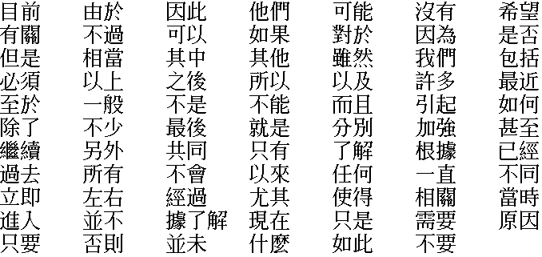
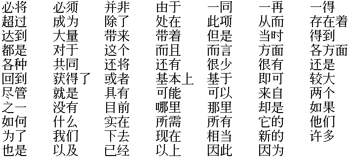

## E  Oracle Text Supplied Stoplists

This appendix describes the default stoplists for all the different languages supported and lists the stopwords in each. The following stoplists are described:

- English Default Stoplist

- Chinese Stoplist (Traditional)

- Chinese Stoplist (Simplified)

- Danish (dk) Default Stoplist

- Dutch (nl) Default Stoplist

- Finnish (sf) Default Stoplist

- French (f) Default Stoplist

- German (d) Default Stoplist

- Italian (i) Default Stoplist

- Portuguese (pt) Default Stoplist

- Spanish (e) Default Stoplist

- Swedish (s) Default Stoplist

### E.1 English Default Stoplist

The following English words are defined as stop words:

- a

- all

- almost

- also

- although

- an

- and

- any

- are

- as

- at

- be

- because

- been

- both

- but

- by

- can

- could

- d

- did

- do

- does

- either

- for

- from

- had

- has

- have

- having

- he

- her

- here

- hers

- him

- his

- how

- however

- i

- if

- in

- into

- is

- it

- its

- just

- ll

- me

- might

- Mr

- Mrs

- Ms

- my

- no

- non

- nor

- not

- of

- on

- one

- only

- onto

- or

- our

- ours

- s

- shall

- she

- should

- since

- so

- some

- still

- such

- t

- than

- that

- the

- their

- them

- then

- there

- therefore

- these

- they

- this

- those

- though

- through

- thus

- to

- too

- until

- ve

- very

- was

- we

- were

- what

- when

- where

- whether

- which

- while

- who

- whose

- why

- will

- with

- would

- yet

- you

- your

- yours

### E.2 Chinese Stoplist (Traditional)

The following traditional Chinese words are defined in the default stoplist for this language.

[Description of the illustration zht_stop.gif](img_text/zht_stop.md)

### E.3 Chinese Stoplist (Simplified)

The following simplified Chinese words are defined in the default stoplist for this language.

[Description of the illustration zhs_stop.gif](img_text/zhs_stop.md)

### E.4 Danish (dk) Default Stoplist

The following Danish words are defined in the default stoplist for this language:

- af

- aldrig

- alle

- altid

- bagved

- de

- der

- du

- efter

- eller

- en

- et

- endnu

- få

- lidt

- fjernt

- for

- foran

- fra

- gennem

- god

- han

- her

- hos

- hovfor

- hun

- hvad

- hvem

- hvor

- hvorhen

- hvordan

- I

- De

- i

- imod

- ja

- jeg

- langsom

- mange

- måske

- med

- meget

- mellem

- mere

- mindre

- når

- hvonår

- nede

- nej

- nu

- og

- oppe

- på

- rask

- hurtig

- sammen

- temmelig

- nok

- til

- uden

- udenfor

- under

- ved

- vi

### E.5 Dutch (nl) Default Stoplist

The following Dutch words are defined in the default stoplist for this language:

- aan

- aangaande

- aangezien

- achter

- achterna

- afgelopen

- al

- aldaar

- aldus

- alhoewel

- alias

- alle

- allebei

- alleen

- alsnog

- altijd

- altoos

- ander

- andere

- anders

- anderszins

- behalve

- behoudens

- beide

- beiden

- ben

- beneden

- bent

- bepaald

- betreffende

- bij

- binnen

- binnenin

- boven

- bovenal

- bovendien

- bovengenoemd

- bovenstaand

- bovenvermeld

- buiten

- daar

- daarheen

- daarin

- daarna

- daarnet

- daarom

- daarop

- daarvanlangs

- dan

- dat

- de

- die

- dikwijls

- dit

- door

- doorgaand

- dus

- echter

- eer

- eerdat

- eerder

- eerlang

- eerst

- elk

- elke

- en

- enig

- enigszins

- enkel

- er

- erdoor

- even

- eveneens

- evenwel

- gauw

- gedurende

- geen

- gehad

- gekund

- geleden

- gelijk

- gemoeten

- gemogen

- geweest

- gewoon

- gewoonweg

- haar

- had

- hadden

- hare

- heb

- hebben

- hebt

- heeft

- hem

- hen

- het

- hierbeneden

- hierboven

- hij

- hoe

- hoewel

- hun

- hunne

- ik

- ikzelf

- in

- inmiddels

- inzake

- is

- jezelf

- jij

- jijzelf

- jou

- jouw

- jouwe

- juist

- jullie

- kan

- klaar

- kon

- konden

- krachtens

- kunnen

- kunt

- later

- liever

- maar

- mag

- meer

- met

- mezelf

- mij

- mijn

- mijnent

- mijner

- mijzelf

- misschien

- mocht

- mochten

- moest

- moesten

- moet

- moeten

- mogen

- na

- naar

- nadat

- net

- niet

- noch

- nog

- nogal

- nu

- of

- ofschoon

- om

- omdat

- omhoog

- omlaag

- omstreeks

- omtrent

- omver

- onder

- ondertussen

- ongeveer

- ons

- onszelf

- onze

- ook

- op

- opnieuw

- opzij

- over

- overeind

- overigens

- pas

- precies

- reeds

- rond

- rondom

- sedert

- sinds

- sindsdien

- slechts

- sommige

- spoedig

- steeds

- tamelijk

- tenzij

- terwijl

- thans

- tijdens

- toch

- toen

- toenmaals

- toenmalig

- tot

- totdat

- tussen

- uit

- uitgezonderd

- vaak

- van

- vandaan

- vanuit

- vanwege

- veeleer

- verder

- vervolgens

- vol

- volgens

- voor

- vooraf

- vooral

- vooralsnog

- voorbij

- voordat

- voordezen

- voordien

- voorheen

- voorop

- vooruit

- vrij

- vroeg

- waar

- waarom

- wanneer

- want

- waren

- was

- wat

- weer

- weg

- wegens

- wel

- weldra

- welk

- welke

- wie

- wiens

- wier

- wij

- wijzelf

- zal

- ze

- zelfs

- zichzelf

- zij

- zijn

- zijne

- zo

- zodra

- zonder

- zou

- zouden

- zowat

- zulke

- zullen

- zult

### E.6 Finnish (sf) Default Stoplist

The following Finnish words are defined in the default stoplist for this language:

- ään

- ah

- ai

- aina

- alla

- alle

- alta

- ansiosta

- edessä

- een

- ehkä

- ei

- eli

- elikkä

- ellei

- elleivät

- ellemme

- ellen

- ellet

- ellette

- enemmän

- eniten

- ennen

- eräs

- että

- hän

- harva

- he

- hei

- hitaasti

- hyi

- hyvin

- iin

- ilman

- itse

- ja

- jahka

- jälkeen

- jo

- joka

- jokainen

- joku

- jollei

- jolleivat

- jollemme

- jollen

- jollet

- jollette

- jos

- joskin

- jotta

- kaikki

- kanssa

- kaukana

- ken

- keneksi

- kenelle

- kenkään

- kenties

- keskellä

- kesken

- ketkä

- kohti

- koska

- koskaan

- ksi

- kuin

- kuinka

- kuka

- kukaan

- kukin

- kumpainen

- kumpainenkaan

- kumpainenkin

- kumpi

- kumpikaan

- kumpikin

- kun

- kunhan

- kunnes

- kuten

- kyllä

- kylliksi

- lähellä

- läpi

- liian

- lla

- llä

- lle

- lta

- ltä

- luona

- me

- mikä

- mikään

- mikäli

- mikin

- miksi

- milloin

- milloinkaan

- minä

- missä

- miten

- molemmat

- mutta

- na

- nä

- näin

- nämä

- ne

- niin

- nopeasti

- nuo

- nyt

- oi

- olemme

- olen

- olet

- olette

- oli

- olimme

- olin

- olit

- olitte

- olivat

- ollut

- on

- oon

- ovat

- paitsi

- paljon

- paremmin

- parhaiten

- pian

- se

- seen

- sekä

- sen

- siellä

- sieltä

- siin

- sillä

- sinä

- sinne

- ssa

- ssä

- sta

- stä

- suoraan

- ta

- tä

- tähden

- tahi

- tai

- taikka

- takana

- takia

- tämä

- tarpeeksi

- tässä

- te

- tokko

- tta

- ttä

- tuo

- ulkopuolella

- useammin

- useimmin

- usein

- vaan

- vähän

- vähemmän

- vähiten

- vaikka

- vailla

- varten

- vastaan

- vielä

- voi

- ympäri

### E.7 French (f) Default Stoplist

The following French words are defined in the default stoplist for this language:

- a

- afin

- ailleurs

- ainsi

- alors

- après

- attendant

- au

- aucun

- aucune

- au-dessous

- au-dessus

- auprès

- auquel

- aussi

- aussitôt

- autant

- autour

- aux

- auxquelles

- auxquels

- avec

- à

- beaucoup

- ça

- ce

- ceci

- cela

- celle

- celles

- celui

- cependant

- certain

- certaine

- certaines

- certains

- ces

- cet

- cette

- ceux

- chacun

- chacune

- chaque

- chez

- combien

- comme

- comment

- concernant

- dans

- de

- dedans

- dehors

- déjà

- delà

- depuis

- des

- desquelles

- desquels

- dessus

- dès

- donc

- donné

- dont

- du

- duquel

- durant

- elle

- elles

- en

- encore

- entre

- et

- étaient

- était

- étant

- etc

- eux

- furent

- grâce

- hormis

- hors

- ici

- il

- ils

- jadis

- je

- jusqu

- jusque

- la

- laquelle

- là

- le

- lequel

- les

- lesquelles

- lesquels

- leur

- leurs

- lors

- lorsque

- lui

- ma

- mais

- malgré

- me

- même

- mêmes

- mes

- mien

- mienne

- miennes

- miens

- moins

- moment

- mon

- moyennant

- ne

- ni

- non

- nos

- notamment

- notre

- notres

- nôtre

- nôtres

- nous

- nulle

- nulles

- on

- ou

- où

- par

- parce

- parmi

- plus

- plusieurs

- pour

- pourquoi

- près

- puis

- puisque

- quand

- quant

- que

- quel

- quelle

- quelqu'un

- quelqu'une

- quelque

- quelques-unes

- quelques-uns

- quels

- qui

- quiconque

- quoi

- quoique

- sa

- sans

- sauf

- se

- selon

- ses

- sien

- sienne

- siennes

- siens

- soi

- soi-même

- soit

- sont

- suis

- sur

- ta

- tandis

- tant

- te

- telle

- telles

- tes

- tienne

- tiennes

- tiens

- toi

- ton

- toujours

- tous

- toute

- toutes

- très

- trop

- tu

- un

- une

- vos

- votre

- vôtre

- vôtres

- vous

- vu

- y

### E.8 German (d) Default Stoplist

The following German words are defined in the default stoplist for this language:

- ab

- aber

- allein

- als

- also

- am

- an

- auch

- auf

- aus

- außer

- bald

- bei

- beim

- bin

- bis

- bißchen

- bist

- da

- dabei

- dadurch

- dafür

- dagegen

- dahinter

- damit

- danach

- daneben

- dann

- daran

- darauf

- daraus

- darin

- darüber

- darum

- darunter

- das

- dasselbe

- daß

- davon

- davor

- dazu

- dazwischen

- dein

- deine

- deinem

- deinen

- deiner

- deines

- dem

- demselben

- den

- denn

- der

- derselben

- des

- desselben

- dessen

- dich

- die

- dies

- diese

- dieselbe

- dieselben

- diesem

- diesen

- dieser

- dieses

- dir

- doch

- dort

- du

- ebenso

- ehe

- ein

- eine

- einem

- einen

- einer

- eines

- entlang

- er

- es

- etwa

- etwas

- euch

- euer

- eure

- eurem

- euren

- eurer

- eures

- für

- fürs

- ganz

- gar

- gegen

- genau

- gewesen

- her

- herein

- herum

- hin

- hinter

- hintern

- ich

- ihm

- ihn

- Ihnen

- ihnen

- ihr

- ihre

- Ihre

- ihrem

- Ihrem

- ihren

- Ihren

- Ihrer

- ihrer

- ihres

- Ihres

- im

- in

- ist

- ja

- je

- jedesmal

- jedoch

- jene

- jenem

- jenen

- jener

- jenes

- kaum

- kein

- keine

- keinem

- keinen

- keiner

- keines

- man

- mehr

- mein

- meine

- meinem

- meinen

- meiner

- meines

- mich

- mir

- mit

- nach

- nachdem

- nämlich

- neben

- nein

- nicht

- nichts

- noch

- nun

- nur

- ob

- ober

- obgleich

- oder

- ohne

- paar

- sehr

- sei

- sein

- seine

- seinem

- seinen

- seiner

- seines

- seit

- seitdem

- selbst

- sich

- Sie

- sie

- sind

- so

- sogar

- solch

- solche

- solchem

- solchen

- solcher

- solches

- sondern

- sonst

- soviel

- soweit

- über

- um

- und

- uns

- unser

- unsre

- unsrem

- unsren

- unsrer

- unsres

- vom

- von

- vor

- während

- war

- wäre

- wären

- warum

- was

- wegen

- weil

- weit

- welche

- welchem

- welchen

- welcher

- welches

- wem

- wen

- wenn

- wer

- weshalb

- wessen

- wie

- wir

- wo

- womit

- zu

- zum

- zur

- zwar

- zwischen

### E.9 Italian (i) Default Stoplist

The following Italian words are defined in the default stoplist for this language:

- a

- affinchè

- agl'

- agli

- ai

- al

- all'

- alla

- alle

- allo

- anzichè

- avere

- bensì

- che

- chi

- cioè

- come

- comunque

- con

- contro

- cosa

- da

- dachè

- dagl'

- dagli

- dai

- dal

- dall'

- dalla

- dalle

- dallo

- degl'

- degli

- dei

- del

- dell'

- delle

- dello

- di

- dopo

- dove

- dunque

- durante

- e

- egli

- eppure

- essere

- essi

- finché

- fino

- fra

- giacchè

- gl'

- gli

- grazie

- I

- il

- in

- inoltre

- io

- l'

- la

- le

- lo

- loro

- ma

- mentre

- mio

- ne

- neanche

- negl'

- negli

- nei

- nel

- nell'

- nella

- nelle

- nello

- nemmeno

- neppure

- noi

- nonchè

- nondimeno

- nostro

- o

- onde

- oppure

- ossia

- ovvero

- per

- perchè

- perciò

- però

- poichè

- prima

- purchè

- quand'anche

- quando

- quantunque

- quasi

- quindi

- se

- sebbene

- sennonchè

- senza

- seppure

- si

- siccome

- sopra

- sotto

- su

- subito

- sugl'

- sugli

- sui

- sul

- sull'

- sulla

- sulle

- sullo

- suo

- talchè

- tu

- tuo

- tuttavia

- tutti

- un

- una

- uno

- voi

- vostro

### E.10 Portuguese (pt) Default Stoplist

The following Portuguese words are defined in the default stoplist for this language:

- a

- abaixo

- adiante

- agora

- ali

- antes

- aqui

- até

- atras

- bastante

- bem

- com

- como

- contra

- debaixo

- demais

- depois

- depressa

- devagar

- direito

- e

- ela

- elas

- êle

- eles

- em

- entre

- eu

- fora

- junto

- longe

- mais

- menos

- muito

- não

- ninguem

- nós

- nunca

- onde

- ou

- para

- por

- porque

- pouco

- próximo

- qual

- quando

- quanto

- que

- quem

- se

- sem

- sempre

- sim

- sob

- sobre

- talvez

- todas

- todos

- vagarosamente

- você

- vocês

### E.11 Spanish (e) Default Stoplist

The following Spanish words are defined in the default stoplist for this language:

- a

- acá

- ahí

- ajena

- ajenas

- ajeno

- ajenos

- al

- algo

- alguna

- algunas

- alguno

- algunos

- algún

- allá

- allí

- aquel

- aquella

- aquellas

- aquello

- aquellos

- aquí

- cada

- cierta

- ciertas

- cierto

- ciertos

- como

- cómo

- con

- conmigo

- consigo

- contigo

- cualquier

- cualquiera

- cualquieras

- cuan

- cuanta

- cuantas

- cuánta

- cuántas

- cuanto

- cuantos

- cuán

- cuánto

- cuántos

- de

- dejar

- del

- demasiada

- demasiadas

- demasiado

- demasiados

- demás

- el

- ella

- ellas

- ellos

- él

- esa

- esas

- ese

- esos

- esta

- estar

- estas

- este

- estos

- hacer

- hasta

- jamás

- junto

- juntos

- la

- las

- lo

- los

- mas

- más

- me

- menos

- mía

- mientras

- mío

- misma

- mismas

- mismo

- mismos

- mucha

- muchas

- muchísima

- muchísimas

- muchísimo

- muchísimos

- mucho

- muchos

- muy

- nada

- ni

- ninguna

- ningunas

- ninguno

- ningunos

- no

- nos

- nosotras

- nosotros

- nuestra

- nuestras

- nuestro

- nuestros

- nunca

- os

- otra

- otras

- otro

- otros

- para

- parecer

- poca

- pocas

- poco

- pocos

- por

- porque

- que

- querer

- qué

- quien

- quienes

- quienesquiera

- quienquiera

- quién

- ser

- si

- siempre

- sí

- sín

- Sr

- Sra

- Sres

- Sta

- suya

- suyas

- suyo

- suyos

- tal

- tales

- tan

- tanta

- tantas

- tanto

- tantos

- te

- tener

- ti

- toda

- todas

- todo

- todos

- tomar

- tuya

- tuyo

- tú

- un

- una

- unas

- unos

- usted

- ustedes

- varias

- varios

- vosotras

- vosotros

- vuestra

- vuestras

- vuestro

- vuestros

- y

- yo

### E.12 Swedish (s) Default Stoplist

The following Swedish words are defined in the default stoplist for this language:

- ab

- aldrig

- all

- alla

- allt

- alltid

- allting

- än

- andra

- andre

- annan

- annat

- ännu

- är

- åter

- att

- av

- avse

- avsedd

- avsedda

- avser

- avses

- bakom

- bara

- bäst

- bättre

- bra

- bredvid

- då

- dålig

- där

- därför

- de

- dem

- den

- denna

- deras

- dess

- dessa

- det

- detta

- du

- efter

- efteråt

- eftersom

- ej

- eller

- emot

- en

- endast

- er

- era

- ert

- ett

- få

- fall

- färre

- fastän

- flest

- flesta

- för

- först

- första

- förste

- fort

- framför

- från

- genom

- god

- goda

- gott

- ha

- hade

- haft

- han

- hans

- här

- hellre

- henne

- hennes

- heta

- heter

- hette

- hon

- honom

- hos

- hur

- i

- fall

- ifall

- in

- inga

- ingen

- ingenting

- inget

- innan

- inte

- ja

- jag

- kan

- kort

- korta

- kunde

- kunna

- lång

- långa

- långsam

- långsamma

- långsamt

- långt

- lite

- liten

- litet

- man

- med

- medan

- mellan

- men

- mer

- mera

- mest

- mesta

- mindre

- minst

- minsta

- mot

- mycket

- någon

- någonting

- något

- några

- när

- nära

- ned

- nej

- ner

- nere

- ni

- nu

- och

- också

- om

- oss

- över

- överst

- översta

- övre

- på

- så

- sådan

- sådana

- sådant

- säga

- säger

- sägs

- sämre

- sämst

- sån

- sånt

- såsom

- sin

- sist

- sista

- ska

- skall

- skulle

- som

- ta

- till

- tillräcklig

- tillräckliga

- tillräckligt

- tillsammans

- tog

- trots att

- under

- underst

- undre

- upp

- uppe

- ut

- utan

- ute

- utom

- vad

- väl

- var

- vara

- varför

- vart

- vem

- vems

- vet

- veta

- vi

- vid

- vilken

- vill

- ville

- visste

- vore
