These topics demonstrate how to develop and deploy a .NET stored function.

- Overview of .NET Stored Function Demonstration

- Step 1: Create the GetDeptNo Function and Build it into an Assembly

- Step 2: Start the Oracle Deployment Wizard for .NET

- Step 3: Choose the Function to Deploy

- Step 4: Determine the Appropriate Parameter Type Mappings

- Step 5: Deploy the Function to an Oracle Database

- Step 6: Test the Function

**See Also:**

Oracle Developer Tools for Visual Studio Help for further information for further information about these components

### Overview of .NET Stored Function Demonstration

This demonstration uses Oracle Developer Tools for Visual Studio extensively although some processes can be performed with other Oracle tools. Also, the demonstration refers to the following components of Oracle Developer Tools for Visual Studio:

- Oracle Explorer

- Oracle Project

- Oracle Deployment Wizard for .NET

In this demonstration, you will develop and deploy a .NET stored function named `GetDeptNo`, with a PL/SQL wrapper, `GETDEPTNO`. The `GetDeptNo` function accepts an employee number (`EMPNO`), performs a query, and returns the department number (`DEPTNO)` of the employee.

### Step 1: Create the GetDeptNo Function and Build it into an Assembly

This demonstration begins by opening Visual Studio, creating a function, and building it into an assembly.

1.  Open Visual Studio and connect as `scott/``password`. See Oracle Developer Tools for Visual Studio Help for information about connecting.
2.  From the Visual Studio menu, select File, then New Project.
3.  To create an Oracle Project template, select the project type Visual C# Projects, and select Oracle Project.
4.  Name the project `CLRLibrary1` and provide a location for it.
    A class named `CLRLibrary1.Class1` appears. It contains a template for a stored procedure.

    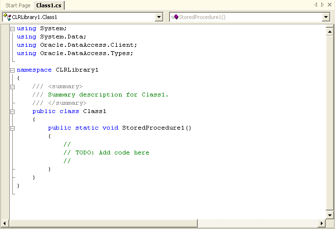
    [Description of the illustration oracleproject.gif](img_text/oracleproject.md)
5.  Copy the following code over the base class and save.
        using System;
        // use the ODP.NET provider
        using Oracle.DataAccess.Client;
        using Oracle.DataAccess.Types;

        namespace CLRLibrary1
        {
          // Sample .NET stored function returning department number for
          // a given employee number
          public class Class1
          {
            public static int GetDeptNo(int empno)
            {
              int deptno = 0;

              // Check for context connection
              OracleConnection conn = new OracleConnection();
              if( OracleConnection.IsAvailable == true )
              {
                conn.ConnectionString = "context connection=true";
              }
              else
              {
                throw new InvalidOperationException("context connection" +
                  "not available");
              }

              conn.Open();
              // Create and execute a command
              OracleCommand cmd = conn.CreateCommand();
              cmd.CommandText = "SELECT DEPTNO FROM EMP WHERE EMPNO = :1";

              cmd.Parameters.Add(":1",OracleDbType.Int32,empno,
                System.Data.ParameterDirection.Input);

              OracleDataReader rdr = cmd.ExecuteReader();

              if (rdr.Read())
                deptno = rdr.GetInt32(0);

              rdr.Close();
              cmd.Dispose();
              conn.Close();

              return deptno;

            } // GetDeptNo
          } // Class1
        } // CLRLibrary1
6.  From the Build menu, select Build Solution or Build CLRLibrary1.
    This builds the code into an assembly.
7.  Save.

### Step 2: Start the Oracle Deployment Wizard for .NET

Oracle Deployment Wizard for .NET can be started from the build menu.

1.  From the Build menu, select Deploy CLRLibrary1.
    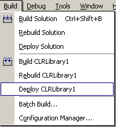
    [Description of the illustration deploymenu.gif](img_text/deploymenu.md)
2.  When the Welcome window appears, select Do not show this page again, if you want.
    Then, click Next.

    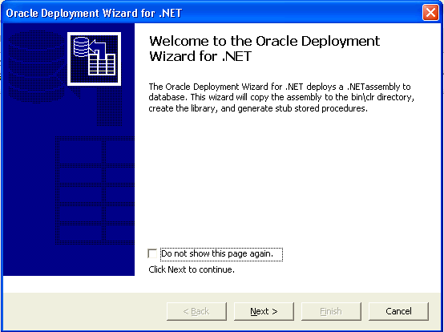
    [Description of the illustration titlepage.gif](img_text/titlepage.md)
3.  The Configure your OracleConnection window appears.
    Choose your connection from the drop-down list, and click Next or click New Connection, if you are not connected.

    You must choose or add a `SYSBA` connection.

    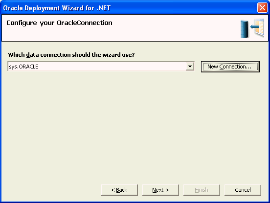
    [Description of the illustration usingdeploywizard1.gif](img_text/usingdeploywizard1.md)
4.  If you have selected New Connection, the Add Connection window appears.
    In the Connection Details tab, select the Data source name from the drop-down list.You can select an option to Use Windows integrated authentication or an option Use a specific user name and password, and enter that information.If you want, select Save password.The option for Role shows `SYSDBA`, which is the only available option.If you want to test the connection, click Test connection.Click OK,

    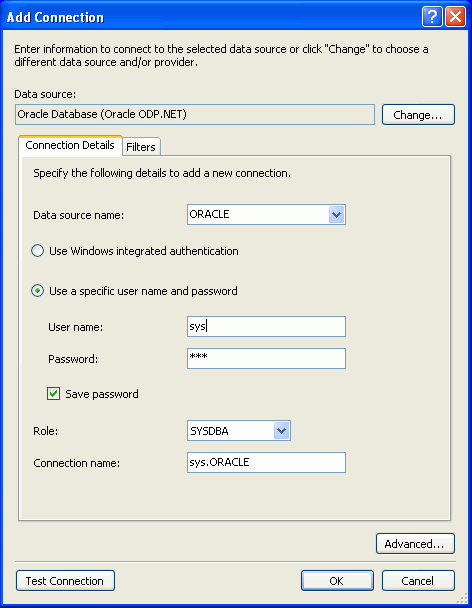
    [Description of the illustration sysdbaaddconnection.gif](img_text/sysdbaaddconnection.md)
5.  The Specify your deployment option window appears.
    The first time you run the deployment wizard, select Copy assembly and generate stored procedures. If you later modify your function or stored procedure, you can run the deployment wizard again, and choose to perform just one of these operations.Click Next.

    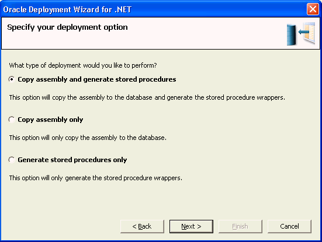
    [Description of the illustration usingdeploywizard2.gif](img_text/usingdeploywizard2.md)
6.  The Specify an assembly and library name window appears.
    To specify the assembly, select the project from the drop-down list, or select File, and click Browse to navigate to the one you want.

    To specify the name of the library database object to be used for the selected assembly, accept the default, select the name from the drop-down list, or enter a new name.

    For this demonstration, accept the default project and library name and click Next.

    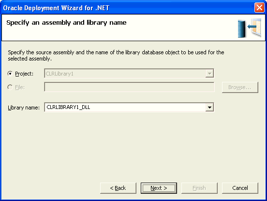
    [Description of the illustration usingdeploywizard3.gif](img_text/usingdeploywizard3.md)
7.  The Specify Copy Options window appears.
    To specify the dependent assemblies to copy to the database, select them from the list. The list displays all possible dependent assemblies. In this case, the assemblies displayed have already been copied to the database and, therefore, there is no need to copy them. To deploy the assembly to a directory other than the default `bin\clr` directory, modify the destination path. The destination must be a `bin\clr` directory or one of its existing subdirectories.

    For this demonstration, do not select any dependent assemblies, and do not modify the destination path.

    If you want to, select Overwrite the file if it already exists in the database.

    Then, click Next.

    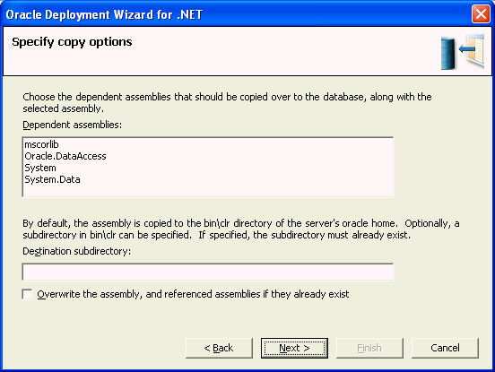
    [Description of the illustration copyoptions.gif](img_text/copyoptions.md)

### Step 3: Choose the Function to Deploy

The Specify methods and security details window appears.

You can select the entire project to deploy, or expand it to deploy specific functions. Because there is only one function in this project, selecting any one item, checks the entire project. If there were more functions or procedures, you could select individual items to deploy.

If you want to select a different schema to deploy, you can do so here. If the schema you want is not listed, you need to apply different filters. For information on this process, see Oracle Developer Tools for Visual Studio Help.

You can set the security level using the drop-down list. The possible levels are:

- Safe - (Default)

- External

- Unsafe

For this demonstration, do the following:

1.  Choose `GetDeptNo()` from the list of procedures and functions contained within that assembly.
2.  The schema initially says `SYS`. Change it to `Scott`, so that you can deploy it in the `scott` schema.
3.  Accept the default security level. You can either click Next to continue, or you can click Parameter Type Mapping... to view the type mappings.
    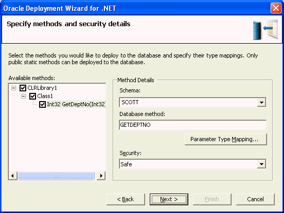
    [Description of the illustration specifymethoddetails.gif](img_text/specifymethoddetails.md)
    **See Also:**

    [Step 3: Choose the Procedure or Function to Deploy and Security Level](devdeploy.md)

### Step 4: Determine the Appropriate Parameter Type Mappings

If you have selected Parameter Type Mapping..., the Parameter Type Mapping window appears, which allows you to change the data type, using the drop-down list.

For this demonstration, accept the default mappings of the .NET data type `System.Int32` to the Oracle type `BINARY_INTEGER`.

Click OK to return to the Specify methods and security details window.

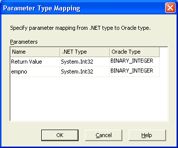
[Description of the illustration datatypemapping.gif](img_text/datatypemapping.md)

**See Also:**

"[Data Type Conversion](datatype-conversion.md)" for data type mapping tables

### Step 5: Deploy the Function to an Oracle Database

The Summary window of the Oracle Deployment Wizard for .NET appears, showing all the indicated specifications. This window permits you to modify any values by selecting Back.

To complete the demonstration, do the following:

1.  Review the summary.
2.  To verify SQL commands, select Show Script.
    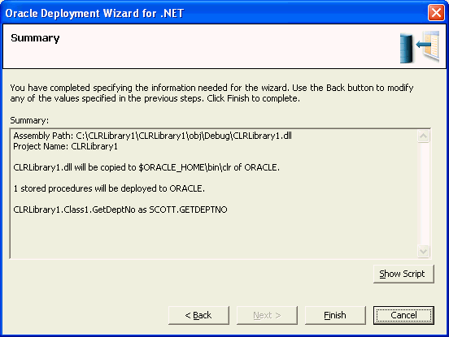
    [Description of the illustration summary.gif](img_text/summary.md)
3.  When the Show Sql window appears, review the code for the PL/SQL wrapper and click OK to return to the Summary window.
    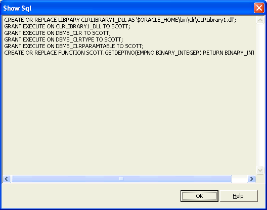
    [Description of the illustration showsqldialog.gif](img_text/showsqldialog.md)
4.  Click Finish to deploy the `GetDeptNo()` function.

### Step 6: Test the Function

At this point, `GetDeptNo()` function has been deployed to the Oracle Database and you are ready to test it by invoking the PL/SQL wrapper function.

You must be connected as the default user, `scott`, in this demonstration, to call the function.

Test the function by invoking it from the following tools:

- Invoking from Oracle Developer Tools for Visual Studio

- Invoking from ODP.NET client

- Invoking from SQL\*Plus

#### Invoking from Oracle Developer Tools for Visual Studio

To locate and call the function from Oracle Developer Tools for Visual Studio:

1.  From the View menu, select Oracle Explorer.
2.  Expand the Functions node.
3.  Locate GETDEPTNO.
4.  Right-click GETDEPTNO and from the menu, select Run.
    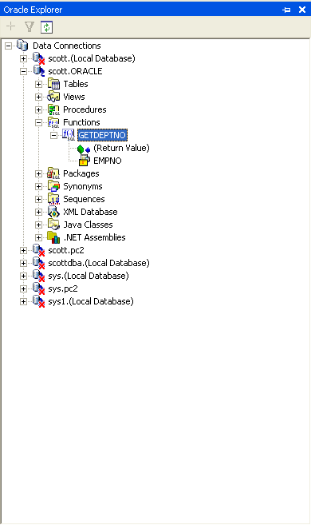
    [Description of the illustration runsp.gif](img_text/runsp.md)
5.  When the Run Function dialog box appears, enter employee number 7934 as the input value.
    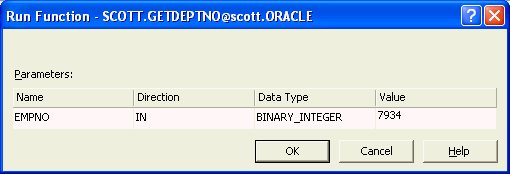
    [Description of the illustration runfunction.gif](img_text/runfunction.md)
6.  Click OK.
    The output value 10 appears in the Document Window, indicating that employee number 7934 belongs to department 10.

    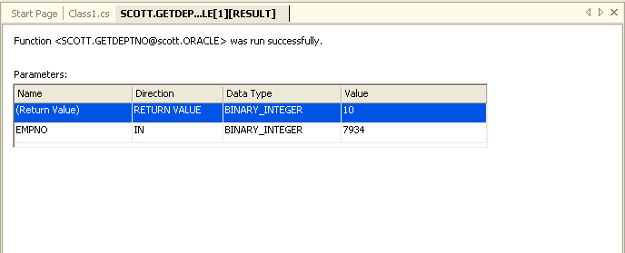
    [Description of the illustration success.gif](img_text/success.md)

#### Invoking from ODP.NET client

The following code sample demonstrates how to invoke the PL/SQL wrapper for .NET function.

    using System;
    using System.Data;
    using Oracle.DataAccess.Client;

    namespace ODPNETClientApp
    {
      public class Class1
      {
        public static void Main()
        {
          int empno  = 7934;
          int deptno = 0;

          try
          {
            // Open a connection to the database
            OracleConnection con = new OracleConnection(
              "User Id=scott; Password=tiger; Data Source=inst1");
            con.Open();

            // Create and execute the command
            OracleCommand cmd = con.CreateCommand();
            cmd.CommandType = CommandType.StoredProcedure;
            cmd.CommandText = "GETDEPTNO";

            // Set parameters
            OracleParameter retParam = cmd.Parameters.Add(":DEPTNO",
                OracleDbType.Int32, System.Data.ParameterDirection.ReturnValue);
            cmd.Parameters.Add(":EMPNO", OracleDbType.Int32, empno,
            System.Data.ParameterDirection.Input);

            cmd.ExecuteNonQuery();
            deptno = (int)retParam.Value;

            Console.WriteLine("\nEmployee# {0} working in department# {1}\n",
              empno, deptno);

            cmd.Dispose();
            con.Close();
          }
          catch (Exception e)
          {
            Console.WriteLine(e.Message);
          }
        }
      } // Class1
    } // ODPNETClientApp namespace

#### Invoking from SQL\*Plus

To invoke the `GetDeptNo()` function .NET function from SQL\* Plus:

1.  Start SQL\*Plus and log in as user `scott` with the password `tiger`.
2.  Enter the following commands:
        SET SERVEROUTPUT ON;
        DECLARE
        deptno BINARY_INTEGER;
        BEGIN
          deptno := GetDeptNo(7934);
          DBMS_OUTPUT.PUT_LINE(deptno);
        END;

Alternatively, you can execute following statement:

    SELECT GetDeptNo(7934) FROM DUAL;
