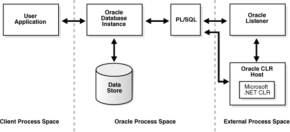
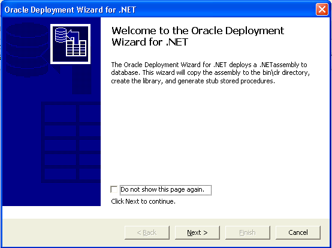

These topics introduce Oracle Database Extensions for .NET, which makes it possible to build and run .NET stored procedures or functions with Oracle Database for Microsoft Windows.

- Oracle Database Extensions for .NET Overview

- Oracle Database Extensions for .NET Architecture

- Oracle Data Provider for .NET

- Oracle Developer Tools for Visual Studio

- Oracle Deployment Wizard for .NET

### Oracle Database Extensions for .NET Overview

Oracle Database Extensions for .NET provides the following:

- A Common Language Runtime (CLR) host for Oracle Database

- Data access through Oracle Data Provider for .NET classes

- Oracle Deployment Wizard for Visual Studio

The Oracle Database hosts the Microsoft Common Language Runtime (CLR) in an external process, outside of the Oracle database process. The integration of Oracle Database with the Microsoft Common Language Runtime (CLR) enables applications to run .NET stored procedures or functions on Oracle Database, on supported Microsoft Windows operating systems.

Application developers can write stored procedures and functions using any .NET compliant language, such as C# and VB.NET, and use these .NET stored procedures in the database, in the same manner as other PL/SQL or Java stored procedures. .NET stored procedures can be called from PL/SQL packages, procedures, functions, and triggers; from SQL statements, or from anywhere a PL/SQL procedure or function can be called.

Application developers build .NET procedures or functions into a .NET assembly, typically using Microsoft Visual Studio. Oracle Data Provider for .NET is used in .NET stored procedures and functions for data access. After building .NET procedures and functions into a .NET assembly, developers deploy them in Oracle Database, using the Oracle Deployment Wizard for .NET, a component of the Oracle Developer Tools for Visual Studio.

The .NET stored procedure or function appears to the caller as a PL/SQL stored procedure or function because a PL/SQL wrapper has been generated for it. The user invokes a .NET stored procedure or function through this PL/SQL wrapper. Oracle Deployment Wizard for .NET determines the probable mappings between Oracle data types and .NET data types, which the user can override. The mappings are handled seamlessly by the PL/SQL wrapper.

### Oracle Database Extensions for .NET Architecture

[Description of the illustration clrnt001.gif](img_text/clrnt001.md)

This architecture diagram shows the client application and then two process spaces, the Oracle process space and the external process space.

The Oracle process space includes the Oracle database instance and hosts the PL/SQL wrapper.

The external process space includes the Oracle CLR host, in which .NET stored procedures or functions are executed.

#### Oracle CLR Host

The Oracle CLR host is installed as part of Oracle Database Extensions for .NET installation and runs in the `extproc` process. The `extproc` process loads the Oracle CLR host which in turn loads an instance of the Microsoft Common Language Runtime (CLR), thus providing an interface for the wrapped PL/SQL procedure. These mechanics are not visible to the users. From a user's point of view, the application is invoking just another PL/SQL stored procedure or function.

**Note:**

The Microsoft .NET Framework must be installed on the same computer as the database.

#### External Processes

.NET stored procedures or functions are hosted in a process external to the Oracle Database. This external process is a heterogeneous service agent called `extproc`, external procedure agent, or external process. This guide uses the terms `extproc` process or `extproc` agent.

**See Also:**

[Oracle Database Heterogeneous Connectivity User's Guide](../heter/using-heterogeneous-services-agents.md)

The `extproc` process supports the following architectures:

- Dedicated Agent Architecture

- Multithreaded Agent Architecture

##### Dedicated Agent Architecture

In dedicated (that is, single-threaded) agent architecture, an `extproc` process is started for each user session. The process terminates when the user session ends. This architecture can consume an unnecessarily large amount of system resources since, with every user session, a new `extproc` process must be started and shut down. Therefore dedicated agent architecture does not perform well in terms of system resources and runtime efficiency.

##### Multithreaded Agent Architecture

A multithreaded `extproc` process uses a pool of shared threads. The tasks requested by the user sessions are put on a queue and are picked up by the first available thread.

Multithreaded agent architecture allows more efficient use of system resources than dedicated architecture.

A separate multithreaded `extproc` process must be started for each system identifier (SID). Each TNS listener that is running on a system listens for incoming connection requests for a set of SIDs. If the SID in an incoming Oracle Net connect string is one that the listener is listening for, then that listener processes the connection. If a multithreaded process has been started for the SID, then the listener passes the request to that process.

**See Also:**

- [Oracle Database Development Guide](../adfns/design_basics.md)

- [Oracle Database Administrator's Guide](../admin/managing-processes.md)

###### Real Application Clusters (RAC) and External Processes

The Oracle multithreaded `extproc` process is tightly coupled with the Oracle listener. Therefore, each node in a Real Application Clusters (RAC) environment has an Oracle multithreaded `extproc` process associated with the listener on that node.

###### Multiple Databases Instance and External Processes

A single Oracle multithreaded `extproc` process is used with multiple database instances associated with a single Oracle home if a single listener is shared among multiple database instances.

### Oracle Data Provider for .NET

Oracle Data Provider for .NET provides data access to the Oracle Database from any client application. Oracle Data Provider for .NET is available for free download on Oracle Technology Network (OTN).

**See Also:**

[Oracle Data Provider for .NET Developer's Guide for Microsoft Windows](../odpnt/extenPorting.md) for detailed descriptions of ODP.NET classes

### Oracle Developer Tools for Visual Studio

Oracle Developer Tools for Visual Studio is a set of application tools tightly integrated with the Visual Studio development environment. Oracle Developer Tools enables developers to execute a wide range of application development tasks, such as creating tables, editing stored procedures, and viewing data in the Oracle Database. Oracle Developer Tools for Visual Studio is available for free download on Oracle Technology Network (OTN).

**See Also:**

Oracle Developer Tools for Visual Studio Help

### Oracle Deployment Wizard for .NET

[Description of the illustration titlepage.gif](img_text/titlepage.md)

The Oracle Deployment Wizard for .NET is a graphical tool integrated with Microsoft Visual Studio which makes it easy to deploy any .NET procedure or function into an Oracle Database. It is installed as part of Oracle Developer Tools for Visual Studio.

**See Also:**

Oracle Developer Tools for Visual Studio Dynamic Help, available by installing Oracle Developer Tools for Visual Studio, for more information
