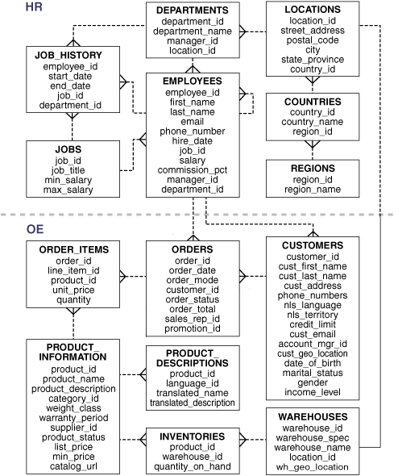
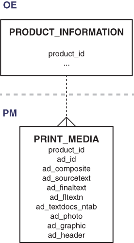
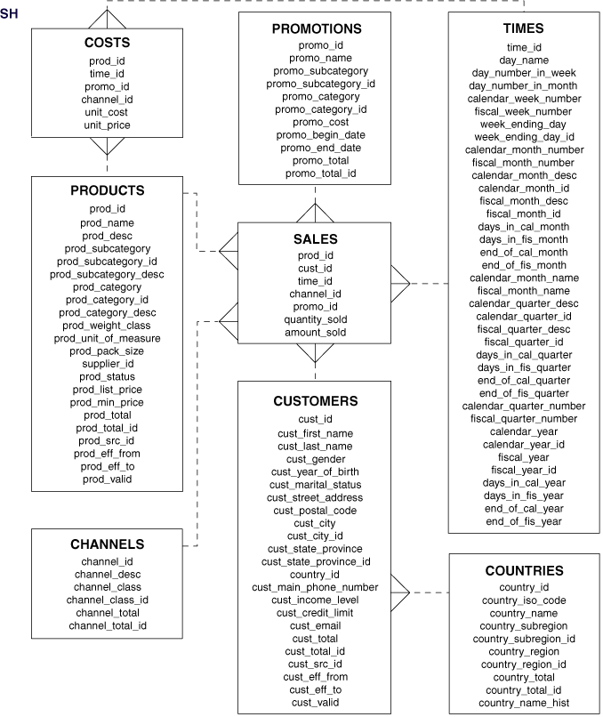
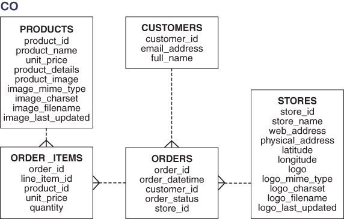

Examine the diagrams of the sample database schemas.

### 3.1 Sample Schema Diagrams

Figure 3-1 illustrates sample schemas `HR` and `OE` and their relationship. The scripts and table descriptions for these schemas are in section "[HR Schema](HR-sample-schema-scripts-and-objects.md)" and "[OE Schema](OE-sample-schema-scripts-and-objects.md)", respectively.

Figure 3-2 illustrates schema PM. The scripts and table description for schema PM are at "[PM Schema](PM-sample-schema-scripts-and-objects.md)".

Figure 3-3 illustrates schema `SH`. The scripts and table description for schema `SH` are in section "[SH Schema](SH-sample-schema-scripts-and-objects.md)".

This edition of the book does not illustrate schema `IX`, but its scripts and table description are in section "[IX Schema](IX-sample-schema-scripts-and-objects.md)".

Sample Schema CO illustrates schema `CO`. The scripts and table description for schema `CO` are in section "[CO Schema](co-schema.md)"

Figure 3-1 Sample Schemas HR and OE

[Description of "Figure 3-1 Sample Schemas HR and OE"](img_text/comsc008.md)

Figure 3-2 Sample Schemas OE and PM

[Description of "Figure 3-2 Sample Schemas OE and PM"](img_text/comsc009.md)

Figure 3-3 Sample Schema SH

[Description of "Figure 3-3 Sample Schema SH"](img_text/comsc010.md)

Figure 3-4 Sample Schema CO

[Description of "Figure 3-4 Sample Schema CO"](img_text/customer-orders-schema.md)
