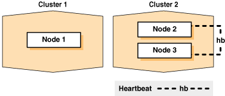
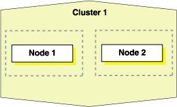

This chapter describes how to clone an Oracle Grid Infrastructure home and use the cloned home to create a cluster. You perform the cloning procedures in this chapter by running scripts in silent mode. The cloning procedures are applicable to Linux and UNIX systems. Although the examples in this chapter use Linux and UNIX commands, the cloning concepts and procedures apply generally to all platforms.

**Note:**

This chapter assumes that you are cloning an Oracle Clusterware 19c installation configured as follows:

- No Grid Naming Service (GNS)

- No Intelligent Platform Management Interface specification (IPMI)

- Voting file and Oracle Cluster Registry (OCR) are stored in Oracle Automatic Storage Management (ASM)

- Single Client Access Name (SCAN) resolves through DNS

This chapter contains the following topics:

- Introduction to Cloning Oracle Clusterware

- Preparing the Oracle Grid Infrastructure Home for Cloning

- Creating a Cluster by Cloning Oracle Clusterware

- Using Cloning to Add Nodes to a Cluster

- Locating and Viewing Log Files Generated During Cloning

### Introduction to Cloning Oracle Clusterware

Cloning is the process of copying an existing Oracle Clusterware installation to a different location and then updating the copied installation to work in the new environment. Changes made by one-off patches applied on the source Oracle Grid Infrastructure home are also present after cloning. During cloning, you run a script that replays the actions that installed the Oracle Grid Infrastructure home.

Cloning requires that you start with a successfully installed Oracle Grid Infrastructure home. You use this home as the basis for implementing a script that extends the Oracle Grid Infrastructure home to create a cluster based on the original Grid home.

Manually creating the cloning script can be error prone because you prepare the script without interactive checks to validate your input. Despite this, the initial effort is worthwhile for scenarios where you run a single script to configure tens or even hundreds of clusters. If you have only one cluster to install, then you should use the traditional, automated and interactive installation methods, such as Oracle Universal Installer (OUI) or the Provisioning Pack feature of Oracle Enterprise Manager.

**Note:**

Cloning is not a replacement for Oracle Enterprise Manager cloning that is a part of the Provisioning Pack. During Oracle Enterprise Manager cloning, the provisioning process simplifies cloning by interactively asking for details about the Oracle home. The interview questions cover such topics as the location to which you want to deploy the cloned environment, the name of the Oracle database home, a list of the nodes in the cluster, and so on.

The Provisioning Pack feature of Oracle Enterprise Manager Grid Control provides a framework that automates the provisioning of nodes and clusters. For data centers with many clusters, the investment in creating a cloning procedure to provision new clusters and new nodes to existing clusters is worth the effort.

The following list describes some situations in which cloning is useful:

- Cloning prepares an Oracle Grid Infrastructure home once and deploys it to many hosts simultaneously. You can complete the installation in silent mode, as a noninteractive process. You do not need to use a graphical user interface (GUI) console, and you can perform cloning from a Secure Shell (SSH) terminal session, if required.

- Cloning enables you to create an installation (copy of a production, test, or development installation) with all patches applied to it in a single step. Once you have performed the base installation and applied all patch sets and patches on the source system, cloning performs all of these individual steps as a single procedure. This is in contrast to going through the installation process to perform the separate steps to install, configure, and patch the installation on each node in the cluster.

- Installing Oracle Clusterware by cloning is a quick process. For example, cloning an Oracle Grid Infrastructure home to a cluster with more than two nodes requires a few minutes to install the Oracle software, plus a few minutes more for each node (approximately the amount of time it takes to run the `root.sh` script).

- Cloning provides a guaranteed method of accurately repeating the same Oracle Clusterware installation on multiple clusters.

A cloned installation acts the same as its source installation. For example, you can remove the cloned Oracle Grid Infrastructure home using OUI or patch it using OPatch. You can also use the cloned Oracle Grid Infrastructure home as the source for another cloning operation. You can create a cloned copy of a test, development, or production installation by using the command-line cloning scripts.

The default cloning procedure is adequate for most cases. However, you can also customize some aspects of cloning, such as specifying custom port assignments or preserving custom settings.

For example, you can specify a custom port for the listener, as follows:

    $ export ORACLE_HOME=/u01/app/12.1.0/grid
    $ $ORACLE_HOME/bin/srvctl modify listener -endpoints tcp:12345

The cloning process works by copying all of the files from the source Oracle Grid Infrastructure home to the destination Oracle Grid Infrastructure home. You can clone either a local (non-shared) or shared Oracle Grid Infrastructure home. Thus, any files used by the source instance that are located outside the source Oracle Grid Infrastructure home's directory structure are not copied to the destination location.

The size of the binary files at the source and the destination may differ because these files are relinked as part of the cloning operation, and the operating system patch levels may also differ between these two locations. Additionally, the number of files in the cloned home would increase because several files copied from the source, specifically those being instantiated, are backed up as part of the clone operation.

### Preparing the Oracle Grid Infrastructure Home for Cloning

To prepare the source Oracle Grid Infrastructure home to be cloned, create a copy of an installed Oracle Grid Infrastructure home and then use it to perform the cloning procedure on other nodes. Use the following step-by-step procedure to prepare the copy of the Oracle Grid Infrastructure home:

- Step 1: Install Oracle Clusterware

- Step 2: Shut Down Running Software

- Step 3: Create a Copy of the Oracle Grid Infrastructure Home

#### Step 1: Install Oracle Clusterware

Use the detailed instructions in the Oracle Grid Infrastructure Installation and Upgrade Guideto perform the following steps on the source node:

1.  Install Oracle Clusterware. This installation puts Oracle Cluster Registry (OCR) and the voting file on Oracle Automatic Storage Management (Oracle ASM).
    **Note:**

    Either install and configure the Oracle Grid Infrastructure for a cluster or install only the Oracle Clusterware software, as described in your platform-specific Oracle Grid Infrastructure Installation and Upgrade Guide.

    If you installed and configured Oracle Grid Infrastructure for a cluster, then you must stop Oracle Clusterware before performing the cloning procedures. If you performed a software-only installation, then you do not have to stop Oracle Clusterware.
2.  Install any patches that are required (for example, an Oracle Grid Infrastructure bundle patch), if necessary.
3.  Apply one-off patches, if necessary.

**Related Topics**

- [Oracle Grid Infrastructure Installation and Upgrade Guide for Linux](../cwlin/installing-oracle-grid-infrastructure.md)

#### Step 2: Shut Down Running Software

Before copying the source Oracle Grid Infrastructure home, shut down all of the services, databases, listeners, applications, Oracle Clusterware, and Oracle ASM instances that run on the node. Oracle recommends that you use the Server Control (SRVCTL) utility to first shut down the databases, and then the Oracle Clusterware Control (CRSCTL) utility to shut down the rest of the components.

**Related Topics**

- [Oracle Real Application Clusters Administration and Deployment Guide](../racad/server-control-utility-reference.md)
- [Oracle Clusterware Control (CRSCTL) Utility Reference](oracle-clusterware-control-crsctl-utility-reference.md)

#### Step 3: Create a Copy of the Oracle Grid Infrastructure Home

To keep the installed Oracle Grid Infrastructure home as a working home, make a full copy of the source Oracle Grid Infrastructure home for cloning.

**Tip:**

When creating the copy, a best practice is to include the release number in the name of the file.

You can use one of the following methods to create a create a copy of the Oracle Grid Infrastructure home.

- Method 1: Create a Copy of the Oracle Grid Infrastructure Home Using the Setup Wizard

- Method 2a: Create a Copy of the Oracle Grid Infrastructure Home by Removing Unnecessary Files from the Copy

- Method 2b: Create a Copy of the Oracle Grid Infrastructure Home Using the -X Option

Method 1 is the recommended method to create the a gold image of a working Oracle Grid Infrastructure home.

You can use Method 2a or 2b to manually create copy of the Oracle Grid Infrastructure home, where `Grid_home` is the original Oracle Grid Infrastructure home on the original node with all files included, and `copy_path` is the directory path to the copied Oracle Grid Infrastructure home with unnecessary files deleted.

##### Method 1: Create a Copy of the Oracle Grid Infrastructure Home Using the Setup Wizard

You can use the grid setup wizard to create a gold image of a working Oracle Grid Infrastructure home.

1.  Run `gridSetup.sh` with the appropriate options to create a gold image.
    For example, create a gold image in a specified destination:
        ./gridSetup.sh -createGoldImage -destinationLocation /tmp/my_grid_images
2.  Run `gridSetup.sh` with the `-help` option for additional information.
    **See Also:**

    [Oracle Grid Infrastructure Installation and Upgrade Guide for Linux](../cwlin/setup-wizard-installation-options.md) for information about using the grid setup wizard installation options for creating images.

##### Method 2a: Create a Copy of the Oracle Grid Infrastructure Home by Removing Unnecessary Files from the Copy

1.  On the source node, create a copy of the Oracle Grid Infrastructure home. To keep the installed Oracle Grid Infrastructure home as a working home, make a full copy of the source Oracle Grid Infrastructure home and remove the unnecessary files from the copy. For example, as `root` on Linux systems, run the `cp` command:
        # cp -prf Grid_home copy_path
2.  Delete unnecessary files from the copy.
    The Oracle Grid Infrastructure home contains files that are relevant only to the source node, so you can remove the unnecessary files from the copy of the Oracle Grid Infrastructure home in the `log`, `crs/init`, `crf`, and `cdata` directories. The following example for Linux and UNIX systems shows the commands to run to remove the unnecessary files from the copy of the Oracle Grid Infrastructure home:

        [root@node1 root]# cd copy_path
        [root@node1 grid]# rm -rf log/host_name
        [root@node1 grid]# rm -rf gpnp/host_name
        [root@node1 grid]# find gpnp -type f -exec rm -f {} \;
        [root@node1 grid]# rm -rf cfgtoollogs/*
        [root@node1 grid]# rm -rf cdata/*
        [root@node1 grid]# rm -rf crf/*
        [root@node1 grid]# rm -rf network/admin/*.ora
        [root@node1 grid]# rm -rf crs/install/crsconfig_params
        [root@node1 grid]# rm -rf crs/install/crsgenconfig_params
        [root@node1 grid]# find . -name '*.ouibak' -exec rm {} \;
        [root@node1 grid]# find . -name '*.ouibak.1' -exec rm {} \;
        [root@node1 grid]# rm -rf root.sh*
        [root@node1 grid]# rm -rf bin/clsecho/*
        [root@node1 grid]# rm -rf rdbms/audit/*
        [root@node1 grid]# rm -rf rdbms/log/*
        [root@node1 grid]# rm -rf inventory/backup/*
        [root@node1 grid]# rm -rf oraInst.loc
3.  Create a compressed copy of the previously copied Oracle Grid Infrastructure home using tar or gzip on Linux and UNIX systems. Ensure that the tool you use preserves the permissions and file timestamps. For example:
    On Linux and UNIX systems:

        [root@node1 root]# cd copy_path
        [root@node1 grid]# tar -zcvpf /copy_path/gridHome.tgz

    In the preceding example, the `cd` command changes the location to the copy of the Oracle Grid Infrastructure home with the unnecessary files removed that you created in the first two steps of this procedure, and the `tar` command creates a file named `gridHome.tgz`. In the `tar` command, `copy_path` represents the location of the copy of the Oracle Grid Infrastructure home.

    On AIX or HPUX systems:

        uncompress gridHome.tar.Z
        tar xvf gridHome.tar

    On Windows systems, use WinZip to create a zip file.

##### Method 2b: Create a Copy of the Oracle Grid Infrastructure Home Using the -X Option

1.  Create a file that lists the unnecessary files in the Oracle Grid Infrastructure home. For example, list the following file names, using the asterisk (\*) wildcard, in a file called `excludeFileList`:
        Grid_home/host_name
        Grid_home/log/host_name
        Grid_home/gpnp/host_name/*
        Grid_home/bin/clsecho/*
        Grid_home/cdata/*
        Grid_home/crf/*
        Grid_home/network/admin/*.ora
        Grid_home/root.sh*
        Grid_home/cfgtoollogs/*
        Grid_home/crs/install/crsconfig_params
        Grid_home/crs/install/crsgenconfig_params
        Grid_home/rdbms/audit/*
        Grid_home/rdbms/log/*
        Grid_home/inventory/backup/*
        Grid_home/oraInst.loc
        *.ouibak
        *.ouibak1
2.  Use the `tar` command or Winzip to create a compressed copy of the Oracle Grid Infrastructure home. For example, on Linux and UNIX systems, run the following command to archive and compress the source Oracle Grid Infrastructure home:
        tar cpfX - excludeFileList Grid_home | compress -fv > temp_dir/gridHome.tar.Z

    **Note:**

    Do not use the jar utility to copy and compress the Oracle Grid Infrastructure home.

### Creating a Cluster by Cloning Oracle Clusterware

This section explains how to create a cluster by cloning a successfully installed Oracle Clusterware environment and copying it to the nodes on the destination cluster. The procedures in this section describe how to use cloning for Linux, UNIX, and Windows systems. OCR and voting files are not shared between the two clusters after you successfully create a cluster from a clone.

For example, you can use cloning to quickly duplicate a successfully installed Oracle Clusterware environment to create a cluster. Figure 7-1 shows the result of a cloning procedure in which the Oracle Grid Infrastructure home on Node 1 has been cloned to Node 2 and Node 3 on Cluster 2, making Cluster 2 a new two-node cluster.

Figure 7-1 Cloning to Create an Oracle Clusterware Environment

[Description of "Figure 7-1 Cloning to Create an Oracle Clusterware Environment"](img_text/cwadd003.md)

The steps to create a cluster through cloning are as follows:

- Step 1: Prepare the New Cluster Nodes

- Step 2: Deploy the Oracle Grid Infrastructure Home

- Step 3: Run the gridSetup.sh Utility

#### Step 1: Prepare the New Cluster Nodes

Before you clone Oracle Clusterware you must complete preinstallation steps.

On each destination node, perform the following preinstallation steps:

1.  Specify the kernel parameters

2.  Configure block devices for Oracle Clusterware devices

3.  Ensure that you have set the block device permissions correctly

4.  Use short, nondomain-qualified names for all of the names in the `/etc/hosts` file

5.  Test whether the interconnect interfaces are reachable, by using the `ping` command

6.  Verify that the virtual IP (VIP) addresses are not active at the start of the cloning process, by using the `ping` command (the `ping` command of the VIP address must fail)

7.  (IBM AIX systems and Oracle Solaris x86-64-bit systems running vendor clusterware only) If you add a node to the cluster, then you must run the `rootpre.sh` script (located at the mount point it you install Oracle Clusterware from a DVD or in the directory where you unzip the tar file if you download the software) on the node before you add the node to the cluster

    **Note:**

    Starting with Oracle Database 19c, the integration of vendor clusterware with Oracle Clusterware is deprecated, and can be desupported in a future release. For this reason, Oracle recommends that you align your next software or hardware upgrade to transition off of vendor cluster solutions.

8.  To verify that your hardware and operating system environment is configured correctly, run the Cluster Verification Utility (CVU)

    **Note:**

    Make sure you check your cluster with CVU before you proceed. Unlike traditional methods of installation, the cloning process does not validate your input during the preparation phase. By comparison, during the traditional method of installation using Oracle Universal Installer (OUI), various checks occur during the interview phase. Thus, if you make errors during the hardware setup or in the preparation phase, then the cloned installation fails.

Refer to your platform-specific Oracle Clusterware installation guide for the complete preinstallation checklist.

#### Step 2: Deploy the Oracle Grid Infrastructure Home

Before you begin the cloning procedure that is described in this section, ensure that you have completed the prerequisite tasks to create a copy of the Oracle Grid Infrastructure home, as described in the section titled "Preparing the Oracle Grid Infrastructure Home for Cloning".

1.  On one of the nodes in the cluster, deploy the copy of the Oracle Grid Infrastructure home that you created in "Step 3: Create a Copy of the Oracle Grid Infrastructure Home", as follows:
    For example, on Linux or UNIX systems, run commands similar to the following:

        [root@node1 root]# mkdir -p location_of_the_copy_of_the_Grid_home
        [root@node1 root]# cd location_of_the_copy_of_the_Grid_home
        [root@node1 crs]# tar -zxvf /gridHome.tgz

    In this example, `location_of_the_copy_of_the_Grid_home` represents the directory structure in which you want to install the Oracle Grid Infrastructure home, such as `/u01/app/12.1.0/grid`. Note that you can change the Grid home location as part of the process.
2.  If you have not already deleted unnecessary files from the Oracle Grid Infrastructure home, then repeat step 2 in "Method 2: Create a Compressed Copy of the Oracle Grid Infrastructure Home Using the -X Option".
3.  If necessary, change the ownership of all of the files in the Oracle Grid Infrastructure home to be owned by the Oracle Grid Infrastructure installation owner and by the Oracle Inventory (`oinstall` privilege) group. If the Oracle Grid Infrastructure installation owner is `oracle`, and the Oracle Inventory group is `oinstall`, then the following example shows the commands to do this on a Linux system:
        [root@node1 crs]# chown -R oracle:oinstall /u01/app

    When you run the preceding command on the Grid home, it clears `setuid` and `setgid` information from the Oracle binary. As expected, the command also clears `setuid` from the following binaries:

        Grid_home/bin/extjob
        Grid_home/bin/jssu
        Grid_home/bin/oradism

    The `setuid` information is properly set in subsequent steps.
4.  It is important to remove any Oracle network files from the `Grid_home` directory on both the source and destination nodes before continuing.

**Related Topics**

- Step 3: Create a Copy of the Oracle Grid Infrastructure Home
- Method 2b: Create a Copy of the Oracle Grid Infrastructure Home Using the -X Option
- Preparing the Oracle Grid Infrastructure Home for Cloning
- Locating and Viewing Log Files Generated During Cloning

#### Step 3: Run the gridSetup.sh Utility

To set up the new Oracle Clusterware environment, run the `gridSetup.sh` utility in either interactive or silent mode on one node, as you would when installing Oracle Grid Infrastructure for a new cluster.

Once you launch the `$ORACLE_home``/gridSetup.sh` utility, you can select to run it either in interactive mode, using the interactive interface, or in silent mode, where you provide a response file.

### Using Cloning to Add Nodes to a Cluster

You can also use cloning to add nodes to a cluster.

Figure 7-2 shows the result of a cloning procedure in which the Oracle Grid Infrastructure home on Node 1 has been cloned to Node 2 in the same cluster, making it a two-node cluster. Newly added nodes to the cluster share the same OCR and voting files.

Figure 7-2 Cloning to Add Nodes to a Cluster

[Description of "Figure 7-2 Cloning to Add Nodes to a Cluster"](img_text/cwadd03.md)

Using Figure 7-2 as an example, the following procedure explains how to add nodes to a cluster using cloning. In this procedure, you make a copy of the image (a clone) that you used to create Node 1, initially, to Node 2.

Prepare Node 2 as described in "Step 1: Prepare the New Cluster Nodes".

1.  Deploy the Oracle Grid Infrastructure home on Node 2, as described in "Step 2: Deploy the Oracle Grid Infrastructure Home on the Destination Nodes".
    Use the tar utility to create an archive of the Oracle Grid Infrastructure home on the Node 1 and copy it to Node 2. If the location of the Oracle Grid Infrastructure home on Node 1 is `$ORACLE_HOME`, then you must use this same directory as the destination location on Node 2.
2.  Run the `gridSetup.sh` script and select the `Software Only` installation option.
3.  This step does not apply to Windows.
    In the Central Inventory directory on Node 2, run the `orainstRoot.sh` script as `root`. This script populates the `/etc/oraInst.loc` directory with the location of the central inventory. For example:

        [root@node2 root]# /opt/oracle/oraInventory/orainstRoot.sh

    You can run the script on more than one destination node simultaneously.
4.  Run the `gridSetup.sh -noCopy` script and select `Add more nodes to cluster`.
5.  On Node 2, run the `Grid_home``/root.sh` script.
    **Note:**

    - Ensure that you extend any database homes before you run the `root.sh` or `gridconfig.bat` scripts.

    - The cluster in this example has only two nodes. When you add multiple nodes to a cluster, you can run `root.sh` concurrently on all of the nodes.

    The following example is for a Linux or UNIX system. On Node 2, run the following command:

        [root@node2 root]# Grid_home/root.sh

    The `root.sh` script automatically configures the virtual IP (VIP) resources in the Oracle Cluster Registry (OCR).

    On Windows, run the following command on Node 2:

        C:\>Grid_home\crs\config\gridconfig.bat
6.  Run the following cluster verification utility (CVU) command on Node 1:
        $ cluvfy stage -post nodeadd -n destination_node_name [-verbose]

**Related Topics**

- [cluvfy stage nodeadd](cluster-verification-utility-reference.md)

### Locating and Viewing Log Files Generated During Cloning

The cloning script runs multiple tools, each of which can generate log files. After the `gridSetup.sh` utility finishes running, you can view log files to obtain more information about the status of your cloning procedures. Table 7-1 lists the log files that are generated during cloning that are the key log files for diagnostic purposes.

**Note:**

`Central_inventory` in Table 7-1 refers to the Oracle Inventory directory.

Table 7-1 Cloning Log Files and their Descriptions

| Log File Name and Location                               | Description                                                                           |
|:---------------------------------------------------------|:--------------------------------------------------------------------------------------|
| `Central_inventory``/logs/cloneActions``timestamp``.log` | Contains a detailed log of the actions that occur during the OUI part of the cloning. |
| `Central_inventory``/logs/oraInstall``timestamp``.err`   | Contains information about errors that occur when OUI is running.                     |
| `Central_inventory``/logs/oraInstall``timestamp``.out`   | Contains other miscellaneous information.                                             |

Table 7-2 lists the location of the Oracle Inventory directory for various platforms.

Table 7-2 Finding the Location of the Oracle Inventory Directory

| Type of System                              | Location of the Oracle Inventory Directory |
|:--------------------------------------------|:-------------------------------------------|
| All UNIX computers except Linux and IBM AIX | `/var/opt/oracle/oraInst.loc`              |
| IBM AIX and Linux                           | `/etc/oraInst.loc`                         |
| Windows                                     | `C:\Program Files\Oracle\Inventory`        |
