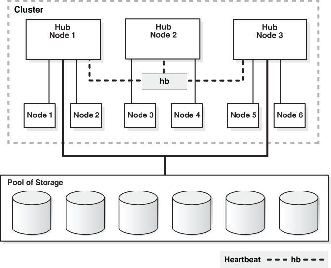
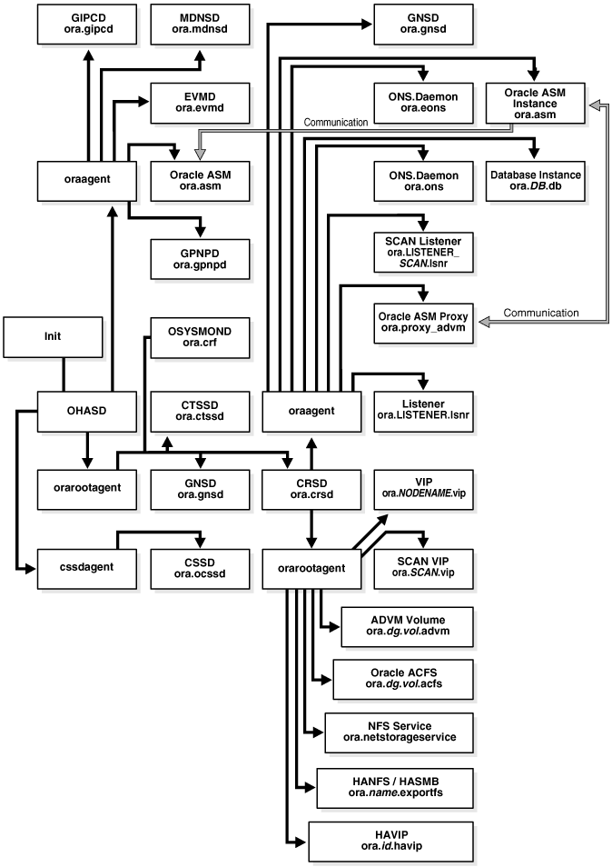

Oracle Clusterware concepts and components.

Oracle Clusterware enables servers to communicate with each other, so that they appear to function as a collective unit. This combination of servers is commonly known as a cluster. Although the servers are standalone servers, each server has additional processes that communicate with other servers. In this way the separate servers appear as if they are one system to applications and end users.

This chapter includes the following topics:

- Overview of Oracle Clusterware

- Understanding System Requirements for Oracle Clusterware

- Overview of Oracle Clusterware Platform-Specific Software Components

- High Availability Options for Oracle Database

- Overview of Installing Oracle Clusterware

- Overview of Upgrading and Patching Oracle Clusterware

- Overview of Grid Infrastructure Management Repository

- Overview of Domain Services Clusters

- Overview of Managing Oracle Clusterware Environments

- Overview of Command Evaluation

- Overview of Cloning and Extending Oracle Clusterware in Grid Environments

- Overview of the Oracle Clusterware High Availability Framework and APIs

- Overview of Cluster Time Management

### Overview of Oracle Clusterware

Oracle Clusterware is portable cluster software that provides comprehensive multi-tiered high availability and resource management for consolidated environments. It supports clustering of independent servers so that they cooperate as a single system.

Oracle Clusterware is the integrated foundation for Oracle Real Application Clusters (Oracle RAC), and the high-availability and resource management framework for all applications on any major platform. Oracle Clusterware was first released with Oracle Database 10g release 1 (10.1) as the required cluster technology for the Oracle multi-instance database, Oracle RAC. The intent is to leverage Oracle Clusterware in the cloud to provide enterprise-class resiliency where required, and dynamic, online allocation of compute resources where and when they are needed.

#### Oracle Flex Clusters

In Oracle Clusterware 12c release 2 (12.2), all clusters are configured as Oracle Flex Clusters, meaning that a cluster is configured with one or more [Hub Node](glossary.md)s, which can support a large number of nodes. Clusters currently configured under older versions of Oracle Clusterware are converted in place as part of the upgrade process, including the activation of Oracle Flex ASM (which is a requirement for Oracle Flex Clusters).

Figure 1-1 Oracle Clusterware Configuration

[Description of "Figure 1-1 Oracle Clusterware Configuration"](img_text/cwadd002c.md)

Hub Nodes are tightly connected, and have direct access to shared storage. They would traditionally be deployed as hosts for Oracle RAC or Oracle RAC One database instances. Other nodes in the cluster differ from Hub Nodes in that they do not require direct access to shared storage, but instead access data through the Hub Nodes.

All nodes in an Oracle Flex Cluster belong to a single Oracle Grid Infrastructure cluster. This architecture centralizes policy decisions for deployment of resources based on application needs, to account for various service levels, loads, failure responses, and recovery.

Oracle Flex Clusters consists of Hub Nodes that support other nodes in the cluster. The number of Hub Nodes in an Oracle Flex Cluster must be at least one and can be as many as 64, while the number of other, supported nodes can be many more. Hub Nodes can host different types of applications.

Oracle Flex Clusters may operate with one or many Hub Nodes, but other nodes are optional and can only exist as members of a cluster that includes at least one Hub Node.

The benefits of using a cluster include:

- Scalability of applications (including Oracle RAC and Oracle RAC One databases)

- Reduce total cost of ownership for the infrastructure by providing a scalable system with low-cost commodity hardware

- Ability to fail over

- Increase throughput on demand for cluster-aware applications, by adding servers to a cluster to increase cluster resources

- Increase throughput for cluster-aware applications by enabling the applications to run on all of the nodes in a cluster

- Ability to program the startup of applications in a planned order that ensures dependent processes are started in the correct sequence

- Ability to monitor processes and restart them if they stop

- Eliminate unplanned downtime due to hardware or software malfunctions

- Reduce or eliminate planned downtime for software maintenance

You can configure Oracle Clusterware to manage the availability of user applications and Oracle databases. In an Oracle RAC environment, Oracle Clusterware manages all of the resources automatically. All of the applications and processes that Oracle Clusterware manages are either [cluster resource](glossary.md)s or [local resource](glossary.md)s.

Oracle Clusterware is required for using Oracle RAC; it is the only clusterware that you need for platforms on which Oracle RAC operates. Although Oracle RAC continues to support many third-party clusterware products on specific platforms, you must also install and use Oracle Clusterware. Note that the servers on which you want to install and run Oracle Clusterware must use the same operating system. Starting with Oracle Database 19c, the integration of vendor clusterware with Oracle Clusterware is deprecated, and can be desupported in a future release. For this reason, Oracle recommends that you align your next software or hardware upgrade to transition off of vendor cluster solutions.

Using Oracle Clusterware eliminates the need for proprietary vendor clusterware and provides the benefit of using only Oracle software. Oracle provides an entire software solution, including everything from disk management with Oracle Automatic Storage Management (Oracle ASM) to data management with Oracle Database and Oracle RAC. In addition, Oracle Database features, such as Oracle Services, provide advanced functionality when used with the underlying Oracle Clusterware high-availability framework.

Oracle Clusterware has two stored components, besides the binaries: The voting files, which record node membership information, and the Oracle Cluster Registry (OCR), which records cluster configuration information. Voting files and OCRs must reside on shared storage available to all cluster member nodes.

#### Clusterware Architectures

Oracle Clusterware provides you with two different deployment architecture choices for new clusters during the installation process. You can either choose a domain services cluster or a member cluster, which is used to host applications and databases.

A domain services cluster is an Oracle Flex Cluster that has one or more Hub Nodes (for database instances) and zero or more other nodes. Shared storage is locally mounted on each of the Hub Nodes and an Oracle ASM instance is available to all Hub Nodes. In addition, a management database is stored and accessed, locally, within the cluster. This deployment is also used for an upgraded, pre-existing cluster.

A member cluster groups multiple cluster configurations for management purposes and makes use of shared services available within that cluster domain. The cluster configurations within that cluster domain are:

- Domain services cluster: A cluster that provides centralized services to other clusters within the Cluster Domain. Services can include a centralized Grid Infrastructure Management Repository (on which the management database for each of the clusters within the Cluster Domain resides), the trace file analyzer service, an optional Fleet Patching and Provisioning service, and, very likely, a consolidated Oracle ASM storage management service.

- Database member cluster: A cluster that is intended to support Oracle RAC or Oracle RAC One database instances, the management database for which is off-loaded to the domain services cluster, and that can be configured with local Oracle ASM storage management or make use of the consolidated Oracle ASM storage management service offered by the domain services cluster.

- Application member cluster: A cluster that is configured to support applications without the resources necessary to support Oracle RAC or Oracle RAC One database instances. This cluster type has no configured local shared storage but it is intended to provide a highly available, scalable platform for running application processes.

### Understanding System Requirements for Oracle Clusterware

Oracle Clusterware hardware and software concepts and requirements.

To use Oracle Clusterware, you must understand the hardware and software concepts and requirements.

#### Oracle Clusterware Hardware Concepts and Requirements

Understanding the hardware concepts and requirements helps ensure a successful Oracle Clusterware deployment.

A cluster consists of one or more servers. Access to an external network is the same for a server in a cluster (also known as a cluster member or node) as for a standalone server.

**Note:**

Many hardware providers have validated cluster configurations that provide a single part number for a cluster. If you are new to clustering, then use the information in this section to simplify your hardware procurement efforts when you purchase hardware to create a cluster.

A node that is part of a cluster requires a second network. This second network is referred to as the interconnect. For this reason, cluster member nodes require at least two network interface cards: one for a public network and one for a private network. The interconnect network is a private network using a switch (or multiple switches) that only the nodes in the cluster can access.Foot 1

**Note:**

Oracle does not support using crossover cables as Oracle Clusterware interconnects.

Cluster size is determined by the requirements of the workload running on the cluster and the number of nodes that you have configured in the cluster. If you are implementing a cluster for high availability, then configure redundancy for all of the components of the infrastructure as follows:

- At least two network interfaces for the public network, bonded to provide one address

- At least two network interfaces for the private interconnect network

The cluster requires shared connection to storage for each server in the cluster. Oracle Clusterware supports Network File Systems (NFSs), iSCSI, Direct Attached Storage (DAS), Storage Area Network (SAN) storage, and Network Attached Storage (NAS).

To provide redundancy for storage, generally provide at least two connections from each server to the cluster-aware storage. There may be more connections depending on your I/O requirements. It is important to consider the I/O requirements of the entire cluster when choosing your storage subsystem.

Most servers have at least one local disk that is internal to the server. Often, this disk is used for the operating system binaries; you can also use this disk for the Oracle software binaries. The benefit of each server having its own copy of the Oracle binaries is that it increases high availability, so that corruption of one binary does not affect all of the nodes in the cluster simultaneously. It also allows rolling upgrades, which reduce downtime.

#### Oracle Clusterware Operating System Concepts and Requirements

You must first install and verify the operating system before you can install Oracle Clusterware.

Each server must have an operating system that is certified with the Oracle Clusterware version you are installing. Refer to the certification matrices available in the Oracle Grid Infrastructure Installation and Upgrade Guide for your platform or on My Oracle Support (formerly OracleMetaLink) for details.

When the operating system is installed and working, you can then install Oracle Clusterware to create the cluster. Oracle Clusterware is installed independently of Oracle Database. After you install Oracle Clusterware, you can then install Oracle Database or Oracle RAC on any of the nodes in the cluster.

**Related Topics**

- [Oracle RAC Technologies Certification Matrix for UNIX Platforms](http://www.oracle.com/technetwork/database/clustering/tech-generic-unix-new-166583.html)
- [Oracle Grid Infrastructure Installation and Upgrade Guide for Linux](../cwlin/configuring-operating-systems-for-oracle-grid-infrastructure-on-linux.md)

#### Oracle Clusterware Software Concepts and Requirements

Oracle Clusterware uses voting files to provide fencing and cluster node membership determination. Oracle Cluster Registry (OCR) provides cluster configuration information. Collectively, voting files and OCR are referred to as Oracle Clusterware files.

Oracle Clusterware files must be stored on Oracle ASM. If the underlying storage for the Oracle ASM disks is not hardware protected, such as RAID, then Oracle recommends that you configure multiple locations for OCR and voting files. The voting files and OCR are described as follows:

- Voting Files

  Oracle Clusterware uses voting files to determine which nodes are members of a cluster. You can configure voting files on Oracle ASM, or you can configure voting files on shared storage.

  If you configure voting files on Oracle ASM, then you do not need to manually configure the voting files. Depending on the redundancy of your disk group, an appropriate number of voting files are created.

  If you do not configure voting files on Oracle ASM, then for high availability, Oracle recommends that you have a minimum of three voting files on physically separate storage. This avoids having a single point of failure. If you configure a single voting file, then you must use external mirroring to provide redundancy.

  Oracle recommends that you do not use more than five voting files, even though Oracle supports a maximum number of 15 voting files.

- Oracle Cluster Registry

  Oracle Clusterware uses the Oracle Cluster Registry (OCR) to store and manage information about the components that Oracle Clusterware controls, such as Oracle RAC databases, listeners, virtual IP addresses (VIPs), and services and any applications. OCR stores configuration information in a series of key-value pairs in a tree structure. To ensure cluster high availability, Oracle recommends that you define multiple OCR locations. In addition:

  - You can have up to five OCR locations

  - Each OCR location must reside on shared storage that is accessible by all of the nodes in the cluster

  - You can replace a failed OCR location online if it is not the only OCR location

  - You must update OCR through supported utilities such as Oracle Enterprise Manager, the Oracle Clusterware Control Utility (CRSCTL), the Server Control Utility (SRVCTL), the OCR configuration utility (OCRCONFIG), or the Oracle Database Configuration Assistant (Oracle DBCA)

**Related Topics**

- [Oracle Clusterware Configuration and Administration](oracle-clusterware-administration.md)

#### Oracle Clusterware Network Configuration Concepts

Oracle Clusterware enables a dynamic Oracle Grid Infrastructure through the self-management of the network requirements for the cluster.

Oracle Clusterware supports the use of [Dynamic Host Configuration Protocol (DHCP)](glossary.md) or stateless address auto-configuration for the VIP addresses and the [Single Client Access Name (SCAN)](glossary.md) address, but not the public address. DHCP provides dynamic assignment of IPv4 VIP addresses, while Stateless Address Autoconfiguration provides dynamic assignment of IPv6 VIP addresses.

The use of node VIPs is optional in a cluster deployment. By default node VIPs are included when you deploy the cluster environment.

When you are using Oracle RAC, all of the clients must be able to reach the database, which means that the clients must resolve VIP and SCAN names to all of the VIP and SCAN addresses, respectively. This problem is solved by the addition of [Grid Naming Service (GNS)](glossary.md) to the cluster. GNS is linked to the corporate Domain Name Service (DNS) so that clients can resolve host names to these dynamic addresses and transparently connect to the cluster and the databases. Oracle supports using GNS without DHCP or zone delegation in Oracle Clusterware 12c or later releases (as with Oracle Flex ASM server clusters, which you can configure without zone delegation or dynamic networks).

**Note:**

Oracle does not support using GNS without DHCP or zone delegation on Windows.

Starting with Oracle Clusterware 12c, a GNS instance was enhanced to enable the servicing multiple clusters rather than just one, thus only a single domain must be delegated to GNS in DNS. GNS still provides the same services as in previous versions of Oracle Clusterware.

The cluster in which the GNS server runs is referred to as the [server cluster](glossary.md). A [client cluster](glossary.md) advertises its names with the server cluster. Only one GNS daemon process can run on the server cluster. Oracle Clusterware puts the GNS daemon process on one of the nodes in the cluster to maintain availability.

In previous, single-cluster versions of GNS, the single cluster could easily locate the GNS service provider within itself. In the multicluster environment, however, the client clusters must know the GNS address of the server cluster. Given that address, client clusters can find the GNS server running on the server cluster.

In order for GNS to function on the server cluster, you must have the following:

- The DNS administrator must delegate a zone for use by GNS

- A GNS instance must be running somewhere on the network and it must not be blocked by a firewall

- All of the node names in a set of clusters served by GNS must be unique

**Related Topics**

- [Oracle Automatic Storage Management Administrator's Guide](../ostmg/manage-flex-asm.md)
- [Overview of Grid Naming Service](oracle-clusterware-administration.md)

##### Single Client Access Name (SCAN)

Oracle Clusterware can use the Single Client Access Name (SCAN) for dynamic VIP address configuration, removing the need to perform manual server configuration.

The SCAN is a domain name registered to at least one and up to three IP addresses, either in DNS or GNS. When using GNS and DHCP, Oracle Clusterware configures the VIP addresses for the SCAN name that is provided during cluster configuration.

The node VIP and the three SCAN VIPs are obtained from the DHCP server when using GNS. If a new server joins the cluster, then Oracle Clusterware dynamically obtains the required VIP address from the DHCP server, updates the cluster resource, and makes the server accessible through GNS.

**Related Topics**

- [Understanding SCAN Addresses and Client Service Connections](oracle-clusterware-administration.md)

##### Manual Addresses Configuration

You have the option to manually configure addresses, instead of using GNS and DHCP for dynamic configuration.

In manual address configuration, you configure the following:

- One public address and host name for each node.

- One VIP address for each node.

  You must assign a VIP address to each node in the cluster. Each VIP address must be on the same subnet as the public IP address for the node and should be an address that is assigned a name in the DNS. Each VIP address must also be unused and unpingable from within the network before you install Oracle Clusterware.

- Up to three SCAN addresses for the entire cluster.

  **Note:**

  The SCAN must resolve to at least one address on the public network. For high availability and scalability, Oracle recommends that you configure the SCAN to resolve to three addresses on the public network.

**Related Topics**

- [Oracle Grid Infrastructure Installation and Upgrade Guide for Linux](../cwlin/configuring-networks-for-oracle-grid-infrastructure-and-oracle-rac.md)

### Overview of Oracle Clusterware Platform-Specific Software Components

In an operational Oracle Clusterware, various platform-specific processes or services run on each cluster node.

This section describes these processes and services.

#### The Oracle Clusterware Technology Stack

Oracle Clusterware consists of two separate technology stacks: an upper technology stack anchored by the Cluster Ready Services (CRS) daemon (CRSD) and a lower technology stack anchored by the Oracle High Availability Services daemon (OHASD).

These two technology stacks have several processes that facilitate cluster operations. The following sections describe these technology stacks in more detail.

##### The Cluster Ready Services Technology Stack

The Cluster Ready Services (CRS) technology stack leverages several processes to manage various services.

The following list describes these processes:

- Cluster Ready Services (CRS): The primary program for managing high availability operations in a cluster.

  The CRSD manages cluster resources based on the configuration information that is stored in OCR for each resource. This includes start, stop, monitor, and failover operations. The CRSD process generates events when the status of a resource changes. When you have Oracle RAC installed, the CRSD process monitors the Oracle database instance, listener, and so on, and automatically restarts these components when a failure occurs.

- Cluster Synchronization Services (CSS): Manages the cluster configuration by controlling which nodes are members of the cluster and by notifying members when a node joins or leaves the cluster. If you are using certified third-party clusterware, then CSS processes interface with your clusterware to manage node membership information.

  The `cssdagent` process monitors the cluster and provides I/O fencing. This service formerly was provided by Oracle Process Monitor Daemon (`oprocd`), also known as `OraFenceService` on Windows. A `cssdagent` failure may result in Oracle Clusterware restarting the node.

- Oracle ASM: Provides disk management for Oracle Clusterware and Oracle Database.

- Cluster Time Synchronization Service (CTSS): Provides time management in a cluster for Oracle Clusterware.

- Event Management (EVM): A background process that publishes events that Oracle Clusterware creates.

- Grid Naming Service (GNS): Handles requests sent by external DNS servers, performing name resolution for names defined by the cluster.

- Oracle Agent (`oraagent`): Extends clusterware to support Oracle-specific requirements and complex resources. This process runs server callout scripts when FAN events occur. This process was known as RACG in Oracle Clusterware 11g release 1 (11.1).

- Oracle Notification Service (ONS): A publish and subscribe service for communicating Fast Application Notification (FAN) events.

- Oracle Root Agent(`orarootagent`): A specialized `oraagent` process that helps the CRSD manage resources owned by `root`, such as the network, and the Grid virtual IP address.

The Cluster Synchronization Service (CSS), Event Management (EVM), and Oracle Notification Services (ONS) components communicate with other cluster component layers on other nodes in the same cluster database environment. These components are also the main communication links between Oracle Database, applications, and the Oracle Clusterware high availability components. In addition, these background processes monitor and manage database operations.

##### The Oracle High Availability Services Technology Stack

The Oracle High Availability Services technology stack uses several processes to provide Oracle Clusterware high availability.

The following list describes the processes in the Oracle High Availability Services technology stack:

- `appagent`: Protects any resources of the `application` resource type used in previous versions of Oracle Clusterware.

- Cluster Logger Service (`ologgerd`): Receives information from all the nodes in the cluster and persists in an Oracle Grid Infrastructure Management Repository-based database. This service runs on only two nodes in a cluster.

- Grid Interprocess Communication (GIPC): A support daemon that enables Redundant Interconnect Usage.

- Grid Plug and Play (GPNPD): Provides access to the Grid Plug and Play profile, and coordinates updates to the profile among the nodes of the cluster to ensure that all of the nodes have the most recent profile.

- Multicast Domain Name Service (mDNS): Used by Grid Plug and Play to locate profiles in the cluster, and by GNS to perform name resolution. The mDNS process is a background process on Linux and UNIX and on Windows.

- Oracle Agent (`oraagent`): Extends clusterware to support Oracle-specific requirements and complex resources. This process manages daemons that run as the Oracle Clusterware owner, like the GIPC, GPNPD, and GIPC daemons.

  **Note:**

  This process is distinctly different from the process of the same name that runs in the Cluster Ready Services technology stack.

- Oracle Root Agent (`orarootagent`): A specialized `oraagent` process that helps the CRSD manage resources owned by `root`, such as the Cluster Health Monitor (CHM).

  **Note:**

  This process is distinctly different from the process of the same name that runs in the Cluster Ready Services technology stack.

- `scriptagent`: Protects resources of resource types other than `application` when using shell or batch scripts to protect an application.

- System Monitor Service (`osysmond`): The monitoring and operating system metric collection service that sends the data to the cluster logger service. This service runs on every node in a cluster.

Table 1-1 lists the processes and services associated with Oracle Clusterware components. In Table 1-1, if a UNIX or a Linux system process has an (r) beside it, then the process runs as the `root` user.

**Note:**

Oracle ASM is not only one process, but an instance. Given Oracle Flex ASM, Oracle ASM does not necessarily run on every cluster node but only some of them.

Table 1-1 List of Processes and Services Associated with Oracle Clusterware Components

| Oracle Clusterware Component      | Linux/UNIX Process                                                         | Windows Processes                              |
|:----------------------------------|:---------------------------------------------------------------------------|:-----------------------------------------------|
| CRS                               | `crsd.bin` (r)                                                             | `crsd.exe`                                     |
| CSS                               | `ocssd.bin`, `cssdmonitor`, `cssdagent`                                    | `cssdagent.exe`, `cssdmonitor.exe` `ocssd.exe` |
| CTSS                              | `octssd.bin` (r)                                                           | `octssd.exe`                                   |
| EVM                               | `evmd.bin`, `evmlogger.bin`                                                | `evmd.exe`                                     |
| GIPC                              | `gipcd.bin`                                                                |                                                |
| GNS                               | `gnsd` (r)                                                                 | `gnsd.exe`                                     |
| Grid Plug and Play                | `gpnpd.bin`                                                                | `gpnpd.exe`                                    |
| LOGGER                            | `ologgerd.bin` (r)                                                         | `ologgerd.exe`                                 |
| Master Diskmon                    | `diskmon.bin`                                                              |                                                |
| mDNS                              | `mdnsd.bin`                                                                | `mDNSResponder.exe`                            |
| Oracle agent                      | `oraagent.bin` (Oracle Clusterware 12c release 1 (12.1) and later releases | `oraagent.exe`                                 |
| Oracle High Availability Services | `ohasd.bin` (r)                                                            | `ohasd.exe`                                    |
| ONS                               | `ons`                                                                      | `ons.exe`                                      |
| Oracle root agent                 | `orarootagent` (r)                                                         | `orarootagent.exe`                             |
| SYSMON                            | `osysmond.bin` (r)                                                         | `osysmond.exe`                                 |

**Note:**

Oracle Clusterware on Linux platforms can have multiple threads that appear as separate processes with unique process identifiers.

Figure 1-2 illustrates cluster startup.

Figure 1-2 Cluster Startup

[Description of "Figure 1-2 Cluster Startup"](img_text/cwadd006_ha_stack.md)

**Related Topics**

- [Oracle Clusterware Resources](making-applications-highly-available-using-oracle-clusterware.md)
- [Oracle Clusterware Diagnostic and Alert Log Data](troubleshooting-oracle-clusterware.md)

###### Transport Layer Security Cipher Suite Management

Oracle Clusterware provides CRSCTL commands to disable a given cipher suite, and stores disabled cipher suite details in Oracle Local Registry and Oracle Cluster Registry, ensuring that cipher suites included on the disabled list are not used to negotiate transport layer security.

Starting with Oracle Clusterware 19c, the technology stack uses the GIPC library for both inter-node and intra-node communication. To secure an inter-node communication channel, the GIPC library uses transport layer security. For any Oracle Clusterware release, the GIPC library supports a set of precompiled cipher suites. Over time, a cipher suite may get compromised. Prior to Oracle Clusterware 19c, you could not disable a given cipher suite included in the set to prevent it from being used in any new connections in the future.

##### Querying the Cipher List

To obtain a list of available cipher suites:

    crsctl get cluster tlsciphersuite

##### Adding a Cipher Suite to the Disabled List

To add a cipher suite to the disabled list:

    crsctl set cluster disabledtlsciphersuite add cipher_suite_name

##### Removing a Cipher Suite from the Disabled List

To remove a cipher suite from the disabled list:

    crsctl set cluster disabledtlsciphersuite delete cipher_suite_name

**Related Topics**

- [crsctl get cluster tlsciphersuite](oracle-clusterware-control-crsctl-utility-reference.md)
- [crsctl set cluster disabledtlsciphersuite](oracle-clusterware-control-crsctl-utility-reference.md)

#### Oracle Clusterware Processes on Windows Systems

Oracle Clusterware uses various Microsoft Windows processes for operations on Microsoft Windows systems.

These include the following processes:

- `mDNSResponder.exe`: Manages name resolution and service discovery within attached subnets

- `OracleOHService`: Starts all of the Oracle Clusterware daemons

### High Availability Options for Oracle Database

Review the high availability options available to you for Oracle Database using Standard Edition High Availability, Oracle Restart, Oracle Real Application Clusters (Oracle RAC), and Oracle RAC One Node.

The following is an overview of the high availability options available to you for Oracle Database.

#### Standard Edition High Availability

- Cluster-based active/passive Oracle Database failover solution
- Designed for single instance Standard Edition Oracle Databases
- Available with Oracle Database 19c release update (RU) 19.7 and later
- Requires Oracle Grid Infrastructure 19c RU 19.7 and later, installed as a Standalone Cluster

#### Oracle Restart

- Oracle Database instance restart only feature and basis for Oracle Automatic Storage Management (Oracle ASM) for standalone server deployments
- For single instance Oracle Databases
- Requires Oracle Grid Infrastructure for a standalone server (no cluster)

#### Oracle Real Application Clusters (Oracle RAC) One Node

- Provides a cluster-based active/passive Oracle Database failover and online database relocation solution
- Available for Oracle RAC-enabled Oracle Databases
- Only one instance of an Oracle RAC-enabled Oracle Database is running under normal operations
- Enables relocation of the active instance to another server in the cluster in an online fashion. To relocate the active instance, you can temporarily start a second instance on the destination server, and relocate the workload
- Supports Rolling Upgrades - patch set, database, and operating system
- Supports Application Continuity
- Requires Oracle Grid Infrastructure to be installed as a Standalone Cluster

#### Oracle Real Application Clusters (Oracle RAC)

- Provides active / active Oracle Database high availability and scalability solution
- Enables multiple servers to perform concurrent transactions on the same Oracle Database
- Provides high availability: a failure of a database instance or server does not interrupt the database service as a whole, because other instances and their servers remain operational
- Supports Rolling Upgrades - patch set, database, and operating system
- Supports Application Continuity
- Requires Oracle Grid Infrastructure to be installed as a Standalone Cluster

### Overview of Installing Oracle Clusterware

A successful deployment of Oracle Clusterware is more likely if you understand the installation and deployment concepts.

**Note:**

Install Oracle Clusterware with the Oracle Universal Installer.

#### Oracle Clusterware Version Compatibility

You can install different releases of Oracle Clusterware, Oracle ASM, and Oracle Database on your cluster. However you should be aware of compatibility considerations.

Follow these guidelines when installing different releases of software on your cluster:

- You can only have one installation of Oracle Clusterware running in a cluster, and it must be installed into its own software home (`Grid_home`). The release of Oracle Clusterware that you use must be equal to or higher than the Oracle ASM and Oracle RAC versions that run in the cluster. You cannot install a version of Oracle RAC that was released after the version of Oracle Clusterware that you run on the cluster. For example:

  - Oracle Clusterware 19c only supports Oracle ASM 19c, because Oracle ASM is in the Oracle Grid Infrastructure home, which also includes Oracle Clusterware

  - Oracle Clusterware 19c supports Oracle Database 19c and Oracle Database 12.1 Release 1 (12.1 and later)

  - Oracle ASM 19c requires Oracle Clusterware 19c, and supports Oracle Database 19c and Oracle Database 12c Release 1 (12.1 and later)

  - Oracle Database 19c requires Oracle Clusterware 19c

    For example:

    - If you have Oracle Clusterware 19c installed as your clusterware, then you can have an Oracle Database 12c Release 1 (12.1) single-instance database running on one node, and separate Oracle Real Application Clusters 12c Release 2 (12.2) and Oracle Real Application Clusters 18c databases also running on the cluster.

    - When using different Oracle ASM and Oracle Database releases, the functionality of each depends on the functionality of the earlier software release. Thus, if you install Oracle Clusterware 19c, and you later configure Oracle ASM, and you use Oracle Clusterware to support an existing Oracle Database 12c Release 2 (12.2) installation, then the Oracle ASM functionality is equivalent only to that available in the 12c Release 2 (12.2) release version. Set the compatible attributes of a disk group to the appropriate release of software in use.

- There can be multiple Oracle homes for the Oracle Database software (both single instance and Oracle RAC) in the cluster. The Oracle homes for all nodes of an Oracle RAC database must be the same.

- You can use different users for the Oracle Clusterware and Oracle Database homes if they belong to the same primary group.

- Starting with Oracle Clusterware 12c, there can only be one installation of Oracle ASM running in a cluster. Oracle ASM is always the same version as Oracle Clusterware, which must be the same (or higher) release than that of the Oracle database.

- To install Oracle RAC 10g, you must also install Oracle Clusterware.

- Oracle recommends that you do not run different cluster software on the same servers unless they are certified to work together. However, if you are adding Oracle RAC to servers that are part of a cluster, then either migrate to Oracle Clusterware or ensure that:

  - The clusterware you run is supported to run with Oracle RAC 18c.

  - You have installed the correct options for Oracle Clusterware and the other vendor clusterware to work together.

**Note:**

Starting with Oracle Database 19c, the integration of vendor clusterware with Oracle Clusterware is deprecated, and can be desupported in a future release. For this reason, Oracle recommends that you align your next software or hardware upgrade to transition off of vendor cluster solutions.

**Related Topics**

- [Oracle Automatic Storage Management Administrator's Guide](../ostmg/diskgroup-compatibility.md)
- [Oracle Grid Infrastructure Installation and Upgrade Guide](../install-and-upgrade.md)

### Overview of Upgrading and Patching Oracle Clusterware

In-place patching replaces the Oracle Clusterware software with the newer version in the same Grid home. Out-of-place upgrade has both versions of the same software present on the nodes at the same time, in different Grid homes, but only one version is active.

For Oracle Clusterware 12c and later releases, Oracle supports in-place or out-of-place patching. Oracle supports only out-of-place upgrades.

Oracle supports patch bundles and one-off patches for in-place patching but only supports patch sets and major point releases as out-of-place upgrades.

Rolling upgrades avoid downtime and ensure continuous availability of Oracle Clusterware while the software is upgraded to the new version. When you upgrade to Oracle Clusterware 12c or later releases, Oracle Clusterware and Oracle ASM binaries are installed as a single binary called the Oracle Grid Infrastructure.

Oracle supports force upgrades in cases where some nodes of the cluster are down.

**Related Topics**

- [Oracle Grid Infrastructure Installation and Upgrade Guide for Linux](../cwlin/upgrading-oracle-grid-infrastructure.md)

### Overview of Grid Infrastructure Management Repository

The Grid Infrastructure Management Repository stores information about the cluster, such as real-time performance data and metadata that various cluster clients collect and require.

In previous versions of Oracle Grid Infrastructure, the Grid Infrastructure Management Repository was a standalone database in the Grid Infrastructure home. This required disk space in the first disk group created, sharing that space with the Oracle Cluster Registry (OCR) and the voting disk. For standalone clusters, you can install the Grid Infrastructure Management Repository into its own MGMT disk group, along with the OCR backup files during Oracle Grid Infrastructure installation.

Oracle Member Clusters use the Grid Infrastructure Management Repository service located in its Domain Services Cluster, where its Grid Infrastructure Management Repository is a pluggable database (PDB) within the Grid Infrastructure Management Repository container database (CDB) of the Domain Services Cluster. This removes the requirement to run a local Grid Infrastructure Management Repository and locate its data files in the member cluster's disk group.

Additionally, you can install both the local Grid Infrastructure Management Repository and Domain Services Cluster Grid Infrastructure Management Repository into the MGMT disk group during installation of Oracle Grid Infrastructure. It is mandatory for the domain services cluster to be located in a disk group separate from the OCR and voting disk.

The Grid Infrastructure Management Repository:

- Is an Oracle database that stores real-time operating system metrics collected by Cluster Health Monitor. You configure the Grid Infrastructure Management Repository during an installation of or upgrade to Oracle Clusterware 12c on a cluster.

  **Note:**

  If you are upgrading Oracle Clusterware to Oracle Clusterware 12c and OCR and the voting file are stored on raw or block devices, then you must move them to Oracle ASM before you upgrade your software.

- Must run on a Hub Node, and must support failover to another node in case of node or storage failure.

- Communicates with any cluster clients (such as Cluster Health Advisor, cluster resource activity log, Fleet Patching and Provisioning Server, OLOGGERD, and OCLUMON) through the private network. The Grid Infrastructure Management Repository communicates with external clients, Domain Services Clusters, and member clusters over the public network, only.

- Oracle recommends that you store data files in their own Oracle ASM disk group, `MGMT`, which you can create during Oracle Grid Infrastructure installation. If you did not create this disk group during installation, then the data files will be co-located with the OCR and voting files.

  Oracle increased the Oracle Clusterware shared storage requirement to accommodate the Grid Infrastructure Management Repository, which can be a network file system (NFS), cluster file system, or an Oracle ASM disk group.

- Is managed with SRVCTL commands with the `mgmtdb` and `mgmtlsnr` nouns.

- Is managed by each of its clients’ command one utility for retention.

**Note:**

Starting with Oracle Grid Infrastructure 19c, the Grid Infrastructure Management Repository (GIMR) is optional for new installations of Oracle Standalone Cluster. Oracle Domain Services Clusters still require the installation of a GIMR as a service component.

**Related Topics**

- [Oracle Autonomous Health Framework User's Guide](../atnms/purpose-cluster-health-monitor.md)

### Overview of Domain Services Clusters

Domain Services Cluster is the base for a service-oriented infrastructure for deploying clustered systems within a single Management Domain. A Domain Services Cluster is an Oracle cluster deployed solely to provide services to Member Clusters within that Management Domain.

The Member Clusters use the configured services as they are needed. The services include a centralized Domain Management Repository, Storage Management services, and Fleet Patching and Provisioning.

Configuring a Domain Services Cluster has many benefits, including:

- Ease of deployment and provisioning

  - Configure shared services once, reuse many times over

  - No need to provision and configure shared storage for each member cluster

  - Deploy Database Member Clusters with the option of using the shared storage management services or locally configured storage

  - Deploy Application Member Clusters without support for a database, consuming fewer resources and using Oracle ACFS Remote for shared storage

- Centralized shared services

  - Benefits of consolidation of storage management to the Domain Services Clusters:

    - Efficiencies of scale (save storage and effort)

    - Manage all storage simultaneously

  - Database management goes from the local cluster to the Domain Management Repository

  - Member clusters have access to the Oracle ACFS file systems on the Domain Services Cluster using Oracle ACFS Remote

The Cluster Domain consists of the Domain Services Cluster and the Member Clusters that make use of the services provided. All clusters use the same standard Oracle Clusterware and are deployed using the Oracle Universal Installer. The Domain Services Cluster must be deployed first, then used to provide services to the Member Clusters as they are deployed and configured for the services they require.

Application Member Clusters are configured, as follows:

- To not support Oracle databases and database resources, thus consuming far fewer memory resources

- Access to shared storage provisioned from the Domain Services Cluster using Oracle ACFS Remote

- Management repositories and the storage of their Oracle Cluster Registry and voting files provided by centralized storage

The Database Member Clusters can be configured in three different ways, depending upon how storage is to be accessed. In all cases, the management repositories are stored in the Domain Management Repository. The three configurations for Database Member Cluster storage access are:

- Locally configured shared storage, with local Oracle ASM instances on the cluster

- Direct access to storage that is managed through remote Oracle ASM on the Domain Services Cluster

- Indirect access to Oracle ASM storage on the Domain Services Cluster through Oracle ACFS Remote and through an Oracle ASM IO service

**Related Topics**

- [Cross-Cluster Dependency Proxies](oracle-clusterware-administration.md)
- [Oracle Automatic Storage Management Administrator's Guide](../ostmg/manage-flex-asm.md)

### Overview of Managing Oracle Clusterware Environments

Oracle Clusterware provides you with several different utilities with which to manage the environment.

The following list describes the utilities for managing your Oracle Clusterware environment:

- Cluster Health Monitor (CHM): [Cluster Health Monitor](glossary.md) detects and analyzes operating system and cluster resource-related degradation and failures to provide more details to users for many Oracle Clusterware and Oracle RAC issues, such as node eviction. The tool continuously tracks the operating system resource consumption at the node, process, and device levels. It collects and analyzes the clusterwide data. In real-time mode, when thresholds are met, the tool shows an alert to the user. For root-cause analysis, historical data can be replayed to understand what was happening at the time of failure.

- Cluster Verification Utility (CVU): CVU is a command-line utility that you use to verify a range of cluster and Oracle RAC specific components. Use CVU to verify shared storage devices, networking configurations, system requirements, and Oracle Clusterware, and operating system groups and users.

  Install and use CVU for both preinstallation and postinstallation checks of your cluster environment. CVU is especially useful during preinstallation and during installation of Oracle Clusterware and Oracle RAC components to ensure that your configuration meets the minimum installation requirements. Also use CVU to verify your configuration after completing administrative tasks, such as node additions and node deletions.

- Oracle Cluster Registry Configuration Tool (OCRCONFIG): OCRCONFIG is a command-line tool for OCR administration. You can also use the OCRCHECK and OCRDUMP utilities to troubleshoot configuration problems that affect OCR.

- Oracle Clusterware Control (CRSCTL): CRSCTL is a command-line tool that you can use to manage Oracle Clusterware. Use CRSCTL for general clusterware management, management of individual resources, configuration policies, and server pools for non-database applications.

  Oracle Clusterware 12c introduces cluster-aware commands with which you can perform operations from any node in the cluster on another node in the cluster, or on all nodes in the cluster, depending on the operation.

  You can use `crsctl` commands to monitor cluster resources (`crsctl status resource`) and to monitor and manage servers and server pools other than server pools that have names prefixed with `ora.*`, such as `crsctl status server`, `crsctl status serverpool`, `crsctl modify serverpool`, and `crsctl relocate server`. You can also manage Oracle High Availability Services on the entire cluster (`crsctl start | stop | enable | disable | config crs`), using the optional node-specific arguments `-n` or `-all`. You also can use CRSCTL to manage Oracle Clusterware on individual nodes (`crsctl start | stop | enable | disable | config crs`).

- Oracle Enterprise Manager: Oracle Enterprise Manager has both the Cloud Control and Grid Control GUI interfaces for managing both single instance and Oracle RAC database environments. It also has GUI interfaces to manage Oracle Clusterware and all components configured in the Oracle Grid Infrastructure installation. Oracle recommends that you use Oracle Enterprise Manager to perform administrative tasks.

- Oracle Interface Configuration Tool (OIFCFG): OIFCFG is a command-line tool for both single-instance Oracle databases and Oracle RAC environments. Use OIFCFG to allocate and deallocate network interfaces to components. You can also use OIFCFG to direct components to use specific network interfaces and to retrieve component configuration information.

- Server Control (SRVCTL): SRVCTL is a command-line interface that you can use to manage Oracle resources, such as databases, services, or listeners in the cluster.

  **Note:**

  You can only use SRVCTL to manage server pools that have names prefixed with `ora.*`.

**Related Topics**

- [Oracle Autonomous Health Framework User's Guide](../atnms/monitoring-clusterware-chm.md)
- [Cluster Verification Utility Reference](cluster-verification-utility-reference.md)
- [Oracle Clusterware Configuration and Administration](oracle-clusterware-administration.md)
- [Oracle Clusterware Control (CRSCTL) Utility Reference](oracle-clusterware-control-crsctl-utility-reference.md)
- [Oracle Interface Configuration Tool (OIFCFG) Command Reference](oracle-interface-configuration-tool-oifcfg-command-reference.md)
- [Server Control (SRVCTL) Command Reference](server-control-command-reference.md)

### Overview of Command Evaluation

You can use the Oracle Clusterware Control (CRSCTL) utility to evaluate what (command evaluation) will happen and why (reasoned command evaluation) when you use CRSCTL commands to manage servers, server pools, and policies within your Oracle Clusterware environment without making any actual changes.

In addition to showing you consequences of a planned or unplanned event, command evaluation is helpful in a policy-managed environment by validating any assumptions you may have about Oracle Clusterware policy decisions. Reasoned command evaluation expands on this by showing you why Oracle Clusterware performs a particular action through verbose output of various CRSCTL commands.

Following is an example of what would happen if you removed a server from a server pool:

    $ crsctl eval delete server mjk-node2-3 -explain

    Stage Group 1:
    -----------------------------------------------------------------------------
    Stage Required    Action
    -----------------------------------------------------------------------------
       1 E Server 'mjk-node2-3' is removed from server pool 'sp1'.
             E Server pool 'sp1' is below the MIN_SIZE value of 2 with 1
                  servers.
             E Looking at other server pools to see whether MIN_SIZE value 2 of
                  server pool 'sp1' can be met.
             E Scanning server pools with MIN_SIZE or fewer servers in
                  ascending order of IMPORTANCE.
             E Considering server pools (IMPORTANCE): sp2(2) for suitable
                  servers.
             E Considering server pool 'sp2' because its MIN_SIZE is 2 and it
                  has 0 servers above MIN_SIZE.
             E Relocating server 'mjk-node2-0' to server pool 'sp1'.
             Y Server 'mjk-node2-3' will be removed from pools 'sp1'.
             Y Server 'mjk-node2-0' will be moved from pools 'sp2' to
                  pools 'sp1'
    ===============================================================================

The information contained in the preceding example is what a command evaluation returns. Each action plan explains the attributes and criteria Oracle Clusterware used to arrive at the final decision.

**Note:**

CRSCTL can only evaluate third-party resources. Resources with the ora prefix, such as `ora.orcl.db`, must be evaluated using SRVCTL commands.

**Related Topics**

- [Command Evaluation APIs](oracle-clusterware-c-application-program-interfaces.md)
- [Oracle Clusterware Control (CRSCTL) Utility Reference](oracle-clusterware-control-crsctl-utility-reference.md)

### Overview of Cloning and Extending Oracle Clusterware in Grid Environments

Cloning nodes is one method of creating new clusters. Use cloning to quickly create several clusters of the same configuration.

The cloning process copies Oracle Clusterware software images to other nodes that have similar hardware and software. Before using cloning, you must install an Oracle Clusterware home successfully on at least one node using the instructions in your platform-specific Oracle Clusterware installation guide.

For new installations, or if you must install on only one cluster, Oracle recommends that you use the automated and interactive installation methods, such as Oracle Universal Installer or the Provisioning Pack feature of Oracle Enterprise Manager. These methods perform installation checks to ensure a successful installation. To add or delete Oracle Clusterware to or from nodes in the cluster, use the `gridsetup.sh` script.

**Related Topics**

- [Cloning Oracle Clusterware](cloning-oracle-clusterware.md)
- [Adding and Deleting Cluster Nodes](adding-and-deleting-cluster-nodes.md)

### Overview of the Oracle Clusterware High Availability Framework and APIs

Oracle Clusterware provides many high availability application programming interfaces called CLSCRS APIs that you use to enable Oracle Clusterware to manage applications or processes that run in a cluster. The CLSCRS APIs enable you to provide high availability for all of your applications.

You can define a VIP address for an application to enable users to access the application independently of the node in the cluster on which the application is running. This is referred to as the application VIP. You can define multiple application VIPs, with generally one application VIP defined for each application running. The application VIP is related to the application by making it dependent on the application resource defined by Oracle Clusterware.

To maintain high availability, Oracle Clusterware components can respond to status changes to restart applications and processes according to defined high availability rules. You can use the Oracle Clusterware high availability framework by registering your applications with Oracle Clusterware and configuring the clusterware to start, stop, or relocate your application processes. That is, you can make custom applications highly available by using Oracle Clusterware to create profiles that monitor, relocate, and restart your applications.

**Related Topics**

- [Oracle Clusterware C Application Program Interfaces](oracle-clusterware-c-application-program-interfaces.md)

### Overview of Cluster Time Management

The Cluster Time Synchronization Service (CTSS) can detect time synchronization problems between nodes in the cluster.

**Note:**

Cluster Time Synchronization Service (CTSS) is deprecated in Oracle Database 19c. 

To synchronize time between cluster member nodes, use either an operating system configured network time protocol such as `ntp` or `chrony`, or Microsoft Windows Time service. To verify that you have network time synchronization configured, you can use the `cluvfy comp clocksync -n all` command.

CTSS is installed as part of Oracle Clusterware. It runs in observer mode if it detects a time synchronization service (such as NTP or Chrony) or a time synchronization service configuration, valid or broken, on the system. For example, if the `etc/ntp.conf` file exists on any node in the cluster, then CTSS runs in observer mode even if no time synchronization software is running.

If CTSS detects that there is no time synchronization service or time synchronization service configuration on any node in the cluster, then CTSS goes into active mode and takes over time management for the cluster.

If CTSS is running in active mode while another, non-NTP, time synchronization software is running, then you can change CTSS to run in observer mode by creating a file called `etc/ntp.conf`. CTSS puts an entry in the alert log about the change to observer mode.

When nodes join the cluster, if CTSS is in active mode, then it compares the time on those nodes to a reference clock located on one node in the cluster. If there is a discrepancy between the two times and the discrepancy is within a certain stepping limit, then CTSS performs step time synchronization, which is to step the time, forward or backward, of the nodes joining the cluster to synchronize them with the reference.

Clocks on nodes in the cluster become desynchronized with the reference clock (a time CTSS uses as a basis and is on the first node started in the cluster) periodically for various reasons. When this happens, CTSS performs slew time synchronization, which is to speed up or slow down the system time on the nodes until they are synchronized with the reference system time. In this time synchronization method, CTSS does not adjust time backward, which guarantees monotonic increase of the system time.

When Oracle Clusterware starts, if CTSS is running in active mode and the time discrepancy is outside the stepping limit (the limit is 24 hours), then CTSS generates an alert in the alert log, exits, and Oracle Clusterware startup fails. You must manually adjust the time of the nodes joining the cluster to synchronize with the cluster, after which Oracle Clusterware can start and CTSS can manage the time for the nodes.

When performing slew time synchronization, CTSS never runs time backward to synchronize with the reference clock. CTSS periodically writes alerts to the alert log containing information about how often it adjusts time on nodes to keep them synchronized with the reference clock.

CTSS writes entries to the Oracle Clusterware alert log and `syslog` when it:

- Detects a time change

- Detects significant time difference from the reference node

- The mode switches from observer to active or vice versa

Having CTSS running to synchronize time in a cluster facilitates troubleshooting Oracle Clusterware problems, because you will not have to factor in a time offset for a sequence of events on different nodes.

#### Activating and Deactivating Cluster Time Management

You can activate CTSS to assume time management services for your cluster. You can also deactivate it if you want to use a different cluster time synchronization service.

**Note:**

Cluster Time Synchronization Service (CTSS) is deprecated in Oracle Database 19c. 

To synchronize time between cluster member nodes, use either an operating system configured network time protocol such as `ntp` or `chrony`, or Microsoft Windows Time service. To verify that you have network time synchronization configured, you can use the `cluvfy comp clocksync -n all` command.

To activate CTSS in your cluster, you must stop and deconfigure the vendor time synchronization service on all nodes in the cluster. CTSS detects when this happens and assumes time management for the cluster.

For example, to deconfigure NTP, you must remove or rename the `etc/ntp.conf` file.

Similarly, to deactivate CTSS in your cluster:

1.  Configure the vendor time synchronization service on all nodes in the cluster. CTSS detects this change and reverts back to observer mode.
2.  Use the `crsctl check ctss` command to ensure that CTSS is operating in observer mode.
3.  Start the vendor time synchronization service on all nodes in the cluster.
4.  Use the `cluvfy comp clocksync -n all` command to verify that the vendor time synchronization service is operating.

**Related Topics**

- [crsctl check ctss](oracle-clusterware-control-crsctl-utility-reference.md)
- [cluvfy comp clocksync](cluster-verification-utility-reference.md)
- [Oracle Grid Infrastructure Installation and Upgrade Guide for Linux](../cwlin/index.md)

------------------------------------------------------------------------

Footnote Legend

Footnote 1:

Oracle Clusterware supports up to 100 nodes in a cluster on configurations running Oracle Database 10g release 2 (10.2) and later releases.
