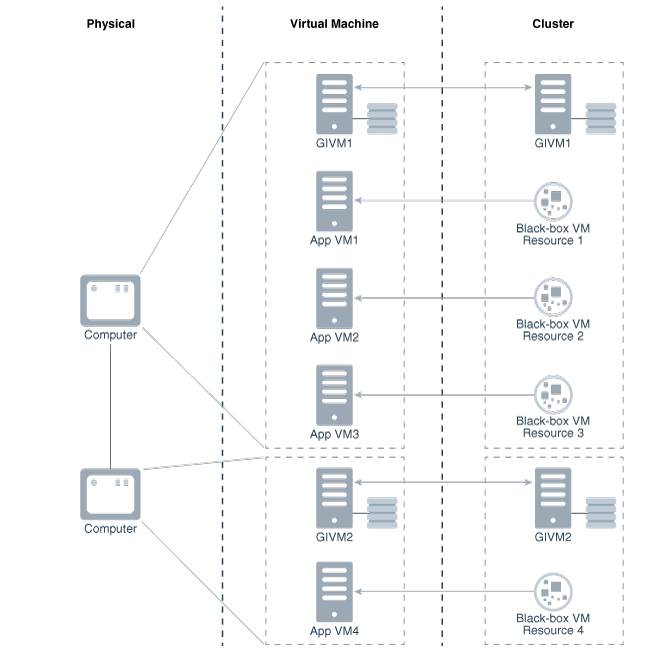

When an application, process, or server fails in a cluster, you want the disruption to be as short as possible, if not completely unknown to users. For example, when an application fails on a server, that application can be restarted on another server in the cluster, minimizing or negating any disruption in the use of that application. Similarly, if a server in a cluster fails, then all of the applications and processes running on that server must be able to fail over to another server to continue providing service to the users. Using the built-in `generic_application` resource type or customizable scripts and application agent programs, and resource attributes that you assign to applications and processes, Oracle Clusterware can manage all these entities to ensure high availability.

This chapter explains how to use Oracle Clusterware to start, stop, monitor, restart, and relocate applications. Oracle Clusterware is the underlying cluster solution for Oracle Real Application Clusters (Oracle RAC). The same functionality and principles you use to manage Oracle RAC databases are applied to the management of applications.

This chapter includes the following topics:

- Oracle Clusterware Resources and Agents

- Overview of Using Oracle Clusterware to Enable High Availability

- Registering an Application as a Resource

- Managing Resources

- Managing Automatic Restart of Oracle Clusterware Resources

### Oracle Clusterware Resources and Agents

This section discusses the framework that Oracle Clusterware uses to monitor and manage [resource](glossary.md)s, to ensure high application availability.

This section includes the following topics:

- Oracle Clusterware Resources

- Oracle Clusterware Resource Types

- Agents in Oracle Clusterware

- Action Scripts

- Building an Agent

- Registering a Resource in Oracle Clusterware

#### Oracle Clusterware Resources

Oracle Clusterware manages applications and processes as resources that you register with Oracle Clusterware.

The number of resources you register with Oracle Clusterware to manage an application depends on the application. Applications that consist of only one process are usually represented by only one resource. For more complex applications that are built on multiple processes or components that may require multiple resources, you can create [resource group](glossary.md)s.

Each resource is based on a resource type that serves as a template. You can configure how Oracle Clusterware will place an application in the cluster by specifying an explicit list of servers, or by using features such as server pools and policies. Relationships between applications and components are expressed using dependencies. Oracle Clusterware manages the application by performing operations on the resources, and the resource state represents the availability of the application.

When you register an application as a resource in Oracle Clusterware, in addition to actually adding the resource to the system, you define how Oracle Clusterware manages the application using resource attributes you ascribe to the resource. The frequency with which the resource is checked and the number of attempts to restart a resource on the same server after a failure before attempting to start it on another server (failover) are examples of resource attributes. The registration information also includes a path to an action script or application-specific action program that Oracle Clusterware calls to start, stop, check, and clean up the application.

An action script is a shell script (a batch script in Windows) that a generic script agent provided by Oracle Clusterware calls. An application-specific agent is usually a C or C++ program that calls Oracle Clusterware-provided APIs directly.

##### Critical Resources

Some large enterprise applications modeled as resource groups can comprise multiple resources representing application or infrastructure components. If any resource in the resource group fails, then Oracle Clusterware must fail the entire resource group over to another server in the cluster.

You can mark a resource as critical for its resource group by specifying the name of the resource in the CRITICAL_RESOURCES attribute of the resource group.

**Related Topics**

- [Oracle Clusterware Resource Reference](oracle-clusterware-resource-reference.md)
- Resource Groups

##### Virtual Machine Resources

A virtual machine is an environment created for a running operating system, known as a guest operating system. The virtual machine displays as a window on your computer’s desktop which can be displayed in full-screen mode or remotely on another computer.

A virtual machine is, essentially, a set of parameters that determines its behavior, analogous to computer system hardware. Parameters include hardware settings (such as how much memory the virtual machine has) as well as state information (such as whether the virtual machine is currently running).

Black-box virtual machines are virtual machines whose contents are unknown to the management interface. All that is known about black-box virtual machines is the virtual hardware they contain: the number of CPUs, the amount of RAM, attached disks, and attached network interfaces. The contents of the hardware however, are unknown. For example, there may be a number of disks attached, but it is not known which operating system is installed on them, nor is it known whether the network cards are configured.

You can manage black-box Oracle virtual machines on physical hardware using Oracle Clusterware, which provides high availability and ease of management of virtual machines.

**Note:**

This is specific to virtual machines, and does not apply to Oracle VM VirtualBox, or any other Oracle VM product.

As an example, in following figure, there are two physical computers, each of which has multiple virtual machines running on it. One of the computers, for each physical host, is an Oracle Grid Infrastructure virtual machine (GIVM).

The GIVMs, themselves, form an Oracle Clusterware cluster, and within this cluster are four black-box virtual machine Oracle Clusterware resources, each monitoring one of the non-GIVM virtual machines. The cluster is not aware of the contents of the virtual machines it is monitoring because they are black-box virtual machines. In this example, if one of the physical hosts goes down, then its GIVM would also go down, causing the GIVM to leave the cluster, which, in turn, causes the resources to fail over to the other GIVM, which starts the black-box virtual machines on the new physical host.

Figure 8-1 Highly Available Virtual Machines in Oracle Database Appliance

[Description of "Figure 8-1 Highly Available Virtual Machines in Oracle Database Appliance"](img_text/cwadd_3v_007.md)

##### Virtual Machine Architecture

Oracle virtual machines consist of two parts: the virtual machine server and the virtual machine manager. The virtual machine server is a minimal operating system installed on bare hardware that uses a Xen hypervisor to manage guests. The server has an agent process, the Oracle virtual machine agent, which acts as an intermediary through which the virtual machine manager manipulates domains on the server.

The virtual machine manager is a web-based management console that is used to manage virtual machine servers and their virtual machines. The virtual machine manager requires a database as well as an Oracle WebLogic Server in order to run, and is necessary for Oracle-supported management of the Oracle virtual machine server. The management domain is supposed to be as small as possible and, therefore, the virtual machine manager may not be installed there. You must install the virtual machine manager on another host, which means either having another physical computer or manually creating a temporary virtual machine using the Xen `xm` commands.

The Oracle virtual machine manager is the sole interface for managing virtual machines. All requests are directed through it, including all APIs and utilities.

The resource type for a virtual machine resource (which is an Oracle Clusterware resource) is similar to the following:

    ATTRIBUTE=DESCRIPTION
    TYPE=string
    DEFAULT_VALUE="Resource type for VM Agents"
    ATTRIBUTE=AGENT_FILENAME
    TYPE=string
    DEFAULT_VALUE=%CRS_HOME%/bin/oraagent%CRS_EXE_SUFFIX%
    ATTRIBUTE=CHECK_INTERVAL
    DEFAULT_VALUE=1
    TYPE=int
    ATTRIBUTE=OVMM_VM_ID
    TYPE=string
    DEFAULT_VALUE=''
    ATTRIBUTE=OVMM_VM_NAME
    TYPE=string
    DEFAULT_VALUE=''
    ATTRIBUTE=VM
    TYPE=strings

##### Resource Groups

A resource group is a container for a logically related group of resources.

An application is modeled as a resource group that contains the application resource and related application resources (such as WebServer), and infrastructure resources (such as disk groups and VIPs). A resource group provides a logical and intuitive entity for high availability modeling of all classes of applications.

You create resource groups using CRSCTL, and then add resources to the resource group. A resource group provides a set of attributes that cover naming, description, and common placement and failover parameter values for the resources that are members of the resource group.

##### Resource Group Principles

- You create a resource group based on a resource group type.

- A resource can be member of only one resource group. You can specify a resource group for a resource when you create the resource.

  If you do not specify a resource group when you create a resource, then the resource becomes a member of an automatic resource group created for that resource. You can later add the resource to a different resource group.

- Resource groups are aware of critical resources, and the state of the resource group is solely determined by the state of its critical resources.

  You can remove a non-critical resource from a resource group (subject to dependency checks) and, at a later time, add it to another resource group.

- Resource groups have cardinality to specify the number of instances of the resource group that can simultaneously run in the cluster.

- All member resources of a running resource group instance are located on the same server.

- Oracle Clusterware restarts a resource group in the event of failure and then relocates the resource group to another server in the event of local restart failures.

##### Automatic Resource Groups

If you create a resource without specifying a resource group, then Oracle Clusterware implicitly and automatically adds the resource to a resource group with the same name as the resource.

An automatic resource group is created for each resource that is not explicitly added to a resource group. You can create resources without using resource groups and work with Oracle Clusterware without disruption. Using resource groups, however, enables you to define relationships to infrastructure and application resources (through automatic resource groups) created by SRVM or other existing utilities.

An automatic resource group is solely described by the resource that it has been created for, and cannot be modified by an administrator. Resources that you create without specifying a resource group can be added to a resource group at a later time. Oracle Clusterware deletes the automatic resource group to which the resource belongs when the resource has been explicitly added to a resource group.

##### Resource Group Management

- You can add a resource to a resource group when you create the resource.

- You can explicitly add a resource that belongs to its automatic resource group to another resource group. The resource must be OFFLINE when you add the resource to a group that is either ONLINE or OFFLINE.

- You can remove a non-critical resource from a resource group (OFFLINE or ONLINE) as long as no other resource in the group depends on it. The resource you remove then becomes a member of its automatic resource group. At a later time, you can add this resource to another group.

- You can delete a non-critical resource, thereby removing the resource from the resource group and deleting it from Oracle Clusterware. You cannot delete a critical resource of a resource group, unless you first update the critical resources list of the resource group to unmark the resource as critical.

- A resource group is empty when it is initially created and also becomes empty when each resource in the group has been removed. An empty resource group cannot be started and its state will be always be OFFLINE.

##### Share Resources

In various Oracle Clusterware deployments, there are components, such as file systems, that multiple applications share. A single Oracle ACFS resource, for example, cannot be a member of multiple resource groups that make use of the filesystem because, by definition, a resource can be a member of only one resource group.

For these types of resources, Oracle recommends that you put them in their own individual resource groups, either explicit or automatic, and configure appropriate dependencies from the application resource groups to these shared resource groups. In this manner, multiple applications can share components.

##### Critical Resources

You can have a large-enterprise type application that is modeled as a resource group that contains multiple resources corresponding to application or infrastructure components. If any of the resources in such a resource group fails, then Oracle Clusterware fails the entire resource group over to another server in the cluster. Some resources in the resource group, however, are not critical to the application and would not necessarily require failing over the entire resource group, which would cause an unnecessary disruption in the running of the instance.

You can define certain resources within a resource group as critical (by specifying the name of the resource in the CRITICAL_RESOURCES list attribute of the resource group) and, should any of those resources fail, then Oracle Clusterware will fail the resource group over to another server in the cluster.

Further, the state of a resource group is determined by the state of its critical resources. Non-critical resources do not affect the state of the resource group nor can they trigger failover of the resource group. A resource group must have at least one critical resource before the resource group can be started and brought online.

You can specify individual resources in a resource group as critical or you can specify a resource type as critical, which would make all resources of that particular type critical. For example:

    CRITICAL_RESOURCES="r1 r2 r3"

The preceding example lists three, space-delimited resources marked as critical.

    CRITICAL_RESOURCES="appvip type:ora.export.type"

The preceding example lists a particular resource type as critical, thereby making any resource of this type a critical resource.

When you create a resource group or remove its members, it is empty and, consequently, there are no critical resources. The first resource that you add to the resource group is automatically marked as critical by Oracle Clusterware, provided that you have not already specified a resource type in the CRITICAL_RESOURCES attribute of the resource group. Oracle Clusterware always checks for the presence of a critical resource before attempting to start a resource group.

##### Resource Group Privileges

You can create resource groups and resource group types, and then create and add resources to those groups. You and also define privileges for modifying and running operations on a resource group using the ACL attribute of the resource group. The resource group owner can assign privileges to other operating system users and groups by appropriately setting the ACL attribute of the resource group. A resource within a resource group can maintain its own privilege specification within its ACL attribute. Specifically:

- A user with write privilege on a resource group and write privilege on a resource can add the resource to the group.

- The owner of the resource group must at all times have execute privileges on all resources in the group. Any user or group granted execute privileges on the group must have execute privileges on all resources in the group.

  For example, in cases where certain infrastructure resources in a resource group must be managed by `root` , the owner of the resource must be specified as `root` and execute permissions on the resource granted to the group owner. This must be done explicitly by `root` user.

- The local administrative user (`root` on Unix or Administrators group user on Windows) can modify, delete, start, and stop any resource group.

##### Resource Group Dependencies

You can set dependencies among resource groups, providing a means to express relationships between applications and components. Oracle Clusterware provides modifiers to specify different ordering, location, and enforcement level of dependencies amongst resource groups. Some things to consider about resource group dependencies:

- A resource group can have a dependency relationship to another resource group and not to individual resources.

- An explicitly created resource group can have a dependency relationship to an automatic resource group.

- A resource in a group can have a dependency relationship to another resource in the same group.

- Resources created without specifying a resource group (thus belonging to an automatic resource group) can have a dependency relationship to another resource group.

- A resource cannot have a dependency relationship to a resource group nor to a resource in a different resource group.

All available Oracle Clusterware resource dependencies are also available to use with resource groups. You configure the START_DEPENDENCIES and STOP_DEPENDENCIES attributes of a resource group to specify dependencies for resource groups.

Table 8-1 Resource Group Dependency Types and Modifiers

| Dependency Type | Description                                                                                                                                                                                                                                                                                                                                                                         |
|:----------------|:------------------------------------------------------------------------------------------------------------------------------------------------------------------------------------------------------------------------------------------------------------------------------------------------------------------------------------------------------------------------------------|
| hard start      | Specifies the requirement that specific other resource groups must be online (anywhere in the cluster) before this resource group can be started. For example: `START_DEPENDENCIES=hard([global: | intermediate: | uniform: ] other_resource_group)` If the start of any dependent resource group fails, then Oracle Clusterware cancels the start of this resource group. |
| weak start      | Specifies the requirement that an attempt must be made to start specific other resource groups before starting this resource group. If the attempt fails to start the specific other resource groups, then Oracle Clusterware starts this resource group, regardless. For example: `START_DEPENDENCIES=weak([global: | concurrent: | uniform: ] other_resource_group)`        |
| pullup          | Use This dependency when this resource group must be automatically started when a dependent resource group starts. For example: `START_DEPENDENCIES=pullup([intermediate: |  always: ]other_resource_group])` Oracle recommends that you use this dependency when a stop dependency exists between the resource groups.                                                    |
| hard stop       | This dependency specifies the mandatory requirement of stopping this resource group when another specific resource group stops running. For example: `STOP_DEPENDENCIES=hard([intermediate: | global: | shutdown: ]other_resource_group)`                                                                                                                                     |
| attraction      | Specifies a co-location preference with specific other resource groups. For example: `START_DEPENDENCIES=attraction([intermediate:]other_resource_group)` Oracle Clusterware will attempt to start this resource group on the same server where a specific other resource group is already online.                                                                         |
| dispersion      | Specifies preference to not be co-located with specific other resource groups. Oracle Clusterware will attempt to start this resource group on a server with the least number of online resource groups with dispersion dependency. For example: `START_DEPENDENCIES=dispersion([intermediate: | active: | pool:]:other_resource_group)`                                      |
| exclusion       | Specifies a mandatory requirement that this resource group not run on the same server as specific other resource groups. Oracle Clusterware will either reject the start of this resource group or stop the dependent resource groups and restart them on another server. For example: `START_DEPENDENCIES=exclusion[(preempt_pre: | preempt_post )] other_resource_group)`   |

##### Resource Group Failure and Recovery

As previously discussed, critical resources determine resource group state and failover.

Failure and Recovery of Critical Resources

- When a critical resource of a resource group fails, the resource group immediately transitions to the OFFLINE state.

- Oracle Clusterware attempts local restart of the failed critical resource according to the RESTART_ATTEMPTS and UPTIME_THRESHOLD resource attributes.

- Oracle Clusterware initiates immediate check actions on other resources in the same group that have a stop dependency on the failed resource.

- Oracle Clusterware initiates immediate check actions on other resource groups dependent on this resource group.

- If the resource restarts successfully, then the resource group transitions to ONLINE state and Oracle Clusterware performs pullup dependency evaluation within and across resource groups.

- If Oracle Clusterware exhausts all local restart attempts of the resource, then Oracle Clusterware stops the entire resource group. Oracle Clusterware also immediately stops other resource groups with a stop dependency on the resource group. Oracle Clusterware attempts local restart of the resource group, if configured to do so. On exhausting all restart attempts, the resource group will fail over to another server in the cluster.

Failure and Recovery of Non-Critical Resources

- When a non-critical resource in a resource group fails, Oracle Clusterware attempts local restart of the failed resource according to the values of the RESTART_ATTEMPTS and UPTIME_THRESHOLD resource attributes. There is no impact on the state of the resource group when a non-critical resource fails.

- Oracle Clusterware initiates immediate check actions on other resources in the same group that have a stop dependency on the failed resource.

- If the resource restarts successfully, Oracle Clusterware performs pullup dependency evaluation and corresponding startup actions.

- If Oracle Clusterware exhausts all local restart attempts of the resource, then there is no impact on the state of the resource group. You must then explicitly start the non-critical resource after fixing the cause of the failure.

**Related Topics**

- Resource Group Types
- Using Resource Groups

###### Resource Group Types

In Oracle Clusterware, a resource type is a template for a class of resources.

Resource group types provide a commonly applicable set of attributes to all resource groups. When you create a resource group, you must specify a resource group type. Oracle Clusterware provides two base resource group types: `local_resourcegroup` and `cluster_resourcegroup`. The base resource types have attributes similar to resources, some of which you can configure.

##### Local Resource Group Type

Use the `local_resourcegroup` type to create a resource group that contains only local resources. Instances of a resource group of this type can run on each node in the cluster. Local resource group type attributes include:

- NAME
- DESCRIPTION
- ACL
- AUTO_START
- CRITICAL_RESOURCES
- DEBUG
- ENABLED
- INTERNAL_STATE
- RESOURCE_LIST
- RESTART_ATTEMPTS
- SERVER_CATEGORY
- START_DEPENDENCIES
- STOP_DEPENDENCIES
- STATE
- STATE_DETAILS
- UPTIME_THRESHOLD

##### Cluster Resource Group Type

A resource group of type `cluster_resourcegroup` can have one or more instances running on a static or dynamic set of servers in the cluster. Such a resource group can fail over to another server in the cluster according to the placement policy of the group. Cluster resource group type attributes include:

- NAME
- DESCRIPTION
- ACL
- ACTIVE_PLACEMENT
- AUTO_START
- CARDINALITY
- CRITICAL_RESOURCES
- DEBUG
- ENABLED
- FAILURE_INTERVAL
- FAILURE_THRESHOLD
- HOSTING_MEMBERS
- INTERNAL_STATE
- PLACEMENT
- RESOURCE_LIST
- RESTART_ATTEMPTS
- SERVER_CATEGORY
- SERVER_POOLS
- START_DEPENDENCIES
- STOP_DEPENDENCIES
- STATE
- STATE_DETAILS
- UPTIME_THRESHOLD

**Related Topics**

- Using Resource Groups
- [Oracle Clusterware Resource Reference](oracle-clusterware-resource-reference.md)

###### Using Resource Groups

Use CRSCTL to create resource groups, resource group types, and to add resources to resource groups.

To use resource groups, you must first create the resource group based on either a built-in resource group type or a resource group type that you create. Once you have create a resource group, you can add resources to it.

1.  Use the following command to create a resource group:
        $ crsctl add resourcegroup group_name -type group_type

    The preceding command creates an empty resource group into which you can add resources. You must provide a name for the resource group and a resource group type. If you choose to base your resource group on a custom resource group type, then you must first create a resource group type, as described in the next step.
2.  If you want to create a resource group based on a custom resource group type, then you must create the resource group type, as follows:
        $ crsctl add resourcegrouptype group_type_name –basetype base_group_type {-file file_path | -attr "attribute_name=attribute_value"}

    The preceding command creates a resource group type that provides a singular set of attributes for any resource group you created based on this resource group type. You must provide an existing resource group type as a base resource group type, and either a path to a file that contains a line-delimited list of attribute/attribute value pairs or, alternatively, you can provide a comma-delimited list of attribute/attribute value pairs on the command line.
3.  After you create a resource group, you can begin to add resources to the resource group, as follows:
        $ crsctl add resource resource_name -group group_name

    The resource group to which you add a resource must exist and the resource you are adding must be in an offline state. A resource can be a member of only one resource group. If you have a resource that is shared by multiple applications, such as a file system, then Oracle recommends that you put those resources into their own individual resource groups.

#### Oracle Clusterware Resource Types

Generally, all resources are unique but some resources may have common attributes. Oracle Clusterware uses resource types to organize these similar resources. Benefits that resource types provide are:

- Manage only necessary resource attributes

- Manage all resources based on the resource type

Every resource that you register in Oracle Clusterware must have a certain resource type. In addition to the resource types included in Oracle Clusterware, you can define custom resource types using the Oracle Clusterware Control (CRSCTL) utility. The included resource types are:

- Local resource: Instances of local resources—type name is `local_resource`—run on each server of the cluster (the default) or you can limit them to run on servers belonging to a particular server category. When a server joins the cluster, Oracle Clusterware automatically extends local resources to have instances tied to the new server. When a server leaves the cluster, Oracle Clusterware automatically sheds the instances of local resources that ran on the departing server. Instances of local resources are pinned to their servers; they do not fail over from one server to another.

- Cluster resource: Cluster-aware resource types—type name is `cluster_resource`—are aware of the cluster environment and are subject to [cardinality](glossary.md) and cross-server switchover and failover.

- Generic application: You can use this resource type—type name is `generic_application`—to protect any generic applications without requiring additional scripts. High availability for an application is achieved by defining a resource with the `generic_application` resource type and providing the values for key attributes of the resource. The `generic_application` resource type is derived from the `cluster_resource` resource type and, therefore, all resources of the `generic_application` resource type are cluster-aware resources. Attributes include:

  - `START_PROGRAM`: A complete path to the executable that starts the application, with all appropriate arguments. The executable must exist on every server where Oracle Grid Infrastructure is configured to run the application. This attribute is required. For example:

        /opt/my_app –start

    The executable must also ensure that the application starts and return an exit status value of zero (0) to indicate that the application started successfully and is online. If the executable fails to start the application, then the executable exits with a non-zero status code.

  - `STOP_PROGRAM`: A complete path to the executable that stops the application, with all appropriate arguments. The executable must exist on every server where Oracle Grid Infrastructure is configured to run the application. If you do not specify this attribute value, then Oracle Clusterware uses an operating system-equivalent of the `kill` command. For example:

        /opt/my_app –stop

    The executable must also ensure that the application stops and return an exit status value of zero (0) to indicate that the application stopped successfully. If the executable fails to stop the application, then the executable exits with a non-zero status code and Oracle Clusterware initiates a clean of the resource.

  - `CLEAN_PROGRAM`: A complete path to the executable that cleans the program, with all appropriate arguments. The executable must exist on every server where Oracle Grid Infrastructure is configured to run the application. If you do not specify a value for this attribute, then Oracle Clusterware uses an operating system-equivalent of the `kill -9` command. For example:

        /opt/my_app –clean

    **Note:**

    The difference between `STOP_PROGRAM` and `CLEAN_PROGRAM` is that `CLEAN_PROGRAM` is a forced stop that stops an application ungracefully, and must always be able to stop an application or the application becomes unmanageable.

  - `PID_FILES`: A comma-delimited list of complete paths to files that will be written by the application and contain a process ID (PID) to monitor. Failure of a single process is treated as a complete resource failure. For example:

        /opt/app.pid

    **Note:**

    The files that you specify in the `PID_FILES` attribute are read immediately after the START action completes and monitoring commences for the PIDs listed in the files.

  - `EXECUTABLE_NAMES`: A comma-delimited list of names of executables that is created when the application starts and the state of these executables is subsequently monitored. Failure of a single executable is treated as a complete resource failure. For example:

        my_app

    **Note:**

    You need specify only the complete name of the executables. This attribute does not accept the path of the executable or wild cards. The PIDs matching the executable names are cached immediately after the START action completes.

  - `CHECK_PROGRAMS`: A list of complete paths to the executable that determines the state of the application. Reporting a non-running state by any of the applications is treated as a failure of the entire resource. For example:

        /opt/my_app –check

  - `ENVIRONMENT_FILE`: A complete path to the file containing environment variables to source when starting the application. The file must be a text file containing `name``=``value` pairs, one per line. For example:

        /opt/my_app.env

  - `ENVIRONMENT_VARS`: A comma-delimited list of `name``=``name` pairs to be included into the environment when starting an application. For example:

        USE_FILES=No, AUTO_START=Yes

  - `SEND_OUTPUT_ALWAYS`: This attribute is responsible for sending the application output that is sent to STDOUT, which is then displayed. A value of 0 does not display any application output unless an action fails. When an action fails, whatever application output that has been saved by the agent is displayed. Any value greater than 0 displays every application output. The default value is 0. For example:

        SEND_OUTPUT_ALWAYS=1

  **Note:**

  If you do not specify the `STOP_PROGRAM`, `CHECK_PROGRAMS`, and `CLEAN_PROGRAM` attributes, then you must specify either `PID_FILES` or `EXECUTABLE_NAMES`, or Oracle Clusterware will not allow you to register a resource of this type.

  If you specify all the attributes, then the following rules apply:

  1.  When stopping a resource, if you specified `STOP_PROGRAM`, then Oracle Clusterware calls `STOP_PROGRAM`. Otherwise, Oracle Clusterware uses an operating system-equivalent of the `kill -9` command on the PID obtained from either the `PID_FILES` or the `EXECUTABLE_NAMES` attribute.

  2.  When you need to establish the current state of an application, if you specified `CHECK_PROGRAMS`, then Oracle Clusterware calls `CHECK_PROGRAMS`. Otherwise, Oracle Clusterware uses an operating system-equivalent of the `ps -p` command with the PID obtained from either the `PID_FILES` or `EXECUTABLE_NAMES` attribute.

  3.  When cleaning a resource, if you specified `CLEAN_PROGRAM`, then Oracle Clusterware calls `CLEAN_PROGRAM`. Otherwise, Oracle Clusterware uses an operating system-equivalent of the `kill -9` command on the PID obtained from either the `PID_FILES` or the `EXECUTABLE_NAMES` attribute.

**Related Topics**

- [crsctl add resource](oracle-clusterware-control-crsctl-utility-reference.md)
- Resource States
- Creating Resources that Use the generic_application Resource Type

#### Agents in Oracle Clusterware

Oracle Clusterware runs all resource-specific commands through an entity called an agent.

Oracle Clusterware manages applications when they are registered as resources with Oracle Clusterware. Oracle Clusterware has access to application-specific primitives that have the ability to start, stop, and monitor a specific resource.

**Note:**

To increase security and further separate administrative duties, Oracle Clusterware agents run with the SYSRAC administrative privilege, and no longer require the SYSDBA administrative privilege. The SYSRAC administrative privilege is the default mode of connecting to the database by the Oracle Clusterware agent on behalf of Oracle RAC utilities, such as SRVCTL, so that no SYSDBA connections to the database are necessary for everyday administration of Oracle RAC database clusters.

An agent is a process that contains the agent framework and user code to manage resources. The agent framework is a library that enables you to plug in your application-specific code to manage customized applications. You program all of the actual application management functions, such as starting, stopping and checking the health of an application, into the agent. These functions are referred to as entry points.

The agent framework is responsible for invoking these entry point functions on behalf of Oracle Clusterware. Agent developers can use these entry points to plug in the required functionality for a specific resource regarding how to start, stop, and monitor a resource. Agents are capable of managing multiple resources.

Agent developers can set the following entry points as callbacks to their code:

- ABORT: If any of the other entry points stop responding, the agent framework calls the ABORT entry point to stop the ongoing action. If the agent developer does not supply a stop function, then the agent framework exits the agent program.

- ACTION: The ACTION entry point is Invoked when a custom action is invoked using the [`clscrs_request_action`](oracle-clusterware-c-application-program-interfaces.md) API of the `crsctl request action` command.

- CHECK: The CHECK (monitor) entry point acts to monitor the health of a resource. The agent framework periodically calls this entry point. If it notices any state change during this action, then the agent framework notifies Oracle Clusterware about the change in the state of the specific resource.

- CLEAN: The CLEAN entry point acts whenever there is a need to clean up a resource. It is a non-graceful operation that is invoked when users must forcefully terminate a resource. This command cleans up the resource-specific environment so that the resource can be restarted.

- DELETE: The DELETE entry point is invoked on every node where a resource can run when the resource is unregistered.

- MODIFY: The MODIFY entry point is invoked on every node where a resource can run when the resource profile is modified.

- START: The START entry point acts to bring a resource online. The agent framework calls this entry point whenever it receives the start command from Oracle Clusterware.

- STOP: The STOP entry points acts to gracefully bring down a resource. The agent framework calls this entry point whenever it receives the stop command from Oracle Clusterware.

START, STOP, CHECK, and CLEAN are mandatory entry points and the agent developer must provide these entry points when building an agent. Agent developers have several options to implement these entry points, including using C, C++, or scripts. It is also possible to develop agents that use both C or C++ and script-type entry points. When initializing the agent framework, if any of the mandatory entry points are not provided, then the agent framework invokes a script pointed to by the `ACTION_SCRIPT` resource attribute.

At any given time, the agent framework invokes only one entry point per application. If that entry point stops responding, then the agent framework calls the ABORT entry point to end the current operation. The agent framework periodically invokes the CHECK entry point to determine the state of the resource. This entry point must return one of the following states as the resource state:

- `CLSAGFW_ONLINE`: The CHECK entry point returns ONLINE if the resource was brought up successfully and is currently in a functioning state. The agent framework continues to monitor the resource when it is in this state. This state has a numeric value of 0 for the `scriptagent`.

- `CLSAGFW_UNPLANNED_OFFLINE` and `CLSAGFW_PLANNED_OFFLINE`: The OFFLINE state indicates that the resource is not currently running. These two states have numeric values of 1 and 2, respectively, for the `scriptagent`.

  Two distinct categories exist to describe an resource's offline state: planned and unplanned.

  When the state of the resource transitions to OFFLINE through Oracle Clusterware, then it is assumed that the intent for this resource is to be offline (`TARGET=OFFLINE`), regardless of which value is returned from the CHECK entry point. However, when an agent detects that the state of a resource has changed independent of Oracle Clusterware (such as somebody stopping the resource through a non-Oracle interface), then the intent must be carried over from the agent to the Cluster Ready Services daemon (CRSD). The intent then becomes the determining factor for the following:

  - Whether to keep or to change the value of the resource's `TARGET` resource attribute. `PLANNED_OFFLINE` indicates that the `TARGET` resource attribute must be changed to OFFLINE only if the resource was running before. If the resource was not running (`STATE=OFFLINE`, `TARGET=OFFLINE`) and a request comes in to start it, then the value of the `TARGET` resource attribute changes to ONLINE. The start request then goes to the agent and the agent reports back to Oracle Clusterware a `PLANNED_OFFLINE` resource state, and the value of the `TARGET` resource attribute remains ONLINE. `UNPLANNED_OFFLINE` does not change the `TARGET` attribute.

  - Whether to leave the resource's state as `UNPLANNED_OFFLINE` or attempt to recover the resource by restarting it locally or failing it over to a another server in the cluster. The `PLANNED_OFFLINE` state makes CRSD leave the resource as is, whereas the `UNPLANNED_OFFLINE` state prompts resource recovery.

- `CLSAGFW_UNKNOWN`: The CHECK entry point returns UNKNOWN if the current state of the resource cannot be determined. In response to this state, Oracle Clusterware does not attempt to failover or to restart the resource. The agent framework continues to monitor the resource if the previous state of the resource was either ONLINE or PARTIAL. This state has a numeric value of 3 for the `scriptagent`.

- `CLSAGFW_PARTIAL`: The CHECK entry point returns PARTIAL when it knows that a resource is partially ONLINE and some of its services are available. Oracle Clusterware considers this state as partially ONLINE and does not attempt to failover or to restart the resource. The agent framework continues to monitor the resource in this state. This state has a numeric value of 4 for the `scriptagent`.

- `CLSAGFW_FAILED`: The CHECK entry point returns FAILED whenever it detects that a resource is not in a functioning state and some of its components have failed and some clean up is required to restart the resource. In response to this state, Oracle Clusterware calls the CLEAN action to clean up the resource. After the CLEAN action finishes, the state of the resource is expected to be OFFLINE. Next, depending on the policy of the resource, Oracle Clusterware may attempt to failover or restart the resource. Under no circumstances does the agent framework monitor failed resources. This state has a numeric value of 5 for the `scriptagent`.

The agent framework implicitly monitors resources in the states listed in Table 8-2 at regular intervals, as specified by the `CHECK_INTERVAL` or `OFFLINE_CHECK_INTERVAL` resource attributes.

Table 8-2 Agent Framework Monitoring Characteristics

| State   | Condition                                                                                                                | Frequency                                                                                                                       |
|:--------|:-------------------------------------------------------------------------------------------------------------------------|:--------------------------------------------------------------------------------------------------------------------------------|
| ONLINE  | Always                                                                                                                   | \\ `CHECK_INTERVAL`                                                                                                          |
| PARTIAL | Always                                                                                                                   | `CHECK_INTERVAL`                                                                                                                |
| OFFLINE | Only if the value of the `OFFLINE_CHECK_INTERVAL` resource attribute is greater than 0.                                  | `OFFLINE_CHECK_INTERVAL`                                                                                                        |
| UNKNOWN | Only monitored if the resource was previously being monitored because of any one of the previously mentioned conditions. | If the state becomes UNKNOWN after being ONLINE, then the value of `CHECK_INTERVAL` is used. Otherwise, there is no monitoring. |

Whenever an agent starts, the state of all the resources it monitors is set to UNKNOWN. After receiving an initial probe request from Oracle Clusterware, the agent framework runs the CHECK entry point for all of the resources to determine their current states.

Once the CHECK action successfully completes for a resource, the state of the resource transitions to one of the previously mentioned states. The agent framework then starts resources based on commands issued from Oracle Clusterware. After the completion of every action, the agent framework invokes the CHECK action to determine the current resource state. If the resource is in one of the monitored states listed in Table 8-2, then the agent framework periodically runs the CHECK entry point to check for changes in resource state.

By default, the agent framework does not monitor resources that are offline. However, if the value of the `OFFLINE_CHECK_INTERVAL` attribute is greater than 0, then the agent framework monitors offline resources.

**Related Topics**

- [ACTION_SCRIPT](oracle-clusterware-resource-reference.md)
- [CHECK_INTERVAL](oracle-clusterware-resource-reference.md)
- [OFFLINE_CHECK_INTERVAL](oracle-clusterware-resource-reference.md)

##### Oracle Clusterware Built-in Agents

Oracle Clusterware uses agent programs (agents) to manage resources and includes the following built-in agents to protect applications:

- `appagent`: This agent (`appagent.exe` in Windows) automatically protects resources of the `generic_application` resource type and any resources in previous versions of Oracle Clusterware of the `application` resource type.

  **Note:**

  Oracle recommends that you not use the deprecated `application` resource type, which is only provided to support pre-Oracle Clusterware 11g release 2 (11.2) resources.

- `scriptagent`: Use this agent (`scriptagent.exe` in Windows) when using shell or batch scripts to protect an application. Both the `cluster_resource` and `local_resource` resource types are configured to use this agent, and any resources of these types automatically take advantage of this agent.

Additionally, you can create your own agents to manage your resources in any manner you want.

**Related Topics**

- Oracle Clusterware Resource Types
- Building an Agent

#### Action Scripts

An action script defines one or more actions to start, stop, check, or clean resources.

The agent framework invokes these actions without the C/C++ actions. Using action scripts, you can build an agent that contains the C/C++ entry points and the script entry points. If all of the actions are defined in the action script, then you can use the script agent to invoke the actions defined in any action scripts.

Before invoking the action defined in the action script, the agent framework exports all the necessary attributes from the resource profile to the environment. Action scripts can log messages to the `stdout/stderr`, and the agent framework prints those messages in the agent logs. However, action scripts can use special tags to send the progress, warning, or error messages to the `crs*` client tools by prefixing one of the following tags to the messages printed to `stdout/stderr`:

    CRS_WARNING:
    CRS_ERROR:
    CRS_PROGRESS:

The agent framework strips out the prefixed tag when it sends the final message to the `crs*` clients.

Resource attributes can be accessed from within an action script as environment variables prefixed with `_CRS_`. For example, the `START_TIMEOUT` attribute becomes an environment variable named `_CRS_START_TIMEOUT`.

**Related Topics**

- [crsctl start resource](oracle-clusterware-control-crsctl-utility-reference.md)
- [crsctl stop resource](oracle-clusterware-control-crsctl-utility-reference.md)

#### Building an Agent

Building an [agent](glossary.md) for a specific application involves the following steps:

1.  Implement the [agent framework](glossary.md) entry points either in scripts, C, or C++.
2.  Build the agent executable (for C and C++ agents).
3.  Collect all the parameters needed by the entry points and define a new resource type. Set the `AGENT_FILENAME` attribute to the absolute path of the newly built executable.

##### Building and Deploying C and C++ Agents

Example C and C++ agents are included with Oracle Clusterware that demonstrate using the agent framework to implement high availability agents for applications.

Appendix F describes an example of an agent called `demoagent1.cpp`. This agent manages a resource that represents a file on disk and performs the following tasks:

- On start: Creates the file

- On stop: Gracefully deletes the file

- On check: Detects whether the file is present

- On clean: Forcefully deletes the file

To describe this particular resource to Oracle Clusterware, you must first create a resource type that contains all the characteristic attributes for this resource class. In this case, the only attribute to be described is the name of the file to be managed. The following steps demonstrate how to set up the resource and its agent and test the functionality of the resource:

1.  Compile the C++ agent using the `demoagent1.cpp` source file provided and a makefile. Modify the makefile based on the local compiler and linker paths and installation locations. The output is an executable named `demoagent1`. This example assumes that the executable is located in a directory named `/path/to/` on every node of the cluster.
2.  Use CRSCTL to add a new resource type, as follows:
        $ crsctl add type hotfile_type -basetype cluster_resource -attr
           "ATTRIBUTE=PATH_NAME,TYPE=string,DEFAULT_VALUE=default.txt,
           ATTRIBUTE=AGENT_FILENAME,TYPE=string,DEFAULT_VALUE=/path/to/demoagent1"

    In the preceding command example, `PATH_NAME` is the directory path for every resource of this type. Modify the value of `PATH_NAME` to the appropriate directory location on the disk.

    The `AGENT_FILENAME` attribute specifies the location of the agent binary that implements the resource management commands for this resource type. This step adds a new resource type to Oracle Clusterware.
3.  Create a new resource based on the type that is defined in the previous step, as follows:
        $ crsctl add res file1 -type hotfile_type -attr "PATH_NAME=/var/log/file1.txt"
        $ crsctl add res file2 -type hotfile_type -attr "PATH_NAME=/var/log/file2.txt"

    The preceding commands add resources named `file1` and `file2` to be managed and monitored by Oracle Clusterware.
4.  Start and stop the resources using CRSCTL, as follows:
        $ crsctl start res file1
        $ crsctl start res file2
        $ crsctl relocate res file1
        $ crsctl stop res file2

    Oracle Clusterware creates and deletes the disk files as the resources are started and stopped.

**Related Topics**

- [Oracle Clusterware Agent Framework C Application Program Interfaces](oracle-clusterware-agent-framework-c-application-program-interfaces.md)

#### Registering a Resource in Oracle Clusterware

Register resources in Oracle Clusterware using the `crsctl add resource` command.

To register an application as a resource:

    $ crsctl add resource resource_name -type [-group group_name] resource_type
      [-file file_path] | [-attr "attribute_name='attribute_value', attribute_name='
      attribute_value', ..."]

Choose a name for the resource based on the application for which it is being created. For example, if you create a resource for an Apache Web server, then you might name the resource `myApache`. Specify the name of an existing resource type after the `-type` option. Optionally, you can add the resource to an existing resource group.

You can specify resource attributes in either a text file specified with the `-file` option or in a comma-delimited list of resource attribute-value pairs enclosed in double quotation marks (`""`) following the `-attr` option. You must enclose space- or comma-delimited attribute names and values enclosed in parentheses in single quotation marks (`''`).

The following is an example of an attribute file:

    PLACEMENT=favored
    HOSTING_MEMBERS=node1 node2 node3
    RESTART_ATTEMPTS@CARDINALITYID(1)=0
    RESTART_ATTEMPTS@CARDINALITYID(2)=0
    FAILURE_THRESHOLD@CARDINALITYID(1)=2
    FAILURE_THRESHOLD@CARDINALITYID(2)=4
    FAILURE_INTERVAL@CARDINALITYID(1)=300
    FAILURE_INTERVAL@CARDINALITYID(2)=500
    CHECK_INTERVAL=2
    CARDINALITY=2

The following is an example of using the `-attr` option:

    $ crsctl add resource resource_name -type resource_type [-attr "PLACEMENT='
      favored', HOSTING_MEMBERS='node1 node2 node3', ..."]

**Related Topics**

- Adding User-Defined Resources
- [crsctl add resource](oracle-clusterware-control-crsctl-utility-reference.md)
- [Resource Attributes](oracle-clusterware-resource-reference.md)
- Resource Groups

### Overview of Using Oracle Clusterware to Enable High Availability

Oracle Clusterware manages resources and resource groups based on how you configure them to increase their availability.

You can configure your resources and resource groups so that Oracle Clusterware:

- Starts resources and resource groups during cluster or server start

- Restarts resources and resource groups when failures occur

- Relocates resources and resource groups to other servers, if the servers are available

To manage your applications with Oracle Clusterware:

1.  Use the `generic_application` resource type, write a custom script for the script agent, or develop a new agent.

2.  Register your applications as resources with Oracle Clusterware.

    If a single application requires that you register multiple resources, then you can create a resource group that Oracle Clusterware manages like a single resource. You may be required to define relevant dependencies between the resources within the resource group.

3.  Assign the appropriate privileges to the resource or resource group.

4.  Start or stop your resources and resource groups.

When a resource fails, Oracle Clusterware attempts to restart the resource based on attribute values that you provide when you register an application or process as a resource. If the failed resource is a non-critical resource member of a resource group, then the resource group remains in an ONLINE state. If a server in a cluster fails, then you can configure your resources and resource groups so that processes that were assigned to run on the failed server restart on another server. Based on various resource attributes, Oracle Clusterware supports a variety of configurable scenarios.

When you register a resource or create a resource group in Oracle Clusterware, the relevant information about the application and the resource-relevant information, is stored in the Oracle Cluster Registry (OCR). This information includes:

- Path to the action script or application-specific agent: This is the absolute path to the script or application-specific agent that defines the start, stop, check, and clean actions that Oracle Clusterware performs on the application.

  **See Also:**

  "Agents in Oracle Clusterware" for more information about these actions

<!-- -->

- Privileges: Oracle Clusterware has the necessary privileges to control all of the components of your application for high availability operations, including the right to start processes that are owned by other user identities. Oracle Clusterware must run as a privileged user to control applications with the correct start and stop processes.

- Resource Dependencies: You can create relationships among resources and resource groups that imply an operational ordering or that affect the placement of resources on servers in the cluster. For example, Oracle Clusterware can only start a resource that has a hard start dependency on another resource if the other resource is running. Oracle Clusterware prevents stopping a resource if other resources that depend on it are running. However, you can force a resource to stop using the `crsctl stop resource -f` command, which first stops all resources that depend on the resource being stopped.

**Related Topics**

- Resource Groups
- Resource Attributes
- Resource States
- Resource Dependencies
- Resource Placement
- Agents in Oracle Clusterware

#### Resource Attributes

Resource attributes define how Oracle Clusterware manages resources of a specific resource type. Each resource type has a unique set of attributes. Some resource attributes are specified when you register resources, while others are internally managed by Oracle Clusterware.

**Note:**

Where you can define new resource attributes, you can only use US-7 ASCII characters.

**Related Topics**

- [Oracle Clusterware Resource Reference](oracle-clusterware-resource-reference.md)

#### Resource States

Every resource in a cluster is in a particular state at any time. Certain actions or events can cause that state to change.

Table 8-3 lists and describes the possible [resource state](glossary.md)s.

Table 8-3 Possible Resource States

| State        | Description                                                                                                                                                                                                                                                                                                                                                                                                                                                                                                                                                                                                                                                                                                                                                                                                                                                                                                                                                                                                                                                                                                                                                                                                                                                                                                                                                                                                                                                                                                                                                                                                                                                                                                                                                                                                                                                  |
|:-------------|:-------------------------------------------------------------------------------------------------------------------------------------------------------------------------------------------------------------------------------------------------------------------------------------------------------------------------------------------------------------------------------------------------------------------------------------------------------------------------------------------------------------------------------------------------------------------------------------------------------------------------------------------------------------------------------------------------------------------------------------------------------------------------------------------------------------------------------------------------------------------------------------------------------------------------------------------------------------------------------------------------------------------------------------------------------------------------------------------------------------------------------------------------------------------------------------------------------------------------------------------------------------------------------------------------------------------------------------------------------------------------------------------------------------------------------------------------------------------------------------------------------------------------------------------------------------------------------------------------------------------------------------------------------------------------------------------------------------------------------------------------------------------------------------------------------------------------------------------------------------|
| ONLINE       | The resource is running.                                                                                                                                                                                                                                                                                                                                                                                                                                                                                                                                                                                                                                                                                                                                                                                                                                                                                                                                                                                                                                                                                                                                                                                                                                                                                                                                                                                                                                                                                                                                                                                                                                                                                                                                                                                                                                     |
| OFFLINE      | The resource is not running.                                                                                                                                                                                                                                                                                                                                                                                                                                                                                                                                                                                                                                                                                                                                                                                                                                                                                                                                                                                                                                                                                                                                                                                                                                                                                                                                                                                                                                                                                                                                                                                                                                                                                                                                                                                                                                 |
| UNKNOWN      | An attempt to stop the resource has failed. Oracle Clusterware does not actively monitor resources that are in this state. You must perform an application-specific action to ensure that the resource is offline, such as stop a process, and then run the `crsctl stop resource` command to reset the state of the resource to OFFLINE.                                                                                                                                                                                                                                                                                                                                                                                                                                                                                                                                                                                                                                                                                                                                                                                                                                                                                                                                                                                                                                                                                                                                                                                                                                                                                                                                                                                                                                                                                                                    |
| INTERMEDIATE | A resource can be in the INTERMEDIATE state because of one of two events: 1. Oracle Clusterware cannot determine the state of the resource but the resource was either attempting to go online or was online the last time its state was precisely known. Usually, the resource transitions out of this state on its own over time, as the conditions that impeded the check action no longer apply. 2. A resource is partially online. For example, the Oracle Database VIP resource fails over to another server when its home server leaves the cluster. However, applications cannot use this VIP to access the database while it is on a non-home server. Similarly, when an Oracle Database instance is started and not open, the resource is partially online: it is running but is not available to provide services. Oracle Clusterware actively monitors resources that are in the INTERMEDIATE state and, typically, you are not required to intervene. If the resource is in the INTERMEDIATE state due to the preceding reason 1, then as soon as the state of the resource is established, Oracle Clusterware transitions the resource out of the INTERMEDIATE state. If the resource is in the INTERMEDIATE state due to the preceding reason 2, then it stays in this state if it remains partially online. For example, the home server of the VIP must rejoin the cluster so the VIP can switch over to it. A database administrator must issue a command to open the database instance. In either case, however, Oracle Clusterware transitions the resource out of the INTERMEDIATE state automatically as soon as it is appropriate.Use the `STATE_DETAILS` resource attribute to explain the reason for a resource being in the INTERMEDIATE state and provide a solution to transition the resource out of this state. |

#### Resource Dependencies

You can configure resources to be dependent on other resources, so that the dependent resources can only start or stop when certain conditions of the resources on which they depend are met. For example, when Oracle Clusterware attempts to start a resource, it is necessary for any resources on which the initial resource depends to be running and in the same location. If Oracle Clusterware cannot bring the resources online, then the initial (dependent) resource cannot be brought online, either. If Oracle Clusterware stops a resource or a resource fails, then any dependent resource is also stopped.

Some resources require more time to start than others. Some resources must start whenever a server starts, while other resources require a manual start action. These and many other examples of resource-specific behavior imply that each resource must be described in terms of how it is expected to behave and how it relates to other resources (resource dependencies).

You can configure resources so that they depend on Oracle resources. When creating resources, however, do not use an ora prefix in the resource name. This prefix is reserved for Oracle use only.

Previous versions of Oracle Clusterware included only two dependency specifications: the `REQUIRED_RESOURCES` resource attribute and the `OPTIONAL_RESOURCES` resource attribute. The `REQUIRED_RESOURCES` resource attribute applied to both start and stop resource dependencies.

**Note:**

The `REQUIRED_RESOURCES` and `OPTIONAL_RESOURCES` resource attributes are still available only for resources of `application` type. Their use to define resource dependencies is deprecated in Oracle Clusterware 12c and later releases.

Resource dependencies are separated into start and stop categories. This separation improves and expands the start and stop dependencies between resources and resource types.

This section includes the following topics:

- Start Dependencies

- Stop Dependencies

##### Start Dependencies

Oracle Clusterware considers start dependencies contained in the profile of a resource when the [start effort evaluation](glossary.md) for that resource begins. You specify start dependencies for resources using the `START_DEPENDENCIES` resource attribute. You can use modifiers on each dependency to further configure the dependency.

This section includes descriptions of the following START dependencies:

- attraction

- dispersion

- exclusion

- hard

- pullup

- weak

**Related Topics**

- [START_DEPENDENCIES](oracle-clusterware-resource-reference.md)

###### attraction

If resource A has an `attraction` dependency on resource B, then Oracle Clusterware prefers to place resource A on servers hosting resource B. Dependent resources, such as resource A in this case, are more likely to run on servers on which resources to which they have `attraction` dependencies are running. Oracle Clusterware places dependent resources on servers with resources to which they are attracted.

You can configure the `attraction` start dependency with the following constraints:

- `START_DEPENDENCIES=attraction(intermediate:resourceB)`

  Use the `intermediate` modifier to specify whether the resource is attracted to resources that are in the `INTERMEDIATE` state.

- `START_DEPENDENCIES=attraction(type:resourceB.type)`

  Use the `type` modifier to specify whether the dependency acts on a particular resource type. The dependent resource is attracted to the server hosting the greatest number of resources of a particular type.

**Note:**

Previous versions of Oracle Clusterware used the now deprecated `OPTIONAL_RESOURCES` attribute to express attraction dependency.

###### dispersion

If you specify the `dispersion` start dependency for a resource, then Oracle Clusterware starts this resource on a server that has the fewest number of resources to which this resource has dispersion. Resources with dispersion may still end up running on the same server if there are not enough servers to which to disperse them.

You can configure the `dispersion` start dependency with the following modifiers:

- `START_DEPENDENCIES=dispersion(intermediate:resourceB)`

  Use the `intermediate` modifier to specify that Oracle Clusterware disperses resource A whether resource B is either in the `ONLINE` or `INTERMEDIATE` state.

- `START_DEPENDENCIES=dispersion:active(resourceB)`

  Typically, dispersion is only applied when starting resources. If at the time of starting, resources that disperse each other start on the same server (because there are not enough servers at the time the resources start), then Oracle Clusterware leaves the resources alone once they are running, even when more servers join the cluster. If you specify the `active` modifier, then Oracle Clusterware reapplies dispersion on resources later when new servers join the cluster.

- `START_DEPENDENCIES=dispersion(pool:resourceB)`

  Use the `pool` modifier to specify that Oracle Clusterware disperses the resource to a different server pool rather than to a different server.

###### exclusion

The `exclusion` start dependency contains a clause that defines the exclusive relationship between resources while starting. Resources that have the `exclusion` start dependency cannot run on the same node. For example, if resource A has an `exclusion` start dependency on resource B, then the CRSD policy provides the following options when resource B is already running on the server where resource A needs to start:

- Deny the start of resource A if resource B is already running.

- Start resource A by preempting resource B. There are two variations to the preempt operation:

  - Resource B is stopped and, if possible, restarted on another node. Resource A is subsequently started.

  - Resource A is started first. Subsequently, resource B is stopped and, if possible, restarted on another node.

You can configure the `exclusion` start dependency with the following modifiers:

- `START_DEPENDENCIES=exclusion([[preempt_pre: | preempt_post:]]` `target_resource_name`` | type:``target_resource_type``]*)`

  All modifiers specified are per resource or resource type. Oracle Clusterware permits only one `exclusion` dependency per resource dependency tree. Without any `preempt` modifier, CRSD will only attempt to start the resource if all of its target resources are offline.

  - `preempt_pre`: If you choose this preempt modifier, then CRSD stops the specified target resource or resources defined by a specific resource type before starting the source resource. If restarting the stopped resources is possible, then CRSD can do this concurrently while starting the preempting resource.

  - `preempt_post`: If you choose this preempt modifier, then, after starting the source resource, CRSD stops and relocates, if possible, the specified target resource or resources defined by a specific resource type.

  If CRSD cannot stop the target resources successfully, or cannot start the source resource, then the entire operation fails. Oracle Clusterware then attempts to return the affected resources to their original state, if possible.

###### hard

Define a `hard` start dependency for a resource if another resource must be running before the dependent resource can start. For example, if resource A has a `hard` start dependency on resource B, then resource B must be running before resource A can start. Similarly, if both resources (A and B) are initially offline, then resource B is started first to satisfy resource A's dependency.

**Note:**

Oracle recommends that resources with `hard` start dependencies also have `pullup` start dependencies.

You can configure the `hard` start dependency with the following constraints:

- `START_DEPENDENCIES=hard(global:resourceB)`

  By default, resources A and B must be located on the same server (collocated). Use the `global` modifier to specify that resources need not be collocated. For example, if resource A has a `hard(global:resourceB)` start dependency on resource B, then, if resource B is running on any node in the cluster, resource A can start.

- `START_DEPENDENCIES=hard(intermediate:resourceB)`

  Use the `intermediate` modifier to specify that the dependent resource can start if a resource on which it depends is in either the `ONLINE` or `INTERMEDIATE` state.

- `START_DEPENDENCIES=hard(type:resourceB.type)`

  Use the `type` modifier to specify whether the `hard` start dependency acts on a particular resource or a resource type. For example, if you specify that resource A has a `hard` start dependency on the `resourceB.type` type, then if any resource of the `resourceB.type` type is running, resource A can start.

- `START_DEPENDENCIES=hard(uniform:resourceB)`

  Use the `uniform` modifier to attempt to start all instances of resource B, but only one instance, at least must start to satisfy the dependency.

- `START_DEPENDENCIES=hard(resourceB, intermediate:resourceC, intermediate:global:type:resourceC.type)`

  You can combine modifiers and specify multiple resources in the `START_DEPENDENCIES` resource attribute.

  **Note:**

  Separate modifier clauses with commas. The `type` modifier clause must always be the last modifier clause in the list and the `type` modifier must always directly precede the type.

###### pullup

Use the `pullup` start dependency if resource A must automatically start whenever resource B starts. This dependency only affects resource A if it is not running. As is the case for other dependencies, `pullup` may cause the dependent resource to start on any server. Use the `pullup` dependency whenever there is a hard stop dependency, so that if resource A depends on resource B and resource B fails and then recovers, then resource A is restarted.

**Note:**

Oracle recommends that resources with `hard` start dependencies also have `pullup` start dependencies.

You can configure the `pullup` start dependency with the following constraints:

- `START_DEPENDENCIES=pullup(intermediate:resourceB)`

  Use the `intermediate` modifier to specify whether resource B can be either in the `ONLINE` or `INTERMEDIATE` state to start resource A.

  If resource A has a `pullup` dependency on multiple resources, then resource A starts only when all resources upon which it depends, start.

- `START_DEPENDENCIES=pullup:always(resourceB)`

  Use the `always` modifier to specify whether Oracle Clusterware starts resource A despite the value of its `TARGET` attribute, whether it is `ONLINE` or `OFFLINE`. By default, without using the `always` modifier, `pullup` only starts resources if the value of the `TARGET` attribute of the dependent resource is `ONLINE`.

- `START_DEPENDENCIES=pullup(type:resourceB.type)`

  Use the `type` modifier to specify that the dependency acts on a particular resource type.

###### weak

If resource A has a `weak` start dependency on resource B, then an attempt to start resource A attempts to start resource B, if resource B is not running. The result of the attempt to start resource B is, however, of no consequence to the result of starting resource A.

You can configure the `weak` start dependency with the following constraints:

- `START_DEPENDENCIES=weak(global:resourceB)`

  By default, resources A and B must be collocated. Use the `global` modifier to specify that resources need not be collocated. For example, if resource A has a `weak(global:resourceB)` start dependency on resource B, then, if resource B is running on any node in the cluster, resource A can start.

- `START_DEPENDENCIES=weak(concurrent:resourceB)`

  Use the `concurrent` modifier to specify that resource A and resource B can start concurrently.

- `START_DEPENDENCIES=weak(type:resourceB.type)`

  Use the `type` modifier to specify that the dependency acts on a resource of a particular resource type, such as `resourceB.type`.

- `START_DEPENDENCIES=weak(uniform:resourceB)`

  Use the `uniform` modifier to attempt to start all instances of resource B.

##### Stop Dependencies

Oracle Clusterware considers stop dependencies between resources whenever a resource is stopped (the resource state changes from `ONLINE` to any other state).

###### hard

If resource A has a `hard` stop dependency on resource B, then resource A must be stopped when B stops running. The two resources may attempt to start or relocate to another server, depending upon how they are configured. Oracle recommends that resources with `hard` stop dependencies also have `hard` start dependencies.

You can configure the `hard` stop dependency with the following modifiers:

- `STOP_DEPENDENCIES=hard(intermedite:resourceB)`

  Use the `intermediate` modifier to specify whether resource B must be in either the `ONLINE` or `INTERMEDIATE` state for resource A to stay online.

- `STOP_DEPENDENCIES=hard(global:resourceB)`

  Use the `global` modifier to specify whether resource A requires that resource B be present on the same server or on any server in the cluster to remain online. If this constraint is not specified, then resources A and B must be running on the same server. Oracle Clusterware stops resource A when that condition is no longer met.

- `STOP_DEPENDENCIES=hard(shutdown:resourceB)`

  Use the `shutdown` modifier to stop the resource only when you shut down the Oracle Clusterware stack using either the `crsctl stop crs` or `crsctl stop cluster` commands.

**Related Topics**

- [STOP_DEPENDENCIES](oracle-clusterware-resource-reference.md)

###### Effect of Resource Dependencies on Resource State Recovery

When a resource goes from a running to a non-running state, while the intent to have it running remains unchanged, this transition is called a resource failure.

At this point, Oracle Clusterware applies a resource state recovery procedure that may try to restart the resource locally, relocate it to another server, or stop the dependent resources, depending on the high availability policy for resources and the state of entities at the time.

When two or more resources depend on each other, a failure of one of them may end up causing the other to fail, as well. In most cases, it is difficult to control or even predict the order in which these failures are detected. For example, even if resource A depends on resource B, Oracle Clusterware may detect the failure of resource B after the failure of resource A.

This lack of failure order predictability can cause Oracle Clusterware to attempt to restart dependent resources in parallel, which, ultimately, leads to the failure to restart some resources, because the resources upon which they depend are being restarted out of order.

In this case, Oracle Clusterware reattempts to restart the dependent resources locally if either or both the `hard` stop and `pullup` dependencies are used. For example, if resource A has either a `hard` stop dependency or `pullup` dependency, or both, on resource B, and resource A fails because resource B failed, then Oracle Clusterware may end up trying to restart both resources at the same time. If the attempt to restart resource A fails, then as soon as resource B successfully restarts, Oracle Clusterware reattempts to restart resource A.

#### Resource Placement

As part of the start effort evaluation, the first decision that Oracle Clusterware must make is where to start (or place) the resource.

Making such a decision is straightforward when the caller specifies the target server by name. If a target server is not specified, however, then Oracle Clusterware attempts to locate the best possible server for placement given the resource's configuration and the current state of the cluster.

Oracle Clusterware considers a resource's placement policy first and filters out servers that do not fit with that policy. Oracle Clusterware sorts the remaining servers in a particular order depending on the value of the `PLACEMENT` resource attribute of the resource.

The result of this consideration is a maximum of two lists of candidate servers on which Oracle Clusterware can start the resource. One list contains preferred servers and the other contains possible servers. The list of preferred servers will be empty if the value of the `PLACEMENT` resource attribute for the resource is set to `balanced` or `restricted`. The placement policy of the resource determines on which server the resource wants to run. Oracle Clusterware considers preferred servers over possible servers, if there are servers in the preferred list.

Oracle Clusterware then considers the resource's dependencies to determine where to place the resource, if any exist. The attraction and dispersion start dependencies affect the resource placement decision, as do some dependency modifiers. Oracle Clusterware applies these placement hints to further order the servers in the two previously mentioned lists. Note that Oracle Clusterware processes each list of servers independently, so that the effect of the resource's placement policy is not confused by that of dependencies.

Finally, Oracle Clusterware chooses the first server from the list of preferred servers, if any servers are listed. If there are no servers on the list of preferred servers, then Oracle Clusterware chooses the first server from the list of possible servers, if any servers are listed. When no servers exist in either list, Oracle Clusterware generates a resource placement error.

**Note:**

Neither the placement policies nor the dependencies of the resources related to the resource Oracle Clusterware is attempting to start affect the placement decision.

**Related Topics**

- Application Placement Policies

### Registering an Application as a Resource

This section presents examples of the procedures for registering an application as a resource in Oracle Clusterware.

The procedures instruct you how to add an Apache Web server (as an example) as a resource to Oracle Clusterware. The examples in this section assume that the Oracle Clusterware administrator has full administrative privileges over Oracle Clusterware and the user or group that owns the application that Oracle Clusterware is going to manage. Once the registration process is complete, Oracle Clusterware can start any application on behalf of any operating system user.

Oracle Clusterware distinguishes between an owner of a registered resource and a user. The owner of a resource is the operating system user under which the agent runs. The `ACL` resource attribute of the resource defines permissions for the users and the owner. Only `root` can modify any resource.

**Note:**

- Oracle Clusterware commands prefixed with `crs_` are desupported with this release and can no longer be used. CRSCTL commands replace those commands. See "Oracle Clusterware Control (CRSCTL) Utility Reference" for a list of CRSCTL commands and their corresponding `crs_` commands.

- Do not use CRSCTL commands on any resources that have names prefixed with `ora` (because these are Oracle resources), unless My Oracle Support directs you to do so.

  To configure Oracle resources, use the server control utility, SRVCTL, which provides you with all configurable options.

**Related Topics**

- [Oracle Clusterware Control (CRSCTL) Utility Reference](oracle-clusterware-control-crsctl-utility-reference.md)
- [Role-Separated Management](oracle-clusterware-administration.md)

#### Creating an Application VIP Managed by Oracle Clusterware

An application VIP is a cluster resource that Oracle Clusterware manages (Oracle Clusterware provides a standard VIP agent for application VIPs).

If clients of an application access the application through a network, and the placement policy for the application allows it to fail over to another node, then you must register a virtual internet protocol address (VIP) on which the application depends. You should base any new application VIPs on this VIP type to ensure that your system experiences consistent behavior among all of the VIPs that you deploy in your cluster.

While you can add a VIP in the same way that you can add any other resource that Oracle Clusterware manages, Oracle recommends using the `Grid_home``/bin/appvipcfg` command-line utility to create or delete an application VIP on the default network for which the `ora.net1.network` resource is created by default.

To create an application VIP, use the following syntax:

    appvipcfg create -network=network_nummber -ip=ip_address -vipname=vip_name
    -user=user_name [-group=group_name] [-failback=0 | 1]

**Note:**

You can modify the VIP name while the resource remains online, without restarting the resource.

When you create an application VIP on a default network, set `-network=1`.

To create an application VIP on a non-default network, you may have to first create the network using the `srvctl add network` command. Then you can create the application VIP, setting `-network=``non-default_network_number`.

In an Oracle Flex Cluster, you can also add a non-Hub Node network resource for application VIPs, so that applications can run on non-Hub Nodes using the `srvctl add network` command, as follows:

    srvctl add network -netnum=network_number -subnet subnet/netmask[/if1[|if2|...]]

To delete an application VIP, use the following syntax:

    appvipcfg delete -vipname=vip_name

In the preceding syntax examples, `network_number` is the number of the network, `ip_address` is the IP address, `vip_name` is the name of the VIP, `user_name` is the name of the user who installed Oracle Database, and `group_name` is the name of the group. The default value of the `-failback` option is 0. If you set the option to 1, then the VIP (and therefore any resources that depend on VIP) fails back to the original node when it becomes available again.

**Note:**

The `-ip=``ip_address` parameter is required, but if Grid Plug and Play and GNS with DHCP have been configured, the parameter always takes the IP address from the DHCP server and ignores the IP address specified in the command. The value for the `-vipname=``vip_name` parameter is also ignored with DHCP.

For example, as `root`, run the following command:

    # Grid_home/bin/appvipcfg create -network=1 -ip=148.87.58.196 -vipname=appsVIP -user=root

The script only requires a network number, the IP address, and a name for the VIP resource, in addition to the user that owns the application VIP resource. A VIP resource is typically owned by `root` because VIP related operations require root privileges.

To delete an application VIP, use the same script with the `delete` option. This option accepts the VIP name as a parameter. For example:

    # Grid_home/bin/appvipcfg delete -vipname=appsVIP

After you have created the application VIP using this configuration script, you can view the VIP profile using the following command:

    $ Grid_home/bin/crsctl status res appsVIP -p

Verify and, if required, modify the following parameters using the `Grid_home``/bin/crsctl modify res` command.

The `appvipcfg` script requires that you specify the `-network` option, even if `-network=1`.

As the Oracle Database installation owner, start the VIP resource:

    $ crsctl start resource appsVIP

**Related Topics**

- [Oracle Real Application Clusters Administration and Deployment Guide](../racad/server-control-utility-reference.md)
- [Oracle Flex Clusters](oracle-flex-clusters.md)
- [Oracle Clusterware Resource Reference](oracle-clusterware-resource-reference.md)

##### Adding an Application VIP with Oracle Enterprise Manager

To add an application VIP with Oracle Enterprise Manager:

1.  Log into Oracle Enterprise Manager Cloud Control.
2.  Select the cluster target that you want to modify.
3.  From the cluster target menu, select Administration \> Resources \> Manage.
4.  Enter a cluster administrator user name and password to display the Manage Resources page.
5.  Click Add Application VIP.
6.  Enter a name for the VIP in the Name field.
7.  Enter a network number in the Network Number field.
8.  Enter an IP address for the VIP in the Internet Protocol Address field.
9.  Enter root in the Primary User field. Oracle Enterprise Manager defaults to whatever user name you are logged in as.
10. Select Start the resource after creation if you want the VIP to start immediately.
11. Click Continue to display the Confirmation: Add VIP Resource page.
12. Enter root and the root password as the cluster credentials.
13. Click Continue to create the application VIP.

#### Adding User-Defined Resources

You can add resources to Oracle Clusterware at any time.

However, if you add a resource that depends on another resource, then you must first add the resource upon which it is dependent.

In the examples in this section, assume that an action script, `myApache.scr`, resides in the `/opt/cluster/scripts` directory on each node to facilitate adding the resource to the cluster. Assume also that a server pool has been created to host an application. This server pool is not a sub-pool of Generic, but instead it is used to host the application in a top-level server pool.

**Note:**

Oracle recommends that you use shared storage, such as Oracle Automatic Storage Management Cluster File System (Oracle ACFS), to store action scripts to decrease script maintenance.

This section includes the following topics:

- Deciding on a Deployment Scheme

- Adding a Resource to a Specified Server Pool

- Adding a Resource Using a Server-Specific Deployment

- Creating Resources that Use the generic_application Resource Type

**Related Topics**

- [Examples of Action Scripts for Third-party Applications](oracle-clusterware-resource-reference.md)

##### Deciding on a Deployment Scheme

You must decide whether to use administrator or policy management for the application. Use administrator management for smaller, two-node configurations, where your cluster configuration is not likely to change. Use policy management for more dynamic configurations when your cluster consists of more than two nodes. For example, if a resource only runs on node 1 and node 2 because only those nodes have the necessary files, then administrator management is probably more appropriate.

Oracle Clusterware supports the deployment of applications in access-controlled server pools made up of anonymous servers and strictly based on the desired pool size. Cluster policies defined by the administrator can and must be used in this case to govern the server assignment with desired sizes and levels of importance. Alternatively, a strict or preferred server assignment can be used, in which resources run on specifically named servers. This represents the pre-existing model available in earlier releases of Oracle Clusterware now known as administrator management.

Conceptually, a cluster hosting applications developed and deployed in both of the deployment schemes can be viewed as two logically separated groups of servers. One server group is used for server pools, enabling role separation and server capacity control. The other server group assumes a fixed assignment based on named servers in the cluster.

To manage an application using either deployment scheme, you must create a server pool before adding the resource to the cluster. A built-in server pool named Generic always owns the servers used by applications of administrator-based management. The Generic server pool is a logical division and can be used to separate the two parts of the cluster using different management schemes.

For third party developers to use the model to deploy applications, server pools must be used. To take advantage of the pre-existing application development and deployment model based on named servers, sub-pools of Generic (server pools that have Generic as their parent pool, defined by the server pool attribute `PARENT_POOLS`) must be used. By creating sub-pools that use Generic as their parent and enumerating servers by name in the sub-pool definitions, applications ensure that named servers are in Generic and are used exclusively for applications using the named servers model.

##### Adding a Resource to a Specified Server Pool

Use the `crsctl add resource` command to add a resource to a server pool.

To add the Apache Web server to a specific server pool as a resource using the policy-based deployment scheme, run the following command as the user that is supposed to run the Apache Server (for an Apache Server this is typically the `root` user):

    $ crsctl add resource myApache -type cluster_resource -attr
      "ACTION_SCRIPT=/opt/cluster/scripts/myapache.scr,
       PLACEMENT=restricted,
       SERVER_POOLS=server_pool_list,
       CHECK_INTERVAL=30,
       RESTART_ATTEMPTS=2,
       START_DEPENDENCIES=hard(appsvip),
       STOP_DEPENDENCIES=hard(appsvip)"

In the preceding example, `myApache` is the name of the resource added to the cluster.

**Note:**

- You must enclose comma or space-delimited attribute values in single quotation marks (' ') to avoid errors. If you enclose single attributes values in single quotation marks, they are ignored and no errors ensue.

- A resource name cannot begin with a period nor with the character string ora.

The resource is configured, as follows:

- The resource is a `cluster_resource` type.

- `ACTION_SCRIPT=/opt/cluster/scripts/myapache.scr:` The path to the required action script.

- `PLACEMENT=restricted`

- `SERVER_POOLS=``server_pool_list`: This resource can only run in the server pools specified in a space-delimited list.

- `CHECK_INTERVAL=30`: Oracle Clusterware checks this resource every 30 seconds to determine its status.

- `RESTART_ATTEMPTS=2`: Oracle Clusterware attempts to restart this resource twice before failing it over to another node.

- `START_DEPENDENCIES=hard(appsvip)`: This resource has a hard START dependency on the appsvip resource. The appsvip resource must be online in order for myApache to start.

- `STOP_DEPENDENCIES=hard(appsvip)`: This resource has a hard STOP dependency on the appsvip resource. The myApache resource stops if the appsvip resource goes offline.

**Related Topics**

- [Examples of Action Scripts for Third-party Applications](oracle-clusterware-resource-reference.md)
- Application Placement Policies

##### Adding a Resource Using a Server-Specific Deployment

To add the Apache Web server as a resource that uses a named server deployment, assume that you add the resource to a server pool that is, by definition, a sub-pool of the Generic server pool. You create server pools that are sub-pools of Generic using the `crsctl add serverpool` command. These server pools define the Generic server pool as their parent in the server pool attribute `PARENT_POOLS`. In addition, they include a list of server names in the `SERVER_NAMES` parameter to specify the servers that should be assigned to the respective pool. For example:

    $ crsctl add serverpool myApache_sp -attr
      "PARENT_POOLS=Generic, SERVER_NAMES=host36 host37"

After you create the sub-pool, add the Apache Web server resource, as follows:

    $ crsctl add resource myApache -type cluster_resource -attr
      "ACTION_SCRIPT=/opt/cluster/scripts/myapache.scr,
       PLACEMENT='restricted',
       SERVER_POOLS=myApache_sp,
       CHECK_INTERVAL='30',
       RESTART_ATTEMPTS='2',
       START_DEPENDENCIES='hard(appsvip)',
       STOP_DEPENDENCIES='hard(appsvip)'"

**Note:**

A resource name cannot begin with a period nor with the character string ora.

In addition, note that when adding a resource using a server-specific deployment, the server pools listed in the `SERVER_POOLS` resource parameter must be sub-pools under Generic.

**Related Topics**

- [Policy-Based Cluster and Capacity Management](policy-based-cluster-and-capacity-management.md)

##### Creating Resources that Use the generic_application Resource Type

Use the `crsctl add resource` command to create resources using the `generic_application` resource type to model any type of application requiring high availability without having to create any action scripts.

This section includes two examples for Linux/UNIX platforms of creating resources that use the `generic_application` resource type.

In the following command example, a Samba server resource is created for high availability:

    $ crsctl add resource samba1 -type generic_application -attr
      "START_PROGRAM='/etc/init.d/smb start',
       STOP_PROGRAM='/etc/init.d/smb stop',
       CLEAN_PROGRAM='/etc/init.d/smb stop',
       PID_FILES='/var/run/smbd.pid,/var/run/nmbd.pid'"

In the preceding example, the attributes that define the resource are configured, as follows:

- `START_PROGRAM='/etc/init.d/smb start'`: This attribute contains the complete path and arguments to the script that starts the Samba server

- `STOP_PROGRAM='/etc/init.d/smb stop'`: This attribute contains the complete path and arguments to the script that stops the Samba server

- `CLEAN_PROGRAM='/etc/init.d/smb stop'`: This attribute contains the complete path and arguments to the script that forcefully terminates and cleans up the Samba server in case there is any failure in starting or stopping the server

- `PID_FILES='/var/run/smbd.pid,/var/run/nmbd.pid'`: This attribute contains the paths to the text files listing the process IDs (PIDs) that must be monitored to ensure that the Samba server and all its components are running

**Note:**

- If script-based monitoring is required for this Samba server configuration, then you can use the `CHECK_PROGRAMS` attribute instead of the `PID_FILES` attribute, as follows:

      CHECK_PROGRAMS='/etc/init.d/smb status'

- You can specify standard Oracle Clusterware placement and cardinality properties by configuring the `HOSTING_MEMBERS`, `SERVER_POOLS`, `PLACEMENT`, and `CARDINALITY` attributes of the Samba server resource.

In the second command example, a database file server (DBFS) resource is created for high availability. The DBFS provides a Filesystem in Userspace (FUSE) file system to access data stored in an Oracle Database.

You can use the `generic_application` resource type to define a resource that corresponds to the DBFS file system. You can use this DBFS resource to start, stop, monitor, and failover the DBFS file system mount point. The command syntax to create this resource is as follows:

    $ crsctl add resource dbfs1 -type generic_application -attr
      "START_PROGRAM='/app/oracle/12.2/bin/dbfs_client -o wallet
       /@inst1 /scratch/mjk/data/dbfs_mount',
       STOP_PROGRAM='/bin/fusermount -u /scratch/mjk/data/dbfs_mount',
       CHECK_PROGRAMS='ls /scratch/mjk/data/dbfs_mount/dbfsdata1',
       ENVIRONMENT_VARS='ORACLE_HOME=/app/oracle/12.2,
             LD_LIBRARY_PATH=/app/oracle/12.2/lib:/app/oracle/12.2/rdbms/lib,
             TNS_ADMIN=/app/oracle/12.2/network/admin',
       CLEAN_PROGRAM='/bin/fusermount -u -z /scratch/mjk/data/dbfs_mount',
       START_DEPENDENCIES='hard(ora.inst1_srv.svc)',
       STOP_DEPENDENCIES='hard(ora.inst1_srv.svc)'"

In addition to the mandatory `START_PROGRAM`, `STOP_PROGRAM`, `CHECK_PROGRAMS`, and `CLEAN_PROGRAM` attributes, the above example also includes the following:

- The `ENVIRONMENT_VARS` attribute specifies custom environment variables that are passed when starting or stopping the program

- The `START_DEPENDENCIES` and `STOP_DEPENDENCIES` dependency attributes create a start and stop dependency on the database service that is the underlying database store of the DBFS file system

  You can create dependencies on to the DBFS resource for higher-level application resources based on the application requirements of the DBFS file system.

**Note:**

- The `ORACLE_HOME` directory shown in the preceding syntax is an example.

- You can specify standard Oracle Clusterware placement and cardinality properties by configuring the `HOSTING_MEMBERS`, `SERVER_POOLS`, `PLACEMENT`, and `CARDINALITY` attributes of the DBFS file system resource.

**Related Topics**

- Oracle Clusterware Resource Types
- [Oracle Database SecureFiles and Large Objects Developer's Guide](../adlob/introducing-database-file-system.md)

#### Adding Resources Using Oracle Enterprise Manager

Use Enterprise Manager to add resources.

To add resources to Oracle Clusterware using Oracle Enterprise Manager:

1.  Log into Oracle Enterprise Manager Cloud Control.
2.  Select the cluster target that you want to modify.
3.  From the cluster target menu, select Administration \> Resources \> Manage.
4.  Enter a cluster administrator user name and password to display the Add Resource page.
5.  Enter a name for the resource in the Name field.
    **Note:**

    A resource name cannot begin with a period nor with the character string ora.
6.  Choose either cluster_resource or local_resource from the Resource Type drop down.
7.  Optionally, enter a description of the resource in the Description field.
8.  Select Start the resource after creation if you want the resource to start immediately.
9.  The optional parameters in the Placement section define where in a cluster Oracle Clusterware places the resource.
    The attributes in this section correspond to the attributes described in [Oracle Clusterware Resource Reference](oracle-clusterware-resource-reference.md).
10. In the Action Program section, choose from the Action Program drop down whether Oracle Clusterware calls an action script, an agent file, or both to manage the resource.
    You must also specify a path to the script, file, or both, depending on what you select from the drop down.

    If you choose Action Script, then you can click Create New Action Script to use the Oracle Enterprise Manager action script template to create an action script for your resource, if you have not yet done so.
11. To further configure the resource, click Attributes. On this page, you can configure start, stop, and status attributes, and offline monitoring and any attributes that you define.
12. Click Advanced Settings to enable more detailed resource attribute configurations.
13. Click Dependencies to configure start and stop dependencies between resources.
14. Click Submit when you finish configuring the resource.

**Related Topics**

- Application Placement Policies
- Resource Dependencies

#### Changing Resource Permissions

Oracle Clusterware manages resources based on the permissions of the user who added the resource. The user who first added the resource owns the resource and the resource runs as the resource owner. Certain resources must be managed as `root`. If a user other than `root` adds a resource that must be run as `root`, then the permissions must be changed as `root` so that `root` manages the resource, as follows:

1.  Change the permission of the named resource to `root` by running the following command as `root`:
        # crsctl setperm resource resource_name –o root
2.  As the user who installed Oracle Clusterware, enable the Oracle Database installation owner (`oracle`, in the following example) to run the script, as follows:
        $ crsctl setperm resource resource_name –u user:oracle:r-x
3.  Start the resource:
        $ crsctl start resource resource_name

#### Application Placement Policies

A resource can be started on any server, subject to the placement policies, the resource start dependencies, and the availability of the action script on that server.

The `PLACEMENT` resource attribute determines how Oracle Clusterware selects a server on which to start a resource and where to relocate the resource after a server failure. The `HOSTING_MEMBERS` and `SERVER_POOLS` attributes determine eligible servers to host a resource and the `PLACEMENT` attribute further refines the placement of resources.

The value of the `PLACEMENT` resource attribute determines how Oracle Clusterware places resources when they are added to the cluster or when a server fails. Together with either the `HOSTING_MEMBERS` or `SERVER_POOLS` attributes, you can configure how Oracle Clusterware places the resources in a cluster. When the value of the `PLACEMENT` attribute is:

- `balanced`: Oracle Clusterware uses any online server pool for placement. Less loaded servers are preferred to servers with greater loads. To measure how loaded a server is, Oracle Clusterware uses the `LOAD` resource attribute of the resources that are in an `ONLINE` state on the server. Oracle Clusterware uses the sum total of the `LOAD` values to measure the current server load.

- `favored`: If a value is assigned to either of the `HOSTING_MEMBERS`, `SERVER_POOLS`, or `SERVER_CATEGORY` resource attributes, then that value expresses a preference. If `HOSTING_MEMBERS` is populated and either `SERVER_POOLS` or `SERVER_CATEGORY` is set, then `HOSTING_MEMBERS` indicates placement preference and `SERVER_POOLS` or `SERVER_CATEGORY` indicates a restriction. For example, the `ora.cluster.vip` resource has a policy that sets the value of `PLACEMENT` to `favored`, `SERVER_CATEGORY` is set to `Hub`, and `HOSTING_MEMBERS` is set to `server_name1`. In this case, Oracle Clusterware restricts the placement of `ora.cluster.vip` to the servers in the Hub category and then it prefers the server known as `server_name1`.

- `restricted`: Oracle Clusterware only considers servers that belong to server pools listed in the `SEVER_POOLS` resource attribute, servers of a particular category as configured in the `SERVER_CATEGORY` resource attribute, or servers listed in the `HOSTING_MEMBERS` resource attribute for resource placement. Only one of these resource attributes can have a value, otherwise it results in an error.

**Related Topics**

- [Oracle Clusterware Resource Reference](oracle-clusterware-resource-reference.md)
- [HOSTING_MEMBERS](oracle-clusterware-resource-reference.md)
- [SERVER_CATEGORY](oracle-clusterware-resource-reference.md)
- [SERVER_POOLS](oracle-clusterware-resource-reference.md)

#### Unregistering Applications and Application Resources

To unregister a resource, use the `crsctl delete resource` command. You cannot unregister an application or resource that is ONLINE or required by another resource, unless you use the `-force` option. The following example unregisters the Apache Web server application:

    $ crsctl delete resource myApache

Run the `crsctl delete resource` command as a clean-up step when a resource is no longer managed by Oracle Clusterware. Oracle recommends that you unregister any unnecessary resources.

### Managing Resources

This section includes the following topics:

- Registering Application Resources

- Starting Application Resources

- Relocating Applications and Application Resources

- Stopping Applications and Application Resources

- Displaying Clusterware Application and Application Resource Status Information

#### Registering Application Resources

Each application that you manage with Oracle Clusterware is registered and stored as a resource in OCR.

Use the `crsctl add resource` command to register applications in OCR. For example, enter the following command to register the Apache Web server application from the previous example:

    $ crsctl add resource myApache -type cluster_resource
    -group group_name -attr "ACTION_SCRIPT=/opt/cluster/scripts/myapache.scr, PLACEMENT=restricted,
    SERVER_POOLS=server_pool_list,CHECK_INTERVAL=30,RESTART_ATTEMPTS=2,
    START_DEPENDENCIES=hard(appsvip),STOP_DEPENDENCIES=hard(appsvip)"

In the preceding example, you can assign the resource to a resource group by specifying the `-group` parameter.

If you modify a resource, then update OCR by running the `crsctl modify resource` command.

**Related Topics**

- [crsctl add resource](oracle-clusterware-control-crsctl-utility-reference.md)
- [crsctl modify resource](oracle-clusterware-control-crsctl-utility-reference.md)

#### Starting Application Resources

Start resources with the `crsctl start resource` command.

Manually starting or stopping resources outside of Oracle Clusterware can invalidate the resource status. In addition, Oracle Clusterware may attempt to restart a resource on which you perform a manual stop operation.

To start an application resource that is registered with Oracle Clusterware, use the `crsctl start resource` command. For example:

    $ crsctl start resource myApache

The command waits to receive a notification of success or failure from the action program each time the action program is called. Oracle Clusterware can start application resources if they have stopped due to exceeding their failure threshold values. You must register a resource using `crsctl add resource` before you can start it.

Running the `crsctl start resource` command on a resource sets the resource `TARGET` value to `ONLINE`. Oracle Clusterware attempts to change the state to match the `TARGET` by running the action program with the `start` action.

If a cluster server fails while you are starting a resource on that server, then check the state of the resource on the cluster by using the `crsctl status resource` command.

**Related Topics**

- [Oracle Clusterware Control (CRSCTL) Utility Reference](oracle-clusterware-control-crsctl-utility-reference.md)

#### Relocating Applications and Application Resources

Use the `crsctl relocate resource` command to relocate applications and application resources.

For example, to relocate the Apache Web server application to a server named `rac2`, run the following command:

    # crsctl relocate resource myApache -n rac2

Each time that the action program is called, the `crsctl relocate resource` command waits for the duration specified by the value of the `SCRIPT_TIMEOUT` resource attribute to receive notification of success or failure from the action program. A relocation attempt fails if:

- The application has required resources that run on the initial server

- Applications that require the specified resource run on the initial server

To relocate an application and its required resources, use the `-f` option with the `crsctl relocate resource` command. Oracle Clusterware relocates or starts all resources that are required by the application regardless of their state.

You can also relocate a resource group using the `crsctl relocate resourcegroup` command, which first stops the resources in the resource group before relocating the resource group on the destination server.

##### Online Relocation

Some resources or resource groups must remain highly available, even during a relocation operation. You can set the RELOCATE_KIND resource attribute (which you can also use with resource groups) to online (`RELOCATE_KIND=online`), which will start a new resource instance (or several instances for resources belonging to a resource group) on the destination server before stopping it on the original server when you run either the `crsctl relocate resource` or `crsctl relocate resourcegroup` command.

**Note:**

Before using online relocation, ensure that the resource can manage the extra resource instances that are started during online relocation.

#### Stopping Applications and Application Resources

Stop application resources with the `crsctl stop resource` command.

The command sets the resource `TARGET` value to `OFFLINE`. Because Oracle Clusterware always attempts to match the state of a resource to its target, the Oracle Clusterware subsystem stops the application. The following example stops the Apache Web server:

    # crsctl stop resource myApache

You cannot stop a resource if another resource has a hard stop dependency on it, unless you use the force (`-f`) option. If you use the `crsctl stop resource ``resource_name`` -f` command on a resource upon which other resources depend, and if those resources are running, then Oracle Clusterware stops the resource and all of the resources that depend on the resource that you are stopping.

#### Displaying Clusterware Application and Application Resource Status Information

Use the `crsctl status resource` command to display status information about applications and resources that are on cluster servers.

The following example displays the status information for the Apache Web server application:

    # crsctl status resource myApache

    NAME=myApache
    TYPE=cluster_resource
    TARGET=ONLINE
    STATE=ONLINE on server010

Other information this command returns includes the following:

- How many times the resource has been restarted

- How many times the resource has failed within the failure interval

- The maximum number of times that a resource can restart or fail

- The target state of the resource and the normal status information

Use the `-f` option with the `crsctl status resource ``resource_name` command to view full information of a specific resource.

Enter the following command to view information about all applications and resources in tabular format:

    # crsctl status resource -t

**Related Topics**

- [Oracle Clusterware Control (CRSCTL) Utility Reference](oracle-clusterware-control-crsctl-utility-reference.md)

### Managing Automatic Restart of Oracle Clusterware Resources

You can prevent Oracle Clusterware from automatically restarting a resource by setting several resource attributes. You can also control how Oracle Clusterware manages the restart counters for your resources. In addition, you can customize the timeout values for the `start`, `stop`, and `check` actions that Oracle Clusterware performs on resources.

This section includes the following topics:

- Preventing Automatic Restarts of Oracle Clusterware Resources

- Automatically Manage Restart Attempts Counter for Oracle Clusterware Resources

#### Preventing Automatic Restarts of Oracle Clusterware Resources

To manage automatic restarts, use the `AUTO_START` resource attribute to specify whether Oracle Clusterware should automatically start a resource when a server restarts.

When a server restarts, Oracle Clusterware attempts to start the resources that run on the server as soon as the server starts. Resource startup might fail, however, if system components on which a resource depends, such as a volume manager or a file system, are not running. This is especially true if Oracle Clusterware does not manage the system components on which a resource depends.

**Note:**

Regardless of the value of the `AUTO_START` resource attribute for a resource, the resource can start if another resource has a hard or weak start dependency on it or if the resource has a pullup start dependency on another resource.

**Related Topics**

- Start Dependencies
- [Oracle Clusterware Resource Reference](oracle-clusterware-resource-reference.md)

#### Automatically Manage Restart Attempts Counter for Oracle Clusterware Resources

When a resource fails, Oracle Clusterware attempts to restart the resource the number of times specified in the `RESTART_ATTEMPTS` resource attribute. Note that this attribute does not specify the number of attempts to restart a failed resource (always one attempt), but rather the number of times the resource fails locally, before Oracle Clusterware attempts to fail it over. The CRSD process maintains an internal counter to track how often Oracle Clusterware restarts a resource. The number of times Oracle Clusterware has attempted to restart a resource is reflected in the `RESTART_COUNT` resource attribute. Oracle Clusterware can automatically manage the restart attempts counter based on the stability of a resource. The `UPTIME_THRESHOLD` resource attribute determines the time period that a resource must remain online, after which the `RESTART_COUNT` attribute gets reset to 0. In addition, the `RESTART_COUNT` resource attribute gets reset to 0 if the resource is relocated or restarted by the user, or the resource fails over to another server.
