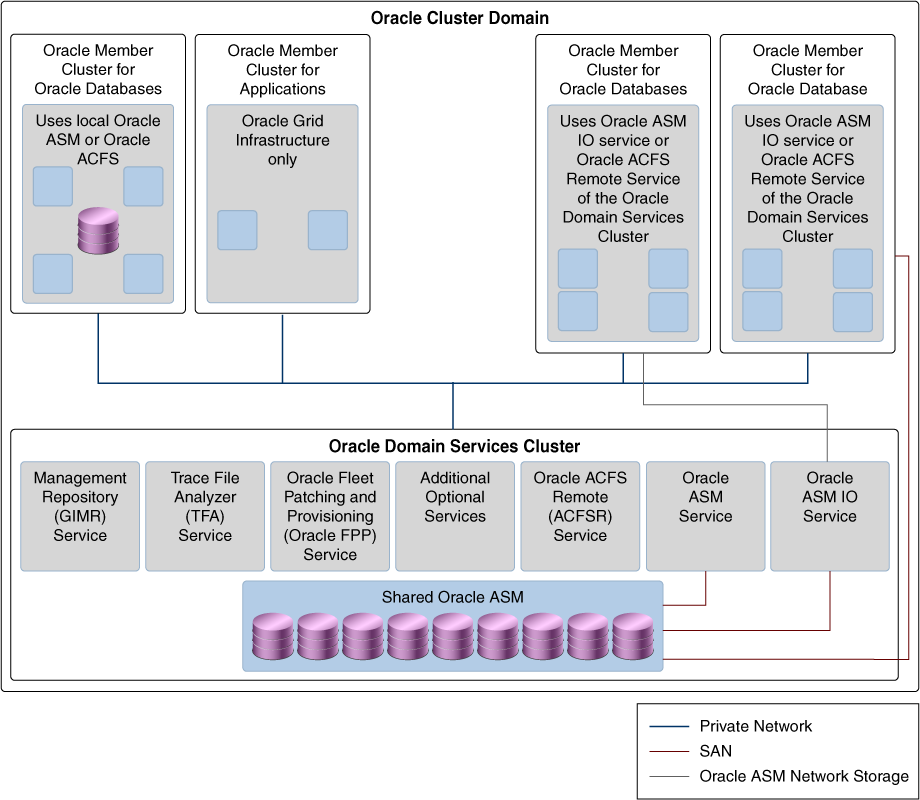

An Oracle Cluster Domain is a choice of deployment architecture for new clusters, introduced in Oracle Clusterware 12c Release 2.

Oracle Cluster Domain enables you to standardize, centralize, and optimize your Oracle Real Application Clusters (Oracle RAC) deployment for the private database cloud. Multiple cluster configurations are grouped under an Oracle Cluster Domain for management purposes and make use of shared services available within that Oracle Cluster Domain. The cluster configurations within that Oracle Cluster Domain include Oracle Domain Services Cluster and Oracle Member Clusters.

The Oracle Domain Services Cluster provides centralized services to other clusters within the Oracle Cluster Domain. These services include:

- A centralized Grid Infrastructure Management Repository (housing the MGMTDB for each of the clusters within the Oracle Cluster Domain)

- Trace File Analyzer (TFA) services, for targeted diagnostic data collection for Oracle Clusterware and Oracle Database

- Consolidated Oracle ASM storage management service, including the use of Oracle ACFS.

- An optional Oracle Fleet Patching and Provisioning Service to install clusters, and provision, patch, and upgrade Oracle Grid Infrastructure and Oracle Database homes. When you configure the Oracle Domain Services Cluster, you can also choose to configure the Oracle Fleet Patching and Provisioning Server.

An Oracle Domain Services Cluster provides these centralized services to Oracle Member Clusters. Oracle Member Clusters use these services for centralized management and to reduce their local resource usage.

Figure 9-1 Oracle Cluster Domain

[Description of "Figure 9-1 Oracle Cluster Domain"](img_text/cluster_domain_architecture.md)

**Related Topics**

- [About Oracle Member Clusters](about-oracle-member-clusters.md)

**Parent topic:** [Understanding Cluster Configuration Options](understanding-cluster-configuration-options.md)
