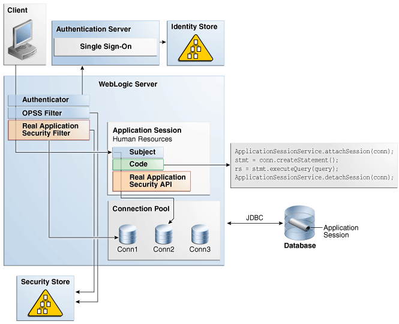

## 8 Application Session Service in Oracle Fusion Middleware

Real Application Security provides an application session service in Oracle Fusion Middleware to set up an application session transparently and securely that supports existing application users, roles, and security context. This application session service is a servlet filter that is responsible for application session setup and a set of APIs that the application can use with the application session. This application session service supports user and roles managed externally by Oracle Fusion Middleware.

Beginning with Oracle Database 12c Release 1 (12.1.0.2), this application session service supports a Java EE Web application using Oracle Platform Security Service (OPSS) as the application security provider. This application session service can be deployed to the Java EE container that OPSS can support, together with the application.

This chapter describes the following topics:

- About Real Application Security Concepts

- About Application Session Service in Oracle Fusion Middleware

- About the Application Session Filter

- About Deployment

- About Application Configuration of the Application Session Filter

- Domain Configuration: Setting Up an Application Session Service to Work with OPSS and Oracle Fusion Middleware

- About Application Session APIs

- Human Resources Demo Use Case: Implementation in Java

### 8.1 About Real Application Security Concepts

As an Oracle Database authorization system, Real Application Security supports application security by enforcing who (application user) can do what application-level operations (ApprovePurchaseOrder, ViewSSN) on which database resource (purchase order records of employees under my report, my SSN). An application session is used to enforce application security. Typically, the users and roles are provisioned externally, that is, enterprise users are provisioned in an identity store and application roles are managed in a policy store, such as, Oracle Identity Management and Oracle Entitlement Server (OES).

#### Application Users and Roles Managed Externally

Real Application Security supports users and roles that are provisioned by an external party, such as Oracle Entitlement Server for managing application users and roles provisioning, while OPSS provides a runtime security framework for enforcing security for application roles. Theses are referred to as external application users and application roles (see [Oracle Fusion Middleware Integration with Real Application Security](oracle-fusion-middleware-integration-with-real-application-security.md) for more information.)

Real Application Security also has users and roles for the application natively managed in the database, and these are referred to as Real Application Security application users and application roles (see [Configuring Application Users and Application Roles](configuring-application-users-and-application-roles.md) for more information).

For external application users and application roles, Real Application Security does not manage user provisioning including users' role assignment. However, for native application users and application roles in the database, grants of application roles to application users, database roles to application roles, and application roles to application roles are managed in the database. Both Real Application Security application users and application roles, and external application users and application roles are supported in an application session, and can be used in a data security policy. An application privilege can be granted to users managed both in the identity store externally or in the database natively.

#### Application Session in Oracle Fusion Middleware

An application session represents an application user's runtime security context, which includes the user identity, database and application roles, and namespace attribute values. The application session here in Oracle Fusion Middleware is using externally managed user and roles. See [Configuring Application Sessions](configuring-application-sessions.md) for more information about configuring an application session.

#### Session Manager in Oracle Fusion Middleware

In Real Application Security, the session manager authorizes the application session operation and has the necessary privileges to create or modify the application session. The application code or application database connection should not have these privileges. To the database, the session manager is a Real Application Security direct logon user (see "[About Creating a Direct Login Application User Account](configuring-application-users-and-application-roles.md)"). It communicates with the database at the beginning of application session service initialization to build a trust relation with the database server based on authorization credentials. This mechanism is used subsequently to further authorize the application session operations on behalf of the application.

#### Dynamic Roles in Oracle Fusion Middleware

Other than the application roles, an application session supports a dynamic role. This is a type of Real Application Security role that must be defined natively in the database (see "[Dynamic Application Roles](configuring-application-users-and-application-roles.md)"). This role is not granted to the user or other roles. It must be enabled programmatically in the application session at run time. This can be done by the Real Application Security filter automatically or by the trusted application code explicitly.

The dynamic role can be defined as request scope or session scope. Session scope means the enabled dynamic role is still enabled in the next attach, unless you explicitly specify that it is disabled in the next attach. Request scope means that the role is disabled after the application session is detached from the connection.

Dynamic role serves two general purposes:

- Object privilege

  An application user is not a database user. These object privileges can be granted to a Real Application Security dynamic role when application users and roles are provisioned in external identity stores. When the Real Application Security filter sets up the application session for the application user, it enables the dynamic role in every application session accessing the current application. The dynamic role is specific to the current application only.

- Application Session privilege elevation

  Certain trusted application code must temporarily have higher privileges in order to do some database operations. This is supported by enabling a Real Application Security dynamic role during application session attach from the trusted code declared using a Java code based policy. The role should be disabled upon detach.

  One use case is application namespace setup where session namespace attributes are secured in Real Application Security in a fine grained manner. The namespace must be predefined at the database as a namespace template. Upon definition, in the associated ACL of the namespace authorization policy can be specified, that is, who (user/role) can do what (modify_namespace, modify_attribute) on the namespace. To ensure that only trusted application code can modify the namespace attributes, the privileges are granted to a dynamic role. Also, the dynamic role can only be programmatically enabled by certain trusted application code identified by Java code permission. This supports the use case that only the trusted code can set up certain namespaces.

### 8.2 About Application Session Service in Oracle Fusion Middleware

Figure 8-1 shows application session service as it is implemented in Oracle Fusion Middleware.

Figure 8-1 Application Session Service in Oracle Fusion Middleware

[Description of "Figure 8-1 Application Session Service in Oracle Fusion Middleware"](img_text/dbfsg_vm_005.md)

An application session service is an integrated solution with Oracle Fusion Middleware, to leverage Oracle Fusion Middleware to provide an application session at the database. In Oracle Fusion Middleware:

- The application user is authenticated by the container. In WLS, typically the authenticator works with the SSO server to authenticate the user.

- The application user and group are managed by the Identity Store.

- OPSS is an application security framework to set up the application security context based on the container's security context. See [Oracle Application Server Containers for J2EE Security Guide](https://docs.oracle.com/pls/topic/lookup?ctx=en/database/oracle/oracle-database/19/dbfsg&id=JISEC1834) for more information about application security with OPSS.

The Real Application Security servlet filter sets up the application session transparently and synchronizes the application session with the OPSS subject. The server filter code consists of a set of APIs that function in the application session to:

- Attach, detach, and destroy the session (see "About Application Session APIs")

- Provide privilege elevation (see "About the Privilege Elevation API")

- Provide namespace operations (see "About Namespace APIs")

- Provide authorization (see "About the Check Privilege API")

Real Application Security provides:

- APIs that support external users and roles in the application session

- Authorizes the session operation through the session manager

- Support for fine-grained access control on namespace

### 8.3 About the Application Session Filter

The Real Application Security application session filter is a standard Java EE servlet filter that implements the `javax.servlet.Filter` interface. The basic function of this filter is to set up an application session transparently according to the authenticated user's security context (OPSS Subject).

This application session filter allows the application session to be continuously shared among applications. It cannot be created for every request, but must be tied to a stateful context and reused for the same user until logout. For web applications, the http session is such a context. It is maintained by the container for the same user's continuous access from logon until logout, across multiple single sign-on applications or containers.

The http session object is always accessible from the `ServletFilter`, but may not be accessible from the generic application code.

This section includes the following topic: About the Application Session Filter Operation.

#### 8.3.1 About the Application Session Filter Operation

The application session filter sets up the application session in the following manner:

- It creates an application session at the user's first access.

  If the user has been logged in, it creates the application session as the user in the authentication context (OPSS Subject).

  If the user has not been logged in, it creates the application session as an anonymous user.

- It reuses the existing application session instance for the user's subsequent access to the same application.

- It shares the same application session among multiple applications when multiple applications access the same Real Application Security database.

- It synchronizes the application session at the beginning of each http request to make sure the user and roles in the current application session are always synchronized with the authentication context (OPSS Subject), and only the configured dynamic roles are enabled for every application session.

  The synchronization is done by pushing the OPSS Subject values to the server and getting back the server computed values for the current application session.

User and roles in the application session are fixed once the filter is fired before application code execution. The filter is responsible for synchronizing the user and roles, not application code.

Application code is responsible for the namespace setup. The filter can only help to bring back the previous namespace. See "About Namespace APIs" for more information about namespace setup.

The application session is cached locally based on the http session ID. The http session is managed by the container. Real Application Security has an application session listener to listen for the container's application session event. When the http session is invalidated by the container, the application session is removed from the local cache by the Real Application Security listener.

### 8.4 About Deployment

Real Application Security application session service is delivered in one jar file, `xsee.jar`. Oracle recommends that you deploy the `xsee.jar` jar file to a common directory, not together with the web application (WAR file inside `web-inf/lib`). In this way, you can separate the jar from application code, and grant some special code based permissions to only the `xsee.jar` jar file, and not to the application code.

For the `xsee.jar` jar file to get the session manager's credential from the CSF store, you must grant code based permission `CredentialAccessPermission` to the `xsee.jar` jar file. The filter internally uses Real Application Security session manager to authorize the session operation.

In Example 8-1, the `xsee.jar` jar file is deployed to WLS's domain `/lib` directory. The java policy file (`system-jazn-data.xml`) has the `CredentialAccessPermission` grant, assuming that the session manager's key/map is using the default value.

For deployment instructions, see the section about standard Java EE deployment in [Understanding Oracle WebLogic Server](https://docs.oracle.com/pls/topic/lookup?ctx=en/database/oracle/oracle-database/19/dbfsg&id=INTRO206).

For a simple and quick method of deploying an application for testing or evaluation, use Auto-Deployment. This is an easier way to deploy the application session service by packaging everything (class, `web.xml`) in to one WAR file, and copying it to the Weblogic `autodeploy` directory. See the section about auto-deploying applications in development domains in [Deploying Applications to Oracle WebLogic Server](https://docs.oracle.com/pls/topic/lookup?ctx=en/database/oracle/oracle-database/19/dbfsg&id=DEPGD254).

To create the session manager's credential, see Step 2 in "Manual Configuration" for more information.

Example 8-1 Granting the Code-Based Permission CredentialAccessPermission to the xsee.jar File

    <grant>
                <grantee>
                    <codesource>
                        <url>file:${domain.home}/lib/xsee.jar</url>
                    </codesource>
                </grantee>
                <permissions>
                    <permission>
                        <class>oracle.security.jps.service.credstore.CredentialAccessPermission</class>
                        <name>context=SYSTEM,mapName=oracle.rdbms.ras, keyName=default</name>
                        <actions>read</actions>
                    </permission>
                </permissions>
     </grant>

### 8.5 About Application Configuration of the Application Session Filter

The filter is configured in the application's `web.xml` configuration file in a standard way. It can be configured to apply to only specific URLs. This avoids unnecessary application session setup for certain pages for which it does not need database access.The filter assumes that user authentication has been done and an authentication context has been established. In OPSS, the user's application context is computed at the OPSS filter, so the OPSS filter must be deployed ahead of the application session filter in the filter chain.The application session filter uses the following `web.xml` parameters:

- `application.datasource`

  The application uses this `application.datasource` parameter. The application session filter requires this parameter for initialization, application session setup and namespace operations.

- `dynamic.roles`

  A list of Real Application Security dynamic roles to be used are separated by a comma(,). The dynamic roles must already be created at the database as session scope; otherwise, the following exception is thrown: `ORA-46055: invalid role specified`.

  The roles are enabled for every application session in the current application, and automatically disabled in other applications. Note that these dynamic roles are enabled for the anonymous session. You should not over grant any privileges to dynamic roles if they are not needed for every application session. Normally, only object privileges should be granted to the dynamic roles.

  For any tables not protected by Real Application Security, the application still has the flexibility to use the database connection pool user for access, not the application user. In that case, no attach application session API call is needed and no object privilege is granted to the dynamic roles.

- `session.manager.pwd.key` and `session.manager.pwd.map`

  The `session.manager.pwd.key` parameter and the `session.manager.pwd.map` parameter (fixed as `oracle.rdbms.ras`) point to a credential (user ID and password) in the credential store. The `session.manager.pwd.key` parameter is used to retrieve the session manager's credential. Currently, the OPSS CSF credential store is used to store the credential, and the CSF API is used to retrieve the credential at run time. In addition, both the session manager's user ID and password can be retrieved from the store.

  The default value is `default` for the `session.manager.pwd.key` parameter. If the application is using the default credential, then this parameter can be omitted.

  If an application wants to use a specific session manager, not the default credential, the application's administrator must create the credential with a different key name, and configure it using this parameter. See configuring the OPSS security store in [Oracle Application Server Containers for J2EE Security Guide](https://docs.oracle.com/pls/topic/lookup?ctx=en/database/oracle/oracle-database/19/dbfsg&id=JISEC2291) for more information.

- `session.manager.pool.min` and `session.manager.pool.max`

  The session manager's connection is also used to query the data security policy (ACL) at the mid-tier. This connection is managed as a pool. The `session.manager.pool.min` parameter determines the minimum size of the pool. This parameter is optional. The default value is 1.

  The `session.manager.pool.max` parameter determines the maximum size of the pool. This parameter is optional. The default value is 3.

  If the privilege check is not needed, the pool size should be set to 1 for both `session.manager.pool.min` and `session.manager.pool.max` values.

Example 8-2 shows an application session filter sample configuration that includes the servlet filter, its parameters, and the listener. Any parameters, which have default values, are omitted from this example.

Example 8-2 Application Session Filter Sample Configuration

    <filter>
            <filter-name>ApplicationSessionFilter</filter-name>
            <filter-class>oracle.security.xs.ee.session.ApplicationSessionFilter</filter-class>
            <init-param>
                <param-name>application.datasource</param-name>
                <param-value>jdbc/myDBDS</param-value>
            </init-param>
            <init-param>
                <param-name>dynamic.roles</param-name>
                <param-value>my_drole</param-value>
            </init-param>
    </filter>
    <listener>
        <description>RAS Session Listener</description>
        <listener-class>oracle.security.xs.ee.session.ApplicationSessionListener</listener-class>
    </listener>

### 8.6 Domain Configuration: Setting Up an Application Session Service to Work with OPSS and Oracle Fusion Middleware

This section describes the prerequisites and configuration required for an application to use an application session service.

This section includes the following topics:

- Prerequisites

- Manual Configuration

- About Automatic Configuration

#### 8.6.1 Prerequisites

To use Real Application Security, both the application session service and OPSS must be deployed and configured in a Oracle Fusion Middleware's Java EE container.

For WebLogic server, the prerequisites include:

- A JRF based WLS domain (OPSS is built-in) certified with the Oracle database 12c JDBC driver. The required JDBC jars could be many, not just one driver jar depending on the features you need (UCP, I18N, SQLXML and so forth).

- Oracle Database 12c Release 1 (12.1) and later

For WebLogic server 10.3.6 and 12.1.2 JRF release (part of Oracle Fusion Middleware), the JDBC driver shipped is not Oracle Database 12c compatible. You must obtain the Oracle Database 12c JDBC jars (`ojdbc6.jar` or `ojdbc7.jar` and other matched jars depending on the features you need), and add these jars to the front of your WebLogic Server's classpath. For detailed instruction, see [Administering JDBC Data Sources for Oracle WebLogic Server](https://docs.oracle.com/pls/topic/lookup?ctx=en/database/oracle/oracle-database/19/dbfsg&id=JDBCA263), Section B.

If there is version mismatch between the JDBC driver and the database, the Real Application Security filter initialization fails with an error message. For example,

- If the Oracle Database 11g JDBC driver is being used with Oracle Database 12c, the following error message appears in the server log: `Fail to initialize RAS session manager due to method missing`.

- If the Oracle Database 12c JDBC driver is being used with Oracle Database 11g, the following error message appears in the server log: `ORA-00439: feature not enabled: Fusion Security`.

#### 8.6.2 Manual Configuration

Follow these manual configuration steps for an application to use an application session service. These steps should work for both WebLogic 10.3.6 and 12.1.2, JRF release.

1.  Install the Real Application Security jars.
    Copy the `xsee.jar` and `xs.jar` (`ORACLE_HOME/jlib/`) to a common directory that applications can consume. For WebLogic, a good location is `DOMAIN_HOME/lib`. This allows Real Application Security jars to be shared by many applications deployed in the same domain.
2.  Create a Real Application Security session manager credential.
    As discussed in "About Application Configuration of the Application Session Filter", a session manager's credential must be created in OPSS's credential store. This can be done using an OPSS script. For details about how to use OPSS script, see the section about the OPSS script in [Oracle Application Server Containers for J2EE Security Guide](https://docs.oracle.com/pls/topic/lookup?ctx=en/database/oracle/oracle-database/19/dbfsg&id=JISEC2936).

        createCred(map='oracle.rdbms.ras', key='default', user='myUsr', password='myPassword')

    The session manager's credential is stored in the default credential store, which is configured for the domain. The `map` name must be `oracle.rdbms.ras`, which is predefined for the Real Application Security application session service. This is fixed and cannot be changed.
3.  Grant code permission to the Real Application Security jar files.
    As discussed in "About Deployment", the CSF permission must be granted to the `xsee.jar` file. This is also done using OPSS script.

        grantPermission(codeBaseURL='file:${domain.home}/lib/xsee.jar', permClass='oracle.security.jps.service.credstore.CredentialAccessPermission',  permTarget='context=SYSTEM,mapName=oracle.rdbms.ras,keyName=*', permActions='read')

    Note that the above `keyName (*)` is for all keys. No further grants are needed for a non-default key, if it is created for a specific application.
4.  Configure `web.xml`, invoke Real Application Security APIs (attach/detach), and build/deploy the application. See Example 8-2 to see how `web.xml` is configured.
    These are standard Java EE development procedures.

    If the `attachSessionPrivileged` API is invoked in the application code, `SessionCodePermission` must be granted to the application code as discussed in "About the Privilege Elevation API". That is similar to step 3. Here is an example:

        grantPermission(codeBaseURL='file:${domain.home}/servers/DefaultServer/tmp/_WL_user/MyWar/pi47ig/war/WEB-INF/lib/trusted.jar', permClass=' oracle.security.xs.ee.session.SessionCodePermission',  permTarget=' MY_NS_DROLE, permActions='attach')
        grantPermission(codeBaseURL='file:${domain.home}/lib/xsee.jar', permClass=' oracle.security.xs.ee.session.SessionCodePermission',  permTarget=' MY_NS_DROLE, permActions='attach')

    OPSS scripts require that the WLS administrative server is running. This manual approach only supports online configuration. Step 4 is always the responsibility of the application administrator, while Steps 1 through 3 can be automated as discussed in "About Automatic Configuration".

#### 8.6.3 About Automatic Configuration

With Oracle Fusion Middleware, you can use a configuration utility to configure common settings for a group of applications. For WebLogic, this is the domain configuration wizard. In a future WLS release (release 12.1.3), the Steps 1 through 3 (in "Manual Configuration") could be automated by this configuration wizard. This automatic approach also has the advantage of supporting offline configuration (when the administrative server is not running).

When the configuration wizard is started (`<ORACLE_HOME>/oracle_common/common/bin/config.sh`), the following user interfaces (UIs) will be shown to prompt for Real Application Security configuration information.

- In the first UI, the application session service is shown as one of the Oracle Fusion Middleware features for selection. Once selected, its dependency (OPSS, part of JRF) is automatically selected.

- In the second UI, you are prompted to enter the default session manager's credential.

There is no UI for granting code permission. This is automatically done by merging a predefined xml file to the domain's `system-jazn-data.xml` file. The predefined xml file contains all the Real Application Security code permission grants that are needed.

If the administrator decides to use a different session manager for an application, then the administrator must complete manual Step 2 or add a special key name from the UI. The same key name must be passed to the application's `web.xml`. In this case, the map name (store name) is still fixed as `oracle.rdbms.ras`, and you do not need to grant code permission because all keys have already been granted internally.

### 8.7 About Application Session APIs

All application session APIs are exposed through class `ApplicationSessionService` as static methods. The APIs operate on the current application session, which is set up based on the current Subject. Inside each API, an identity assertion is performed internally, to make sure the current application session matches the subject. If a mismatch is found, an `ApplicationSesseionException` exception is thrown. The caller code of the application session API should always be executed inside `Subject.doAs`, to be invoked as the subject. See the [JDK's](http://docs.oracle.com/javase/7/docs/api/javax/security/auth/Subject.html) `Subject.doAs` for more information.

This section describes the following topics:

- About Application Session APIs

- About the Privilege Elevation API

- About Namespace APIs

- About the Check Privilege API

#### 8.7.1 About Application Session APIs

This section describes the following topics:

- About Attaching to an Application Session

- Detaching from an Application Session

- Destroying an Application Session

##### 8.7.1.1 About Attaching to an Application Session

Attach the current user's application session to the given database connection.

For application code to attach to the current user's application session, no code based permission is needed. The application session works as is, no extra privilege is elevated through the attach.

##### Syntax

    public static void attachSession(java.sql.Connection conn)
                              throws ApplicationSessionException

##### Parameter

| Parameter | Description                                       |
|:----------|:--------------------------------------------------|
| `conn`    | The JDBC connection for database server roundtrip |

##### Example

See Example 8-3 and Example 8-6.

##### 8.7.1.2 Detaching from an Application Session

Detach the current user's application session from the given database connection.

It is always a good practice to detach the application session at the application code's final block. Not doing so may give an attached connection to some code that is not running under the correct user. It is caller's responsibility to properly detach the application session once used.

If detach is not called, but attach is called again on the same connection, the server forces the detach from the previous attached application session, and attaches to the current application session.

##### Syntax

    public static void detachSession(java.sql.Connection conn)
                              throws ApplicationSessionException

##### Parameter

| Parameter | Description                                       |
|:----------|:--------------------------------------------------|
| `conn`    | The JDBC connection for database server roundtrip |

##### Example

Example 8-3 shows sample code that uses the attach and detach API with a database query. The caller must decide the boundary of the attach and detach calls, based on the needs of the query.

Example 8-3 Application Session APIs: AttachSession and DetachSession

    /**
      * Typical application code calling attach/detach for database query
      */
    public void queryHR(Connection conn) {
          String query = " select emp.employee_id, emp.salary from hr.employees emp";
          Statement stmt = null;
          ResultSet rs = null;
          String id, salary;
          try {
            // attach connection to the current application session
            ApplicationSessionService.attachSession(conn);
            stmt = conn.createStatement();
            rs = stmt.executeQuery(query);
            while (rs.next()) {
              id = rs.getString("employee_id");
              salary = rs.getString("salary");
            }
          } catch (ApplicationSessionException e) {
          } catch (SQLException e) {
          } finally {
             // detach the current application session from the connection
             try { ApplicationSessionService.detachSession(conn); } catch (Exception e) {}
             if (stmt != null) try {stmt.close();} catch (SQLException e) {};
             if (rs != null) try { rs.close();} catch (SQLException e{};
          }
        }

##### 8.7.1.3 Destroying an Application Session

Destroys the current application session at the database, and removes it from current thread's execution context. This should be invoked by the application at logout. It destroys the current application session originally set up by the filter.

##### Syntax

    public static void destroySession(java.sql.Connection conn)
                               throws ApplicationSessionException

##### Parameter

| Parameter | Description                                       |
|:----------|:--------------------------------------------------|
| `conn`    | The JDBC connection for database server roundtrip |

##### Example

Example 8-4 shows sample code that destroys the application session service.

Example 8-4 Application Session APIs: DestroySession

        void doLogout(HttpServletRequest request) {

            DataSource dataSource = null;
            Connection conn = null;

            try {
                InitialContext ic;
                try {
                    ic = new InitialContext();

                    dataSource = (DataSource)ic.lookup("jdbc/myDBDS");

                    if (dataSource != null)
                        try {
                            conn = dataSource.getConnection();
                        } catch (SQLException e) {
                            e.printStackTrace();
                        }
                } catch (NamingException e) {
                    e.printStackTrace();
                }
                // invalidate Http session
                request.getSession().invalidate();
                // destroy XS session at DB
                ApplicationSessionService.destroySession(conn);

            } catch (ApplicationSessionException e) {
                e.printStackTrace();
            } finally {

                if (conn != null)
                    try {
                        conn.close();
                    } catch (SQLException e) {
                    }
            }

        }

#### 8.7.2 About the Privilege Elevation API

This section describes the following topic: Enabling a Dynamic Role in the Application Session.

##### 8.7.2.1 Enabling a Dynamic Role in the Application Session

Attaches the current application session to a given database connection, and enables the Real Application Security dynamic role in the attached application session. This allows trusted application code to have higher privileges temporarily in order to perform some database operations, such as setting up application namespace.

This is for certain trusted application code to elevate the application session privilege. A Real Application Security dynamic role is enabled during attach. The trusted code is identified by java code permission.

##### Syntax

    public static void attachSessionPrivileged(java.sql.Connection conn,
                                               java.lang.String role)
                                        throws ApplicationSessionException

##### Parameter

| Parameter | Description                                       |
|:----------|:--------------------------------------------------|
| `conn`    | The JDBC connection for database server roundtrip |
| `role`    | The given dynamic role; must be request scope     |

##### Example

Each given dynamic role is associated with a code base permission as shown in Example 8-5 (permission grant in `jazn-data.xml`)

See Example 8-6.

##### Usage Notes

The permission is always checked internally in the API, whether the java security manager is on or off. If the caller has the permission (that implies that the given role also matches the role defined in the policy file), the given dynamic role is enabled during attach; otherwise, the API fails with an `AccessControlException`.

The caller code (`caller.jar` file) and application session service code (`xsee.jar`) should both have the `SessioncodePermission` permission. This is sufficient when the `caller.jar` is invoked directly by the container. When `caller.jar` is invoked by another application code, it is up to the caller to decide whether the application code needs to have this permission. If the caller does not need the application to have this permission, the caller can invoke `attachSessionPrivileged` under `AccessController.doPrivileged` with a null `AccessControllerContext`. See the Java API for details. By doing this, the `caller.jar` fully trusts the application code.

Note that the dynamic role is only enabled on the attached application session, not the current application session. It is enabled within the window of attach and detach. The dynamic role must be defined as request scope at the database; otherwise, the following exception `ORA-46055: invalid role specified` is thrown.

Example 8-5 Privilege Elevation API

    <grant>
                <grantee>
                    <codesource>
                        <url>file:${domain.home}/servers/DefaultServer/tmp/_WL_user/MyWar/pi47ig/war/WEB-INF/lib/trusted.jar' </url>
                    </codesource>
                </grantee>
                <permissions>
                    <permission>
                        <class>oracle.security.xs.ee.session.SessionCodePermission</class>
                        <name> MY_NS_DROLE</name>
                        <actions>attach </actions>
                    </permission>
                </permissions>
            </grant>
            <grant>
                <grantee>
                    <codesource>
                        <url>file:${domain.home}/lib/xsee.jar</url>
                    </codesource>
                </grantee>
                <permissions>
                    <permission>
                        <class>oracle.security.xs.ee.session.SessionCodePermission</class>
                        <name>MY_NS_DROLE</name>
                        <actions>attac </actions>
                    </permission>
                </permissions>
            </grant>

#### 8.7.3 About Namespace APIs

This section describes the following topics:

- About Creating a Namespace

- About Deleting a Namespace

- About Setting the Namespace Attribute

- About Deleting a Namespace Attribute

- Getting a Namespace Attribute

##### 8.7.3.1 About Creating a Namespace

Creates a namespace in the current application session. The namespace given must be predefined at the database, and the namespace ACL must allow the attached application session to perform a `MODIFY_NAMESPACE` operation, unless the `ADMIN_ANY_NAMESPACE` privilege is enabled in the application session.

##### Syntax

    public static void createNamespace(java.sql.Connection conn,
                                       java.lang.String name)
                                throws ApplicationSessionException

##### Parameter

| Parameter | Description                                       |
|:----------|:--------------------------------------------------|
| `conn`    | The JDBC connection for database server roundtrip |
| `name`    | The given namespace name                          |

##### Example

See Example 8-6.

##### 8.7.3.2 About Deleting a Namespace

Deletes a namespace from the current application session. The namespace given must be predefined at the database, and the namespace ACL must allow the attached application session to perform a `MODIFY_NAMESPACE` operation, unless the `ADMIN_ANY_NAMESPACE` privilege is enabled in the application session.

##### Syntax

    public static void deleteNamespace(java.sql.Connection conn,
                                       java.lang.String name)
                                throws NamespaceNotFoundException,
                                       ApplicationSessionException

##### Parameter

| Parameter | Description                                       |
|:----------|:--------------------------------------------------|
| `conn`    | The JDBC connection for database server roundtrip |
| `name`    | The given namespace name.                         |

##### Example

See Example 8-6.

##### 8.7.3.3 About Setting the Namespace Attribute

Sets the attribute value to the namespace in the current application session. The namespace given must be predefined at the database, and the namespace ACL must allow the attached application session to perform a `MODIFY_ATTRIBUTE` operation, unless the `ADMIN_ANY_NAMESPACE` privilege is enabled in the application session.

If the attribute does not exist on the namespace, the API creates the attribute with the given value; otherwise, it simply sets the existing value to the given value.

##### Syntax

    public static void setNamespaceAttribute(java.sql.Connection conn,
                                             java.lang.String name,
                                             java.lang.String attribute,
                                             java.lang.String value)
                                      throws NamespaceNotFoundException,
                                             ApplicationSessionException

##### Parameter

| Parameter   | Description                                       |
|:------------|:--------------------------------------------------|
| `conn`      | The JDBC connection for database server roundtrip |
| `name`      | The given namespace name                          |
| `attribute` | The given namespace attribute name                |
| `value`     | The given namespace attribute value               |

##### Example

See Example 8-6.

##### 8.7.3.4 About Deleting a Namespace Attribute

Deletes the attribute from the namespace in the current application session. The namespace given must be predefined at the database, and the namespace ACL must allow the attached application session to perform a `MODIFY_ATTRIBUTE` operation, unless the `ADMIN_ANY_NAMESPACE` privilege is enabled in the application session.

##### Syntax

    public static void deleteNamespaceAttribute(java.sql.Connection conn,
                                                java.lang.String name,
                                                java.lang.String attribute)
                                         throws NamespaceNotFoundException,
                                                ApplicationSessionException

##### Parameter

| Parameter   | Description                                       |
|:------------|:--------------------------------------------------|
| `conn`      | The JDBC connection for database server roundtrip |
| `name`      | The given namespace name                          |
| `attribute` | The given namespace attribute name                |

##### Example

See Example 8-6.

##### 8.7.3.5 Getting a Namespace Attribute

Gets the attribute from the namespace in the current application session. The given namespace must be created. No database connection is needed and no privilege is checked for this operation.

The APIs that change namespace (other than `getNamespaceAttribute`) have a database connection as an input parameter. Those APIs update the namespace in the current application session in the JVM, as well as serialize the change to the database table. The connection must be attached. It uses the attached application session to determine whether the server can authorize the namespace change.

To allow only certain trusted application code to set up namespace. The connection can be attached with a dynamic role, which has elevated privileges (`MODIFY_NAMESPACE`, `MODIFY_ATTRIBUTE`) on the namespace. This is achieved using the `attachSessionPrivileged` API, and only granting the namespace privileges to the dynamic role.

##### Syntax

    public static java.lang.String getNamespaceAttribute(java.lang.String name,
                                                         java.lang.String attribute)
                                                  throws NamespaceNotFoundException,
                                                         ApplicationSessionException

##### Parameter

| Parameter   | Description                        |
|:------------|:-----------------------------------|
| `name`      | The given namespace name           |
| `attribute` | The given namespace attribute name |

##### Example

Example 8-6 shows a sample servlet filter that sets up namespace using namespace APIs and uses the application session privilege elevation API.

##### Important Points to Know About Using Application Namespace

The following usage information summarizes important points about using application namespace.

- The Real Application Security filter caches all the application namespace to the current application session.

  - For first time access, a new application session must be created in the database. No application namespace has been set up yet at this time.

  - For the user's subsequent access, the filter always brings all the namespaces created for the application session, and caches them in the current application session in JVM.

- Application code always accesses namespace from the current application session. Each update operation is a round trip to the server to change the values in the table and current application session (JVM). That is why each update API has a database connection parameter. However, the read attribute is a local operation to read from the current application session in JVM without accessing the database.

- Whenever a namespace change is successfully done, the change is propagated to the already attached application sessions, as well as newly attached application sessions because all these attached application sessions refer to the single source - the current application session.

- The namespace in the current application session is consistent within an http request scope for the web application. Even the namespace can be changed at any time by other applications. The change is only picked up once at the beginning of the current http request by the Real Application Security filter. All attaches that happen within the same http request refer to the same namespace in the current application session.

- Application code has complete control for changing the namespace value. It can read the current application session's namespace at any time and decide whether to update the namespace by calling the namespace APIs.

Example 8-6 Namespace APIs

    /**
      * Trusted application code (servlet filter) sets up namespace
      * Using privilege elevation and namespace APIs
      */
    public void doFilter(ServletRequest request, ServletResponse response,  FilterChain chain) throws IOException, ServletException {
       Connection conn = null;
       try {
         conn = myDatasource.getConnection();
         // Attach an application session with a dynamic role.
         ApplicationSessionService.attachSessionPrivileged(conn, "myNSRole");
         try {
           // Get the current value.
           String currentValue = ApplicationSessionService.getNamespaceAttribute("mySecuredNS", "myAttribute");
           // If the current value is not desired, set it.
           if  ("myValue".compareToIgnoreCase(currentValue) != 0)
              ApplicationSessionService.setNamespaceAttribute(conn, "mySecuredNS", "myAttribute", "myValue");
         } catch (NamespaceNotFoundException e) {
           // Namespace is not found, create it.
           ApplicationSessionService.createNamespace(conn, "mySecuredNS");
           // Set the attribute.
           ApplicationSessionService.setNamespaceAttribute(conn, "mySecuredNS", "myAttribute", "myValue");
         }
       } catch (SQLException e) {
       } catch (ApplicationSessionException e) {
       } finally {
         // Detach an application session.
         try { ApplicationSessionService.detachSession(conn); } catch (Exception e) {}
         if (conn != null) try { conn.close();} catch (Exception e) {}
       }
        // Execution of application code.
        chain.doFilter(request, response);

#### 8.7.4 About the Check Privilege API

This section describes the following topic: Checking a Privilege on the ACLs.

##### 8.7.4.1 Checking a Privilege on the ACLs

Checks the privilege on the ACLs using the attached application session of the given connection and includes these usage notes:

- An attached connection must be given. The privilege check is based on the attached application session. Note that an attached application session can have extra privileges compared to the current application session through the `attachSessionPrivileged` call.

- The API takes the input parameter of ACL IDs, which can be queried from the table using the `ORA_GET_ACLID` operator. The operator returns a set of ACL IDs associated with the current row.

- This API takes the input parameter of privilege name. This input parameter can be DML privileges, such as `SELECT` or `UPDATE`, or it can be any user defined privilege.

##### Syntax

    public static boolean checkPrivilege(java.sql.Connection conn,
                                         byte[] acls,
                                         java.lang.String privilege)
                                  throws ApplicationSessionException

##### Parameter

| Parameter   | Description                                       |
|:------------|:--------------------------------------------------|
| `conn`      | The JDBC connection for database server roundtrip |
| `acls`      | The given ACL IDs in row format                   |
| `privilege` | The given privilege name                          |

##### Example

Example 8-7 shows getting the ACL associated with the row and checking the `UPDATE` privilege on the ACL.

Example 8-7 CheckPrivilege API

        public Collection<Employee> queryHR(Connection conn ) {

          Statement stmt = null;
          ResultSet rs = null;

          Collection<Employee> result = new ArrayList<Employee>();

          try {
            // attach session
            ApplicationSessionService.attachSession(conn);

            stmt = conn.createStatement();
            rs = stmt.executeQuery(query);

            while (rs.next()) {
              Employee emp = new Employee();

              emp.setId(rs.getString("EMPLOYEE_ID"));

              AuthorizationIndicator ai =
                        ((OracleResultSet)rs).getAuthorizationIndicator("salary");

              if (ai == AuthorizationIndicator.NONE) {
                emp.setSalary(rs.getString("salary"));
              } else {
                emp.setSalary("******")  ;
              }

              // get ACL associated with the row
              emp.setAcl(rs.getBytes("acl_id"));
              // check "update" privilege
              boolean canUpdate = ApplicationSessionService.checkPrivilege(conn, emp.getAcl(), "UPDATE");

              emp.setUpdate(canUpdate);
              result.add(emp);

              emp.setFname(rs.getString("first_name"));
              emp.setLname(rs.getString("last_name"));
              emp.setEmail(rs.getString("email"));
              emp.setPhone(rs.getString("phone_number"));
              emp.setManagerId(rs.getString("manager_id"));
              emp.setDepId(rs.getString("department_id"));

            }
          } catch (ApplicationSessionException e) {
              e.printStackTrace();
              // process me
          } catch (SQLException e) {
              // process me
              e.printStackTrace();
          } finally {
             if (stmt != null) try {stmt.close();} catch (SQLException e) {};
             if (rs != null) try { rs.close();} catch (SQLException e)  {};
             try {ApplicationSessionService.detachSession(conn);} catch (ApplicationSessionException e) {};

          }

          return result;
        }

### 8.8 Human Resources Demo Use Case: Implementation in Java

This section describes how an application session service supports user and roles managed externally by Oracle Fusion Middleware. This Java example is based on the Security Human Resources (HR) scenario. It uses the `EMPLOYEES` table in the sample `HR` schema.

**See Also:**

For information about user and group to application roles mapping, see About the HR Demo Use Case - User Roles.

This example includes the following files and employee records that the three types of users can access:

- Setting Up the HR Demo Application for External Principals (setup.sql)

- About the Application Session Filter Configuration File (web.xml)

- About the Sample Servlet Application (MyHR.java)

- About the Filter to Set Up the Application Namespace (MyFilter.java)

- About the HR Demo (1) - Logged in as Employee LPOPP

- About the HR Demo (2) - Logged in as HRMGR

- About the HR Demo (3) - Logged in as a Team Manager

#### 8.8.1 Setting Up the HR Demo Application for External Principals (setup.sql)

Example 8-8 shows a set up script (`setup.sql`) for setting up the HR Demo application for external principals.

This setup script performs the following operations:

- Creates a dynamic role, `HROBJ`, for object privileges for the external user

- Creates a security class, `HRPRIVS`, with privilege `view_sensitive_info`, and aggregate privilege `update_info` that implies data privileges, update, delete, insert, which come from pre-defined security class `DML`.

- Creates an `EMP` ACL, `EMP_ACL`, to grant `EMP`, `HRMGR` and `HRREP` privileges to access employee record in the restricted departments. Note that each external principal, (application role: `HRREP`, `HRMGR`, and `EMP`) must match the OPSS policy store GUID values.

- Creates an self ACL, `SELF_ACL`, to grant `EMP` privileges for an employee to see and update his or her own record.

- Creates a Manager ACL, `MGR_ACL`, to allow a manager to see his or her employee's salary information.

- Creates a data security policy, `EMPLOYEE_DS`, for the `EMPLOYEES` table. The policy defines an instance set to control access to the employees in department 60 and 100 to `EMP_ACL`. It also defines an attribute constraint to control access to the sensitive SALARY column.

- Defines two additional instance sets to `SELF_ACL` and `MGR_ACL` that are appended to the data security policy, `EMPLOYEE_DS`.

- Grants to the dispatcher some additional privileges.

Example 8-8 Set Up the HR Demo Application for External Principals

    Rem Copyright (c) 2009, 2014, Oracle and/or its affiliates.
    Rem All rights reserved.

    SET ECHO ON
    SET FEEDBACK 1
    SET NUMWIDTH 10
    SET LINESIZE 80
    SET TRIMSPOOL ON
    SET TAB OFF
    SET PAGESIZE 100

    -- A PL/SQL function to determine manager-report relationship
    conn hr/hr;

    create or replace package hrutil as
     function ismyreport(id IN PLS_INTEGER)
     return PLS_INTEGER ;
    end hrutil;
    /

    create or replace package body hrutil as
     function ismyreport(id IN PLS_INTEGER)
       return PLS_INTEGER is
       mycount PLS_INTEGER ;
       myid    PLS_INTEGER ;
     begin
       select employee_id into myid from hr.employees
       where UPPER(email) = XS_SYS_CONTEXT('PROFILE_NS','EMAIL');

       select count(employee_id) into mycount from hr.employees
       where employee_id = id start with manager_id = myid
       connect by prior employee_id = manager_id ;
       return mycount ;
     end ismyreport ;
    end hrutil ;
    /

    -- Create a dynamic role for object privileges for external users.
    connect sys/password as sysdba
    show con_name;

    -- Create a dynamic role for HR object privileges.
    exec xs_principal.delete_principal('HROBJ',XS_ADMIN_UTIL.CASCADE_OPTION);
    exec xs_principal.create_dynamic_role('HROBJ');

    -- Create a db role to have HR object privileges.
    drop role hr_db_obj;
    create role hr_db_obj;
    -- Grant object privilege to the db role.
    grant select, insert, update, delete on hr.employees to hr_db_obj;

    -- Grant db role to dynamic role.
    grant hr_db_obj to HROBJ;

    -- Create a security class with privilege view_sensitive_info, and
    -- aggregate privilege update_info that implies data privileges,
    -- update, delete, insert, which come from pre-defined security class
    -- DML.
    DECLARE
      priv_list  XS$PRIVILEGE_LIST;
    BEGIN
      priv_list :=XS$PRIVILEGE_LIST(
         XS$PRIVILEGE(name=>'VIEW_SENSITIVE_INFO'),
         XS$PRIVILEGE(name=>'UPDATE_INFO',
                      implied_priv_list=>XS$NAME_LIST
                        ('"UPDATE"', '"DELETE"', '"INSERT"')));

      xs_security_class.create_security_class(
         name=>'HRPRIVS',
         parent_list=>XS$NAME_LIST('DML'),
         priv_list=>priv_list);
    END;
    /

    -- External Principal (app role) Used for data security:
    -- Such a principal must match the OPSS policy store.
    -- roleName="HRREP" guid="37ED0D108C2F11E2BF802D569259982"
    -- roleName="HRMGR" guid="4077A2B08C2F11E2BF802D569259982"
    -- roleName="EMP"   guid="F917C3608CF011E2BF802D569259982"

    -- Create an EMP Acl to grant EMP, HRMGR and HRREP privileges to access an employee record in the restricted departments.
    DECLARE
      ace_list XS$ACE_LIST;
    BEGIN
      ace_list := XS$ACE_LIST(
          XS$ACE_TYPE(privilege_list=>XS$NAME_LIST('"SELECT"','VIEW_SENSITIVE_INFO'),
                      granted=>true,
                      principal_name=>'"37ED0D108C2F11E2BF802D569259982"', principal_type=>XS_ACL.PTYPE_EXTERNAL),
          XS$ACE_TYPE(privilege_list=>XS$NAME_LIST('UPDATE_INFO'),
                      granted=>true,
                      principal_name=>'"4077A2B08C2F11E2BF802D569259982"', principal_type=>XS_ACL.PTYPE_EXTERNAL),
          XS$ACE_TYPE(privilege_list=>XS$NAME_LIST('"SELECT"'),
                      granted=>true,
                      principal_name=>'"F917C3608CF011E2BF802D569259982"', principal_type=>XS_ACL.PTYPE_EXTERNAL));

      xs_acl.create_acl(name=> 'EMP_ACL',
                       ace_list=> ace_list,
                       sec_class=>'HRPRIVS',
                       description=> 'Employee access to his/her data');
    END;
    /

    -- Create a self Acl to grant EMP privileges to for an employee to see and update his own record.
    -- Grant UPDATE, VIEW_SENSITIVE_INFO privileges to the EMP role.
    DECLARE
     ace_list XS$ACE_LIST;
    BEGIN
     ace_list := XS$ACE_LIST(
       XS$ACE_TYPE(privilege_list=> XS$NAME_LIST('"UPDATE"', 'VIEW_SENSITIVE_INFO'),
                   principal_name=>'"F917C3608CF011E2BF802D569259982"', principal_type=>XS_ACL.PTYPE_EXTERNAL));

     xs_acl.create_acl(name=> 'SELF_ACL',
                       ace_list=> ace_list,
                       sec_class=>'HRPRIVS',
                       description=> 'Employee access to his/her data');
    END;
    /

    --   Create Manager ACL, to allow a manager to see his employee's salary.
    --   Grant VIEW_SENSITIVE_INFO privileges to EMP role on the Manager's employees.
    --
    DECLARE
     ace_list XS$ACE_LIST;
    BEGIN
     ace_list := XS$ACE_LIST(
       XS$ACE_TYPE(privilege_list=> XS$NAME_LIST('VIEW_SENSITIVE_INFO'),
                   principal_name=>'"F917C3608CF011E2BF802D569259982"', principal_type=>XS_ACL.PTYPE_EXTERNAL));

     xs_acl.create_acl(name=> 'MGR_ACL',
                       ace_list=> ace_list,
                       sec_class=>'HRPRIVS',
                       description=> 'Manager can see his reports salaray');
    END;
    /

    -- Create data security policy for the EMPLOYEE table. The policy defines
    -- an instant set to control the access to the employees in department
    -- 60 and 100. It also defines an attribute constraint to control
    -- the access to sensitive column SALARY.
    DECLARE
      inst_sets XS$REALM_CONSTRAINT_LIST;
      attr_secs XS$COLUMN_CONSTRAINT_LIST;
    BEGIN
      inst_sets :=
        XS$REALM_CONSTRAINT_LIST(
          XS$REALM_CONSTRAINT_TYPE(realm=> 'DEPARTMENT_ID in (60, 100)',
                               acl_list=> XS$NAME_LIST('EMP_ACL')));

      attr_secs :=
        XS$COLUMN_CONSTRAINT_LIST(
          XS$COLUMN_CONSTRAINT_TYPE(column_list=> XS$LIST('SALARY'),
                                privilege=> 'VIEW_SENSITIVE_INFO'));

      xs_data_security.create_policy(
              name=>'EMPLOYEES_DS',
              realm_constraint_list=>inst_sets,
              column_constraint_list=>attr_secs);
    END;
    /

    -- Add more instance sets to the above data security.
    declare
      inst1 xs$REALM_CONSTRAINT_TYPE;
      inst2 xs$REALM_CONSTRAINT_TYPE;
    begin

      inst1 := xs$REALM_CONSTRAINT_TYPE(realm=> 'UPPER(email) = XS_SYS_CONTEXT(''PROFILE_NS'',''EMAIL'')',
                                    acl_list=> XS$NAME_LIST('SELF_ACL'));

      xs_data_security.append_realm_constraints('EMPLOYEES_DS', inst1);

      inst2 := xs$REALM_CONSTRAINT_TYPE(realm=> 'hr.hrutil.ismyreport(employee_id) = 1',
                                    acl_list=> XS$NAME_LIST('MGR_ACL'));

      xs_data_security.append_realm_constraints('EMPLOYEES_DS', inst2);
    end;
    /

    -- Apply the data security policy on the table.

    begin
      XS_DATA_SECURITY.apply_object_policy(schema=>'HR', object=>'EMPLOYEES',
                                           policy=>'EMPLOYEES_DS');
    end;
    /

    -- Grant more privileges for the dispatcher.
    exec XS_ADMIN_UTIL.GRANT_SYSTEM_PRIVILEGE('ADMIN_ANY_NAMESPACE','ts',XS_ADMIN_UTIL.PTYPE_XS);
    grant select on  sys.dba_xs_session_roles to ts_role;

    EXIT;

#### 8.8.2 About the Application Session Filter Configuration File (web.xml)

Example 8-9 shows a complete application session filter sample configuration file (`web.xml`) that includes the filter, its parameters, and the listener. It references a filter for setting up the namespace (`MyFilter.java`) shown in Example 8-11, and the sample servlet applications named `MyHR.java` shown in Example 8-10, in addition to: `MySession.java`, `MyUpdate.java`, and `LogoutServlet.java`, which are not shown.

`MySession` queries the `V$XS_SESSION_ROLES` view to show the roles in the application session, queries the users in `XS$SESSION` namespace to show the user in the application session, and queries the `V$XS_SESSION_NS_ATTRIBUTES` view to show the namespace in the application session, and then attaches to an application session.

`MyUpdate` performs an update on the `HR.EMPLOYEES` table to update the phone number for an employee.

`LogoutServlet` performs a logout operation, and then destroys the application session at the database.

In the `ApplicationSessionFilter` filter configuration, the filter section references the class `ApllicationSessionFilter`, describes a parameter `application.datasource` with a parameter value `jdbc/myDBDS`, and describes a parameter `dynamic roles` with a value of `HROBJ` that was created in the set up script in Example 8-8.

Example 8-9 A Complete Application Session Filter Sample Configuration

    <?xml version = '1.0' encoding = 'UTF-8'?>
    <web-app xmlns:xsi="http://www.w3.org/2001/XMLSchema-instance"
             xsi:schemaLocation="http://java.sun.com/xml/ns/javaee http://java.sun.com/xml/ns/javaee/web-app_2_5.xsd"
             version="2.5" xmlns="http://java.sun.com/xml/ns/javaee">
        <filter>
            <filter-name>JpsFilter</filter-name>
            <filter-class>oracle.security.jps.ee.http.JpsFilter</filter-class>
            <init-param>
                <param-name>enable.anonymous</param-name>
                <param-value>true</param-value>
            </init-param>
            <init-param>
                <param-name>remove.anonymous.role</param-name>
                <param-value>false</param-value>
            </init-param>
            <init-param>
                <param-name>application.name</param-name>
                <param-value>MyHRApp</param-value>
            </init-param>
            <!-- Following needed for Menu Security -->
            <!--init-param>
                <param-name>oracle.security.jps.jaas.mode</param-name>
                <param-value>subjectOnly</param-value>
            </init-param-->
        </filter>
        <filter>
            <filter-name>ApplicationSessionFilter</filter-name>
            <filter-class>oracle.security.xs.ee.session.ApplicationSessionFilter</filter-class>

            <init-param>
                <param-name>application.datasource</param-name>
                <param-value>jdbc/myDBDS</param-value>
            </init-param>
            <init-param>
                <param-name>dynamic.roles</param-name>
                <param-value>HROBJ</param-value>
            </init-param>
            <!--
             <init-param>
                <param-name>dispatcher.pool.max</param-name>
                <param-value>90</param-value>
            </init-param>
            -->
            <!-- init-param>
                <param-name>application.id</param-name>
                <param-value>MyHRApp</param-value>
            </init-param>
            <init-param>
                <param-name>session.provider</param-name>
                <param-value>XS</param-value>
            </init-param>
            <init-param>
                <param-name>db.url</param-name>
                <param-value>jdbc:oracle:thin:@myhost:1521:orcl</param-value>
            </init-param>

            <init-param>
                <param-name>dispatcher.id</param-name>
                <param-value>ts</param-value>
            </init-param>

            <init-param>
                <param-name>dispatcher.pwd.map</param-name>
                <param-value>XS_MAP</param-value>
            </init-param>
            <init-param>
                <param-name>dispatcher.pwd.key</param-name>
                <param-value>XS_KEY</param-value>
            </init-param>
            <init-param>
                <param-name>dispatcher.pool.min</param-name>
                <param-value>3</param-value>
            </init-param>
            <init-param>
                <param-name>dispatcher.pool.max</param-name>
                <param-value>10</param-value>
            </init-param -->

            <!--init-param>
                <param-name>namespaces</param-name>
                <param-value>sec_ns</param-value>
            </init-param-->
        </filter>
        <filter>
            <filter-name>MyFilter</filter-name>
            <filter-class>trusted.MyFilter</filter-class>
        </filter>
        <filter-mapping>
            <filter-name>JpsFilter</filter-name>
            <url-pattern>/*</url-pattern>
            <dispatcher>FORWARD</dispatcher>
            <dispatcher>REQUEST</dispatcher>
            <dispatcher>INCLUDE</dispatcher>
        </filter-mapping>
        <filter-mapping>
            <filter-name>ApplicationSessionFilter</filter-name>
            <url-pattern>/myhr</url-pattern>
            <url-pattern>/mysession</url-pattern>
            <url-pattern>/myupdate</url-pattern>
            <url-pattern>/logout</url-pattern>
            <dispatcher>FORWARD</dispatcher>
            <dispatcher>REQUEST</dispatcher>
            <dispatcher>INCLUDE</dispatcher>
        </filter-mapping>
        <filter-mapping>
            <filter-name>MyFilter</filter-name>
            <url-pattern>/myhr</url-pattern>
            <url-pattern>/mysession</url-pattern>
            <url-pattern>/myupdate</url-pattern>
            <dispatcher>FORWARD</dispatcher>
            <dispatcher>REQUEST</dispatcher>
            <dispatcher>INCLUDE</dispatcher>
        </filter-mapping>
        <listener>
            <listener-class>oracle.security.xs.ee.session.ApplicationSessionListener</listener-class>
        </listener>
        <servlet>
            <servlet-name>MySession</servlet-name>
            <servlet-class>app.MySession</servlet-class>
        </servlet>
        <servlet>
            <servlet-name>LogoutServlet</servlet-name>
            <servlet-class>app.MyLogout</servlet-class>
        </servlet>
        <servlet>
            <servlet-name>MyHR</servlet-name>
            <servlet-class>app.MyHR</servlet-class>
        </servlet>
        <servlet>
            <servlet-name>MyUpdate</servlet-name>
            <servlet-class>app.MyUpdate</servlet-class>
        </servlet>
        <servlet-mapping>
            <servlet-name>MySession</servlet-name>
            <url-pattern>/mysession</url-pattern>
        </servlet-mapping>
        <servlet-mapping>
            <servlet-name>LogoutServlet</servlet-name>
            <url-pattern>/logout</url-pattern>
        </servlet-mapping>
        <servlet-mapping>
            <servlet-name>MyHR</servlet-name>
            <url-pattern>/myhr</url-pattern>
        </servlet-mapping>
        <servlet-mapping>
            <servlet-name>MyUpdate</servlet-name>
            <url-pattern>/myupdate</url-pattern>
        </servlet-mapping>
        <security-constraint>
            <web-resource-collection>
                <web-resource-name>my servlet</web-resource-name>
                <url-pattern>/myhr</url-pattern>
                <url-pattern>/mysession</url-pattern>
                <url-pattern>/myupdate</url-pattern>
            </web-resource-collection>
            <auth-constraint>
                <role-name>valid-users</role-name>
            </auth-constraint>
        </security-constraint>
        <login-config>
            <auth-method>CLIENT-CERT,FORM</auth-method>
            <form-login-config>
                <form-login-page>/login.jsp</form-login-page>
                <form-error-page>/error.jsp</form-error-page>
            </form-login-config>
        </login-config>
        <security-role>
            <role-name>valid-users</role-name>
        </security-role>
    </web-app>

#### 8.8.3 About the Sample Servlet Application (MyHR.java)

Example 8-10 shows the sample servlet application named `MyHR.java`, which is referenced in the application session filter sample configuration (`web.xml` file) shown in Example 8-9.

The MyHR application performs a query on the `EMPLOYEES` table and returns the results. If you have authorization, depending on your login credentials, you can perform certain tasks as described in:

- About the HR Demo (1) - Logged in as Employee LPOPP

  As an employee, you can see your own salary information, but no one elses, and you can update only your own contact information.

- About the HR Demo (2) - Logged in as HRMGR

  If you are logged in as a HR Manager, you can see the salary records of all employees and you can update their contact information.

- About the HR Demo (3) - Logged in as a Team Manager

  If you are logged in as a Team Manager, you can see only your teams's employees salary information, but you cannot update their contact information, only your own contact information.

From a check of the privilege on the ACLs (`checkPrivilege`), if you have `UPDATE` privilege, then you are authorized to perform an update of that employee's record and the `EMPLOYEE_ID` will show a link that allows you access to that employee's record.

Example 8-10 Sample Servlet Application MyHR.java

    /* Copyright (c) 2009, 2014, Oracle and/or its affiliates.
    All rights reserved.*/

    package app;

    import java.io.IOException;
    import java.io.PrintWriter;

    import java.sql.Connection;
    import java.sql.ResultSet;
    import java.sql.SQLException;
    import java.sql.Statement;

    import java.util.ArrayList;
    import java.util.Collection;

    import javax.naming.InitialContext;
    import javax.naming.NamingException;

    import javax.servlet.ServletConfig;
    import javax.servlet.http.HttpServlet;
    import javax.servlet.ServletException;
    import javax.servlet.http.HttpServletRequest;
    import javax.servlet.http.HttpServletResponse;

    import javax.sql.DataSource;

    import oracle.jdbc.OracleResultSet;
    import oracle.jdbc.OracleResultSet.AuthorizationIndicator;
    import oracle.security.xs.ee.session.ApplicationSessionException;
    import oracle.security.xs.ee.session.ApplicationSessionService;

    public class MyHR extends HttpServlet {
        private static final String CONTENT_TYPE = "text/html; charset=UTF-8";

        String query = " select emp.EMPLOYEE_ID, emp.first_name, emp.last_name, " +
                       "        emp.email, emp.phone_number, salary, emp.manager_id, " +
                       "        emp.department_id,ora_get_aclids(emp) as acl_id" +
                       " from hr.employees emp";

        public void init(ServletConfig config) throws ServletException {
            super.init(config);
        }

        public void queryHR(PrintWriter out) throws ApplicationSessionException {

            DataSource dataSource = null;
            Connection conn = null;

            try {
                InitialContext ic;
                try {
                    ic = new InitialContext();

                    dataSource = (DataSource)ic.lookup("jdbc/myDBDS");

                    if (dataSource != null)
                        try {
                            conn = dataSource.getConnection();
                        } catch (SQLException e) {
                            e.printStackTrace();
                        }
                } catch (NamingException e) {
                    e.printStackTrace();
                }

                try {
                    queryHR(conn, out);
                } catch (Exception e) {
                    e.printStackTrace();
                }

            } finally {

                if (conn != null)
                    try {
                        conn.close();
                    } catch (SQLException e) {
                    }
            }

        }

        public void doGet(HttpServletRequest request,
                          HttpServletResponse response) throws ServletException,
                                                               IOException {
            response.setContentType(CONTENT_TYPE);
            PrintWriter pw = response.getWriter();

            pw.println(HEADER);

            pw.println("<h1>RAS Session Service Demo</h1>");
            pw.println("");
            pw.println("You are logged in as <b>" + request.getRemoteUser() + "</b>");

            try {
                queryHR(pw);
            } catch (ApplicationSessionException e) {
                e.printStackTrace();
            }

            pw.println(FOOTER);
            pw.close();
        }

        public Collection<Employee> queryHR(Connection conn ) {

          Statement stmt = null;
          ResultSet rs = null;

          Collection<Employee> result = new ArrayList<Employee>();

          try {
            // attach session
            ApplicationSessionService.attachSession(conn);

            stmt = conn.createStatement();
            rs = stmt.executeQuery(query);

            while (rs.next()) {
              Employee emp = new Employee();

              emp.setId(rs.getString("EMPLOYEE_ID"));

              AuthorizationIndicator ai =
                        ((OracleResultSet)rs).getAuthorizationIndicator("salary");

              if (ai == AuthorizationIndicator.NONE) {
                emp.setSalary(rs.getString("salary"));
              } else {
                emp.setSalary("******")  ;
              }

              // get ACL associated with the row
              emp.setAcl(rs.getBytes("acl_id"));
              // check "update" privilege
              boolean canUpdate = ApplicationSessionService.checkPrivilege(conn, emp.getAcl(), "UPDATE");

              emp.setUpdate(canUpdate);
              result.add(emp);

              emp.setFname(rs.getString("first_name"));
              emp.setLname(rs.getString("last_name"));
              emp.setEmail(rs.getString("email"));
              emp.setPhone(rs.getString("phone_number"));
              emp.setManagerId(rs.getString("manager_id"));
              emp.setDepId(rs.getString("department_id"));

            }
          } catch (ApplicationSessionException e) {
              e.printStackTrace();
              // process me
          } catch (SQLException e) {
              // process me
              e.printStackTrace();
          } finally {
             if (stmt != null) try {stmt.close();} catch (SQLException e) {};
             if (rs != null) try { rs.close();} catch (SQLException e)  {};
             try {ApplicationSessionService.detachSession(conn);} catch (ApplicationSessionException e) {};

          }

          return result;
        }

        public void queryHR(Connection conn, PrintWriter out ) {

            Collection<Employee> list = queryHR(conn);

            PrintWriter pw = out;

            pw.println(" Displaying employee record(s) that you can access. ");
            pw.println("");
            pw.println("<i>NOTE: Salary is only shown if you are authorized to view,
     and ID is shown as a link if you are authorized to perform an update.</i> ");

            out.println("<table border=\"1\">");

            String tmp;

            if (list.size() > 0) {
                out.println("<tr>");
                out.println("<th>ID</th>");
                out.println("<th>First Name</th>");
                out.println("<th>Last Name</th>");
                out.println("<th>Email</th>");
                out.println("<th>Phone</th>");
                out.println("<th>Salary</th>");

                out.println("<th>Department ID</th>");
                out.println("<th>Manager ID</th>");
                out.println("</tr>");
            }

            for (Employee e: list)  {

                if (e.canUpdate()) {
                    tmp = "" + e.getId() + "";
                } else {
                    tmp = e.getId();
                }

                out.println("<tr><td>" + tmp + "</td>");
                out.println("<td>" +  e.getFname() + "</td>");
                out.println("<td>" +  e.getLname() + "</td>");
                out.println("<td>" +  e.getEmail() + "</td>");
                out.println("<td>" +  e.getPhone() + "</td>");
                out.println("<td>" +  e.getSalary() + "</td>");
                out.println("<td>" +  e.getDepId() + "</td>");
                out.println("<td>" +  e.getManagerId() + "</td></tr>");

            }

            out.println("</TABLE>");

        };

        class Employee {

            String id;
            String salary;
            boolean update;
            String fname;
            String lname;
            String email;
            String phone;
            String managerId;
            String depId;
            byte[] acl;

            public void setId(String id) {
                this.id = id;
            }

            public String getId() {
                return id;
            }

            public void setSalary(String salary) {
                this.salary = salary;
            }

            public String getSalary() {
                return salary;
            }

            public void setUpdate(boolean canUpdate) {
                this.update = canUpdate;
            }

            public boolean canUpdate() {
                return update;
            }

            public void setFname(String fname) {
                this.fname = fname;
            }

            public String getFname() {
                return fname;
            }

            public void setLname(String lname) {
                this.lname = lname;
            }

            public String getLname() {
                return lname;
            }

            public void setEmail(String email) {
                this.email = email;
            }

            public String getEmail() {
                return email;
            }

            public void setPhone(String phone) {
                this.phone = phone;
            }

            public String getPhone() {
                return phone;
            }

            public void setManagerId(String managerId) {
                this.managerId = managerId;
            }

            public String getManagerId() {
                return managerId;
            }

            public void setDepId(String depId) {
                this.depId = depId;
            }

            public String getDepId() {
                return depId;
            }

            public void setAcl(byte[] acl) {
                this.acl = acl;
            }

            public byte[] getAcl() {
                return acl;
            }
        }

        private static String HEADER = "<html xmlns=\"http://www.w3.org/1999/xhtml\"><head>"
                + "<meta content=\"text/html; charset=UTF-8\" http-equiv=\"content-type\"/>"
                + "<title>Oracle</title>"
                + "<link href=\"css/general.css\" type=\"text/css\" rel=\"stylesheet\"/>"
                + "<link href=\"css/window.css\" type=\"text/css\" rel=\"stylesheet\"/>"
                + "<link href=\"css/login.css\" type=\"text/css\" rel=\"stylesheet\"/>"
                + ""
                + ""
                + "</head>"
                + "<body onload=\"document.loginData.j_username.focus();\">"
                + "  "
                + "   "
                + "    "
                + "    "
                + ""
                + "  "
                + "  "
                + "";

            private static String FOOTER = "Logout"
                    + "</body></html>";
    }

#### 8.8.4 About the Filter to Set Up the Application Namespace (MyFilter.java)

Example 8-11 shows a filter to set up the application namespace. This filter is named `MyFilter.java`, which is referenced in the application session filter sample configuration (`web.xml` file) shown in Example 8-9.

This filter should be deployed as a separate jar, and `SessionCodePermission` should be granted to the jar file.

This filter first queries the `V$XS_SESSION_ROLES` view to show the roles in the Real Security Application session. Next, this filter demonstrates how trusted application code (a filter) firsts checks to see if a namespace exists (getNamespaceAttribute); then if not, it can set up a security critical namespace using session privilege elevation (`attachSessionPrivileged`) and namespace APIs (`createNamespace`, and `setNamespaceAttribute`) to create the namespace and set some namespace attributes.

Example 8-11 Filter to Set Up Application Namespace

    /* Copyright (c) 2009, 2014, Oracle and/or its affiliates.
    All rights reserved.*/

    package trusted;

    import java.io.IOException;
    import java.sql.Connection;
    import java.sql.ResultSet;
    import java.sql.SQLException;
    import java.sql.Statement;
    import javax.naming.InitialContext;
    import javax.naming.NamingException;

    import javax.servlet.Filter;
    import javax.servlet.FilterChain;
    import javax.servlet.FilterConfig;
    import javax.servlet.ServletException;
    import javax.servlet.ServletRequest;
    import javax.servlet.ServletResponse;
    import javax.servlet.http.HttpServletRequest;
    import javax.sql.DataSource;
    import oracle.security.xs.ee.session.ApplicationSessionException;
    import oracle.security.xs.ee.session.ApplicationSessionService;
    import oracle.security.xs.ee.session.NamespaceNotFoundException;

    /**
     * Demonstrate how trusted application code (a filter) can set up
     * security critical namespace using session privilege elevation and
     * namespace APIs.
     *
     * The filter should be deployed as a separate jar, and SessionCodePermission
     * should be granted to the jar.
     */

    public class MyFilter implements Filter {
        private FilterConfig _filterConfig = null;
        DataSource myDatasource = null;

        public void init(FilterConfig filterConfig) throws ServletException {
            _filterConfig = filterConfig;

        }

        public void destroy() {
            _filterConfig = null;
        }

        public void querySessionRoles(Connection conn) throws SQLException {

            String query =
                "select role_name from v$xs_session_roles order by role_name";
            String roles = null;

            try {

                Statement stmt = conn.createStatement();
                ResultSet rs = stmt.executeQuery(query);

                System.out.println("
 roles in RAS session (from myfilter):
");

                System.out.println("<TABLE>");

                while (rs.next()) {

                    roles = rs.getString(1);
                    System.out.println("<tr><td>" + roles + "</td></tr>");
                }
                System.out.println("</TABLE>");
            } finally {

            }

            return;
        }

        private boolean namespaceExists(String ns, String attribute, String value) throws ApplicationSessionException {

            try {
                return value.equalsIgnoreCase(ApplicationSessionService.getNamespaceAttribute(ns, attribute));
            } catch (NamespaceNotFoundException e) {
                return false;
            }
        }

        private Connection getConnection() {

            DataSource dataSource = null;
            InitialContext ic;
            try {
                ic = new InitialContext(); //TODO cache context

                dataSource = (DataSource)ic.lookup("jdbc/myDBDS");

                if (dataSource != null)
                    try {
                        return dataSource.getConnection();
                    } catch (SQLException e) {
                        e.printStackTrace();
                    }
            } catch (NamingException e) {
                e.printStackTrace();
            }
            return null;
        }

        public void doFilter(ServletRequest request, ServletResponse response,
                             FilterChain chain) {

            Connection conn = null;

            try {

                String email = ((HttpServletRequest)request).getRemoteUser();
                if ( email != null && !namespaceExists("PROFILE_NS", "EMAIL", email )) {

                    conn = getConnection();

                    //AccessController.doPrivileged(new AttachAction(conn), null);
                    ApplicationSessionService.attachSessionPrivileged(conn, "SESSION_NS_DROLE");

                    ApplicationSessionService.createNamespace(conn, "PROFILE_NS");
                    ApplicationSessionService.setNamespaceAttribute(conn, "PROFILE_NS", "EMAIL", email);

                    ApplicationSessionService.detachSession(conn);
                }

            } catch (ApplicationSessionException e) {
                e.printStackTrace();
            } catch (Exception e) {
                e.printStackTrace();
            } finally {

                if (conn != null)
                    try {
                        conn.close();
                    } catch (SQLException e) {
                    }
                }

            try {
                chain.doFilter(request, response);
            } catch (IOException e) {
                e.printStackTrace();
            } catch (ServletException e) {
                e.printStackTrace();
            }
        }
    }

#### 8.8.5 About the HR Demo Use Case - User Roles

In the HR Demo Use Case, the Identity Management store contains the user name, user name's password, and group name, while the OPSS security store contains the application roles and the user and group to application roles mapping. Example 8-12 shows a code snippet for the user and group to application roles mapping for one user `LPOPP`.

Example 8-12 User and Group to Application Roles Mapping

    <app-role>
    <name>EMP</name>
    <display-name>Employee for dept #60 and dept #100</display-name>
    <description>HR manager for dept #60 and representative for dept #100</description>
    <guid>F917C3608CF011E2BF802D569259982</guid>
    <class>oracle.security.jps.service.policystore.ApplicationRole</class>
    <members>
        <member>
            <class>weblogic.security.principal.WLSUserImpl</class>
            <name>LPOPP</name>
        </member>
    </members>
    </app-role>

#### 8.8.6 About the HR Demo (1) - Logged in as Employee LPOPP

Table 8-1 displays employee records that you can access logged in as an employee, `LPOPP`. You can see everyone's record except their salary information, you can see your own salary information, and you can update your own contact information.

This access is set by:

- Realm and grant (1): `DEPARTMENT_ID in (60, 100)` and `SELECT to EMP`

- Realm and grant (2): `UPPER(email) = XS_SYS_CONTEXT("PROFILE_NS","EMAIL") `and `UPDATE, VIEW_SENSITIVE_INFO to EMP`

- Column Constraints: `SALARY` requires `VIEW_SENSITIVE_INFO` privilege

Salary is only shown if you are authorized to view, and ID is shown as a link (Italic format in the table) if you are authorized to update.

Table 8-1 Session Service HR Demo(1) Logged in as Employee LPOPP

| ID  | First Name  | Last Name | Email    | Phone        | Salary       | Department ID | Manager ID |
|:----|:------------|:----------|:---------|:-------------|:-------------|:--------------|:-----------|
| 103 | Alexander   | Hunold    | AHUNOLD  | 510.222.3388 | \*\*\*\*\*\* | 60            | 102        |
| 104 | Bruce       | Ernst     | BERNST   | 590.423.4568 | \*\*\*\*\*\* | 60            | 103        |
| 105 | David       | Austin    | DAUSTIN  | 590.423.4569 | \*\*\*\*\*\* | 60            | 103        |
| 106 | Valli       | Pataballa | VPATABAL | 590.423.4560 | \*\*\*\*\*\* | 60            | 103        |
| 107 | Diana       | Lorentz   | DLORENTZ | 590.423.4567 | \*\*\*\*\*\* | 60            | 103        |
| 108 | Nancy       | Greenberg | NGREENBE | 515.124.4569 | \*\*\*\*\*\* | 100           | 101        |
| 109 | Daniel      | Faviet    | DFAVIET  | 515.124.4169 | \*\*\*\*\*\* | 100           | 108        |
| 110 | John        | Chen      | JCHEN    | 515.124.4269 | \*\*\*\*\*\* | 100           | 108        |
| 111 | Ismael      | Sciarra   | ISCIARRA | 515.124.4369 | \*\*\*\*\*\* | 100           | 108        |
| 112 | Jose Manuel | Urman     | JMURMAN  | 515.124.4469 | \*\*\*\*\*\* | 100           | 108        |
| 113 | Luis        | Popp      | LPOOP    | 133.444.5555 | 6900         | 100           | 108        |

#### 8.8.7 About the HR Demo (2) - Logged in as HRMGR

Table 8-2 displays employee records that you can access logged in as an HR Manager, `HRMGR`. You can see every employee's salary information, and you can update every employee's contact information.

This access is set by the realm and grant: `DEPARTMENT_ID in (60, 100)`, `SELECT`, `UPDATE`, and `VIEW_SENSITIVE_INFO to HRMGR`.

Salary is only shown if you are authorized to view, and ID is shown as a link (Italic format in the table) if you are authorized to update.

Table 8-2 Session Service HR Demo(2) Logged in as HR Manager HRMGR

| ID  | First Name  | Last Name | Email    | Phone        | Salary | Department ID | Manager ID |
|:----|:------------|:----------|:---------|:-------------|:-------|:--------------|:-----------|
| 103 | Alexander   | Hunold    | AHUNOLD  | 510.222.3388 | 9000   | 60            | 102        |
| 104 | Bruce       | Ernst     | BERNST   | 590.423.4568 | 6000   | 60            | 103        |
| 105 | David       | Austin    | DAUSTIN  | 590.423.4569 | 4800   | 60            | 103        |
| 106 | Valli       | Pataballa | VPATABAL | 590.423.4560 | 4800   | 60            | 103        |
| 107 | Diana       | Lorentz   | DLORENTZ | 590.423.4567 | 4200   | 60            | 103        |
| 108 | Nancy       | Greenberg | NGREENBE | 515.124.4569 | 12008  | 100           | 101        |
| 109 | Daniel      | Faviet    | DFAVIET  | 515.124.4169 | 9000   | 100           | 108        |
| 110 | John        | Chen      | JCHEN    | 515.124.4269 | 8200   | 100           | 108        |
| 111 | Ismael      | Sciarra   | ISCIARRA | 515.124.4369 | 7700   | 100           | 108        |
| 112 | Jose Manuel | Urman     | JMURMAN  | 515.124.4469 | 7800   | 100           | 108        |
| 113 | Luis        | Popp      | LPOOP    | 133.444.5555 | 6900   | 100           | 108        |

#### 8.8.8 About the HR Demo (3) - Logged in as a Team Manager

Table 8-3 displays employee records that you can access logged in as a Team Manager, `AHUNOLD`. You can see your team member's salary information; however, you cannot update their contact information, only your own contact information.

This access is set by the realm and grant: `is my member(employee_id) =1` and `VIEW_SENSITIVE_INFO to EMP`.

Salary is only shown if you are authorized to view, and ID is shown as a link (Italic format in the table) if you are authorized to update.

Table 8-3 Session Service HR Demo(3) Logged in as Team Manager AHUNOLD

| ID  | First Name  | Last Name | Email    | Phone        | Salary       | Department ID | Manager ID |
|:----|:------------|:----------|:---------|:-------------|:-------------|:--------------|:-----------|
| 103 | Alexander   | Hunold    | AHUNOLD  | 510.222.3388 | 9000         | 60            | 102        |
| 104 | Bruce       | Ernst     | BERNST   | 590.423.4568 | 6000         | 60            | 103        |
| 105 | David       | Austin    | DAUSTIN  | 590.423.4569 | 4800         | 60            | 103        |
| 106 | Valli       | Pataballa | VPATABAL | 590.423.4560 | 4800         | 60            | 103        |
| 107 | Diana       | Lorentz   | DLORENTZ | 590.423.4567 | 4200         | 60            | 103        |
| 108 | Nancy       | Greenberg | NGREENBE | 515.124.4569 | \*\*\*\*\*\* | 100           | 101        |
| 109 | Daniel      | Faviet    | DFAVIET  | 515.124.4169 | \*\*\*\*\*\* | 100           | 108        |
| 110 | John        | Chen      | JCHEN    | 515.124.4269 | \*\*\*\*\*\* | 100           | 108        |
| 111 | Ismael      | Sciarra   | ISCIARRA | 515.124.4369 | \*\*\*\*\*\* | 100           | 108        |
| 112 | Jose Manuel | Urman     | JMURMAN  | 515.124.4469 | \*\*\*\*\*\* | 100           | 108        |
| 113 | Luis        | Popp      | LPOOP    | 133.444.5555 | \*\*\*\*\*\* | 100           | 108        |
