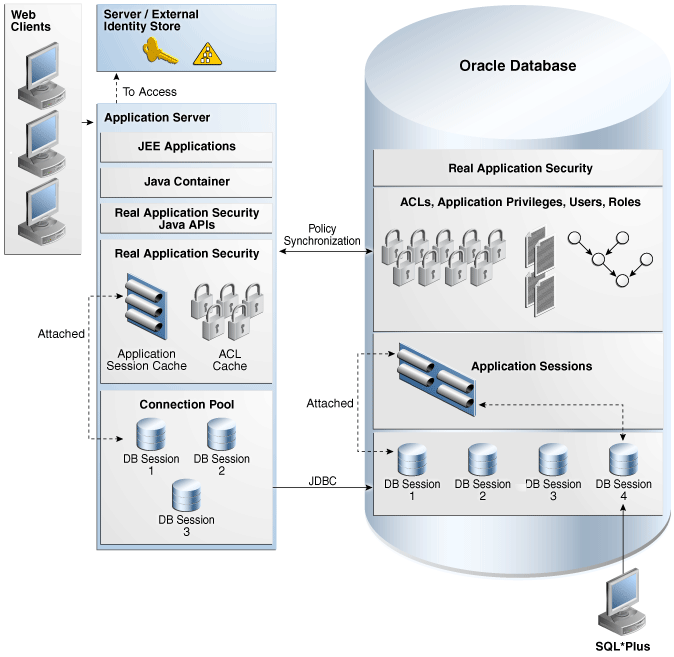

## 3  Configuring Application Sessions

This chapter contains:

- About Application Sessions

- About Creating and Maintaining Application Sessions

- About Manipulating the Application Session State

- About Administrative APIs for External Users and Roles

- About Real Application Security Session Privilege Scoping Through ACL

### 3.1 About Application Sessions

An application session contains information relevant to the application and its user. An application session stores application session state as a collection of attribute-value pairs. These attribute value pairs are divided into namespaces. Unlike traditional heavyweight database sessions, an application session does not hold its own database resources, such as transactions and cursors. Because application sessions consume far fewer server resources than heavyweight sessions, an application session can be dedicated to each end application user. An application session can persist in the database and resume later with minimal cost.

To configure an application session, you work in two phases:

1.  You create and maintain the application session.

2.  You can manipulate the session state during the life of the session.

You can use either PL/SQL APIs or Java APIs to configure application sessions. This chapter describes the programmatic creation, use, and maintenance of application sessions in PL/SQL, and includes specific links to comparable Java information.

**See Also:**

- [Oracle Database Real Application Security SQL Functions](real-application-security-sql-functions.md) and [Oracle Database Real Application Security PL/SQL Packages](real-application-security-plsql-packages.md) for information about PL/SQL API syntax

- [Oracle Database Real Application Security Java API Reference](../jadfs/index.md) for information about Java API syntax (in Javadoc format)

- [Using Real Application Security in Java Applications](using-real-application-security-in-java-applications.md) for information about performing tasks with Java APIs

This section contains:

- About Application Sessions in Real Application Security

- Advantages of Application Sessions

#### 3.1.1 About Application Sessions in Real Application Security

Figure 3-1 shows a Real Application Security architecture diagram and indicates how application sessions fit into it. The figure shows applications creating application sessions in the database. Some of these application sessions are associated with traditional database (DB) sessions.

Figure 3-1 also shows other components of Real Application Security such as ACLs, application privileges, application users, and application roles.

Figure 3-1 Real Application Security Architecture

[Description of "Figure 3-1 Real Application Security Architecture"](img_text/fs_arch.md)

#### 3.1.2 Advantages of Application Sessions

Application sessions have functional advantages over traditional database sessions. For example, traditional database sessions are typically unaware of the end user identities or the security policies for those end users. On the contrary:

- Application sessions encapsulate end user's security context. They enable applications to use database authorization mechanisms for access control based on the end user identity.

- An application session can be associated with multiple database sessions simultaneously.

- They are accessible by all nodes in an Oracle Real Application Clusters (Oracle RAC) environment.

Application sessions have these performance advantages over traditional database sessions:

- They can be created with less overhead than traditional database sessions.

- They can persist in the database and resume later with minimal cost.

- Real Application Security can collect session attribute changes and session states on the client, using caches. Then, these changes are appended to the database until the next database roundtrip, reducing the number of database roundtrips.

### 3.2 About Creating and Maintaining Application Sessions

This section contains:

- Creating an Application Session

- Creating an Anonymous Application Session

- Attaching an Application Session to a Traditional Database Session

- Setting a Cookie for an Application Session

- Assigning an Application User to an Anonymous Application Session

- Switching a Current Application User to Another Application User in the Current Application Session

- About Creating a Global Callback Event Handler Procedure

- Configuring Global Callback Event Handlers for an Application Session

- Saving an Application Session

- Detaching an Application Session from a Traditional Database Session

- Destroying an Application Session

#### 3.2.1 Creating an Application Session

You can create an application session using the `DBMS_XS_SESSIONS.CREATE_SESSION` procedure in PL/SQL or using the `createSession` method of the `XSSessionManager` class in Java. To create an application session, the invoking user needs `CREATE_SESSION` application privilege. This privilege can be obtained through `XS_SESSION_ADMIN` Database role or by `XS_ADMIN_UTIL.GRANT_SYSTEM_PRIVILEGE` API call (see "[GRANT_SYSTEM_PRIVILEGE Procedure](XS_ADMIN_UTIL-package.md)" for more information). `CREATE_SESSION` procedure populates the unique identifier of the newly created session in `sessionid` out parameter. This unique identifier can be used to refer to the session in future calls. The `DBA_XS_SESSIONS` data dictionary view displays all the application sessions in the database.

You can also specify a list of namespaces to be created when the session is created. If you specify namespaces during creation of the session, the caller must have application privileges `MODIFY_NAMESPACE` or `MODIFY_ATTRIBUTE` on the namespaces, or the `ADMIN_NAMESPACE` system privilege.

Example 3-1 shows how to create an application session with `lwuser1`.

Example 3-1 Creating an Application Session

    DECLARE
      sessionid RAW(16);
    BEGIN
      SYS.DBMS_XS_SESSIONS.CREATE_SESSION('lwuser1', sessionid);
    END;

**See Also:**

- [CREATE_SESSION Procedure](DBMS_XS_SESSION-package.md) for information about the syntax of this PL/SQL procedure

- [Oracle Database Real Application Security Java API Reference](../jadfs/index.md) for information about the syntax of the Java `createSession` method (in Javadoc format)

- [Example 6-2](using-real-application-security-in-java-applications.md) for information about a Java example of this task

#### 3.2.2 Creating an Anonymous Application Session

You can also create an anonymous application session using the `DBMS_XS_SESSIONS.CREATE_SESSION` procedure in PL/SQL or using the `createAnonymousSession` method of the `XSSessionManager` class in Java. To create an anonymous session through the PL/SQL API, you must specify the predefined user name `XSGUEST`.

Example 3-2 shows how to create an anonymous session with the predefined user `XSGUEST`.

After creating an anonymous application session, you can assign a named user to the session.

Example 3-2 Creating an Anonymous Application Session

    DECLARE
      sessionid RAW(16);
    BEGIN
      SYS.DBMS_XS_SESSIONS.CREATE_SESSION('XSGUEST', sessionid);
    END;

**See Also:**

- [CREATE_SESSION Procedure](DBMS_XS_SESSION-package.md) for information about the syntax of this PL/SQL procedure

- [Oracle Database Real Application Security Java API Reference](../jadfs/index.md) for information about the syntax of the Java `createAnonymousSession` method (in Javadoc format)

- [Example 6-2](using-real-application-security-in-java-applications.md) for information about a Java example of this task

#### 3.2.3 Attaching an Application Session to a Traditional Database Session

To use an application session, it must be associated with a database session. This operation is called `attach`. You can attach an application session to a traditional database session using the `DBMS_XS_SESSIONS.ATTACH_SESSION` procedure in PL/SQL or the `attachSession` method of the `XSSessionManager` class in Java. A database session can only attach one application session at a time. The `DBA_XS_ACTIVE_SESSIONS` dynamic data dictionary view displays all attached application sessions in the database.

To execute this procedure, the traditional session user must have the `ATTACH_SESSION` application privilege. This privilege can be obtained through the `XS_SESSION_ADMIN` Database role or by the `XS_ADMIN_UTIL.GRANT_SYSTEM_PRIVILEGE` API call. If you specify namespaces, then the user is required to have the application privileges `MODIFY_NAMESPACE` or `MODIFY_ATTRIBUTE` on the namespaces, or `ADMIN_NAMESPACE` system privilege.

Example 3-3 shows how to attach an application session to a database session.

Beginning with Oracle Database 12c Release 2 (12.2), Oracle Label Security supports Real Application Security users. This means that Oracle Label Security context is established in the Real Application Security session during the attach operation, so that Oracle Label Security authorization can be exercised in the Real Application Security user session. Oracle Label Security provides the ability to define data labels, assign user labels and protect sensitive application data within the Oracle database.

For example, using Oracle Label Security data labels allows each row of a table to be labeled based on its level of confidentiality. Data labels consist of 3 components: levels, compartments, and groups. So a given data label should have one level, zero or more compartments and zero or more groups associated with it. Compartments allow defining finer granularity within a level – all data belonging to a particular project can be labeled with the same compartment. Groups are hierarchical and a group can thus be associated with a parent group.

In addition, using Oracle Label Security user labels, each user can be assigned labels that constrain access to labeled data. Each user is assigned a range of levels, compartments, and groups, and each session can operate within that authorized range to access labeled data within that range.

Furthermore, using privileges, Oracle Label Security privileges are policy specific and used to provide users specific rights to perform special operations or to access data beyond their label authorizations. The list of all policy specific privileges is: `FULL`, `READ`, `COMPACCESS`, `PROFILE_ACCESS`, `WRITEUP`, `WRITEDOWN`, and `WRITEACROSS`.

Using Oracle Label Security, trusted stored programs can be used. A trusted stored program unit is a stored procedure, function, or package that has been granted one or more label security privileges. Trusted stored program units are used to let users perform privileged operations in a controlled manner, or update data at several labels. By granting privileges to a program unit, the privileges required for users can be effectively reduced.

Using Oracle Label Security, a policy is applied to a table or an entire schema after defining data labels or user labels or both and assigning appropriate privileges to users. When a policy is applied on a table, label security creates a policy specific NUMBER column on the table to store numeric equivalent of the data labels defined before for the policy. The column can be created as a user visible column or as a hidden column. The user can specify various enforcement options when the policy is applied on the table. The `READ_CONTROL` enforcement option for example protects the table from queries and `WRITE_CONTROL` protects it from DML operations.

Establishing Oracle Label Security context in a Real Application Security session therefore lets `SELECT` and DML operations return results authorized for the Real Application Security user.

To attach a session with dynamic roles, a list of dynamic roles can be passed in the PL/SQL `ATTACH_SESSION` procedure.

**Note:**

When developing the application, ensure that all application end user actions are captured within an `ATTACH_SESSION` ... `DETACH_SESSION` programming block. (For more information, see "Detaching an Application Session from a Traditional Database Session").

Example 3-3 Attaching an Application Session

    DECLARE
      sessionid raw(16);
    BEGIN
      SYS.DBMS_XS_SESSIONS.CREATE_SESSION('lwuser1', sessionid);
      SYS.DBMS_XS_SESSIONS.ATTACH_SESSION(sessionid);
    END;

**See Also:**

- [ATTACH_SESSION Procedure](DBMS_XS_SESSION-package.md) for information about the syntax of this PL/SQL procedure

- [Oracle Database Real Application Security Java API Reference](../jadfs/index.md) for information about the syntax of the Java `attachSession` method (in Javadoc format)

- [Example 6-3](using-real-application-security-in-java-applications.md) for information about a Java example of this task

- [Oracle Label Security Administrator’s Guide](../olsag/oracle-label-security-pl-sql-packages.md) for information about Oracle Label Security

#### 3.2.4 Setting a Cookie for an Application Session

You can associate a specific cookie with an application session using the `DBMS_XS_SESSIONS.SET_SESSION_COOKIE` procedure in PL/SQL or the `setCookie` method of the `XSSessionManager` class in Java. The cookie can also be associated at the time of creation of the session through the `CREATE_SESSION` PL/SQL API. A cookie is a token embedded in a user’s session by a web site during an application session. So the next time the same user requests something from that web site, it sends the cookie to the application session, which allows the server to associate the session with that user.

To execute this procedure, the user must be granted the `MODIFY_SESSION` application privilege. This privilege can be obtained through the `XS_SESSION_ADMIN` Database role or by the `XS_ADMIN_UTIL.GRANT_SYSTEM_PRIVILEGE` API call.

Example 3-4 shows how to set a cookie for an application session.

Example 3-4 Setting a Cookie for an Application Session

    DECLARE
      sessionid raw(16);
    BEGIN
      SYS.DBMS_XS_SESSIONS.CREATE_SESSION('lwuser1', sessionid);
      SYS.DBMS_XS_SESSIONS.SET_SESSION_COOKIE('Cookie1', sessionid);
    END;

**See Also:**

- [SET_SESSION_COOKIE Procedure](DBMS_XS_SESSION-package.md) for information about the syntax of this PL/SQL procedure

- [Oracle Database Real Application Security Java API Reference](../jadfs/index.md) for information about the syntax of the Java `setCookie` method (in Javadoc format)

- [Example 6-20](using-real-application-security-in-java-applications.md) for information about a Java example of this task

#### 3.2.5 Assigning an Application User to an Anonymous Application Session

You can assign a named application user to a currently attached anonymous application session using the `DBMS_XS_SESSIONS.ASSIGN_USER` procedure in PL/SQL or the `assignUser` method of the `XSSessionManager` class in Java. Assigning a user changes the user session from anonymous to a named user.

To execute this procedure, the dispatcher or connection user must have the `ASSIGN_USER` application privilege. This privilege can be obtained through the `XS_SESSION_ADMIN` Database role or by the `XS_ADMIN_UTIL.GRANT_SYSTEM_PRIVILEGE` API call. If you specify namespaces, then the user is required to be granted application privileges `MODIFY_NAMESPACE` or `MODIFY_ATTRIBUTE` on the namespaces, or `ADMIN_NAMESPACE` system privilege. A list of dynamic roles can also be enabled using the `DBMS_XS_SESSIONS.ASSIGN_USER` procedure.

Beginning with Oracle Database 12c Release 2 (12.2), Oracle Label Security supports Real Application Security users. If the Real Application Security user is authorized in any Oracle Label Security policy then, during an `assign_user` call, the corresponding label security authorization is established for the named Real Application Security user session. Establishing Oracle Label Security context in a Real Application Security session therefore lets `SELECT` and DML operations return results authorized for the Real Application Security user.

Example 3-5 shows how to assign the application user `lwuser1` to an application session.

Example 3-5 Assigning an Application User to an Application Session

    DECLARE
      sessionid raw(16);
    BEGIN
      SYS.DBMS_XS_SESSIONS.CREATE_SESSION('XSGUEST', sessionid);
      SYS.DBMS_XS_SESSIONS.ATTACH_SESSION(sessionid);
      SYS.DBMS_XS_SESSIONS.ASSIGN_USER('lwuser1');
    END;

**See Also:**

- [ASSIGN_USER Procedure](DBMS_XS_SESSION-package.md) for information about the syntax of this PL/SQL procedure

- [Oracle Database Real Application Security Java API Reference](../jadfs/index.md) for information about the syntax of the Java `assignUser` method (in Javadoc format)

- [Example 6-5](using-real-application-security-in-java-applications.md) for information about a Java example of this task

- Attaching an Application Session to a Traditional Database Session for information about how Oracle Label Security supports Real Application Security users

- [Oracle Label Security Administrator’s Guide](../olsag/oracle-label-security-pl-sql-packages.md) for information about Oracle Label Security

#### 3.2.6 Switching a Current Application User to Another Application User in the Current Application Session

You can switch or proxy the security context of the current application session to a newly initialized security context for a specified application user using the `DBMS_XS_SESSIONS.SWITCH_USER` procedure in PL/SQL or the `switchUser` method of the `Session` interface in Java. To proxy another application user, the current application session user must be set up as a proxy user for the target user before performing the switch operation. This is performed through the `XS_PRINCIPAL.ADD_PROXY_USER` PL/SQL API.

Switching a user changes the user session between two named users.

If the target application user of the proxy operation has a list of filtering roles (proxy roles) set up for the proxy user, they are enabled in the session.

Beginning with Oracle Database 12c Release 2 (12.2), Oracle Label Security supports Real Application Security users. This means that Oracle Label Security context of the `target_user` will be established on switching from the `proxy_user` session to the `target_user` session.

You can either retain or clear the application namespace and attributes after a switch operation. When the `keep_state` parameter is set to `TRUE`, all application namespaces and attributes are retained; otherwise, all previous state in the session is cleared.

If you specify namespaces, then the user is required to be granted application privileges `MODIFY_NAMESPACE` or `MODIFY_ATTRIBUTE` on the namespaces, or the `ADMIN_NAMESPACE` system privilege.

Example 3-6 shows how to switch the application user `lwuser1` to application user `lwuser2` in the current application session. Note that namespace templates `ns1` and `ns2` should have already have been created by `SYSDBA`.

Example 3-6 Switching an Application User to Another Application User in the Current Application Session

    DECLARE
      sessionid RAW(16);
      nsList DBMS_XS_NSATTRLIST;
    BEGIN
      nsList := DBMS_XS_NSATTRLIST(DBMS_XS_NSATTR('ns1'),DBMS_XS_NSATTR('ns2'));
      SYS.DBMS_XS_SESSIONS.CREATE_SESSION('lwuser1', sessionid);
      SYS.DBMS_XS_SESSIONS.ATTACH_SESSION(sessionid);
      SYS.DBMS_XS_SESSIONS.SWITCH_USER(username => 'lwuser2',
                                   keep_state => TRUE,
                                   namespaces => nsList);
    END;

**See Also:**

- [SWITCH_USER Procedure](DBMS_XS_SESSION-package.md) for information about the syntax of this PL/SQL procedure

- [Oracle Database Real Application Security Java API Reference](../jadfs/index.md) for information about the syntax of the Java `assignUser` method (in Javadoc format)

- [Example 6-6](using-real-application-security-in-java-applications.md) for information about a Java example of this task

- Attaching an Application Session to a Traditional Database Session for information about how Oracle Label Security supports Real Application Security users

- [Oracle Label Security Administrator’s Guide](../olsag/oracle-label-security-pl-sql-packages.md) for information about Oracle Label Security

#### 3.2.7 About Creating a Global Callback Event Handler Procedure

The callback event handler procedure must adhere to the prototype, which includes a specified set of arguments.

For example, the following `callback_procedure` specifies an existing PL/SQL procedure, which is the event handler and shows its two possible forms.

    PROCEDURE callback_procedure (sessionid in raw, error out pls_integer)

This first form includes two parameters, the `sessionid` in `RAW` and the out parameter `error`, which is used for the purpose of setting the error. The `sessionid` contains the session ID of the session in which the event was triggered. The out `error` parameter can be used in the event handler code to display the error.

    PROCEDURE callback_procedure (sessionid in raw, user in varchar2, error out pls_integer)

This second form includes an additional parameter `user` in `VARCHAR2` to specify the user who triggered this event.

**Note:**

The error value must be explicitly set to a value in the PL/SQL body or in the exception block as follows, `error:= 0;`.

Otherwise, the following error is raised, `ORA-46071: Error occured in event handler <name-of-event-handler>` followed by another error, `ORA-1405: fetched column value is NULL`, indicating that the error value is `NULL`.

The following example shows the explicit setting of the error value using the second form of the callback procedure.

    CREATE OR REPLACE PACKAGE CALLBACK_PACKAGE AS
    PROCEDURE CALLBACK_PROCEDURE (sessionid in RAW, user in VARCHAR2, error out PLS_INTEGER);
    END CALLBACK_PACKAGE;
    /

    CREATE OR REPLACE PACKAGE BODY CALLBACK_PACKAGE AS
    PROCEDURE CALLBACK_PROCEDURE (sessionid in RAW, user in VARCHAR2, error out PLS_INTEGER) IS
    BEGIN
      error := 0;
      dbms_output.put_line('Inside callback procedure');
    EXCEPTION
    WHEN OTHERS THEN
            error:=0;
            dbms_output.put_line('Error');
    END CALLBACK_PROCEDURE;
    END CALLBACK_PACKAGE;

**See Also:**

- Configuring Global Callback Event Handlers for an Application Session

#### 3.2.8 Configuring Global Callback Event Handlers for an Application Session

A global callback event handler is a predefined PL/SQL procedure that can be invoked to inspect, log, and modify the session state when certain session events of interest occur. You can add multiple global callback event handlers on a session event. After you create the PL/SQL procedure, you can register or deregister, or enable or disable it using these procedures, respectively:

- `DBMS_XS_SESSIONS.ADD_GLOBAL_CALLBACK`

  Use this procedure to register a callback event handler.

- `DBMS_XS_SESSIONS.DELETE_GLOBAL_CALLBACK`

  Use this procedure to deregister a global callback.

- `DBMS_XS_SESSIONS.ENABLE_GLOBAL_CALLBACK`

  Use this procedure to enable or disable a global callback procedure by specifying a value of `TRUE` for enable or `FALSE` for disable.

To execute these APIs the user must have the `CALLBACK` application privilege. This can be obtained through the `XSPROVISIONER` application role or by calling the `XS_ADMIN_UTIL.GRANT_SYSTEM_PRIVILEGE` API. You can configure one or more global callback event handlers for use in an application session. If you configure multiple callback event handlers, Oracle Database executes the handlers in the order in which they were created.

Optionally, you can follow these steps to change the execution order:

1.  Run the `DBMS_XS_SESSIONS.DELETE_GLOBAL_CALLBACK` procedure to deregister any existing callback.
2.  Run the `DBMS_XS_SESSIONS.ADD_GLOBAL_CALLBACK` procedure to register the callback.

Example 3-7 Registering a Global Callback in an Application Session

    BEGIN
      SYS.DBMS_XS_SESSIONS.ADD_GLOBAL_CALLBACK
       (DBMS_XS_SESSIONS.CREATE_SESSION_EVENT,
       'CALLBACK_SCHM','CALLBACK_PKG','CALLBACK_PROC');
    END;
    /

Table 3-1 lists session events that can use callback event handlers.

Table 3-1 Session Events That Can Use Callback Event Handlers

| Session Event                                                                | When the Callback Will Be Executed                                                                                       |
|:-----------------------------------------------------------------------------|:-------------------------------------------------------------------------------------------------------------------------|
| Creating a new application session                                           | After the session is created.                                                                                            |
| Attaching to an existing application session                                 | After the session is attached.                                                                                           |
| Enabling a dynamic application role                                          | After a dynamic application role is enabled.                                                                             |
| Disabling a dynamic application role                                         | After a dynamic application role is disabled.                                                                            |
| Direct login of an application session                                       | After the session is attached (if the session attach is called as part of the direct logon of an application session).   |
| Assigning a named application user to an anonymous application session       | After the named user is assigned to the anonymous application session.                                                   |
| Proxying from one named application user to another named application user   | After the application user is switched (if the application user is not proxying back to the original application user).  |
| Proxying back from a named application user to the original application user | After the application user is switched (if the application user is proxying back to the original application user).      |
| Enabling a regular application role                                          | After the application role is enabled.                                                                                   |
| Disabling a regular application role                                         | After the application role is disabled.                                                                                  |
| Detaching from an existing application session or database session           | Before the session is detached.                                                                                          |
| Terminating an existing application session or database session              | Before the session is destroyed.                                                                                         |
| Direct logoff of an application session or database session                  | Before the session is detached (if the session detach is called as part of the direct logoff of an application session). |

Suppose you want to initialize certain application-specific states after creating a session. Example 3-7 shows how to register a global callback that sets up the state `CALLBACK_PROC`, which is defined in the package `CALLBACK_PKG` and owned by the schema `CALLBACK_SCHM`.

The state `CALLBACK_PROC` is registered as a global callback for the event `CREATE_SESSION_EVENT`.

For more examples, and for details about the syntax of these procedures, see the following:

- "[ADD_GLOBAL_CALLBACK Procedure](DBMS_XS_SESSION-package.md)"

- "[DELETE_GLOBAL_CALLBACK Procedure](DBMS_XS_SESSION-package.md)"

- "[ENABLE_GLOBAL_CALLBACK Procedure](DBMS_XS_SESSION-package.md)"

#### 3.2.9 Saving an Application Session

You can save the current user application session using the `DBMS_XS_SESSIONS.SAVE_SESSION` procedure in PL/SQL or the `saveSession` method of the `XSSessionManager` class in Java. Use the save operation when session changes need to be propagated immediately to other sessions using the same session as this one. If the save operation is not used, then the session changes would be reflected in other sessions only after this session is detached.

The calling user requires no privileges to perform this operation.

Example 3-8 shows how to save the current user application session.

Example 3-8 Saving the Current User Application Session

    BEGIN
     SYS.DBMS_XS_SESSIONS.SAVE_SESSION;
    END;

**See Also:**

- [SAVE_SESSION Procedure](DBMS_XS_SESSION-package.md) for information about the syntax of these PL/SQL procedures

- [Oracle Database Real Application Security Java API Reference](../jadfs/index.md) for information about the syntax of the Java `detachSession` method (in Javadoc format)

- [Example 7-4](oracle-fusion-middleware-integration-with-real-application-security.md) for information about a Java example of this task

#### 3.2.10 Detaching an Application Session from a Traditional Database Session

You can detach an application session from the traditional database session using either of these procedures:

- `DBMS_XS_SESSIONS.DETACH_SESSION(abort => FALSE)`

  Use this procedure to detach the session and commit any changes that were made since the last time session changes were saved. When you specify the `abort` parameter as `FALSE` (the default value), all changes performed in the current session are persisted. The currently attached user can perform this operation without any additional privileges.

  `DETACH_SESSION` is always performed on the currently attached session.

- `DBMS_XS_SESSIONS.DETACH_SESSION(abort => TRUE)`

  Use this procedure to detach the session without saving the changes. When you specify the `abort` parameter as `TRUE`, it rolls back the changes performed in the current session. The role and namespace changes made to the session since the attach are discarded.

Example 3-9 shows how to detach an application session from a database session and commit the changes. Note that you can call `DETACH_SESSION` anywhere to detach the currently attached session.

You can use the `detachSession` method of the `XSSessionManager` class in Java.

Example 3-10 shows how to detach a database session from an application session without saving any changes.

**Note:**

When developing the application, ensure that all application end user actions are captured within an `ATTACH_SESSION` ... `DETACH_SESSION` programming block. (For more information, see "Attaching an Application Session to a Traditional Database Session")

Example 3-9 Detaching and Committing an Application Session

    DECLARE
      sessionid RAW(16);
    BEGIN
      SYS.DBMS_XS_SESSIONS.CREATE_SESSION('lwuser1', sessionid);
      SYS.DBMS_XS_SESSIONS.ATTACH_SESSION(sessionid);
    ...
      SYS.DBMS_XS_SESSIONS.DETACH_SESSION;
    ...
    END;

Example 3-10 Detaching and Not Committing an Application Session

    DECLARE
      sessionid RAW(16);
    BEGIN
      SYS.DBMS_XS_SESSIONS.CREATE_SESSION('lwuser1', sessionid);
      SYS.DBMS_XS_SESSIONS.ATTACH_SESSION(sessionid);
    ...
      SYS.DBMS_XS_SESSIONS.DETACH_SESSION(TRUE);
    END;

**See Also:**

- [DETACH_SESSION Procedure](DBMS_XS_SESSION-package.md) for information about the syntax of these PL/SQL procedures

- [Oracle Database Real Application Security Java API Reference](../jadfs/index.md) for information about the syntax of the Java `detachSession` method (in Javadoc format)

- [Example 6-21](using-real-application-security-in-java-applications.md) for information about a Java example of this task

#### 3.2.11 Destroying an Application Session

You can terminate an application session using the `DBMS_XS_SESSIONS.DESTROY_SESSION` procedure in PL/SQL or using the `destroySession` method of the `XSSessionManager` class in Java. This procedure also detaches all traditional sessions from the application session.

To execute this procedure, the invoking user must have the `TERMINATE_SESSION` application privilege. This privilege can be obtained through the `XS_SESSION_ADMIN` Database role or by the `XS_ADMIN_UTIL.GRANT_SYSTEM_PRIVILEGE` API call.

Example 3-11 shows how to destroy an application session.

Example 3-11 Destroying an Application Session

    DECLARE
      sessionid RAW(16);
    BEGIN
      SYS.DBMS_XS_SESSIONS.CREATE_SESSION('lwuser1', sessionid);
      SYS.DBMS_XS_SESSIONS.ATTACH_SESSION(sessionid);
      SYS.DBMS_XS_SESSIONS.DETACH_SESSION;
      SYS.DBMS_XS_SESSIONS.DESTROY_SESSION(sessionid);
    END;

**See Also:**

- [DESTROY_SESSION Procedure](DBMS_XS_SESSION-package.md) for information about the syntax of this PL/SQL procedure

- [Oracle Database Real Application Security Java API Reference](../jadfs/index.md) for information about the syntax of the Java `destroySession` method (in Javadoc format)

- [Example 6-22](using-real-application-security-in-java-applications.md) for information about a Java example of this task

### 3.3 About Manipulating the Application Session State

This section contains:

- About Using Namespace Templates to Create Namespaces

- Initializing a Namespace in an Application Session

- Setting Session Attributes in an Application Session

- Getting Session Attributes in an Application Session

- Creating Custom Attributes in an Application Session

- Deleting a Namespace in an Application Session

- Enabling Application Roles for a Session

- Disabling Application Roles for a Session

#### 3.3.1 About Using Namespace Templates to Create Namespaces

An application uses a namespace to store application defined attribute-value pairs. Often, an application needs to use the same namespace across different application sessions. A namespace template provides a way to define and initialize a namespace.

A namespace template defines the namespace and its properties. It is used to initialize the namespace in an application session. The namespace name must be the same as the template that defines it.

This section contains:

- Components of a Namespace Template

- About Namespace Views

- Creating a Namespace Template for an Application Session

##### 3.3.1.1 Components of a Namespace Template

A namespace template includes the following:

- Name of the namespace

  The name of the application namespace uniquely identifies the namespace. This name is used when creating the namespace in an application session.

- Namespace handler

  The namespace handler is called when an attribute value is set or retrieved. Specifying a handler is optional.

  Namespaces can be associated with an event handling function. The server invokes this function whenever an operation on an attribute registered for event handling is performed. The event handling function is provided with the attribute name, attribute value, and the event code as arguments. For example:

      FUNCTION event_handling_function_name(
               session_id IN RAW,
               namespace  IN VARCHAR2,
               attribute  IN VARCHAR2,
               old_value  IN VARCHAR2,
               new_value  IN VARCHAR2,
               event_code IN PLS_INTEGER)
      RETURNS PLS_INTEGER;

- Attribute List

  The attribute list includes the attributes defined for the namespace. These attributes are created in the session when the namespace is created.

  You can specify the following optional data for attributes:

  - The default value

    The attribute is initialized with the default value when the namespace is created in the application session. The default value and the event types `FIRSTREAD_EVENT` and `FIRSTREAD_PLUS_UPDATE_EVENT` cannot exist at the same time.

  - Event types

    You can specify the following event types for an attribute:

    - `FIRSTREAD_EVENT`

      Specify this event type to call the namespace handler when an attribute whose value has not been set is read for the first time. You can specify this event type only if a default value has not been set for the attribute.

    - `UPDATE_EVENT`

      Specify this event type to call the namespace handler when the attribute value is updated.

    - `FIRSTREAD_PLUS_UPDATE_EVENT`

      Specify this event type to call the namespace handler when an attribute whose value has not been set is read for the first time, or when its value is updated. You can specify this event type only if a default value has not been set for the attribute.

- Namespace ACL

  The privilege model for namespace operations. Namespace operations are protected by the ACL set on the template. By default, `NS_UNRESTRICTED_ACL` is set on a template, which allows unrestricted operation on namespaces created from the templates.

##### 3.3.1.2 About Namespace Views

You can find information about namespace templates, namespace template attributes, and namespace attributes in current and all application sessions by querying these data dictionary views:

- "[DBA_XS_NS_TEMPLATES](real-application-security-data-dictionary-views.md)"

- "[DBA_XS_NS_TEMPLATE_ATTRIBUTES](real-application-security-data-dictionary-views.md)"

- "[DBA_XS_SESSION_NS_ATTRIBUTES](real-application-security-data-dictionary-views.md)"

- "[V\$XS_SESSION_NS_ATTRIBUTES](real-application-security-data-dictionary-views.md)"

##### 3.3.1.3 Creating a Namespace Template for an Application Session

You can create a namespace template using the `XS_NAMESPACE.CREATE_TEMPLATE` procedure in PL/SQL or the `createNamespace` method of the `Session` interface in Java.

Example 3-12 shows how to create the namespace template `ns1` for an application session. It defines the attributes for this namespace using the list of attributes `attrs`. Because this namespace template has `NS_UNRESTRICTED_ACL` set on the template, this allows unrestricted operation on namespaces created from the template.

The calling user must have the `ADMIN_ANY_SEC_POLICY` application privilege, which allows it to administer namespace templates and attributes.

Example 3-12 Creating a Namespace Template

    DECLARE
      attrs XS$NS_ATTRIBUTE_LIST;
    BEGIN
      attrs := XS$NS_ATTRIBUTE_LIST();
      attrs.extend(3);

      attrs(1) := XS$NS_ATTRIBUTE('attr1','value1',
        XS_NAMESPACE.UPDATE_EVENT);
      attrs(2) := XS$NS_ATTRIBUTE('attr2',null,
        XS_NAMESPACE.FIRSTREAD_PLUS_UPDATE_EVENT);
      attrs(3) := XS$NS_ATTRIBUTE('attr3','value3');

      SYS.XS_NAMESPACE.CREATE_TEMPLATE(name=>'ns1',
                                   description=>'namespace template 1',
                                   attr_list=>attrs,
                                   schema=>'SCOTT',
                                   package=>'PKG1',
                                   function=>'FN1',
                                   acl=>'SYS.NS_UNRESTRICTED_ACL');
    END;
    /

**See Also:**

- [CREATE_TEMPLATE Procedure](XS_NAMESPACE-package.md) for information about the syntax of this PL/SQL procedure

- [Oracle Database Real Application Security Java API Reference](../jadfs/index.md) for information about the syntax of the Java `createNamespace` method (in Javadoc format)

- [Example 6-10](using-real-application-security-in-java-applications.md) for information about a Java example of this task

#### 3.3.2 Initializing a Namespace in an Application Session

A namespace can be initialized, using a namespace template, during any of the following events, as described in this section:

This section contains:

- Initializing a Namespace When the Session Is Created

- Initializing a Namespace When the Session Is Attached

- Initializing a Namespace When a Named Application User Is Assigned to an Anonymous Application Session

- Initializing a Namespace When the Application User Is Switched in an Application Session

- Initializing a Namespace Explicitly

##### 3.3.2.1 Initializing a Namespace When the Session Is Created

When you create an application session using the `DBMS_XS_SESSIONS.CREATE_SESSION` procedure in PL/SQL or the `createSession` method of the `XSSessionManager` class in Java, you can specify a list of namespaces to initialize.

Example 3-13 shows how to initialize two namespaces, `ns1` and `ns2`, while creating an application session.

If you specify namespaces during creation of the session, the caller is required to be granted application privileges `MODIFY_NAMESPACE` or `MODIFY_ATTRIBUTE` on the namespaces, or be granted the `ADMIN_NAMESPACE` system privilege.

**Note:**

The namespaces used in Example 3-13 must already have corresponding namespace templates defined.

Example 3-13 Initializing Namespaces When Creating an Application Session

    DECLARE
      nsList DBMS_XS_NSATTRLIST;
      sessionid RAW(16);
    BEGIN
        nsList := DBMS_XS_NSATTRLIST(DBMS_XS_NSATTR('ns1'),DBMS_XS_NSATTR('ns2'));
        SYS.DBMS_XS_SESSIONS.CREATE_SESSION('lwuser1', sessionid, FALSE, FALSE, nsList);
    END;
    /

**See Also:**

- [CREATE_SESSION Procedure](DBMS_XS_SESSION-package.md) for information about the syntax of this PL/SQL procedure

- [Oracle Database Real Application Security Java API Reference](../jadfs/index.md) for information about the syntax of the Java `createSession` method (in Javadoc format)

- [Example 6-2](using-real-application-security-in-java-applications.md) for information about a Java example of this task

##### 3.3.2.2 Initializing a Namespace When the Session Is Attached

When you attach the session using the `DBMS_XS_SESSIONS.ATTACH_SESSION` procedure in PL/SQL or using the `attachSession` method of the `XSSessionManager` class in Java, you can specify a list of namespaces to initialize.

Example 3-14 shows how to initialize two namespaces, `ns1` and `ns2`, while attaching an application session.

If you specify namespaces, then the user is required to be granted application privileges `MODIFY_NAMESPACE` or `MODIFY_ATTRIBUTE` on the namespaces, or the `ADMIN_NAMESPACE` system privilege.

**Note:**

The namespaces used in Example 3-14 must already have corresponding namespace templates defined.

Example 3-14 Initializing Namespaces When Attaching an Application Session

    DECLARE
      nsList DBMS_XS_NSATTRLIST;
      sessionid RAW(16);
    BEGIN
        nsList := DBMS_XS_NSATTRLIST(DBMS_XS_NSATTR('ns1'),DBMS_XS_NSATTR('ns2'));
        SYS.DBMS_XS_SESSIONS.CREATE_SESSION('lwuser1', sessionid);
        SYS.DBMS_XS_SESSIONS.ATTACH_SESSION(sessionid, NULL, NULL, NULL, NULL, nsList);
    END;
    /

**See Also:**

- [ATTACH_SESSION Procedure](DBMS_XS_SESSION-package.md) for information about the syntax of this PL/SQL procedure

- [Oracle Database Real Application Security Java API Reference](../jadfs/index.md) for information about the syntax of the Java `attachSession` method (in Javadoc format)

- [Example 6-3](using-real-application-security-in-java-applications.md) for information about a Java example of this task

##### 3.3.2.3 Initializing a Namespace When a Named Application User Is Assigned to an Anonymous Application Session

When you assign an application user to an application session using the `DBMS_XS_SESSIONS.ASSIGN_USER` procedure in PL/SQL or the `assignUser` method of the `XSSessionManager` class in Java, you can specify a list of namespaces to initialize.

If you specify namespaces, then the user is required to be granted application privileges `MODIFY_NAMESPACE` or `MODIFY_ATTRIBUTE` on the namespaces, or `ADMIN_NAMESPACE` system privilege.

Example 3-15 shows how to initialize two namespaces, `ns1` and `ns2`, while assigning an application user to an application session.

**Note:**

The namespaces used in Example 3-15 must already have corresponding namespace templates defined.

Example 3-15 Initializing Namespaces When Assigning an Application User to an Application Session

    DECLARE
      sessionid RAW(30);
      nsList DBMS_XS_NSATTRLIST;
    BEGIN
      nsList := DBMS_XS_NSATTRLIST(DBMS_XS_NSATTR('ns1'),DBMS_XS_NSATTR('ns2'));
      SYS.DBMS_XS_SESSIONS.CREATE_SESSION('XSGUEST', sessionid);
      SYS.DBMS_XS_SESSIONS.ASSIGN_USER(username => 'lwuser2',
                                   sessionid => sessionid,
                                   namespaces => nsList);
    END;
    /

**See Also:**

- [ASSIGN_USER Procedure](DBMS_XS_SESSION-package.md) for information about the syntax of this PL/SQL procedure

- [Oracle Database Real Application Security Java API Reference](../jadfs/index.md) for information about the syntax of the Java `assignUser` method (in Javadoc format)

- [Example 6-5](using-real-application-security-in-java-applications.md) for information about a Java example of this task

##### 3.3.2.4 Initializing a Namespace When the Application User Is Switched in an Application Session

When you switch an application user in an application session using the `DBMS_XS_SESSIONS.SWITCH_USER` procedure in PL/SQL or using the `switchUser` method of the `Session` interface in Java, you can specify a list of namespaces to initialize.

If you specify namespaces, then the user is required to be granted application privileges `MODIFY_NAMESPACE` or `MODIFY_ATTRIBUTE` on the namespaces, or the `ADMIN_NAMESPACE` system privilege.

**Note:**

To enable the switch from `lwuser1` to `lwuser2` after attaching the session, you must first define `lwuser2` as the target user for `lwuser1`, as follows:

    exec XS_PRINCIPAL.ADD_PROXY_USER('lwuser2', 'lwuser1');

Example 3-16 shows how to initialize two namespaces, `ns1` and `ns2`, while switching an application user in an application session.

**Note:**

The namespaces used in Example 3-16 must already have corresponding namespace templates defined.

Example 3-16 Initializing Namespaces When Switching an Application User in an Application Session

    DECLARE
      sessionid RAW(30);
      nsList DBMS_XS_NSATTRLIST;
    BEGIN
      nsList := DBMS_XS_NSATTRLIST(DBMS_XS_NSATTR('ns1'),DBMS_XS_NSATTR('ns2'));
     SYS.DBMS_XS_SESSIONS.CREATE_SESSION('lwuser1', sessionid);
     SYS. DBMS_XS_SESSIONS.ATTACH_SESSION(sessionid);
      SYS.DBMS_XS_SESSIONS.SWITCH_USER(username => 'lwuser2',
                                   namespaces => nsList);
    END;
    /

**See Also:**

- [SWITCH_USER Procedure](DBMS_XS_SESSION-package.md) for information about the syntax of this PL/SQL procedure

- [Oracle Database Real Application Security Java API Reference](../jadfs/index.md) for information about the syntax of the Java `switchUser` method (in Javadoc format)

- [Example 6-6](using-real-application-security-in-java-applications.md) for information about a Java example of this task

##### 3.3.2.5 Initializing a Namespace Explicitly

You can explicitly initialize a namespace in an application session using the `DBMS_XS_SESSIONS.CREATE_NAMESPACE` procedure in PL/SQL or the `createNamespace` method of the `Session` interface in Java.

To execute the `DBMS_XS_SESSIONS.CREATE_NAMESPACE` procedure, the calling user must have the `MODIFY_NAMESPACE` application privilege on the namespace or the `ADMIN_NAMESPACE` system privilege.

Example 3-17 shows how to explicitly initialize a namespace, `ns1`, in an application session.

**Note:**

The namespace used in Example 3-17 must already have a corresponding namespace template defined.

Example 3-17 Initializing a Namespace Explicitly in an Application Session

    DECLARE
      sessionid RAW(30);
    BEGIN
      SYS.DBMS_XS_SESSIONS.CREATE_SESSION('lwuser1', sessionid);
      SYS.DBMS_XS_SESSIONS.ATTACH_SESSION(sessionid);
      SYS.DBMS_XS_SESSIONS.CREATE_NAMESPACE('ns1');
    END;
    /

**See Also:**

- [CREATE_NAMESPACE Procedure](DBMS_XS_SESSION-package.md) for information about the syntax of this PL/SQL procedure

- [Oracle Database Real Application Security Java API Reference](../jadfs/index.md) for information about the syntax of the Java `createNamespace` method (in Javadoc format)

- [Example 6-10](using-real-application-security-in-java-applications.md) for information about a Java example of this task

#### 3.3.3 Setting Session Attributes in an Application Session

You can set the value of a specific session attribute using the `DBMS_XS_SESSIONS.SET_ATTRIBUTE` procedure in PL/SQL or the `setAttribute` method of the `SessionNamespace` interface method in Java.

The calling user is required to be granted the `MODIFY_ATTRIBUTE` application privilege on the namespace or the `ADMIN_NAMESPACE` system privilege.

**Note:**

An attribute can store a string value up to 4000 characters long.

Example 3-18 shows how to set a value, `val1`, for an attribute, `attr1`, of the application session.

Example 3-18 Setting a Namespace Attribute for an Application Session

    DECLARE
      sessionid RAW(16);
    BEGIN
      SYS.DBMS_XS_SESSIONS.CREATE_SESSION('lwuser1', sessionid);
      SYS.DBMS_XS_SESSIONS.ATTACH_SESSION(sessionid);
      SYS.DBS_XS_SESSIONS.CREATE_NAMESPACE('ns1');
      SYS.DBMS_XS_SESSIONS.SET_ATTRIBUTE('ns1', 'attr1', 'val1');
      SYS.DBMS_XS_SESSIONS.DETACH_SESSION;
      SYS.DBMS_XS_SESSIONS.DESTROY_SESSION(sessionid);
    END;
    /

**See Also:**

- [SET_ATTRIBUTE Procedure](DBMS_XS_SESSION-package.md) for more information about the syntax of this PL/SQL procedure

- [Oracle Database Real Application Security Java API Reference](../jadfs/index.md) for information about the syntax of the Java `setAttribute` method (in Javadoc format)

- [About Setting a Session Namespace Attribute](using-real-application-security-in-java-applications.md) for information about this task in Java

#### 3.3.4 Getting Session Attributes in an Application Session

You can retrieve the value of a specific session attribute using the `DBMS_XS_SESSIONS.GET_ATTRIBUTE` procedure in PL/SQL or using the `getAttribute` method of the `SessionNamespace` interface method in Java.

The calling user is not required to be granted any privileges to get attributes using the `DBMS_XS_SESSIONS.GET_ATTRIBUTE` procedure.

**Note:**

If an attribute value has not been set, and the `FIRSTREAD_EVENT` has been specified for the attribute, then an attempt to read the the attribute value triggers a call to the namespace event handler. The namespace event handler procedure typically sets a value for the attribute, and performs other application-specific processing tasks.

Example 3-19 shows how to retrieve an attribute, `attr1`, of the application session.

Example 3-19 Getting a Namespace Attribute for an Application Session

    DECLARE
      sessionid RAW(16);
      attrib_out_val VARCHAR2(4000);
    BEGIN
      SYS.DBMS_XS_SESSIONS.CREATE_SESSION('lwuser1', sessionid);
      SYS.DBMS_XS_SESSIONS.ATTACH_SESSION(sessionid);
      SYS.DBMS_XS_SESSIONS.CREATE_NAMESPACE('ns1');
      SYS.DBMS_XS_SESSIONS.SET_ATTRIBUTE('ns1', 'attr1', 'val1');
      SYS.DBMS_XS_SESSIONS.GET_ATTRIBUTE('ns1', 'attr1', attrib_out_val);
      SYS.DBMS_XS_SESSIONS.DETACH_SESSION;
      SYS.DBMS_XS_SESSIONS.DESTROY_SESSION(sessionid);
    END;
    /

**See Also:**

- [GET_ATTRIBUTE Procedure](DBMS_XS_SESSION-package.md) for information about the syntax of this PL/SQL procedure

- [Oracle Database Real Application Security Java API Reference](../jadfs/index.md) for information about the syntax of the Java `getAttribute` method (in Javadoc format)

- [Getting a Session Namespace Attribute](using-real-application-security-in-java-applications.md) for information about this task in Java

#### 3.3.5 Creating Custom Attributes in an Application Session

You can create custom attributes in a namespace using the `DBMS_XS_SESSIONS.CREATE_ATTRIBUTE` procedure in PL/SQL or the `createAttribute` method of the `SessionNamespace` interface method in Java.

Custom attributes differ from template attributes. Template attributes are part of the namespace template, and are automatically created in the session when the namespace is created. Custom attributes are programmatically created in a namespace, using the `CREATE_ATTRIBUTE` procedure.

The calling application is required to be granted the `MODIFY_ATTRIBUTE` application privilege on the namespace or the `ADMIN_NAMESPACE` system privilege.

Example 3-20 shows how to create a custom attribute, `customattr`, in a namespace of the application session.

Example 3-20 Creating a Custom Namespace Attribute for an Application Session

    DECLARE
      sessionid RAW(16);
      attrib_out_val VARCHAR2(4000);
    BEGIN
      SYS.DBMS_XS_SESSIONS.CREATE_SESSION('lwuser1', sessionid);
      SYS.DBMS_XS_SESSIONS.ATTACH_SESSION(sessionid);
      SYS.DBMS_XS_SESSIONS.CREATE_NAMESPACE('ns1');
      SYS.DBMS_XS_SESSIONS.CREATE_ATTRIBUTE('ns1','customattr','default_value_custom',NULL);
      SYS.DBMS_XS_SESSIONS.SET_ATTRIBUTE('ns1','customattr','newvalue');
      SYS.DBMS_XS_SESSIONS.GET_ATTRIBUTE('ns1', 'customattr', attrib_out_val);
      SYS.DBMS_XS_SESSIONS.DETACH_SESSION;
      SYS.DBMS_XS_SESSIONS.DESTROY_SESSION(sessionid);
    END;
    /

**See Also:**

- [CREATE_ATTRIBUTE Procedure](DBMS_XS_SESSION-package.md) for information about the syntax of this PL/SQL procedure

- [Oracle Database Real Application Security Java API Reference](../jadfs/index.md) for information about the syntax of the Java `createAttribute` method (in Javadoc format)

- [Example 6-13](using-real-application-security-in-java-applications.md) for information about a Java example of this task

#### 3.3.6 Deleting a Namespace in an Application Session

You can delete a namespace and all attributes identified by it from an application session using the `DBMS_XS_SESSIONS.DELETE_NAMESPACE` procedure in PL/SQL or the `deleteAttribute` method of the `SessionNamespace` interface method in Java.

The calling user must have the `MODIFY_NAMESPACE` application privilege on the namespace or the `ADMIN_NAMESPACE` system privilege.

Example 3-21 shows how to delete a namespace `ns1` from an application session.

Example 3-21 Deleting a Namespace in an Application Session

    DECLARE
      sessionid RAW(16);
      out_value VARCHAR2(4000);
    BEGIN
      SYS.DBMS_XS_SESSIONS.CREATE_SESSION('lwuser1', sessionid);
      SYS.DBS_XS_SESSIONS.ATTACH_SESSION(sessionid);
      SYS.DBMS_XS_SESSIONS.CREATE_NAMESPACE('ns1');
      SYS.DBMS_XS_SESSIONS.SET_ATTRIBUTE('ns1', 'attr1', 'val1');
      SYS.DBMS_XS_SESSIONS.GET_ATTRIBUTE('ns1', 'attr1', out_value);
      SYS.DBMS_XS_SESSIONS.DELETE_NAMESPACE('ns1');
      SYS.DBMS_XS_SESSIONS.DETACH_SESSION;
      SYS.DBMS_XS_SESSIONS.DESTROY_SESSION(sessionid);
    END;
    /

**See Also:**

- [DELETE_NAMESPACE Procedure](DBMS_XS_SESSION-package.md) for information about the syntax of this PL/SQL procedure

- [Oracle Database Real Application Security Java API Reference](../jadfs/index.md) for information about the syntax of the Java `deleteNamespace` method (in Javadoc format)

- [Example 6-11](using-real-application-security-in-java-applications.md) for information about a Java example of this task

#### 3.3.7 Enabling Application Roles for a Session

You can enable only directly granted regular application roles of an application session user using the `DBMS_XS_SESSIONS.ENABLE_ROLE` procedure in PL/SQL or the `enableRole` method of the `Session` interface in Java.

The `DBA_XS_SESSION_ROLES` dynamic data dictionary view lists application roles enabled in all application sessions. The `V$XS_SESSION_ROLES` dynamic data dictionary view lists application roles enabled in the currently attached application session.

Example 3-22 shows how to enable a role in an application session.

Example 3-22 Enabling a Role in an Application Session

    DECLARE
      sessionid RAW(16);
    BEGIN
      SYS.DBMS_XS_SESSIONS.CREATE_SESSION('lwuser1', sessionid);
      SYS.DBMS_XS_SESSIONS.ATTACH_SESSION(sessionid);
      SYS.DBMS_XS_SESSIONS.ENABLE_ROLE('auth1_role');
      SYS.DBMS_XS_SESSIONS.DETACH_SESSION;
      SYS.DBMS_XS_SESSIONS.DESTROY_SESSION(sessionid);
    END;
    /

**See Also:**

- [ENABLE_ROLE Procedure](DBMS_XS_SESSION-package.md) for information about the syntax of this PL/SQL procedure

- [Oracle Database Real Application Security Java API Reference](../jadfs/index.md) for information about the syntax of the Java `enableRole` method (in Javadoc format)

- [Example 6-7](using-real-application-security-in-java-applications.md) for information about a Java example of this task

#### 3.3.8 Disabling Application Roles for a Session

You can disable application roles for a specific session using the `DBMS_XS_SESSIONS.DISABLE_ROLE` procedure in PL/SQL or the `disableRole` method of the `Session` interface in Java.

Example 3-23 shows how to disable a role in an application session.

Example 3-23 Disabling a Role in an Application Session

    DECLARE
      sessionid RAW(16);
    BEGIN
      SYS.DBMS_XS_SESSIONS.CREATE_SESSION('lwuser1', sessionid);
      SYS.DBMS_XS_SESSIONS.ATTACH_SESSION(sessionid);
      SYS.DBMS_XS_SESSIONS.ENABLE_ROLE('auth1_role');
      SYS.DBMS_XS_SESSIONS.DISABLE_ROLE('auth1_role');
      SYS.DBMS_XS_SESSIONS.DETACH_SESSION;
      SYS.DBMS_XS_SESSIONS.DESTROY_SESSION(sessionid);
    END;
    /

**See Also:**

- [DISABLE_ROLE Procedure](DBMS_XS_SESSION-package.md) for information about the syntax of this PL/SQL procedure

- [Oracle Database Real Application Security Java API Reference](../jadfs/index.md) for information about t he syntax of the Java `disableRole` method (in Javadoc format)

- [Example 6-8](using-real-application-security-in-java-applications.md) for information about a Java example of this task

### 3.4 About Administrative APIs for External Users and Roles

This section describes the following administrative APIs that are required for external users and roles:

- [CREATE_SESSION Procedure](DBMS_XS_SESSION-package.md)

- [ATTACH_SESSION Procedure](DBMS_XS_SESSION-package.md)

- [ASSIGN_USER Procedure](DBMS_XS_SESSION-package.md)

- [SAVE_SESSION Procedure](DBMS_XS_SESSION-package.md)

### 3.5 About Real Application Security Session Privilege Scoping Through ACL

Describes session privilege scoping through an ACL allowing per principal session privilege grants through an ACL set on the principal, where the principal can be either an application user or a dynamic role.

In Oracle Database 12c Release 1 (12.1), Real Application Security session privileges are granted through `GRANT_SYSTEM_PRIVILEGE` procedure or revoked through `REVOKE_SYSTEM_PRIVILEGE` procedure in the `XS_ADMIN_UTIL` package. These grants are applicable system wide and allow the grantee to exercise the grants for session operations on any Real Application Security principal. This is implemented using a seeded system ACL – `SESSIONACL`. All session privilege checks are done in this ACL. For a database running multiple applications with multiple user communities this approach becomes cumbersome to administer Real Application Security session administration appropriately.

Session privilege scoping addresses two issues. The first issue is who can create, attach, detach, or destroy a user’s session. The second issue is who can enable a dynamic role for a user session. Because a dynamic role can never be granted and can only be dynamically enabled, session privilege scoping through an ACL is needed. Because regular roles are granted to application users, an ACL is not needed on them.

Beginning with Oracle Database 12c Release 2 (12.2), Real Application Security supports session privilege scoping through an ACL. This feature allows per principal session privilege grants through an ACL set on the principal. The ACL containing the session privilege grant can be set on a regular Real Application Security application user or a dynamic role, but it cannot be set on a regular Real Application Security role or external principal. Because Real Application Security session scoping can be enforced per the ACL set on the application user or dynamic role involved in a session operation, you can more finely restrict session operations to specific user communities. For example, you can set up a session operation for a separate user community that can be managed by separate session managers (dispatchers), so users belonging to the same user community will have the same ACL set on them. In addition, enabling and disabling of a dynamic role can be restricted to appropriate dispatchers with the addition of a new privilege `ENABLE_DYNAMIC_ROLE` to restrict enablement and disablement of dynamic roles. This privilege is enforced even for enabling existing session scope dynamic roles from previous attach. With these features, the Real Application Security session administrator can provide a scoping for session privileges that allows a user to create or attach or modify sessions for one Real Application Security user community or a group of Real Application Security user communities for which it has been granted privilege.

The ACL can be set on the principal at creation time using the Real Application Security least system privilege `PROVISION`, which can create, modify, or drop application users and application roles. In addition, you can also use the `CREATE_USER` procedure and `CREATE_DYNAMIC_ROLE` procedure and this requires the caller to have `ALTER USER` or `ALTER ROLE` privilege depending on the principal being created; or the ACL can be created after principal creation using the `SET_ACL` procedure, which requires the caller to have the same privilege as previously mentioned depending on whether the principal is an application user or dynamic role. Both the application user or dynamic role and ACL must already exist before setting the ACL using the `SET_ACL` procedure and the ACL must have been created in the `SYS` schema.

Session operations require either specific session privileges to be granted to the session manager depending on the session operation by either a system-wide ACL or an ACL attached to the affected user or role. The `ADMINISTER_SESSION` privilege aggregates all specific session privileges. Like all session privileges, this privilege can be granted to the session manager by either a system-wide ACL or principal specific ACL. The use of new privileges is audited like other system privileges. An ACL set on a user or dynamic role overrides the system-wide ACL.

The `DBA_XS_USERS` and `DBA_XS_DYNAMIC_ROLES` views are enhanced to show an additional column for the ACL that is set on the Real Application Security application user or dynamic role.

System level session privilege grants can coexist with the principal specific ACL, but the principal specific ACL grants have precedence. This precedence is important as Real Application Security principal specific ACLs can have negative grants. Note that the negative grant can only appear in principal specific ACLs not for the system ACL.

The following table describes the behavior of a session privilege check comparing the principal specific ACL (column 1) with the System ACL (column 2) and showing the result of the session privilege check (column 3) as being either True or False. For example, when the checked privilege is neither granted or denied in a principal specific ACL, then the System ACL is checked for the privilege.

Table 3-2 Session Privilege Checking

| Principal Specific ACL              | System ACL                    | Session Privilege Check Result |
|:------------------------------------|:------------------------------|:-------------------------------|
| Grant                               | Deny, grant, or not specified | True                           |
| Deny                                | Deny, grant, or not specified | False                          |
| Not specified or ACL does not exist | Grant                         | True                           |
| Not specified or ACL does not exist | Not specified.                | False                          |

#### Enforcing Session Privilege According to the ACL Set on the Principal

Session privilege is enforced according to the ACL set on the Real Application Security application user in the session operation. A privilege to enable a dynamic role is enforced according to the ACL set on the dynamic role. For example, a create session operation requires the caller to have the `CREATE_SESSION` privilege in the ACL set on the Real Application Security application user. Similarly, the attach operation with dynamic role requires the `ENABLE_DYNAMIC_ROLES` privilege in the ACLs set on the dynamic roles. Any existing system level session privilege grants as mentioned previously can still coexist, but the principal specific ACL grants gets precedence.

Privilege check is first done in the ACL associated with the principal (if at all there are such settings). If the ACL check succeeds the operation will go through. If the check finds deny, the operation fails with insufficient privilege error. If neither grant nor deny is found, the check is done in system ACL associated with SESSION_SC security class and operation fails or succeeds based on this privilege check result.

The following table lists Real Application Security session operations and the required session privileges to perform that operation. This information is useful for creating ACLs on principals for specific session operations. Note that the `ADMINISTER_SESSION` privilege aggregates all session privileges listed in this table.

Table 3-3 Session Privilege Operations and the Required Privileges to Perform Them

| Session Operations                                                                                                           | Required Session Privilege                                                                                                                                                                                                                                                                                                                                                                                                     |
|:-----------------------------------------------------------------------------------------------------------------------------|:-------------------------------------------------------------------------------------------------------------------------------------------------------------------------------------------------------------------------------------------------------------------------------------------------------------------------------------------------------------------------------------------------------------------------------|
| Create Session                                                                                                               | `CREATE_SESSION` privilege in the ACL set on the Real Application Security application user (that is used for creating the session) or in the System ACL. If there is a negative grant in the principal specific ACL, the operation fails.                                                                                                                                                                                     |
| Attach Session                                                                                                               | `ATTACH_SESSION` privilege in the ACL set on the Real Application Security application user (that is used for creating the session) or in the System ACL. `ENABLE_DYNAMIC_ROLE` privilege in the ACL set on the dynamic roles (that is used for creating the session) or in the System ACL. If there is a negative grant in the principal specific ACL, the operation fails.                                                   |
| Assign User                                                                                                                  | `ASSIGN_SESSION` privilege in the ACL set on the named Real Application Security application user to be assigned or in the System ACL. `ENABLE_DYNAMIC_ROLE` privilege in the ACL set on the dynamic roles (that is used for creating the session) or in the System ACL. So if there are dynamic roles enabled, these privileges are checked. If there is a negative grant in the principal specific ACL, the operation fails. |
| Switch User                                                                                                                  | No session privilege check, as per proxy configuration.                                                                                                                                                                                                                                                                                                                                                                        |
| Enable Role                                                                                                                  | No session privilege check.                                                                                                                                                                                                                                                                                                                                                                                                    |
| Disable Role                                                                                                                 | No session privilege check.                                                                                                                                                                                                                                                                                                                                                                                                    |
| Namespace Operation (Create Namespace, delete namespace, create attribute, set attribute, reset attribute, delete attribute) | No session privilege check, only namespace privilege checks.                                                                                                                                                                                                                                                                                                                                                                   |
| Save Session, Detach Session                                                                                                 | No session privilege check.                                                                                                                                                                                                                                                                                                                                                                                                    |
| Destroy Session                                                                                                              | `TERMINATE_SESSION` privilege in the ACL set on the Real Application Security application user (that is used for creating the session) or in the System ACL.                                                                                                                                                                                                                                                                   |
| Set Session Cookie                                                                                                           | `MODIFY_SESSION` privilege in the ACL set on the Real Application Security application user (that is used for creating the session) or in the System ACL.                                                                                                                                                                                                                                                                      |
| Set Inactivity Timeout                                                                                                       | `MODIFY_SESSION` privilege in the ACL set on the Real Application Security application user (that is used for creating the session) or in the System ACL.                                                                                                                                                                                                                                                                      |
| Reauthorize Session                                                                                                          | `MODIFY_SESSION` privilege in the ACL set on the Real Application Security application user (that is used for creating the session) or in the System ACL.                                                                                                                                                                                                                                                                      |
| Get SID from Cookie                                                                                                          | No session privilege check.                                                                                                                                                                                                                                                                                                                                                                                                    |
| Global Callback Configuration (Add global callback, delete global callback, enable global callback)                          | No session privilege check, only callback privilege checks.                                                                                                                                                                                                                                                                                                                                                                    |

**See Also:**

- [GRANT_SYSTEM_PRIVILEGE Procedure](XS_ADMIN_UTIL-package.md) and [REVOKE_SYSTEM_PRIVILEGE Procedure](XS_ADMIN_UTIL-package.md)

- [Security Classes](predefined-objects-in-real-application-security.md)

- [CREATE_USER Procedure](XS_PRINCIPAL-package.md), [CREATE_DYNAMIC_ROLE Procedure](XS_PRINCIPAL-package.md), and [SET_ACL Procedure](XS_PRINCIPAL-package.md)

- [DBA_XS_USERS](real-application-security-data-dictionary-views.md) and [DBA_XS_DYNAMIC_ROLES](real-application-security-data-dictionary-views.md)

#### 3.5.1 Granting Session Privileges on a Principal Using an ACL

Describes how to grant session privileges on a principal using an ACL while creating the user and after the user is already created.

The following examples show how to grant session privileges to principals through an ACL, `USER_ACL` while creating the user and after the user is already created.

First, create the ACL `USER_ACL` and grant the privilege `ADMINISTER_SESSION` to user `lwuser3` and grant the privileges `CREATE_SESSION`, `MODIFY_SESSION`, and `ATTACH_SESSION` to user `lwuser4` and grant the privileges `CREATE_SESSION` and `MODIFY_SESSION` to user `lwuser5`.

    sqlplus /nolog
    SQL> CONNECT SYS/password as SYSDBA
    SQL> GRANT CREATE SESSION, XS_SESSION_ADMIN TO SEC_MGR IDENTIFIED BY password;
    SQL> EXEC SYS.XS_ADMIN_UTIL.GRANT_SYSTEM_PRIVILEGE('PROVISION', 'sec_mgr', SYS.XS_ADMIN_UTIL.PTYPE_DB);

    CONNECT SEC_MGR
    Enter password: password
    Connected.

    DECLARE
    ace_list  XS$ACE_LIST;

    BEGIN

    ace_list := XS$ACE_LIST(
        XS$ACE_TYPE(privilege_list=>XS$NAME_LIST('"ADMINISTER_SESSION"'),
                    granted=>true,
                    principal_name=>'lwuser3'),
        XS$ACE_TYPE(privilege_list=>XS$NAME_LIST('"CREATE_SESSION"','"MODIFY_SESSION"','"ATTACH_SESSION"'),
                    granted=>true,
                    principal_name=>'lwuser4'),
        XS$ACE_TYPE(privilege_list=>XS$NAME_LIST('"CREATE_SESSION"','"MODIFY_SESSION"'),
                    granted=>true,
                    principal_name=>'lwuser5'));

    sys.xs_acl.create_acl(name=>'USER_ACL',
                        ace_list=>ace_list,
                        sec_class=>'SESSIONPRIVS',
                        description=>'Session management');
    END;
    /

Next, create users `lwuser3` and `lwuser4` and grant these users the ACL, `USER_ACL`.

    BEGIN
     SYS.XS_PRINCIPAL.CREATE_USER(name=>'lwuser3',
                                  schema=>'HR',
                                  acl=>'USER_ACL';
    END;
    /
    EXEC  SYS.XS_PRINCIPAL.SET_PASSWORD('lwuser3', 'password');

    BEGIN
     SYS.XS_PRINCIPAL.CREATE_USER(name=>'lwuser4',
                                  schema=>'HR',
                                  acl=>'USER_ACL';
    END;
    /
    EXEC  SYS.XS_PRINCIPAL.SET_PASSWORD('lwuser4', 'password');

Next, create user `lwuser5` and set the ACL, `USER_ACL`, for this user using the `SET_ACL` procedure.

    sqlplus SEC_MGR
    Enter password: password
    Connected.

    BEGIN
     SYS.XS_PRINCIPAL.CREATE_USER(name=>'lwuser5',
                                  schema=>'HR');
    END;
    /
    EXEC SYS.XS_PRINCIPAL.SET_ACL('lwuser5','USER_ACL');

**See Also:**

- [GRANT_SYSTEM_PRIVILEGE Procedure](XS_ADMIN_UTIL-package.md) and [REVOKE_SYSTEM_PRIVILEGE Procedure](XS_ADMIN_UTIL-package.md)

- [Security Classes](predefined-objects-in-real-application-security.md)

- [CREATE_USER Procedure](XS_PRINCIPAL-package.md), [CREATE_DYNAMIC_ROLE Procedure](XS_PRINCIPAL-package.md), and [SET_ACL Procedure](XS_PRINCIPAL-package.md)

- [DBA_XS_USERS](real-application-security-data-dictionary-views.md) and [DBA_XS_DYNAMIC_ROLES](real-application-security-data-dictionary-views.md)
