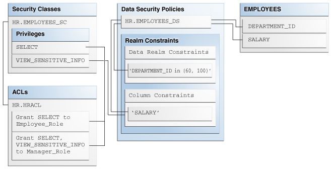
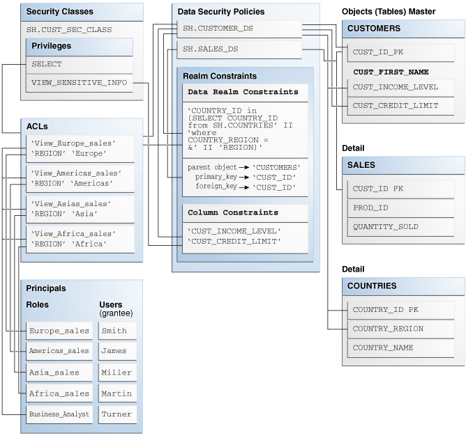

## 5  Configuring Data Security

This chapter contains:

- About Data Security

- About Validating the Data Security Policy

- Understanding the Structure of the Data Security Policy

- About Designing Data Realms

- Applying Additional Application Privileges to a Column

- About Enabling Data Security Policy for a Database Table or View

- About Creating Real Application Security Policies on Master-Detail Related Tables

- About Managing Application Privileges for Data Security Policies

- Using BEQUEATH CURRENT_USER Views

- Real Application Security: Putting It All Together

- About Schema Level Real Application Security Policy Administration

### 5.1 About Data Security

Data security refers to the ability to control application user access to data in an Oracle database throughout all components of an Oracle Enterprise, using a uniform methodology. In Oracle Database Real Application Security, to secure a database table or view, you must specify the rows that you want to secure by creating a data realm (see also, [data realm](glossary.md)).

To restrict access to the data realm, you associate one or more access control lists ([ACL](glossary.md)s) that list the application users or application roles and their application privileges for each data realm. A data realm together with its associated ACL is known as a data realm constraint.

You can further restrict access to specific columns by applying one or more application privileges to each column. This is useful in situations where you want only privileged application users to see the data in that column.

Data security is an extension of Oracle Virtual Private Database (VPD). VPD adds a `WHERE` predicate to restrict data access each time an application user selects or modifies a database table. For more information about VPD, see [Oracle Database Security Guide](../dbseg/using-oracle-vpd-to-control-data-access.md). Oracle Database Real Application Security extends VPD concepts further by implementing an authorization model that can further restrict access at both the row and column by means of associating ACLs to these objects. In addition, the application session and session context (through user roles and session namespace) are made more secure. Furthermore Real Application Security provides its own data dictionaries.

To configure data security in Oracle Database Real Application Security, you must follow these steps:

1.  Create a data security policy. The data security policy defines one or more data realms and associates ACLs for each data realm to create data realm constraints. The data security policy can also contain column-specific attributes to further control data access. Multiple tables or views can share the same data security policy. This lets you create a uniform security strategy that can be used across a set of tables and views.

    Example 5-1Example 5-1 shows the structure a data security policy.

2.  Associate the data security policy with the table or view you want to secure.

    You can run the `XS_DATA_SECURITY.APPLY_OBJECT_POLICY` PL/SQL procedure to enable the data security policy for the table or view that contains the data realms and columns that you want to secure.

    Note that if your application security requires that you update table rows and also restrict read access to certain columns in the same table, you must use two `APPLY_OBJECT_POLICY` procedures to enforce both data security policies. For example, one `APPLY_OBJECT_POLICY` procedure would enforce the DML `statement_types` required for updating table rows (for example, `INSERT`, `UPDATE`, `DELETE`), while the other `APPLY_OBJECT_POLICY` procedure would enforce only the `statement_types` of `SELECT` for the column constraint.

    Example 5-5Example 5-5 shows how to use the APPLY_OBJECT_POLICY procedure. See "[APPLY_OBJECT_POLICY Procedure](XS_DATA_SECURITY-package.md)" for more information.

3.  Validate the data security policy. See "About Validating the Data Security Policy" for more information.

### 5.2 About Validating the Data Security Policy

Oracle recommends that you should always validate the Real Application Security objects after administrative configuration changes. The `XS_DIAG` package provides a set of validation APIs to help ensure that the complicated relationships among your Real Application Security objects are not damaged unintentionally by these changes.

See "[VALIDATE_DATA_SECURITY Function](XS_DIAG-package.md)" for more information about validating a data security policy.

### 5.3 Understanding the Structure of the Data Security Policy

You can create a data security policy using the `XS_DATA_SECURITY.CREATE_POLICY` PL/SQL procedure.

Figure 5-1 shows the structure of a Real Application Security data security policy named `HR.EMPLOYEES_DS` that is created from a data realm constraint and a column constraint, both of which are to be applied to the `EMPLOYEES` table. The data realm constraint defines the rows (`DEPARTMENT_ID` with a value of 60 or 100) on which the data security policy applies and the ACL (`HRACL`) that is associated with these rows. The column constraint defines a constraint for the sensitive column data in the `SALARY` column of the `EMPLOYEES` table by using the `VIEW_SENSITIVE_INFO` privilege that is required to view this sensitive data.

Figure 5-1 Real Application Security Data Security Policy Created on the EMPLOYEES Table

[Description of "Figure 5-1 Real Application Security Data Security Policy Created on the EMPLOYEES Table"](img_text/dspolicy_emp.md)

Example 5-1 creates the data security policy shown in Figure 5-1.

**See Also:**

"[CREATE_POLICY Procedure](XS_DATA_SECURITY-package.md)"

You should validate the data security policy after you create it. See "[VALIDATE_DATA_SECURITY Function](XS_DIAG-package.md)" for more information.

The main parameters of a data security policy are as follows:

- Policy Name: This defines the name of the data security policy.

  Example 5-1 uses the name `EMPLOYEES_DS` for the data security policy that it creates.

- Data Realm Constraints: The data realm constraints define the data realms, or the rows, on which the data security policy applies, together with the ACLs to be associated with these data realms.

  Example 5-1 uses the `realm_cons` list to define the data realm constraint for the `EMPLOYEES_DS` policy. `realm_cons` comprises of rows that have a `DEPARTMENT_ID` value of `60` or `100`. These rows are associated with the `HRACL` access control list.

- Column Constraint: Column constraint defines additional constraint for sensitive column data in the data realm constraint.

  Example 5-1 associates the column_cons column constraint with the `EMPLOYEES_DS` policy. `column_cons` protects the `SALARY` column with the `VIEW_SENSITIVE_INFO` privilege.

Example 5-1 Structure of a Data Security Policy

    -- Create the ACL HRACL.
    DECLARE
    ace_list XS$ACE_LIST;
    BEGIN
    ace_list := XS$ACE_LIST(
    XS$ACE_TYPE(privilege_list => XS$NAME_LIST('SELECT'),
    granted => true,principal_name => 'Employee_Role'),
    XS$ACE_TYPE(privilege_list => XS$NAME_LIST('SELECT', 'VIEW_SENSITIVE_INFO'), granted => true, principal_name => 'Manager_Role'));

    sys.xs_acl.create_acl(name => 'HRACL',ace_list => ace_list, sec_class => 'HR.EMPOLYEES_SC');
    END;

    -- Create variables to store the data realm constraints and the column constraint.
    DECLARE
      realm_cons XS$REALM_CONSTRAINT_LIST;
    BEGIN

    -- Create a data realm constraint comprising of a data realm (rule) and
    -- an associated ACL.
      realm_cons :=
        XS$REALM_CONSTRAINT_LIST(
          XS$REALM_CONSTRAINT_TYPE(realm=> 'DEPARTMENT_ID in (60, 100)',
                                   acl_list=> XS$NAME_LIST('HRACL')));

    -- Create the column constraint.
      column_cons :=
        XS$COLUMN_CONSTRAINT_LIST(
          XS$COLUMN_CONSTRAINT_TYPE(column_list=> XS$LIST('SALARY'),
                                privilege=> 'VIEW_SENSITIVE_INFO'));

     -- Create the data security policy.
      SYS.XS_DATA_SECURITY.CREATE_POLICY(
              name=>'HR.EMPLOYEES_DS',
              realm_constraint_list=>realm_cons,
              column_constraint_list=>column_cons);

    -- Enforce the data security policy to protect READ access of the EMPLOYEES table
    -- and restrict access to the SALARY column using the VIEW_SENSITIVE_INFO
    -- privilege.
      sys.xs_data_security.apply_object_policy(
               policy => 'HR.EMPLOYEES_DS',
               schema => 'HR',
               object => 'EMPLOYEES',
               statement_types => 'SELECT',
               owner_bypass => true);

    END;

### 5.4 About Designing Data Realms

This section includes the following topics:

- About Understanding the Structure of a Data Realm

- About Using Static Data Realms

- Using Trace Files to Check for Policy Predicate Errors

#### 5.4.1 About Understanding the Structure of a Data Realm

A data realm is a collection of one or more object instances. An object instance is associated with a single row in a table or view and is identified by the primary key value of the row in the storage table of the object. A table can have both static and dynamic data realms defined for it at the same time. As described earlier, an ACL defines the application privilege grants for the data realm.

A data realm constraint is used to associate a data realm with an ACL. Example 5-2 creates a data realm constraint called `realm_cons`. The data realm constraint includes a membership rule to create a data realm. The data realm includes rows where `DEPARTMENT_ID` is 60 or 100. `realm_cons` also declares an ACL, called `HRACL`, to associate with the data realm.

The membership of the object instances within a data realm is determined by a rule in the form of a SQL predicate, which must be applicable to the `WHERE` clause of a single-table query against the storage table of the object. The SQL predicate in Example 5-2 is `DEPARTMENT_ID in (60, 100)`.

If the SQL you write causes errors, such as `ORA-28113: policy predicate has error`, then you can use trace files to find cause of the error. See "Using Trace Files to Check for Policy Predicate Errors" for more information.

Example 5-2 uses a single ACL called `HRACL`. A data realm can be associated with multiple ACLs, and the same ACL can be used across multiple data realms.

Consider the following columns from the `ORDERS` purchase order table in the `OE` sample schema:

| ORDER_ID | CUSTOMER_ID | ORDER_STATUS | SALES_REP_ID | ORDER_TOTAL |
|:---------|:------------|:-------------|:-------------|:------------|
| 2354     | 104         | 0            | 155          | 46257       |
| 2355     | 104         | 8            | NULL         | 94513.5     |
| 2356     | 105         | 5            | NULL         | 29473.8     |
| 2357     | 108         | 5            | 158          | 59872.4     |
| 2358     | 105         | 2            | 155          | 7826        |

Each row in the `ORDERS` table is an object instance in the purchase order object. The number listed in the `ORDER_ID` column is the primary key used to uniquely identify a particular purchase order object instance. For example:

- A data realm comprised of one object instance, that is, one row. For example, you could use the `WHERE` predicate of `ORDER_ID=2354`.

- A data realm comprised of multiple object instances. For example, you could have multiple rows using the `WHERE` predicate of `CUSTOMER_ID=104`.

- A data realm comprised of the entire contents of the table, defined by the `WHERE` predicate of `1=1`.

Examples of ways to define data realms are as follows:

- Use valid SQL attributes such as columns in a table.

  In this case, you are using `WHERE` predicates such as the following:

      CUSTOMER_ID=104

  Changes made to the data in the rows and columns are automatically reflected in the data collected by the data realm.

- Use parameters in the WHERE predicate.

  You can parameterize an data realm, for example:

      CUSTOMER_ID=&PARAM

  This example assumes that the parameter `PARAM` has been associated with different customer IDs. When you grant permissions in this situation, you need to grant the permission to the specific parameter value. You must specify the values of the parameters in the ACL associated with the data realm that contains this type of `WHERE` predicate. This enables you to create the grant based on customer IDs without having to create many customer ID-specific data realms.

- Use a membership rule based on runtime application session variables or subqueries.

  An example of this type of membership rule is:

      CUSTOMER_ID=XS_SYS_CONTEXT('order', 'cust_id')

  However, be careful about creating membership rules that are based on session variables or subqueries. For example, suppose you wanted to use the session variable `USER`, which reflects the current application user, in the membership rule `col=USER`. Oracle Database cannot pre-compute the resultant row set because the result is not deterministic. Application user `SCOTT` and application user `JSMITH` may have a different result for the same row. However, the membership rule `col='SCOTT'` works because the rule is always evaluated to the same result for any given row.

  See "About Using Static Data Realms" for more information about creating data realms. See also "[XS_SYS_CONTEXT Function](real-application-security-sql-functions.md)" for more information about `XS_SYS_CONTEXT`.

Example 5-2 Components of a Data Realm Constraint

    realm_cons := XS$REALM_CONSTRAINT_TYPE(realm=> 'DEPARTMENT_ID in (60, 100)',
                                           acl_list=> XS$NAME_LIST('HRACL'));

#### 5.4.2 About Using Static Data Realms

In a static data realm, Oracle Database evaluates changes to data affected by a data realm when the data is updated. You can use static data realms with tables, but not with views.

To set an data realm to be static, set its `is_static` attribute to `true`. The following example creates a static data realm:

    realm_cons := XS$REALM_CONSTRAINT_TYPE(realm=> 'DEPARTMENT_ID in (60, 100)',
                                           acl_list=> XS$NAME_LIST('HRACL'),
                                           is_static=> TRUE);

Materialized Views (MVs) will be used to maintain the binding between rows in the protected table and the ACLs that protect them. They will be generated automatically whenever static data realms are included in the data security policy. These MVs will support complete refresh only and will allow up to 125 ACLs to be associated with any single row.

The MV that is generated will be of the form `mv(TABLEROWID, ACLIDLIST)` where `TABLEROWID` refers to a row in the table being protected and ACLIDLIST is a list of ACLID values stored in a `RAW` type column. The individual 16-byte values will be concatenated to form the list.

Oracle Database evaluates dynamic data realms each time the application user performs a query on the data realm data. You can use dynamic data realms to protect rows for both tables and views. A dynamic data realm has the most flexibility, because it is not bound by the requirements needed for static data realms. Be aware that an overly complex rule within the dynamic data realm definition may affect performance.

If the base table update is infrequent or the data realm member evaluation rule is complex, then you should consider using static data realms to protect the base table. A frequently updated base table may be constantly out of sync with the ACLIDS storage MV, unless the MV is refreshed accordingly. The administrator should make the decision based on the base table statistics and performance requirements of the system.

To set a data realm constraint to be dynamic, set its `is_static` attribute to `FALSE`, or omit the `is_static` attribute. The following example creates a dynamic data realm:

    realm_cons := XS$REALM_CONSTRAINT_TYPE(realm=> 'DEPARTMENT_ID in (60, 100)',
                                           acl_list=> XS$NAME_LIST('HRACL'),
                                           is_static=> FALSE);

#### 5.4.3 Using Trace Files to Check for Policy Predicate Errors

If the SQL defined in the `realm` element causes an `ORA-28113: policy predicate has error` or similar message, then you can use trace files to find the cause of the error. The trace file shows the actual error, along with the VPD view showing the reason for the problem. Often, the syntax of the view has a trivial error, which you can solve by analyzing the SQL text of the view.

To enable tracing, log into SQL\*Plus as a user who has the `ALTER SESSION` privilege.

If you want to dump all the data realm constraint rules (with their parameter values resolved) into the trace file, enter the following statement:

    ALTER SESSION SET EVENTS 'TRACE[XSXDS] disk=high';

If you want to dump the VPD views of the XDS-enabled table during the initial (hard) parse of a query, enter the following statement:

    ALTER SESSION SET EVENTS 'TRACE[XSVPD] disk=high';

Alternatively, you can enable tracing by adding the following lines to the initialization file for the database instance:

    event="TRACE[XSXDS] disk=high"
    event="TRACE[XSVPD] disk=high"

You can find the location of this trace file by issuing the following SQL command:

    SHOW PARAMETER USER_DUMP_DEST;

If you need to disable tracing, issue the following statements:

    ALTER SESSION SET EVENTS 'TRACE[XSVPD] off';
    ALTER SESSION SET EVENTS 'TRACE[XSXDS] off';

**See Also:**

- "[About Data Security (XSXDS and XSVPD) Event-Based Tracing](troubleshooting_real_application_security.md)"

- [Oracle Database Administrator’s Guide](../admin/monitoring-the-database.md) for more information about using trace files

### 5.5 Applying Additional Application Privileges to a Column

By default, access to rows is protected by the ACL associated with the data realm. In addition, you can protect a particular column with custom application privileges.

To protect a column for table `T`, add a list of column constraints to the data security policy that will be applied to table `T`.

**Note:**

For tables approaching 1000 columns, there is a limitation on the number of columns that can be protected as Real Application Security uses an internal virtual column to compute and store the authorization indicator. The sum of the number of columns and the number of protected columns should not exceed 1000. (Number of table columns + Number of protected table columns \<=1000). For example, if a table has 998 columns, up to and including 2 protected columns are allowed; or, if a table has 990 columns, up to and including 10 protected columns are allowed, and so forth. If the number of columns to be protected exceeds the number allowed, an `ORA-28113: policy predicate has error` is returned.

For example, the `PRODUCT_INFORMATION` table in the `OE` schema contains the `LIST_PRICE` column. If you want to restrict the display of product prices to specific categories, you can apply an additional application privilege to the `LIST_COLUMN` table, so that only the sales representative who has logged in can see the product list prices for the categories he or she manages.

Example 5-3 shows a column constraint that protects the `LIST_PRICE` column with the `ACCESS_PRICE` application privilege.

Before you add the column constraint, a `SELECT` statement on the following columns from the `OE.PRODUCT_INFORMATION` table for products in categories 13 and 14 shows the following output:

| PRODUCT_ID | PRODUCT_NAME   | CATEGORY_ID | LIST_PRICE |
|:-----------|:---------------|:------------|:-----------|
| 3400       | HD 8GB /SE     | 13          | 389        |
| 3355       | HD 8GB /SI     | 13          | NULL       |
| 2395       | 32MB Cache /M  | 14          | 123        |
| 1755       | 32MB Cache /NM | 14          | 121        |
| ...        | ...            | ...         | ...        |

After the column constraint is applied, the sales representatives who are responsible for category 13 products see the following output:

| PRODUCT_ID | PRODUCT_NAME   | CATEGORY_ID | LIST_PRICE |
|:-----------|:---------------|:------------|:-----------|
| 3400       | HD 8GB /SE     | 13          | 389        |
| 3355       | HD 8GB /SI     | 13          | NULL       |
| 2395       | 32MB Cache /M  | 14          | NULL       |
| 1755       | 32MB Cache /NM | 14          | NULL       |
| ...        | ...            | ...         | ...        |

Conversely, sales representatives responsible for category 14 products see this output:

| PRODUCT_ID | PRODUCT_NAME   | CATEGORY_ID | LIST_PRICE |
|:-----------|:---------------|:------------|:-----------|
| 3400       | HD 8GB /SE     | 13          | NULL       |
| 3355       | HD 8GB /SI     | 13          | NULL       |
| 2395       | 32MB Cache /M  | 14          | 123        |
| 1755       | 32MB Cache /NM | 14          | 121        |
| ...        | ...            | ...         | ...        |

In these examples, the list price for product 3355 is `NULL`. To enable a mid-tier application to distinguish between the true value of authorized data, which could include `NULL`, and an unauthorized value that is always `NULL`, use the `COLUMN_AUTH_INDICATOR` SQL function to check if the column value in a row is authorized. You can mask the unauthorized data with a value different from `NULL` by modifying the `SELECT` statement to include a `DECODE` or `CASE` function that contains the `COLUMN_AUTH_INDICATOR` SQL function.

Example 5-4 shows a `SELECT` statement that uses the `COLUMN_AUTH_INDICATOR` function to check authorized data and the `DECODE` function to replace `NULL` with the value `restricted`.

Afterward, the masked value appears in place of `NULL`. For example, if our category 13 sales representative logs on and searches for product list prices, he or she sees the following output:

| PRODUCT_ID | PRODUCT_NAME   | CATEGORY_ID | LIST_PRICE |
|:-----------|:---------------|:------------|:-----------|
| 3400       | HD 8GB /SE     | 13          | 389        |
| 3355       | HD 8GB /SI     | 13          | NULL       |
| 2395       | 32MB Cache /M  | 14          | restricted |
| 1755       | 32MB Cache /NM | 14          | restricted |
| ...        | ...            | ...         | ...        |

**See Also:**

- [Oracle Database Real Application Security Data Dictionary Views](real-application-security-data-dictionary-views.md) for information about the column constraints data dictionary views, which list existing tables that use column level security

- "[COLUMN_AUTH_INDICATOR Function](real-application-security-sql-functions.md)"

- Example 5-1 for an example of a column constraint element within a data security policy.

- [Configuring OCI and JDBC Applications for Column Authorization](configuring-oci-and-jdbc-applications-for-column-authorization.md) if your applications use either Oracle Call Interface (OCI) or JDBC

Example 5-3 Column with an Additional Application Privilege That Has Been Applied

    column_cons :=
      XS$COLUMN_CONSTRAINT_LIST(
        XS$COLUMN_CONSTRAINT_TYPE(column_list=> XS$LIST('LIST_PRICE'),
                              privilege=> 'ACCESS_PRICE'));

Example 5-4 Checking Authorized Data and Masking NULL Values

    SELECT PRODUCT_ID, PRODUCT_NAME, CATEGORY_ID
    DECODE(COLUMN_AUTH_INDICATOR(LIST_PRICE), 0, 'restricted', 1, LIST_PRICE) LIST_PRICE
    FROM PRODUCT_INFORMATION
    WHERE CATEGORY_ID = 13;

### 5.6 About Enabling Data Security Policy for a Database Table or View

The `XS_DATA_SECURITY.APPLY_OBJECT_POLICY` procedure applies a data security policy on a table or view.

This section includes the following topics:

- Enabling Real Application Security Using the APPLY_OBJECT_POLICY Procedure

- About How the APPLY_OBJECT_POLICY Procedure Alters a Database Table

- About How ACLs on Table Data Are Evaluated

#### 5.6.1 Enabling Real Application Security Using the APPLY_OBJECT_POLICY Procedure

Use the `XS_DATA_SECURITY.APPLY_OBJECT_POLICY` procedure to enable Real Application Security for a database table or view. Example 5-5 enables the `ORDERS_DS` data security policy for the `OE.ORDERS` table. See "[APPLY_OBJECT_POLICY Procedure](XS_DATA_SECURITY-package.md)" for more information.

Example 5-5 Using XS_DATA_SECURITY.APPLY_OBJECT_POLICY

    BEGIN  SYS.XS_DATA_SECURITY.APPLY_OBJECT_POLICY(policy=>'ORDERS_DS',
                                           schema=>'OE',
                                           object=>'ORDERS');
    END;

This section includes the following topic: About Applying Multiple Policies for a Table or View.

##### 5.6.1.1 About Applying Multiple Policies for a Table or View

You can apply multiple data security policies for a table or view. When a table or view is protected by multiple data security policies, an application user has access to only those rows that are allowed by all the policies. So, for example, if the data realm for Policy 1 includes a row, but the data realm for Policy 2 does not include the same row, the application user would be unable to access the row.

Column security works similarly. Consider the case where column Col1 is protected by multiple policies: Policy1 protects it with Priv1, Policy2 protects it with Priv2, and so forth. Then an application user must have been granted all application privileges (Priv1, Priv2, and so forth) to access Col1.Thus, for columns protected by column policies, an application user must have been granted access by all policies protecting the column.

#### 5.6.2 About How the APPLY_OBJECT_POLICY Procedure Alters a Database Table

The following table, `OE.ORDERS`, shown earlier under "About Understanding the Structure of a Data Realm", has been enabled with `XS_DATA_SECURITY.APPLY_OBJECT_POLICY`. It shows the addition of the hidden `SYS_ACLOID` column. This column, whose data type is `NUMBER`, lists application user-managed ACL identifiers. The following table contains the application user-managed ACL identifier 500, which is a direct grant on the object instance identified by the order ID 2356.

**Note:**

The `SYS_ACLOID` hidden column can be enabled by passing the value `XS_DATA_SECURITY.APPLY_ACLOID_COLUMN `for the `apply_option` parameter when invoking the `XS_DATA_SECURITY` procedure. Real Application Security allows only one ACLID to be added to the `SYS_ACLOID` column.

| ORDER_ID | CUSTOMER_ID | ORDER_STATUS | SALES_REP_ID | ORDER_TOTAL | SYS_ALCOID |
|:---------|:------------|:-------------|:-------------|:------------|:-----------|
| `2354`   | `104`       | `0`          | `155`        | `46257`     |            |
| `2355`   | `104`       | `8`          | `NULL`       | `94513.5`   |            |
| `2356`   | `105`       | `5`          | `NULL`       | `29473.8`   | `500`      |
| `2357`   | `108`       | `5`          | `158`        | `59872.4`   |            |
| `2358`   | `105`       | `2`          | `155`        | `7826`      |            |

The system-managed static ACL identifiers, are stored in a Materialized View (MV).

| TABLEROWID           | ACLIDLIST                          |
|:---------------------|:-----------------------------------|
| `AAAO/8AABAAANrCABJ` | `60FB8AAA40D46C9EE040449864653987` |
| `AAAO/8AABAAANrCAB`L | `60FB8AAA40D46C9EE040449864653987` |

To find detailed information on the data realms or data realm constraints associated with a table, query the `DBA_XS_REALM_CONSTRAINTS` data dictionary view. See "[DBA_XS_REALM_CONSTRAINTS](real-application-security-data-dictionary-views.md)" for more information.

#### 5.6.3 About How ACLs on Table Data Are Evaluated

When Oracle Database evaluates a set of ACLs, it stops the evaluation when it finds the first grant or deny. For this reason, it is important to plan the order of ACLs carefully. The ACLs associated with each row in a table are evaluated in the following order:

1.  The ACLs from grants directly on object instances (that is, application user-managed ACL identifiers) are evaluated first. See "[About Configuring Access Control Lists](configuring-application-privileges-and-access-contol-lists.md)" for more information about creating an ACL and adding it to the object instance.

2.  The ACLs from static data realm constraint grants are evaluated next, after application user-managed ACLs. If you have multiple static data realms, they are evaluated in the order of their physical appearance in the data security policy. See "About Using Static Data Realms" for more information about static data realms.

3.  The ACLs from dynamic data realm constraint grants are evaluated last. If you have multiple dynamic data realms, they are evaluated in the order of their physical appearance in the policy. See "About Using Static Data Realms" for more information about dynamic data realms.

### 5.7 About Creating Real Application Security Policies on Master-Detail Related Tables

This section includes the following topics:

- About Real Application Security Policies on Master-Detail Related Tables

- About Understanding the Structure of Master Detail Data Realms

- Example of Creating a Real Application Security Policy on Master-Detail Related Tables

For more information about master-detail tables, see the chapter about creating a master-detail application using JPA and Oracle ADF in [Oracle Database 2 Day + Java Developer's Guide](../tdpjd/index.md).

#### 5.7.1 About Real Application Security Policies on Master-Detail Related Tables

You can create a data security policy that can be used for master-detail related tables. Typically, you may want the same policy that protects the master table to protect its detail tables. Creating a Real Application Security policy for master-detail tables enables anyone accessing these tables to do so under a uniform policy that can be inherited from master table to detail table.

The possible inheritance paths for policies and master-detail tables are as follows:

- Multiple detail tables can inherit policies from one master table.

- Detail tables can inherit policies from other detail tables.

- One detail table can inherit policies from multiple master tables.

If any one of the policies in the master table is satisfied, then application users can access the corresponding rows in the detail table.

#### 5.7.2 About Understanding the Structure of Master Detail Data Realms

To create a Real Application Security policy for master-detail related tables, you must create a data security policy for each table. In each data security policy for the detail tables, you indicate the master table from which the detail table inherits by including master detail data realms. Steps 4, 6 and 7 in the procedure under "Example of Creating a Real Application Security Policy on Master-Detail Related Tables" shows examples of creating and using master-detail data realms and creating and applying master-detail data security policies to master-detail tables.

Example 5-6 shows a sample master detail data realm.

In this specification:

- `when_condition` specifies a predicate for the detail table, similar to a `WHERE` clause, to filter data. If `when_condition` evaluates to true, then Oracle Database applies the master policy. This element is optional.

- `parent_schema` specifies the name of the schema that contains the master table.

- `parent_object` specifies the name of the master table.

- `primary_key` specifies the primary key from the master table.

- `foreign_key` specifies the foreign key of the detail table.

Example 5-6 A Master Detail Data Realm

      realm_cons :=  XS$REALM_CONSTRAINT_TYPE
                     (parent_schema=> 'OE',
                      parent_object=> 'CUSTOMERS',
                      key_list=> XS$KEY_LIST(XS$KEY_TYPE(primary_key=> 'CUSTOMER_ID',
                                                     foreign_key=> 'CUSTOMER_ID',
                                                     foreign_key_type=> 1)),
                      when_condition=> 'ORDER_STATUS IS NOT NULL')

#### 5.7.3 Example of Creating a Real Application Security Policy on Master-Detail Related Tables

This example uses the `SH` sample schema. The `SH` schema has a table called `CUSTOMERS`, which is the master table. The master table `CUSTOMERS` has a detail table called `SALES`, and another detail table called `COUNTRIES`. The following example demonstrates how to enforce a Real Application Security policy that virtually partitions the customer and sales data along their regional boundary defined in the `COUNTRIES` table for read access of the `CUSTOMERS` and `SALES` tables. In addition, there is a requirement to mask out data on the columns `CUST_INCOME_LEVEL` and `CUST_CREDIT_LIMIT` to users, except for those users who need full table access for business analysis, such as the business analyst.

**Note:**

All administrative commands in this example can be performed by a database user, such as the `SYSTEM` account who has the `DBA` roles in the database, because the `DBA` role has been granted appropriate privilege for Real Application Security administrative tasks. In addition, because security classes, ACLs, and data security policies are schema qualified objects, you must explicitly use the intended schema name when these objects are specified in the APIs, so they will not be resolved to objects under the database session default schema of `SYSTEM`.

The descriptions for the three tables, which are all in the same schema (`SH`), are as follows:

    -- SH.CUSTOMERS in the master table.
     Name                                      Null?    Type
     ----------------------------------------- -------- ----------------------------
     CUST_ID                                   NOT NULL NUMBER
     CUST_FIRST_NAME                           NOT NULL VARCHAR2(20)
     CUST_LAST_NAME                            NOT NULL VARCHAR2(40)
     CUST_GENDER                                        CHAR(1)
     CUST_YEAR_OF_BIRTH                                 NUMBER(4)
     CUST_MARITAL_STATUS                                VARCHAR2(20)
     CUST_STREET_ADDRESS                       NOT NULL VARCHAR2(40)
     CUST_POSTAL_CODE                          NOT NULL VARCHAR2(10)
     CUST_CITY                                 NOT NULL VARCHAR2(30)
     CUST_STATE_PROVINCE                                VARCHAR2(40)
     COUNTRY_ID                                NOT NULL CHAR(2)
     CUST_MAIN_PHONE_NUMBER                             VARCHAR2(25)
     CUST_INCOME_LEVEL                                  VARCHAR2(30)
     CUST_CREDIT_LIMIT                                  NUMBER
     CUST_EMAIL                                         VARCHAR2(30)

    -- SH.SALES is a detail table.
     Name                                      Null?    Type
     ----------------------------------------- -------- ----------------------------
     PROD_ID                                   NOT NULL NUMBER(6)
     CUST_ID                                   NOT NULL NUMBER
     TIME_ID                                   NOT NULL DATE
     CHANNEL_ID                                NOT NULL CHAR(1)
     PROMO_ID                                  NOT NULL NUMBER(6)
     QUANTITY_SOLD                             NOT NULL NUMBER(3)
     AMOUNT_SOLD                               NOT NULL NUMBER(10,2)

    -- SH.COUNTRIES is a detail table.
     Name                                      Null?    Type
     ----------------------------------------- -------- ----------------------------
     COUNTRY_ID                                NOT NULL CHAR(2)
     COUNTRY_NAME                              NOT NULL VARCHAR2(40)
     COUNTRY_SUBREGION                                  VARCHAR2(30)
     COUNTRY_REGION                                     VARCHAR2(20)

Figure 5-2 shows an overview of the completed Real Application Security data security policies created and applied to the master-detail related tables (`CUSTOMERS` - `SALES` - `COUNTRIES`) that are described as an overview in the following steps and in more detail in the steps that follow this figure.

1.  Create the principals, an application role and an application user, for each of four geographic regions: Europe, Americas, Asia, and Africa, in addition to a business analyst role and an associated application user.

2.  Create the `VIEW_SENSITIVE_INFO` privilege and create the `SH.CUST_SEC_CLASS` in which to scope the privilege.

3.  Grant the `VIEW_SENSITIVE_INFO` privilege to the business analyst role.

4.  Define a data realm constraint with a rule that parameterizes regions in order for the system to recognize the string `&REGION`, which will later be used in a policy.

5.  Create a column constraint to secure the two columns, `CUST_INCOME_LEVEL` and `CUST_CREDIT_LEVEL` using the `VIEW_SENSITIVE_INFO` privilege.

6.  Create the data security policy `SH.CUSTOMER_DS` specifying the data realm constraint and the column constraint that was previously created.

7.  Register the name and data type of the parameter in the rule for the `SH.CUSTOMER_DS` data security policy.

8.  Create the ACLs for each region to authorize read access to the respective roles needing read access. For example for the Europe region, you grant `SELECT` privilege to the `Europe_sales` role and grant `SELECT` and `VIEW_SENSITIVE_INFO` privileges to the `Business_Analyst` role.

9.  Associate each ACL in each region with the rows that satisfy the rule where the value of the parameter `REGION` is equal to region name, for example, Europe. You do this for each of the four regions, and then add this ACL to the `SH.CUSTOMER_DS` data security policy.

10. Create the data realm constraint for the master-detail tables, so users can access a record in the `SALES` detail table only if a user is authorized to access its parent row in the `CUSTOMERS` master table.

11. Create the `SH.SALES_DS` data security policy to enforce this data realm constraint.

In Figure 5-2, the master-detail tables also show the primary key (PK) fields and foreign key (FK) fields and a number of additional fields that are used in creating the data realm constraints and column constraints. Using these PK and FK relationships, the same data security policies that apply to the master table also apply to the detail tables. In this particular case, for example, all ACLs granting `SELECT` privilege to the `CUSTOMERS` master table and enforced by the `SH.CUSTOMER_DS` data security policy, also applies to the `SALES` detail table.

Figure 5-2 Real Application Security Data Security Policy Created on Master-Detail Related Tables

[Description of "Figure 5-2 Real Application Security Data Security Policy Created on Master-Detail Related Tables"](img_text/dspolicy_master_detail.md)

To create a Real Application Security policy for these master-detail tables, follow these steps:

1.  Create the roles and users needed for each country, (role `Europe_sales`, user `SMITH`), (role `Americas_sales`, user `JAMES`), (role `Asia_sales`, user `MILLER`), (role `Africa_sales`, user `MARTIN`), and (role `Business_Analyst`, user `TURNER`), who is the only user who will have full table access.
        BEGIN
           sys.xs_principal.create_role(name => 'Europe_sales', enabled => TRUE);
           sys.xs_principal.create_role(name => 'Americas_sales', enabled => TRUE);
           sys.xs_principal.create_role(name => 'Asia_sales', enabled => TRUE);
           sys.xs_principal.create_role(name => 'Africa_sales', enabled => TRUE);
           sys.xs_principal.create_role(name => 'Business_Analyst', enabled => TRUE);

           sys.xs_principal.create_user(name => 'SMITH', schema => 'SH');
           sys.dbms_xs_principals.set_password(username => 'SMITH',
                                               password => 'password',
                                               type => XS_PRINCIPAL.XS_SHA512);
           sys.xs_principal.grant_roles(grantee => 'SMITH', role => 'Europe_sales');

           sys.xs_principal.create_user(name =>' JAMES', schema => 'SH');
           sys.dbms_xs_principals.set_password(username => 'JAMES',
                                               password => 'password',
                                               type => XS_PRINCIPAL.XS_SHA512);
           sys.xs_principal.grant_roles(grantee => 'JAMES', role => 'Americas_sales');

           sys.xs_principal.create_user(name => 'MILLER', schema => 'SH');
           sys.dbms_xs_principals.set_password(username => 'MILLER',
                                               password => 'password',
                                               type => XS_PRINCIPAL.XS_SHA512);
           sys.xs_principal.grant_roles(grantee => 'MILLER', role => 'Asia_sales');

           sys.xs_principal.create_user(name => 'MARTIN', schema => 'SH');
           sys.dbms_xs_principals.set_password(username => 'MARTIN',
                                               password => 'password',
                                               type => XS_PRINCIPAL.XS_SHA512);
           sys.xs_principal.grant_roles(grantee => 'MARTIN', role => 'Africa_sales');

           sys.xs_principal.create_user(name => 'TURNER', schema=> 'SH');
           sys.dbms_xs_principals.set_password(username => 'TURNER',
                                               password => 'password',
                                               type => XS_PRINCIPAL.XS_SHA512);
           sys.xs_principal.grant_roles(grantee => 'TURNER', role => 'Business_Analyst');
        END;
2.  Define the `SH.CUST_SEC_CLASS` security class for the privilege, `VIEW_SENSITIVE_INFO` to protect the sensitive columns.
    The row level privileges to access data security protected objects for query and DML are predefined in the Security Class DML under the `SYS` schema.

        DECLARE
          pr_list  XS$PRIVILEGE_LIST;
        BEGIN
        -- Let's call the new privilege VIEW_SENSIATIVE_INFO
          pr_list := XS$PRIVILEGE_LIST(XS$PRIVILEGE(name => 'VIEW_SENSITIVE_INFO'));

          sys.xs_security_class.create_security_class(
                   name => 'SH.CUST_SEC_CLASS',
                   description => 'Security Class to protect CUSTOMERS and SALES data',
                   parent_list => XS$NAME_LIST('SYS.DML'),
                   priv_list => pr_list);
        END;
3.  Define the data realm constraint with a rule that parameterizes regions, then define the column constraint and specify the name of the two columns, `CUST_INCOME_LEVEL` and `CUST_CREDIT_LIMIT`, to be secured by the `VIEW_SENSITIVE_INFO `privilege. Then, create a `SH.CUSTOMER_DS` data security policy and register the name and data type of the parameter in the rule.
    The security policy requires that regional customers and sales data be partitioned with different ACLs. One way to achieve this is to define as many data realms as regions and do this for both tables. However, in this example, another way is shown. That is, to parameterize the region in a data realm with a single rule and use the master-detail relationship to simplify the administrative tasks.

    So, instead of creating many constraints for the policy, it is more efficient to create only one constraint with the following rule that parameterizes the region:

        COUNTRY_ID in
         (select COUNTRY_ID from SH.COUNTRIES where COUNTRY_REGION = &REGION)

    In order for the system to recognize that the string `&REGION` in the rule is indeed a parameter, you must invoke the `xs_data_security.create_acl_parameter` procedure to register the parameter name after the policy is created. In addition, you must specify the data type of the parameter value. Since regions are stored as character string data, the `XS_ACL.TYPE_VARCHAR` macro is used for this example. Another supported data type is `XS_ACL.TYPE_NUMBER` for numbers.

        DECLARE
          rows_secs XS$REALM_CONSTRAINT_LIST;
          cols_secs XS$COLUMN_CONSTRAINT_LIST;
        BEGIN
        -- Define the realm constraint with a rule that parameterizes regions.
          rows_secs := xs$REALM_CONSTRAINT_LIST(
                  XS$REALM_CONSTRAINT_TYPE(
                    realm => 'COUNTRY_ID in (select COUNTRY_ID from SH.COUNTRIES ' ||
                             'where COUNTRY_REGION = &' || 'REGION)'));

        -- Define the column constraint to secure CUST_INCOME_LEVEL and
        -- CUST_CREDIT_LIMIT columns by using the VIEW_SENSITIVE_INFO privilege.
          cols_secs := XS$COLUMN_CONSTRAINT_LIST(
                XS$COLUMN_CONSTRAINT_TYPE(
                  column_list => XS$LIST('CUST_INCOME_LEVEL', 'CUST_CREDIT_LIMIT'),
                  privilege => 'VIEW_SENSITIVE_INFO'));

        -- Create the data security policy.
          sys.xs_data_security.create_policy(
                  name => 'SH.CUSTOMER_DS',
                  realm_constraint_list => rows_secs,
                  column_constraint_list => cols_secs,
                  description => 'Policy to protect sh.customers table');

        -- Register the name and data type of the parameter in the rule.
          sys.xs_data_security.create_acl_parameter(
                   policy => 'SH.CUSTOMER_DS',
                   parameter => 'REGION',
                   param_type => XS_ACL.TYPE_VARCHAR);
        END;
4.  Create ACLs to authorize read access for each region. For the Europe region, grant `SELECT` to the `Europe_sales` role. In addition, `SELECT` and `VIEW_SENSITIVE_INFO` privileges are granted to the `Business_Analyst` role so that the grantee of the role has full table access and is able to see data in the columns of `CUST_INCOME_LEVEL` and `CUST_CREDIT_LIMIT` as well.
        DECLARE
          ace_list XS$ACE_LIST;
        BEGIN
          ace_list := XS$ACE_LIST(
                      XS$ACE_TYPE(privilege_list => XS$NAME_LIST('SELECT'),
                                  granted => true,
                                  principal_name => 'Europe_sales'),
                      XS$ACE_TYPE(privilege_list =>
                                    XS$NAME_LIST('SELECT', 'VIEW_SENSITIVE_INFO'),
                                  granted => true,
                                  principal_name => 'Business_Analyst'));

          sys.xs_acl.create_acl(name => 'View_Europe_sales',
                          ace_list => ace_list,
                          sec_class => 'SH.CUST_SEC_CLASS',
                          description => 'Authorize read access for the Europe region');

        -- The ACL must be associated with rows that satisfy the rule where the value
        -- of the parameter REGION is equal to Europe. For example the constraint
        -- rule becomes the COUNTRY_ID in
        --  (select COUNTRY_ID from SH.COUNTRIES where COUNTRY_REGION = 'Europe').

          sys.xs_acl.add_acl_parameter(acl => 'View_Europe_sales',
                                   policy => 'SH.CUSTOMER_DS',
                                   parameter => 'REGION',
                                   value => 'Europe');
        END;
5.  Create ACLs to authorize read access for the other three regions, Americas, Asia, and Africa.
        DECLARE
          ace_list XS$ACE_LIST;
        BEGIN
          ace_list := XS$ACE_LIST(
                      XS$ACE_TYPE(privilege_list => XS$NAME_LIST('SELECT'),
                                  granted => true,
                                  principal_name => 'Americas_sales'),
                      XS$ACE_TYPE(privilege_list =>
                                    XS$NAME_LIST('SELECT', 'VIEW_SENSITIVE_INFO'),
                                  granted => true,
                                  principal_name => 'Business_Analyst'));

          sys.xs_acl.create_acl(name => 'View_Americas_sales',
                        ace_list => ace_list,
                        sec_class => 'SH.CUST_SEC_CLASS',
                        description => 'Authorize read access for the Americas region');

          sys.xs_acl.add_acl_parameter(acl => 'View_Americas_sales',
                                   policy => 'SH.CUSTOMER_DS',
                                   parameter => 'REGION',
                                   value => 'Americas');
        END;

        DECLARE
          ace_list XS$ACE_LIST;
        BEGIN
          ace_list := XS$ACE_LIST(
                      XS$ACE_TYPE(privilege_list => XS$NAME_LIST('SELECT'),
                                  granted => true,
                                  principal_name => 'Asia_sales'),
                      XS$ACE_TYPE(privilege_list =>
                                    XS$NAME_LIST('SELECT', 'VIEW_SENSITIVE_INFO'),
                                  granted => true,
                                  principal_name => 'Business_Analyst'));

          sys.xs_acl.create_acl(name => 'View_Asia_sales',
                        ace_list => ace_list,
                        sec_class => 'SH.CUST_SEC_CLASS',
                        description => 'Authorize read access for the Asia region');

          sys.xs_acl.add_acl_parameter(acl => 'View_Asia_sales',
                                   policy => 'SH.CUSTOMER_DS',
                                   parameter => 'REGION',
                                   value => 'Asia');
        END;

        DECLARE
          ace_list XS$ACE_LIST;
        BEGIN
          ace_list := XS$ACE_LIST(
                      XS$ACE_TYPE(privilege_list => XS$NAME_LIST('SELECT'),
                                  granted => true,
                                  principal_name => 'Africa_sales'),
                      XS$ACE_TYPE(privilege_list =>
                                    XS$NAME_LIST('SELECT', 'VIEW_SENSITIVE_INFO'),
                                  granted => true,
                                  principal_name => 'Business_Analyst'));

          sys.xs_acl.create_acl(name => 'View_Africa_sales',
                        ace_list => ace_list,
                        sec_class => 'SH.CUST_SEC_CLASS',
                        description => 'Authorize read access for the Africa region');

          sys.xs_acl.add_acl_parameter(acl => 'View_Africa_sales',
                                   policy => 'SH.CUSTOMER_DS',
                                   parameter => 'REGION',
                                   value => 'Africa');
        END;
6.  Apply the `SH.CUSTOMER_DS` policy created in Step 3 to protect read access to the `CUSTOMERS` table.
        BEGIN
          sys.xs_data_security.apply_object_policy(
                   policy => 'SH.CUSTOMER_DS',
                   schema => 'SH',
                   object => 'CUSTOMERS',
                   statement_types => 'SELECT',
                   owner_bypass => true);
        END;
7.  Create the data realm master-detail constraint to protect the `SALES` table. This master-detail constraint utilizes the same regional partitioning policy as previously described in Steps 3 through 6. This means that a user can access a record in the `SALES` detail table only if that user is authorized to access its parent row in the `CUSTOMERS` master table.
        DECLARE
          rows_secs XS$REALM_CONSTRAINT_LIST;
        BEGIN
        -- Define the master-detail constraint.
          rows_secs := xs$REALM_CONSTRAINT_LIST(
            XS$REALM_CONSTRAINT_TYPE(
              parent_schema => 'SH',
              parent_object => 'CUSTOMERS',
              key_list => xs$key_list(xs$key_type(primary_key => 'CUST_ID',
                                                  foreign_key => 'CUST_ID',
                                                  foreign_key_type => 1))));

        -- Create a policy to enforce the constraint.
          sys.xs_data_security.create_policy(
                 name => 'SH.SALES_DS',
                 realm_constraint_list => rows_secs,
                 column_constraint_list => null);

        -- Apply the policy to protect read access of the SALES table.
          sys.xs_data_security.apply_object_policy(
                   policy => 'SH.SALES_DS',
                   schema => 'SH',
                   object => 'SALES',
                   statement_types => 'SELECT',
                   owner_bypass => true);
        END;
8.  Grant object level `SELECT` privilege to `PUBLIC` for users to perform a query.
        GRANT SELECT ON sh.customers TO PUBLIC;
        GRANT SELECT ON sh.countries TO PUBLIC;
        GRANT SELECT ON sh.sales TO PUBLIC;
9.  Connect as user `MARTIN` and perform a query to display user `MARTIN`'s sales data for the Africa region and to show the masking of the sensitive sales information for the `CUST_INCOME_LEVEL` and `CUST_CREDIT_LIMIT` columns.
        CONNECT MARTIN/welcome

        SELECT c.COUNTRY_NAME, c.COUNTRY_ID, ct.CUST_FIRST_NAME, PROD_ID, QUANTITY_SOLD
         FROM sh.customers ct, sh.sales s, sh.countries c
         WHERE  ct.CUST_ID = s.CUST_ID AND
                ct.COUNTRY_ID = c.COUNTRY_ID;

        COUNTRY_NAME         CO CUST_FIRST_NAME         PROD_ID QUANTITY_SOLD
        -------------------- -- -------------------- ---------- -------------
        South Africa         ZA Forrest                    8050             2
        South Africa         ZA Mitch                     17505            11
        South Africa         ZA Murry                     32785             7
        South Africa         ZA Heath                      3585            12

### 5.8 About Managing Application Privileges for Data Security Policies

This section includes the following topics:

- About Bypassing the Security Checks of a Real Application Security Policy

- Using the SQL\*Plus SET SECUREDCOL Command

#### 5.8.1 About Bypassing the Security Checks of a Real Application Security Policy

The following database users can bypass the security checks of a Real Application Security Policy:

- User `SYS`

- Database users who have the `EXEMPT ACCESS POLICY` system privilege

- The owner of the object to which the policy is applied.

  If the data security policy is applied to an object with the owner bypass specification, the owner of the object may bypass such policy. By default, owner bypass is not allowed.

  The object owner also can create another view on the same table and assign this view a different Real Application Security policy.

#### 5.8.2 Using the SQL\*Plus SET SECUREDCOL Command

The SQL\*Plus `SET SECUREDCOL` command enables you to customize how secure column values are displayed in SQL\*Plus output for users without permission to view a column and for columns with unknown security. You can choose either the default text or specify the text that is displayed. The default is `OFF`.

When column level security is enabled, and `SET SECUREDCOL` is set `ON`, output from SQL\*Plus for secured columns or columns of unknown security level is replaced with either your customized text or the default indicators. This only applies to scalar data types. Complex object data output is not affected.

##### Syntax

    SET SECUREDCOL {OFF¦ON} [UNAUTH[ORIZED] text][UNK[NOWN] text]

##### Parameters

| Parameter        | Description                                                                                                                                                                                                                                                                                                                                                                                                                                                                                         |
|:-----------------|:----------------------------------------------------------------------------------------------------------------------------------------------------------------------------------------------------------------------------------------------------------------------------------------------------------------------------------------------------------------------------------------------------------------------------------------------------------------------------------------------------|
| `ON`             | Displays the default indicator asterisks (`****`) in place of column values for users without authorization to view the column, and displays question marks (`?????`) in place of column values where the security level is unknown for the column (when the specific privileges applied to the column are not known). The indicators "`*`" and "`?`" are filled to the defined column length or the column length defined by a current `COLUMN` command. By default this command will be `OFF`. |
| `OFF`            | Displays null values in place of column values for application users without authorization to view the column, and in place of column values where the security level is unknown for the column.                                                                                                                                                                                                                                                                                                    |
| `UNAUTH[ORIZED]` | Text enables you to specify the text to be displayed in a secured column for application users without authorization to view the column. This text appears instead of the default `*****`. You can specify any alphanumeric text up to the column length or a maximum of 30 characters. Longer text is truncated. Text containing spaces must be quoted.                                                                                                                                         |
| `UNK[NOWN]`      | Text enables you to specify the text to be displayed in a column of unknown security level (when the specific privileges applied to the column are not known). This text appears instead of the default `??????`. You can specify any alphanumeric text up to the column length or a maximum of 30 characters. Longer text is truncated. Text containing spaces must be quoted.                                                                                                                  |

##### Example 1

    SET SECUREDCOL ON
    SELECT empno, ename, sal FROM emp ORDER BY deptno;

The output of the example will be as follows:

    EMPNO ENAME   DEPTNO SAL
    ----- ------ ------ --------
    7539 KING     10    ********
    7369 SMITH    20    800
    7566 JONES    20    2975
    7788 SCOTT    20    3000
    7521 WARD     30    ********
    7499 ALLEN    30    ********

    6 rows selected.

##### Example 2

    SET SECUREDCOL ON UNAUTH notallowed
    SELECT empno, ename, sal FROM emp ORDER BY deptno;

The output of the example will be as follows:

    EMPNO ENAME  DEPTNO SAL
    ----- ------ ------ -------
    7539 KING    10    notallowed
    7369 SMITH   20    800
    7566 JONES   20    2975
    7788 SCOTT   20    3000
    7521 WARD    30    notallowed
    7499 ALLEN   30    notallowed

    6 rows selected.

### 5.9 Using BEQUEATH CURRENT_USER Views

Traditionally, views in Oracle Database use definer's rights. This means that if you invoke an identity or privilege-sensitive SQL function or an invoker's rights PL/SQL or Java function, then current schema, and current user, are set to the view owner and currently enabled roles is set to the view owner plus `PUBLIC` within the functions's execution.

If you need background information on invoker's rights and definer's rights, see [Oracle Database PL/SQL Language Reference](../lnpls/invokers-rights-and-definers-rights-authid-property.md).

**Note:**

Certain built-in SQL functions, such as `SYS_CONTEXT()` and `USERENV()` are exceptions to the preceding rule. These functions always use the current application user's environment, even when called from definer's rights views.

Oracle Database 12c Release 1 (12.1) and later enables you to create views with the `BEQUEATH` clause, which lets you configure this behavior. The `BEQUEATH` clause determines whether identity or privilege-sensitive SQL functions, invoker's rights PL/SQL program units, and Java functions referenced in the view inherit the current schema, current user, and currently enabled roles from the querying user's environment. This is especially useful for Real Application Security applications, which often need to run code in the invoking application user's environment.

Using `BEQUEATH CURRENT_USER` in the view definition creates a view that allows privilege-sensitive, and invoker's rights functions referenced in the view to inherit current schema, current user, and currently enabled roles from the querying user's environment. See [Oracle Database SQL Language Reference](../sqlrf/CREATE-VIEW.md) for the syntax of the `CREATE OR REPLACE VIEW` statement.

Example 5-7 illustrates how a `BEQUEATH CURRENT_USER` view enables invoker right's program units to run in the invoking application user's environment. When `USER2` selects from `USER1`'s view, the invoker's rights function is invoked in `USER2`'s environment.

Using `BEQUEATH DEFINER` in the view definition creates a view that causes privilege-sensitive, and invoker's rights functions referenced in the view to inherit current schema, current user, and currently enabled roles from the view definer's environment. If no `BEQUEATH` clause is specified, then `BEQUEATH DEFINER` is assumed.

If a `BEQUEATH_DEFINER` view contains a reference to a `BEQUEATH CURRENT_USER` view, then invoker's rights functions in the referenced view would use the parent view owner's rights.

Example 5-8 illustrates how a `BEQUEATH DEFINER` view defines a boundary for nested invoker right's program units to run in the view owner's environment. When `USER2` selects from `USER1`'s view, the view's invoker's rights function is invoked in `USER1`'s environment.

**See Also:**

[Oracle Database Security Guide](../dbseg/managing-security-for-definers-rights-and-invokers-rights.md) for the use of invoker's rights and definer's rights in VPD and FGA policies

Example 5-7 How a BEQUEATH CURRENT_USER View Works

    SQL> CONNECT USER1/USER1
    Connected.
    SQL>
    SQL> -- You first create an invoker's rights function to determine who the current SQL> -- user really is.
    SQL> CREATE OR REPLACE FUNCTION CALLED_AS_USER RETURN VARCHAR2 AUTHID CURRENT_USER IS
    2 BEGIN
    3 RETURN SYS_CONTEXT('USERENV', 'CURRENT_USER');
    4 END;
    5 /
    Function created.

    SQL> -- Note that you do not need to grant EXECUTE to called_as_user, because even
    SQL> -- BEQUEATH CURRENT_USER views do name resolution and privilege checking on
    SQL> -- the references present in the view body using definer's rights.

    SQL> CREATE OR REPLACE VIEW BEQUEATH_INVOKER_VIEW BEQUEATH CURRENT_USER AS
    2 SELECT CALLED_AS_USER FROM DUAL;
    View created.

    SQL> GRANT SELECT ON BEQUEATH_INVOKER_VIEW TO PUBLIC;
    Grant succeeded.

    SQL> CONNECT USER2/USER2
    Connected.

    SQL> SELECT * FROM USER1.BEQUEATH_INVOKER_VIEW;
    CALLED_AS_USER
    --------------------------------------------------------------------------------
    USER2

Example 5-8 How a BEQUEATH DEFINER View Works

    SQL> CONNECT USER1/USER1
    Connected.
    SQL>
    SQL> -- You first create an invoker's rights function to determine who the current SQL> -- user really is.
    SQL> CREATE OR REPLACE FUNCTION CALLED_AS_USER RETURN VARCHAR2 AUTHID CURRENT_USER IS
    2 BEGIN
    3 RETURN SYS_CONTEXT('USERENV', 'CURRENT_USER');
    4 END;
    5 /
    Function created.

    SQL> -- Note that you do not need to grant EXECUTE to called_as_user, because even
    SQL> -- BEQUEATH CURRENT_USER views do name resolution and privilege checking on
    SQL> -- the references present in the view body using definer's rights.

    SQL> CREATE OR REPLACE VIEW BEQUEATH_DEFINER_VIEW BEQUEATH DEFINER AS
    2 SELECT CALLED_AS_USER FROM DUAL;
    View created.

    SQL> GRANT SELECT ON BEQUEATH_DEFINER_VIEW TO PUBLIC;
    Grant succeeded.

    SQL> CONNECT USER2/USER2
    Connected.

    SQL> SELECT * FROM USER1.BEQUEATH_DEFINER_VIEW;
    CALLED_AS_USER
    --------------------------------------------------------------------------------
    USER1

This section includes the following topic: Using SQL Functions to Determine the Invoking Application User.

#### 5.9.1 Using SQL Functions to Determine the Invoking Application User

SQL functions, such as `SYS_CONTEXT()` and `USERENV()`, and `XS_SYS_CONTEXT()`, always return the current application user's environment, even when called from definer's rights views. Sometimes, applications need to determine the invoking application user based on the security context (`BEQUEATH` property) of views referenced in the statement.

The following new functions introduced in Oracle Database 12c Release 1 (12.1) enable you to figure out the invoking application user taking into account the `BEQUEATH` property of views referenced in the statement:

- `ORA_INVOKING_USER:` Use this function to return the name of the database user whose context is currently used. If the function is invoked from within a definer's rights boundary, then the name of the database object owner is returned. If the invoking user is a Real Application Security application user, then the constant `XS$USER` is returned.

- `ORA_INVOKING_USERID:` Use this function to return the identifier (ID) of the database user whose context is currently used. If the function is invoked from within a definer's rights boundary, then the ID of the database object owner is returned.

  If the invoking user is a Real Application Security application user, then the function returns an identifier common to all Real Application Security application users, but distinct from the identifier for any database user.

- `ORA_INVOKING_XS_USER:` Use this function to return the name of the Real Application Security application user whose context is currently used.

  If the invoking user is a database user, then the value `NULL` is returned.

- `ORA_INVOKING_XS_USER_GUID:` Use this function to return the identifier (ID) of the Real Application Security application user whose context is currently used.

  If the invoking user is a database user, then the value `NULL` is returned.

The following example shows a database user `USER1` querying `ORA_INVOKING_USER` and `ORA_INVOKING_XS_USER.` `ORA_INVOKING_XS_USER` returns `NULL`, as the user is not a Real Application security application user.

    SQL> CONNECT USER1
    Enter password:
    Connected.
    SQL> SELECT ORA_INVOKING_USER FROM DUAL;

    ORA_INVOKING_USER
    --------------------------------------------------------------------------------
    USER1

    SQL> SELECT ORA_INVOKING_XS_USER FROM DUAL;

    ORA_INVOKING_XS_USER
    --------------------------------------------------------------------------------

**See Also:**

- [Oracle Database SQL Language Reference](../sqlrf/SYS_CONTEXT.md) for detailed information on the preceding SQL functions and other functions like `SYS_CONTEXT`

- "[XS_SYS_CONTEXT Function](real-application-security-sql-functions.md)"

### 5.10 Real Application Security: Putting It All Together

This section puts all the Real Application Security concepts together in order to define a basic data security policy. It builds upon the `HR` scenario example introduced in "[Scenario: Security Human Resources (HR) Demonstration of Employee Information](indroducing-oracle-database-real-application-security.md)".

The section includes the following topic that discusses each implementation task described in the scenario with the help of an example.

This section includes the following topics:

- Basic HR Scenario: Implementation Tasks

- Running the Security HR Demo

#### 5.10.1 Basic HR Scenario: Implementation Tasks

The following implementation tasks are discussed:

- Connecting as User SYS to Create Real Application Security Users and Roles

- Creating Roles and Application Users

- Creating the Security Class and ACLS

- Creating the Data Security Policy

- Validating the Real Application Security Objects

- Disabling a Data Security Policy for a Table

##### 5.10.1.1 Connecting as User SYS to Create Real Application Security Users and Roles

To create Real Application Security users and roles, you need only to connect as user `SYS`.

Example 5-9 Connecting as User SYS

    SQL> connect sys/&passwd as sysdba
    Connected.

##### 5.10.1.2 Creating Roles and Application Users

##### Creating the Database Role

Create the database role `DB_EMP` and grant this role the necessary table privileges. This role is used to grant the required object privileges to application users.

##### Creating the Application Roles

##### Grant the DB_EMP Database Role to the Application Roles

Grant the `DB_EMP` database role to the three application roles, so they each have the required object privilege to access the table.

##### Create the Application Users

Create application user `DAUSTIN` (in the IT department) and grant this user application roles `EMPPLOYEE` and `IT_ENGINEER`.

In this example:

**Note:**

To make logins easier, you can create the name in upper case. That way, the user can omit the quotation marks when logging in or connecting to SQL\*Plus. For example:

    sqlplus DAUSTIN

**See Also:**

"[Creating a Simple Application User Account](configuring-application-users-and-application-roles.md)" for information about how case sensitivity affects database logins for application users

Create application user `SMAVRIS` (in the HR department) and grant this user application roles `EMPLOYEE` and `HR_REPRESENTATIVE`.

##### Grant the HR User the Policy Administration Privilege ADMIN_ANY_SEC_POLICY

Grant the `HR` user the `ADMIN_ANY_SEC_POLICY` privilege.

Example 5-10 Creating the DB_EMP Role

    SQL> create role db_emp;

    Role created.

    SQL> grant select, insert, update, delete on hr.employees to db_emp;

    Grant succeeded.

Example 5-11 Creating the Application Role EMPLOYEE for Common Employees

    SQL> exec sys.xs_principal.create_role(name => 'employee', enabled => true);

    PL/SQL procedure successfully completed.

Example 5-12 Creating the Application Role IT_ENGINEER for the IT Department

    SQL> exec sys.xs_principal.create_role(name => 'it_engineer', enabled => true);

    PL/SQL procedure successfully completed.

Example 5-13 Creating the Application Role HR_REPRESENTATIVE for the HR Department

    SQL> exec sys.xs_principal.create_role(name => 'hr_representative', enabled => true);

    PL/SQL procedure successfully completed.

Example 5-14 Granting DB_EMP Database Role to Each Application Role

    SQL> grant db_emp to employee;

    Grant succeeded.

    SQL> grant db_emp to it_engineer;

    Grant succeeded.

    SQL> grant db_emp to hr_representative;

    Grant succeeded.

Example 5-15 Creating Application User DAUSTIN

    SQL> exec  sys.xs_principal.create_user(name => 'daustin', schema => 'hr');

    PL/SQL procedure successfully completed.

    SQL> exec  sys.xs_principal.set_password('daustin', 'password');

    PL/SQL procedure successfully completed.

    SQL> exec  sys.xs_principal.grant_roles('daustin', 'XSCONNECT');

    PL/SQL procedure successfully completed.

    SQL> exec  sys.xs_principal.grant_roles('daustin', 'employee');

    PL/SQL procedure successfully completed.

    SQL> exec  sys.xs_principal.grant_roles('daustin', 'it_engineer');

    PL/SQL procedure successfully completed.

Example 5-16 Creating Application User SMAVRIS

    SQL> exec  sys.xs_principal.create_user(name => 'smavris', schema => 'hr');

    PL/SQL procedure successfully completed.

    SQL> exec  sys.xs_principal.set_password('smavris', 'password');

    PL/SQL procedure successfully completed.

    SQL> exec  sys.xs_principal.grant_roles('daustin', 'XSCONNECT');

    PL/SQL procedure successfully completed.

    SQL> exec  sys.xs_principal.grant_roles('smavris', 'employee');

    PL/SQL procedure successfully completed.

    SQL> exec  sys.xs_principal.grant_roles('smavris', 'hr_representative');

    PL/SQL procedure successfully completed.

Example 5-17 Granting the HR User the Policy Administration Privilege ADMIN_ANY_SEC_POLICY

    SQL> exec sys.xs_admin_util.grant_system_privilege('ADMIN_ANY_SEC_POLICY','HR');

    PL/SQL procedure successfully completed.

##### 5.10.1.3 Creating the Security Class and ACLS

##### Creating the Security Class

Create a security class `HR_PRIVILEGES` based on the predefined DML security class. `HR_PRIVILEGES` has a new privilege `VIEW_SALARY`, which controls access to the `SALARY` column.

##### Creating the ACls

Create three ACLs, `EMP_ACL`, `IT_ACL`, and `HR_ACL` to grant privileges for the data security policy to be defined later.

In this example:

- Lines 11 through 13: Creates the `EMP_ACL` and grants `EMPLOYEE` the `SELECT` and `VIEW_SALARY` privileges.

- Lines 21 through 23: Creates the `IT_ACL` and grants `IT_ENGINEER` the `SELECT` privileges.

- Lines 30 through 33: Creates the `HR_ACL` and grants `HR_REPRESENTATIVE` the `SELECT`, `INSERT`, `UPDATE`, and `DELETE` database privileges to view and update all employee's records, and granting the `VIEW_SALARY` application privilege to view the `SALARY` column.

Example 5-18 Creating the HRPRIVS Security Class

    SQL> declare
      2  begin
      3    xs_security_class.create_security_class(
      4      name        => 'hr_privileges',
      5      parent_list => xs$name_list('sys.dml'),
      6      priv_list   => xs$privilege_list(xs$privilege('view_salary')));
      7  end;
      8  /

    PL/SQL procedure successfully completed.

Example 5-19 Creating ACLs: EMP_ACL, IT_ACL, and HR_ACL

    SQL> declare
      2    aces xs$ace_list := xs$ace_list();
      3  begin
      4    aces.extend(1);
      5
      6    -- EMP_ACL: This ACL grants EMPLOYEE role the privileges to view an employee's
      7    --          own record including SALARY column.
      8    aces(1) := xs$ace_type(privilege_list => xs$name_list('select','view_salary'),
      9                           principal_name => 'employee');
     10
     11    sys.xs_acl.create_acl(name      => 'emp_acl',
     12                      ace_list  => aces,
     13                      sec_class => 'hr_privileges');
     14
     15    -- IT_ACL:  This ACL grants IT_ENGINEER the privilege to view the employee
     16    --          records in IT department, but it does not grant the VIEW_SALARY
     17    --          privilege that is required for access to SALARY column.
     18    aces(1) := xs$ace_type(privilege_list => xs$name_list('select'),
     19                           principal_name => 'it_engineer');
     20
     21    sys.xs_acl.create_acl(name      => 'it_acl',
     22                      ace_list  => aces,
     23                      sec_class => 'hr_privileges');
     24
     25    -- HR_ACL:  This ACL grants HR_REPRESENTATIVE the privileges to view and update all
     26    --          employees' records including SALARY column.
     27    aces(1):= xs$ace_type(privilege_list => xs$name_list('select', 'insert',
     28                                              'update', 'delete', 'view_salary'),
     29                          principal_name => 'hr_representative');
     30
     31    sys.xs_acl.create_acl(name      => 'hr_acl',
     32                      ace_list  => aces,
     33                      sec_class => 'hr_privileges');
     34  end;
     35  /

    PL/SQL procedure successfully completed.

##### 5.10.1.4 Creating the Data Security Policy

Create the data security policy for the `EMPLOYEES` table. The policy defines three data realm constraints and a column constraint that protects the `SALARY` column.

In this example:

- Lines 7 through 23: Defines the three data realm constraints.

- Lines 27 through 30: Defines the column constraint requiring the `VIEW_SALARY` application privilege to view the `SALARY` column.

- Lines 32 through 35: Creates the EMPLOYEES_DS data security policy encompassing the three data realm constraints and the column constraint.

##### Applying the Data Security Policy to the Table

Apply the data security policy to the `EMPLOYEES` table.

Example 5-20 Creating the EMPLOYEES_DS Data Security Policy

    SQL> declare
      2    realms   xs$realm_constraint_list := xs$realm_constraint_list();
      3    cols     xs$column_constraint_list := xs$column_constraint_list();
      4  begin
      5    realms.extend(3);
      6
      7    -- Realm #1: Only the employee's own record.
      8    --           EMPLOYEE role can view the realm including SALARY column.
      9    realms(1) := xs$realm_constraint_type(
     10      realm    => 'email = xs_sys_context(''xs$session'',''username'')',
     11      acl_list => xs$name_list('emp_acl'));
     12
     13    -- Realm #2: The records in the IT department.
     14    --           IT_ENGINEER role  can view the realm excluding SALARY column.
     15    realms(2) := xs$realm_constraint_type(
     16      realm    => 'department_id = 60',
     17      acl_list => xs$name_list('it_acl'));
     18
     19    -- Realm #3: All the records.
     20    --           HR_REPRESENTATIVE role can view and update the realm including SALARY column.
     21    realms(3) := xs$realm_constraint_type(
     22      realm    => '1 = 1',
     23      acl_list => xs$name_list('hr_acl'));
     24
     25    -- Column constraint protects SALARY column by requiring VIEW_SALARY
     26    -- privilege.
     27    cols.extend(1);
     28    cols(1) := xs$column_constraint_type(
     29      column_list => xs$list('salary'),
     30      privilege   => 'view_salary');
     31
     32    sys.xs_data_security.create_policy(
     33      name                   => 'employees_ds',
     34      realm_constraint_list  => realms,
     35      column_constraint_list => cols);
     36  end;
     37  /

    PL/SQL procedure successfully completed.

Example 5-21 Applying the EMPLOYEES_DS Security Policy to the EMPLOYEES Table

    SQL> begin
      2    sys.xs_data_security.apply_object_policy(
      3      policy => 'employees_ds',
      4      schema => 'hr',
      5      object =>'employees');
      6  end;
      7  /

    PL/SQL procedure successfully completed.

##### 5.10.1.5 Validating the Real Application Security Objects

After you create these Real Application Security objects, validate them to ensure they are all properly configured.

Example 5-22 Validating the Real Application Security Objects

    SQL> set serveroutput on;
    SQL> begin
      2    if (xs_diag.validate_workspace()) then
      3      dbms_output.put_line('All configurations are correct.');
      4    else
      5      dbms_output.put_line('Some configurations are incorrect.');
      6    end if;
      7  end;
      8  /
    All configurations are correct.

    PL/SQL procedure successfully completed.

    SQL> -- XS$VALIDATION_TABLE contains validation errors if any.
    SQL> -- Expect no rows selected.
    SQL> select * from xs$validation_table order by 1, 2, 3, 4;

    no rows selected

##### 5.10.1.6 Disabling a Data Security Policy for a Table

Example 5-23 shows the complementary operation of disabling data security for table `HR.EMPLOYEES`.

Example 5-23 Disabling a Data Security Policy for a Table

    BEGIN
      SYS.XS_DATA_SECURITY.DISABLE_OBJECT_POLICY(policy => 'EMPLOYEES_DS', schema => 'HR', object => 'EMPLOYEES');
    END;
    /

#### 5.10.2 Running the Security HR Demo

The Security HR Demo is run in two ways:

- Using direct logon first as application user `DAUSTIN` and later as application user `SMAVRIS`.

  In each case, each user performs queries on the `HR.EMPLOYEES` table to demonstrate what each can access or cannot access to view employee records and the `SALARY` column. See "[Running the Security HR Demo Using Direct Logon](real-application-security-hr-demo.md)" for a description of this demonstration.

- Attached to a Real Application Security session

  In this demonstration, the Real Application Security Administrator creates a Real Application Security session for an application user to attach to. See "[Running the Security HR Demo Attached to a Real Application Security Session](real-application-security-hr-demo.md)" for a description of this demonstration.

### 5.11 About Schema Level Real Application Security Policy Administration

Describes introduction of schema level privileges for Real Application Security policy administration across different applications within the same schema.

Beginning with Oracle Database 12c Release 2 (12.2), Real Application Security introduces schema level privileges, which allows a policy administrator to create, update, and apply a policy in only the granted schema and administer policy enforcement within one application, thereby achieving separate management and enforcement of a policy across different applications within the same schema. This level of policy administration is essential in a Cloud computing scenario where each application may be running under one or more schemas. It then becomes highly desirable for a policy administrator to have the ability to manage and apply data security policies for each individual application in that environment.

#### Achieving Schema Level Data Security Policy Administration

To achieve schema level data security policy administration, the following new and changed features were introduced:

- The `GRANT_SYSTEM_PRIVILEGE` and `REVOKE_SYSTEM_PRIVILEGE` procedures were extended with the addition of the `schema` parameter to allow granting and revoking Real Application Security privileges on a particular schema to a database or application user as shown in the following syntax descriptions:

      XS_ADMIN_UTIL.GRANT_SYSTEM_PRIVILEGE (
        priv_name      IN VARCHAR2,
        user_name      IN VARCHAR2,
        user_type      IN PLS_INTEGER := XS_ADMIN_UTIL.PTYPE_DB,
        schema         IN VARCHAR2);

      XS_ADMIN_UTIL.REVOKE_SYSTEM_PRIVILEGE (
        priv_name      IN VARCHAR2,
        user_name      IN VARCHAR2,
        user_type      IN PLS_INTEGER := XS_ADMIN_UTIL.PTYPE_DB,
        schema         IN VARCHAR2);

  Where the `schema` parameter is the schema on which the privilege is granted. The value is `NULL` if the privilege is a system privilege.

- The system security class `ADMIN_SEC_POLICY` privilege is extended to schemas for policy management (Create, Read, Update, and Delete) operations. So a policy administrator can grant `ADMIN_SEC_POLICY` privilege on a particular schema to a user to manage policy artifacts within granted schemas and apply policy management for individual applications. The APIs that are affected by this enhancement include the Real Application Security administrator packages: `XS_ACL`, `XS_DATA_SECURITY`, and `XS_SECURITY_CLASS`

- A new system security class `APPLY_SEC_POLICY` privilege is added for policy enforcement to allow a policy administrator to enforce a policy within granted schemas within one application. The following data security APIs are checked before enforcing data security policies:
  - `XS_DATA_SECURITY.APPLY_OBJECT_POLICY`

  - `XS_DATA_SECURITY.REMOVE_OBJECT_POLICY`

  - `XS_DATA_SECURITY.ENABLE_OBJECT_POLICY`

  - `XS_DATA_SECURITY.DISABLE_OBJECT_POLICY`

- Auditing of `GRANT_SYSTEM_PRIVILEGE` procedure is provided with the audit action `AUDIT_GRANT_PRIVILEGE`.

- Auditing of `REVOKE_SYSTEM_PRIVILEGE` procedure is provided with the audit action `AUDIT_REVOKE_PRIVILEGE`.

- A new data dictionary view `DBA_XS_PRIVILEGE_GRANTS` is added to show all the Real Applicaton Security system or schema level privilege grants in the database.

- In addition, the following views are added: [ALL_XS_SECURITY_CLASSES](real-application-security-data-dictionary-views.md), [ALL_XS_SECURITY_CLASS_DEP](real-application-security-data-dictionary-views.md), [ALL_XS_PRIVILEGES](real-application-security-data-dictionary-views.md), [ALL_XS_IMPLIED_PRIVILEGES](real-application-security-data-dictionary-views.md), [ALL_XS_ACLS](real-application-security-data-dictionary-views.md), [ALL_XS_ACES](real-application-security-data-dictionary-views.md), [ALL_XS_POLICIES](real-application-security-data-dictionary-views.md), [ALL_XS_REALM_CONSTRAINTS](real-application-security-data-dictionary-views.md), [ALL_XS_INHERITED_REALMS](real-application-security-data-dictionary-views.md), [ALL_XS_ACL_PARAMETERS](real-application-security-data-dictionary-views.md), [ALL_XS_COLUMN_CONSTRAINTS](real-application-security-data-dictionary-views.md), [ALL_XS_APPLIED_POLICIES](real-application-security-data-dictionary-views.md), and [DBA_XS_PRIVILEGE_GRANTS](real-application-security-data-dictionary-views.md)

This section includes the following topic: Setting Up and Enabling a Schema Level Data Security Policy.

#### 5.11.1 Setting Up and Enabling a Schema Level Data Security Policy

Describes how to set up and enable a schema level data security policy for two application administrators.

The following set of examples describe how to set up and enable a schema level data security policy for two application administrators to administer two different schemas. Later, it will show how to disable the data security policy and revoke system privileges from these two application administrator users.

Create the application administrator users, then grant them the roles they need.

    EXEC SYS.XS_PRINCIPAL.CREATE_USER(NAME => 'app_admin_user1', SCHEMA => 'HR');
    EXEC SYS.XS_PRINCIPAL.SET_PASSWORD('app_admin_user1', 'PASSWORD');
    EXEC SYS.XS_PRINCIPAL.GRANT_ROLES('app_admin_user1', 'XSCONNECT');

    EXEC SYS.XS_PRINCIPAL.CREATE_USER(NAME => 'app_admin_user2', SCHEMA => 'SH');
    EXEC SYS.XS_PRINCIPAL.SET_PASSWORD('app_admin_user2', 'PASSWORD');
    EXEC SYS.XS_PRINCIPAL.GRANT_ROLES('app_admin_user2', 'XSCONNECT');

The Real Application Security Administrator with either `SYS` or a user granted `GRANT ANY PRIVILEGE` grants the system privileges `ADMIN_SEC_POLICY` and `APPLY_SEC_POLICY` to each application administrator user on the respective `HR` and `SH` schemas to the Real Application Security user, `PTYPE_XS`.

    EXEC SYS.XS_ADMIN_UTIL.GRANT_SYSTEM_PRIVILEGE('ADMIN_SEC_POLICY', 'app_admin_user1', SYS.XS_ADMIN_UTIL.PTYPE_XS, 'HR');

    EXEC SYS.XS_ADMIN_UTIL.GRANT_SYSTEM_PRIVILEGE('APPLY_SEC_POLICY', 'app_admin_user1', SYS.XS_ADMIN_UTIL.PTYPE_XS, 'HR');

    EXEC SYS.XS_ADMIN_UTIL.GRANT_SYSTEM_PRIVILEGE('ADMIN_SEC_POLICY', 'app_admin_user2', SYS.XS_ADMIN_UTIL.PTYPE_XS, 'SH');

    EXEC SYS.XS_ADMIN_UTIL.GRANT_SYSTEM_PRIVILEGE('APPLY_SEC_POLICY', 'app_admin_user2', SYS.XS_ADMIN_UTIL.PTYPE_XS, 'SH');

Next, the policy administrator applies the desired object policy to a particular table in an application and enables it. For example, see the HR demo script [About Creating the Data Security Policy](real-application-security-hr-demo.md) for an example of creating a data security policy `EMPLOYEES_DS` for the `EMPLOYEE` table. Once created, then the policy administrator applies the data security policy `EMPLOYEES_DS` to the `EMPLOYEES` table in the `HR` schema.

    BEGIN
      SYS.XS_DATA_SECURITY.ENABLE_OBJECT_POLICY(policy =>'EMPLOYEES_DS',
                                                schema=>'hr',
                                                object=>'employees');
    END;
    /

    BEGIN
      SYS.XS_DATA_SECURITY.ENABLE_OBJECT_POLICY(policy =>'CUSTOMERS_DS',
                                                schema=>'sh',
                                                object=>'customers');
    END;
    /

##### 5.11.1.1 Disabling the Data Security Policy and Revoking the System Privileges from the User

Describes how to disable data security policy and revoke the system privileges from the user.

##### How to Disable the Data Security Policy and Revoke the System Privileges from the User

To disable the `EMPLOYEES_DS` data security policy for the `EMPLOYEES` table in the `HR` schema, the policy administrator does the following:

    BEGIN
      SYS.XS_DATA_SECURITY.DISABLE_OBJECT_POLICY(policy =>'EMPLOYEES_DS',
                                                 schema=>'hr',
                                                 object=>'employees');
    END;
    /

To disable the `CUSTOMERS_DS` data security policy for the `CUSTOMERS` table in the `SH` schema, the policy administrator does the following:

    BEGIN
      SYS.XS_DATA_SECURITY.DISABLE_OBJECT_POLICY(policy =>'CUSTOMERS_DS',
                                                 schema=>'sh',
                                                 object=>'customers');
    END;
    /

To revoke the system privileges from application administrator users `app_admin_user1` and `app_admin_user2` not from the role `policy_admin_role` because there may be other policy administrators with this same role enabled, the Real Application Security Administrator with either `SYS` privilege or a user granted `GRANT ANY PRIVILEGE` privilege revokes the system privileges `ADMIN_SEC_POLICY` and `APPLY_SEC_POLICY` from application users `app_admin_user1`and `app_admin_user2` as follows:

    EXEC SYS.XS_ADMIN_UTIL.REVOKE_SYSTEM_PRIVILEGE('APPLY_SEC_POLICY', 'app_admin_user1', SYS.XS_ADMIN_UTIL.PTYPE_XS, 'HR');
    EXEC SYS.XS_ADMIN_UTIL.REVOKE_SYSTEM_PRIVILEGE('ADMIN_SEC_POLICY', 'app_admin_user1', SYS.XS_ADMIN_UTIL.PTYPE_XS, 'HR');

    EXEC SYS.XS_ADMIN_UTIL.REVOKE_SYSTEM_PRIVILEGE('APPLY_SEC_POLICY', 'app_admin_user2', SYS.XS_ADMIN_UTIL.PTYPE_XS, 'SH');
    EXEC SYS.XS_ADMIN_UTIL.REVOKE_SYSTEM_PRIVILEGE('ADMIN_SEC_POLICY', 'app_admin_user2', SYS.XS_ADMIN_UTIL.PTYPE_XS, 'SH');
