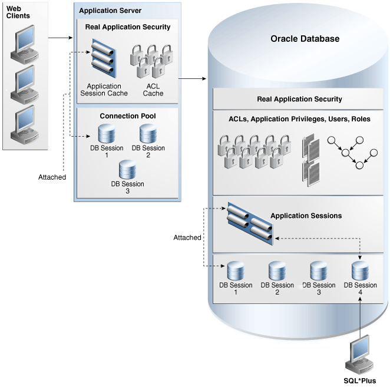
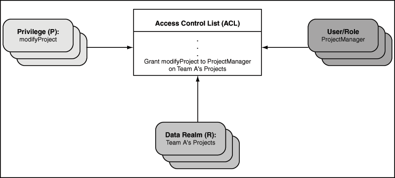

## 1  Introducing Oracle Database Real Application Security

This chapter contains:

- What Is Oracle Database Real Application Security?

- Data Security Concepts Used in Real Application Security

- Application Session Concepts Used in Application Security

- Flow of Design and Development

- Scenario: Security Human Resources (HR) Demonstration of Employee Information

- About Auditing in an Oracle Database Real Application Security Environment

- Support for Pluggable Databases

### 1.1 What Is Oracle Database Real Application Security?

Oracle Database Real Application Security is a database authorization model that:

- Supports declarative security policies

- Enables end-to-end security for multitier applications

- Provides an integrated solution to secure database and application resources

- Advances the security architecture of Oracle Database to meet existing and emerging demands of applications developed for the Internet

Traditional security was designed for client/server systems. These systems had a significantly smaller number of users than newer applications designed for the Internet. When application developers found traditional security inadequate, they often moved it from the database layer to the application layer. To accomplish this, developers frequently built their own tables and defined their own application users. Because security was encoded in the application layer, rather than in the database, application users and application roles were typically known only to the application. In other words, database users were not application-level users, hence the user identity was not known during the access control decision in the database. Furthermore, database operations were limited to DDLs and DMLs that do not represent application-level tasks or operations, hence the operation context was also not known during the access control decision in the database. These practices exposed the database to vulnerability.

Real Application Security is designed to:

- Manage application security for application users rather than database users

- Enable developers to manage security for application level tasks

- Enable application user identity to be known during security enforcement

- Enable developers to return security to the database layer, either incrementally, or all at once

This section discusses traditional security and Real Application Security, indicating how Real Application Security improves upon traditional security.

This section describes these concepts:

- Disadvantages of Traditional Security for Managing Application Users

- Advantages of Real Application Security

- Architecture of Real Application Security

#### 1.1.1 Disadvantages of Traditional Security for Managing Application Users

Using the traditional security model, it was often difficult to manage three-tier applications, especially when performing these security tasks:

- Extending security policies independent of application code

- Enforcing security policies at the database level, where the application user is unknown

- Enforcing least privilege principle as full access is granted to highly privileged two-tier components

#### 1.1.2 Advantages of Real Application Security

Real Application Security enables these security tasks, which improve database security and performance:

- Three-tier and two-tier applications can declaratively define, provide, and enforce access control requirements at the database layer.

- The database can provide a uniform security model across all tiers and support multiple application user stores, including the associated roles, authentication credentials, database attributes, and application-defined attributes. This model enables application users to have a single unique global identity across an Oracle enterprise.

- An Oracle database can natively support the application security context. The database supports integrated policy specification and enforcement for both the application and the database, so the application does not need to do this through application code. Because the database stores the application security context information, this also reduces network traffic.

- Developers can use Real Application Security to control application user access to data in an Oracle database throughout all components of an Oracle enterprise in a common manner.

  See [Configuring Data Security](configuring-data-security.md) for more information about defining data security policies and access control requirements.

#### 1.1.3 Architecture of Real Application Security

Real Application Security is managed through a collection of PL/SQL and Java APIs. This architecture that enables you to configure its components—application users, application roles, sessions, and other security-related components. With Real Application Security, you configure application counterparts to the traditional user, role, and session, through the use of entities, which are stored in tables.

Figure 1-1 shows the various components used in Oracle Database Real Application Security. This includes application users, application roles, access control lists, security classes, and application sessions. These components are discussed in the following sections. Figure 1-1 also shows Web applications establishing application sessions to the database.

Figure 1-1 Oracle Database Real Application Security Components

[Description of "Figure 1-1 Oracle Database Real Application Security Components"](img_text/fs_basic.md)

### 1.2 Data Security Concepts Used in Real Application Security

This section describes access control terms and concepts that you need to understand before you can begin to configure Real Application Security. Using the PL/SQL administrative interfaces, you can create and manage the entities described here: application user, application role, principal, application privilege, security class, access control list (ACL), access control entry (ACE), and data realm.

**Note:**

When a term such as application user or application role is used here, it applies to Real Application Security; when it is important to distinguish the database type, either no qualifier is used or the qualifier database is used.

**See Also:**

- [Configuring Application Users and Application Roles](configuring-application-users-and-application-roles.md)

- [Configuring Application Privileges and Access Control Lists](configuring-application-privileges-and-access-contol-lists.md)

This section contains:

- About Data Security with Oracle Database Real Application Security

- Principals: Users and Roles

- Application Privileges

- Security Classes in Oracle Database Real Application Security

- Access Control Entry (ACE)

- Access Control List (ACL)

- Data Security Policy

#### 1.2.1 About Data Security with Oracle Database Real Application Security

Effective security requires defining which application users, applications, or functions can have access to which data, to perform which kinds of operations. Thus, effective security has these three dimensions:

1.  which application users

2.  can perform which operations

3.  on which data

You define (1) principals, (2) application privileges, and (3) objects in relation to these three dimensions, respectively. Principals are users and roles. A role can represent attributes of an application user, system state, or a piece of code.

Principals and application privileges are related in a declarative way by defining ACLs. These ACLs are then related to the data by defining Data Security policy that protects rows and columns of table data. For example, you can protect table data by using PL/SQL procedures to set controlling ACLs.

Figure 1-2 illustrates an example where the user, `ProjectManager` has the `ModifyProject` privilege on a data realm comprised of Team A's projects.

Figure 1-2 Three Dimensions of Data Security

[Description of "Figure 1-2 Three Dimensions of Data Security"](img_text/access_control.md)

#### 1.2.2 Principals: Users and Roles

When discussing fine-grained database access control, a **principal** is an application user or an application role or a database user or a database role. An **application user** can be a person or an autonomous application process that accesses information in the database. An **application role** is a logical grouping of application privileges required to accomplish a real life task. An application role can contain other application roles, but this recursion cannot be circular. You use application roles to associate application users, both database users and application users with privileges.

Oracle Database supports the following as principals:

- **Database users** and **database roles**

  A database user is also sometimes referred to as a database schema or a user account. When a person or application logs onto the database, it uses a database user (schema) and password.

  A database role corresponds to a set of database privileges that can be granted to database users, applications, or other database roles — see "Understanding the Difference Between Database Roles and Application Roles".

- **Application users** and **Application roles**

  The term application, as used by Real Application Security, refers to the creation of an application user, application role, or session that contains only information pertinent to the application that the application user is logging onto. Application users and application roles are defined by an application, and they do not need to be tied to any database schema.

  Application users can also create heavyweight database sessions by connecting to the database directly. These are called direct login application users. See "[About Creating a Direct Login Application User Account](configuring-application-users-and-application-roles.md)". When an application user creates a heavyweight database session, the user's default schema is set to a preconfigured value meant solely for name resolution purposes, such as `HR`.

  An application role can only be granted to an application user or to another application role. You cannot directly grant database privileges to application users and application roles. See "Granting Database Privileges to Application Users and Application Roles" for further details.

  **See Also:**

  - "[About Configuring Application Users](configuring-application-users-and-application-roles.md)"

  - "[About Configuring Application Roles](configuring-application-users-and-application-roles.md)"

This section includes the following sections:

- Understanding the Difference Between Database Users and Application Users

- Understanding the Difference Between Database Roles and Application Roles

- Granting Database Privileges to Application Users and Application Roles

##### 1.2.2.1 Understanding the Difference Between Database Users and Application Users

Database users are also referred to as traditional users, and have these characteristics:

- They are associated with schemas and passwords.

- They can create heavyweight sessions to schemas with which they are associated.

Application users are defined by an application, and have these characteristics:

- They do not own database schemas.

- They can create application sessions to the database through the middle tier.

- They can create heavyweight database sessions by connecting to the database directly. (See "[About Creating a Direct Login Application User Account](configuring-application-users-and-application-roles.md)".)

**Note:**

In a heavyweight session, the user is associated with a default schema.

##### 1.2.2.2 Understanding the Difference Between Database Roles and Application Roles

A database role is traditionally thought of as a named set of database privileges.

Database roles have these characteristics:

- They are granted privileges, just as database users can be granted privileges.

- They serve as intermediaries for mapping database privileges to database users (and applications) as follows: a role is granted privileges, and the role is then granted to users (giving them the privileges).

  1.  Grant privileges to database role

  2.  Grant database role to database user

  The database user now has the privileges of the database role.

**Note:**

In traditional database terminology, a role is considered to be the same thing as the set of privileges that are granted to it.

An application role can be regarded as the set of application-defined privileges that are associated with it using the mechanism of a declarative access control list (ACL), discussed in "Access Control List (ACL)".

Application roles have these characteristics:

- They use an access control list (ACL), rather than a database grant, as the intermediary that maps application privileges to users or roles.

- They can be only granted to application users or application roles.

- They cannot be granted to a database role, unlike a database role can be granted to an application role.

**Note:**

In access control terminology, application roles are classified with application users as principals.

##### 1.2.2.3 Granting Database Privileges to Application Users and Application Roles

You cannot grant database privileges directly to application users and application roles. Instead, you grant the database privileges to a database role, and then grant the database role to the application role in these steps.

1.  Grant database privileges to database role.
2.  Grant database role to the application role.

The statements in the following code do exactly this, effectively granting the database `SELECT` privilege to the application role, `HRREP`.

    CREATE ROLE db_hrrep;
    GRANT SELECT ON hr.employees TO db_hrrep;
    GRANT db_hrrep TO HRREP;

Application users already created or subsequently created, with that application role, acquire this application privilege.

#### 1.2.3 Application Privileges

An **application privilege** is a particular right or permission that can be granted or denied to a principal. Application developers define application privileges in a security class.

The set of application privileges granted to a principal controls whether or not this principal can perform a given operation on the data that it protects. For example, if the principal (database user) `HR` wants to perform the `SELECT` operation on a given resource, then `SELECT` privileges must be granted to principal `HR` before the SELECT operation.

Application privileges can also be aggregated. An **aggregate privilege** is an application privilege that implies other application privileges. These implied privileges can be any application privileges defined by the current security class or an inherited privilege. When an aggregate privilege is granted or denied, its implied application privileges are implicitly granted or denied.

Aggregate privileges simplify usability when the number of application privileges grows. For example, instead of granting each application privilege separately, you can group related application privileges into an aggregate privilege. Then, you can use a single grant to enable a principal to access all the application privileges contained in the aggregate privilege.

#### 1.2.4 Security Classes in Oracle Database Real Application Security

A **security class** is a scope for a set of application privileges.

A security class includes application privileges that it inherits from other security classes, and it can include application privileges that it defines.

A security class is typically associated with an access control list (ACL), and the ACL can grant application privileges in the security class to specific principals. See "Access Control List (ACL)".

[Example 4-4](configuring-application-privileges-and-access-contol-lists.md) shows how to create a security class policy.

#### 1.2.5 Access Control Entry (ACE)

An **access control entry** (**ACE**) either grants or denies application privileges to a particular principal (application user or application role).

An ACE is an element in an array named `ace_list`. The whole array is called by and becomes part of the access control list (ACL).

The ACE does not, itself, specify which data to protect; that is done by associating the ACL with target data, such as a set of rows in an order entry table. You can make this association by creating a data realm to restrict the user to modifying only those rows, or by using the PL/SQL procedure `XS_DATA_SECURITY.SET_ACLS`.

#### 1.2.6 Access Control List (ACL)

An **access control list** (**ACL**) is a list of access control entries (ACEs), which permit or deny application privileges to one or more principals.

If the ACL you create relies on a set of custom application privileges that you define in your own security class, then you must explicitly associate that security class with the ACL. See [Example 4-15](configuring-application-privileges-and-access-contol-lists.md) for an example.

If the only application privileges used in the ACL are defined in the DML security class, then no security class association is needed as that is the default. See a description in "[DML Security Class](configuring-application-privileges-and-access-contol-lists.md)".

#### 1.2.7 Data Security Policy

To protect data within a database table, you must create a data security policy. Database records, both at row and column level, can be protected using the fine-grained access control described in this section.

The data security policy performs the following functions:

- Specifies the data that you want to protect. The data can be indicated by a `WHERE` clause in a data realm of one or more rows that you design. It can also be defined using named notation by using an association operator to associate the parameter to the left of the arrow (=\>) with the actual parameter to the right of the arrow. For example, in [Example 5-20](configuring-data-security.md), each `realm` is defined using association operators.

  The data security policy can contain one or more data realms.

- Associates each data realm with one or more access control lists (ACLs) that specify the application privileges required to access rows and columns of the data realm to form what is called a data realm constraint. A given ACL protects a given data realm and controls access to particular application users or application roles (called principals). (See "Access Control List (ACL)" for more information about ACLs.)

- Optionally applies additional application privileges to protect a particular column to form what is known as column constraints. This is useful in cases where you need to add an extra layer of security for sensitive data.

- Associates additional custom application privileges. For example, an administrator could create an `APPROVE_TRANSACTION` privilege, which controls whether a user can take a particular action on the row. Assuming `SELECT` privilege is granted to all users, all users could see the row, but only some users can perform the transaction approval action.

In summary, the application user who logs in will only be allowed to perform operations including DML on records within the data realm, including individual rows of data, based on the application privileges in its associated ACLs. Thus, the data security policy is composed of data realm constraints and column constraints that protect the data realm by only allowing access to application users who have application privileges in the associated ACLs.

For example, suppose you have a sales table that lists all sales representatives, their regions, the products they are responsible for, product categories, and product prices. When individual sales representatives log on, each representative would see selected data for all other sales representatives, such as sales representatives for particular product categories based on data realm constraints. If you wanted to restrict the display of product prices to sales representatives by region, you could apply additional application privileges to the column listing product prices, in this case using column constraints.

[Configuring Data Security](configuring-data-security.md) describes in detail how to protect database objects.

### 1.3 Application Session Concepts Used in Application Security

Real Application Security introduces the concept of an application session. Within the context of application sessions, there are three types of user identities:

- Application session user: The user associated with the application session.

  Application session access to database objects is checked against the permissions granted to this user.

- Traditional (heavyweight) session user: The user that established the database session.

  This user can be an application user or a database user, as long as database authentication credentials are available.

- Schema owner: The database schema is the schema associated with the traditional database session and is only used for object name resolution.

Traditional database user sessions have these characteristics:

- They hold their own database resources, such as transactions and cursors.

- They consume many server resources.

Application sessions have these characteristics:

- They contain information that is pertinent only to the application.

- They can be dedicated to each end application user.

- They can persist until the application user logs out of the application or the application terminates unexpectedly.

See [Configuring Application Sessions](configuring-application-sessions.md) for more information about application sessions.

### 1.4 Flow of Design and Development

You should be familiar with the concepts introduced in this chapter to take full advantage of Real Application Security.

In general, identify all tasks an application performs that require application privileges to control data access. Then, add the appropriate application privileges to a security class so that you can reference them in an ACL and grant them to the application users and application roles. This process involves these tasks:

- Create a default set of meaningful application roles based on the features the application provides.

- Identify the tables that require data security protection based on the application table design and security requirements, and define the data realms, including column protection.

- Define data security policies based on the application requirements and the rules applied on the tables.

- Ensure that ACLs used in the data security policy and functional security grant the appropriate application privileges to application roles.

This section contains:

- [Design Phase](real-application-security-hr-demo.md)

- Development Flow Steps

#### 1.4.1 Design Phase

In the design phase, you identify all the tasks an application performs that require application privileges to control data access.

For example, during the design phase, the application policy designer must identify:

1.  The set of application-level operations that require access control.

2.  The rows and columns of tables and views that can be accessed as part of the application-level operations.

3.  The set of actors or principals (users and roles) that can perform these operations.

4.  The runtime application session attributes that identity rows of a table or views. These attribute names are used within the predicates that selects the rows to be authorized, and their values are set during the execution of the application.

#### 1.4.2 Development Flow Steps

In the development phase, as the Real Application Security administrator, you use Real Application Security components to develop your data security policies.

Follow these steps to develop your data security policies:

1.  Create the corresponding application users and roles. If using an external directory server, create the application users and roles or user groups in the directory server. Follow this procedure to create these principals natively in the database:

    1.  Create the application roles and grant application roles to application roles, if needed. See [About Configuring Application Roles](configuring-application-users-and-application-roles.md).

    2.  Create the application users and grant application roles to the application users. See [About Configuring Application Users](configuring-application-users-and-application-roles.md).

    3.  For configuring the directory server to fetch the users and role, when principals from external stores are used, see the RASADM configuration information in [Oracle Database Real Application Security Administration](../rasad/index.md).

    4.  For users and roles in the external Directory Server, see manage parameter settings for using RASADM with a Directory Serve in [Oracle Database Real Application Security Administration](../rasad/index.md).

2.  Create each privilege class that you plan to use to develop the security policies for your application. Each privilege class consists of one or more appropriate privileges that you define and can reference in an ACL and also grant them to the application users and application roles. Each privilege class authorizes by means of ACLs the required application-level operations of a data security policy. See [About Configuring Security Classes](configuring-application-privileges-and-access-contol-lists.md) and [About Configuring Access Control Lists](configuring-application-privileges-and-access-contol-lists.md).

3.  Create one or more session namespaces that can be used across different application sessions. This consists of defining for a session namespace its set of properties (application attributes) and its associated access control policy or ACL that you can choose from a list or create. See [About Manipulating the Application Session State](configuring-application-sessions.md).

4.  Create the data security policy by associating each data realm with an ACL, so as to create both data realm authorization and column authorization as needed. See [About Data Security](configuring-data-security.md).

    This process consists of four parts:

    1.  Policy Information - You choose the object to be protected and the privilege class to protect it as well as specify the policy name and select the policy owner. See [Understanding the Structure of the Data Security Policy](configuring-data-security.md).

    2.  Column Level Authorization - You choose the name of the column to be protected and select the privilege to be granted to access the column, which is associated with the privilege class you selected in Step 3a. See [Applying Additional Application Privileges to a Column](configuring-data-security.md).

    3.  Data Realm Authorization - You create a SQL predicate to represent the data realm to be protected and add each to a data realm grant list. Then you choose or create the ACL to protect the data realm. Next, create privilege grants to be added to a privilege grants list consisting of each principal and whether it is allowed authorization or denied authorization by selecting the appropriate privilege. See [About Designing Data Realms](configuring-data-security.md).

    4.  Apply Policy - You can apply, remove, enable, or disable the data security policy you are creating and choose to specify certain apply options, allowing the owner of the table or view to bypass this data security policy, and whether to enforce statement types for this policy. See [About Enabling Data Security Policy for a Database Table or View](configuring-data-security.md).

**See Also:**

Scenario: Security Human Resources (HR) Demonstration of Employee Information that describes in detail how the development flow is implemented for an example policy scenario for the security human resources (HR) demonstration of employee information using the concepts and components of Real Application Security.

### 1.5 Scenario: Security Human Resources (HR) Demonstration of Employee Information

This section presents an example policy that provides a high-level overview of Real Application Security. It is a simple scenario aimed at explaining the basic Real Application Security concepts. You should be familiar with the following concepts, introduced in "Data Security Concepts Used in Real Application Security":

- Principals – application users and application roles

- Security classes and application privileges

- Access control lists and entries (ACLs and ACEs)

- Data security policy

This same scenario appears throughout the book, to illustrate different components of Real Application Security. It is also described in detail in [Real Application Security HR Demo](real-application-security-hr-demo.md) and [Real Application Security HR Demo Files](real-application-security-hr-demo-files.md) to demonstrate how to use advanced concepts of Real Application Security to handle a more complex policy.

This section includes the following topics:

- Basic Security HR Demo Scenario: Description and Security Requirements

- Basic HR Scenario: Implementation Overview

#### 1.5.1 Basic Security HR Demo Scenario: Description and Security Requirements

Susan Mavris (`SMAVRIS`) is an employee in the Human Resources department. Her job title is Human Resources Representative. In this capacity, she is in charge of managing the human resources information for all employees, including department 60 (IT). She can view and update all the employee records, including the `SALARY` column.

David Austin (`DAUSTIN`) is an employee in the IT department. His job title is Assistant Department Manager. In this capacity, he can view employee records in the IT department, but he cannot view the `SALARY` column, except for his own salary record.

Secure authorization requires defining which application users and application roles can have access to which data, to perform which kinds of operations. These three security dimensions must be defined: protected data, principals, and application privileges. (see "About Data Security with Oracle Database Real Application Security").

In this basic scenario:

- The data to be protected is employee information and it is protected in three ways:

  - Access to an employee's own record, including the `SALARY` column.

  - Access to all the records in the IT department, excluding the `SALARY` column.

  - Access to all employee records, including the `SALARY` column.

- Users are allowed access to employee data in the following ways:

  - Each user can view their own record, including the `SALARY` column.

  - Application user `DAUSTIN` in his role as Assistant Department Manager is allowed to view all the records in the IT department, excluding the `SALARY` column.

  - Application user `SMAVRIS` in her role as human-resources representative is allowed to view and update all employee records, including the `SALARY` column.

- Database role `DB_EMP` is created and granted `SELECT`, `INSERT`, `UPDATE`, and `DELETE` privileges on `HR.EMPLOYEES`.

- Application roles are created as follows:

  - `EMPLOYEE` role is granted to both application users `DAUSTIN` and `SMAVRIS`. Database role `DB_EMP` is granted to `EMPLOYEE` role.

  - `IT_ENGINEER` role is granted to only application user `DAUSTIN`. Database role `DB_EMP` is granted to `IT_ENGINEER` role.

  - `HR_REPRESENTATIVE` role is granted to only application user `SMAVRIS`. Database role `DB_EMP` is granted to `HR_REPRESENTATIVE` role.

- The `VIEW_SALARY` application privilege is created to control access to the `SALARY` column. The `HR_PRIVILEGES` security class is created in which to scope the `VIEW_SALARY` application privilege.

- ACLs are created to define the degree of access to employee records in the following ways:

  - `EMP_ACL` grants the `EMPLOYEE` role the `SELECT` database privilege and `VIEW_SALARY` application privilege to view an employee's own record, including the `SALARY` column.

  - `IT_ACL` grants the `IT_ENGINEER` role only the `SELECT` database privilege to view the employee records in the IT department, but it does not grant the `VIEW_SALARY` privilege that is required for access to the `SALARY` column.

  - `HR_ACL` grants the `HR_REPRESENTATIVE` role `SELECT`, `INSERT`, `UPDATE`, and `DELETE` database privileges to view and update all employee's records, and granting the `VIEW_SALARY` application privilege to view the `SALARY` column.

- The HR demo secures the `HR.EMPLOYEE` table by creating and applying the data security policy, `EMPLOYEES_DS`, that has the following three data realms and column constraint:

  - An employee's own record realm. The ACL, `EMP_ACL` controls this realm, which grants application role `EMPLOYEE` privileges to access the realm, including the `SALARY` column.

  - All the records in the IT department realm. The ACL, `IT_ACL` controls this realm, which grants application role `IT_ENGINEER` privileges to access the realm, but excluding the `SALARY` column.

  - All the employee records realm. The ACL, `HR_ACL` controls this realm, which grants application role `HR_REPRESENTATIVE` privileges to access the realm, including the `SALARY` column.

  - A column constraint that protects the `SALARY` column by requiring the `VIEW_SALARY` privilege to view its sensitive data.

#### 1.5.2 Basic HR Scenario: Implementation Overview

To implement the basic human-resources security scenario, in addition to identifying the protected data, the principals, and the application privileges, you must define the following:

- A database user as the Real Application Security Administrator and then connect as the Real Application Security Administrator to create the components.

- How the principals connect with the database to access the data.

- The access control lists (ACLs) that grant the application privilege and any database privileges to the principals.

- A data security policy that associates the ACLs with the particular data (rows) that the principals need to access.

In this basic scenario, application users `SMAVRIS` and `DAUSTIN` connect to the database directly as the principals.

The application user account that is created for application users `SMAVRIS` and `DAUSTIN` are principals in this scenario. Each application user account is granted application roles that, ultimately, has the `SELECT` privilege on the database table that contains the employee information. The application role is a principal in this scenario.

A database role, `DB_EMP` serves as intermediary between the application role and the database privilege because database privileges can be granted only to database users and roles. That is, the necessary database privileges are granted to a database role, and that role is granted to each application role (the principal).

The database `SELECT` privilege applies to the entire table. The principal must also be granted an Real Application Security application privilege such as the DML `SELECT` privilege, which can be restricted to certain rows of the database table. This restriction is implemented using an access control list (ACL) and a data security policy.

The HR scenario requires the following components for the security model:

- Protected data: Employee information is stored in the table `EMPLOYEES` of the sample database schema `HR` (delivered with Oracle Database).

- Application role: Application roles, `EMPLOYEE`, `IT_ENGINEER`, and `HR_REPRESENTATIVE` are created for performing tasks. The application roles are defined with the `XS_PRINCIPAL.CREATE_ROLE` procedure.

- Application user: Application users, `SMAVRIS` and `DAUSTIN`, are created and defined. `SMAVRIS` is granted the application roles `EMPLOYEE` and `HR_REPRESENTATIVE`. `DAUSTIN` is granted the application roles `EMPLOYEE` and `IT_ENGINEER`.

- Database access: Application users `SMAVRIS` and `DAUSTIN` are given a database password for direct database login. In order to grant `SELECT`, `INSERT`, `UPDATE`, and `DELETE` privileges on table `EMPLOYEES` to application roles `EMPLOYEE`, `IT_ENGINEER`, `HR_REPRESENTATIVE` a database role, `DB_EMP`, is created and granted these database privileges. The application roles are then granted this database role.

- Application Privilege: A single security class, `HR_PRIVILEGES`, is created which defines a single custom application privilege, `VIEW_SALARY`. Through inheritance, the predefined application privilege `SELECT` is also available in this security class. These application privileges will be used in connection with a data security policy to allow read access to employee information. The security class is created by the `XS.SECURITY_CLASS.CREATE_SECURITY_CLASS` procedure.

- ACL: The `SELECT` and `VIEW_SALARY` privileges are granted to application role `EMPLOYEE` by the access control list (ACL), `EMP_ACL` that is created by `XS_ACL.CREATE_ACL` procedure. The `SELECT` privilege is granted to application role `IT_ENGINEER` by the ACL, `IT_ACL` that is created by `XS_ACL.CREATE_ACL` procedure. The `SELECT`, `INSERT`, `UPDATE`, and `DELETE` privileges are granted to application role `HR_REPRESENTATIVE` by the ACL, `HR_ACL` that is created by `XS_ACL.CREATE_ACL` procedure to view and update all employee's records, and granting the `VIEW_SALARY` application privilege to view the `SALARY` column. .

- Data Security Policy: The data security policy is defined and created with the `XS_DATA_SECURITY.CREATE_POLICY` procedure. This data security policy defines three data realms (an employee's own record realm that can view the realm including the `SALARY` column, all the records in the IT department realm that can view the IT department excluding the `SALARY` column, and all the employee records realm that can view the realm including the `SALARY` column) and a column constraint. The data security policy associates the ACLs `EMP_ACL,` `IT_ACL`, and `HR_ACL` with its respective data realm.

Introducing this example in this chapter provides an overview of the requirements for implementing a policy using Real Application Security. Actual implementation of these tasks requires a systematic understanding of all the Real Application Security concepts introduced in this chapter, and further discussed in subsequent chapters. The complete example, including implementation details, appears in "[Real Application Security: Putting It All Together](configuring-data-security.md)".

### 1.6 About Auditing in an Oracle Database Real Application Security Environment

Another aspect of security is auditing in an Oracle Database Real Application Security environment. Real Application Security administration and run-time actions can be audited by configuring and enabling unified audit policies. For information about unified auditing in an Oracle Database Real Application Security environment, see [Oracle Database Security Guide](../dbseg/configuring-audit-policies.md).

The following static data dictionary views are defined for auditing policies specifically for Oracle Database Real Application Security:

- `DBA_XS_AUDIT_POLICY_OPTIONS` - describes the auditing options that were defined for Real Application Security unified audit policies. See [Oracle Database Reference](../refrn/DBA_XS_AUDIT_POLICY_OPTIONS.md) for more information.

- `DBA_XS_AUDIT_TRAIL` - provides detailed information about Real Application Security that were audited. See [Oracle Database Reference](../refrn/DBA_XS_AUDIT_TRAIL.md) for more information.

- `DBA_XS_ENB_AUDIT_POLICIES` - lists users for whom Real Application Security unified audit polices are enabled. See [Oracle Database Reference](../refrn/DBA_XS_ENB_AUDIT_POLICIES.md) for more information.

### 1.7 Support for Pluggable Databases

The multitenant architecture enables an Oracle database to contain a portable collection of schemas, schema objects, and nonschema objects that appear to an Oracle Real Application Security application user as a separate database. A multitenant container database (CDB) is an Oracle database that includes one or more pluggable databases (PDBs).

Oracle Real Application Security can be used with Oracle Multitenant to provide increased security for consolidation.

Because Oracle Real Application Security entities are scoped within a PDB, each PDB has its own Real Application Security metadata, such as users, roles, privileges, ACLs, data security policies, and so forth. As a result, Real Application Security can prevent privileged user access inside a PDB between and among applications and between the PDB and the common privileged user at the container database.

As `SYS` is the schema owner for Oracle Real Application Security entities, Real Application Security entities created in `root` can only be accessed by the `SYS` user in `root`. The same is true for other operating systems in that the SYS user is the schema owner for Oracle Real Application Security entities and only the SYS user has access to these entities. Similarly, Real Application Security entities created within a local PDB, can only be accessed in the local PDB.

Since Oracle Real Application Security direct login users have a password associated with them, these users can be provisioned within a PDB, using a single `sqlnet.ora` parameter to support them.

Oracle Real Application Security administration involves PDB specific administrative privileges and a schema to qualify the name for Real Application Security entities. The schema name can be common; however, entities created under the naming scope of a common schema are not common.

Oracle Real Application Security auditing is PDB specific.

An Oracle Real Application Security application user can connect to a PDB using a service whose pluggable database property has been set to the relevant PDB.

**See Also:**

[Introduction to the Multitenant Architecture](../multi/introduction-to-the-multitenant-architecture.md) and [Overview of the Multitenant Architecture](../multi/overview-of-the-multitenant-architecture.md) in Oracle Database Concepts.

[Oracle Database Administrator’s Guide](../multi/administering-pdbs-with-sql-plus.md) for more information about PDBs and for more details about configuring the services to connect to various PDBs
