## 12 Real Application Security HR Demo

This chapter describes the following topics:

- Overview of the Security HR Demo

- What Each Script Does

- Setting Up the Security HR Demo Components

- Running the Security HR Demo Using Direct Logon

- Running the Security HR Demo Attached to a Real Application Security Session

- Running the Security HR Demo Cleanup Script

- Running the Security HR Demo in the Java Interface

- About Using RASADM to Run the Security HR Demo

### 12.1 Overview of the Security HR Demo

This Human Resources (HR) Demonstration shows how to use basic Real Application Security (RAS) features. This tutorial is an end-to-end use case scenario. PL/SQL scripts, a Java program source file, and log files can be found in [Real Application Security HR Demo Files](real-application-security-hr-demo-files.md).

The HR demo secures the `HR.EMPLOYEE` table by applying a data security policy that has three realms:

1.  An employee's own record realm. The ACL, `EMP_ACL` controls this realm, which grants application role `employee` privileges to access the realm, including the `SALARY` column.

2.  All the records in the IT department realm. The ACL, `IT_ACL` controls this realm, which grants application role `it_engineer` privileges to access the realm, but excluding the `SALARY` column.

3.  All the employee records realm. The ACL, HR_ACL controls this realm, which grants application role `hr_representative` privileges to access the realm, including the `SALARY` column.

The HR Demo defines two application users to demonstrate the effects of the policy:

- `DAUSTIN`, an application user in the IT department. He has application roles `employee` and `it_engineer`. So, he can access realm \#1 and realm \#2 mentioned previously; that is, he can view employee records in the IT department, but he cannot view the `SALARY` column, except for his own salary record.

- `SMAVRIS`, an application user in HR department. She has application roles `employee` and `hr_representative`. So, she can access realm \#1 and realm \#3 mentioned previously; that is, she can view and update all the employee records.

The HR Demo scripts show:

- How to create Real Application Security objects: application user, application role, ACL, security class, and data security policy.

- How to use the data security policy to secure rows (using realm constraints) and columns (using a column constraint) of a table.

- How to directly logon to a database with application users (requiring a password), and how to create, attach, detach, and destroy a Real Application Security session.

- How to enable and disable an application role in a Real Application Security session.

### 12.2 What Each Script Does

The Security HR demo use case runs the following set of PL/SQL scripts to set up components and run the demo:

- `hrdemo_setup.sql`: sets up the demo components by:

  - Creating a database user as the Real Application Security Administrator and then connecting as the Real Application Security Administrator to create the components.

  - Creating a database role, `DB_EMP`.

  - Creating an IT application user, `DAUSTIN`.

  - Creating an HR application user, `SMAVRIS`.

  - Creating application roles: `employee`, `it_engineer`, and `hr_representative`, and then granting the database role `DB_EMP` to each of these application roles.

  - Granting application roles `employee` and `it_engineer` to application user `DAUSTIN`.

  - Granting application roles `employee` and `hr_representative` to application user `SMAVRIS`.

  - Creating the `VIEW_SALARY` privilege and creating the `hr_privileges` security class in which to scope the privilege.

  - Creating three ACLs: `EMP_ACL`, `IT_ACL`, and `HR_ACL`, in which:

    - `EMP_ACL` grants the `employee` role the `SELECT` database privilege and `VIEW_SALARY` application privilege to view an employee's own record, including the `SALARY` column.

    - `IT_ACL` grants the `it_engineer` role only the `SELECT` database privilege to view the employee records in the IT department, but it does not grant the `VIEW_SALARY` privilege that is required for access to the `SALARY` column.

    - `HR_ACL` grants the `hr_representative` role `SELECT`, `INSERT`, `UPDATE`, and `DELETE` database privileges to view and update all employee's records, and granting the `VIEW_SALARY` application privilege to view the `SALARY` column.

  - The HR demo secures the `HR.EMPLOYEE` table by creating and applying the data security policy, `EMPLOYEES_DS`, that has the following three realms and column constraint:

    - An employee's own record realm. The ACL, `EMP_ACL` controls this realm, which grants application role `employee` privileges to access the realm, including the `SALARY` column.

    - All the records in the IT department realm. The ACL, `IT_ACL` controls this realm, which grants application role `it_engineer` privileges to access the realm, but excluding the `SALARY` column.

    - All the employee records realm. The ACL, `HR_ACL` controls this realm, which grants application role `hr_representative` privileges to access the realm, including the `SALARY` column.

    - A column constraint that protects the `SALARY` column by requiring the `VIEW_SALARY` privilege to view its sensitive data.

  - Validating all the objects that have been created to ensure that all configurations are correct.

  - Setting up the mid-tier related configuration by creating a `DISPATCHER` user, setting the password for this user, and granting the roles, `XSCONNECT` and `xsdispatcher` to this `DISPATCHER` user.

- `hrdemo.sql`: runs the demo with direct logon, demonstrating:

  - That the IT application user, `DAUSTIN`, can view the records in the IT department, but can only view his own salary record, and cannot update his own record.

  - That the HR application user, `SMAVRIS`, can view all the records, including all salary rows in the `SALARY` column, and can update any record.

- `hrdemo_session.sql`: runs the demo creating and attaching to a Real Application Security session, demonstrating:

  - Connecting as the Real Application Security Administrator and creating an application session for application user `SMAVRIS` and attaching to it.

  - Displaying the current user as `SMAVRIS`.

  - Displaying the enabled database roles as `DB_EMP` and application roles as `employee`, `hr_representative`, and `XSPUBLIC` for the current user `SMAVRIS`.

  - That `SMAVRIS` application user can view all records including all salary rows in the `SALARY` column.

  - Disabling the `hr_representative` and thus limiting application user `SMAVRIS `to viewing only her own employee record.

  - Enabling the `hr_representative`, thus allowing `SMAVRIS` application user to view all records, including all salary rows in the `SALARY` column again.

  - Detaching from the application session.

  - Destroying the application session.

- `hrdemo_clean.sql`: performs a cleanup operation that removes: application roles, application users, ACLs, the data security policy, the database role, the Real Application Security administrative user, and the mid-tier dispatcher user.

- `hrdemo.java`: runs the HR Demo using the Java interface.

"Setting Up the Security HR Demo Components" describes in more detail how each of the Real Application Security components is created along with performing some other important tasks.

### 12.3 Setting Up the Security HR Demo Components

Before you can create Real Application Security components, you must first connect as `SYS/` user as `SYSDBA`.

    define passwd=&1
    connect sys/&passwd as sysdba

This sections includes the following topics:

- About Creating Roles and Application Users

- About Creating the Security Class and ACLs

- About Creating the Data Security Policy

- About Validating the Real Application Security Objects

- About Setting Up the Mid-Tier Related Configuration

#### 12.3.1 About Creating Roles and Application Users

Create the application roles `EMPLOYEE`, `IT_ENGINEER`, and `HR_REPRESENTATIVE`, and the database role `DB_EMP`. The `DB_EMP` role is used to grant the required object privileges to the two application users that are created, `DAUSTIN` and `SMAVRIS`. Finally, grant the `HR` user the policy administration privilege, `ADMIN_ANY_SEC_POLICY`.

Connect as `SYS/` user as `SYSDBA`.

    define passwd=&1
    connect sys/&passwd as sysdba

Create the application role `EMPLOYEE` for common employees.

    exec sys.xs_principal.create_role(name => 'employee', enabled => true);

Create an application role `IT_ENGINEER` for the IT department.

    exec sys.xs_principal.create_role(name => 'it_engineer', enabled => true);

Create an application role `HR_REPRESENTATIVE` for the HR department.

    exec sys.xs_principal.create_role(name => 'hr_representative', enabled => true);

Create the database role, `DB_EMP`, for object privilege grants.

    create role db_emp;

Grant the `DB_EMP` database role to the three application roles, so they each have the required object privilege to access the table.

    grant db_emp to employee;
    grant db_emp to it_engineer;
    grant db_emp to hr_representative;

Create the application users.

Create application user `DAUSTIN` (in the IT department) and grant this user application roles `EMPLOYEE` and `IT_ENGINEER`.

    exec  sys.xs_principal.create_user(name => 'daustin', schema => 'hr');
    exec  sys.xs_principal.set_password('daustin', 'welcome1');
    exec  sys.xs_principal.grant_roles('daustin', 'XSCONNECT');
    exec  sys.xs_principal.grant_roles('daustin', 'employee');
    exec  sys.xs_principal.grant_roles('daustin', 'it_engineer');

Create application user `SMAVRIS` (in the HR department) and grant this user application roles `EMPLOYEE` and `HR_REPRESENTATIVE`.

    exec  sys.xs_principal.create_user(name => 'smavris', schema => 'hr');
    exec  sys.xs_principal.set_password('smavris', 'welcome1');
    exec  sys.xs_principal.grant_roles('smavris', 'XSCONNECT');
    exec  sys.xs_principal.grant_roles('smavris', 'employee');
    exec  sys.xs_principal.grant_roles('smavris', 'hr_representative');

Grant the `HR` user the policy administration privilege, `ADMIN_ANY_SEC_POLICY`.

    exec sys.xs_admin_util.grant_system_privilege('ADMIN_ANY_SEC_POLICY','HR');

#### 12.3.2 About Creating the Security Class and ACLs

First, grant the necessary table privileges to the `DB_EMP` role.

Next, create a security class `HR_PRIVILEGES` based on the predefined DML security class. `HR_PRIVILEGES` has a new privilege `VIEW_SALARY`, which controls access to the `SALARY` column. Finally, create the three ACLs, `EMP_ACL`, `IT_ACL`, and `HR_ACL`.

Connect as the `HR` user.

    connect hr/hr;

Grant the necessary object privileges to the `DB_EMP` role. This role is used to grant the required object privileges to application users.

    grant select, insert, update, delete on hr.employees to db_emp;

    declare
    begin
      sys.xs_security_class.create_security_class(
        name        => 'hr_privileges',
        parent_list => xs$name_list('sys.dml'),
        priv_list   => xs$privilege_list(xs$privilege('view_salary')));
    end;
    /

Create three ACLs, `EMP_ACL`, `IT_ACL`, and `HR_ACL` to grant privileges for the data security policy to be defined later.

    declare
      aces xs$ace_list := xs$ace_list();
    begin
      aces.extend(1);

      -- EMP_ACL: This ACL grants EMPLOYEE role the privileges to view an employee's
      --          own record including SALARY column.
      aces(1) := xs$ace_type(privilege_list => xs$name_list('select','view_salary'),
                             principal_name => 'employee');

      sys.xs_acl.create_acl(name      => 'emp_acl',
                        ace_list  => aces,
                        sec_class => 'hr_privileges');

      -- IT_ACL:  This ACL grants IT_ENGINEER role the privilege to view the employee
      --          records in IT department, but it does not grant the VIEW_SALARY
      --          privilege that is required for access to SALARY column.
      aces(1) := xs$ace_type(privilege_list => xs$name_list('select'),
                             principal_name => 'it_engineer');

      sys.xs_acl.create_acl(name      => 'it_acl',
                        ace_list  => aces,
                        sec_class => 'hr_privileges');

      -- HR_ACL:  This ACL grants HR_REPRESENTITIVE role the privileges to view and update all
      --          employees' records including SALARY column.
      aces(1):= xs$ace_type(privilege_list => xs$name_list('select', 'insert',
                                              'update', 'delete', 'view_salary'),
                            principal_name => 'hr_representative');

      sys.xs_acl.create_acl(name      => 'hr_acl',
                        ace_list  => aces,
                        sec_class => 'hr_privileges');
    end;
    /

#### 12.3.3 About Creating the Data Security Policy

Create the data security policy for the `EMPLOYEE` table. The policy defines three realm constraints and a column constraint that protects the `SALARY` column.

    declare
      realms   xs$realm_constraint_list := xs$realm_constraint_list();
      cols     xs$column_constraint_list := xs$column_constraint_list();
    begin
      realms.extend(3);

      -- Realm #1: Only the employee's own record.
      --           The EMPLOYEE role can view the realm including SALARY column.
      realms(1) := xs$realm_constraint_type(
        realm    => 'email = xs_sys_context(''xs$session'',''username'')',
        acl_list => xs$name_list('emp_acl'));

      -- Realm #2: The records in the IT department.
      --           The IT_ENGINEER role can view the realm excluding SALARY column.
      realms(2) := xs$realm_constraint_type(
        realm    => 'department_id = 60',
        acl_list => xs$name_list('it_acl'));

      -- Realm #3: All the records.
      --           The HR_REPRESENTATIVE role can view and update the realm including SALARY column.
      realms(3) := xs$realm_constraint_type(
        realm    => '1 = 1',
        acl_list => xs$name_list('hr_acl'));

      -- Column constraint protects SALARY column by requiring VIEW_SALARY
      -- privilege.
      cols.extend(1);
      cols(1) := xs$column_constraint_type(
        column_list => xs$list('salary'),
        privilege   => 'view_salary');

      sys.xs_data_security.create_policy(
        name                   => 'employees_ds',
        realm_constraint_list  => realms,
        column_constraint_list => cols);
    end;
    /

Apply the data security policy to the `EMPLOYEES` table.

    begin
      sys.xs_data_security.apply_object_policy(
        policy => 'employees_ds',
        schema => 'hr',
        object =>'employees');
    end;
    /

#### 12.3.4 About Validating the Real Application Security Objects

After you create these Real Application Security objects, validate them to ensure they are all properly configured.

    begin
      if (sys.xs_diag.validate_workspace()) then
        dbms_output.put_line('All configurations are correct.');
      else
        dbms_output.put_line('Some configurations are incorrect.');
      end if;
    end;
    /
    -- XS$VALIDATION_TABLE contains validation errors if any.
    -- Expect no rows selected.
    select * from xs$validation_table order by 1, 2, 3, 4;

#### 12.3.5 About Setting Up the Mid-Tier Related Configuration

Set up the mid-tier configuration to be used later. This involves creating a session administrator, `hr_session`, who only has Real Application Security administrative privileges (`XS_SESSION_ADMIN` and `CREATE SESSION`), but no data privileges. The session administrator is responsible for managing the Real Application Security session for each application user. In addition, it involves creating a `DISPATCHER` user and password and granting this user the `XSCONNECT` and `XSDISPATCHER` Real Application Security administrator privileges.

    grant xs_session_admin, create session to hr_session identified by hr_session;
    grant create session to hr_common identified by hr_common;

Create a dispatcher user for the Java demo to set up a session for the application user.

    exec sys.xs_principal.create_user(name=>'dispatcher', schema=>'HR');
    exec sys.xs_principal.set_password('dispatcher', 'welcome1');
    exec sys.xs_principal.grant_roles('dispatcher', 'XSCONNECT');
    exec sys.xs_principal.grant_roles('dispatcher', 'xsdispatcher');

### 12.4 Running the Security HR Demo Using Direct Logon

To run the HR Demo, first connect as application user `DAUSTIN`, who has only the `EMPLOYEE` and `IT_ENGINEER` application roles.

    conn daustin/welcome1;

Customize how secured column values are to be displayed in SQL\*Plus using the default indicator asterisks (\*\*\*\*\*\*\*) in place of column values.

    SET SECUREDCOL ON UNAUTH *******

Perform a query to show that application user `DAUSTIN` can view the records in the IT department, but can only view his own `SALARY` column.

    select email, first_name, last_name, department_id, manager_id, salary
    from employees order by email;

    SQL> select email, first_name, last_name, department_id, manager_id, salary
      2  from employees order by email;

    EMAIL      FIRST_NAME      LAST_NAME       DEPARTMENT_ID MANAGER_ID  SALARY
    ---------- --------------- --------------- ------------- ---------- -------
    AHUNOLD    Alexander       Hunold                     60        102 *******
    BERNST     Bruce           Ernst                      60        103 *******
    DAUSTIN    David           Austin                     60        103    4800
    DLORENTZ   Diana           Lorentz                    60        103 *******
    VPATABAL   Valli           Pataballa                  60        103 *******

    5 rows selected.

Set to the default display for how secured column values are to be displayed in SQL\*Plus by displaying null values in place of column values for application users without authorization, and in place of column values where the security level is unknown.

    SET SECUREDCOL OFF

Perform an update operation to show that application user is not authorized to update the record.

    update employees set manager_id = 102 where email = 'DAUSTIN';

    SQL> update employees set manager_id = 102 where email = 'DAUSTIN';

    0 rows updated.

Perform a query to show that the record is unchanged.

    select email, first_name, last_name, department_id, manager_id, salary
    from employees where email = 'DAUSTIN';

    SQL> select email, first_name, last_name, department_id, manager_id, salary
      2  from employees where email = 'DAUSTIN';

    EMAIL      FIRST_NAME      LAST_NAME       DEPARTMENT_ID MANAGER_ID  SALARY
    ---------- --------------- --------------- ------------- ---------- -------
    DAUSTIN    David           Austin                     60        103    4800

    1 row selected.

Connect as application user `SMAVRIS`, who has both `EMPLOYEE` and `HR_REPRESENTATIVE` application roles.

    conn smavris/welcome1;

Perform a query to show that application user `SMAVRIS` can view all the records including `SALARY` column.

    select email, first_name, last_name, department_id, manager_id, salary
    from employees where department_id = 60 or department_id = 40
    order by department_id, email;

    SQL> select email, first_name, last_name, department_id, manager_id, salary
      2  from employees where department_id = 60 or department_id = 40
      3  order by department_id, email;

    EMAIL      FIRST_NAME      LAST_NAME       DEPARTMENT_ID MANAGER_ID  SALARY
    ---------- --------------- --------------- ------------- ---------- -------
    SMAVRIS    Susan           Mavris                     40        101    6500
    AHUNOLD    Alexander       Hunold                     60        102    9000
    BERNST     Bruce           Ernst                      60        103    6000
    DAUSTIN    David           Austin                     60        103    4800
    DLORENTZ   Diana           Lorentz                    60        103    4200
    VPATABAL   Valli           Pataballa                  60        103    4800

    6 rows selected.

Perform a query to show that application user `SMAVRIS` can access all the records.

    select count(*) from employees;

    SQL> select count(*) from employees;

      COUNT(*)
    ----------
           107

    1 row selected.

Perform an update of the record to show that application user `SMAVRIS` can update the record.

    update employees set manager_id = 102 where email = 'DAUSTIN';

    SQL> update employees set manager_id = 102 where email = 'DAUSTIN';

    1 row updated.

Perform a query to show that the record is changed.

    select email, first_name, last_name, department_id, manager_id, salary
    from employees where email = 'DAUSTIN';

    SQL> select email, first_name, last_name, department_id, manager_id, salary
      2  from employees where email = 'DAUSTIN';

    EMAIL      FIRST_NAME      LAST_NAME       DEPARTMENT_ID MANAGER_ID  SALARY
    ---------- --------------- --------------- ------------- ---------- -------
    DAUSTIN    David           Austin                     60        102    4800

    1 row selected.

Update the record to change it back to its original state.

    update employees set manager_id = 103 where email = 'DAUSTIN';

    SQL> update employees set manager_id = 103 where email = 'DAUSTIN';

    1 row updated.

### 12.5 Running the Security HR Demo Attached to a Real Application Security Session

To run the demo attached to a Real Application Security session, the Real Application Security administrator must first create the session for an application user and attach to it. In the process, create a variable to remember the session ID.

    connect hr_session/hr_session;

    var gsessionid varchar2(32);

    declare
      sessionid raw(16);
    begin
      sys.dbms_xs_sessions.create_session('SMAVRIS', sessionid);
      :gsessionid := rawtohex(sessionid);
      sys.dbms_xs_sessions.attach_session(sessionid, null);
    end ;
    /

Display the current user.

    select xs_sys_context('xs$session','username') from dual;

    SQL> select xs_sys_context('xs$session','username') from dual;

    XS_SYS_CONTEXT('XS$SESSION','USERNAME')
    --------------------------------------------------------------------------------
    SMAVRIS

    1 row selected.

Display the enabled database and application roles for the current application user.

    select role_name from v$xs_session_roles union
    select role from session_roles order by 1;

    SQL> select role_name from v$xs_session_roles union
      2  select role from session_roles order by 1;

    ROLE_NAME
    --------------------------------------------------------------------------------
    DB_EMP
    EMPLOYEE
    HR_REPRESENTATIVE
    XSPUBLIC

    4 rows selected.

Perform a query to show that application user `SMAVRIS` can view all the records including `SALARY` column.

    select email, first_name, last_name, department_id, manager_id, salary
    from employees where department_id = 60 or department_id = 40
    order by department_id, email;

    SQL> select email, first_name, last_name, department_id, manager_id, salary
      2  from employees where department_id = 60 or department_id = 40
      3  order by department_id, email;

    EMAIL      FIRST_NAME      LAST_NAME       DEPARTMENT_ID MANAGER_ID  SALARY
    ---------- --------------- --------------- ------------- ---------- -------
    SMAVRIS    Susan           Mavris                     40        101    6500
    AHUNOLD    Alexander       Hunold                     60        102    9000
    BERNST     Bruce           Ernst                      60        103    6000
    DAUSTIN    David           Austin                     60        103    4800
    DLORENTZ   Diana           Lorentz                    60        103    4200
    VPATABAL   Valli           Pataballa                  60        103    4800

    6 rows selected.

Perform a query to show that application user `SMAVRIS` can access all the records.

    select count(*) from employees;

    SQL> select count(*) from employees;

      COUNT(*)
    ----------
           107

    1 row selected.

Disable the `HR_REPRESENTATIVE` role. This will limit application user `SMAVRIS` to only be able to see her own record.

    exec dbms_xs_sessions.disable_role('hr_representative');

Perform a query

    select email, first_name, last_name, department_id, manager_id, salary
    from employees where department_id = 60 or department_id = 40
    order by department_id, email;

    SQL> select email, first_name, last_name, department_id, manager_id, salary
      2  from employees where department_id = 60 or department_id = 40
      3  order by department_id, email;

    EMAIL      FIRST_NAME      LAST_NAME       DEPARTMENT_ID MANAGER_ID  SALARY
    ---------- --------------- --------------- ------------- ---------- -------
    SMAVRIS    Susan           Mavris                     40        101    6500

    1 row selected.

Enable the `HR_REPRESENTATIVE` role so the application user can view all the records including `SALARY` column.

    exec dbms_xs_sessions.enable_role('hr_representative');

Perform a query to show that application user can view all the records including `SALARY` column.

    select email, first_name, last_name, department_id, manager_id, salary
    from employees where department_id = 60 or department_id = 40
    order by department_id, email;

    SQL> -- SMAVRIS can view all the records again.
    SQL> select email, first_name, last_name, department_id, manager_id, salary
      2  from employees where department_id = 60 or department_id = 40
      3  order by department_id, email;

    EMAIL      FIRST_NAME      LAST_NAME       DEPARTMENT_ID MANAGER_ID  SALARY
    ---------- --------------- --------------- ------------- ---------- -------
    SMAVRIS    Susan           Mavris                     40        101    6500
    AHUNOLD    Alexander       Hunold                     60        102    9000
    BERNST     Bruce           Ernst                      60        103    6000
    DAUSTIN    David           Austin                     60        103    4800
    DLORENTZ   Diana           Lorentz                    60        103    4200
    VPATABAL   Valli           Pataballa                  60        103    4800

    6 rows selected.

Perform a query to show that application user `SMAVRIS` can access all the records.

    select count(*) from employees;

    SQL> select count(*) from employees;

      COUNT(*)
    ----------
           107

    1 row selected.

Detach and destroy the application session.

    declare
      sessionid raw(16);
    begin
      sessionid := hextoraw(:gsessionid);
      sys.dbms_xs_sessions.detach_session;
      sys.dbms_xs_sessions.destroy_session(sessionid);
    end;
    /

### 12.6 Running the Security HR Demo Cleanup Script

After running the HR demo, you can run the clean up script to remove all of the Real Application Security components.

To start, connect as the Real Application Security Administrator and then begin removing components.

    define passwd=&1
    connect hr/hr;

Remove the data security policy from the `EMPLOYEES` table.

    begin
      xs_data_security.remove_object_policy(policy=>'employees_ds',
                                            schema=>'hr', object=>'employees');
    end;
    /

Delete the security class and the ACLs.

    exec sys.xs_security_class.delete_security_class('hrprivs', xs_admin_util.cascade_option);
    exec sys.xs_acl.delete_acl('emp_acl', xs_admin_util.cascade_option);
    exec sys.xs_acl.delete_acl('it_acl', xs_admin_util.cascade_option);
    exec sys.xs_acl.delete_acl('hr_acl', xs_admin_util.cascade_option);

Delete the data security policy.

    exec sys.xs_data_security.delete_policy('employees_ds', xs_admin_util.cascade_option);

Connect as `SYS/` user as `SYSDBA`.

    connect sys/&passwd as sysdba

Delete the application roles and application users.

    exec sys.xs_principal.delete_principal('employee', xs_admin_util.cascade_option);
    exec sys.xs_principal.delete_principal('hr_representative', xs_admin_util.cascade_option);
    exec sys.xs_principal.delete_principal('it_engineer', xs_admin_util.cascade_option);
    exec sys.xs_principal.delete_principal('smavris', xs_admin_util.cascade_option);
    exec sys.xs_principal.delete_principal('daustin', xs_admin_util.cascade_option);

Delete the database role.

    drop role db_emp;

Delete the Real Application Security session administrator.

    drop user hr_session;

Delete the common user used to connect to the database.

    drop user hr_common;

Delete the `DISPATCHER` user used by the mid-tier.

    exec sys.xs_principal.delete_principal('dispatcher', xs_admin_util.cascade_option);

### 12.7 Running the Security HR Demo in the Java Interface

See the Output section in "[Human Resources Administration Use Case: Implementation in Java](using-real-application-security-in-java-applications.md)" for a description of the two queries that are returned from running the Security HR Demo in the Java interface.

### 12.8 About Using RASADM to Run the Security HR Demo

Describes how to use RASADM to create Real Application Security data security policies using a graphical user interface.

Oracle Database Real Application Security Administration (RASADM) lets you create Real Application Security data security policies using a graphical user interface. For more information on installing and configuring RASADM, see [Real Application Security Administration](../rasad/index.md).

This section describes the following topics:

- About Running the RASADM Application

- Design Phase

- Development Flow

- About Using RASADM to Create the HR Demo

#### 12.8.1 About Running the RASADM Application

Describes how to run the RASADM application.

The following URL is just an example and the real URL is based on your current Application Express configuration. Make sure the correct URL is provided. Then log in as the RASADM administrator using the same password given during the installation.

To run the RASADM application, you would enter in your browser a URL like the following: https://www.example.com:8080/apex/f?p=rasadm.

Oracle recommends that you turn on HTTPS.

You can log in as the RASADM `admin` user or any user created after installation using the password given during installation as shown in the following screen shot.

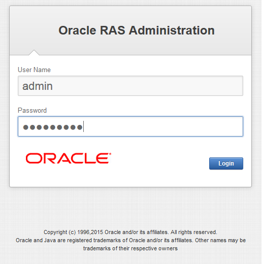
[Description of the illustration ras_ui_login.png](img_text/ras_ui_login.md)

##### For More Information

See the following resources for more information:

- Real Application Security discussion forum: [Database Security — General](https://docs.oracle.com/pls/topic/lookup?ctx=en/database/oracle/oracle-database/19/dbfsg&id=ras_discussion_forum)

- Real Application Security Documentation: see [Oracle Database Real Application Security Administration](../rasad/index.md)

#### 12.8.2 Design Phase

In the design phase, you identify all the tasks an application performs that require application privileges to control data access.

For example, during the design phase, the application policy designer must identify:

1.  The set of application-level operations that require access control.

2.  The rows and columns of tables and views that can be accessed as part of the application-level operations.

3.  The set of actors or principals (users and roles) that can perform these operations.

4.  The runtime application session attributes that identity rows of a table or views. These attribute names are used within the predicates that selects the rows to be authorized, and their values are set during the execution of the application.

#### 12.8.3 Development Flow

To develop data security policies using RASADM, you must follow some basic steps.

In the development phase, as the RASADM administrator, you use RASADM to develop your data security policies following these steps:

1.  Create the corresponding application users and roles. If using an external directory server, create the application users and roles or user groups in the directory server. Follow this procedure to create these principals natively in the database:

    1.  Create the application roles and grant application roles to application roles, if needed. See the topic on creating application roles.

    2.  Create the application users and grant application roles to the application users. See the topic on creating application users.

    3.  Configure the directory server to fetch the users and role, when principals from external stores are used. See the topic on configuration.

    4.  For users and roles in the external Directory Server, manage parameter settings for using RASADM with a Directory Server. See the topic on managing settings.

2.  Create each privilege class that you plan to use to develop the security policies for your application. Each privilege class consists of one or more appropriate privileges that you define and can reference in an ACL and also grant them to the application users and application roles. Each privilege class authorizes by means of ACLs the required application-level operations of a data security policy. See the topic on creating application privilege classes.

3.  Create one or more session namespaces that can be used across different application sessions. This consists of defining for a session namespace its set of properties (application attributes) and its associated access control policy or ACL that you can choose from a list or create. See the topic on creating namespaces.

4.  Create the data security policy by associating each data realm with an ACL, so as to create both data realm authorization and column authorization as needed. This process consists of four parts:

    1.  Policy Information - You choose the object to be protected and the privilege class to protect it as well as specify the policy name and select the policy schema. See Step 3 in the topic on creating data security policies.

    2.  Column Level Authorization - You choose the name of the column to be protected and select the privilege to be granted to access the column, which is associated with the privilege class you selected in Step 3a. See Step 4 in the topic on creating data security policies.

    3.  Data Realm Authorization - You create a SQL predicate to represent the data realm to be protected and add each to a data realm grant list. Then you choose or create the ACL to protect the data realm. Next, create privilege grants to be added to a privilege grants list consisting of each principal and whether it is allowed authorization or denied authorization by selecting the appropriate privilege. See Step 5 in the topic on creating data security policies.

    4.  Apply Policy - You can apply, remove, enable, or disable the data security policy you are creating and choose to specify certain apply options, allowing the owner of the table or view to bypass this data security policy, and whether to enforce statement types for this policy. See Step 6 in the topic on creating data security policies.

#### 12.8.4 About Using RASADM to Create the HR Demo

Describes how to use RASADM to create the HR Demo application.

To begin, you should be running the RASADM application and be logged in as the `ADMIN` user as described in About Running the RASADM Application and shown in the following screen shots.

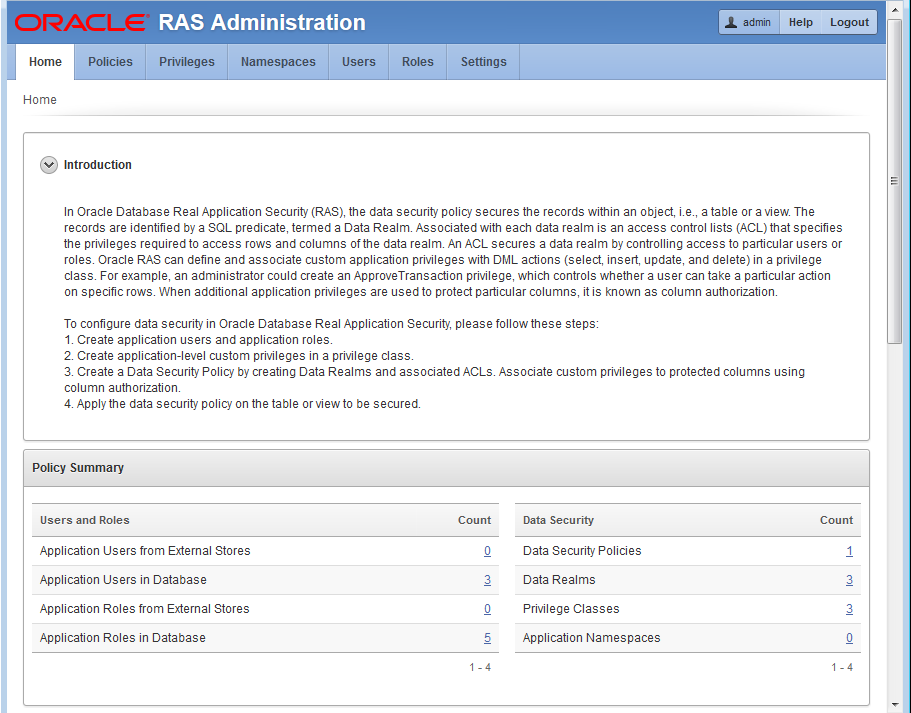
[Description of the illustration ras_ui_home_part1.png](img_text/ras_ui_home_part1.md)

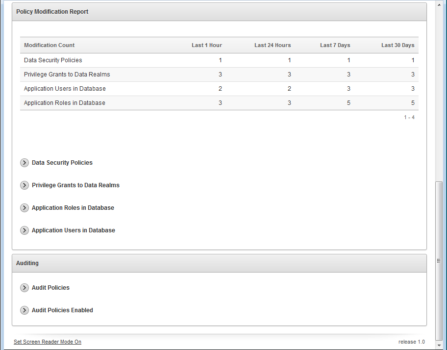
[Description of the illustration ras_ui_part2.png](img_text/ras_ui_part2.md)

You will be performing the following tasks:

##### 12.8.4.1 About Creating Application Roles

Describes how to create application roles and specifically the database DB_EMP role.

You must create a database `DB_EMP` role using SQL\*Plus and grant this role `SELECT`,` INSERT`, `UPDATE`, and `DELETE` privileges in `HR.EMPLOYEES` as this code snippet indicates.

    -- Create database role DB_EMP and grant necessary table privileges.
    -- This role will be used to grant the required object privileges to
    -- application users.
    CREATE ROLE DB_EMP;
    GRANT SELECT, INSERT, UPDATE, DELETE ON HR.EMPLOYEES TO DB_EMP;

See [hrdemo_setup.sql](real-application-security-hr-demo-files.md)for more information.

This next task involves creating the following application roles: `EMP_ROLE`, `IT_ROLE`, and `HR_ROLE`, and then enabling each application role.

This task can be performed in one of two ways:

- Using RASADM to create these application roles.

- Using an external directory server to create the application roles in the directory server.

In either case, for the HR Demo, the following application roles will be created:

- `EMP_ROLE`

- `IT_ROLE`

- `HR_ROLE`

Finally, using SQL\*Plus, you must grant each of these application roles the database `DB_EMP` role as indicated in the following code snippet.

    -- Grant DB_EMP to the three application roles, so they have the required
    -- object privilege to access the table.
    GRANT DB_EMP TO EMP_ROLE;
    GRANT DB_EMP TO IT_ROLE;
    GRANT DB_EMP TO HR_ROLE;

See [hrdemo_setup.sql](real-application-security-hr-demo-files.md)for more information.

- See Using RASADM to Create Application Roles

###### 12.8.4.1.1 Using RASADM to Create Application Roles

Describes how to create application roles using RASADM.

To get started, click the Roles tab, then click Create Role.

1.  On the `Application Role` page, enter information in the following fields:
    1.  Role Name: Enter `EMP_ROLE`.
    2.  Description: Enter a brief description.
    3.  Type of Role: Select the default, `ROLE`.
    4.  Enabled by Default: Select `Yes`.
2.  In Roles Grant section, in the Roles field, click ^ and select DB_EMP role from the list to add it as a direct role grant.
3.  Click Apply Changes to create the `EMP_ROLE `application role.
4.  Click the role `EMP_ROLE` to see the edit view of this role as shown in the following screen shot.
5.  Repeat these steps to create the `IT_ROLE` and `HR_ROLE` application roles. Again, there are no application roles to be granted to either of these application roles.

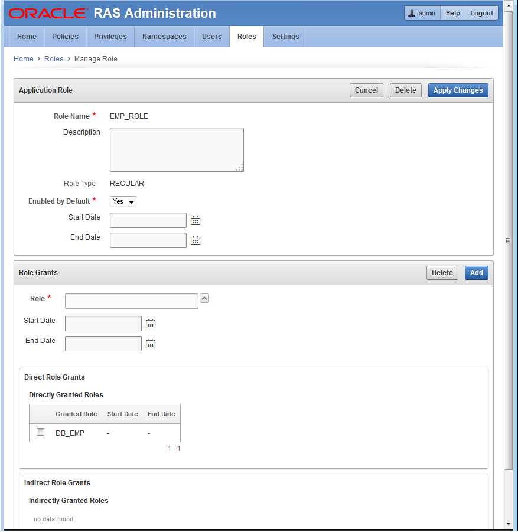
[Description of the illustration application_role.png](img_text/application_role.md)

##### 12.8.4.2 About Creating Application Users

Describes creating application users and granting them roles.

This task involves creating each application user and granting each application user its respective application role.

This task can be performed in one of two ways:

- Using RASADM to create application users: `DAUSTIN` and `SMAVRIS`.

  Next, perform the following grants:

  - Grant application roles `EMP_ROLE` and `IT_ROLE` to `DAUSTIN`.

  - Grant application roles `EMP_ROLE` and `HR_ROLE` to `SMAVRIS`.

- Using an external directory server to create the application users or application user groups in the directory server.

In either case, for this HR Demo, the following application users will be created:

- `DAUSTIN`

- `SMAVRIS`

Next, you will perform the following grants:

- Grant the application role `EMP_ROLE` to user `DAUSTIN` and `SMAVRIS`.

- Grant the application role `IT_ROLE` to user `DAUSTIN`.

- Grant the application role `HR_ROLE` to user `SMAVRIS`.

<!-- -->

- See Using RASADM to Create Application Users.

###### 12.8.4.2.1 Using RASADM to Create Application Users

Describes creating application users using RASADM.

To get started, click the Users tab, then click Create User.

1.  On the `Manage User` page in the Application User section, enter information in the following fields:
    1.  Name: Enter `DAUSTIN.`
    2.  Description: Enter a brief description.
    3.  Default Schema: Select `HR`.
    4.  Roles Default Enabled: Select `Yes`.
    5.  Status: Chose `Active`.
2.  In the Roles Grants section, select the application roles to be granted to the application user `daustin`. Enter information in the Role: field by clicking ^ and selecting `EMP_ROLE`.
3.  Click Add to grant this role. Repeat this process to grant the `IT_ROLE` to `DAUSTIN`.
4.  Click Apply Changes to create the application user `DAUSTIN`.
5.  Click user `DAUSTIN` to see the edit view of this user as shown in the following screen shot.
6.  Repeat these steps to grant the `EMP_ROLE` and `HR_ROLE` to application user `SMAVRIS`.

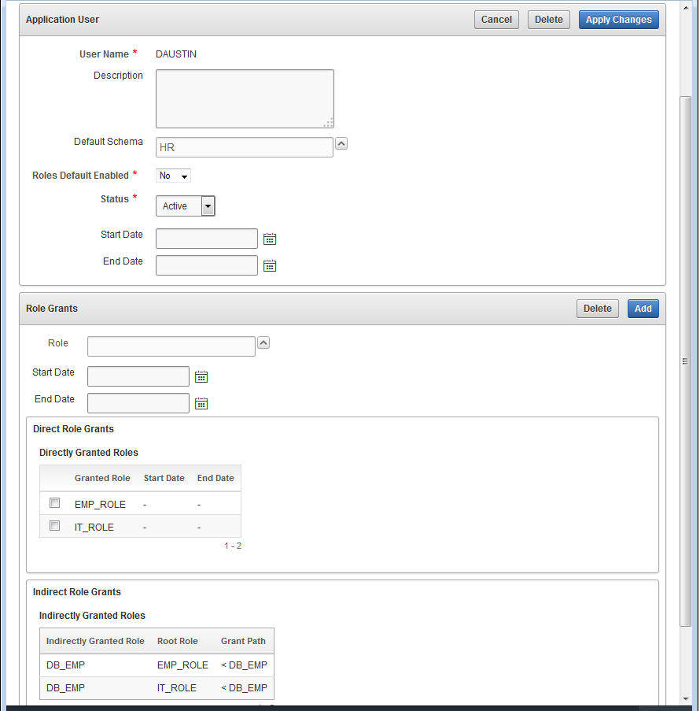
[Description of the illustration application_user\_\_daustin.png](img_text/application_user__daustin.md)

##### 12.8.4.3 About Creating the Data Security Policy

Describes the process flow for creating the data security policy.

This task involves creating the HRDEMO data security policy. It includes:

- Entering the policy information.

- Creating the `HRPRIVS` privilege class and its `VIEW_SALARY` privilege.

- Creating the `SALARY` column authorization and selecting the `HRPRIVS` privilege class to be applied to the column.

- Creating the data realm authorization consisting of the three data realms, one for employee access, one for IT access, and one for HR access along with each associated ACL with its respective defined privilege grant for each principal to control its row access.

- Applying the `HRDEMO` data security policy by enabling it.

This section includes the following topics:

###### 12.8.4.3.1 Entering Policy Information

Describes entering data security policy information using the RASADM application.

To create a data security policy, click the Policies tab, then click Create to display the Policy Information page.

1.  On the Policy Information page, enter the policy information in the following fields:
    1.  Policy Schema: Click ^ and select `HR`.
    2.  Policy Name: Enter the name `Employees_DS`.
    3.  Description: Enter a brief description for this policy.
    4.  Privilege Class: Click NEW to create the `HRPRIVS` privilege class.
2.  On the Privilege Class page, enter the following information:
    1.  For Privilege Class. Privilege Class Name: Enter `HRPRIVS`.
    2.  For Privilege Class. Description: Enter a brief description.
    3.  For Application Privileges. Privilege Name: Enter the name `VIEW_SALARY`.
    4.  For Application Privileges. Description: Enter a brief description.
    5.  For Application Privileges. Implied Privileges: Click `Select`.
    6.  Click Add to add the `VIEW_SALARY` privilege to the Application Privileges list. See the following figure.
    7.  Click Apply Changes to save the `HRPRIVS` privilege class.
3.  On the same Privilege Class page, enter the following information:
    1.  Protected Object's Schema: Click ^ and select `HR`.
    2.  Protected Object: Click ^ and select `EMPLOYEES`.

    The following screen shot shows the Policy Information page for the `Employees_DS` data security policy.
    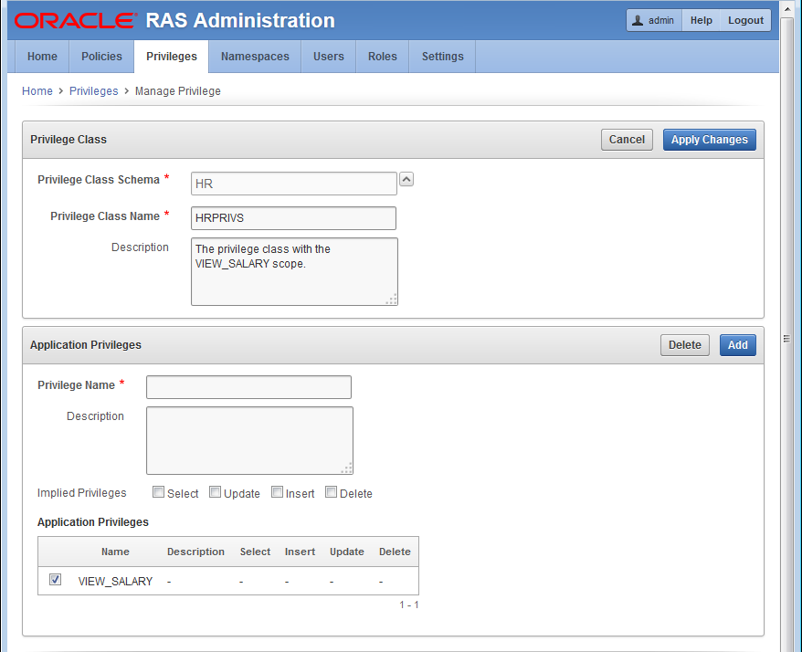
    [Description of the illustration hr_hrprivs_privileges.png](img_text/hr_hrprivs_privileges.md)
4.  Click Next to go to the `Column Authorization` page.

###### 12.8.4.3.2 Creating the Column Authorization

Describes creating the column authorization part of the data security policy.

1.  On the Column Authorization page, enter the following information to create a column authorization:
    1.  Column: Click ^ and select `SALARY`.
    2.  Privilege: Click ^ and select `VIEW_SALARY`.
2.  Click Add to add the column authorization to the Column Constraint list.
    The following screen shot shows the Column Authorization page with the created `SALARY` column authorization protected by the `VIEW_SALARY` privilege.
    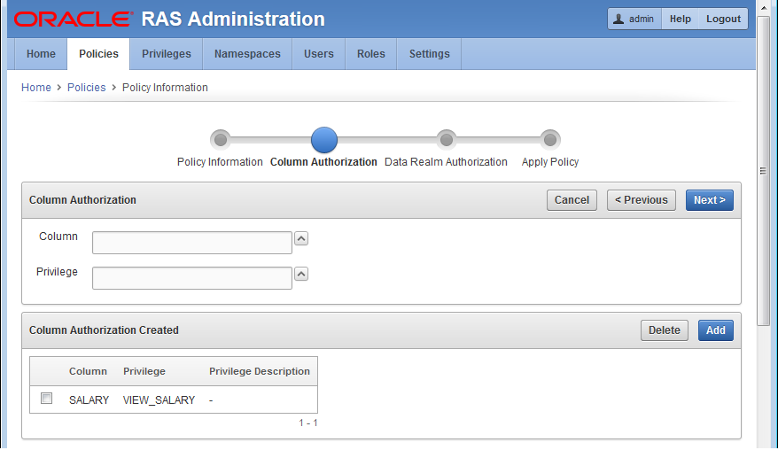
    [Description of the illustration column_authorization.png](img_text/column_authorization.md)
3.  Click Next to go to the Data Realm Authorization page.

###### 12.8.4.3.3 Creating the Data Realm Authorizations

Describes the creating the data realm authorizations part of the data security policy.

Three data realm authorizations will be created that:

- Allows a user granted the `IT_ROLE` to view records in the IT department excluding the `SALARY` column.

- Allows a user granted the `EMP_ROLE` to view their own record including the `SALARY` column

- Allows a user granted the `HR_ROLE` to view and update all records including the `SALARY` column.

1.  On the Data Realm Authorization page, enter information in the following fields to create the data realm to allow the IT department member access to their department records, excluding the `SALARY` column:
    1.  Description: Enter a brief description.
    2.  SQL Predicate: Click \> to expand the Predicate Builder field. Enter information in the following fields:
    3.  Column Name: Click ^ to select the `DEPARTMENT` column name.
    4.  Operator: Click ^ to select the `=` operator.
    5.  Value: Enter the value `60`.
    6.  AND/OR: Ignore this option.
    7.  Click Apply to create the SQL predicate.

    The following screen shows the completed IT Department data realm authorization..
    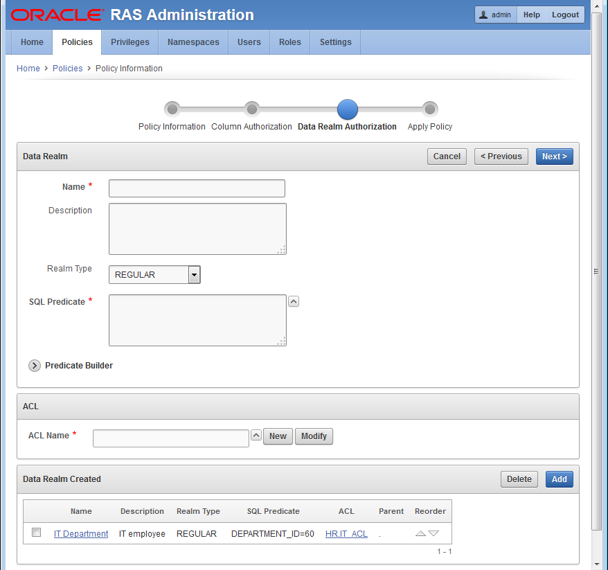
    [Description of the illustration it_department_dr.png](img_text/it_department_dr.md)
2.  ACL Name: Click + to create the `IT_ACL`. Enter information in the following fields:
    1.  For ACL Control Lists (ACL), ACL Name: Enter `IT_ACL`.
    2.  For ACL Control Lists (ACL), Description: Enter a brief description.
    3.  For ACL Control Lists (ACL), ACL Inheritance: Ignore this field.
    4.  For Privilege Grants, Principal: Click \<- to select a principal.
    5.  For Privilege Grants, Principal Type: Click User.
    6.  For Privilege Grants, Principal Store: Click Database.
    7.  For Privilege Grants, Principal Filter: Enter `DAUSTIN` and click Search. Then click Select to select DAUSTIN as the principal.
    8.  For Privilege Grants, Privilege: Choose the default option, SELECT.
    9.  For Privilege Grants, Grant: Choose the option Grant.
    10. Click Add to add this privilege grant.

    The following screen shot shows the completed `IT_ACL` ACL and its privilege grant of the SELECT privilege granted to the IT_ROLE role.
    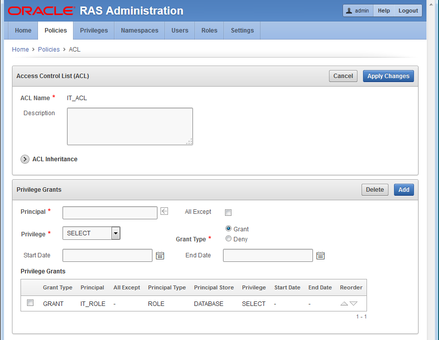
    [Description of the illustration hr_it_acl.png](img_text/hr_it_acl.md)
3.  Data Realm Grant: Click Add to grant this data realm.
4.  On the Data Realm Authorization page, Click Add to begin to add the next data realm authorization. Enter information in the following fields to create the data realm to allow the employee access to their own record, including the `SALARY` column.
    1.  Description: Enter a brief description.
    2.  SQL Predicate: Enter` UPPER(email) = XS_SYS_CONTEXT('XS$SESSION','USERNAME')`.
    3.  Click Preview to view the results of the query and see if it is what you expected.
5.  ACL Name: Click + to create the `EMP_ACL`. Enter information in the following fields:
    1.  For ACL Control Lists (ACL), ACL Name: Enter `EMP_ACL`
    2.  For ACL Control Lists (ACL), Description: Enter a brief description.
    3.  For ACL Control Lists (ACL), ACL Inheritance: Ignore this field.
    4.  For Privilege Grants, Principal: Click \<- to select a principal.
    5.  For Privilege Grants, Principal Type: Click User.
    6.  For Privilege Grants, Principal Store: Click Database.
    7.  For Privilege Grants, Principal Filter: Enter `DAUSTIN` and click Search. Then click Select to select DAUSTIN as the principal.
    8.  For Privilege Grants, Privilege: Choose the default option, SELECT
    9.  For Privilege Grants, Grant: Choose the option Grant.
    10. Click Add to add this privilege grant.
    11. Repeat these same two grants for user `SMAVRIS`, so user `SMAVRIS` is granted `SELECT` and `VIEW_SALARY` application privileges.
6.  Data Realm Grant: Click Add to grant this data realm.
7.  On the Data Realm Authorization page, Click Add to begin to add the next data realm authorization. Enter information in the following fields to create the data realm to allow the HR personnel to access and update all employee records, including the `SALARY` column.
    1.  Description: Enter a brief description.
    2.  SQL Predicate: Enter` UPPER(email) = XS_SYS_CONTEXT('XS$SESSION','USERNAME')`.
    3.  Click Preview to view the results of the query and see if it is what you expected.
8.  ACL Name: Click + to create the `HR_ACL`. Enter information in the following fields:
    1.  For ACL Control Lists (ACL), ACL Name: Enter `HR_ACL`
    2.  For ACL Control Lists (ACL), Description: Enter a brief description.
    3.  For ACL Control Lists (ACL), ACL Inheritance: Ignore this field.
    4.  For Privilege Grants, Principal: Click \<- to select a principal.
    5.  For Privilege Grants, Principal Type: Click User.
    6.  For Privilege Grants, Principal Store: Click Database.
    7.  For Privilege Grants, Principal Filter: Enter `SMAVRIS` and click Search. Then click Select to select `SMAVRIS` as the principal.
    8.  For Privilege Grants, Privilege: Choose the default option, SELECT
    9.  For Privilege Grants, Grant: Choose the option Grant.
    10. Repeat this Privileges Grants step to grant `UPDATE` to `SMAVRIS`.
    11. For Privilege Grants, Principal: Click \<- to select a principal.
    12. For Privilege Grants, Principal Type: Click User.
    13. For Privilege Grants, Principal Store: Click Database.
    14. For Privilege Grants, Principal Filter: Enter `SMAVRIS` and click Search. Then click Select to select `SMAVRIS` as the principal.
    15. For Privilege Grants, Privilege: Choose UPDATE
    16. For Privilege Grants, Grant: Choose the option Grant.
    17. Repeat this step two more times to grant `INSERT` and `DELETE` to `SMAVRIS`.
    18. Click Add to add this privilege grant.
9.  Data Realm Grant: Click Add to add this data realm authorization to the list of data realm authorizations.

The following screen shot shows the three completed data realm authorizations and the completed column authorization.

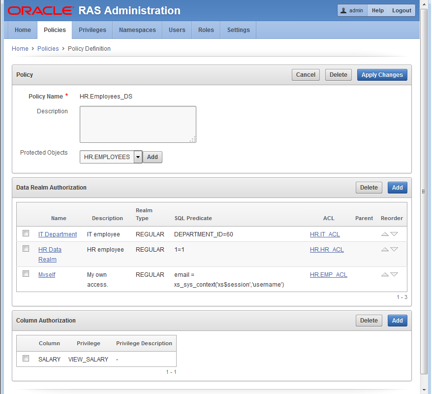
[Description of the illustration employee_ds_policy.png](img_text/employee_ds_policy.md)

###### 12.8.4.3.4 Applying the Policy

Describes applying the data security policy.

To apply the `Employees_DS` data security policy, perform the following steps:

1.  On the Apply Policy page, enter information in the Apply Policy field by selecting `Enable` to enable this data security policy.
    The following screen shot shows the completed `Employees_DS` data security policy on the Policies page with the policy already set to be enabled.
    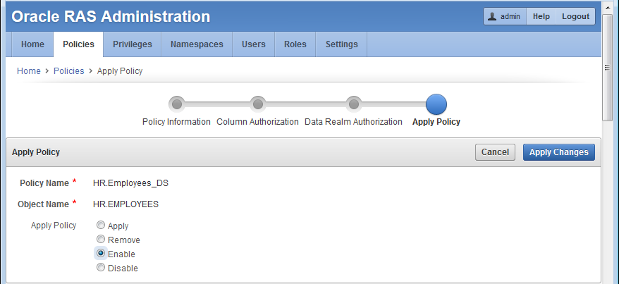
    [Description of the illustration apply_policy.png](img_text/apply_policy.md)
2.  Click Apply Changes to create the `Employees_DS` data security policy.
