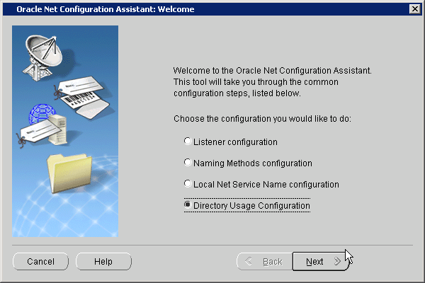

Configuring Enterprise User Security for an Oracle database primarily involves creating directory objects to store enterprise user and database information. For some implementations, it can also require creating special network configuration files (`ldap.ora`) that enable your databases to locate the correct directory server on the network.

While Oracle Enterprise Manager is your primary tool for both configuring Enterprise User Security and for administration tasks, this chapter introduces all the available tools, in the following topics:

- Enterprise User Security Tools Overview

- Database Configuration Assistant

- Oracle Wallet Manager

- Oracle Enterprise Manager

- Oracle Net Configuration Assistant

- User Migration Utility

- Duties of an Enterprise User Security Administrator/DBA

### 3.1 Enterprise User Security Tools Overview

Enterprise users are database users whose identities are stored and centrally managed in an LDAP directory, such as Oracle Internet Directory. Table 3-1 provides a summary of Enterprise User Security configuration and management tasks and the tools to complete them. The tool names are links to sections that describe them.

Table 3-1 Enterprise User Security Tasks and Tools Summary

| Task                                                                                                                                                                                                                                                                                         | Tools                                          |
|:---------------------------------------------------------------------------------------------------------------------------------------------------------------------------------------------------------------------------------------------------------------------------------------------|:-----------------------------------------------|
| Create users and manage their passwords                                                                                                                                                                                                                                                      | Oracle Internet Directory Self-Service Console |
| Configure databases Oracle home for directory usage over the network                                                                                                                                                                                                                         | Oracle Net Configuration Assistant             |
| Register and un-register databases in Oracle Internet Directory                                                                                                                                                                                                                              | Database Configuration Assistant               |
| Manage Oracle wallets for Enterprise User Security                                                                                                                                                                                                                                           | Oracle Wallet Manager                          |
| • Configure enterprise domains and databases in Oracle Internet Directory including mappings, roles and proxy permissions • Manage identity management realm attributes and administrative groups that pertain to Enterprise User Security in Oracle Internet Directory                   | Oracle Enterprise Manager                      |
| Manage identity management realms in Oracle Internet Directory For information about this tool and realms, refer to [Oracle Identity Management Guide to Delegated Administration](https://docs.oracle.com/pls/topic/lookup?ctx=en/database/oracle/oracle-database/19/dbimi&id=OIMDA003). | Oracle Internet Directory Self-Service Console |
| Perform bulk migrations of database users to Oracle Internet Directory                                                                                                                                                                                                                       | User Migration Utility                         |

### 3.2 Oracle Internet Directory Self-Service Console

Oracle Internet Directory Self-Service Console is a tool based on Delegated Administration Services. This is a self service application that allows administrated access to the applications data managed in the directory. This tool comes ready to use with Oracle Internet Directory.

The [Oracle Identity Management Guide to Delegated Administration](https://docs.oracle.com/pls/topic/lookup?ctx=en/database/oracle/oracle-database/19/dbimi&id=OIMDA004) discusses Delegated Administration Services and the Oracle Internet Directory Self-Service Console tool.

### 3.3 Oracle Net Configuration Assistant

Oracle Net Configuration Assistant is a wizard-based tool with a graphical user interface. Its primary uses are to configure basic Oracle Net network components, such as listener names and protocol addresses, and to configure your Oracle home for directory server usage. The latter use is what makes this tool important for configuring Enterprise User Security.

If you use Domain Name System (DNS) discovery (automatic domain name lookup) to locate Oracle Internet Directory on your network, then this assistant is not necessary. Note that using DNS discovery is the recommended configuration.

Before you can register a database with the directory, you must do either one of the following two tasks:

- Configure DNS discovery of Oracle Internet Directory on your network.

  **See Also:**

  [Oracle Fusion Middleware Administrator's Guide for Oracle Internet Directory](https://docs.oracle.com/pls/topic/lookup?ctx=en/database/oracle/oracle-database/19/dbimi&id=OIDAG2184) for information about DNS server discovery

- If DNS discovery is not configured on your network, then use Oracle Net Configuration Assistant to create an `ldap.ora` file for your Oracle home.

Your database initially uses the `ldap.ora` file to locate the correct Oracle Internet Directory server on your network. This configuration file contains the hostname, port number, and identity management realm information for your directory server.

Once database registration is complete, the realm is ascertained through the database DN stored in the database wallet.

The following section describes more information about Oracle Net Configuration Assistant: Starting Oracle Net Configuration Assistant.

#### 3.3.1 Starting Oracle Net Configuration Assistant

To start Oracle Net Configuration Assistant:

- (UNIX) From `$ORACLE_HOME``/bin`, enter the following at the command line:

      netca

- (Windows) Choose Start, Programs, Oracle-HOME_NAME, Configuration and Migration Tools, Net Configuration Assistant

After you start this tool, you will be presented with the opening page shown in Figure 3-1.

Choose the Directory Usage Configuration option on this page, click Next, and choose the directory server where you wish to store your enterprise users. Then, click Finish to create a properly configured `ldap.ora` file for your Oracle home.

Figure 3-1 Opening Page of Oracle Net Configuration Assistant

[Description of "Figure 3-1 Opening Page of Oracle Net Configuration Assistant"](img_text/netca1.md)

**See Also:**

- "[Task 5: (Optional) Configure your Oracle home for directory usage](enterprise-user-security-configuration-tasks-and-troubleshooting.md)" for more information about using this tool to configure your Oracle home for Enterprise User Security

- Oracle Net Configuration Assistant online help and [Oracle Database Net Services Administrator's Guide](../netag/managing-oracle-net-services.md) for a complete documentation of this tool

### 3.4 Database Configuration Assistant

Database Configuration Assistant is a wizard-based tool used to create and configure Oracle databases.

Use Database Configuration Assistant to register a database with the directory. In that process, Database Configuration Assistant creates a distinguished name (DN) for the database and the corresponding entry and subtree in Oracle Internet Directory.

The following section describes more information about Database Configuration Assistant: Starting Database Configuration Assistant.

#### 3.4.1 Starting Database Configuration Assistant

To start Database Configuration Assistant:

- (UNIX) From `$ORACLE_HOME``/bin`, enter `dbca` at the command line:

- (Windows) Choose Start \> Programs \> Oracle - HOME_NAME \> Configuration and Migration Tools \> Database Configuration Assistant

  **See Also:**

  - "[To register a database with the directory:](enterprise-user-security-configuration-tasks-and-troubleshooting.md)" for information about using this tool to register your database

  - [Oracle Database Administrator’s Guide](../admin/creating-and-configuring-an-oracle-database.md) for more information about this tool

### 3.5 Oracle Wallet Manager

Security administrators use Oracle Wallet Manager, which is an application that wallet owners use to manage and edit the security credentials in their Oracle wallets. A wallet is a password-protected container used to store authentication and signing credentials, including private keys, certificates, and trusted certificates needed by SSL The wallets it creates can be read by Oracle Database, Oracle Application Server 10g, and the Oracle Identity Management infrastructure.

**See Also:**

[Using Oracle Wallet Manager](using-oracle-wallet-manager.md)

This section includes the following topics:

- Starting Oracle Wallet Manager

- The orapki Command-Line Utility

#### 3.5.1 Starting Oracle Wallet Manager

To start Oracle Wallet Manager:

- (Windows) Select Start, Programs, Oracle-HOME_NAME, Integrated Management Tools, Wallet Manager

- (UNIX) At the command line, enter `owm`.

#### 3.5.2 The orapki Command-Line Utility

The `orapki` command-line utility enables administrators to manage wallets, certificate revocation lists, and other public key infrastructure (PKI) elements from the command line. It can be used inside scripts, enabling administrators to automate many routine PKI tasks. The `orapki` commands enable you to do the following tasks:

Table 3-2 Summary of `orapki` Commands

| Object Affected                   | Operations Possible with orapki Commands |
|:----------------------------------|:-----------------------------------------|
| Certificate                       | Create or display                        |
| CRL (certificate revocation list) | Delete, display, hash, list, or upload   |
| Wallet                            | Create, display, add, or export          |

**See Also:**

`orapki` Utility in the [Oracle Database Security Guide](../dbseg/using-the-orapki-utility-to-manage-pki-elements.md)

### 3.6 Oracle Enterprise Manager

Enterprise User Security employs Oracle Enterprise Manager to administer enterprise users, administrative groups, [enterprise domain](glossary.md)s, and [enterprise role](glossary.md)s stored in Oracle Internet Directory. You can use the Web-based user interface provided by Oracle Enterprise Manager to administer Enterprise User Security.

Enterprise users are users provisioned and managed centrally in an LDAP-compliant directory, such as Oracle Internet Directory, for database access. Enterprise domains are directory constructs containing databases, enterprise roles (the access privileges assigned to enterprise users), and proxy permissions (which enable enterprise users to connect to databases as other users).

**See Also:**

[Introducing Enterprise User Security](introducing-enterprise-user-security.md) for a discussion of Enterprise User Security administrative groups, enterprise domains, enterprise roles, enterprise users, shared schemas, and user-schema mappings

Use the following steps to access the Enterprise User Security link in Oracle Enterprise Manager Cloud Control:

1.  Enter the URL for Cloud Control in a browser window. For example:

        https://mydbhost:1158/em

2.  Log in as an administrative database user.

3.  To navigate to your database, select Databases from the Targets menu.

4.  Click the database name in the list that appears. The database page appears.

5.  Under the Administration menu, select Security, Enterprise User Security. The Oracle Internet Directory Login page appears.

6.  Enter the distinguished name (DN) of a directory user, who has administrative privileges for the identity management realm, in the User field. Enter the user password in the Password field. Click Login.

    The Enterprise User Security page appears.

### 3.7 User Migration Utility

User Migration Utility is a command-line tool that enables you to perform bulk migrations of database users to Oracle Internet Directory where they are stored and managed as enterprise users. This tool performs a bulk migration in two phases: In phase one, it populates a table with database user information. During phase two, the database user information is migrated to the directory.

This tool is automatically installed in the following location when you install an Oracle Database client:

    $ORACLE_HOME/rdbms/bin/umu

The basic syntax for this utility is as follows:

    umu parameter_keyword_1=value1:value2

    parameter_keyword_2=value
    parameter_keyword_3=value1:value2:value3
    ...
    parameter_keyword_n=value

Note that when a parameter takes multiple values, they are separated with colons (:).

**See Also:**

[Using the User Migration Utility](using-the-user-migration-utility.md) for complete instructions (including usage examples) for using this tool to migrate database users to a directory

### 3.8 Duties of an Enterprise User Security Administrator/DBA

Enterprise User Security administrators plan, implement, and administer enterprise users. Table 3-3 lists the primary tasks of Enterprise User Security administrators, the tools used to perform the tasks, and the links to where the tasks are documented.

Table 3-3 Common Enterprise User Security Administrator Configuration and Administrative Tasks

| Task                                                                                                                                     | Tools Used                                                                                                         | See Also                                                                                                                                                                                                                            |
|:-----------------------------------------------------------------------------------------------------------------------------------------|:-------------------------------------------------------------------------------------------------------------------|:------------------------------------------------------------------------------------------------------------------------------------------------------------------------------------------------------------------------------------|
| Create an identity management realm in Oracle Internet Directory                                                                         | Oracle Internet Directory Self-Service Console (Delegated Administration Service)                                  | [Oracle Fusion Middleware Administrator's Guide for Oracle Internet Directory](https://docs.oracle.com/pls/topic/lookup?ctx=en/database/oracle/oracle-database/19/dbimi&id=OIDAG075) for information about how to perform this task |
| Upgrade an identity management realm in Oracle Internet Directory                                                                        | Oracle Internet Directory Configuration Assistant                                                                  | [Oracle Fusion Middleware Administrator's Guide for Oracle Internet Directory](https://docs.oracle.com/pls/topic/lookup?ctx=en/database/oracle/oracle-database/19/dbimi&id=OIDAG075) and the online Help for this tool              |
| Set up DNS to enable automatic discovery of Oracle Internet Directory over the network. Note that this is the recommended configuration. | Oracle Internet Directory Configuration Assistant                                                                  | Oracle Fusion Middleware Administrator's Guide for Oracle Internet Directory (Domain Name System server discovery) and the online Help for this tool                                                                                |
| Create an `ldap.ora` file to enable directory access                                                                                     | Oracle Net Configuration Assistant                                                                                 | "[Task 5: (Optional) Configure your Oracle home for directory usage](enterprise-user-security-configuration-tasks-and-troubleshooting.md)"                                                                                          |
| Register a database in the directory                                                                                                     | Database Configuration Assistant                                                                                   | "[Task 6: Register the database in the directory](enterprise-user-security-configuration-tasks-and-troubleshooting.md)"                                                                                                             |
| Configure password authentication for Enterprise User Security                                                                           | Oracle Enterprise Manager                                                                                          | "[Configuring Enterprise User Security for Password Authentication](enterprise-user-security-configuration-tasks-and-troubleshooting.md)"                                                                                           |
| Configure Kerberos authentication for Enterprise User Security                                                                           | • Oracle Internet Directory Self-Service Console (Delegated Administration Service) • Oracle Enterprise Manager | "[Configuring Enterprise User Security for Kerberos Authentication](enterprise-user-security-configuration-tasks-and-troubleshooting.md)"                                                                                           |
| Configure SSL authentication for Enterprise User Security                                                                                | • Oracle Net Manager • Oracle Enterprise Manager • Oracle Wallet Manager                                     | "[Configuring Enterprise User Security for SSL Authentication](enterprise-user-security-configuration-tasks-and-troubleshooting.md)"                                                                                                |
| Create or modify user entries and Oracle administrative groups in the directory                                                          | Oracle Internet Directory Self-Service Console (Delegated Administration Service)                                  | • "[Administering Identity Management Realms](administering-enterprise-user-security.md)" • "[Administering Enterprise Users](administering-enterprise-user-security.md)"                                                        |
| Create or modify enterprise roles and domains in the directory                                                                           | Oracle Enterprise Manager                                                                                          | • "[Administering Enterprise Domains](administering-enterprise-user-security.md)" • "[Configuring Enterprise Roles](administering-enterprise-user-security.md)"                                                                  |
| Create or modify wallets for directory, databases, and clients                                                                           | • Oracle Wallet Manager • orapki command line utility                                                           | • "[Managing Oracle Wallets](using-oracle-wallet-manager.md)" • [Oracle Database Security Guide](../dbseg/using-the-orapki-utility-to-manage-pki-elements.md) for information about `orapki` Utility                             |
| Change a user's database or directory password                                                                                           | Oracle Internet Directory Self-Service Console (Delegated Administration Service)                                  | "[Setting Enterprise User Passwords](administering-enterprise-user-security.md)"                                                                                                                                                    |
| Change a database's directory password                                                                                                   | Database Configuration Assistant                                                                                   | "[To change the database's directory password:](enterprise-user-security-configuration-tasks-and-troubleshooting.md)"                                                                                                               |
| Manage user wallets on the local system or update database and directory wallet passwords                                                | Oracle Wallet Manager                                                                                              | "[Managing Oracle Wallets](using-oracle-wallet-manager.md)"                                                                                                                                                                         |
| Request initial Kerberos ticket when KDC is not part of the operating system, such as Kerberos V5 from MIT                               | `okinit` utility                                                                                                   | [Oracle Database Security Guide](../dbseg/configuring-kerberos-authentication.md) for information about using the `okinit` utility to get an initial Kerberos ticket                                                                |
| Migrate large numbers of local or external database users to the directory for Enterprise User Security                                  | User Migration Utility                                                                                             | [Using the User Migration Utility](using-the-user-migration-utility.md)                                                                                                                                                             |
