Enterprise User Security enables you to centrally manage database users across the enterprise. Enterprise users are created in Oracle Internet Directory, and can be assigned roles and privileges across various enterprise databases registered with the directory.

This chapter uses a tutorial approach to help you get started with Enterprise User Security. The following steps discuss configuring Enterprise User Security:

1.  Configuring Your Database to Use the Directory

2.  Registering Your Database with the Directory

3.  Creating a Shared Schema in the Database

4.  Mapping Enterprise Users to the Shared Schema

5.  Connecting to the Database as an Enterprise User

6.  Using Enterprise Roles

7.  Using Proxy Permissions

8.  Using Pluggable Databases

### 2.1 Configuring Your Database to Use the Directory

The first step in configuring Enterprise User Security is to configure the database to use the directory. Running the Net Configuration Assistant (NetCA) tool enables you to configure the directory host name and port that your database should use.

#### To configure your database for directory usage:

1.  Start NetCA using the `netca` command.
    - On Windows, you can also start NetCA from the Start menu:

      Click Start, All Programs, Oracle - OracleHomeName, Configuration and Migration Tools, Net Configuration Assistant.

    - On Unix systems, you can start NetCA using the following command:

      `$ORACLE_HOME``/bin/netca`

    The Welcome screen appears.

    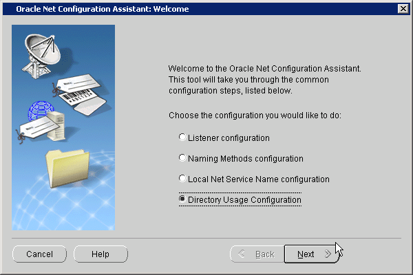
    [Description of the illustration netca1.gif](img_text/netca1.md)
2.  Select Directory Usage Configuration. Click Next.
    The Directory Type screen appears.

    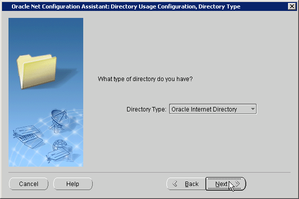
    [Description of the illustration netca2.gif](img_text/netca2.md)
3.  Click Next.
    The Directory Location screen appears.

    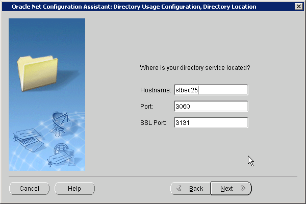
    [Description of the illustration netca3.gif](img_text/netca3.md)
4.  Enter the name of the host on which the Oracle Internet Directory server is running. Also enter the LDAP non-SSL and SSL port numbers. These port numbers are 3060 and 3131 by default. Click Next.
    The Select Oracle Context screen appears.

    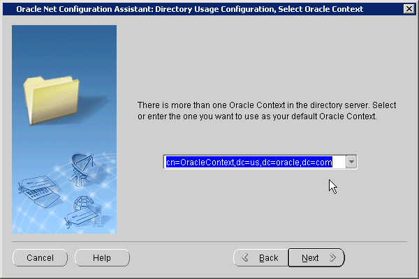
    [Description of the illustration netca4.gif](img_text/netca4.md)
5.  Select the default Oracle Context to use. You need to select this if there are multiple identity management realms on the directory server. Click Next.
    The Directory Usage Configuration, Done screen is displayed.
6.  Confirm that the directory usage configuration is successfully completed. Click Next.
7.  Click Finish.
    NetCA creates an `ldap.ora` file in the `$ORACLE_HOME``/network/admin` directory. This is the `$ORACLE_HOME``\network\admin` directory in Windows. The `ldap.ora` file stores the connection information details about the directory.

### 2.2 Registering Your Database with the Directory

The next step is to register the database with the directory service. The Database Configuration Assistant (DBCA) tool enables you to register the database with Oracle Internet Directory.

#### To register the database with the directory:

1.  Start DBCA using the `dbca` command.
    - On Windows, you can also start DBCA from the Start menu:

      Click Start, All Programs, Oracle - OracleHomeName, Configuration and Migration Tools, Database Configuration Assistant.

    - On Unix systems, you can start DBCA using the following command:

      `$ORACLE_HOME``/bin/dbca`

    The Welcome screen appears.
2.  Click Next.
    The Operations screen displays.

    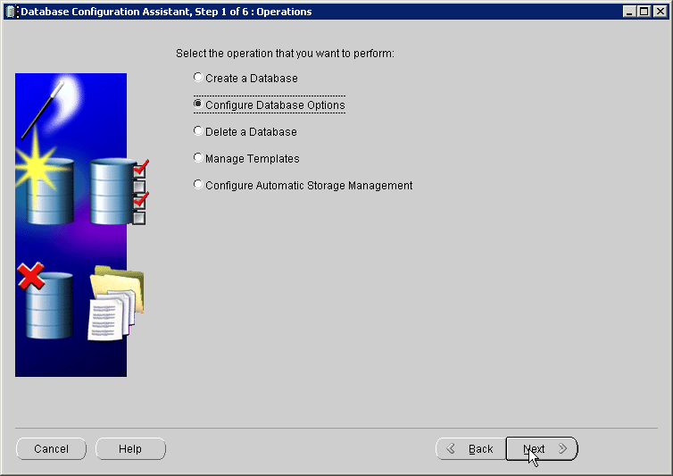
    [Description of the illustration dbca2.gif](img_text/dbca2.md)
3.  Select Configure Database Options. Click Next.
    The Database screen appears.
4.  Select the database name that you wish to configure. You might also be asked to enter `SYS` user credentials if you are not using operating system authentication. Click Next.
    The Management Options screen appears.
5.  Select the management options, and click Next.
    The Security Settings screen appears.
6.  Select Keep the enhanced 12c default security settings to keep the Oracle Database 12c security settings. Click Next.
    The Network Configuration screen appears.

    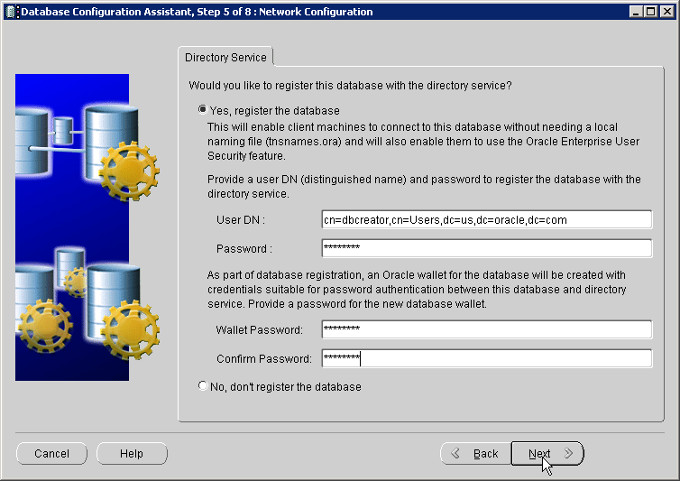
    [Description of the illustration dbca6.gif](img_text/dbca6.md)
7.  Select Yes, register the database to register the database with the directory. Enter the distinguished name (DN) of a user who is authorized to register databases in Oracle Internet Directory. Also, enter the password for the directory user. Enter a wallet password. Reenter the password in the Confirm Password field. Click Next.
    **Note:**

    The database uses a randomly generated password to log in to the directory. This database password is stored in an Oracle wallet. The wallet can also be used to store certificates needed for SSL connections.

    The wallet password that you specify is different from the database password. The wallet password is used to protect the wallet.

    The Database Components screen appears.
8.  Click Next.
    The Connection Mode page appears.
9.  Select Dedicated Server Mode or Shared Server Mode. Click Finish.
    The Confirmation dialog box appears.
10. Click OK.

**Note:**

After you register the database with the directory, make sure that auto login is enabled for the database wallet. The default wallet is created in the `$ORACLE_BASE``/admin/``database_sid``/wallet` directory.

You can verify that auto login for the wallet is enabled by checking for the presence of the `cwallet.sso` file in the wallet directory. If the file is not present, you can enable auto login by opening the wallet using Oracle Wallet Manager, and using the option to enable auto login for the wallet.

### 2.3 Registering an Oracle RAC Database with the Directory

Configuring the Oracle Internet Directory (OID) in an Oracle RAC environment requires certain additional steps.

1.  Create the `ldap.ora` file using NetCA following the steps under Configuring Your Database to Use the Directory. Choose Cluster configuration for the entire cluster configuration or Single node configuration to create the `ldap.ora` file in one node and copy it to the other remaining nodes. The `ldap.ora` file is located at `$ORACLE_HOME/network/admin/ldap.ora`.
    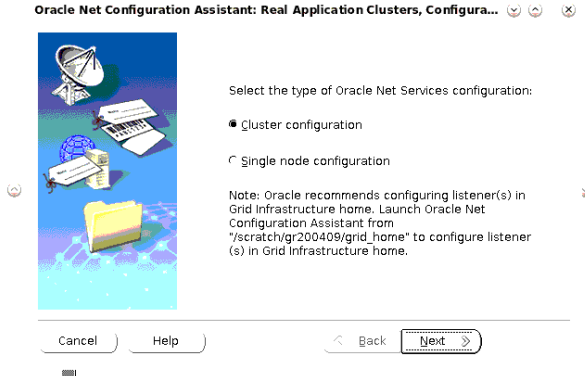
    [Description of the illustration netca-rac.png](img_text/netca-rac.md)
2.  Configure the database by running DBCA in silent mode for Oracle RAC databases:
        dbca -silent -configureDatabase -sourceDB <DB_name> -registerWithDirService <true/false>
        -dirServiceUserName <OracleContext_value> -dirServicePassword <OID_pwd> -walletPassword <wallet_pwd>

    `DB_name` is the name of the source database to configure

    `registerWithDirService` is the boolean value that must be set to `true` for configuring the database

    `OracleContext_value` is the default Oracle Context that is unique for the OID

    `OID_pwd` is the unique password value for the OID

    `wallet_pwd` is the user specified wallet password

    For example, for an Oracle RAC database named `t2`, the DBCA command is as follows:
        dbca -silent -configureDatabase -sourceDB t2 -registerWithDirService true
        -dirServiceUserName cn=dbcauser,cn=users,dc=us,dc=oracle,dc=com
        -dirServicePassword <OID_pwd> -walletPassword <wallet_pwd>

### 2.4 Creating a Shared Schema in the Database

Creating a shared schema in the database enables you to map multiple enterprise users to the same schema. Example 2-1creates a shared schema, `global_ident_schema_user`, and grants the `CONNECT` role to it.

Example 2-1 Creating a Shared Schema

    SQL> CREATE USER global_ident_schema_user IDENTIFIED GLOBALLY;
    User created.
    SQL> GRANT CONNECT TO global_ident_schema_user;
    Grant succeeded.

### 2.5 Mapping Enterprise Users to the Shared Schema

Enterprise User Security can be managed using Enterprise Manager. Example 2-2 maps the DN, `cn=users, dc=us, dc=oracle, dc=com` to the shared database schema, `global_ident_schema_user`.

Example 2-2 Mapping Enterprise Users to the Shared Schema

To create the user-schema mapping:

1.  Log in to Enterprise Manager Cloud Control, as an administrative user.

2.  To navigate to your database, select Databases from the Targets menu.

3.  Click the database name in the list that appears. The database page appears.

4.  Under the Administration menu, select Security, Enterprise User Security. The Oracle Internet Directory Login page appears.

5.  Enter the distinguished name (DN) of a directory user who can administer enterprise users in the User field. Enter the user password in the Password field. Click Login.

    **See Also:**

    Registering Your Database with the Directory, specifically Step 6, where you previously entered the user DN and password to register the database with the directory service

    The Enterprise User Security page appears.

6.  Click Manage Enterprise Domains.

    The Manage Enterprise Domains page appears.

7.  Select the enterprise domain which contains the database. Click Configure.

    The Configure Domain page appears.

8.  Click the User-Schema Mappings tab. All user-schema maps that apply to the enterprise domain are displayed.

9.  Click Create.

    The Create Mapping page is displayed.

10. Under the From section, select Subtree. Click the Search icon. Select the DN, cn=Users, dc=us,dc=oracle,dc=com.

11. Under the To section, enter global_ident_schema_user in the Schema field. Click Continue.

    The user-schema mapping is added in the Configure Domain page.

12. Click OK.

### 2.6 Connecting to the Database as an Enterprise User

All users in the mapped Oracle Internet Directory subtree can now connect to the database as enterprise users. Example 2-3 shows the `cn=orcladmin, cn=users, dc=us,dc=oracle,dc=com` user connecting to the database.

Example 2-3 Connecting to the Database as an Enterprise User

    SQL> CONNECT orcladmin
    Enter password:
    Connected.

### 2.7 Using Enterprise Roles

Enterprise roles are created in the directory. Enterprise roles contain global roles from different databases that are part of the enterprise domain. Enterprise roles are used to assign database privileges to enterprise users.

Example 2-4 creates two enterprise users, Joe and Nina. Both these users are created in the subtree, `cn=Users, dc=us,dc=oracle,dc=com`, which is already mapped to the `global_ident_schema_user` in the EUSDB database. See [RFC4519 — Lightweight Directory Access Protocol (LDAP) : Schema for User Applications](https://docs.oracle.com/pls/topic/lookup?ctx=en/database/oracle/oracle-database/19/dbimi&id=rfc4519_ldap_attr_types) for information about the LDAP attribute types shown in the previous subtree example.

Nina is an HR manager. She needs the `SELECT` privilege on the `hr.employees` table in the EUSDB database. Example 2-4 achieves this using enterprise roles.

Example 2-4 Using Enterprise Roles

We start by creating two enterprise users, Joe and Nina. You can create enterprise users using the Oracle Internet Directory Self Service Console.

To create enterprise users, Joe and Nina:

1.  Connect to the Oracle Internet Directory Self Service Console. Use the following URL:

    `http://``hostname`:`port``/oiddas/`

    Here, `hostname` is the name of the host that is running the Oracle Internet Directory server. The `port` number is the TCP port number on which the Oracle Internet Directory Self Service Console is running. This is 7777 by default.

    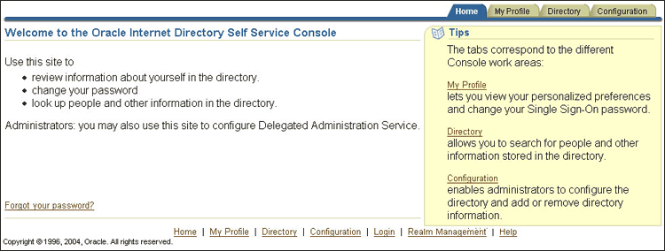
    [Description of the illustration getstrtd7.gif](img_text/getstrtd7.md)

2.  Click the Directory tab.

    The Sign In page appears.

    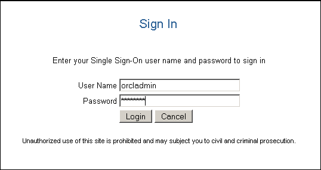
    [Description of the illustration getstrtd8.gif](img_text/getstrtd8.md)

3.  Log in as the user that can create users in Oracle Internet Directory.

    The User page appears.

4.  Click Create.

    The Create User page appears.

    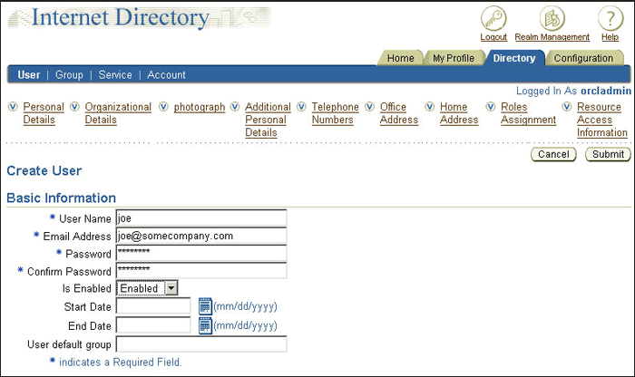
    [Description of the illustration getstrtd9.gif](img_text/getstrtd9.md)

5.  Enter joe under User Name. Enter values for the other required fields. Select Enabled under Is Enabled.

6.  Click Submit.

7.  Click Create Another User.

    The Create User page appears.

8.  Enter Nina under User Name. Enter values for the other required fields. Select Enabled under Is Enabled.

9.  Click Submit. Click OK.

Next, we create a global role in the database that allows access to the `hr.employees` table. The following SQL\*Plus statements create a global role, `hr_access` and grant the necessary privilege to it.

    SQL> CREATE ROLE hr_access IDENTIFIED GLOBALLY;
    Role created.
    SQL> GRANT SELECT ON hr.employees TO hr_access;
    Grant succeeded.

Next, we create an enterprise role called `hr_access` and assign the global role to it. We then assign this enterprise role to the enterprise user, Nina. The enterprise role can be created using Enterprise Manager.

To create the enterprise role, `hr_access:`

1.  Log in to Enterprise Manager Cloud Control, as an administrative user.

2.  To navigate to your database, select Databases from the Targets menu.

3.  Click the database name in the list that appears. The database page appears.

4.  Under the Administration menu, select Security, Enterprise User Security. The Oracle Internet Directory Login page appears.

5.  Enter the distinguished name (DN) of a directory user who can administer enterprise users in the User field. Enter the user password in the Password field. Click Login.

    The Enterprise User Security page appears.

6.  Click Manage Enterprise Domains.

    The Manage Enterprise Domains page appears. This page lists the enterprise domains in the identity management realm.

7.  Select the enterprise domain that contains the database. Click Configure.

    The Configure Domain page appears.

8.  Click the Enterprise Roles tab.

9.  Click Create.

    The Create Enterprise Role page appears.

10. Enter hr_access in the Name field.

    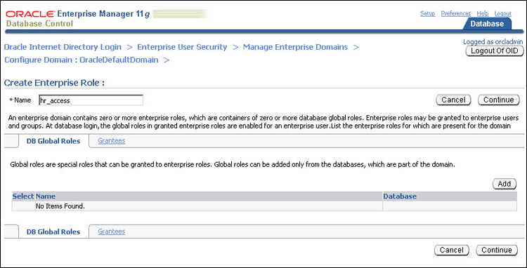
    [Description of the illustration getstrtd11.gif](img_text/getstrtd11.md)

11. Click Add to add the database global role to the enterprise role.

    The Search and Select Database Global Roles window is displayed.

    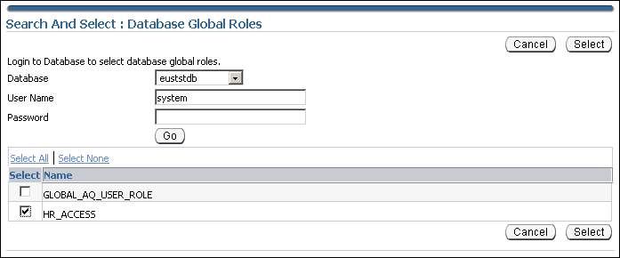
    [Description of the illustration getstrtd12.gif](img_text/getstrtd12.md)

12. Select the `hr_access` global role in your database. Click Select.

    **Note:**

    You will be required to log in to the database before you can select the global role.

13. Click the Grantees tab. Click Add.

    The Select Users or Groups window appears.

14. Select user Nina. Click Select.

    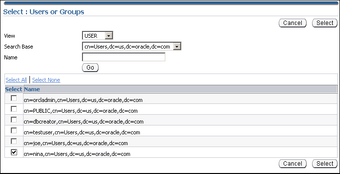
    [Description of the illustration getstrtd10.gif](img_text/getstrtd10.md)

15. Click Continue in the Create Enterprise Role page.

16. Click OK in the Configure Domain page.

The enterprise user, Nina can now access the `hr.employees` table in the database. The following SQL\*Plus statements illustrate this:

    SQL> CONNECT Nina
    Enter password:
    Connected.
    SQL> SELECT employee_id FROM hr.employees;
    EMPLOYEE_ID
    -----------
            100
            101
            102
    ...
    ...
    107 rows selected.

The enterprise user, Joe cannot access the `hr.employees` table, as he does not have the enterprise role assigned to him.

    SQL> CONNECT joe
    Enter password:
    Connected.
    SQL> SELECT employee_id FROM hr.employees;
    SELECT employee_id FROM hr.employees

    ERROR at line 1:
    ORA-00942: table or view does not exist

### 2.8 Using Proxy Permissions

Proxy permissions are created at the enterprise domain level. Proxy permissions allow an enterprise user to proxy a local database user, which means that the enterprise user can log in to the database as the local database user. You can grant proxy permissions to individual enterprise users or groups. Proxy permissions are especially useful for middle-tier applications that operate across multiple databases as enterprise users.

Example 2-5 illustrates the use of proxy permissions. The enterprise user, `joe` is a sales manager and needs to log in to enterprise databases as the target database user, `SH`. The `SH` user owns the sample `SH` schema that contains Sales History related tables.

Example 2-5 Using Proxy Permissions

The first step in allowing enterprise user proxy is to `ALTER` the target database user to allow `CONNECT` through enterprise users. The following `SQL` statements unlock the `SH` database account, set a password for it, and `ALTER` the account to allow enterprise user proxy:

    SQL> CONNECT SYSTEM
    Enter password:
    Connected.
    SQL> ALTER USER SH IDENTIFIED BY hrd2guess ACCOUNT UNLOCK;
    User altered.
    SQL> ALTER USER SH GRANT CONNECT THROUGH ENTERPRISE USERS;
    User altered.

Next, use Enterprise Manager to configure the proxy permission. This allows the enterprise user `joe` to connect as the local database user, `SH`.

To configure the proxy permission for enterprise user, `joe`:

1.  Log in to Enterprise Manager Cloud Control, as an administrative user.

2.  To navigate to your database, select Databases from the Targets menu.

3.  Click the database name in the list that appears. The database page appears.

4.  Under the Administration menu, select Security, Enterprise User Security. The Oracle Internet Directory Login page appears.

5.  Enter the distinguished name (DN) of a directory user who can administer enterprise users in the User field. Enter the user password in the Password field. Click Login.

    The Enterprise User Security page appears.

6.  Click Manage Enterprise Domains.

    The Manage Enterprise Domains page appears. This page lists the enterprise domains in the identity management realm.

7.  Select the enterprise domain that you wish to configure. Click Configure.

    The Configure Domain page appears.

8.  Click the Proxy Permissions tab.

    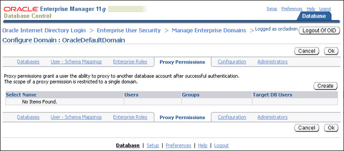
    [Description of the illustration getstrtd13.gif](img_text/getstrtd13.md)

9.  Click Create to create a new proxy permission.

    The Create Proxy Permission page appears.

10. Enter SH_Proxy, as the name of the proxy permission, in the Name field.

    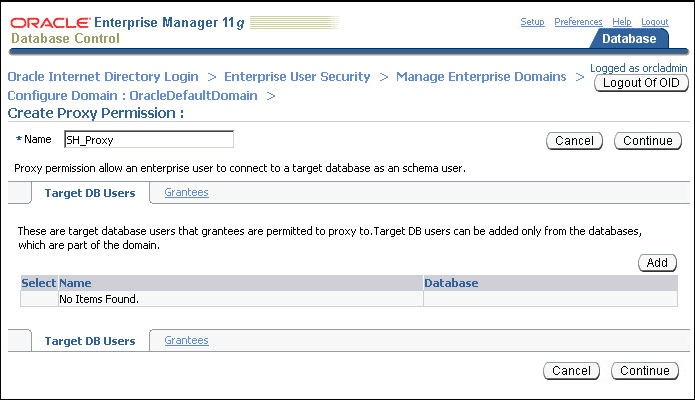
    [Description of the illustration getstrtd14.gif](img_text/getstrtd14.md)

11. Ensure that the Target DB Users tab is selected. Click Add.

    The Search and Select window appears.

12. Log in to the database that contains the `SH` user. A list of all database users that have been altered to allow enterprise user proxy is displayed.

13. Select the SH user. Click Select.

    The `SH` user is added under Target DB Users in the Create Proxy Permission page.

    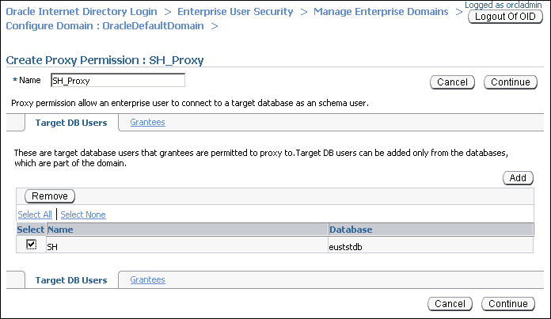
    [Description of the illustration getstrtd15.gif](img_text/getstrtd15.md)

14. Click the Grantees tab.

15. Click Add.

    The Select Users or Groups window appears.

16. Select `cn=users,dc=us,dc=oracle,dc=com` under Search Base. Select `User` under View. Click Go.

    A list of users under the subtree, `cn=users,dc=us,dc=oracle,dc=com` is displayed.

    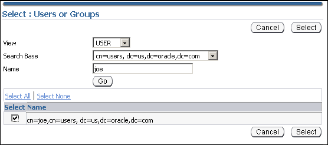
    [Description of the illustration getstrtd16.gif](img_text/getstrtd16.md)

17. Select `cn=joe,cn=users,dc=us,dc=oracle,dc=com`. Click Select.

    The user `joe` is added under Grantees in the Create Proxy Permission page.

    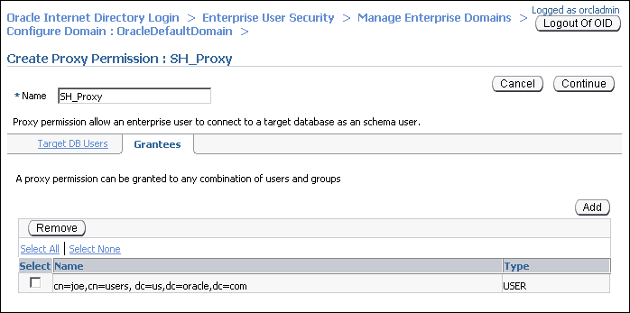
    [Description of the illustration getstrtd17.gif](img_text/getstrtd17.md)

18. Click Continue in the Create Proxy Permission page.

    The proxy permission, `SH_Proxy` is added in the Configure Domain page.

    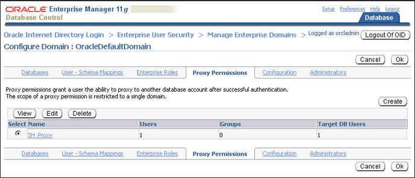
    [Description of the illustration getstrtd18.gif](img_text/getstrtd18.md)

19. Click OK.

The enterprise user, `joe` can now log in as the local database user `SH`. The following `SQL` statements illustrate this:

    SQL> REMARK Joe uses his own password to connect as the local database user, SH.
    SQL> CONNECT joe[SH]
    Enter password:
    Connected.
    SQL> SELECT * FROM SH.sales WHERE cust_id=4;

       PROD_ID    CUST_ID TIME_ID   CHANNEL_ID   PROMO_ID QUANTITY_SOLD AMOUNT_SOLD
    ---------- ---------- --------- ---------- ---------- ------------- -----------
            37          4 31-MAY-00          3        999             1       60.43
            39          4 31-MAY-00          3        999             1       38.45
            40          4 31-MAY-00          3        999             1        48.1
    ...
    ...
    72 rows selected.

### 2.9 Using Pluggable Databases

You can use Enterprise User Security with Pluggable Databases (PDBs), introduced in Oracle Database 12c Release 1 (12.1). Each PDB has its own Enterprise User Security metadata, such as global users, global roles, and so on. Each PDB should have its own identity in the directory. A PDB is like any regular database registered with the directory, except for the following restrictions:

- Client-side SSL authentication uses the Container Database (CDB)-wide wallet configured for the listener. The PDB-specific wallet is used for database-to-directory authentication.

- If the client-to-database authentication uses `SSL`, and the database-to-directory authentication also uses `SSL`, then two wallets need to be configured for the database with certificates. The first wallet is the CDB-wide wallet and the second wallet is the PDB-specific wallet.

- Current user database link is not supported in the CDB environment.

**Note:**

Each PDB has it's own value for `LDAP_DIRECTORY_ACCESS` parameter. The value of the `LDAP_DIRECTORY_ACCESS` parameter has to be set from a PDB.

The following sections describe more information about using pluggable databases:

- Wallet Location for Pluggable Databases

- Wallet Root for Pluggable Databases

- Default Database DN Format

- Plugging and Unplugging PDBs

- Switching Containers

#### 2.9.1 Wallet Location for Pluggable Databases

For pluggable databases, when a PDB is registered with the directory, the Database Configuration Assistant (DBCA) creates the wallet at the following location:

- If the `ORACLE_BASE` environment variable is set:

      ORACLE_BASE/admin/db_unique_name/pdb_GUID/wallet

- If `ORACLE_BASE` is not set:

      ORACLE_HOME/admin/db_unique_name/pdb_GUID/wallet

  The GUID of the PDB is used because the PDB name can change, but the GUID does not change. So, the PDB wallet location is still valid even if the PDB name changes.

**Note:**

On the Microsoft Windows x64 platform, without specifying the `WALLET_LOCATION` parameter in the `listener.ora` file and server side `sqlnet.ora` file, the server does not pick up the wallets from the default system location, which is `%USERPROFILE%``\ORACLE\WALLETS`. Hence, when you try to login using an SSL connection, the login fails with the following error: `ORA-28864: SSL connection closed gracefully`. There is no workaround to this known issue.

#### 2.9.2 Wallet Root for Pluggable Databases

`WALLET_ROOT` specifies the path to the root of a directory tree containing a subdirectory for each pluggable database (PDB). The directory structure is similar to the Oracle ASM wallet storage directory structure which is used to store the various wallets associated with the PDB.

This example uses the value of `ORACLE_BASE` environment variable to set the root of the wallet directory hierarchy:

    WALLET_ROOT=$ORACLE_BASE/admin/orcl/wallet

You can also use `WALLET_LOCATION` to specify the wallet location of your choice. When you specify both `WALLET_ROOT` and `WALLET_LOCATION` parameters, `WALLET_ROOT` takes the highest precedence. If both parameters are not specified, default wallet location is used.

**Note:**

This parameter is available starting with Oracle Database release 18c, version 18.1.

**See Also:**

[WALLET_ROOT](../refrn/WALLET_ROOT.md)

#### 2.9.3 Connecting to a Directory Service

Previously in a multitenant database, all the containers used to connect to a single directory service. You can now connect a different directory service for each pluggable database (PDB).

##### 2.9.3.1 Comparison of the dsi.ora and ldap.ora Files

You can use either `dsi.ora` or `ldap.ora` for Enterprise User Security and integration with Oracle Internet Directory(OID).

If you use `ldap.ora` for Enterprise User Security, you can only specify a single OID server for all the containers (PDBs) in a database. However, `ldap.ora` can also be used for net naming services which may or may not be using the same directory service. The `dsi.ora` allows each PDB to integrate with a different OID server if needed. While DBCA can be used to configure the `ldap.ora`, the `dsi.ora` needs to be created manually.

##### 2.9.3.2 About Using a dsi.ora File

You use a `dsi.ora` file to specify the Oracle Internet Directory(OID) server.

You must manually create the `dsi.ora` file to identify the OID server. The `dsi.ora` file provides directory connection information for all pluggable databases if it is located in the same places where the `ldap.ora` file can be placed. A `dsi.ora` file in a PDB-specific wallet location takes precedence over the main `dsi.ora` file for that PDB only.

**Note:**

If you are using `ldap.ora` for naming services, then do not make any changes to `ldap.ora` for the directory configuration. Only use `dsi.ora` to configure OID.

##### Placement of dsi.ora

Oracle recommends that you use directories for writable files under `$ORACLE_BASE`, not under `$ORACLE_HOME`. Starting with Oracle Database 18c, you can optionally set the `$ORACLE_HOME` directory to be read-only. Hence, you should place the `dsi.ora` file in a directory that is outside of `$ORACLE_HOME` to accommodate the `dsi.ora` configuration for future releases.

##### Search Order for dsi.ora

When you create the `dsi.ora` file, Oracle Database searches for it in the following order:

1.  For a PDB, Oracle searches for it in the PDB-specific wallet location.
    1.  If `WALLET_ROOT` is specified in `init.ora`, the PDB-specific wallet location is at `WALLET_ROOT``/``pdb_gui``d/eus/`
    2.  If `WALLET_ROOT` is not specified in `init.ora`, and if `WALLET_LOCATION` is specified in `sqlnet.ora`, the PDB-specific wallet location is at `WALLET_LOCATION``/``pdb_guid``/`
    3.  If neither `WALLET_ROOT` or `WALLET_LOCATION` is specified, the PDB-specific wallet location is the default location, that is:
        1.  If the `ORACLE_BASE` environment variable is set, the default location is:

                ORACLE_BASE/admin/db_unique_name/pdb_guid/wallet/

        2.  If `ORACLE_BASE` is not set, the default location is:

                ORACLE_HOME/admin/db_unique_name/pdb_guid/wallet/
2.  If Oracle Database cannot find `dsi.ora` in the wallet location, then Oracle Database searches for it in the following order. These are the same locations that Oracle Database searches for the `ldap.ora` file.
    1.  `$LDAP_ADMIN` environment variable setting
    2.  `$ORACLE_HOME/ldap/admin` directory
    3.  `$TNS_ADMIN` environment variable setting
    4.  `$ORACLE_HOME/network/admin` directory

##### When to Use dsi.ora

Oracle recommends that you use only `dsi.ora` to connect to a different OID service for each PDB . If both `dsi.ora` and `ldap.ora` are configured in the same database and are both located in the same directory, then `dsi.ora` takes precedence over the `ldap.ora` file. If they are in different directories, then Oracle uses the first one that it finds in the location precedence list above to find the directory server.

The default wallet location for a PDB is the `$ORACLE_BASE/admin/``db_unique_name``/``pdb_guid``/wallet/` directory.

To find the `db_unique_name`, connect to the CDB root and execute the following query:

    SELECT DB_UNIQUE_NAME FROM V$DATABASE;

To find the `pdb_guid`, from the CDB root, execute the following query:

    SELECT PDB_NAME,GUID FROM DBA_PDBS;

##### 2.9.3.3 Creating the dsi.ora File

The `dsi.ora` configuration file sets the information to find the directory server.

To use the `dsi.ora` configuration file:

1.  Log in to the host where the Oracle database is located.
2.  Locate the wallet location directory to place the `dsi.ora` file. See Search Order for dsi.ora for more information on wallet location. Create the directory for the wallet location if it does not exist. Go to the wallet location directory to create the `dsi.ora` file.
3.  Add the following parameters to the `dsi.ora` file:
    - `DSI_DIRECTORY_SERVERS`, which sets the Directory server host and port number, and alternate directory servers. The directory server name must be a fully qualified name. For example:

          DSI_DIRECTORY_SERVERS =  (ldap-server.examplecorp.com:389:636, raffles.examplecorp.com:389:636)

    - `DSI_DEFAULT_ADMIN_CONTEXT`, specifies the default directory for the creation, modification, or search of the connect identifiers. For example:

          DSI_DEFAULT_ADMIN_CONTEXT = "o=OracleSoftware,c=US"

    - `DSI_DIRECTORY_SERVER_TYPE`, which determines the directory server access. You must set it to `OID` for Oracle Internet Directory. Enter this value in upper case.

          DSI_DIRECTORY_SERVER_TYPE = OID

##### 2.9.3.4 About Using an ldap.ora File

You can use an `ldap.ora` file to specify the directory server.

If you are already using an `ldap.ora` file for another purpose such as net naming services, then you must use the `dsi.ora` file to configure the directory for user authentication and authorization. Even if the database currently is not using `ldap.ora` for another service, Oracle recommends using `dsi.ora` in case `ldap.ora` will be used at a future time for net naming services.

If `ldap.ora` is being used for naming services, then do not make any changes to `ldap.ora`. Only use `dsi.ora` to configure the directory.

##### Benefit of Using ldap.ora

The benefit of using `ldap.ora` is that you can use the DBCA graphical interface or the DBCA silent mode to complete configuring the connection to the directory servers. When using `dsi.ora`, the steps to complete configuring the connection to the directory must be done separately.

Once you configure a PDB using DBCA with a `ldap.ora`, you can create an individual `dsi.ora` in the PDB-specific wallet location for that PDB. Move the contents of `ldap.ora` into the corresponding `dsi.ora` with `DSI_` prefix added to each parameter in `dsi.ora`.

Later, you can update `ldap.ora` with different OID servers. After you update `ldap.ora`, use DBCA to configure another PDB, and move the contents of `ldap.ora` into the `dsi.ora` in the PDB-specific wallet location for that PDB. Repeat the process to configure every PDB so that each PDB can connect to different OID servers.

##### Placement of ldap.ora

Typically, the `ldap.ora` file is stored in the `$ORACLE_HOME/network/admin` directory.

##### Search Order for ldap.ora

After you create the `ldap.ora` file, Oracle Database searches for it in the following order:

1.  `$LDAP_ADMIN` environment variable setting

2.  `$ORACLE_HOME/ldap/admin` directory

3.  `$TNS_ADMIN` environment variable setting

4.  `$ORACLE_HOME/network/admin` directory

##### Changing the Contents of ldap.ora

If you change the contents of `ldap.ora` after database has been started, then you must either restart the database instance or re-execute the following DDL to make the updated content in `ldap.ora` effective:

    ALTER SYSTEM SET LDAP_DIRECTORY_ACCESS = 'PASSWORD';

##### 2.9.3.5 Creating the ldap.ora File

These steps assume that `ldap.ora` is not being used for net naming services and can be used to set up the connection with the directory.

1.  Log in to the host where the Oracle database is located.
2.  Choose a directory where to use the `ldap.ora` file, based on the search order for the `ldap.ora` file. (See Related Topics.) If this directory does not exist, then create the directory. Then go to this directory to create the `ldap.ora` file.
3.  If the `ldap.ora` file does not exist, then create it by using a text editor.
    If the `ldap.ora` file does exist, create a backup of this file, and then open `ldap.ora`.
4.  Add the following parameters to the `ldap.ora` file:
    - `DSI_DIRECTORY_SERVERS`, which sets the Directory server host and port number, and alternate directory servers. The directory server name must be a fully qualified name. For example:

          DIRECTORY_SERVERS = (ldap-server.examplecorp.com:389:636, raffles.examplecorp.com:389:636)

    - `DEFAULT_ADMIN_CONTEXT`, specifies the default directory for the creation, modification, or search of the connect identifiers. For example:

          DEFAULT_ADMIN_CONTEXT = "o=OracleSoftware,c=US"

    - `DIRECTORY_SERVER_TYPE`, which determines the LDAP server access. You must set it to `OID` for Enterprise User Security. Enter this value in upper case.

          DIRECTORY_SERVER_TYPE = OID

#### 2.9.4 Default Database DN Format

When a PDB is registered with the directory using DBCA, the default PDB Distinguished Name (DN) is generated in the following format:

    cn=PDB_NAME.DB_UNIQUE_NAME,cn=oraclecontext,realm

You can change the default `cn` (PDB_NAME.DB_UNIQUE_NAME) to a custom value in the DBCA registration screen. It cannot be altered after registration.

#### 2.9.5 Plugging and Unplugging PDBs

You can plug existing registered databases into a CDB. You do not need to register the PDB again, as long as you perform the following steps:

- Pick the wallet files from the source location and put them in the new default wallet location for the PDB.

- Set the `LDAP_DIRECTORY_ACCESS` parameter to the desired value in the PDB.

Similarly, when unplugging an existing PDB that is registered with the directory, you do not need to re-register the database. You need to copy the wallet to the new default location after unplug. The default location should be:

- If the `ORACLE_BASE` environment variable is set:

      ORACLE_BASE/admin/db_unique_name/pdb_guid/wallet

- If `ORACLE_BASE` is not set:

      ORACLE_HOME/admin/db_unique_name/pdb_guid/wallet

#### 2.9.6 Switching Containers

An Enterprise User cannot execute the `ALTER SESSION SET CONTAINER` `target-CDB` command, as an enterprise user is not a common user.
