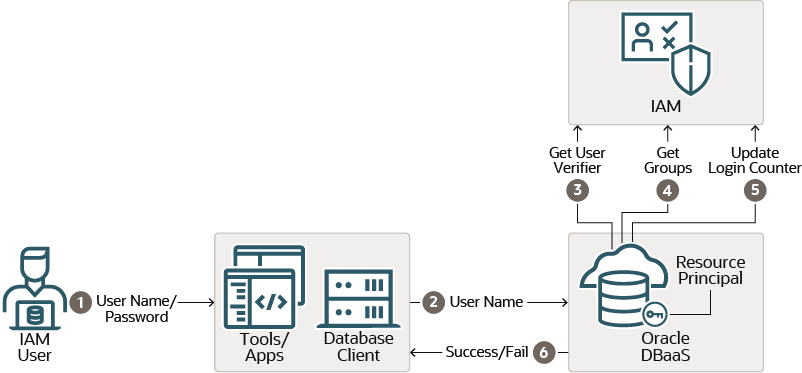
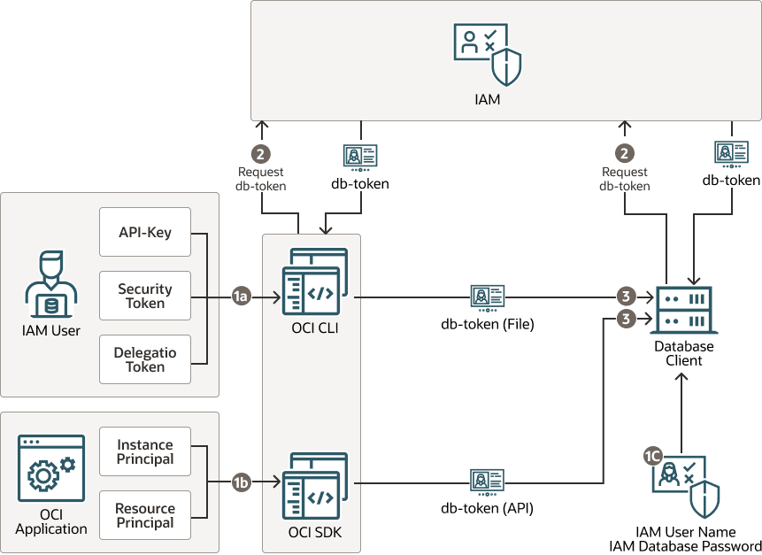
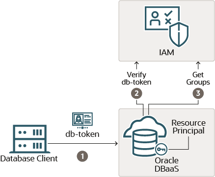
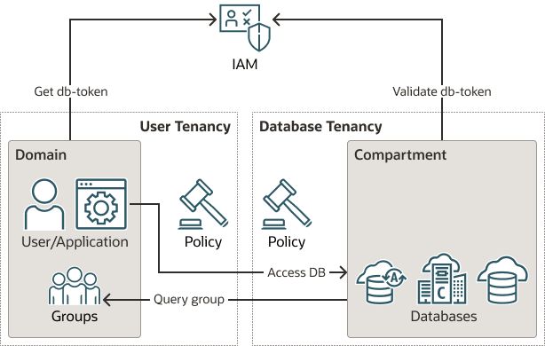

## 7 Authenticating and Authorizing IAM Users for Oracle DBaaS Databases

Identity and Access Management (IAM) users can be configured to connect to an Oracle Database as a service (Oracle DBaaS) instance.

- Introduction to Authenticating and Authorizing IAM Users for Oracle DBaaS
  Before you begin authenticating and authorizing IAM users for an Oracle DBaaS instance, you should understand the overall process.
- Configuring Oracle DBaaS for IAM
  To configure Oracle DBaaS to work with IAM, an Oracle DBaaS database administrator must first enable the IAM integration and then authorize IAM users and roles for Oracle DBaaS.
- Configuring IAM for Oracle DBaaS
  To configure IAM to work with the Oracle DBaaS instance, an IAM administrator may need to create an IAM policy and have users create an IAM database password.
- Accessing the Database Using an Instance Principal or a Resource Principal
  An Oracle Cloud Infrastructure (OCI) application or function can connect to the database instance using its own instance or resource principal.
- Configuring the Database Client Connection
  Configuring the IAM client connection controls the authentication of IAM users to the Oracle DBaaS instance.
- Accessing a Database Cross-Tenancy Using an IAM Integration
  Users and groups in one tenancy can access DBaaS database instances in another tenancy if policies in both tenancies allow this.
- Database Links in an Oracle DBaaS-to-IAM Integration
  The use of database links when accessing the Oracle DBaaS database using IAM credentials is supported.
- Troubleshooting IAM Connections
  The `ORA-01017: invalid username/password; logon denied` error can be caused by several different issues throughout the Oracle DBaaS integration with Identity and Access Management (IAM).

**Parent topic:** [Managing User Authentication and Authorization](part_1.md)

### 7.1 Introduction to Authenticating and Authorizing IAM Users for Oracle DBaaS

Before you begin authenticating and authorizing IAM users for an Oracle DBaaS instance, you should understand the overall process.

- About Authenticating and Authorizing IAM Users for Oracle DBaaS
  Users for the Oracle DBaaS instance can be centrally managed in Oracle Cloud Infrastructure (OCI) Identity and Access Management (IAM).
- Architecture of the IAM Integration with Oracle DBaaS
  The architecture for the IAM integration with an Oracle DBaaS instance depends on whether the IAM user is using an Oracle Cloud Infrastructure (OCI) IAM database password verifier or an OCI IAM token to authenticate or connect to the DBaaS instance.
- IAM Users and Groups to Map with Oracle DBaaS
  IAM users must be mapped to a schema, either an exclusive mapping of a database schema to an IAM user or to a database shared schema that is mapped to an IAM group the user is a member of.

**Parent topic:** Authenticating and Authorizing IAM Users for Oracle DBaaS Databases

#### 7.1.1 About Authenticating and Authorizing IAM Users for Oracle DBaaS

Users for the Oracle DBaaS instance can be centrally managed in Oracle Cloud Infrastructure (OCI) Identity and Access Management (IAM).

You can perform this integration in the following Oracle Database environments:

- Oracle Autonomous Database Serverless
- Oracle Autonomous Database on Dedicated Exadata Infrastructure
- Oracle Autonomous Database on Exadata Cloud@Customer
- Oracle Exadata Database Service on Dedicated Infrastructure
- Oracle Exadata Database Service on Cloud@Customer
- Oracle Base Database Service

The instructions for configuring IAM use the term "Oracle DBaaS" to encompass these environments.

**Note:**

Oracle Database supports the Oracle DBaaS integration for OCI IAM with identity domains as well as the legacy IAM, which does not include identity domains. Both default and non-default domain users and groups are supported when using IAM with identity domains.

Oracle Database only supports Oracle DBaaS integration for OCI IAM with local IAM users when they use legacy IAM tenancies. Federated users are supported when using IAM with identity domains.

The DBaaS integration with OCI IAM does not support users with administrative privileges (`SYSDBA`, `SYSOPER`, `SYSBACKUP`, `SYSDG`, `SYSKM`, and `SYSRAC`). However, these privileges are supported when using IAM database passwords, but only when the database is open.

An Oracle Database administrator works with an OCI IAM administrator to manage the authentication and authorization of OCI IAM users who need to connect to the Oracle DBaaS instance. The types of Oracle DBaaS instance that IAM users can connect to are Oracle Autonomous Database Serverless, Oracle Autonomous Database on Dedicated Exadata Infrastructure, and Oracle Base Database Service.

This type of connection enables the IAM user to access the Oracle DBaaS. These users typically log in with a user name and password (for example, using SQL\*Plus). Alternatively, a user can log in with IAM Single-Sign On (SSO) credentials with a token when accessing the DBaaS instance. The choice to use IAM password authentication or the IAM SSO token authentication depends on the use case and user preference.

Legacy applications using existing supported database clients can migrate seamlessly to using an IAM user name and password. They can also use the IAM database gradual password rollover feature to set a second database password in IAM and update the application passwords without downtime.

Tools and applications that are updated to support IAM tokens can authenticate users directly with IAM and pass the database access token to the DBaaS instance. Existing database tools such as SQL\*Plus can use the IAM database password to authenticate with the database directly using existing password login protocol or the database client can request a database token (`db-token`) from OCI IAM using the IAM user name and IAM database password and send the `db-token` to the database for IAM user access. The database client can only request a `db-token` in exchange for the IAM user name and IAM database password. All other IAM credentials (`API-key`, instance principal, resource principal, security token, delegation token) will require the `db-token` to be requested by the application or helper client like OCI CLI. A database access token (`db-token`) is a scoped proof-of-possession (POP) token and comes with a public key. Before the `db-token` is sent to the database, the database client signs the `db-token` with the private key that is associated with token's public key. It provides "proof" that the sender of the token is the rightful holder of the token. The scope can optionally be included as part of the request for the `db-token` to reduce the scope of what the `db-token` can be used for. The default scope for the `db-token` is the entire tenancy but compartment and individual databases can also be defined as the scope. See the `get` description in [OCI CLI Command Reference](https://docs.oracle.com/en-us/iaas/tools/oci-cli/latest/oci_cli_docs/cmdref/iam/db-token/get.html) for more information.

IAM users and OCI applications can request a database token from IAM by using one of the following methods:

- Using an existing, valid security (session) token
- Using an IAM recognized API-key
- Using a delegation token within an OCI cloud shell
- Using an OCI instance principal for an application on OCI compute instance
- Using an OCI resource principal for an application with a resource principal
- Using an IAM user name and IAM database password (can only be requested by database client)

The general process of enabling an IAM user to connect to an Oracle DBaaS instance is as follows:

1.  The IAM administrator creates and manages the IAM user accounts and groups, adding IAM users to appropriate IAM groups based on their tasks.

2.  On the Oracle DBaaS instance, the database administrator enables the connection between the Oracle DBaaS and the IAM endpoint.

    If the database is Autonomous Database on Dedicated Exadata Infrastructure, then the IAM connection for new PDBs is automatically enabled. Check the Oracle DBaaS documentation for details.

3.  On the Oracle DBaaS server, the database administrator enables the authorization of the IAM users by performing the following types of mappings:

    - Mapping an IAM group to a shared Oracle Database global user account
    - Mapping an IAM group to an Oracle Database global role
    - Exclusively mapping the IAM user to an Oracle Database global user

    The IAM user must be mapped to one schema, either exclusively or to a shared schema. They can optionally be members in an IAM group that is mapped to one or more global roles.

4.  The following use cases are some common scenarios to connect to the Oracle DBaaS with centralized IAM authentication and authorization:
    - Connecting using SQL\*Plus to the Oracle DBaaS using an IAM user name and IAM database password.
    - Using SQL\*Plus to connect using an IAM SSO token.
    - Using SQLcl to connect to the Oracle DBaaS using the IAM password or IAM token.
    - Using SQL\*Plus within the Oracle Cloud Infrastructure (OCI) Cloud Shell to connect to the Oracle DBaaS using the IAM password or IAM SSO token. Authenticating and authorization with IAM will take additional time as opposed to authenticating to a local database user account (non-global).

**Related Topics**

- [Oracle Autonomous Database Serverless](https://docs.oracle.com/pls/topic/lookup?ctx=en/cloud/paas/autonomous-database/serverless&id=ADBSB-GUID-CD33BEA1-4679-451C-AC54-D130C3C3FDEA)
- [Oracle Autonomous Database on Dedicated Exadata Infrastructure](https://docs.oracle.com/pls/topic/lookup?ctx=en/cloud/paas/autonomous-database/dedicated&id=MNQMN)
- [Oracle Autonomous Database on Exadata Cloud@Customer](https://docs.oracle.com/pls/topic/lookup?ctx=en/cloud/paas/autonomous-database/dedicated&id=MNQMN)
- [Oracle Exadata Database Service on Dedicated Infrastructure](https://docs.oracle.com/pls/topic/lookup?ctx=en/engineered-systems/exadata-cloud-service&id=ECSCM-GUID-D59E6F46-2F24-4C63-9773-CB123357F041)
- [Oracle Exadata Database Service on Cloud@Customer](https://docs.oracle.com/pls/topic/lookup?ctx=en/engineered-systems/exadata-cloud-at-customer&id=ECCCM-GUID-51424A67-C26A-48AD-8CBA-B015F88F841A)
- [Oracle Base Database Service](https://docs.oracle.com/pls/topic/lookup?ctx=en/cloud/paas/base-database&id=GUID-F662EFF2-52D2-4557-AE4D-37E45BA998F1)
- Enabling External Authentication for Oracle DBaaS

**Parent topic:** Introduction to Authenticating and Authorizing IAM Users for Oracle DBaaS

#### 7.1.2 Architecture of the IAM Integration with Oracle DBaaS

The architecture for the IAM integration with an Oracle DBaaS instance depends on whether the IAM user is using an Oracle Cloud Infrastructure (OCI) IAM database password verifier or an OCI IAM token to authenticate or connect to the DBaaS instance.

The following diagram illustrates how using an Oracle Cloud Infrastructure (OCI) IAM database password verifier to authenticate with the Oracle DBaaS works:

Figure 7-1 IAM User Authenticating to Oracle DBaaS with an OCI IAM Database Password Verifier

[Description of "Figure 7-1 IAM User Authenticating to Oracle DBaaS with an OCI IAM Database Password Verifier"](img_text/password-verifier-iam.md)

1.  The IAM user logs in to a tool or application client that is associated with the Oracle Database client. This user logs in with their IAM user name and IAM database password, which begins the authentication process. The user can use any database client that is at least Oracle Database release12.1.0.2. Earlier versions of the database client do not support the `12C` database verifier.
2.  The IAM user connection request is sent through the database client.
3.  After the IAM user name is sent to the Oracle DBaaS instance, the database requests the user’s Oracle Cloud Infrastructure (OCI) IAM database password verifier from IAM. (The IAM user profile stores the IAM database password verifier.) This verifier is a hashed version of the password, not clear text. If the password verifier from IAM matches the password verifier generated by the database client, then the user is authenticated. The Oracle DBaaS instance uses a resource principal to communicate with IAM. The resource principal is the Oracle DBaaS identity that is recognized by IAM and used by the database to securely communicate with IAM.
4.  When the authentication succeeds, the Oracle DBaaS instance retrieves the IAM user groups. If the IAM user is mapped to an Oracle Database schema and the user has not been locked out of their OCI account, then the IAM user successfully accesses the database. The user is also granted any global roles that are mapped to a group the user is a member of.
5.  The Oracle Cloud Infrastructure (OCI) login counter tracks logins for both the OCI console and OCI database passwords. A successful database login using the IAM database password will reset this counter.
6.  Based on the outcome of the preceding steps, the IAM user database access attempt either succeeds or fails.

The following diagram illustrates the start of actions that take place when an IAM user or an Oracle Cloud Infrastructure (OCI) application accesses the Oracle DBaaS instance using an OCI IAM token:

Figure 7-2 IAM User or OCI Application Authenticating to an Oracle DBaaS with an OCI IAM Token, Part 1

[Description of "Figure 7-2 IAM User or OCI Application Authenticating to an Oracle DBaaS with an OCI IAM Token, Part 1"](img_text/token-iam.md)

1.  Access to the database requires one of the following:
    - 1a: From an IAM user, the user must have an `API-key` stored in their local system or have a security token from signing into OCI recently. An `API-key`, security token, delegation token, instance principal, can be used with the OCI CLI. If a current and valid security token is not available, then the user can be prompted to authenticate with OCI IAM. (See [User Credentials](https://docs.oracle.com/en-us/iaas/Content/Identity/Concepts/usercredentials.htm) for information about the available user credentials.) In an OCI cloud shell environment, a delegation token will be available.
    - 1b: For an OCI application, the application must have be configured to have an instance principal or a resource principal. All key types (`API-key`, security token, delegation token, instance principal, and resource principal) can be used with the OCI SDK.
    - 1c: You can configure the database client to request a `db-token` from IAM by using the IAM user name and IAM database password. Only the database client can use this type of token to access the database. The database client cannot request a `db-token` using any other credential.

2.  The application, OCI CLI, or the database client makes a call to IAM requesting the `db-token` using one of the principal credentials. Only the `db-token` can be used to access the Oracle DBaaS. Requesting a `db-token` can be done by an application written with the Oracle Cloud Infrastructure (OCI) public SDK to connect with OCI IAM. (See [Software Development Kits and Command Line Interface](https://docs.oracle.com/en-us/iaas/Content/API/Concepts/sdks.htm).) If an application cannot be changed to connect directly with OCI IAM using the OCI public SDK, then a helper tool such as the OCI command line interface (OCI CLI) can be used to retrieve the `db-token` for the user. The database client can also be configured to request a `db-token` using the IAM user name and IAM database password.

3.  An application or tool that has been updated to work with IAM can then pass the `db-token` directly to the database client through the client API as an attribute. If an application cannot be updated to get the `db-token` directly, then a helper tool such as OCI CLI can put the `db-token` into the default or specified location in the local directory. The `TOKEN_AUTH=OCI_TOKEN` setting in the connect string or the `sqlnet.ora` file enables the database client to retrieve the `db-token` from the default or specified file location. A user can request a token at the OCI CLI by running the `oci iam db-token get` command and specifying their profile, which stores their user account credentials. For example:

        oci iam db-token get --profile PeterFitch

    The directory location for the `db-token` and the corresponding private key should only have enough permission for the OCI CLI to write the files to the location and the database client to retrieve these files (for example, just read and write by the process user). Because the token and key allow access to the database, they should be protected within the file system.

The following diagram illustrates the continuation of the OCI IAM token authentication process:

Figure 7-3 IAM User or OCI Application Authenticating to an Oracle DBaaS with an OCI IAM Token, Part 2

[Description of "Figure 7-3 IAM User or OCI Application Authenticating to an Oracle DBaaS with an OCI IAM Token, Part 2"](img_text/token-iam-2.md)

1.  The `db-token` is signed and sent to the Oracle DBaaS instance. TLS must be enabled on the database client-server link as well as DN matching. (When you use the Autonomous Database wallet files to connect to the Autonomous Database instance, TLS and DNS matching is already set for you.) DN matching is on by default with the JDBC driver, but will need to be configured for the OCI-C database client (and instant client). A `db-token` that the database client retrieves by using an IAM user name and IAM database password does not come with a private key and is not be signed by the database client.
2.  The Oracle DBaaS instance will request the IAM public key, if a valid copy is not already available locally. This key will be used to validate that the `db-token` was sent by IAM. The Oracle DBaaS instance uses a resource principal to communicate with IAM.
3.  After this authorization step completes successfully, the Oracle DBaaS instance will request the IAM user’s groups from IAM. This action will map the user to a global schema and also to map the user to any global roles that the user is a member of. After the IAM user has successfully completed these steps, the user has access to the Oracle DBaaS instance.

IAM SSO token-based authentication requires that you download the latest Oracle Database 19c (19.16) clients.

**Related Topics**

- [Using Oracle Autonomous Database Serverless](https://docs.oracle.com/pls/topic/lookup?ctx=en/database/oracle/oracle-database/19/dbseg&id=ADBSA-GUID-7EED5198-2C92-41B6-99DD-29F4187CABF5)

**Parent topic:** Introduction to Authenticating and Authorizing IAM Users for Oracle DBaaS

#### 7.1.3 IAM Users and Groups to Map with Oracle DBaaS

IAM users must be mapped to a schema, either an exclusive mapping of a database schema to an IAM user or to a database shared schema that is mapped to an IAM group the user is a member of.

An IAM user must be mapped to a database schema to successfully complete the login and authorization steps. An IAM user can be directly mapped to a database schema if the IAM user needs to maintain their own schema objects (exclusive mapping). More commonly, an IAM user is a member of an IAM group that is mapped to a database schema (shared schema mapping). Shared schema mapping allows multiple IAM users to share the same schema so a new database schema is not required to be created every time a new user joins the organization. This operational efficiency allows database administrators to focus on database application maintenance, performance, and tuning tasks instead of configuring new users, updating privileges and roles, and removing accounts.

Database administrators for a group of databases can be members of an IAM group (for example, sales application developers for a sales application are in an IAM group called `sales_app_dev_group`). In this scenario, all the related databases can map the shared schema to the `sales_app_dev_group` group. Database global roles cannot be granted to a schema; they can only be mapped to an IAM group. Global roles can differentiate IAM user privileges when multiple IAM users are mapped to the same shared schema.

Remember that an IAM user must be mapped exclusively to a database schema or to a shared schema so that the IAM user can access the Oracle DBaaS instance.

**Parent topic:** Introduction to Authenticating and Authorizing IAM Users for Oracle DBaaS

### 7.2 Configuring Oracle DBaaS for IAM

To configure Oracle DBaaS to work with IAM, an Oracle DBaaS database administrator must first enable the IAM integration and then authorize IAM users and roles for Oracle DBaaS.

- Enabling External Authentication for Oracle DBaaS
  The method of enabling an IAM connection with Oracle DBaaS depends on the platform of Oracle DBaaS that you are using.
- Configuring Authorization for IAM Users and Oracle Cloud Infrastructure Applications
  An Oracle DBaaS database administrator can map IAM users and Oracle Cloud Infrastructure (OCI) applications to the Oracle Database global schemas and global roles.
- Configuring IAM Proxy Authentication
  Proxy authentication allows an IAM user to proxy to a database schema for tasks such as application maintenance.

**Parent topic:** Authenticating and Authorizing IAM Users for Oracle DBaaS Databases

#### 7.2.1 Enabling External Authentication for Oracle DBaaS

The method of enabling an IAM connection with Oracle DBaaS depends on the platform of Oracle DBaaS that you are using.

- Oracle Autonomous Database on Dedicated Exadata Infrastructure: The IAM connection is automatically configured to work with this platform. See [Using Oracle Autonomous Database on Dedicated Exadata Infrastructure](https://docs.oracle.com/pls/topic/lookup?ctx=en/database/oracle/oracle-database/19/dbseg&id=ADBSA-GUID-901FC624-A176-4FEC-A9F5-E848E79F9236).

- Oracle Autonomous Database Serverless: The IAM connection must be enabled to work with this platform. See [Using Oracle Autonomous Database Serverless](https://docs.oracle.com/pls/topic/lookup?ctx=en/database/oracle/oracle-database/19/dbseg&id=ADBSA-GUID-901FC624-A176-4FEC-A9F5-E848E79F9236).

- Oracle Base Database Service: See [Use Identity and Access Management Authentication with Base Database Service](https://docs.oracle.com/pls/topic/lookup?ctx=en/database/oracle/oracle-database/19/dbseg&id=BBAAA-GUID-F662EFF2-52D2-4557-AE4D-37E45BA998F1).

<!-- -->

- Oracle Exadata Database Service on Dedicated Infrastructure: See [Connect Identity and Access Management (IAM) Users to Oracle Exadata Database Service on Dedicated Infrastructure](https://docs.oracle.com/en-us/iaas/exadatacloud/exacs/connect-iam-users-to-oracle-exadata-database-service-on-dedicated-infra.html).

##### Databases Other Than Oracle Autonomous Database Serverless

1.  Refer to the documentation for your Oracle DBaaS platform for prerequisites and other information you may need.

2.  For non-Oracle Autonomous Database instances, set the `IDENTITY_PROVIDER_CONFIG` parameter.

        ALTER SYSTEM SET IDENTITY_PROVIDER_TYPE=OCI_IAM SCOPE=BOTH;

    If `IDENTITY_PROVIDER_CONFIG` had been set to a different value, then run the following statement:

        ALTER SYSTEM RESET IDENTITY_PROVIDER_CONFIG SCOPE=BOTH;

    The `IDENTITY_PROVIDER_CONFIG` parameter may have been set to a different value because a different identity provider, such as Microsoft Azure, had been used.

**Parent topic:** Configuring Oracle DBaaS for IAM

#### 7.2.2 Configuring Authorization for IAM Users and Oracle Cloud Infrastructure Applications

An Oracle DBaaS database administrator can map IAM users and Oracle Cloud Infrastructure (OCI) applications to the Oracle Database global schemas and global roles.

- About Configuring Authorization for IAM Users and Oracle Cloud Infrastructure Applications
  You create the mappings for IAM users and Oracle Cloud Infrastructure (OCI) applications to database users (schemas) in the Oracle DBaaS.
- Mapping an IAM Group to a Shared Oracle Database Global User
  Oracle Database global users that are mapped to IAM groups and IAM dynamic groups give IAM users and OCI applications a schema when they log in along with the privileges and roles granted to that schema.
- Mapping an IAM Group to an Oracle Database Global Role
  Oracle Database global roles that are mapped to IAM groups and dynamic groups give member users and applications additional privileges and roles above what they have been granted through their login schemas.
- Exclusively Mapping an IAM User to an Oracle Database Global User
  You can map an IAM user exclusively to an Oracle Database global user.
- Altering or Migrating an IAM User Mapping Definition
  You can update an IAM user to a database global user mapping by using the `ALTER USER` statement.
- Mapping Instance and Resource Principals
  Applications can use instance principals and resource principals to retrieve database tokens and establish a connection to an Oracle DBaaS instance.
- Verifying the IAM User Logon Information
  After you configure and authorize an IAM user for the Oracle DBaaS instance, you can verify the user logon information by executing a set of SQL queries on the Oracle database side.

**Parent topic:** Configuring Oracle DBaaS for IAM

##### 7.2.2.1 About Configuring Authorization for IAM Users and Oracle Cloud Infrastructure Applications

You create the mappings for IAM users and Oracle Cloud Infrastructure (OCI) applications to database users (schemas) in the Oracle DBaaS.

There is a difference with authorization between IAM database password authentication and using IAM token based authentication. IAM database password verifier authorization is only based on mappings of database schemas and global roles to IAM users and group. With IAM token based authentication, IAM policies are an additional authorization for IAM users to access their tenancy databases. An IAM user must be authorized through an IAM policy and be authorized through a mapping to a database global schema (exclusive or shared).

For both token and password verifier database access, you create the mappings for IAM users and OCI applications to the Oracle DBaaS instance. The IAM user accounts themselves are managed in IAM. The user accounts and user groups can be in either the default domain or in a custom, non-default domain.

When the IAM user accesses the Oracle DBaaS instance with a token, the database will perform an authorization check against IAM policies to ensure the user is allowed to access the database. If the IAM user is allowed to access the database by IAM policy, then the database will query IAM for the user groups. When using password verifier authentication, the database will query IAM for user groups once the IAM user successfully completes authentication. The database queries the IAM endpoint to find the groups of which the user is a member. If your deployment is using shared schemas, then one of the IAM groups will map to a shared database schema and the IAM user will be assigned to that database schema. The IAM user will have the roles and privileges that are granted to the database schema. Because multiple IAM users can be assigned to the same shared database schema, only the minimal set of roles and privileges should be granted to the shared schema. In some cases, no privileges and roles should be granted to the shared schema. Users will be assigned the appropriate set of roles and schemas through database global roles. Global roles are mapped to IAM groups. This way, different users can have different roles and privileges even if they are mapped to the same database shared schema. A newly hired user will be assigned to an IAM group mapped to a shared schema and then to one or more additional groups mapped to global roles to gain the additional roles and privileges required to complete their tasks. The combination of shared schemas and global roles allows for centralized authorization management with minimal changes to the database operationally. The database must be initially provisioned with the set of shared schemas and global roles mapped to the appropriate IAM groups, but then user authorization management can happen within IAM.

Ensure that the IAM user is only mapped to one schema, either through exclusive mapping to a database schema or as a member of one IAM group that is mapped to a shared database schema. If more than one schema is mapped for an IAM user, then the database will take exclusive mapping as precedence over any group mapping to a shared schema. If more than one group is mapped for a user, then the database will select the oldest mapping.

When using global roles to grant privileges and roles to the user, remember that the maximum number of enabled roles in a session is 150.

If you drop and recreate IAM users and groups using the same names, then the mappings from the database to IAM using the same names will continue to work. However, recreating an IAM user will require the IAM user to do one or more of the following: create the IAM database password, re-upload the API public key, update the OCI configuration file, and then re-examine the IAM policy for database authentication and authorization with IAM. If the IAM policy specifies a group that can use or manage the `database-connections` and `autonomous-database-family` resource types, then the user will need to be added to that group to allow IAM authentication and authorization.

Accessing the database with tokens requires the user to be authorized by IAM policy and by database mapping. Accessing the database with the IAM database password verifier requires authorization through database mapping. If no database schema mapping exists for the IAM user, the IAM user is prevented from accessing the database even if they have a valid token or password.

IAM users get their authorizations to perform various tasks based on the roles that they have been granted. The following scenarios are possible:

- IAM group mapped to a shared Oracle Database global user: With the shared database global user account, an IAM user is assigned to a shared database schema (user) through the mapping of an IAM group to the shared schema. The IAM users that are members of the group can connect to the database through this shared schema. Use of shared schemas allows for centralized management of user authorization in IAM.

- IAM group mapped to an Oracle Database global role: The privileges that have been granted to the shared Oracle Database global role become available to the users who have added to the IAM group.

- Local IAM user exclusively mapped to an Oracle Database global user: With an exclusive global user mapping, a dedicated database user is exclusively mapped to a local IAM user. Not as common as the shared database schema, this user is created for when the user requires their own schema objects. Oracle recommends that you grant database privileges to these users through global roles, which facilitates authorization management. These users can also have direct privilege and role grants to their exclusive schema.

  In IAM with Identity Domains, users and groups are supported in the default domain as well as custom non-default domains. When you specify users and groups in the default domain, then no domain prefix is required. When you specify users and groups in a non-default domain, then the domain must be prefixed.

**Parent topic:** Configuring Authorization for IAM Users and Oracle Cloud Infrastructure Applications

##### 7.2.2.2 Mapping an IAM Group to a Shared Oracle Database Global User

Oracle Database global users that are mapped to IAM groups and IAM dynamic groups give IAM users and OCI applications a schema when they log in along with the privileges and roles granted to that schema.

1.  Log in to the Oracle DBaaS instance as a user who has the `CREATE USER` or `ALTER USER` system privilege.
2.  Run the `CREATE USER` or `ALTER USER` statement with the `IDENTIFIED GLOBALLY AS` clause specifying the IAM group name (which can be a dynamic group).
    For example, to create a new database global user account named `shared_sales_schema` and map it to an existing IAM group named `WidgetSalesGroup`:
        CREATE USER shared_sales_schema IDENTIFIED GLOBALLY AS
        'IAM_GROUP_NAME=WidgetSalesGroup';

    The following example shows how to accomplish this for a non-default domain:

        CREATE USER shared_sales_schema IDENTIFIED GLOBALLY AS
        'IAM_GROUP_NAME=sales_domain/WidgetSalesGroup';

**Parent topic:** Configuring Authorization for IAM Users and Oracle Cloud Infrastructure Applications

##### 7.2.2.3 Mapping an IAM Group to an Oracle Database Global Role

Oracle Database global roles that are mapped to IAM groups and dynamic groups give member users and applications additional privileges and roles above what they have been granted through their login schemas.

Global roles cannot be granted to a database schema (user), they can only be mapped to a group and be assigned to an IAM user when accessing the database.

1.  Log in to the Oracle DBaaS instance as a user who has been granted the `CREATE ROLE` or `ALTER ROLE` system privilege
2.  Run the `CREATE ROLE` or `ALTER ROLE` statement with the `IDENTIFIED GLOBALLY AS` clause specifying the name of the IAM group (which can be a dynamic group).
    For example, to create a new database global role named `widget_mgr_role` and map it to an existing IAM group named `WidgetManagerGroup`, using the default domain:
        CREATE ROLE widget_mgr_role IDENTIFIED GLOBALLY AS
        'IAM_GROUP_NAME=WidgetManagerGroup';

    The following example shows how to create the role by specifying a non-default domain, `sales_domain`:

        CREATE ROLE widget_sales_role IDENTIFIED GLOBALLY AS
        'IAM_GROUP_NAME=sales_domain/WidgetManagerGroup';

    All members of the `WidgetManagerGroup` in the `sales_domain` domain will be authorized with the database global role `widget_sales_role` when they log in to the database.

**Parent topic:** Configuring Authorization for IAM Users and Oracle Cloud Infrastructure Applications

##### 7.2.2.4 Exclusively Mapping an IAM User to an Oracle Database Global User

You can map an IAM user exclusively to an Oracle Database global user.

1.  Log in to the Oracle DBaaS instance as a user who has been granted the `CREATE USER` or `ALTER USER` system privilege.
2.  Run the `CREATE USER` or `ALTER USER` statement with the `IDENTIFIED GLOBALLY AS` clause specifying the IAM database user name.
    By default, the IAM database user name is the same as the IAM user name, including the domain name. You can also create a unique IAM database user name for ease of authentication to the database. In your OCI IAM user profile, you can create a unique IAM database user name for ease of authentication to the database. This can be set when you create and manage your IAM database password in your IAM profile. Adding or changing the IAM database user name will invalidate the IAM user to schema mapping, so the database schema will need to be remapped to the new IAM database user name.
    For example, to create a new database global user named `peter_fitch` and map this user to an existing IAM user named with an IAM database user name of `peterfitch`, using the default domain:
        CREATE USER peter_fitch IDENTIFIED GLOBALLY AS
        'IAM_PRINCIPAL_NAME=peterfitch';

    The following example shows how to create the user by specifying a non-default domain, `sales_domain`:

        CREATE USER peter_fitch2 IDENTIFIED GLOBALLY AS
        'IAM_PRINCIPAL_NAME=sales_domain/peterfitch';

**Parent topic:** Configuring Authorization for IAM Users and Oracle Cloud Infrastructure Applications

##### 7.2.2.5 Altering or Migrating an IAM User Mapping Definition

You can update an IAM user to a database global user mapping by using the `ALTER USER` statement.

You can update database schemas that were mapped to an IAM user, and whose accounts were created using any of the `CREATE USER` statement clauses: `IDENTIFIED BY` password, `IDENTIFIED EXTERNALLY`, or `IDENTIFIED GLOBALLY`. This is useful when migrating existing schemas to using IAM. If you delete and recreate an IAM user or an IAM group using the exact same name as the previous IAM user or group, then the existing mapping from the database that uses that IAM user or IAM group name will continue to work.

1.  Log in to the Oracle DBaas instance as a user who has been granted the `ALTER USER` system privilege.
2.  Run the `ALTER USER` statement with the `IDENTIFIED GLOBALLY AS` clause.
    For example, suppose you want to change the existing schema `shared_sales_schema` to a different IAM group:
        ALTER USER shared_sales_schema IDENTIFIED GLOBALLY AS
        'IAM_GROUP_NAME=BiggerWidgetSalesGroup';

    The following example shows how to modify the schema by specifying a non-default domain, `sales_domain`:

        ALTER USER shared_sales_schema IDENTIFIED GLOBALLY AS
        'IAM_GROUP_NAME=sales_domain/BiggerWidgetSalesGroup';

**Parent topic:** Configuring Authorization for IAM Users and Oracle Cloud Infrastructure Applications

##### 7.2.2.6 Mapping Instance and Resource Principals

Applications can use instance principals and resource principals to retrieve database tokens and establish a connection to an Oracle DBaaS instance.

You can exclusively map instance principals and resource principals to a global schema (database user) or you can map them by using dynamic groups to a shared schema.

You can only use instance principal and resource principal `OCID`s to map them exclusively or to a shared schema. Instance principal and resource principal dynamic groups can also be mapped to global roles.

Examples are as follows:

- Exclusive schema mapping using an instance principal (`ip_user`) and a resource principal (`rp_user`):

      CREATE USER ip_user IDENTIFIED GLOBALLY AS 'IAM_PRINCIPAL_OCID=ocid1.instance.region1.sea.abcdef123456';

      CREATE USER rp_user IDENTIFIED GLOBALLY AS 'IAM_PRINCIPAL_OCID=ocid1.dbsystem.oc1.sea.abcdef123456';

- Shared schema mapping using dynamic group:

      CREATE USER iam_dg IDENTIFIED GLOBALLY AS 'IAM_GROUP_NAME=DB_Principals';

- Mapping to a global role;

      CREATE ROLE app_role IDENTIFIED GLOBALLY AS 'IAM_GROUP_NAME=application_principals';

**Related Topics**

- [Managing Dynamic Groups](https://docs.oracle.com/en-us/iaas/Content/Identity/Tasks/managingdynamicgroups.htm)
- [Calling Services from an Instance](https://docs.oracle.com/en-us/iaas/Content/Identity/Tasks/callingservicesfrominstances.htm)
- [Accessing Other Oracle Cloud Infrastructure Resources from Running Functions](https://docs.oracle.com/en-us/iaas/Content/Functions/Tasks/functionsaccessingociresources.htm)

**Parent topic:** Configuring Authorization for IAM Users and Oracle Cloud Infrastructure Applications

##### 7.2.2.7 Verifying the IAM User Logon Information

After you configure and authorize an IAM user for the Oracle DBaaS instance, you can verify the user logon information by executing a set of SQL queries on the Oracle database side.

1.  Log in to the Oracle DBaaS instance as an IAM user that you have just configured and authorized.
    For example, to log in to the database instance `inst1` as the database global user `peterfitch`, who is using the default domain in IAM:
        sqlplus /nolog
        CONNECT "peterfitch"@inst1
        Enter password: password

    This example shows how to log in if user `peterfitch` is in a non-default domain, `sales_domain`:

        sqlplus /nolog
        CONNECT "sales_domain/peterfitch"@inst1
        Enter password: password
2.  Verify the mapped global user.
    The mapped global user is the database user account that has the IAM user authorization. User `PETER_FITCH_SCHEMA` is considered a global user with exclusive mapping for the IAM user `peterfitch`, while user `WIDGET_SALES` is considered a global user with shared mapping for IAM group `widget_sales_group` of which `peterfitch` is a member.
        SHOW USER;

    Output similar to the following appears, depending on if it is an exclusive mapping or a shared mapping:

        USER is "PETER_FITCH_SCHEMA"

    Or

        USER is "WIDGET_SALES"
3.  Find the roles that have been granted to the centrally managed user.
        SELECT ROLE FROM SESSION_ROLES ORDER BY ROLE;

    Output similar to the following appears:

        ROLE
        ----------------------------------------------------------------------
        WIDGET_SALES_ROLE
        ...
4.  Run the following queries to check the `SYS_CONTEXT` namespace values for the current schema being used in this database session, current user name, session user name, authentication method, authenticated identity, enterprise identity, identification type, and server type.
    - Verify the current schema that is being used in this database session. A database schema is an object container that identifies the objects it contains. The current schema is the default container for objects name resolution in this database session.

          SELECT SYS_CONTEXT('USERENV', 'CURRENT_SCHEMA') FROM DUAL;

      Output similar to the following appears, depending on if it is an exclusive mapping or a shared mapping:

          SYS_CONTEXT('USERENV','CURRENT_SCHEMA')
          ----------------------------------------------------------------------
          PETER_FITCH_SCHEMA

      Or

          SYS_CONTEXT('USERENV','CURRENT_SCHEMA')
          ----------------------------------------------------------------------
          WIDGET_SALES

    - Verify the current user. In this case, the current user is the same as the current schema.

          SELECT SYS_CONTEXT('USERENV', 'CURRENT_USER') FROM DUAL;

      Output similar to the following appears, depending on if it is an exclusive mapping or a shared mapping:

          SYS_CONTEXT('USERENV','CURRENT_USER')
          ----------------------------------------------------------------------
          PETER_FITCH_SCHEMA

      Or

          SYS_CONTEXT('USERENV','CURRENT_USER')
          ----------------------------------------------------------------------
          WIDGET_SALES

    - Verify the session user.

          SELECT SYS_CONTEXT('USERENV', 'SESSION_USER') FROM DUAL;

      Output similar to the following appears, depending on if it is an exclusive mapping or a shared mapping:

          SYS_CONTEXT('USERENV','SESSION_USER')
          ----------------------------------------------------------------------
          PETER_FITCH_SCHEMA

      Or

          SYS_CONTEXT('USERENV','SESSION_USER')
          ----------------------------------------------------------------------
          WIDGET_SALES

    - Verify the authentication method.

          SELECT SYS_CONTEXT('USERENV', 'AUTHENTICATION_METHOD') FROM DUAL;

      Output similar to the following appears:

          SYS_CONTEXT('USERENV','AUTHENTICATION_METHOD')
          ----------------------------------------------------------------------
          PASSWORD_GLOBAL

      If the user is authenticating with a token, then the output is `TOKEN_GLOBAL`.

    - Verify the authenticated identity for the enterprise user. The IAM authenticated user identity is captured and audited when this user logs on to the database.

          SELECT SYS_CONTEXT('USERENV', 'AUTHENTICATED_IDENTITY') FROM DUAL;

      Output similar to the following appears:

          SYS_CONTEXT('USERENV','AUTHENTICATED_IDENTITY')
          ----------------------------------------------------------------------
          sales_domain/peterfitch

    - If a user nickname has been set for the enterprise user, then verify this nickname.

          SELECT SYS_CONTEXT('USERENV', 'USER_NICKNAME') FROM DUAL;

      Output similar to the following appears:

          SYS_CONTEXT('USERENV','USER_NICKNAME')
          ----------------------------------------------------------------------
          pfitch

    - Verify the centrally managed user's enterprise identity.

          SELECT SYS_CONTEXT('USERENV', 'ENTERPRISE_IDENTITY') FROM DUAL;

      Enterprise Identity will show the OCI Identity (OCID) of the IAM user or OCI application. Output similar to the following appears:

          SYS_CONTEXT('USERENV','ENTERPRISE_IDENTITY')
          ----------------------------------------------------------------------
          ocid1.user.region1..aaaaaaaaj7ot4g2sagkjtw3enbg4ied3x554zwyywurgrm2232j4crm5zha

    - Verify the identification type.

          SELECT SYS_CONTEXT('USERENV', 'IDENTIFICATION_TYPE') FROM DUAL

      Output similar to the following appears, depending on if it is an exclusive mapping or a shared mapping:

          SYS_CONTEXT('USERENV','IDENTIFICATION_TYPE')
          ----------------------------------------------------------------------
          GLOBAL EXCLUSIVE

      Or

          SYS_CONTEXT('USERENV','IDENTIFICATION_TYPE')
          ----------------------------------------------------------------------
          GLOBAL SHARED

    - Verify the server type.

          SELECT SYS_CONTEXT('USERENV', 'LDAP_SERVER_TYPE') FROM DUAL;

      Output similar to the following appears. In this case, the LDAP server type is IAM.

          SYS_CONTEXT('USERENV','LDAP_SERVER_TYPE')
          ----------------------------------------------------------------------
          OCI_IAM

**Parent topic:** Configuring Authorization for IAM Users and Oracle Cloud Infrastructure Applications

#### 7.2.3 Configuring IAM Proxy Authentication

Proxy authentication allows an IAM user to proxy to a database schema for tasks such as application maintenance.

- About Configuring IAM Proxy Authentication
  IAM users can connect to Oracle DBaaS by using proxy authentication.
- Configuring Proxy Authentication for the IAM User
  To configure proxy authentication for an IAM user, the IAM user must already have a mapping to a global schema (exclusive or shared mapping). A separate database schema for the IAM user to proxy to must also be available.
- Validating the IAM User Proxy Authentication
  You can validate the IAM user proxy configuration for both password and token authentication methods.

**Parent topic:** Configuring Oracle DBaaS for IAM

##### 7.2.3.1 About Configuring IAM Proxy Authentication

IAM users can connect to Oracle DBaaS by using proxy authentication.

Proxy authentication is typically used to authenticate the real user and then authorize them to use a database schema with the schema privileges and roles in order to manage an application. Alternatives such as sharing the application schema password are considered insecure and unable to audit which actual user performed an action.

A use case can be in an environment in which a named IAM user who is an application database administrator can authenticate by using their credentials and then proxy to a database schema user (for example, `hrapp`). This authentication enables the IAM administrator to use the `hrapp` privileges and roles as user `hrapp` in order to perform application maintenance, yet still use their IAM credentials for authentication. An application database administrator can sign in to the database and then proxy to an application schema to manage this schema.

You can configure proxy authentication for both the password authentication and token authentication methods.

**Parent topic:** Configuring IAM Proxy Authentication

##### 7.2.3.2 Configuring Proxy Authentication for the IAM User

To configure proxy authentication for an IAM user, the IAM user must already have a mapping to a global schema (exclusive or shared mapping). A separate database schema for the IAM user to proxy to must also be available.

After you ensure that you have this type of user, alter the database user to allow the IAM user to proxy to it.

1.  Log in to the Autonomous Database instance as a user who has the `ALTER USER` system privileges.
2.  Grant permission for the IAM user to proxy to the local database user account.
    An IAM user cannot be referenced in the command so the proxy must be created between the database global user (mapped to the IAM user) and the target database user.
    In the following example, `hrapp` is the database schema to proxy to, and `peterfitch_schema` is the database global user exclusively mapped to user `peterfitch`.
        ALTER USER hrapp GRANT CONNECT THROUGH peterfitch_schema;

At this stage, the IAM user can log in to the database instance using the proxy. For example, to connect using a password verifier:

    CONNECT peterfitch[hrapp]@connect_string
    Enter password: password

To connect using a token:

    CONNECT [hrapp]/@connect_string

**Parent topic:** Configuring IAM Proxy Authentication

##### 7.2.3.3 Validating the IAM User Proxy Authentication

You can validate the IAM user proxy configuration for both password and token authentication methods.

1.  Log in to the Autonomous Database instance as a user who has the `CREATE USER` and `ALTER USER` system privileges.
2.  Connect as the IAM user and run the `SHOW USER` and `SELECT SYS_CONTEXT` commands.
    For example, suppose you want to check the proxy authentication of the IAM user `peterfitch` when they proxy to database user `hrapp`. Run the following queries after you proxy to the database using an IAM user. Depending on how you authenticate and access the database, you will get different values for these queries.
    - For password authentication, assuming the IAM user is in the default domain:

          CONNECT peterfitch[hrapp]/password\!@connect_string
          SHOW USER;
          --The output should be "USER is HRAPP"
          SELECT SYS_CONTEXT('USERENV','AUTHENTICATION_METHOD') FROM DUAL;
          --The output should be "PASSWORD_GLOBAL_PROXY"
          SELECT SYS_CONTEXT('USERENV','PROXY_USER') FROM DUAL;
          --The output should be "PETERFITCH_SCHEMA"
          SELECT SYS_CONTEXT('USERENV','CURRENT_USER') FROM DUAL;
          --The output should be "HRAPP"

    - For token authentication, for a user who is in a non-default domain, `sales_domain`:

          CONNECT [hrapp]/@connect_string
          SHOW USER;
          --The output should be USER is "HRAPP "
          SELECT SYS_CONTEXT('USERENV','AUTHENTICATION_METHOD') FROM DUAL;
          --The output should be "TOKEN_GLOBAL_PROXY"
          SELECT SYS_CONTEXT('USERENV','PROXY_USER') FROM DUAL;
          --The output should be "PETERFITCH_SCHEMA"
          SELECT SYS_CONTEXT('USERENV','CURRENT_USER') FROM DUAL;
          --The output should be "HRAPP"

**Parent topic:** Configuring IAM Proxy Authentication

### 7.3 Configuring IAM for Oracle DBaaS

To configure IAM to work with the Oracle DBaaS instance, an IAM administrator may need to create an IAM policy and have users create an IAM database password.

- Creating an IAM Policy to Authorize Users Authenticating with Tokens
  To configure IAM to work with the Oracle DBaaS instance, an IAM administrator must create an IAM policy (if using IAM tokens), create IAM groups and manage group membership.
- Creating an IAM Database Password
  The IAM database password, different from the Oracle Cloud Infrastructure (OCI) console password, and set by the IAM user, is required for the Oracle DBaaS password verification process.

**Parent topic:** Authenticating and Authorizing IAM Users for Oracle DBaaS Databases

#### 7.3.1 Creating an IAM Policy to Authorize Users Authenticating with Tokens

To configure IAM to work with the Oracle DBaaS instance, an IAM administrator must create an IAM policy (if using IAM tokens), create IAM groups and manage group membership.

The IAM administrator should work with the database administrator to create the appropriate IAM groups for databases. Individual IAM users will need to create an IAM database password in their profile if they are using password verifiers.

You do not need to create a policy for users who are authenticating with password verifiers.

- Use the `allow group` command to create the policy. For example:
      allow group DBUsers to use database-connections in tenancy
- To create a policy that limits members of `DBUsers` group to access DBaaS instances in compartment `testing_compartment` only
      allow group DBUsers to use autonomous-database-family in compartment testing_compartment
- To create a policy that limits group access to a single database in a compartment:
      allow group DBUsers to use autonomous-database-family in compartment testing_compartment where target.database.id = 'ocid1.autonomousdatabase.oc1.iad.aaaabbbbcccc'

Note the following:

- The `database-connections` resource type is included in the `autonomous-database-family` resource type. Either resource can be used, depending on your use case.
- The minimum verb to enable access to the database is `use`. You can also use the `manage` verb to enable access to the database.
- Dynamic group names are case sensitive when they are used in this policy. You must use the exact case for the dynamic group name when using it with this policy.

See [Oracle Cloud Infrastructure Documentation](https://docs.oracle.com/en-us/iaas/Content/Identity/Concepts/policysyntax.htm) for more information about the syntax of policy statements.

**Parent topic:** Configuring IAM for Oracle DBaaS

#### 7.3.2 Creating an IAM Database Password

The IAM database password, different from the Oracle Cloud Infrastructure (OCI) console password, and set by the IAM user, is required for the Oracle DBaaS password verification process.

The set of allowed characters for the OCI IAM database password is similar to the set of allowed characters for the OCI console password except that the double quotation mark character is not allowed for the OCI IAM database password. See [Managing User Credentials](https://docs.oracle.com/en-us/iaas/Content/Identity/Tasks/managingcredentials.htm) for information about creating an IAM database password.

1.  Log in to the OCI console to your user page.
2.   Access My profile or User settings (top right in the navigation toolbar) depending on the IAM version that you are using.
3.  In your profile or settings, in the left, under Resources, click on the Database Passwords link.
4.  Click the Create Database Password button.
5.  Add a description and the password, ensuring that you apply the listed complexity rules.
6.  Click Create Database Password to save the password.
    After the password is created, its description and creation date are listed under Database Passwords.

**Parent topic:** Configuring IAM for Oracle DBaaS

### 7.4 Accessing the Database Using an Instance Principal or a Resource Principal

An Oracle Cloud Infrastructure (OCI) application or function can connect to the database instance using its own instance or resource principal.

You can map instance principals and resource principals exclusively to a database global schema or to a shared schema using a mapping to a dynamic group. When mapping instance principals and resource principals exclusively to a database global schema, you must use the principal OCID. For example:

    CREATE USER widget IDENTIFIED GLOBALLY
    AS 'IAM_PRINCIPAL_OCID=ocid1.instance.region1.sea.1234567890abcdef';

When using shared schemas, you must add instance principals and resource principals to a dynamic group, and map the dynamic group to the shared schema.

**Related Topics**

- [Managing Dynamic Groups](https://docs.oracle.com/en-us/iaas/Content/Identity/Tasks/managingdynamicgroups.htm)
- [Calling Services from an Instance](https://docs.oracle.com/en-us/iaas/Content/Identity/Tasks/callingservicesfrominstances.htm)
- [Accessing Other Oracle Cloud Infrastructure Resources from Running Functions](https://docs.oracle.com/en-us/iaas/Content/Functions/Tasks/functionsaccessingociresources.htm)
- [Accessing the Oracle Cloud Infrastructure API Using Instance Principals](https://blogs.oracle.com/developers/post/accessing-the-oracle-cloud-infrastructure-api-using-instance-principals#:~:text=You%20use%20instance%20principals%20to,Calling%20Services%20from%20an%20Instance)
- [Using Oracle Autonomous Database Serverless](https://docs.oracle.com/pls/topic/lookup?ctx=en/database/oracle/oracle-database/19/dbseg&id=ADBSA-GUID-EE5C24AD-34A5-4474-9B6A-9F606AABBA98)

**Parent topic:** Authenticating and Authorizing IAM Users for Oracle DBaaS Databases

### 7.5 Configuring the Database Client Connection

Configuring the IAM client connection controls the authentication of IAM users to the Oracle DBaaS instance.

- About Connecting to an Autonomous Database Instance Using IAM
  IAM users can connect to the Autonomous Database instance by using either an IAM database password verifier or an IAM token.
- Supported Client Drivers for IAM Connections
  Oracle DBaaS supports several types of client drivers for IAM connections.
- Using Centralized Oracle Cloud Infrastructure Services for Net Naming and Secrets
  You can use the Oracle Cloud Infrastructure (OCI) object store and vault to centrally store net names and secrets.
- Client Connections That Use an IAM Database Password Verifier
  After you have configured the authorization needed for the IAM user, this user can log in using existing client application, such as SQL\*Plus or SQLcl without additional configuration.
- Client Connections That Use a Token Requested by an IAM User Name and Database Password
  You can create a client connection that uses a token requested by an IAM user name and database password.
- Client Connections That Use a Token Requested by a Client Application or Tool
  For IAM token access to the Oracle DBaaS, the client application or tool requests a database token from IAM for the IAM user.
- TLS Connections without Client Wallets
  The use of Transport Layer Security (TLS) connections without client wallets is supported for IAM connections.
- Common Database Client Configurations
  IAM users can connect to the Oracle DBaaS instance using client tools such as SQLcl on a laptop.

**Parent topic:** Authenticating and Authorizing IAM Users for Oracle DBaaS Databases

#### 7.5.1 About Connecting to an Autonomous Database Instance Using IAM

IAM users can connect to the Autonomous Database instance by using either an IAM database password verifier or an IAM token.

Using the IAM database password verifier is similar to the Oracle Database password authentication process. However, instead of the password verifier (encrypted hash of the password) being stored in the Oracle database, the verifier is instead stored as part of the Oracle Cloud Infrastructure (OCI) IAM user profile.

The second connection method, the use of an IAM token for the database, is more modern. The use of token-based access is a better fit for Cloud resources such as Autonomous Database. The token is based on the strength that the IAM endpoint can enforce. This can be multi-factor authentication, which is stronger than the use of passwords alone. Another benefit of using tokens is that the password verifier (which is considered sensitive) is never stored or available in memory. A TCPS (TLS) connection is required when using tokens for database access.

**Note:**

You cannot configure native network encryption when passing an IAM token. Only Transport Layer Security (TLS) by itself is supported, not native network encryption or native network encryption with TLS.

**Parent topic:** Configuring the Database Client Connection

#### 7.5.2 Supported Client Drivers for IAM Connections

Oracle DBaaS supports several types of client drivers for IAM connections.

IAM database password verifiers work with any supported database client. Using IAM tokens requires the latest Oracle Database client 19c (at least 19.16). Some earlier clients (19c and 21c) provide a limited set of capabilities for token access. Oracle Database client 21c does not fully support the IAM token access feature. Oracle Database client 23c supports the IAM token access feature.

**Parent topic:** Configuring the Database Client Connection

#### 7.5.3 Using Centralized Oracle Cloud Infrastructure Services for Net Naming and Secrets

You can use the Oracle Cloud Infrastructure (OCI) object store and vault to centrally store net names and secrets.

This functionality is currently supported with the JDBC-thin and .NET-thin drivers.

See the following guides:

- [Oracle Database Net Services Administrator's Guide](../netag/index.md)
- [Oracle Database Net Services Reference](../netrf/index.md)

**Parent topic:** Configuring the Database Client Connection

#### 7.5.4 Client Connections That Use an IAM Database Password Verifier

After you have configured the authorization needed for the IAM user, this user can log in using existing client application, such as SQL\*Plus or SQLcl without additional configuration.

The IAM user enters the IAM user name and IAM database password (not the Oracle Cloud Infrastructure (OCI) console password) using any currently supported database client. The only constraint is that the database client version be either Oracle Database release 12.1.0.2 or later to use Oracle Database 12c passwords. The database client must be able to use the `12C` password verifier. Using the `11G` verifier encryption is not supported with IAM. No special client or tool configuration is needed for the IAM user to connect to the OCI DBaaS instance.

**Parent topic:** Configuring the Database Client Connection

#### 7.5.5 Client Connections That Use a Token Requested by an IAM User Name and Database Password

You can create a client connection that uses a token requested by an IAM user name and database password.

- About Client Connections That Use a Token Requested by an IAM User Name and Database Password
  IAM users can connect to the Oracle DBaaS instance by using an IAM token that was retrieved using an IAM user name and IAM database password.
- Parameters to Set for Client Connections That Use a Token Requested by an IAM User Name and Database Password
  To set these parameters, you modify either the `sqlnet.ora` file or the `tnsnames.ora` file.
- Configuring the Database Client to Retrieve a Token Using an IAM User Name and Database Password
  You can configure the database client to retrieve the IAM database token using the provided IAM user name and IAM database password.
- Configuring a Secure External Password Store Wallet to Retrieve an IAM Token
  You can enable an IAM user name and a secure external password store (SEPS) to request the IAM database token.

**Parent topic:** Configuring the Database Client Connection

##### 7.5.5.1 About Client Connections That Use a Token Requested by an IAM User Name and Database Password

IAM users can connect to the Oracle DBaaS instance by using an IAM token that was retrieved using an IAM user name and IAM database password.

In both cases, the token is retrieved by using a database password, either by using SQL\*Plus or through a SEPS.

In previous releases, you could only use the IAM user name and database password to get a password verifier from IAM. Getting a token with these credentials is more secure than getting a password verifier because a password verifier is considered sensitive. Using a token means that you do not need to pass or use the verifier. Applications cannot pass a token that was retrieved by the IAM user name and password through the database client API. Only the database client can retrieve this type of token. A database client can only retrieve a database token using the IAM user name and IAM database password.

You can enter the IAM username and IAM database password directly into the tool or use a SEPS wallet to hold these credentials securely.

**Parent topic:** Client Connections That Use a Token Requested by an IAM User Name and Database Password

##### 7.5.5.2 Parameters to Set for Client Connections That Use a Token Requested by an IAM User Name and Database Password

To set these parameters, you modify either the `sqlnet.ora` file or the `tnsnames.ora` file.

##### Token-Specific Parameters for IAM User Name and Database Password Token Requests

- PASSWORD_AUTH Parameter

  Sets sets the authentication method. This configuration must use a setting of `OCI_TOKEN`. Getting a token using the user and password credentials is more secure than using a password verifier, since a password verifier is considered sensitive. This parameter is required for retrieving the IAM bearer token with an IAM user name and database password.

  Syntax:

      PASSWORD_AUTH=authentication_method

  Example:

      PASSWORD_AUTH=OCI_TOKEN

- OCI_IAM_URL Parameter

  Specifies the IAM URL that the database client must connect with to get the database token. This parameter is required for retrieving the IAM bearer token with an IAM user name and database password. This setting is specific to your region. See [Identity and Access Management Data Plane API](https://docs.oracle.com/en-us/iaas/api/#/en/identity-dp/v1/) for the appropriate URL for your region. Then append `/v1/actions/generateScopedAccessBearerToken` to the regional URL.

  Syntax:

      OCI_IAM_URL=authentication_regional_endpoint.com/v1/actions/generateScopedAccessBearerToken

  Example:

  The following example uses the Phoenix URL (`https://auth.us-phoenix-1.oraclecloud.com`):

      https://auth.us-phoenix-1.oraclecloud.com/v1/actions/generateScopedAccessBearerToken

- OCI_TENANCY Parameter

  Specifies the OCID of the user's tenancy. You can find this setting under the user's icon at the top right of the OCI console. This parameter is required for retrieving the IAM bearer token with an IAM user name and database password.

  Syntax:

      OCI_TENANCY=tenancy_OCI..OCID

  Example:

      OCI_TENANCY=ocid1.tenancy.region1..12345

- OCI_COMPARTMENT Parameter

  Specifies defines the scope of the database token request. Note that there are two periods after `region_name`. The token will only be usable for databases in the specified compartment. If you omit this value, then the entire tenancy is the scope of the request. This parameter is optional, except if `OCI_DATABASE` is set.

  Syntax:

      OCI_COMPARTMENT=compartment_OCID

  Example:

  Note that there are two periods after `region1`.

      OCI_COMPARTMENT=ocid1.compartment.region1..12345

- OCI_DATABASE Parameter

  Specifies the OCID of the database to access. This parameter limits the token to the database only. This parameter is optional.

  Syntax:

      OCI_DATABASE=database_OCID

  Example:

      OCI_DATABASE=ocid1.autonomousdatabase.oc1.iad.12345

##### DN-Specific Parameters for IAM User Name and Database Password Token Requests

- SSL_SERVER_CERT_DN Parameter

  Specifies the distinguished name (DN) of the database server for this client. (Note that this parameter is not specific to the bearer tokens.)

  Syntax:

      SSL_SERVER_CERT_DN=DN

  Example:

      SSL_SERVER_CERT_DN="C=US,O=ExampleCorporation,CN=sslserver2"

- SSL_SERVER_DN_MATCH Parameter

  Enforces server-side validation through DN matching. Set this parameter to `TRUE`.

  Syntax:

      SSL_SERVER_DN_MATCH=TRUE|FALSE

  Example:

      SSL_SERVER_DN_MATCH=TRUE

##### sqlnet.ora Example

    PASSWORD_AUTH=OCI_TOKEN
    OCI_IAM_URL=https://auth.region1.example.com/v1/actions/generateScopedAccessBearerToken
    OCI_TENANCY=ocid1.tenancy..12345
    OCI_COMPARTMENT=ocid1.compartment.region1..12345
    OCI_DATABASE=ocid1.autonomousdatabase.oc1.iad.12345
    SSL_SERVER_CERT_DN="C=US,O=ExampleCorporation,CN=sslserver2",
    SSL_SERVER_DN_MATCH=TRUE

##### tnsnames.ora Example

    db_connection=
      (DESCRIPTION=
        (ADDRESS=(PROTOCOL=tcps)(HOST=sales1-svr)(PORT=5678))
        (SECURITY=
          (PASSWORD_AUTH=OCI_TOKEN)
          (OCI_IAM_URL=https://auth.region1.example.com/v1/actions/generateScopedAccessBearerToken)
          (OCI_TENANCY=ocid1.tenancy..12345)
          (OCI_COMPARTMENT=ocid1.compartment.region1..12345)
          (OCI_DATABASE=ocid1.autonomousdatabase.oc1.iad.12345)
          (SSL_SERVER_CERT_DN="C=US,O=ExampleCorporation,CN=sslserver2")
          (SSL_SERVER_DN_MATCH=TRUE))
        (CONNECT_DATA=(SERVICE_NAME=sales.us.example.com)))

In this specification:

- `(PROTOCOL=tcps)` sets the protocol to TCPS. You must use TCPS as the protocol or the connection will fail. TCPS must be enabled when passing tokens from the database client to the server.
- `SECURITY` is where you set the authentication and DN parameters.

**Parent topic:** Client Connections That Use a Token Requested by an IAM User Name and Database Password

##### 7.5.5.3 Configuring the Database Client to Retrieve a Token Using an IAM User Name and Database Password

You can configure the database client to retrieve the IAM database token using the provided IAM user name and IAM database password.

1.  Log in to the Oracle DBaaS client.
2.  Set the appropriate parameters to retrieve a token that will be requested by an IAM user name and database password.
3.  In the `sqlnet.ora` file, set the `WALLET_LOCATION` parameter to the location of the client. The root certificates will reside in this directory.
    For example:
        WALLET_LOCATION =
          (SOURCE=
            (METHOD=FILE)
              (METHOD_DATA=
                DIRECTORY=/ora_db/wallet)

**Related Topics**

- Parameters to Set for Client Connections That Use a Token Requested by an IAM User Name and Database Password

**Parent topic:** Client Connections That Use a Token Requested by an IAM User Name and Database Password

##### 7.5.5.4 Configuring a Secure External Password Store Wallet to Retrieve an IAM Token

You can enable an IAM user name and a secure external password store (SEPS) to request the IAM database token.

1.  Log in to the Oracle DBaaS client.
2.  Configure this client to use the secure external password store.
3.  Set the appropriate parameters to retrieve a token that will be requested by an IAM user name and database password.

**Related Topics**

- [Configuring a Client to Use the Secure External Password Store](configuring-authentication.md)
- Parameters to Set for Client Connections That Use a Token Requested by an IAM User Name and Database Password

**Parent topic:** Client Connections That Use a Token Requested by an IAM User Name and Database Password

#### 7.5.6 Client Connections That Use a Token Requested by a Client Application or Tool

For IAM token access to the Oracle DBaaS, the client application or tool requests a database token from IAM for the IAM user.

The client application will pass the database token directly to the database client through the database client API.

If the application or tool has not been updated to request an IAM token, then the IAM user can use Oracle Cloud Infrastructure (OCI) command line interface (CLI) to request and store the database token. You can request a database access token (`db-token`) using the following credentials:

- Security tokens (with IAM authentication), delegation tokens (in the OCI cloud shell) and `API-keys`, which are credentials that represent the IAM user to enable the authentication
- Instance principal tokens, which enable instances to be authorized actors (or principals) to perform actions on service resources after authenticating
- Resource principal token, which is a credential that enables the application to authenticate itself to other Oracle Cloud Infrastructure services

When the IAM users logs into the client with a slash `/` login and the `OCI_IAM` parameter is configured (`sqlnet.ora`, `tnsnames.ora`, or as part of a connect string), then the database client retrieves the database token from a file. If the IAM user submits a user name and password, the connection will use the IAM database verifier access described for client connections that use IAM database password verifiers. The instructions in this guide show how to use the OCI CLI as a helper for the database token. If the application or tool has been updated to work with IAM, then follow the instructions for the application or tool. Some common use cases include the following: SQLPlus on-premises, SQLcl on-premises, SQL\*Plus in Cloud Shell, or applications that use SEP wallets.

**Related Topics**

- Client Connections That Use an IAM Database Password Verifier

**Parent topic:** Configuring the Database Client Connection

#### 7.5.7 TLS Connections without Client Wallets

The use of Transport Layer Security (TLS) connections without client wallets is supported for IAM connections.

Before you configure this type of connection, ensure that the Oracle DBaaS environment meets the requirements.

**Related Topics**

- [Transport Layer Security Connection without a Client Wallet](configuring-secure-sockets-layer-authentication.md)

**Parent topic:** Configuring the Database Client Connection

#### 7.5.8 Common Database Client Configurations

IAM users can connect to the Oracle DBaaS instance using client tools such as SQLcl on a laptop.

- Configuring a Client Connection for SQL\*Plus That Uses an IAM Database Password
  You can configure SQL\*Plus to use an IAM database password.
- Configuring a Client Connection for SQL\*Plus That Uses an IAM Token
  You can configure a client connection for SQL\*Plus that uses an IAM token.

**Parent topic:** Configuring the Database Client Connection

##### 7.5.8.1 Configuring a Client Connection for SQL\*Plus That Uses an IAM Database Password

You can configure SQL\*Plus to use an IAM database password.

- As the IAM user, log in to the Autonomous Database instance by using the following syntax:
      CONNECT user_name@db_connect_string
      Enter password: password

  In this specification, `user_name` is the IAM user name. There is a limit of 128 bytes for the combined `domain_name``/``user_name`.

  The following example shows how IAM user `peter_fitch` can log in to an Autonomous Database instance.

      sqlplus /nolog
      connect peter_fitch@db_connect_string
      Enter password: password

  Some special characters will require double quotation marks around `user_name` and `password`. For example:

      "peter_fitch@example.com"@db_connect_string

      "IAM database password"

**Parent topic:** Common Database Client Configurations

##### 7.5.8.2 Configuring a Client Connection for SQL\*Plus That Uses an IAM Token

You can configure a client connection for SQL\*Plus that uses an IAM token.

1.  Ensure you have an IAM user account.
2.  Check with an IAM administrator and an Oracle Database administrator to ensure you have a policy allowing you to access the database in the compartment or your tenancy and that you are mapped to a global schema in the database.
3.  If your application or tool does not support direct IAM integration, then download, install, and configure the OCI CLI. (See [OCI Command Line Interface Quickstart](https://docs.oracle.com/en-us/iaas/Content/API/SDKDocs/cliinstall.htm#Quickstart).) Set up an API key as part of the OCI CLI configuration and select default values.
    1.  Set up the API key access for the IAM user.
    2.  Retrieve the `db-token`. For example:
        - Retrieving a `db-token` with an `API-key` using the Oracle Cloud Infrastructure (OCI) command-line interface:

              oci iam db-token get

        - Retrieving a `db-token` with a security (or session) token:

              oci iam db-token get --auth security_token

          If the security token has expired, a window will appear so the user can log in to OCI again. This generates the security token for the user. OCI CLI will use this refreshed token to get the `db-token`.

        - Retrieving a `db-token` with a delegation token: When you log in to the cloud shell, the delegation token is automatically generated and placed in the `/etc` directory. To get this token, execute the following command in the cloud shell:

              oci iam db-token get

        - Retrieving an instance token by using the OCI command-line interface:

              oci iam db-token get --auth instance_principal
    3.  The database client can also be configured to retrieve a database token using the IAM username and IAM database password.
        See Client Connections That Use a Token Requested by an IAM User Name and Database Password for more information.

    See [Required Keys and OCIDs](https://docs.oracle.com/en-us/iaas/Content/API/Concepts/apisigningkey.htm) for more information.
4.  Ensure that you are using the latest release updates for the Oracle Database client releases 19c and 21c.
    This configuration only works with the Oracle Database client release 19c or 21c.
5.  Follow the existing process to download the wallet from the Autonomous Database and then follow the directions for configuring it for use with SQL\*Plus.
    1.  Confirm that DN matching is enabled by looking for `SSL_SERVER_DN_MATCH=ON` in `sqlnet.ora`.
    2.  Configure the database client to use the IAM token by adding `TOKEN_AUTH=OCI_TOKEN` to the `sqlnet.ora` file. Because you will be using the default locations for the database token file, you do not need to include the token location.

    The `TOKEN_AUTH` and `TOKEN_LOCATION` values in the `tnsnames.ora` connect strings take precedence over the `sqlnet.ora` settings for that connection. For example, for the connect string, assuming that the token is in the default location (`~/.oci/db-token` for Linux):
        (description=
          (retry_count=20)(retry_delay=3)
          (address=(protocol=tcps)(port=1522)
          (host=example.us-phoenix-1.oraclecloud.com))
          (connect_data=(service_name=aaabbbccc_exampledb_high.example.oraclecloud.com))
          (security=(ssl_server_cert_dn="CN=example.uscom-east-1.oraclecloud.com,
             OU=Oracle BMCS US, O=Example Corporation,
             L=Redwood City, ST=California, C=US")
          (TOKEN_AUTH=OCI_TOKEN)))

After the connect string is updated with the `TOKEN_AUTH` parameter, the IAM user can log in to the Autonomous Database instance by running the following command to start SQL\*Plus. You can include the connect descriptor itself or use the name of the descriptor from the `tnsnames.ora` file.

    connect /@exampledb_high

Or:

    connect /@(description=
      (retry_count=20)(retry_delay=3)
      (address=(protocol=tcps)(port=1522)
      (host=example.us-phoenix-1.oraclecloud.com))
      (connect_data=(service_name=aaabbbccc_exampledb_high.example.oraclecloud.com))
      (security=(ssl_server_cert_dn="CN=example.uscom-east-1.oraclecloud.com,
         OU=Oracle BMCS US, O=Example Corporation,
         L=Redwood City, ST=California, C=US")
      (TOKEN_AUTH=OCI_TOKEN)))

The database client is already configured to get a `db-token` because `TOKEN_AUTH` has already been set, either through the `sqlnet.ora` file or in a connect string. The database client gets the `db-token` and signs it using the private key and then sends the token to the Autonomous Database. If an IAM user name and IAM database password are specified instead of slash `/`, then the database client will connect using the password instead of using the `db-token`.

**Parent topic:** Common Database Client Configurations

### 7.6 Accessing a Database Cross-Tenancy Using an IAM Integration

Users and groups in one tenancy can access DBaaS database instances in another tenancy if policies in both tenancies allow this.

- About Cross-Tenancy Access for IAM Users to DBaaS Instances
  Cross-tenancy access to an Oracle Cloud Infrastructure (OCI) DBaaS instance is similar to a single tenancy scenario except that tenancy information is required for mappings and token requests and a policy is required in both tenancies to allow this cross tenancy database resource access.
- Configuring Policies
  You must create policies in both the user tenancy and the database resource tenancy to allow cross-tenancy database access.
- Mapping Database Schemas and Roles to Users and Groups in Another Tenancy
  When you perform this type of mapping, you must add the tenancy OCID to the mapping information so the database knows it is cross-tenancy access.
- Configuring Database Clients for Cross-Tenancy Access
  You can configure some database clients directly.
- Requesting Cross-Tenancy Tokens Using the OCI Command-Line Interface
  You must add the `--scope` parameter to the Oracle Cloud Infrastructure (OCI) command-line interface command to get a `db-token` for a cross-tenancy request.

**Parent topic:** Authenticating and Authorizing IAM Users for Oracle DBaaS Databases

#### 7.6.1 About Cross-Tenancy Access for IAM Users to DBaaS Instances

Cross-tenancy access to an Oracle Cloud Infrastructure (OCI) DBaaS instance is similar to a single tenancy scenario except that tenancy information is required for mappings and token requests and a policy is required in both tenancies to allow this cross tenancy database resource access.

The following figure illustrates the process for a cross-tenancy access to an OCI DBaaS instance.

Figure 7-4 Cross-Tenancy Access to an OCI DBaaS Instance

[Description of "Figure 7-4 Cross-Tenancy Access to an OCI DBaaS Instance"](img_text/db_cross_tenancy.md)

The cross-tenancy process is as follows:

1.  The policy is required in both tenancies to endorse and admit access cross tenancy.
2.  The IAM principal (user or application) requests a db-token for a cross-tenancy resource.
3.  The `db-token` is returned and is used to access the database in a different tenancy
4.  The database will make a cross-tenancy group query for the user’s groups and map principal to global schema and optional global roles.

You must subscribe the user tenancy to the same regions in which the databases are located. For example, if the databases in the database tenancy are in the `PHX` and `IAD` regions, then you must subscribe the user tenancy to these regions. This is not the home region, just the additional subscribed regions in the user tenancy.

**Parent topic:** Accessing a Database Cross-Tenancy Using an IAM Integration

#### 7.6.2 Configuring Policies

You must create policies in both the user tenancy and the database resource tenancy to allow cross-tenancy database access.

- Configuring the Source User Tenancy
  Two policies are required to allow cross-tenancy access in the user tenancy.
- Configuring the Target Database Resource Tenancy
  The database tenancy will need matching policies to enable access to the users from the user tenancy as well as allow its own databases to query group information in the user tenancy
- Policy Examples for Cross-Tenancy Access
  Examples include using a `WHERE` clause to refine the cross-tenancy configuration, and other methods of performing this type of configuration.

**Parent topic:** Accessing a Database Cross-Tenancy Using an IAM Integration

##### 7.6.2.1 Configuring the Source User Tenancy

Two policies are required to allow cross-tenancy access in the user tenancy.

The first policy is to allow a user tenancy group to access a database in a different tenancy. The second policy allows a database in the database tenancy to query group information in the user tenancy.

1.  In the OCI console, select Identity & Security.
2.  Under Identity, select Policies.
3.  Click Create Policy and in the Policy Builder select Show manual editor.
4.  Use the `DEFINE` statement to make it easier to read the actual policies.
    For example:
        DEFINE tenancy database_tenancy as ocid1.tenancy.OCID
5.  Endorse the tenancy group `domainA/xt_db_users` to use database_connections in tenancy `database_tenancy`.
    This allows users of the `xt_db_users` group in `domainA` to access any database in tenancy `database_tenancy`.
        ENDORSE group domainA/xt_db_users to use database-connections in tenancy database_tenancy
6.  Use the `ADMIT` statement to create an Admit policy to allow any database in the database tenancy to query group information for specific IAM users in the user tenancy.
        ADMIT any-user of tenancy database_tenancy to {GROUP_MEMBERSHIP_INSPECT, AUTHENTICATION_INSPECT} in tenancy

**Parent topic:** Configuring Policies

##### 7.6.2.2 Configuring the Target Database Resource Tenancy

The database tenancy will need matching policies to enable access to the users from the user tenancy as well as allow its own databases to query group information in the user tenancy

1.  In the OCI console, select Identity & Security.
2.  Under Identity, select Policies.
3.  Click Create Policy and in the Policy Builder select Show manual editor.
4.  Use `DEFINE` to make it easier to troubleshoot and read the policies.
        DEFINE tenancy user_tenancy as ocid1.tenancy.OCID
        DEFINE group xt_db_users as ocid1.group.defg
5.  Use `ADMIT` to create an Admit policy in the tenancy to match the Endorse policy from the user tenancy.
    The Admit policy must match the `ENDORSE` policy in the user tenancy so that it can enable users from the `user_tenancy` to access databases in this tenancy.
        ADMIT group xt_db_users of tenancy user_tenancy to use database-connections in tenancy
6.  Create an Endorse policy, which will match the Admit policy created in the User tenancy.
    The Endorse policy will enable databases in the database tenancy to query group information from the user_tenancy.
        ENDORSE any-user to {GROUP_MEMBERSHIP_INSPECT, AUTHENTICATION_INSPECT} in tenancy user_tenancy

While using `any-user` makes it easy to understand the required policies, Oracle recommends that you use stronger constraints in addition to or instead of using `any-user`. The `any-user` option will allow any principal or resource to query user groups in the `user_tenancy`. Ideally, you should limit this to just allowing the database resources (resource principals) to make the group queries. You can do this by adding a `WHERE` clause to the policies or by adding a dynamic group that limits it to the members of the dynamic group. Defining every possible way to specify dynamic groups and policies is outside the scope of this topic. You can find more information from these sources:

- [Managing Dynamic Groups](https://docs.oracle.com/en-us/iaas/Content/Identity/Tasks/managingdynamicgroups.htm)
- [Managing Policies](https://docs.oracle.com/en-us/iaas/Content/Identity/Tasks/managingpolicies.htm)

**Parent topic:** Configuring Policies

##### 7.6.2.3 Policy Examples for Cross-Tenancy Access

Examples include using a `WHERE` clause to refine the cross-tenancy configuration, and other methods of performing this type of configuration.

You can add a `WHERE` clause to limit the database resources allowed to make the cross-tenancy group query:

    ADMIT any-user of tenancy db_tenancy to {GROUP_MEMBERSHIP_INSPECT, AUTHENTICATION_INSPECT} in tenancy where request.principal.type = 'dbsystem'

This Admit policy allows any Base Database Service (resource type: `dbsystem`) in the `db_tenancy` to query a user's group information from the user tenancy. Resource type names are in the table below.

A similar method can be done by putting the same resource type into a dynamic group:

    dynamic group: db_principals
    any {resource.type = 'dbsystem', resource.type = 'vmcluster', resource.type = 'cloudvmcluster'}

The dynamic group in the preceding example includes database instances for Oracle Base Database Service (`dbsystem`), Oracle Exadata Cloud@Customer (`vmcluster`), and Oracle Exadata Database Service (`cloudvmcluster`).

This example uses a dynamic group instead of `any-user`:

    ADMIT dynamic group db_principals of tenancy db_tenancy to {GROUP_MEMBERSHIP_INSPECT, AUTHENTICATION_INSPECT} in tenancy

You can also add all resource principals in a compartment using `resource.compartment.id`. However, this might also allow other non-database resource principals to make the cross-tenancy group query. The following table provides a mapping of the various resource types with the DBaaS platform name:

| DBaaS Platform Name | Resource Type Name           |
|:--------------------|:-----------------------------|
| ADB-S               | `autonomousdatabase`         |
| ADB-D (OPC)         | `cloudautonomousvmcluster`\* |
| Base DBS            | `dbsystem`                   |
| ExaCS               | `cloudvmcluster`             |
| ExaCC               | `vmcluster`                  |

\* Older ADBD instances may still be using the `autonomousexainfrastructure` resource type.

**Parent topic:** Configuring Policies

#### 7.6.3 Mapping Database Schemas and Roles to Users and Groups in Another Tenancy

When you perform this type of mapping, you must add the tenancy OCID to the mapping information so the database knows it is cross-tenancy access.

Use a full colon to separate the tenancy OCID when you use the `CREATE USER` and `CREATE ROLE` statements in SQL\*Plus.

- To use the `CREATE USER` statement to perform the mapping:
  The following examples show exclusive and shared schema mapping with principals and groups in default and non-default domains. When using default domains, you do not need to include a domain name.
      CREATE USER schema1 IDENTIFIED GLOBALLY
      AS 'IAM_PRINCIPAL_NAME=ocid1.tenancy.OCID:example_domain/peter.fitch@oracle.com';

      CREATE USER schema2 IDENTIFIED GLOBALLY
      AS 'IAM_PRINCIPAL_NAME=ocid1.tenancy.OCID:peter.fitch@oracle.com';

      CREATE USER qa_db_user_group IDENTIFIED GLOBALLY
      AS 'IAM_GROUP_NAME=ocid1.tenancy.OCID:example_domain/xt_db_users';

      CREATE USER qa_sales_user_group IDENTIFIED GLOBALLY
      AS 'IAM_GROUP_NAME=ocid1.tenancy.OCID:sales_users';

      CREATE USER xt_ip_user IDENTIFIED GLOBALLY
      AS 'IAM_PRINCIPAL_OCID=ocid1.instance.region1.sea.OCID';
      GRANT CREATE SESSION TO xt_ip_user;

      CREATE USER xt_iam_dg IDENTIFIED GLOBALLY
      AS 'IAM_GROUP_NAME=ocid1.tenancy.region1.OCID:sales_principals';
      GRANT CREATE SESSION TO xt_iam_dg;
- To use the `CREATE ROLE` statement to perform the mapping:
  The following examples show global role mapping with groups in default and non-default domains. When using default domains, you do not need to include a domain name.
      CREATE ROLE globalrole1 IDENTIFIED GLOBALLY
      AS 'IAM_GROUP_NAME=ocid1.tenancy.abcdef:example_domain/xt_db_users';

      CREATE ROLE globalrole2 IDENTIFIED GLOBALLY
      AS 'IAM_GROUP_NAME=ocid1.tenancy.abcdef:sales_users';

**Parent topic:** Accessing a Database Cross-Tenancy Using an IAM Integration

#### 7.6.4 Configuring Database Clients for Cross-Tenancy Access

You can configure some database clients directly.

The database tenancy must be identified in either the connect string or in `sqlnet.ora` if the client is configured to directly get the access token from OCI IAM. Review client-specific documentation for specific parameter values (JDBC-thin, ODP.NET-core, managed).

**Parent topic:** Accessing a Database Cross-Tenancy Using an IAM Integration

#### 7.6.5 Requesting Cross-Tenancy Tokens Using the OCI Command-Line Interface

You must add the `--scope` parameter to the Oracle Cloud Infrastructure (OCI) command-line interface command to get a `db-token` for a cross-tenancy request.

See [Optional Parameters](https://docs.oracle.com/en-us/iaas/tools/oci-cli/latest/oci_cli_docs/cmdref/iam/db-token/get.html#optional-parameters) for more details about using the optional parameters of the `oci get` command.

You can scope it for the entire tenancy or scope it to a compartment or database in the tenancy. When scoping for cross tenancy compartment or database, you do not need to also add the tenancy information because the compartment and database OCIDs are unique across OCI.

Certain clients can request the tokens directly from MSEI. Refer to their documentation on setting the parameters to get the MSEI `OAuth2` access tokens.

**Parent topic:** Accessing a Database Cross-Tenancy Using an IAM Integration

### 7.7 Database Links in an Oracle DBaaS-to-IAM Integration

The use of database links when accessing the Oracle DBaaS database using IAM credentials is supported.

The method of configuring database links for Oracle DBaaS connections to IAM depends on the Oracle DBaaS platform. Review the topic below that corresponds to your Oracle DBaaS platform and then click on the associated link for more information.

- Oracle Autonomous Database Serverless: You can use fixed user database links in which a database user is used for the fixed database link. The database user for creating the database link can only use password authentication with the database link. The IAM user can authenticate to the source database using either password or token access. You cannot configure IAM users as fixed database links, nor can you use connected or current user database links. See [Using Oracle Autonomous Database Serverless](https://docs.oracle.com/pls/topic/lookup?ctx=en/database/oracle/oracle-database/19/dbseg&id=ADBSA-GUID-28F06977-300F-4599-AD97-2DEF67EF5FEA)
- Oracle Autonomous Database on Dedicated Exadata Infrastructure and all non-Autonomous Database DBaaS platforms: You can use connected user and fixed user database links, but not current user database links. For connected user database links, an IAM user must be provisioned to both the source and target link databases. You can use a database password verifier or an IAM database token to connect and use connected user database links. For a fixed user database link, a user can connect to the target database using a target database user with password authentication. In addition, an IAM user can connect to the first PDB by using an IAM user name and password or an IAM token. See [Using Oracle Autonomous Database on Dedicated Exadata Infrastructure](https://docs.oracle.com/pls/topic/lookup?ctx=en/database/oracle/oracle-database/19/dbseg&id=ADBDL-GUID-4E206209-4E3B-4387-9364-BDCFB4E16E2E)

**Parent topic:** Authenticating and Authorizing IAM Users for Oracle DBaaS Databases

### 7.8 Troubleshooting IAM Connections

The `ORA-01017: invalid username/password; logon denied` error can be caused by several different issues throughout the Oracle DBaaS integration with Identity and Access Management (IAM).

- Areas to Check on the Client-Side for ORA-01017 Errors
  Client-side `ORA-01017` errors can result from problems with IAM credentials, client configuration, or problems with the IAM profile.
- Database Client Trace Files
  You can generate two levels of trace files to troubleshoot IAM connections on client side.
- Check in the Oracle Cloud Infrastructure IAM and the Oracle Database for ORA-01017 Errors
  `ORA-01017` errors in the Oracle Database instance can arise from the way that the database was enabled to work with IAM.
- ORA-01017 Errors Caused by Improperly Configured IAM Users
  Several `ORA-01017` errors can arise from improperly configured IAM users.
- ORA-12599 and ORA-03114 Errors Caused When Trying to Access a Database Using a Token
  The `ORA-12599: TNS: cryptographic checksum mismatch` and `ORA-03114: not connected to ORACLE` errors indicate that the database to which you are trying to connect is protected by native network encryption.
- Actions IAM Administrators Can Take to Address ORA-01017 Errors
  Several actions to remedy `ORA-01017` errors can only be performed by IAM administrators.

**Parent topic:** Authenticating and Authorizing IAM Users for Oracle DBaaS Databases

#### 7.8.1 Areas to Check on the Client-Side for ORA-01017 Errors

Client-side `ORA-01017` errors can result from problems with IAM credentials, client configuration, or problems with the IAM profile.

##### Troubleshooting the IAM Token

- Check the version of the Oracle Cloud Infrastructure (OCI) CLI used for the token. The OCI CLI must be at least OCI version 3.4, which includes the command to get the new `db-token` from IAM. To check the version of OCI, run the following command:

      oci --version

- Check the Oracle Database Client version. You can find the latest version by checking the Oracle Database documentation. Currently, only the following drivers are supported:

  - JDBC: Version 19.13.0.0.1 and later versions of 19c JDBC clients JDBC: Version 21.5 and later versions of 21c
  - Instant Client/SQL\*Plus (Linux only): Version 19.13 (annotated with -2) and later versions of 19c
  - Instant Client/OCI/SQL\*Plus (Linux only): Version 21.5 and later versions of 21c (Not all features are supported with Instant Client/OCI version 21c. Oracle recommends that you use the latest 19c or version 23c client, if possible.)
  - SQLcl: version 21.4 and later
  - ODP.net: Version 19.13 and higher versions of 19c
  - ODP.net: Version 21.4 and higher versions of 21c
  - Oracle Database release 23c: All clients

  The latest version of these drivers is needed when you use IAM tokens to access the database. All supported database clients will work when using IAM database passwords.

- Check the token location that was specified in the tnsnames.ora file. The database clients and OCI CLI use the same default location for storing and retrieving database tokens and the private key (`~/.oci/db-token`). You can specify a different location, but both OCI CLI and the database client must be configured to use the same directory. Ensure that the correct `TOKEN_LOCATION` value is specified in the connect string, in the `tnsnames.ora` or `sqlnet.ora` file. The connect string takes precedence over `tnsnames.ora`, which takes precedence over the value of `TOKEN_LOCATION` in `sqlnet.ora`.

- Check if the token has expired. The IAM database token is only valid for one hour. After the database token has expired, re-run the following OCI CLI command to request another token if you are using an `API-key`:

      oci iam db-token get

- Check the TOKEN_AUTH parameter value in tnsnames.ora. Ensure that the parameter `TOKEN_AUTH=OCI_TOKEN` is set in either the connect string, `tnsnames.ora`, or `sqlnet.ora`. The connect string takes precedence over `tnsnames.ora`, which takes precedence over `sqlnet.ora` for the value of `TOKEN_AUTH`.

- Check if there is a missing token or private key from the default user-specified token location. Ensure that both the token and the private key are in the directory that is specified by the `TOKEN_LOCATION` after you run the OCI CLI command `oci cli db-token get`. You can find the `db-token` and private key location by running the following command:

      [oracle@localhost ~]$ oci iam db-token get

  Output similar to the following appears:

      Private key written at /home/oracle/.oci/db-token/oci_db_key.pem
      db-token written at: /home/oracle/.oci/db-token/token
      db-token is valid until 2022-01-05 15:36:51

  If the location does not match the `TOKEN_LOCATION` setting, either update the OCI CLI command or update the `TOKEN_LOCATION` parameter.

- Check your OCI IAM profile.
  - Ensure that the public API-key exists in the OCI user account. The OCI CLI will default to using the `API-key` on the client to request a `db-token` from IAM. If the public API-key is not in the OCI user account, then IAM will not return a database token.
  - Ensure that the IAM account is not locked. If it is, then ask the IAM administrator to unlock it.
  - If you are using the IAM database password, then ensure that you set the IAM database password in your IAM profile.

- If you are not using the API-key, then explicitly state that you are using the security token. Use the following command:

      oci iam db-token get --auth security_token

  If the security token does not exist or has expired, this command will try to open the browser for you to sign into IAM (or your federated IdP). This command will fail if you do not have a browser in your environment.

##### Troubleshooting Both the IAM Database Password and the IAM Token

- Check client tracing on Oracle Instant Client only. Client tracing can provide some information when you use SQL\*Plus with the Instant Client. You can generate Oracle Database client trace files using two different tracing levels.

**Related Topics**

- Database Client Trace Files

**Parent topic:** Troubleshooting IAM Connections

#### 7.8.2 Database Client Trace Files

You can generate two levels of trace files to troubleshoot IAM connections on client side.

The two levels of trace files that you can generate are as follows:

- Low level tracing prints traces in case of failures:

  - If TCPS is not set up for the IAM connection, then it prints a message that the protocol has to be TCPS.

  - If `SSL_SERVER_DN_MATCH` is not set to `TRUE`, then it prints a message that the value is `FALSE`.

  - If an invalid `TOKEN_LOCATION` has been specified, then it prints a message that the token location does not exist.

  - If the `db-token` and private key are not present at the specified `TOKEN_LOCATION` or the default token location, then it prints a message.

  - If the application has passed in only `db-token` or private key, it prints a message for the missing attribute.

  - If the `db-token` has expired, then it prints a message.

- High level tracing prints traces in case of failure as mentioned above. In addition, it prints traces in case of success, as follows:
  - It prints where `SSL_SERVER_DN_MATCH` is present, `tnsnames.ora` or `sqlnet.ora`. It also prints the value as `TRUE` if set to `TRUE`.

  - If both the `db-token` and private key are set by the application, then it prints a message.

  - If `TOKEN_AUTH` has the correct value `OCI_TOKEN`, then it prints the value.

  - If `db-token` is not expired, then it prints a message.

To control client tracing for IAM connections, you can use one of these methods:

- Add the following settings to the client side `sqlnet.ora` file:

  - `EVENT_25701=14` for low level tracing

  - `EVENT_25701=15` for high level tracing

- Set the environment variable `EVENT_25701`:
  - `EVENT_25701=14` for low level tracing

  - `EVENT_25701=15` for high level tracing

Client trace files are created in the following locations:

- Linux: `$ORACLE_HOME/log/diag/clients`

- Windows: `%ORACLE_HOME%\log\diag\clients`

You can use the `ADR_BASE` parameter in the client side `sqlnet.ora` to specify the directory in which tracing messages are stored. Ensure that the directory path is valid and has write permissions. Ensure that the `diag_adr_enabled` parameter is not set to `false`.

An example of setting `ADR_BASE` is as follows:

    ADR_BASE=/oracle/iam/trace

**Parent topic:** Troubleshooting IAM Connections

#### 7.8.3 Check in the Oracle Cloud Infrastructure IAM and the Oracle Database for ORA-01017 Errors

`ORA-01017` errors in the Oracle Database instance can arise from the way that the database was enabled to work with IAM.

- Check if the IAM configuration has been enabled. The OCI server must be configured for IAM integration and one or more database schemas (database users) must be mapped to IAM users or groups. This applies to both the IAM token and IAM database password use cases. To check if the configuration has been enabled, run the following command in SQL\*Plus:

      SELECT NAME, VALUE
      FROM V$PARAMETER
      WHERE NAME='identity_provider_type';

  Alternatively, you can use this command:

      SHOW PARAMETER IDENTITY_PROVIDER_TYPE

  If the returned value does not equal `OCI_IAM`, then enable the external authentication.

- Check the schemas that have been mapped to IAM. Note which IAM users and IAM groups are used in the mapping. You can find this information by running the following query in SQL\*Plus:

      SELECT USERNAME, EXTERNAL_NAME, CREATED
      FROM DBA_USERS
      WHERE AUTHENTICATION_TYPE='GLOBAL';

  In the output, check that there is at least one `EXTERNAL_NAME` that starts with either `IAM_USER` or `IAM_GROUP`. Make a note of the IAM user or group name. If there are no global schemas, then you must create a new schema, or alter an existing schema, and then map it to an IAM user or IAM group that the user is a member of.

- Check if the Oracle Database instance needs to be restarted. In some cases, a database instance that existed before the IAM configuration was introduced may need to be restarted. But before doing so, follow all other troubleshooting guidelines before trying to restart the database.

**Related Topics**

- Configuring Authorization for IAM Users and Oracle Cloud Infrastructure Applications

**Parent topic:** Troubleshooting IAM Connections

#### 7.8.4 ORA-01017 Errors Caused by Improperly Configured IAM Users

Several `ORA-01017` errors can arise from improperly configured IAM users.

- Ensure that the IAM user can log in to the Oracle DBaaS instance. Ask the IAM user to try logging in an IAM user but not as a federated user. Ensure that this user is not locked out of the account. (The user should contact an IAM administrator if this happens.) If the user's IAM account is locked, then this user cannot log in to the Oracle DBaaS instance.

  You should also check the IAM user name and IAM groups that the user is a member of. One of these (user name or group names) should match the mapped IAM user and group name that you found from the Oracle DBaaS server. If there is no mapping, then the user will be denied access to the database. If this is the case, then an IAM administrator should add the user to an IAM group that is mapped to the DBaaS instance that the user needs to access.

- Ensure that the API public key is registered in the IAM user profile. If the Oracle DBaaS instance configuration with IAM uses tokens, and if you use an `API-key` to retrieve the database token, then the API public key needs to be registered in the user's IAM user profile.

- Ensure that the IAM database password has been set in the IAM user profile. If the Oracle DBaaS instance configuration with IAM uses database password authentication, then ensure that an IAM database password has been set in the user IAM user profile. In addition, ensure that `Database Passwords` is an allowed setting in the `User Capability` section of the IAM user profile.

**Related Topics**

- Configuring Authorization for IAM Users and Oracle Cloud Infrastructure Applications

**Parent topic:** Troubleshooting IAM Connections

#### 7.8.5 ORA-12599 and ORA-03114 Errors Caused When Trying to Access a Database Using a Token

The `ORA-12599: TNS: cryptographic checksum mismatch` and `ORA-03114: not connected to ORACLE` errors indicate that the database to which you are trying to connect is protected by native network encryption.

When tokens are being used to access an Oracle database, a Transport Layer Security (TLS) connection must be established, not network native encryption. To remedy these errors, ensure that TLS is properly configured for your database. You should test the configuration with a local database user name and password and check the following `SYSCONTEXT USERENV` parameters:

- `NETWORK_PROTOCOL`

- `TLS_VERSION`

**Related Topics**

- [Configuring Transport Layer Security Authentication](configuring-secure-sockets-layer-authentication.md)

**Parent topic:** Troubleshooting IAM Connections

#### 7.8.6 Actions IAM Administrators Can Take to Address ORA-01017 Errors

Several actions to remedy `ORA-01017` errors can only be performed by IAM administrators.

- Check if the IAM user needs to recreate API-keys. If the IAM user was deleted and then recreated with the exact same user name, then Oracle Cloud Infrastructure (OCI) IAM will consider this as a different user with a different user OCID. In this case, the IAM user will need to recreate their user account and `API-key`. This action does not affect the IAM user and IAM group mappings in the database.

- If necessary, unlock the IAM user account. If the user is inactive or otherwise locked, then an IAM administrator will need to unlock the user account before database access can be allowed.

- Check the IAM policy. An IAM policy is required to allow the user to use IAM database tokens to access the database. The resource is called `database-connections` and it is also a member of the `autonomous-database-family`. You do not need to create IAM policies if the Oracle DBaaS instance uses IAM database passwords. When you configure the IAM policy, remember that the `use` or `manage` tag is required for the policy. For example:
  - Set `allow all-users` to use `autonomous-database-family` in the tenancy. This enables all IAM tenancy users to use IAM database tokens to access all Oracle DBaaS instances in the tenancy.
  - Set `allow group DBUsers` to use `database-connections` in the `production_compartment` compartment. This enables IAM users who are members of the `DBUsers` IAM group to use IAM tokens to access databases in the `production_compartment` compartment.

- Check the mappings for IAM users and groups. The IAM user either has an exclusive mapping from a schema (that is, a database user) in the database or is a member of an IAM group that is mapped to a schema in the database. Run the following SQL\*Plus query and review its output to find the mapped IAM users and groups. Ensure that the user has one mapping to a database schema.

      SELECT USERNAME, EXTERNAL_NAME,
      FROM DBA_USERS
      WHERE AUTHENTICATION_TYPE='GLOBAL';

**Related Topics**

- Creating an IAM Policy to Authorize Users Authenticating with Tokens

**Parent topic:** Troubleshooting IAM Connections
