## 8 Authenticating and Authorizing Microsoft Azure Active Directory Users for Oracle Databases

An Oracle Database can be configured for Microsoft Azure AD users to connect using single-sign on.

- Introduction to Oracle Database Integration with Microsoft Azure AD
  Before you begin configuring Microsoft Azure AD to access an Oracle database, you must understand the overall process.
- Configuring the Oracle Database for Microsoft Azure AD Integration
  The Microsoft Azure AD integration with the Oracle Database instance requires the database to be registered with Azure AD.
- Mapping Oracle Database Schemas and Roles
  Azure AD users will be mapped to one database schema and optionally to one or more database roles.
- Configuring Azure AD Client Connections to the Oracle Database
  You can configure client connections to connect with the Azure AD registered database
- Configuring Microsoft Azure AD Proxy Authentication
  Proxy authentication allows an Azure AD user to proxy to a database schema for tasks such as application maintenance.
- Troubleshooting Microsoft Azure AD Connections
  You can use trace files to diagnose problems with Microsoft Azure AD connections. You also can easily remedy `ORA-12599` and `ORA-03114` errors.

**Parent topic:** [Managing User Authentication and Authorization](part_1.md)

### 8.1 Introduction to Oracle Database Integration with Microsoft Azure AD

Before you begin configuring Microsoft Azure AD to access an Oracle database, you must understand the overall process.

- About Integrating Oracle Database with Microsoft Azure AD
  Oracle Database and Microsoft Azure AD can be configured to allow users and applications to connect to the database using their Azure AD credentials.
- Architecture of Oracle Database Integration with Microsoft Azure AD
  Microsoft Azure Active Directory access tokens follow the OAuth 2.0 standard with extensions.
- Azure AD Users Mapping to an Oracle Database Schema and Roles
  Microsoft Azure users must be mapped to an Oracle Database schema and have the necessary privileges (through roles) before being able to authenticate to the Oracle Database instance.
- Use Cases for Connecting to an Oracle Database Using Azure AD
  Oracle Database supports several use cases for connecting to the database.
- General Process of Authenticating Microsoft Azure AD Identities with Oracle Database
  The Oracle Database administrator and the Microsoft Azure AD administrator play roles to allow Azure AD users to connect to the database using Azure AD OAuth2 access tokens.

**Parent topic:** Authenticating and Authorizing Microsoft Azure Active Directory Users for Oracle Databases

#### 8.1.1 About Integrating Oracle Database with Microsoft Azure AD

Oracle Database and Microsoft Azure AD can be configured to allow users and applications to connect to the database using their Azure AD credentials.

Azure AD users and applications can log in with Azure AD Single Sign On (SSO) credentials to access the standalone and CDB multitenant databases. This is done with an Azure AD `OAuth2` access token that the user or application first requests from Azure AD. This `OAuth2` access token contains the user identity and database access information and is then sent to the database. Refer to Refer to the Microsoft article [Passwordless authentication options for Azure Active Directory](https://learn.microsoft.com/en-us/azure/active-directory/authentication/concept-authentication-passwordless) for information about configuring multi-factor and passwordless authentication.

You can perform this integration in the following Oracle Database environments:

- On-premises Oracle Database release 19.18 and later, excluding 21c
- All Oracle Database server platforms: Linux, Windows, AIX, Solaris, and HPUX
- Oracle Autonomous Database Serverless
- Oracle Autonomous Database on Dedicated Exadata Infrastructure
- Oracle Autonomous Database on Exadata Cloud@Customer
- Oracle Exadata Database Service on Dedicated Infrastructure
- Oracle Exadata Database Service on Cloud@Customer
- Oracle Base Database Service

The instructions for configuring Azure AD use the term "Oracle Database" to encompass these environments.

This type of integration enables the Azure AD user to access an Oracle Database instance. Azure AD users and applications can log in with Azure AD Single Sign On (SSO) credentials to get an Azure AD `OAuth2` access token to send to the database.

The Azure AD administrator creates and registers Oracle Database with Azure AD. Within Azure AD, this is called an app registration, which is short for application registration. This is the digital information that Azure AD must know about the software that is using Azure AD. The Azure AD administrator also creates application (app) roles for the database app registration in Azure AD. App roles connect Azure users, groups, and applications to database schemas and roles. The Azure AD administrator assigns Azure AD users, groups, or applications to the app roles. These app roles are mapped to a database global schema or a global role or to both a schema and a role. An Azure AD user, group, or application that is assigned to an app role will be mapped to a database global schema, global role, or to both a schema and a role. An Oracle global schema can also be mapped exclusively to an Azure AD user. An Azure AD guest user (non-organization user) or an Azure AD service principal (application) can only be mapped to a database global schema through an Azure AD app role. An Oracle global role can only be mapped from an Azure app role and cannot be mapped from an Azure user.

Tools and applications that are updated to support Azure AD tokens can authenticate users directly with Azure AD and pass the database access token to the Oracle Database instance. You can configure existing database tools such as SQL\*Plus to use an Azure AD token from a file location. In these cases, Azure AD tokens can be retrieved using tools like Microsoft PowerShell or Azure CLI and put into a file location. An Azure AD `OAuth2` database access tokens are issued with an expiration time. The Oracle Database client driver will ensure that the token is in a valid format and that it has not expired before passing it to the database. The token is scoped for the database, which means that there is information in the token about the database where the token will be used. The app roles the Azure AD principal was assigned to in the database Azure AD app registration are included as part of the access token. The directory location for the Azure AD token should only have enough permission for the user to write the token file to the location and the database client to retrieve these files (for example, just read and write by the user). Because the token allows access to the database, it should be protected within the file system.

Azure AD users can request a token from Azure AD using a number of methods to open an Azure login window to enter their Azure AD credentials.

Oracle Database accepts tokens representing the following Azure AD principals:

- Azure AD user, who is registered user in the Azure AD tenancy
- Guest user, who is registered as a guest user in the Azure AD tenancy
- Service, which is the registered application connecting to the database as itself with the client credential flow (connection pool use case)

Oracle Database supports the following Azure AD authentication flows:

- Interactive flow (also called authorization code flow) using Proof Key for Code Exchange (PKCE), most commonly used for human users (not applications) to authenticate to Azure AD in an client environment with a browser
- Client credentials, which are for database applications that connect as themselves (and not the end-user)
- On-Behalf-Of (OBO), where an application requests an access token on behalf of a logged-in user to send to the database
- Resource owner password credential (ROPC), which is not recommended for production use, but can be used in test environments where a pop-up browser user authentication would be difficult to incorporate. ROPC needs the Azure AD user name and password credential to be part of the token request call.

**Related Topics**

- [Oracle Autonomous Database Serverless](https://docs.oracle.com/pls/topic/lookup?ctx=en/cloud/paas/autonomous-database/serverless&id=ADBSB-GUID-562655CA-4D8B-41D2-9165-6515BC824E07)
- [Oracle Autonomous Database on Dedicated Exadata Infrastructure](https://docs.oracle.com/pls/topic/lookup?ctx=en/cloud/paas/autonomous-database/dedicated&id=EEMEE)
- [Oracle Autonomous Database on Exadata Cloud@Customer](https://docs.oracle.com/pls/topic/lookup?ctx=en/cloud/paas/autonomous-database/dedicated&id=EEMEE)
- [Oracle Exadata Database Service on Dedicated Infrastructure](https://docs.oracle.com/pls/topic/lookup?ctx=en/engineered-systems/exadata-cloud-service&id=ECSCM-GUID-2712902B-DD07-4A61-B336-31C504781D0F)
- [Oracle Exadata Database Service on Cloud@Customer](https://docs.oracle.com/pls/topic/lookup?ctx=en/engineered-systems/exadata-cloud-at-customer&id=ECCCM-GUID-2674943B-BB46-40A0-B1BC-0DFDECEEBCB4)
- [Oracle Base Database Service](https://docs.oracle.com/pls/topic/lookup?ctx=en/cloud/paas/base-database&id=GUID-DE818AB0-3E0A-4AD4-B703-07A503393660)

**Parent topic:** Introduction to Oracle Database Integration with Microsoft Azure AD

#### 8.1.2 Architecture of Oracle Database Integration with Microsoft Azure AD

Microsoft Azure Active Directory access tokens follow the OAuth 2.0 standard with extensions.

The Azure AD access token will be needed before you access the database from the database client (for example, with SQLPlus or SQLcl). The Oracle clients (for example, OCI, JDBC, and ODP) can be configured to pick up an Azure AD token from a file location or the token can be passed to the client through the database client API. An Azure user can use a script (examples available from Microsoft) to retrieve a token and put it into a file location for the database client to retrieve. Applications can use the Azure SDK to get an access token and pass the token through the database client API. Command-line tools such as Microsoft PowerShell or the Azure command-line interface can be used to retrieve the Azure AD token if the application cannot directly get the token.

The following diagram is a generalized flow diagram for OAuth 2.0 standard, using the `OAuth2` token. See [Authentication flow support in MSAL](https://docs.microsoft.com/en-us/azure/active-directory/develop/msal-authentication-flows) in the Microsoft Azure AD documentation for more details about each supported flow.

Figure 8-1 Azure AD User Accessing the Database with the Interactive Authorization Code Flow

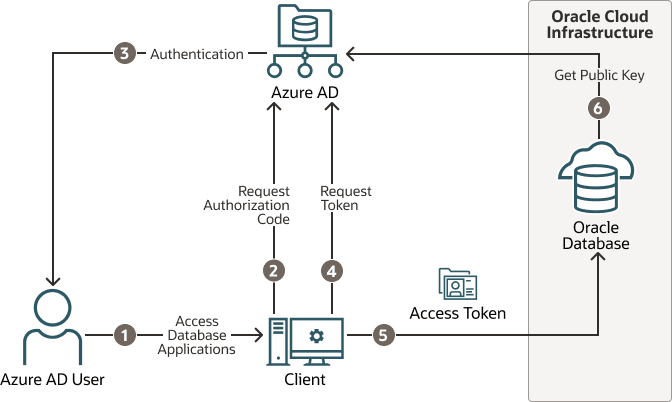
[Description of "Figure 8-1 Azure AD User Accessing the Database with the Interactive Authorization Code Flow"](img_text/azure-authentication.md)

The authorization code flow is an OAuth2 standard and is described in detail as part of the standards. There are two steps in the flow. The first step authenticates the user and retrieves the authorization code. The second step uses the authorization code to get the database access token.

1.  The Azure AD user requests access to the resource, the Oracle Database instance.
2.  The database client or application requests an authorization code from Azure AD.
3.  Azure AD authenticates the Azure AD user and returns the authorization code.
4.  The helper tool or application uses the authorization code with Azure AD to exchange it for the `OAuth2` token.
5.  The database client sends the `OAuth2` access token to the Oracle database. The token includes the database app roles the user was assigned to in the Azure AD app registration for the database.
6.  The Oracle Database instance uses the Azure AD public key to verify that the access token was created by Azure AD.

Both the database client and the database server must be registered with the app registrations feature in the Azure Active Directory section of the Azure portal. The database client must be registered with Azure AD app registration. Permission must also be granted to allow the database client to get an access token for the database.

**Parent topic:** Introduction to Oracle Database Integration with Microsoft Azure AD

#### 8.1.3 Azure AD Users Mapping to an Oracle Database Schema and Roles

Microsoft Azure users must be mapped to an Oracle Database schema and have the necessary privileges (through roles) before being able to authenticate to the Oracle Database instance.

In Microsoft Azure, an Azure AD administrator can assign users, groups, and applications to the database app roles.

Exclusively mapping an Azure AD schema to a database schema requires the database administrator to create a database schema when the Azure AD user joins the organization or is authorized to the database. The database administrator must also modify the privileges and roles that are granted to the database schema to align them with the tasks the Azure AD user is assigned to. When the Azure AD user leaves the organization, the database administrator must drop the database schema so that an unused account is not left on the database. Using the database app roles enables the Azure AD administrator to control access and roles by assigning users to app roles that are mapped to global schemas and global roles. This way, user access to the database is managed by Azure AD administrators and database administrators do not need to create, manage, and drop schemas for every user.

An Azure AD user can be mapped to a database schema (user) either exclusively or through an app role.

- Creating an exclusive mapping between an Azure AD user and an Oracle Database schema. In this type of mapping, the database schema must be created for the Azure AD user. Database privileges and roles that are needed by the Azure AD user must be granted to the database schema. The database schema not only must be created when the Azure AD user is authorized to the database, but the granted privileges and roles must be modified as the Azure AD roles and tasks change. Finally, the database schema must be dropped when the Azure AD user leaves the organization.
- Creating a shared mapping between an Azure AD app role and an Oracle Database schema. This type of mapping, which is more common than exclusive mappings, is for Azure AD users who have been assigned directly to the app role or is a member of an Azure AD group that is assigned to the app role. The app role is mapped to an Oracle Database schema (shared schema mapping). Shared schema mapping allows multiple Azure AD users to share the same Oracle Database schema so a new database schema is not required to be created every time a new user joins the organization. This operational efficiency allows database administrators to focus on database application maintenance, performance, and tuning tasks instead of configuring new users, updating privileges and roles, and removing accounts.

In addition to database roles and privileges being granted directly to the mapped global schema, additional roles and privileges can be granted through mapped global roles. Different Azure AD users mapped to the same shared global schema may need different privileges and roles. Azure app roles can be mapped to Oracle Database global roles. Azure AD users who are assigned to the app role or are a member of an Azure AD group that is assigned to the app role will be granted the Oracle Database global role when they access the database.

The following diagram illustrates the different types of assignments and mappings that are available.

Figure 8-2 Assignments and Mappings Between Azure AD and Oracle Database

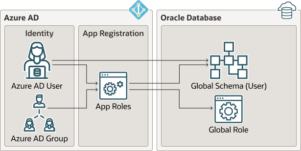
[Description of "Figure 8-2 Assignments and Mappings Between Azure AD and Oracle Database"](img_text/azure_mappings.md)

These mappings are as follows:

- An Azure AD user can be mapped directly to an Oracle Database global schema (user).
- An Azure AD user, Azure AD group, or application is assigned to an app role, which is then mapped to either an Oracle Database global schema (user) or a global role.

**Parent topic:** Introduction to Oracle Database Integration with Microsoft Azure AD

#### 8.1.4 Use Cases for Connecting to an Oracle Database Using Azure AD

Oracle Database supports several use cases for connecting to the database.

- OAuth2 authorization code flow: This is the most common flow for human users. The client directs the Azure AD user to Azure AD to get the authorization code. This code is used to get the database access token. See the Microsoft Azure article [Microsoft identity platform and OAuth 2.0 authorization code flow](https://docs.microsoft.com/en-us/azure/active-directory/develop/v2-oauth2-auth-code-flow).
- Resource owner password credentials (ROPC): This flow is not recommended for production servers. It is useful for test software that cannot work with a pop-up authentication window. It is used in non-graphic user interface environments when a pop-up window cannot be used to authenticate a user.
- Client credentials: This flow is used for applications to connect with the database. The application must register with Azure AD app registration and needs a client ID and client password. These client credentials must be used to get the database access token from Azure AD when the application connects to the database. The application can pass the token through the file system or through the database client API.
- On-behalf-of (OBO) token: An Azure application requests an OBO token for a logged in user. The OBO token will also be an access token for the database with the Azure AD user identity and assigned app roles for the database. This enables the Azure AD user to log in to the database as the user and not the application. Only an application can request an OBO token for its Azure AD user and pass it to the database client through the API.

**Parent topic:** Introduction to Oracle Database Integration with Microsoft Azure AD

#### 8.1.5 General Process of Authenticating Microsoft Azure AD Identities with Oracle Database

The Oracle Database administrator and the Microsoft Azure AD administrator play roles to allow Azure AD users to connect to the database using Azure AD OAuth2 access tokens.

The general process is as follows:

1.  The Oracle Database administrator ensures that the Oracle Database environment meets the requirements for the Microsoft Azure AD integration. See Oracle Database Requirements for the Microsoft Azure AD Integration.

2.  The Azure AD administrator creates an Azure AD app registration for the database and the Oracle Database administrator enables the database to use Azure AD tokens for database access.

    As part of the app registration process, the Azure AD administrator creates Azure app roles to be used for the mappings between the Azure users, groups, and applications to the Oracle Database schemas and roles.

3.  The Oracle Database administrator creates and maps global schemas to either an Azure AD user (exclusive schema mapping) or to an Azure app role (shared schema mapping). The Azure AD user or application must be mapped to one schema.

4.  Optionally, the Oracle administrator creates and maps global Oracle Database roles to Azure app roles.

5.  The Azure AD end user who wants to connect with the Oracle Database instance registers the client application as an Azure AD client (similar to how the Oracle database is registered).

    The Azure AD client will have a client identification and a client secret, unless the application client is public. If the application client is public, then only the application client identification is necessary.

6.  The Azure AD end user (who can be a database administrator) connects using an utility such as PowerShell or the Azure command-line interface to retrieve the `OAuth2` database access token and store it in a local file directory. An application can also request an Azure AD `OAuth2` access token directly from Azure AD and pass it through a database client API. Refer to the following Oracle Database client documentation for information about passing Azure AD `OAuth2` tokens:
    - JDBC-thin clients: [Oracle Database JDBC Developer’s Guide](../jjdbc/client-side-security.md)
    - Oracle Call Interface (OCI): [Oracle Call Interface Programmer's Guide](../lnoci/handler-and-descriptor-attributes.md)
    - Oracle Data Provider for .NET (ODP): [Oracle Data Provider for .NET Developer's Guide for Microsoft WindowsConnecting to Oracle Database](../odpnt/featConnecting.md)

7.  Once connected to the Oracle Database instance, the Azure AD end user performs database operations as needed.

**Parent topic:** Introduction to Oracle Database Integration with Microsoft Azure AD

### 8.2 Configuring the Oracle Database for Microsoft Azure AD Integration

The Microsoft Azure AD integration with the Oracle Database instance requires the database to be registered with Azure AD.

- Oracle Database Requirements for the Microsoft Azure AD Integration
  Before you can configure an Oracle Database instance with Microsoft Azure AD, you must ensure that your environment meets special requirements.
- Registering the Oracle Database Instance with a Microsoft Azure AD Tenancy
  A user with Azure AD administrator privileges uses Microsoft Azure AD to register the Oracle Database instance with the Microsoft Azure AD tenancy.
- Enabling Microsoft Azure AD v2 Access Tokens
  Oracle Database supports integration with the v1 and v2 Azure AD `OAuth2` access token.
- Managing App Roles in Microsoft Azure AD
  In Azure AD, you can create and manage app roles that will be assigned to Azure AD users and groups and also be mapped to Oracle Database global schemas and roles.
- Enabling Azure AD External Authentication for Oracle Database
  You need to enable Microsoft Azure AD external authentication with Oracle Database.
- Disabling Azure AD External Authentication for Oracle Database
  To disable Azure AD External authentication for an Oracle Database instance, you must use the `ALTER SYSTEM` statement.

**Parent topic:** Authenticating and Authorizing Microsoft Azure Active Directory Users for Oracle Databases

#### 8.2.1 Oracle Database Requirements for the Microsoft Azure AD Integration

Before you can configure an Oracle Database instance with Microsoft Azure AD, you must ensure that your environment meets special requirements.

For an on-premises, non-cloud Oracle database, follow the steps in this document. If your Oracle database is in one of the following DBaaS platforms, then refer to the platform documentation for additional requirements.

- [Using Oracle Autonomous Database Serverless](https://docs.oracle.com/pls/topic/lookup?ctx=en/database/oracle/oracle-database/19/dbseg&id=ADBSA-GUID-562655CA-4D8B-41D2-9165-6515BC824E07)
- [Using Oracle Autonomous Database on Dedicated Exadata Infrastructure](https://docs.oracle.com/en/cloud/paas/autonomous-database/dedicated/eemee/)
- [Use Azure Active Directory Authentication with Base Database Service](https://docs.oracle.com/en/cloud/paas/bm-and-vm-dbs-cloud/azure/index.html#articletitle)
- [Use Azure Active Directory Authentication with Exadata Database on Dedicated Infrastructure](https://docs.oracle.com/en-us/iaas/exadatacloud/exacs/auth-ms-azure-ad-users-for-oracle-databases.html)

Note the following:

- The Oracle Database server must be able to request the Azure AD public key. Depending on the enterprise network connectivity setup, you may need to configure a proxy setting.
- Users and applications that need to request an Azure AD token must also be able to have network connectivity to Azure AD. You may need to configure a proxy setting for the connection.
- You must configure Transport Layer Security (TLS) between the Oracle Database client and the Oracle Database server so that the token can be transported securely. This TLS connection can be either one-way or mutual.
- You can create the TLS server certificate to be self-signed or be signed by a well known certificate authority. The advantage of using a certificate that is signed by a well known Certificate Authority (CA) is that the database client can use the system default certificate store to validate the Oracle Database server certificate instead of having to create and maintain a local wallet with the root certificate. Note that this applies to Linux and Windows clients only.

**Related Topics**

- [Transport Layer Security Connection without a Client Wallet](configuring-secure-sockets-layer-authentication.md)

**Parent topic:** Configuring the Oracle Database for Microsoft Azure AD Integration

#### 8.2.2 Registering the Oracle Database Instance with a Microsoft Azure AD Tenancy

A user with Azure AD administrator privileges uses Microsoft Azure AD to register the Oracle Database instance with the Microsoft Azure AD tenancy.

1.  Log in to the Azure portal as an administrator who has Microsoft Azure AD privileges to register applications.
2.  In the Azure Active directory admin center page, from the left navigation bar, select Azure Active Directory.
3.  In the MS - App registrations page, select App registrations from the left navigation bar.
4.  Select New registration.
    The Register an application window appears. 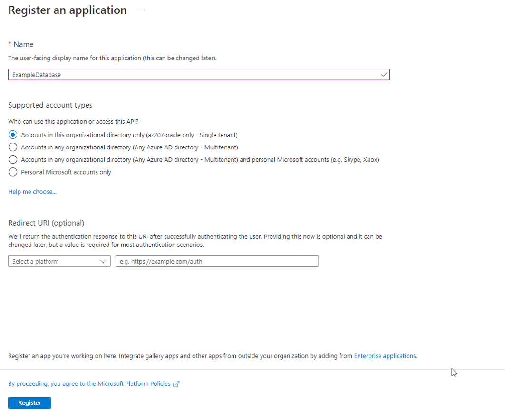
    [Description of the illustration azure-reg.png](img_text/azure-reg.md)
5.  In the Register an application page, enter the following Oracle Database instance registration information:
    - In the Name field, enter a name for the Oracle Database instance connection (for example, `Example Database`).
    - Under Supported account types, select the account type that matches your use case.
      - Accounts in this organizational directory only (tenant_name only - Single tenant)
      - Accounts in any organizational directory (Any Azure AD directory - Multitenant)
      - Accounts in any organizational directory (Any Azure AD directory - Multitenant) and personal Microsoft accounts (e.g. Skype, Xbox)
      - Personal Microsoft accounts only
6.  Bypass the Redirect URI (Optional) settings. You do not need to create a redirect URI because Azure AD does not need one for the database server.
7.  Click Register.
    After you click Register, Azure AD displays the app registration's Overview pane, which will show the Application (client) ID under Essentials. This value is a unique identifier for the application in the Microsoft identity platform. Note the term Application refers to the Oracle Database instance.
8.  Register a scope for the database app registration.
    A scope is a permission to access the database. Each database will need a scope so that clients can establish a trust with the database by requesting permission to use the database scope. This allows the database client to get access tokens for the database.
    1.  In the left navigation bar, select Expose an API.
    2.  Under Set the App ID URI, in the Application ID URI field, enter the app ID URI for the database connection using the following format, and then click Save:
            your_tenancy_url/application_(client)_id

        In this specification:

        - `your_tenancy_url` must include `https` as the prefix and the fully qualified domain name of your Azure AD tenancy.
        - `application_(client)_id` is the ID that was generated when you registered the Oracle Database instance with Azure AD. It is displayed in the Overview pane of the app registration.

        For example:

            https://sales_west.example.com/1aa11111-1a1z-1a11-1a1a-11aa11a1aa1a
    3.  Select Add a scope and then enter the following settings:
        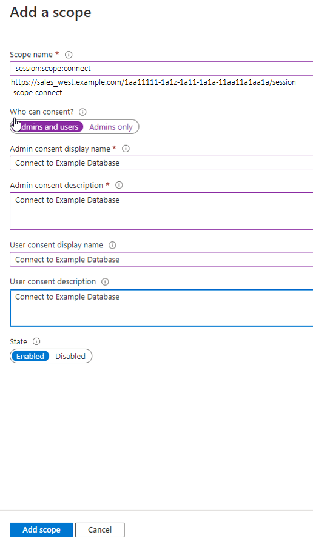
        [Description of the illustration azure-scope.png](img_text/azure-scope.md)
        - Scope name specifies a name for the scope. Enter the following name:

              session:scope:connect

          This name can be any text. However, a scope name must be provided. You will need to use this scope name later when you give consent to the database client application to access the database.

        - Who can consent specifies the necessary permissions. Select Admins and users, or for higher restrictions, Admins only.

        - Admin consent display name describes the scope's purpose (for example, `Connect to Oracle`), which only administrators can see.

        - Admin consent display name describes the scope's purpose (for example, `Connect to Example Database`), which only administrators can see.

        - User consent display name is a short description of the purpose of the scope (for example, `Connect to Example Database`), which users can see if you specify Admins and users in Who can consent.

        - User consent description is a more detailed description of the purpose of the scope (for example, `Connect to Example Database`), which users can see if you specify Admins and users in Who can consent.

        - State enables or disables the connection. Select Enabled.

After you complete these steps, you are ready to add one or more Azure app roles, and then perform the mappings of Oracle schemas and roles.

**Related Topics**

- [Quickstart: Register an application with the Microsoft identity platform](https://docs.microsoft.com/en-us/azure/active-directory/develop/quickstart-register-app)

**Parent topic:** Configuring the Oracle Database for Microsoft Azure AD Integration

#### 8.2.3 Enabling Microsoft Azure AD v2 Access Tokens

Oracle Database supports integration with the v1 and v2 Azure AD `OAuth2` access token.

The Azure AD v2 access token, supports a wider range of access scenarios than the v1 token, including authentication for both organizational accounts (Azure AD) and personal Microsoft accounts (MSA). You can use this token with applications that are registered in the Azure portal using the App registrations experience.

When you use the Azure AD v2 `OAuth2` access token, the credential flow continues to work as it did before without any changes. However, the `upn:` claim must be added when you use v2 tokens with the interactive flow.

1.  Check the version of the Azure AD access token that you are using.
2.  Log in to the Microsoft Azure portal.
3.  Search for and select Azure Active Directory.
4.  Under Manage, select App registrations.
5.  Choose the application for which you want to configure optional claims based on your scenario and desired outcome.
6.  Under Manage, select Token configuration.
7.  Click Add optional claim and select upn.

When you use v2 tokens, the `aud:` claim only reflects the APP ID value. You do not need to set the `https:domain` prefix to the APP ID URI when v2 tokens are being used. This simplifies the configuration for the database because the default APP ID URI can be used.

**Related Topics**

- Checking the Azure AD Access Token Version

**Parent topic:** Configuring the Oracle Database for Microsoft Azure AD Integration

#### 8.2.4 Managing App Roles in Microsoft Azure AD

In Azure AD, you can create and manage app roles that will be assigned to Azure AD users and groups and also be mapped to Oracle Database global schemas and roles.

- Creating a Microsoft Azure AD App Role
  Azure AD users, groups, and applications that need to connect to the database will be assigned to the database app roles.
- Assigning Users and Groups to the Microsoft Azure AD App Role
  Before Microsoft Azure AD users can have access to the Oracle database, they must first be assigned to the app roles that will be mapped to Oracle Database schema users or roles.
- Assigning an Application to an App Role
  An application that must connect to the database using the client credential flow must to be assigned to an app role.

**Parent topic:** Configuring the Oracle Database for Microsoft Azure AD Integration

##### 8.2.4.1 Creating a Microsoft Azure AD App Role

Azure AD users, groups, and applications that need to connect to the database will be assigned to the database app roles.

See the Microsoft Azure article [Create and assign a custom role in Azure Active Directory](https://docs.microsoft.com/en-us/azure/active-directory/roles/custom-create) for detailed steps on how to create an app role. The following steps describe how to create the app role for use with an Oracle database.

1.  Log in to Azure AD as an administrator who has privileges for creating app roles.
2.  Access the Oracle Database app registration that you created.
    1.  Use the Directory + subscription filter to locate the Azure Active Directory tenant that contains the Oracle Database app registration.
    2.  Select Azure Active Directory.
    3.  Under Manage, select App registrations, and then select the Oracle Database instance that you registered earlier.
3.  Under Manage, select App roles.
4.  In the App roles page, select Create app role.
5.  In the Create app role page, enter the following information:
    - Display name is the displayed name of the role (for example, `HR App Schema`). You can include spaces in this name.
    - Value is the actual name of the role (for example, `HR_APP`). Ensure that this setting matches exactly the string that is referenced in the database mapping to a schema or role. Do not include spaces in this name.
    - Description provides a description of the purpose of this role.
    - Do you want to enable this app role? enables you to activate the role.
6.  Click Apply.
    The app role appears in the App roles pane.

    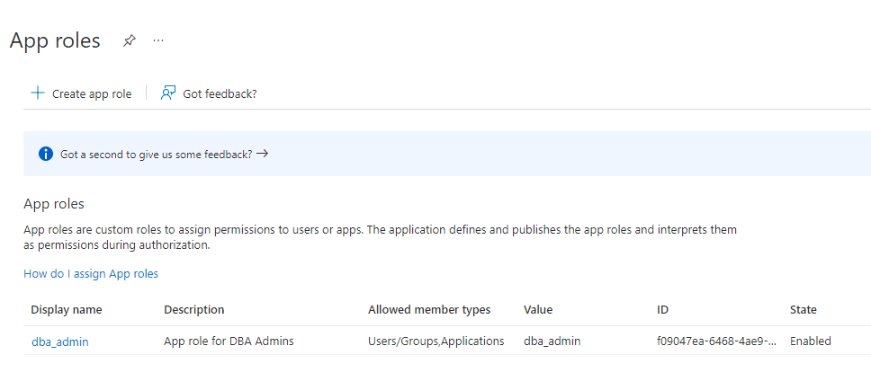
    [Description of the illustration azure-app-roles-creation.png](img_text/azure-app-roles-creation.md)

**Parent topic:** Managing App Roles in Microsoft Azure AD

##### 8.2.4.2 Assigning Users and Groups to the Microsoft Azure AD App Role

Before Microsoft Azure AD users can have access to the Oracle database, they must first be assigned to the app roles that will be mapped to Oracle Database schema users or roles.

See the Microsoft Azure article [Add app roles to your application and receive them in the token](https://docs.microsoft.com/en-us/azure/active-directory/develop/howto-add-app-roles-in-azure-ad-apps) for detailed steps assigning users and groups to an app role. The following steps explain how to do this for an Oracle database.

1.  Log in to Azure AD as an administrator who has privileges for assigning Azure AD users and groups to app roles.
2.  In enterprise applications, find the name of the Oracle Database app registration that you created. This is automatically created when you create an app registration.
    1.  Use the Directory + subscription filter to locate the Azure Active Directory tenant that contains the Oracle connection.
    2.  Select Azure Active Directory.
    3.  Under Manage, select Enterprise applications, and then select the Oracle Database app registration name that you registered earlier.
3.  Under Getting Started, select Assign users and groups.
4.  Select Add user/group.
5.  In the Add assignment window, select Users and groups to display a list of users and security groups.
6.  From this list, select the users and groups that you want to assign to the app role, and then click Select.
7.  In the Add assignment window, select Select a role to display a list of the app roles that you have created.
8.  Select the app role and then select Select.
9.  Click Assign.

**Parent topic:** Managing App Roles in Microsoft Azure AD

##### 8.2.4.3 Assigning an Application to an App Role

An application that must connect to the database using the client credential flow must to be assigned to an app role.

1.  Log in to Azure AD as an administrator who has privileges for assigning Azure AD users and groups to app roles.
2.  Access the app registration for the application.
3.  Under Manage, select API permissions.
4.  In the Configured permissions area, select + Add a permission.
5.  In the Request API permission pane, select the My APIs tab.
6.  Select the Oracle Database app that you want to give permission for this application to access. Then select the Application permissions option.
7.  Select the database app roles to assign to the application and then click the Add Permission box at the bottom of the screen to assign the app roles and close the dialog box. Ensure that the app roles that you just assigned appear under Configured permissions.
    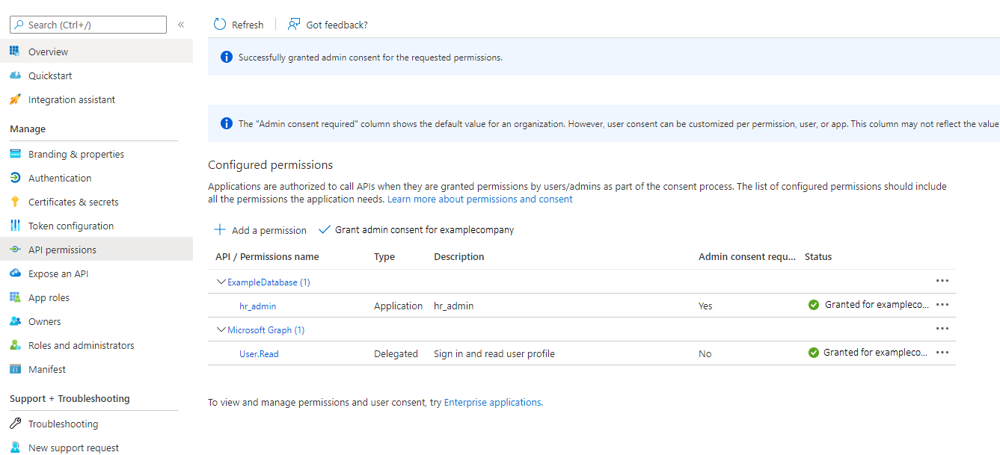
    [Description of the illustration azure-grant-consent.png](img_text/azure-grant-consent.md)
8.  Select Grant admin consent for tenancy to grant consent for the tenancy users, then select Yes in the confirmation dialog box.

**Related Topics**

- [Configure the admin consent workflow](https://docs.microsoft.com/en-us/azure/active-directory/manage-apps/configure-admin-consent-workflow)

**Parent topic:** Managing App Roles in Microsoft Azure AD

#### 8.2.5 Enabling Azure AD External Authentication for Oracle Database

You need to enable Microsoft Azure AD external authentication with Oracle Database.

For additional information about Azure AD authentication for your platform, see the documentation links below.

1.  Log in to the Oracle Database instance as a user who has been granted the `ALTER SYSTEM` system privilege.
2.  Set the `IDENTITY_PROVIDER_TYPE` parameter as follows:
        ALTER SYSTEM SET IDENTITY_PROVIDER_TYPE=AZURE_AD SCOPE=BOTH;
3.  Ensure that you set the `IDENTITY_PROVIDER_TYPE` parameter correctly.
        SELECT NAME, VALUE FROM V$PARAMETER WHERE NAME='identity_provider_type';

    The following output should appear:

        NAME                    VALUE
        ----------------------  -------
        identity_provider_type  AZURE_AD
4.  Set the `IDENTITY_PROVIDER_CONFIG` parameter by using the following syntax:
        ALTER SYSTEM SET IDENTITY_PROVIDER_CONFIG =
        '{
           application_id_uri : string , // from registered app, to be mapped in jwt "aud" claim;
                                         // Domain qualified to support cross tenancy resource access
           tenant_id : string,           // from tenant config
           app_id: string                // from registered resource app
        }' SCOPE=BOTH;

    For example:

        ALTER SYSTEM SET IDENTITY_PROVIDER_CONFIG =
        '{
          "application_id_uri" : "https://www.example.com/11aa1a11-aaaa-1111-1111-1111aa11111",
          "tenant_id" : "111a1111-a11a-111a-1a1a-1111111111a",
          "app_id" : "11aa1a11-aaaa-1111-1111-1111aa11111"
        }' SCOPE=BOTH;

See the following platform-specific documentation for information about enabling Oracle Database for Azure AD external authentication, in addition to the information detailed in this document for on-premises (non-cloud) Oracle databases.

- [Using Oracle Autonomous Database Serverless](https://docs.oracle.com/pls/topic/lookup?ctx=en/database/oracle/oracle-database/19/dbseg&id=ADBSA-GUID-5BB42AD0-50BE-4336-8E62-668FE60CD60A)

- [Oracle Autonomous Database on Dedicated Exadata Infrastructure](https://docs.oracle.com/en/cloud/paas/autonomous-database/dedicated/eemee/#articletitle)

**Parent topic:** Configuring the Oracle Database for Microsoft Azure AD Integration

#### 8.2.6 Disabling Azure AD External Authentication for Oracle Database

To disable Azure AD External authentication for an Oracle Database instance, you must use the `ALTER SYSTEM` statement.

In addition to Oracle Database, this procedure can be used for Oracle Autonomous Database on Dedicated Exadata Infrastructure and Oracle Exadata Cloud Service (Oracle ExaCS). If you want to disable Azure AD external authentication with these products, see their product documentation.

To disable Azure AD from Oracle Autonomous Database Serverless, see [Using Oracle Autonomous Database Serverless](https://docs.oracle.com/pls/topic/lookup?ctx=en/database/oracle/oracle-database/19/dbseg&id=ADBSA-GUID-E9CF08F4-F18D-4F11-9D33-772E60903021). The following procedure applies to all other platforms:

1.  Log in to the Oracle Database instance as a user who has been granted the `ALTER SYSTEM` system privilege.
2.  Set the identity provider parameters as follows:
        ALTER SYSTEM RESET IDENTITY_PROVIDER_CONFIG SCOPE=BOTH;
        ALTER SYSTEM RESET IDENTITY_PROVIDER_TYPE SCOPE=BOTH;

**Parent topic:** Configuring the Oracle Database for Microsoft Azure AD Integration

### 8.3 Mapping Oracle Database Schemas and Roles

Azure AD users will be mapped to one database schema and optionally to one or more database roles.

- Exclusively Mapping an Oracle Database Schema to a Microsoft Azure AD User
  You can exclusively map an Oracle Database schema to a Microsoft Azure AD user.
- Mapping a Shared Oracle Schema to an App Role
  In this mapping, an Oracle schema is mapped to an app role. Therefore, anyone who has that app role would get the same shared schema.
- Mapping an Oracle Database Global Role to an App Role
  Oracle Database global roles that are mapped to Azure app roles give Azure users and applications additional privileges and roles above those that they have been granted through their login schemas.

**Parent topic:** Authenticating and Authorizing Microsoft Azure Active Directory Users for Oracle Databases

#### 8.3.1 Exclusively Mapping an Oracle Database Schema to a Microsoft Azure AD User

You can exclusively map an Oracle Database schema to a Microsoft Azure AD user.

1.  Log in to the Oracle Database instance as a user who has been granted the `CREATE USER` or `ALTER USER` system privilege.
2.  Run the `CREATE USER` or `ALTER USER` statement with the `IDENTIFIED GLOBALLY AS` clause specifying the Azure AD user name.
    For example, to create a new database schema user named `peter_fitch` and map this user to an existing Azure AD user named `peter.fitch@example.com`:
        CREATE USER peter_fitch IDENTIFIED GLOBALLY AS
        'AZURE_USER=peter.fitch@example.com';
3.  Grant the `CREATE SESSION` privilege to the user.
        GRANT CREATE SESSION TO peter_fitch;

**Parent topic:** Mapping Oracle Database Schemas and Roles

#### 8.3.2 Mapping a Shared Oracle Schema to an App Role

In this mapping, an Oracle schema is mapped to an app role. Therefore, anyone who has that app role would get the same shared schema.

1.  Log in to the Oracle Database instance as a user who has the `CREATE USER` or `ALTER USER` system privilege.
2.  Run the `CREATE USER` or `ALTER USER` statement with the `IDENTIFIED GLOBALLY AS` clause specifying the Azure application role name.
    For example, to create a new database global user account (schema) named `dba_azure` and map it to an existing Azure AD application role named `AZURE_DBA`:
        CREATE USER dba_azure IDENTIFIED GLOBALLY AS 'AZURE_ROLE=AZURE_DBA';

**Parent topic:** Mapping Oracle Database Schemas and Roles

#### 8.3.3 Mapping an Oracle Database Global Role to an App Role

Oracle Database global roles that are mapped to Azure app roles give Azure users and applications additional privileges and roles above those that they have been granted through their login schemas.

1.  Log in to the Oracle Database instance as a user who has been granted the `CREATE ROLE` or `ALTER ROLE` system privilege
2.  Run the `CREATE ROLE` or `ALTER ROLE` statement with the `IDENTIFIED GLOBALLY AS` clause specifying the name of the Azure AD application role.
    For example, to create a new database global role named `widget_sales_role` and map it to an existing Azure AD application role named `WidgetManagerGroup`:
        CREATE ROLE widget_sales_role IDENTIFIED GLOBALLY AS
        'AZURE_ROLE=WidgetManagerGroup';

**Parent topic:** Mapping Oracle Database Schemas and Roles

### 8.4 Configuring Azure AD Client Connections to the Oracle Database

You can configure client connections to connect with the Azure AD registered database

- About Configuring Client Connections to Azure ADs
  There are numerous ways that you can configure a client to connect with an Oracle Database instance using Azure AD tokens.
- Supported Client Drivers for Azure AD Connections
  Oracle Database supports several types of client drivers for Azure AD connections.
- Using Centralized Oracle Cloud Infrastructure Services for Net Naming and Secrets
  You can use the Oracle Cloud Infrastructure (OCI) object store and vault to centrally store net names and secrets.
- Operational Flow for SQL\*Plus Client Connection in PowerShell to Oracle Database
  The connection between the Azure user, Azure AD, and the Oracle database relies on the passing of the `OAuth2` token throughout these components.
- Registering a Client with Azure AD Application Registration
  This type of registration is similar to registering Oracle Database with Azure AD app registration.
- Examples of Retrieving Azure AD OAuth2 Tokens
  These examples show different ways that you can retrieve Azure AD `OAuth2` tokens.
- Configuring SQL\*Plus for Azure AD Access Tokens
  You must configure SQL\*Plus to retrieve the Azure AD database access token from a location and use it when the `/` slash login is used.
- Creating a Network Proxy for the Database to Connect with the Internet
  This network proxy will enable the Oracle database to reach the Azure AD endpoint.
- Enabling Clients to Directly Retrieve Azure Tokens
  You can set parameters to enable clients to directly retrieve Azure tokens on their own.

**Parent topic:** Authenticating and Authorizing Microsoft Azure Active Directory Users for Oracle Databases

#### 8.4.1 About Configuring Client Connections to Azure ADs

There are numerous ways that you can configure a client to connect with an Oracle Database instance using Azure AD tokens.

You should choose the client connection method that works best with your environment. This guide provides examples of connecting SQL\*Plus with different methods of getting an Azure AD OAuth2 access token. All Oracle Database release 19c clients can accept a token that is passed as a file. The JDBC-thin, Instant Client, and ODP.net drivers also accept the token through the database client API from an application. Oracle Database tools such as SQL\*Plus cannot retrieve the tokens directly, so tools such as PowerShell or Azure CLI must be used to retrieve the Azure AD `OAuth2` access token. To retrieve an Azure AD token, the client must be registered through the Azure AD app registration process. Registering the client is similar to registering the Oracle Database server with Azure AD using app registration. Both the database and client must be registered with Azure AD.

The database must be registered so the client can get permission to get an access token for the database. The client must be registered so that Azure AD can recognize a trusted client is asking for an access token.

See the following Microsoft Azure articles for more information about connecting clients to Azure AD:

- [Quickstart: Configure a client application to access a web API](https://docs.microsoft.com/en-us/azure/active-directory/develop/quickstart-configure-app-access-web-apis)
- [Choose the right Azure command-line tool](https://docs.microsoft.com/en-us/azure/developer/azure-cli/choose-the-right-azure-command-line-tool)
- [Get Azure AD tokens by using the Microsoft Authentication Library](https://docs.microsoft.com/en-us/azure/databricks/dev-tools/api/latest/aad/app-aad-token)
- [Install the Azure CLI on Linux](https://docs.microsoft.com/en-us/cli/azure/install-azure-cli-linux?pivots=dnf)

**Parent topic:** Configuring Azure AD Client Connections to the Oracle Database

#### 8.4.2 Supported Client Drivers for Azure AD Connections

Oracle Database supports several types of client drivers for Azure AD connections.

- JDBC-thin: Oracle Database 19.16 (July 2022), Oracle Database 21.8 (October 2022)
- OCI (C driver): Oracle Database 19.16 (July 2022)
- Oracle Instant Client based on OCI
- Oracle Data Provider (core): Oracle Database 19.16, Oracle Database 21.7
- Oracle Data Provider (unmanaged): based on OCI
- Oracle Data Provider (managed): Oracle Database 19.16, Oracle Database 21.7
- All other drivers built on OCI adopts the OCI compatibility

**Parent topic:** Configuring Azure AD Client Connections to the Oracle Database

#### 8.4.3 Using Centralized Oracle Cloud Infrastructure Services for Net Naming and Secrets

You can use the Oracle Cloud Infrastructure (OCI) object store and vault to centrally store net names and secrets.

This functionality is currently supported with the JDBC-thin and .NET-thin drivers.

See the following guides:

- [Oracle Database Net Services Administrator's Guide](../netag/index.md)
- [Oracle Database Net Services Reference](../netrf/index.md)

**Parent topic:** Configuring Azure AD Client Connections to the Oracle Database

#### 8.4.4 Operational Flow for SQL\*Plus Client Connection in PowerShell to Oracle Database

The connection between the Azure user, Azure AD, and the Oracle database relies on the passing of the `OAuth2` token throughout these components.

This example shows the use of the Resource Owner Password Credential (ROPC) flow with a public client. See the Microsoft Azure article [Microsoft identity platform and OAuth 2.0 Resource Owner Password Credentials](https://docs.microsoft.com/en-us/azure/active-directory/develop/v2-oauth-ropc) for detailed information about ROPC.

Figure 8-3 ROPC Operational Flow with a Public Client

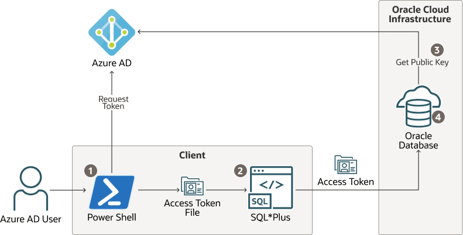
[Description of "Figure 8-3 ROPC Operational Flow with a Public Client"](img_text/azure_connection_flow.md)

1.  The Azure user requests an Azure AD access token for the database in PowerShell and the returned token is written into a file called `token` at a file location.
2.  The Azure user connects to the database using `/` slash login. Either the `sqlnet.ora` or `tnsnames.ora` connection string tells the instant client that an Azure AD `OAuth2` token is needed and to retrieve it from a specified file location. The access token is sent to the database.
3.  The database verifies that the access token came from Azure AD (using the Azure AD public key) and then checks the token for additional claims.
4.  The database finds the schema mapping (exclusive or shared) and creates the session. The database will also grant any global roles that the Azure user is also assigned to through an app role.

**Parent topic:** Configuring Azure AD Client Connections to the Oracle Database

#### 8.4.5 Registering a Client with Azure AD Application Registration

This type of registration is similar to registering Oracle Database with Azure AD app registration.

- Confidential and Public Client Registration
  You can register the database client with Azure as either confidential or public depending on your use case.
- Registering a Database Client App with Entra ID
  Creating the client app registration is similar to creating the Oracle Database instance with the Microsoft Entra ID tenancy.

**Parent topic:** Configuring Azure AD Client Connections to the Oracle Database

##### 8.4.5.1 Confidential and Public Client Registration

You can register the database client with Azure as either confidential or public depending on your use case.

See the Microsoft Azure article [Authentication flows and application scenarios](https://docs.microsoft.com/en-us/azure/active-directory/develop/authentication-flows-app-scenarios) for detailed information about authentication flows and application scenarios.

Registering a confidential client app requires that the client have a secret, in addition to the client ID. The confidential client app uses both the client ID and the secret when it makes Azure AD requests. However, in an enterprise, it is not practical for every SQL\*Plus and SQLcl user to create a separate app registration with its own secret. In addition, a secret is no longer a secret when you start to share it within an organization. It is far better to just create a public client app. A public client app does not have a secret; it only has a client ID. All database tool users can use the public client ID when they connect to Azure AD to get an access token. The Azure AD user still needs to authenticate to Azure AD with their own user credential.

**Parent topic:** Registering a Client with Azure AD Application Registration

##### 8.4.5.2 Registering a Database Client App with Entra ID

Creating the client app registration is similar to creating the Oracle Database instance with the Microsoft Entra ID tenancy.

1.  Log in to the Azure portal as an administrator who has Microsoft Entra ID privileges to register applications.
2.  In the Azure Active directory admin center page, from the left navigation bar, select Microsoft Entra ID.
3.  In the MS - App registrations page, select App registrations from the left navigation bar.
4.  Select New registration.
5.  In the Register an application page, enter the following Oracle Database client registration information:
    - In the Name field, enter a name for the client app (for example, `DatabaseClientApplication`)..
    - Under Supported account types, select the account type that matches your use case.
      - Accounts in this organizational directory only (tenant_name only - Single tenant)
      - Accounts in any organizational directory (Any Entra ID directory - Multitenant)
      - Accounts in any organizational directory (Any Entra ID directory - Multitenant) and personal Microsoft accounts (e.g. Skype, Xbox)
      - Personal Microsoft accounts only
6.  Under Redirect URI (optional), configure the redirect URI for the client app.
    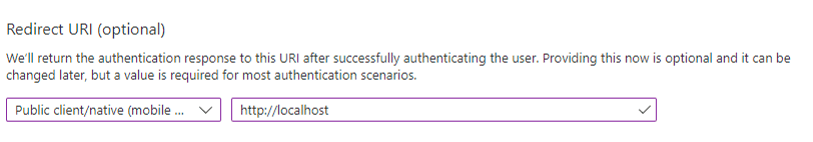
    [Description of the illustration azure-redirect-uri.png](img_text/azure-redirect-uri.md)
    - Select Public client/native (mobile & desktop) or Web. Choose Public client if this client app will be used by multiple users such as database administrators who need to use SQL\*Plus to access the Oracle Database instance.
    - Add a redirect URI of `http://localhost`, unless you have another address to use. This redirect URI is needed for the authorization flow.
7.  Click Register.
    At this stage, the database client has been registered with Entra ID. Next, you must add the new client to the list of authorized client apps for the Oracle Database instance.
8.  To add the new client to this list of client apps, do the following:
    1.  Make a note of the new client's Application (client) ID. This ID is in the Overview page for the app.
        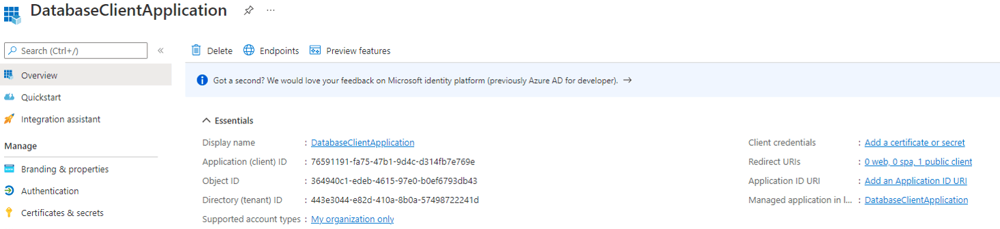
        [Description of the illustration azure-client-id.png](img_text/azure-client-id.md)
    2.  On the App registrations page, open the app registration page for the database server by selecting it from the menu.
    3.  On the left side, select Expose an API.
    4.  Scroll down on the main page until you see Authorized client applications.
    5.  Select + to add a client application.
    6.  Copy the new client's Application (client) ID to the Client Id field.
        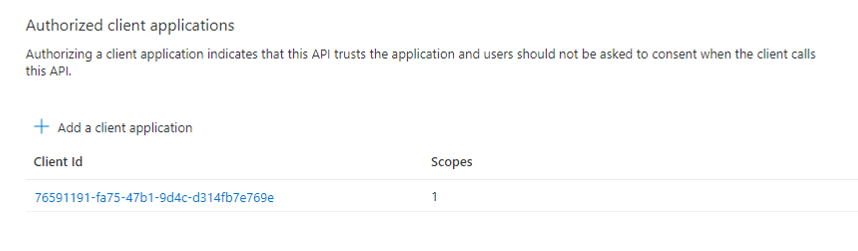
        [Description of the illustration azure-auth-client-app.png](img_text/azure-auth-client-app.md)
    7.  Click Add application.

**Related Topics**

- [Quickstart: Register an application with the Microsoft identity platform](https://docs.microsoft.com/en-us/azure/active-directory/develop/quickstart-register-app)

**Parent topic:** Registering a Client with Azure AD Application Registration

#### 8.4.6 Examples of Retrieving Azure AD OAuth2 Tokens

These examples show different ways that you can retrieve Azure AD `OAuth2` tokens.

- Example: Using PowerShell to Get a Token Using Resource Owner Password Credentials
  This example shows how to use PowerShell to get an Azure AD access token by using Resource Owner Password Credentials (ROPC).
- Example: Using Python with Microsoft Authentication Library Using an Authorization Flow
  Because this example with the Microsoft Authentication Library (MSAL) is in Python, it can be run on a variety of platforms such as PowerShell and Linux.
- Example: Using Curl with a Resource Owner Password Credential Flow
  This example shows how to use the `curl` command against the Azure AD API using a Resource Owner Password Credential (ROPC) flow with a public Azure AD client.
- Example: Azure CLI Using Authorization Flow
  This example shows how to use the Azure CLI to retrieve an access token and then write the token to a file.

**Parent topic:** Configuring Azure AD Client Connections to the Oracle Database

##### 8.4.6.1 Example: Using PowerShell to Get a Token Using Resource Owner Password Credentials

This example shows how to use PowerShell to get an Azure AD access token by using Resource Owner Password Credentials (ROPC).

You can retrieve the `OAuth2` access token by making a REST call from PowerShell. This configuration requires several values that were generated or that you specified when you registered the Oracle Database instance with Azure AD.

1.  If necessary install the Azure Active Directory PowerShell module.
    Follow the instructions in the Microsoft article [Install the Azure Az PowerShell module](https://docs.microsoft.com/en-us/powershell/azure/install-az-ps?view=azps-7.5.0) to download and install Azure PowerShell. It takes about 20 minutes or longer to perform the installation. You may want to set debug options for Azure PowerShell so that you can see how the installation is progressing.
2.  After the Azure PowerShell installation is complete, log in to PowerShell and then set the following variables in the order shown.
    1.  `$TenantDomain = "``user_tenancy_domain_name``"`
        This value is the tenancy domain name. For example:
            $TenantDomain = "example.com"
    2.  `$AppClientId ="``application_client_id``"`
        This value sets the application client ID for the database client, not the database server. This is the Application (client) ID value in the app registration's Overview pane. For example:
            $AppClientId ="111a1a1a-aa1a-1a1a-11aa-1a11111111aa"
    3.  `$Username = "``user_name``"`, which
        This value is the name of the Azure user who wants to access the Oracle Database instance. For example:
            $Username = "peter.fitch@example.com"
    4.  Entering the user password in PowerShell scripts depends on your corporate or personal security standards. Use your own method to capture the password securely or use this example that hides the password from the command history and command line window. You should delete the password variables after they have been used. Enter these in the order shown:
        1.  `$securePassword = Read-Host " Enter Password" -AsSecureString`
        2.  `$Password = [System.Runtime.InteropServices.Marshal]::PtrToStringAuto([System.Runtime.InteropServices.Marshal]::SecureStringToBSTR($securePassword))`
    5.  `$Scope = "``database_app_id_uri/scope``"`
        This value sets the app ID URI for the database and the scope (permission) for the database, separated by a `/` slash. These values can be found in the database app registration Expose an API page. In the following example, `https://example.com/111aa1aa-1111-1111-a1a1-1a11a111111a` is the app ID URI and `session:scope:connect` is the scope.
            $Scope = "https://example.com/111aa1aa-1111-1111-a1a1-1a11a111111a/session:scope:connect"
    6.  `$requestBody = @{client_id=$AppClientId;grant_type="password";username=$Username;password=$Password;scope=$Scope;}`
        This is the request body of the upcoming REST call.
    7.  `$OAuthResponse = Invoke-RestMethod -Method Post -Uri https://login.microsoftonline.com/$TenantDomain/oauth2/v2.0/token -Body $requestBody`
        This gets the `OAuth2` access token for the user.
    8.  You can remove the password from the variables if you do not need them.
        - `$securePassword = $null`, for secure password strings
        - `$Password = $null`, for clear text password strings
    9.  `$AccessToken = $OAuthResponse.access_token | Out-File -FilePath .\token -Encoding ASCII`, which writes the `OAuth2` token to the current file location using ASCII encoding
3.  Optionally, because the Azure AD `OAuth2` access token is a JSON Web Token (JWT) formatted token, you can view the cleartext of the encoded content by copying and pasting the token content into the website:
    <https://jwt.io/>

    Note the following:

    - The default PowerShell UTF16 file encoding cannot be used for the token. Use ASCII encoding as an alternative.
    - Tokens may not work cross-platform (for example, Windows to Linux or Linux to Windows), depending on encoding changes to the file when it is moved.

At this stage, the `OAuth2` access token has been retrieved and stored as a file. The next step is to enable the SQL\*Plus client to use the store access token and send it to the database.

**Parent topic:** Examples of Retrieving Azure AD OAuth2 Tokens

##### 8.4.6.2 Example: Using Python with Microsoft Authentication Library Using an Authorization Flow

Because this example with the Microsoft Authentication Library (MSAL) is in Python, it can be run on a variety of platforms such as PowerShell and Linux.

When multi-factor authentication is enabled for the user, an `OAuth2` authorization flow is necessary for a user to add the second authentication. Because the authorization flow requires two round trips to Azure AD, it is best handled using the MSAL. See the Microsoft article [Get Azure AD tokens by using the Microsoft Authentication Library](https://docs.microsoft.com/en-us/azure/databricks/dev-tools/api/latest/aad/app-aad-token) for how to use a python script with MSAL. These instructions are for the Databricks service, but the scope is changed to the database App ID URI and scope instead of the Databricks scope.

1.  Bypass the steps to set up the client app registration, since you have already accomplished that step except make sure you add a Redirect URI (`http://localhost`) for your client app registration.
2.  Go directly to Get Azure AD tokens by using the MSAL Python library.
    You will need the Directory (tenant) ID, Client ID for the public app client, and the database App ID URI and scope. You will see a code section for scopes with directions to not modify this variable. Because this python code was written for Databricks scope, you will need to change this scope variable to the scope of your database. For example:
        scopes = ['https://example.com/1111aa1a-a1aa-1a11-11aa-1a1a11aa1111/session:connect']
3.  Modify the code to write the token to a file location.
    Use the following example code and append it to the print statements at the end. Note the extra lines to back up and restore the original `stdout`.
        stdout_backup = sys.stdout
        with open('token', 'w') as token_file:
            sys.stdout = token_file
            print(acquire_tokens_result['access_token'])

        sys.stdout = stdout_backup

**Parent topic:** Examples of Retrieving Azure AD OAuth2 Tokens

##### 8.4.6.3 Example: Using Curl with a Resource Owner Password Credential Flow

This example shows how to use the `curl` command against the Azure AD API using a Resource Owner Password Credential (ROPC) flow with a public Azure AD client.

The cleartext password is part of this command so this is not so much for end-users as it is for applications. This would need to be protected.

- Enter the following `curl` command:
      curl -X POST -H 'Content-Type: application/x-www-form-urlencoded' https://login.microsoftonline.com/az207oracleoutlook.onmicrosoft.com/oauth2/v2.0/token
      -d 'client_id=571c3f0a-aa3c-4f0a-93ed-4f75748955ea' -d 'scope=https://example.com/383fe7ee-1433-4844-a2d5-5b80d811256d/session:scope:connect'
      -d 'username=peter.fitch@example.com' -d 'password=password' -d 'grant_type=password'

The response is a JSON file with token type, scope, expiration, and then the actual token. This file will need to be parsed so only the access token is written and stored in a file.

**Parent topic:** Examples of Retrieving Azure AD OAuth2 Tokens

##### 8.4.6.4 Example: Azure CLI Using Authorization Flow

This example shows how to use the Azure CLI to retrieve an access token and then write the token to a file.

See the Microsoft Azure article [Install the Azure CLI on Linux](https://docs.microsoft.com/en-us/cli/azure/install-azure-cli-linux?pivots=script) for information about installing the Azure CLI.

1.  Log in to your Azure tenancy.
        $ az login
2.  Get an access token and assign it to the token variable using the following syntax:
        token=$(az account get-access-token --resource=database_app_id_uri --query accessToken --output tsv)

    For example:

        token=$(az account get-access-token --resource=https://example.com/1111aa1a-a1aa-1a11-11aa-1a1a11aa1111 --query accessToken --output tsv)

    If you get an error saying that the Azure CLI client app ID does not have permission to access the database resource, then copy the Azure CLI client app ID from the error message and add it to the list of authorized client applications for the database resource. (Go to the database app registration in Azure AD, click Expose an API and then Add a client application).
3.  Write the token to a file.
        $ echo "$token" >> token

**Parent topic:** Examples of Retrieving Azure AD OAuth2 Tokens

#### 8.4.7 Configuring SQL\*Plus for Azure AD Access Tokens

You must configure SQL\*Plus to retrieve the Azure AD database access token from a location and use it when the `/` slash login is used.

Only the latest SQL\*Plus and Instant Client will work with Azure AD `OAuth2` tokens. There is no default location for the Azure AD token, so you must specify this location.

1.  Ensure that you have an Azure AD user account.
2.  Check with an Azure AD administrator or Oracle Database administrator for one of the following:
    - An application client ID that you can use to get Azure AD tokens. If you have Azure AD privileges to do so, then create your own client app registration, similar to registering the Oracle Database instance with an Azure AD tenancy.
    - You are mapped to a global schema in the database.
3.  Ensure that you are using the latest release updates for the Oracle Database client releases 19c.
    This configuration only works with the Oracle Database client release 19c.
4.  Follow the existing process to download the wallet from the Oracle Database instance and then follow the directions for configuring it for use with SQL\*Plus.
5.  On the client, set the following parameters in the `sqlnet.ora` file:
    - Check for the parameter `SSL_SERVER_DN_MATCH = ON` to ensure that DN matching is enabled.

    - Set the `TOKEN_AUTH` parameter to enable the client to use the Azure AD token. Include the `TOKEN_LOCATION` parameter to point to the token location. For example:

          TOKEN_AUTH=OAUTH
          TOKEN_LOCATION="token_location"

      Note that there is no default location. If the token is named `token`, then you only need to specify the file directory (for example, `/test/oracle/aad-token`). If the token name is different from `token` (for example, `azure.token`), then you must include this name in the path (for example, `/test/oracle/aad-token/azure.token`).

You can specify the `TOKEN_AUTH` and `TOKEN_LOCATION` parameters in `tnsnames.ora`, as well as in `sqlnet.ora`. The `TOKEN_AUTH` and `TOKEN_LOCATION` values in the `tnsnames.ora` connect strings take precedence over the `sqlnet.ora` settings for that connection. For example:

    (description=
      (retry_count=20)(retry_delay=3)
      (address=(protocol=tcps)(port=1522)
      (host=example.us-phoenix-1.oraclecloud.com))
      (connect_data=(service_name=aaabbbccc_exampledb_high.example.oraclecloud.com))
      (security=(ssl_server_cert_dn="CN=example.uscom-east-1.oraclecloud.com,
         OU=Oracle BMCS US, O=Example Corporation,
         L=Redwood City, ST=California, C=US")
      (TOKEN_AUTH=OAUTH)(TOKEN_LOCATION="/test/oracle/aad-token"))

After the connect string is updated with the `TOKEN_AUTH` and `TOKEN_LOCATION` parameters, the Azure user can log in to the Oracle Database instance by running the following command to start SQL\*Plus. You can include the connect descriptor itself or use the name of the descriptor from the `tnsnames.ora` file.

    connect /@exampledb_high

Or the user can use the connect string. For example:

    connect /@(description=
      (retry_count=20)(retry_delay=3)
      (address=(protocol=tcps)(port=1522)
      (host=example.us-phoenix-1.oraclecloud.com))
      (connect_data=(service_name=aaabbbccc_exampledb_high.example.oraclecloud.com))
      (security=(ssl_server_cert_dn="CN=example.uscom-east-1.oraclecloud.com,
         OU=Oracle BMCS US, O=Example Corporation,
         L=Redwood City, ST=California, C=US") (TOKEN_AUTH=OAUTH)(TOKEN_LOCATION="/test/oracle/aad-token")

The database client is already configured to get an Azure `OAuth2` token because `TOKEN_AUTH` has already been set, either through the `sqlnet.ora` file or in a connect string. The database client gets the `OAuth2` token and then sends the token to the Oracle Database instance.

**Related Topics**

- Registering the Oracle Database Instance with a Microsoft Azure AD Tenancy

**Parent topic:** Configuring Azure AD Client Connections to the Oracle Database

#### 8.4.8 Creating a Network Proxy for the Database to Connect with the Internet

This network proxy will enable the Oracle database to reach the Azure AD endpoint.

- About Creating a Network Proxy for the Database to Connect with the Internet
  The Oracle database must connect to Azure AD endpoints and it may require network configuration and default trust store access.
- Testing the Accessibility of the Azure Endpoint
  You must ensure that your Oracle Database instance can access the Azure AD endpoint.
- Creating the Network Proxy for the Default Oracle Database Environment
  To create the network proxy, you must set environment variables and then restart the listener.
- Creating the Network Proxy for an Oracle Real Application Clusters Environment
  To create the network proxy, you must set an environment variable and then restart the database.
- Creating the Network Proxy in the Windows Registry Editor
  To create the network proxy in a Windows environment, you must update the Registry Editor (`regedit`).

**Parent topic:** Configuring Azure AD Client Connections to the Oracle Database

##### 8.4.8.1 About Creating a Network Proxy for the Database to Connect with the Internet

The Oracle database must connect to Azure AD endpoints and it may require network configuration and default trust store access.

You can configure the database when HTTP network proxy is in place in an enterprise, for a default Oracle Database environment and for an Oracle Real Applications Clusters environment. The database establishes a Transport Layer Security (TLS) link to Azure AD, so it also needs access to the default trust store on the database server. To enable this, ensure that the database server has access to the system default certificate store.

**Parent topic:** Creating a Network Proxy for the Database to Connect with the Internet

##### 8.4.8.2 Testing the Accessibility of the Azure Endpoint

You must ensure that your Oracle Database instance can access the Azure AD endpoint.

For an Oracle database to accept Azure AD `OAuth2` tokens, the database must request the public key from the Azure AD endpoint.

- Run the following test to determine if the database can connect with the Azure AD endpoint:
      SET SERVEROUTPUT ON SIZE 40000
      DECLARE
        req UTL_HTTP.REQ;
        resp UTL_HTTP.RESP;
      BEGIN
        UTL_HTTP.SET_WALLET(path => 'system:');
        req := UTL_HTTP.BEGIN_REQUEST('https://login.windows.net/common/discovery/keys');
        resp := UTL_HTTP.GET_RESPONSE(req);
        DBMS_OUTPUT.PUT_LINE('HTTP response status code: ' || resp.status_code);
        UTL_HTTP.END_RESPONSE(resp);
      END;
      /

  If this test is successful, then a `PL/SQL procedure successfully completed` message appears.

  If the following messages appear, then it means that a database network access control list (ACL) policy blocked your test and you will need to temporarily set an access control list policy to allow you to test this:

      ORA-29273: HTTP request failed
      ORA-24247: network access denied by access control list (ACL)

  1.  Set the ACL as follows:

          BEGIN
          DBMS_NETWORK_ACL_ADMIN.APPEND_HOST_ACE(
            host => '*',
            ace  =>  xs$ace_type(privilege_list => xs$name_list('connect'),
                                 principal_name => 'username_placeholder',
                                 principal_type => xs_acl.ptype_db));
          END;
          /

      Replace `username_placeholder` with the user name of the database user who is running the test. For example:

          BEGIN
          DBMS_NETWORK_ACL_ADMIN.APPEND_HOST_ACE(
            host => '*',
            ace  =>  xs$ace_type(privilege_list => xs$name_list('connect'),
                                 principal_name => 'DBA_DEBRA',
                                 principal_type => xs_acl.ptype_db));
          END;
          /

  2.  Try running the test again.

  3.  Remove the ACL, because you now no longer need it. For example, assuming your user name is `dba_debra`:

          BEGIN
          DBMS_NETWORK_ACL_ADMIN.REMOVE_HOST_ACE(
            host => '*',
            ace  =>  xs$ace_type(privilege_list => xs$name_list('connect'),
                                 principal_name => 'DBA_DEBRA',
                                 principal_type => xs_acl.ptype_db));
          END;
          /

If the database cannot connect with the Azure AD endpoint, even after you set the ACL policy, you will most likely need to set the `HTTP_PROXY` package for your database. Review the topics listed in Related Topics, depending if you are using a default Oracle Database environment or an Oracle Real Application Clusters RAC environment. Your network administrator should be able to tell you what the correct `HTTP_PROXY` setting should be.

**Related Topics**

- Creating the Network Proxy for the Default Oracle Database Environment
- Creating the Network Proxy for an Oracle Real Application Clusters Environment

**Parent topic:** Creating a Network Proxy for the Database to Connect with the Internet

##### 8.4.8.3 Creating the Network Proxy for the Default Oracle Database Environment

To create the network proxy, you must set environment variables and then restart the listener.

You do not need to restart the database.

1.  In the server where the Oracle database is installed, set the `http_proxy` environment variable.
    For example:
        export http_proxy=http://www-proxy-example.com:80/
2.  Restart the listener.
        lsnrctl stop
        lsnrctl start

**Parent topic:** Creating a Network Proxy for the Database to Connect with the Internet

##### 8.4.8.4 Creating the Network Proxy for an Oracle Real Application Clusters Environment

To create the network proxy, you must set an environment variable and then restart the database.

1.  In the server where the Oracle database is installed, set the `http_proxy` environment variable.
    Use this syntax to set the network proxies. the proxy command that you enter must have `http://` preceding the proxy name and must have the port number at the end of the proxy:
        http_proxy=http://....:80/

    For example:

        srvctl setenv database -db db_name -env "http_proxy=http://www-proxy.example.com:80/"
2.  Stop the database.
        $srvctl stop database -db db_name
3.  Display the environment variable values to ensure that they are correctly set.
        $ srvctl getenv database -db db_name

    Output similar to the following should appear:

        db_name:
        http_proxy=http://www-proxy.example.com:80/
        https_proxy=http://www-proxy.example.com:80/
4.  Restart the database.
        $ srvctl start database -db db_name

**Parent topic:** Creating a Network Proxy for the Database to Connect with the Internet

##### 8.4.8.5 Creating the Network Proxy in the Windows Registry Editor

To create the network proxy in a Windows environment, you must update the Registry Editor (`regedit`).

1.  Start the Registry Editor (`regedit`).
2.  Locate the `\HKEY_LOCAL_MACHINE\SYSTEM\CurrentControlSet\Services\OracleServicer``version` key.
3.  Select this key, and then in the right panel, locate Environment.
4.  Edit Environment to add a new multi-string value to it.
    The following example uses the domain of `example.com`:
    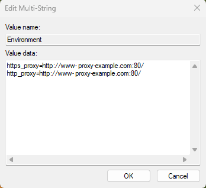
    [Description of the illustration regedit_env.png](img_text/regedit_env.md)

5.  Click OK.
6.  Restart the database server.
    For example:
        net start Oracle_service_name
        sqlplus "/as sysdba"
        startup;
7.  Open the PDBs.
        ALTER PLUGGABLE DATABASE ALL OPEN;

**Parent topic:** Creating a Network Proxy for the Database to Connect with the Internet

#### 8.4.9 Enabling Clients to Directly Retrieve Azure Tokens

You can set parameters to enable clients to directly retrieve Azure tokens on their own.

This feature is available in environments that use JDBC-thin clients, ODP.NET Core classes, or ODP.NET Managed Driver classes. It enables the client to display authentication requests to the user by using the following methods:

- If the user is using a Web application, then the authentication request appears in a dialog box prompting the user for their authentication.
- If the user is working in a command line shell, then the authentication request appears as a prompt.

To enable this feature for either of these authentication request types, you must set the following parameters in either the client's `sqlnet.ora` file or in a connect string. The connect string takes precedence over `sqlnet.ora`.

Table 8-1 Parameters to Directly Retrieve Tokens

| Parameter             | Description                                                                                                                                                                                                                                                                                                                                                                                                                                                                                                                                                                                                                                                                                                                                                                                                                                                                                                                                                                                                                                                                                                                                                                                                                                                                                                                                                                                                                                |
|:----------------------|:-------------------------------------------------------------------------------------------------------------------------------------------------------------------------------------------------------------------------------------------------------------------------------------------------------------------------------------------------------------------------------------------------------------------------------------------------------------------------------------------------------------------------------------------------------------------------------------------------------------------------------------------------------------------------------------------------------------------------------------------------------------------------------------------------------------------------------------------------------------------------------------------------------------------------------------------------------------------------------------------------------------------------------------------------------------------------------------------------------------------------------------------------------------------------------------------------------------------------------------------------------------------------------------------------------------------------------------------------------------------------------------------------------------------------------------------|
| `TOKEN_AUTH`          | Sets the token authentication. Enter one of the following values: • `AZURE_DEVICE_CODE` signals the database driver to follow the device code flow for requesting an Azure AD access token. This is also for human users, when their environment cannot open a browser: a command line only environment. A device code and Azure AD login URL is written out to the standard output of the tool and the user logs into Azure AD on their cellphone or laptop, and then enters the device code. Users are authenticated through a separate channel and then allowed to continue access the database if the authentication is successful. • `AZURE_INTERACTIVE` tells the driver that it must flow the Azure OAuth2 interactive (OAuth2 authorization) flow to get an access token for the database. This configures the database client to get the token directly from Azure AD without having to use an external script. This is for human users who are logging into tools such as SQLcl and can also open a browser window in their environment to authenticate to Azure AD. • `AZURE_MANAGED_IDENTITY` enables the driver to authenticate as an identity that has been assigned to the host system. The host system must be a resource which is managed by Azure AD, such as a virtual machine. • `AZURE_SERVICE_PRINCIPAL` enables the driver to authenticate using a secret or certificate of the registered application. |
| `AZURE_CLIENT_ID`     | The unique application (client) ID assigned to your app by Azure AD when the app was registered. This app is your database client that will request to get an access token for the database for the user.                                                                                                                                                                                                                                                                                                                                                                                                                                                                                                                                                                                                                                                                                                                                                                                                                                                                                                                                                                                                                                                                                                                                                                                                                                  |
| `AZURE_DB_APP_ID_URI` | The application ID URI is a URI that uniquely identifies the application in your Azure AD. You get this value from the overview screen of your database Azure AD app registration.                                                                                                                                                                                                                                                                                                                                                                                                                                                                                                                                                                                                                                                                                                                                                                                                                                                                                                                                                                                                                                                                                                                                                                                                                                                         |
| `AZURE_TENANT_ID`     | Specifies the Azure tenancy ID of the database.                                                                                                                                                                                                                                                                                                                                                                                                                                                                                                                                                                                                                                                                                                                                                                                                                                                                                                                                                                                                                                                                                                                                                                                                                                                                                                                                                                                            |

**Parent topic:** Configuring Azure AD Client Connections to the Oracle Database

### 8.5 Configuring Microsoft Azure AD Proxy Authentication

Proxy authentication allows an Azure AD user to proxy to a database schema for tasks such as application maintenance.

- About Configuring Microsoft Azure AD Proxy Authentication
  Azure users can connect to Oracle Autonomous Database by using proxy authentication.
- Configuring Proxy Authentication for the Azure AD User
  To configure proxy authentication for an Azure AD user, this user must already have a mapping to a global schema (exclusive or shared mapping). A separate database schema for the Azure AD user to proxy to must also be available.
- Validating the Azure AD User Proxy Authentication
  You can validate the Azure AD user proxy configuration for token authentication.

**Parent topic:** Authenticating and Authorizing Microsoft Azure Active Directory Users for Oracle Databases

#### 8.5.1 About Configuring Microsoft Azure AD Proxy Authentication

Azure users can connect to Oracle Autonomous Database by using proxy authentication.

Proxy authentication is typically used to authenticate the real user and then authorize them to use a database schema with the schema privileges and roles in order to manage an application. Alternatives such as sharing the application schema password are considered insecure and unable to audit which actual user performed an action.

A use case can be in an environment in which a named Azure AD user who is an application database administrator can authenticate by using their credentials and then proxy to a database schema user (for example, `hrapp`). This authentication enables the Azure AD administrator to use the `hrapp` privileges and roles as user `hrapp` in order to perform application maintenance, yet still use their Azure AD credentials for authentication. An application database administrator can sign in to the database and then proxy to an application schema to manage this schema.

**Parent topic:** Configuring Microsoft Azure AD Proxy Authentication

#### 8.5.2 Configuring Proxy Authentication for the Azure AD User

To configure proxy authentication for an Azure AD user, this user must already have a mapping to a global schema (exclusive or shared mapping). A separate database schema for the Azure AD user to proxy to must also be available.

After you ensure that you have this type of user, alter the database user to allow the Azure AD user to proxy to it.

1.  Log in to the Autonomous Database instance as a user who has the `ALTER USER` system privileges.
2.  Grant permission for the Azure AD user to proxy to the local database user account.
    An Azure AD user cannot be referenced in the command so the proxy must be created between the database global user (mapped to the Azure AD user) and the target database user.
    In the following example, `hrapp` is the database schema to proxy to, and `peterfitch_schema` is the database global user exclusively mapped to user `peterfitch`.
        ALTER USER hrapp GRANT CONNECT THROUGH peterfitch_schema;

At this stage, the Azure AD user can log in to the database instance using the proxy. For example:

    CONNECT [hrapp]/@connect_string

**Parent topic:** Configuring Microsoft Azure AD Proxy Authentication

#### 8.5.3 Validating the Azure AD User Proxy Authentication

You can validate the Azure AD user proxy configuration for token authentication.

1.  Log in to the Oracle Autonomous Database instance as a user who has the `CREATE USER` and `ALTER USER` system privileges.
2.  Connect as the Azure AD user and run the `SHOW USER` and `SELECT SYS_CONTEXT` commands.
    For example, suppose you want to check the proxy authentication of the Azure AD user `peterfitch` when they proxy to database user `hrapp`:
        CONNECT [hrapp]/@connect_string
        SHOW USER;
        --The output should be USER is "HRAPP "
        SELECT SYS_CONTEXT('USERENV','AUTHENTICATION_METHOD') FROM DUAL;
        --The output should be "TOKEN_GLOBAL"
        SELECT SYS_CONTEXT('USERENV','PROXY_USER') FROM DUAL;
        --The output should be "PETERFITCH_SCHEMA"
        SELECT SYS_CONTEXT('USERENV','CURRENT_USER') FROM DUAL;
        --The output should be "HRAPP"

**Parent topic:** Configuring Microsoft Azure AD Proxy Authentication

### 8.6 Troubleshooting Microsoft Azure AD Connections

You can use trace files to diagnose problems with Microsoft Azure AD connections. You also can easily remedy `ORA-12599` and `ORA-03114` errors.

- Trace Files for Troubleshooting Oracle Database Client Connections with Azure AD
  You can use trace files to troubleshoot the Oracle Database integration with Microsoft Azure AD.
- ORA-12599 and ORA-03114 Errors Caused When Trying to Access a Database Using a Token
  The `ORA-12599: TNS: cryptographic checksum mismatch` and `ORA-03114: not connected to ORACLE` errors indicate that the database to which you are trying to connect is protected by native network encryption.
- Checking the Azure AD Access Token Version
  You can check the version of the Microsoft Azure AD access token that your site uses by using the JSON Web Tokens web site.

**Parent topic:** Authenticating and Authorizing Microsoft Azure Active Directory Users for Oracle Databases

#### 8.6.1 Trace Files for Troubleshooting Oracle Database Client Connections with Azure AD

You can use trace files to troubleshoot the Oracle Database integration with Microsoft Azure AD.

- About Trace Files Used for Troubleshooting Connections
  You can generate two levels of trace files to troubleshoot Microsoft Azure AD connections on client side.
- Setting Client Tracing for Token Authentication
  You can add `EVENT` settings to the client-side `sqlnet.ora` file to control client tracing.

**Parent topic:** Troubleshooting Microsoft Azure AD Connections

##### 8.6.1.1 About Trace Files Used for Troubleshooting Connections

You can generate two levels of trace files to troubleshoot Microsoft Azure AD connections on client side.

The two levels of trace files that you can generate are as follows:

- Low level tracing prints traces in case of failures:
  - If TCPS is not set up for the Azure AD connection, then it prints a message that the protocol has to be TCPS.
  - If `SSL_SERVER_DN_MATCH` is not set to `TRUE`, then it prints a message that the value is `FALSE`.
  - If `TOKEN_LOCATION` has not been specified, then it prints a message that the token location does not exist.
  - If the token is not present at the specified `TOKEN_LOCATION`, then it prints a message.
  - If the application has passed in the token without setting `OCI_ATTR_TOKEN_ISBEARER` to true, it prints a message for the missing attribute.
  - If the application has set `OCI_ATTR_TOKEN_ISBEARER` to `TRUE` and not passed in the token, it prints a message for the missing attribute.
  - If the token has expired, then it prints a message.
- High level tracing prints traces in case of failure as mentioned above. In addition, it prints traces in case of success, as follows:
  - It prints where `SSL_SERVER_DN_MATCH` is present, `tnsnames.ora` or `sqlnet.ora`. It also prints the value as `TRUE` if set to `TRUE`.
  - If both the token and `OCI_ATTR_TOKEN_ISBEARER=true` are set by the application, then it prints a message.
  - If `TOKEN_AUTH` has the correct value `OAUTH`, then it prints the value.
  - If the token is not expired, then it prints a message.

**Parent topic:** Trace Files for Troubleshooting Oracle Database Client Connections with Azure AD

##### 8.6.1.2 Setting Client Tracing for Token Authentication

You can add `EVENT` settings to the client-side `sqlnet.ora` file to control client tracing.

These `EVENT` settings can be used for both IAM and Azure AD connections with Oracle Database.

- Use either of the following methods:
  - Add the following settings to the client side `sqlnet.ora` file:
    - `EVENT_25701=14` for low level tracing
    - `EVENT_25701=15` for high level tracing

  <!-- -->

  - Set the environment variable `EVENT_25701`:
    - `EVENT_25701=14` for low level tracing
    - `EVENT_25701=15` for high level tracing

  Client trace files are created in the following locations:
  - Linux: `$ORACLE_HOME/log/diag/clients`
  - Windows: `%ORACLE_HOME%\log\diag\clients`

  You can use the `ADR_BASE` parameter in the client side `sqlnet.ora` to specify the directory in which tracing messages are stored. Ensure that the directory path is valid and has write permissions. Ensure that the `DIAG_ADR_ENABLED` parameter is not set to `FALSE`.

  An example of setting `ADR_BASE` is as follows:

      ADR_BASE=/oracle/oauth2/trace

**Parent topic:** Trace Files for Troubleshooting Oracle Database Client Connections with Azure AD

#### 8.6.2 ORA-12599 and ORA-03114 Errors Caused When Trying to Access a Database Using a Token

The `ORA-12599: TNS: cryptographic checksum mismatch` and `ORA-03114: not connected to ORACLE` errors indicate that the database to which you are trying to connect is protected by native network encryption.

When tokens are being used to access an Oracle database, a Transport Layer Security (TLS) connection must be established, not network native encryption. To remedy these errors, ensure that TLS is properly configured for your database. You should test the configuration with a local database user name and password and check the following `SYSCONTEXT USERENV` parameters:

- `NETWORK_PROTOCOL`

- `TLS_VERSION`

**Related Topics**

- [Configuring Transport Layer Security Authentication](configuring-secure-sockets-layer-authentication.md)

**Parent topic:** Troubleshooting Microsoft Azure AD Connections

#### 8.6.3 Checking the Azure AD Access Token Version

You can check the version of the Microsoft Azure AD access token that your site uses by using the JSON Web Tokens web site.

By default, Azure AD Microsoft Azure AD v1 access token, but your site may have chosen to use v2. Oracle Database supports v1 tokens and Autonomous Database Serverless supports v2 tokens, as well. If you want to use the v2 access tokens, then you can enable their use for the Oracle database. To find the version of the Azure AD access token that you are using, you can either check with your Azure AD administrator, or confirm the version from the JSON Web Tokens website, as follows.

1.  Go to the JSON Web Tokens website.
        https://jwt.io/
2.  Copy and paste the token string into the Encoded field.
3.  Check the Decoded field, which displays information about the token string.
    Near or at the bottom of the field, you will see a claim entitled `ver`, which indicates either of the following versions:
    - `"ver": "1.0"`
    - `"ver": "2.0"`

**Related Topics**

- Enabling Microsoft Azure AD v2 Access Tokens

**Parent topic:** Troubleshooting Microsoft Azure AD Connections
