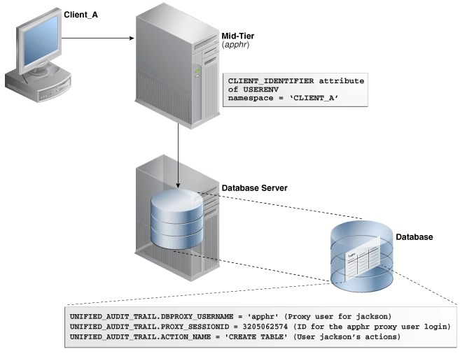
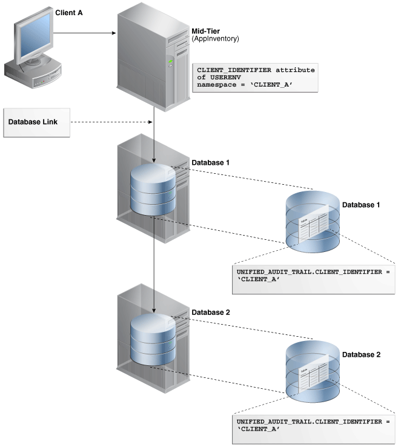

## 27 Configuring Audit Policies

Unified auditing supports custom unified audit policies, predefined unified auditing policies, and fine-grained auditing.

- Selecting an Auditing Type
  You can audit general activities (such as SQL statement actions), commonly used auditing activities, or fine-grained audit scenarios.
- Auditing Activities with Unified Audit Policies and the AUDIT Statement
  You can use the `CREATE AUDIT POLICY` and `AUDIT` statements to use unified auditing policies.
- Auditing Activities with the Predefined Unified Audit Policies
  Oracle Database provides predefined unified audit policies that cover commonly used security-relevant audit settings.
- Auditing Specific Activities with Fine-Grained Auditing
  Fine-grained auditing enables you to create audit policies at the granular level.
- Audit Policy Data Dictionary Views
  Data dictionary and dynamic views can be used to find detailed auditing information.

**Parent topic:** [Monitoring Database Activity with Auditing](part_6.md)

### 27.1 Selecting an Auditing Type

You can audit general activities (such as SQL statement actions), commonly used auditing activities, or fine-grained audit scenarios.

- Auditing SQL Statements, Privileges, and Other General Activities
  You can audit many types of objects, from SQL statements to other Oracle Database components, such as Oracle Database Vault..
- Auditing Commonly Used Security-Relevant Activities
  Oracle Database provides a set default unified audit policies that you can choose from for commonly used security-relevant audits.
- Auditing Specific, Fine-Grained Activities
  Use fine-grained auditing if you want to audit individual columns and use event handlers.

**Parent topic:** Configuring Audit Policies

#### 27.1.1 Auditing SQL Statements, Privileges, and Other General Activities

You can audit many types of objects, from SQL statements to other Oracle Database components, such as Oracle Database Vault..

In addition, you can create policies that use conditions. However, if you want to audit specific columns or use event handlers, you must use fine-grained auditing.

The general steps for performing this type of auditing are as follows:

1.  In most cases, use the `CREATE AUDIT POLICY` statement to create an audit policy. If you must audit application context values, then use the `AUDIT` statement.
    See the relevant categories under Auditing Activities with Unified Audit Policies and the AUDIT Statement.
2.  If you are creating an audit policy, then use the `AUDIT` statement to enable it and optionally apply (or exclude) the audit settings to one or more users, including administrative users who log in with the `SYSDBA` administrative privilege (for example, the `SYS` user).
    `AUDIT` also enables you to create an audit record upon an action's success, failure, or both.

    See Enabling and Applying Unified Audit Policies to Users and Roles.
3.  Query the `UNIFIED_AUDIT_TRAIL` view to find the generated audit records.
    See also Audit Policy Data Dictionary Views for additional views.
4.  Periodically archive and purge the contents of the audit trail.
    See [Purging Audit Trail Records](administering-the-audit-trail.md).

**Parent topic:** Selecting an Auditing Type

#### 27.1.2 Auditing Commonly Used Security-Relevant Activities

Oracle Database provides a set default unified audit policies that you can choose from for commonly used security-relevant audits.

The general steps for performing this type of auditing are as follows:

1.  See Auditing Activities with the Predefined Unified Audit Policies to learn about the default audit policies.
2.  Use the `AUDIT` statement enable the policy and optionally apply (or exclude) the audit settings to one or more users.
    See Enabling and Applying Unified Audit Policies to Users and Roles.
3.  Query the `UNIFIED_AUDIT_TRAIL` view to find the generated audit records.
    See also Audit Policy Data Dictionary Views for additional views.
4.  Periodically archive and purge the contents of the audit trail.
    See [Purging Audit Trail Records](administering-the-audit-trail.md).

**Parent topic:** Selecting an Auditing Type

#### 27.1.3 Auditing Specific, Fine-Grained Activities

Use fine-grained auditing if you want to audit individual columns and use event handlers.

This type of auditing provides all the features available in unified audit policies.

The general steps for fine-grained auditing are as follows:

1.  See Auditing Specific Activities with Fine-Grained Auditing to understand more about auditing specific activities.
2.  Use the `DBMS_FGA` PL/SQL package to configure fine-grained auditing policies. See Using the DBMS_FGA PL/SQL Package to Manage Fine-Grained Audit Policies.
3.  Query the `UNIFIED_AUDIT_TRAIL` view to find the generated audit records.
    See also Audit Policy Data Dictionary Views for additional views.
4.  Periodically archive and purge the contents of the audit trail.
    See [Purging Audit Trail Records](administering-the-audit-trail.md).

**Parent topic:** Selecting an Auditing Type

### 27.2 Auditing Activities with Unified Audit Policies and the AUDIT Statement

You can use the `CREATE AUDIT POLICY` and `AUDIT` statements to use unified auditing policies.

- About Auditing Activities with Unified Audit Policies and AUDIT
  You can audit the several types of activities, using unified audit policies and the `AUDIT` SQL statement.
- Best Practices for Creating Custom Unified Audit Policies
  You can enable multiple policies at a time in the database, but ideally, limit the number of enabled policies.
- Syntax for Creating a Unified Audit Policy
  To create a unified audit policy, you must use the `CREATE AUDIT POLICY` statement.
- Auditing Roles
  You can use the `CREATE AUDIT POLICY` statement to audit database roles.
- Auditing System Privileges
  You can use the `CREATE AUDIT POLICY` statement to audit system privileges.
- Auditing Administrative Users
  You can create unified audit policies to capture the actions of administrative user accounts, such as `SYS`.
- Auditing Object Actions
  You can use the `CREATE AUDIT POLICY` statement to audit object actions.
- Auditing the READ ANY TABLE and SELECT ANY TABLE Privileges
  The `CREATE AUDIT POLICY` statement can audit the `READ ANY TABLE` and `SELECT ANY TABLE` privileges.
- Auditing SQL Statements and Privileges in a Multitier Environment
  You can create a unified audit policy to audit the activities of a client in a multitier environment.
- Creating a Condition for a Unified Audit Policy
  You can use the `CREATE AUDIT POLICY` statement to create conditions for a unified audit policy.
- Auditing Application Context Values
  You can use the `AUDIT` statement to audit application context values.
- Auditing Oracle Database Real Application Security Events
  You can use `CREATE AUDIT POLICY` statement to audit Oracle Database Real Application Security events.
- Auditing Oracle Recovery Manager Events
  You can use the `CREATE AUDIT POLICY` statement to audit Oracle Recovery Manager events.
- Auditing Oracle Database Vault Events
  In an Oracle Database Vault environment, the `CREATE AUDIT POLICY` statement can audit Database Vault activities.
- Auditing Oracle Label Security Events
  In an Oracle Label Security environment, the `CREATE AUDIT POLICY` statement can audit Oracle Label Security activities.
- Auditing Oracle Data Mining Events
  You can use the `CREATE AUDIT POLICY` statement to audit Oracle Data Mining events.
- Auditing Oracle Data Pump Events
  You can use the `CREATE AUDIT POLICY` statement to audit Oracle Data Pump.
- Auditing Oracle SQL\*Loader Direct Load Path Events
  You can use the `CREATE AUDIT POLICY` statement to audit Oracle SQL\*Loader direct load path events.
- Auditing Only Top-Level Statements
  You can audit top-level SQL or PL/SQL statements to limit the volume of audit records.
- Unified Audit Policies or AUDIT Settings in a Multitenant Environment
  In a multitenant environment, you can create unified audit policies for individual PDBs and in the root.
- Altering Unified Audit Policies
  You can use the `ALTER AUDIT POLICY` statement to modify a unified audit policy.
- Enabling and Applying Unified Audit Policies to Users and Roles
  You can use the `AUDIT POLICY` statement to enable and apply unified audit policies to users and roles.
- Disabling Unified Audit Policies
  You can use the `NOAUDIT POLICY` statement to disable a unified audit policy.
- Dropping Unified Audit Policies
  You can use the `DROP AUDIT POLICY` statement to drop a unified audit policy.
- Tutorial: Auditing Nondatabase Users
  This tutorial shows how to create a unified audit policy that uses a client identifier to audit a nondatabase user's actions.

**Related Topics**

- Auditing SQL Statements, Privileges, and Other General Activities

**Parent topic:** Configuring Audit Policies

#### 27.2.1 About Auditing Activities with Unified Audit Policies and AUDIT

You can audit the several types of activities, using unified audit policies and the `AUDIT` SQL statement.

The kinds of activities that you can audit are as follows:

- User accounts (including administrative users who log in with the `SYSDBA` administrative privilege), roles, and privileges

- Object actions, such as dropping a table or a running a procedure

- Application context values

- Activities from Oracle Database Real Application Security, Oracle Recovery Manager, Oracle Data Mining, Oracle Data Pump, Oracle SQL\*Loader direct path events, Oracle Database Vault, and Oracle Label Security

To find system actions to audit, you can query the `AUDITABLE_SYSTEM_ACTIONS` system table.

To accomplish this, depending on what you want to audit, use the following:

- Unified audit policies. A unified audit policy is a named group of audit settings that enable you to audit a particular aspect of user behavior in the database. To create the policy, you use the `CREATE AUDIT POLICY` statement. The policy can be as simple as auditing the activities of a single user or you can create complex audit policies that use conditions. You can have more than one audit policy in effect at a time in a database. An audit policy can contain both system-wide and object-specific audit options. Most of the auditing that you will do for general activities (including standard auditing) requires the use of audit policies.

- AUDIT and NOAUDIT SQL statements. The `AUDIT` and `NOAUDIT` SQL statements enable you to, respectively, enable and disable an audit policy. The `AUDIT` statement also lets you include or exclude specific users for the policy. The `AUDIT` and `NOAUDIT` statements also enable you to audit application context values.

- For Oracle Recovery Manager, you do not create unified audit policies. The `UNIFIED_AUDIT_TRAIL` view automatically captures commonly audited Recovery Manager events.

**Parent topic:** Auditing Activities with Unified Audit Policies and the AUDIT Statement

#### 27.2.2 Best Practices for Creating Custom Unified Audit Policies

You can enable multiple policies at a time in the database, but ideally, limit the number of enabled policies.

The unified audit policy syntax is designed so that you can write one policy that covers all the audit settings that your database needs. A good practice is to group related options into a single policy instead of creating multiple small policies. This enables you to manage the policies much easier. As an example, each predefined audit policies contains multiple audit settings within one unified audit policy.

Limiting the number of enabled audit policies for a user session has the following benefits:

- It reduces the logon overhead that is associated with loading the audit policy's details into the session's UGA memory. If the enabled policy count is less, then less time is spent in loading the policy information.

- It reduces the session's UGA memory consumption, because a fewer number of policies are required to be cached in UGA memory.

- It makes the internal audit check functionality more efficient, which determines whether to generate an audit record for its associated event.

- If you have configured a unified audit policy for `LOGON` statements, then audit records for both direct logins as well as `ALTER SESSION` and `SET CONTAINER` statements are generated.

**Related Topics**

- Auditing Activities with the Predefined Unified Audit Policies

**Parent topic:** Auditing Activities with Unified Audit Policies and the AUDIT Statement

#### 27.2.3 Syntax for Creating a Unified Audit Policy

To create a unified audit policy, you must use the `CREATE AUDIT POLICY` statement.

When you create a unified audit policy, Oracle Database stores it in a first class object that is owned by the `SYS` schema, not in the schema of the user who created the policy.

Example 27-1 shows the syntax for the `CREATE AUDIT POLICY` statement.

Example 27-1 Syntax for the CREATE AUDIT POLICY Statement

    CREATE AUDIT POLICY policy_name
        { {privilege_audit_clause [action_audit_clause ] [role_audit_clause ]}
            | { action_audit_clause  [role_audit_clause ] }
            | { role_audit_clause }
         }
        [WHEN audit_condition EVALUATE PER {STATEMENT|SESSION|INSTANCE}]
        [ONLY TOPLEVEL]
        [CONTAINER = {CURRENT | ALL}];

In this specification:

- `privilege_audit_clause` describes privilege-related audit options. See Auditing System Privileges for details. The detailed syntax for configuring privilege audit options is as follows:

      privilege_audit_clause  :=  PRIVILEGES  privilege1 [, privilege2]

- `action_audit_clause` and `standard_actions` describe object action-related audit options. See Auditing Object Actions. The syntax is as follows:

      action_audit_clause := {standard_actions | component_actions}
                                               [, component_actions ]
      standard_actions :=
           ACTIONS action1 [ ON {schema.obj_name
                                                | DIRECTORY directory_name
                                                | MINING MODEL schema.obj_name
                                                 }
                      ]
                 [, action2 [ ON {schema.obj_name
                                                | DIRECTORY directory_name
                                                | MINING MODEL schema.obj_name
                         }
                      ]

- `component_actions` enables you to create an audit policy for Oracle Label Security, Oracle Database Real Application Security, Oracle Database Vault, Oracle Data Pump, or Oracle SQL\*Loader. See the appropriate section under Auditing Activities with Unified Audit Policies and the AUDIT Statement for more information. The syntax is:

      component_actions :=
           ACTIONS COMPONENT=[OLS|XS] action1 [,action2 ] |
           ACTIONS COMPONENT=DV DV_action ON DV_object_name |
           ACTIONS COMPONENT=DATAPUMP [ EXPORT | IMPORT | ALL ] |
           ACTIONS COMPONENT=DIRECT_LOAD [ LOAD | ALL ]

- `role_audit_clause` enables you to audit roles. See Auditing Roles. The syntax is:

      role_audit_clause := ROLES role1 [, role2]

- `WHEN ``audit_condition`` EVALUATE PER` enables you to specify a function to create a condition for the audit policy and the evaluation frequency. You must include the `EVALUATE PER` clause with the `WHEN` condition. See Creating a Condition for a Unified Audit Policy. The syntax is:

      WHEN 'audit_condition := function operation value_list'
      EVALUATE PER {STATEMENT|SESSION|INSTANCE}

- `ONLY TOPLEVEL` allows users to audit only the top-level operations that are performed for the actions that were configured as part of this audit policy. See Auditing Only Top-Level Statements.

- `CONTAINER`, allows users to specify if the audit policy will apply to the current CDB or application PDB (`CURRENT`) or across the entire multitenant environment (`ALL`). See Unified Audit Policies or AUDIT Settings in a Multitenant Environment.
  **Note:**

  `CONTAINER=ALL` is only applicable to common objects and only common audit policies can be created to audit common objects.

This syntax is designed to audit any of the components listed in the policy. For example, suppose you create the following policy:

    CREATE AUDIT POLICY table_pol
    PRIVILEGES CREATE ANY TABLE, DROP ANY TABLE
    ROLES emp_admin, sales_admin;

The audit trail will capture SQL statements that require the `CREATE ANY TABLE` system privilege or the `DROP ANY TABLE` system privilege or any system privilege directly granted to the role `emp_admin` or any system privilege directly granted to the role `sales_admin`. (Be aware that it audits privileges that are directly granted, not privileges that are granted recursively through a role.)

After you create the policy, you must enable it by using the `AUDIT` statement. Optionally, you can apply the policy to one or more users, exclude one or more users from the policy, and designate whether an audit record is written when the audited action succeeds, fails, or both succeeds or fails. See Enabling and Applying Unified Audit Policies to Users and Roles.

**Parent topic:** Auditing Activities with Unified Audit Policies and the AUDIT Statement

#### 27.2.4 Auditing Roles

You can use the `CREATE AUDIT POLICY` statement to audit database roles.

- About Role Auditing
  When you audit a role, Oracle Database audits all system privileges that are directly granted to the role.
- Configuring Role Unified Audit Policies
  To create a unified audit policy to capture role use, you must include the `ROLES` clause in the `CREATE AUDIT POLICY` statement.
- Example: Auditing the DBA Role in a Multitenant Environment
  The `CREATE AUDIT POLICY` statement can audit roles in a multitenant environment.

**Parent topic:** Auditing Activities with Unified Audit Policies and the AUDIT Statement

##### 27.2.4.1 About Role Auditing

When you audit a role, Oracle Database audits all system privileges that are directly granted to the role.

You can audit any role, including user-defined roles. If you create a common unified audit policy for roles with the `ROLES` audit option, then you must specify only common roles in the role list. When such a policy is enabled, Oracle Database audits all system privileges that are commonly and directly granted to the common role. The system privileges that are locally granted to the common role will not be audited. To find if a role was commonly granted, query the `DBA_ROLES` data dictionary view. To find if the privileges granted to the role were commonly granted, query the `ROLE_SYS_PRIVS` view.

**Related Topics**

- [Predefined Roles in an Oracle Database Installation](configuring-privilege-and-role-authorization.md)

**Parent topic:** Auditing Roles

##### 27.2.4.2 Configuring Role Unified Audit Policies

To create a unified audit policy to capture role use, you must include the `ROLES` clause in the `CREATE AUDIT POLICY` statement.

- Use the following syntax to create a unified audit policy that audits roles:

      CREATE AUDIT POLICY policy_name
       ROLES role1 [, role2];

For example:

    CREATE AUDIT POLICY audit_roles_pol
     ROLES IMP_FULL_DATABASE, EXP_FULL_DATABASE;

You can build more complex role unified audit policies, such as those that include conditions. Remember that after you create the policy, you must use the `AUDIT` statement to enable it.

**Related Topics**

- Syntax for Creating a Unified Audit Policy

**Parent topic:** Auditing Roles

##### 27.2.4.3 Example: Auditing the DBA Role in a Multitenant Environment

The `CREATE AUDIT POLICY` statement can audit roles in a multitenant environment.

The following example shows how to audit a predefined common role `DBA` in a multitenant environment.

Example 27-2 Auditing the DBA Role in a Multitenant Environment

    CREATE AUDIT POLICY role_dba_audit_pol
     ROLES DBA
     CONTAINER = ALL;

    AUDIT POLICY role_dba_audit_pol;

**Parent topic:** Auditing Roles

#### 27.2.5 Auditing System Privileges

You can use the `CREATE AUDIT POLICY` statement to audit system privileges.

- About System Privilege Auditing
  System privilege auditing audits activities that successfully use a system privilege, such as `READ` `ANY` `TABLE.`
- System Privileges That Can Be Audited
  You can audit the use of almost any system privilege.
- System Privileges That Cannot Be Audited
  Several system privileges cannot be audited.
- Configuring a Unified Audit Policy to Capture System Privilege Use
  The `PRIVILEGES` clause in the `CREATE AUDIT POLICY` statement audits system privilege use.
- Example: Auditing a User Who Has ANY Privileges
  The `CREATE AUDIT POLICY` statement can audit users for `ANY` privileges.
- Example: Using a Condition to Audit a System Privilege
  The `CREATE AUDIT POLICY` statement can create an audit policy that uses a condition to audit a system privilege.
- How System Privilege Unified Audit Policies Appear in the Audit Trail
  The `UNIFIED_AUDIT_TRAIL` data dictionary view lists system privilege audit events.

**Parent topic:** Auditing Activities with Unified Audit Policies and the AUDIT Statement

##### 27.2.5.1 About System Privilege Auditing

System privilege auditing audits activities that successfully use a system privilege, such as `READ` `ANY` `TABLE.`

In this kind of auditing, SQL statements that require the audited privilege to succeed are recorded.

A single unified audit policy can contain both privilege and action audit options. Do not audit the privilege use of administrative users such as `SYS`. Instead, audit their object actions.

Be aware that a single query can generate multiple audit records, one for each object that is being accessed in the query and if auditing is enabled on all these objects. For example, while you query the view, multiple audit records can be generated for each of the underlying objects that is referenced by the view itself.

**Note:**

You can audit system privileges, objects, database events, and so on. However, if you must find database privilege usage (for example, which privileges that have been granted to a given role are used), and generate a report of the used and unused privileges, then you can create a privilege capture.

**Related Topics**

- Auditing Object Actions
- [Performing Privilege Analysis to Identify Privilege Use](performing-privilege-analysis-identify-privilege-use.md)

**Parent topic:** Auditing System Privileges

##### 27.2.5.2 System Privileges That Can Be Audited

You can audit the use of almost any system privilege.

To find a list of auditable system privileges, you can query the `SYSTEM_PRIVILEGE_MAP` table.

For example:

    SELECT NAME FROM SYSTEM_PRIVILEGE_MAP;

    NAME
    -------------
    ALTER ANY CUBE BUILD PROCESS
    SELECT ANY CUBE BUILD PROCESS
    ALTER ANY MEASURE FOLDER
    ...

Similar to action audit options, privilege auditing audits the use of system privileges that have been granted to database users. If you set similar audit options for both SQL statement and privilege auditing, then only a single audit record is generated. For example, if two policies exist, with one auditing `EXECUTE PROCEDURE` specifically on the `HR.PROC` procedure and the second auditing `EXECUTE PROCEDURE` in general (all procedures), then only one audit record is written.

Privilege auditing does not occur if the action is already permitted by the existing owner and object privileges. Privilege auditing is triggered only if the privileges are insufficient, that is, only if what makes the action possible is a system privilege. For example, suppose that user `SCOTT` has been granted the `SELECT ANY TABLE` privilege and `SELECT ANY TABLE` is being audited. If `SCOTT` selects his own table (for example, `SCOTT.EMP`), then the `SELECT ANY TABLE` privilege is not used. Because he performed the `SELECT` statement within his own schema, no audit record is generated. On the other hand, if `SCOTT` selects from another schema (for example, the `HR.EMPLOYEES` table), then an audit record is generated. Because `SCOTT` selected a table outside his own schema, he needed to use the `SELECT ANY TABLE` privilege.

**Parent topic:** Auditing System Privileges

##### 27.2.5.3 System Privileges That Cannot Be Audited

Several system privileges cannot be audited.

These privileges are:

- `INHERIT ANY PRIVILEGE`

- `INHERIT PRIVILEGE`

- `TRANSLATE ANY SQL`

- `TRANSLATE SQL`

**Parent topic:** Auditing System Privileges

##### 27.2.5.4 Configuring a Unified Audit Policy to Capture System Privilege Use

The `PRIVILEGES` clause in the `CREATE AUDIT POLICY` statement audits system privilege use.

- Use the following syntax to create a unified audit policy that audits privileges:

      CREATE AUDIT POLICY policy_name
       PRIVILEGES privilege1 [, privilege2];

  For example:

      CREATE AUDIT POLICY my_simple_priv_policy
       PRIVILEGES SELECT ANY TABLE, CREATE LIBRARY;

You can build more complex privilege unified audit policies, such as those that include conditions. Remember that after you create the policy, you must use the `AUDIT` statement to enable it.

**Related Topics**

- Syntax for Creating a Unified Audit Policy

**Parent topic:** Auditing System Privileges

##### 27.2.5.5 Example: Auditing a User Who Has ANY Privileges

The `CREATE AUDIT POLICY` statement can audit users for `ANY` privileges.

Example 27-3 shows how to audit several `ANY` privileges of the user `HR_MGR`.

Example 27-3 Auditing a User Who Has ANY Privileges

    CREATE AUDIT POLICY hr_mgr_audit_pol
     PRIVILEGES DROP ANY TABLE, DROP ANY CONTEXT, DROP ANY INDEX, DROP ANY LIBRARY;

    AUDIT POLICY hr_mgr_audit_pol BY HR_MGR;

**Parent topic:** Auditing System Privileges

##### 27.2.5.6 Example: Using a Condition to Audit a System Privilege

The `CREATE AUDIT POLICY` statement can create an audit policy that uses a condition to audit a system privilege.

Example 27-4 shows how to use a condition to audit privileges that are used by two operating system users, `psmith` and `jrawlins`.

Example 27-4 Using a Condition to Audit a System Privilege

    CREATE AUDIT POLICY os_users_priv_pol
     PRIVILEGES SELECT ANY TABLE, CREATE LIBRARY
     WHEN 'SYS_CONTEXT (''USERENV'', ''OS_USER'') IN (''psmith'', ''jrawlins'')'
     EVALUATE PER SESSION;

    AUDIT POLICY os_users_priv_pol;

**Parent topic:** Auditing System Privileges

##### 27.2.5.7 How System Privilege Unified Audit Policies Appear in the Audit Trail

The `UNIFIED_AUDIT_TRAIL` data dictionary view lists system privilege audit events.

The following example, based on the unified audit policy `os_users_priv_pol` that was created in Example 27-4, shows a list of privileges used by the operating system user `psmith`.

    SELECT SYSTEM_PRIVILEGE_USED FROM UNIFIED_AUDIT_TRAIL
     WHERE OS_USERNAME = 'PSMITH' AND UNIFIED_AUDIT_POLICIES = 'OS_USERS_PRIV_POL';

    SYSTEM_PRIVILEGE_USED
    ----------------------
    SELECT ANY TABLE
    DROP ANY TABLE

**Note:**

If you have created an audit policy for the `SELECT ANY TABLE` system privilege, whether the user has exercised the `READ` object privilege or the `SELECT` object privilege will affect the actions that the audit trail captures.

**Related Topics**

- Auditing the READ ANY TABLE and SELECT ANY TABLE Privileges

**Parent topic:** Auditing System Privileges

#### 27.2.6 Auditing Administrative Users

You can create unified audit policies to capture the actions of administrative user accounts, such as `SYS`.

- Administrative User Accounts That Can Be Audited
  Oracle Database provides administrative user accounts that are associated with administrative privileges.
- Configuring a Unified Audit Policy to Capture Administrator Activities
  The `CREATE AUDIT POLICY` statement can audit administrative users.
- Example: Auditing the SYS User
  The `CREATE AUDIT POLICY` statement can audit the `SYS` user.

**Parent topic:** Auditing Activities with Unified Audit Policies and the AUDIT Statement

##### 27.2.6.1 Administrative User Accounts That Can Be Audited

Oracle Database provides administrative user accounts that are associated with administrative privileges.

Table 27-1 lists default administrative user accounts and the administrative privileges with which they are typically associated.

Table 27-1 Administrative Users and Administrative Privileges

| Administrative User Account | Administrative Privilege |
|:----------------------------|:-------------------------|
| `SYS`                       | `SYSDBA`                 |
| `PUBLIC`Foot 1   | `SYSOPER`                |
| `SYSASM`                    | `SYSASM`                 |
| `SYSBACKUP`                 | `SYSBACKUP`              |
| `SYSDG`                     | `SYSDG`                  |
| `SYSKM`                     | `SYSKM`                  |

Footnote 1

`PUBLIC` refers to the user `PUBLIC`, which is the effective user when you log in with the `SYSOPER` administrative privilege. It does not refer to the `PUBLIC` role.

**Related Topics**

- [Activities That Are Mandatorily Audited](administering-the-audit-trail.md)

**Parent topic:** Auditing Administrative Users

##### 27.2.6.2 Configuring a Unified Audit Policy to Capture Administrator Activities

The `CREATE AUDIT POLICY` statement can audit administrative users.

- To audit administrative users, create a unified audit policy and then apply this policy to the user, the same as you would for non-administrative users. Note that top-level statements by administrative users are mandatorily audited until the database opens.

**Parent topic:** Auditing Administrative Users

##### 27.2.6.3 Example: Auditing the SYS User

The `CREATE AUDIT POLICY` statement can audit the `SYS` user.

Example 27-5 shows how to audit grants of the `DBMS_FGA` PL/SQL package by user `SYS`.

Example 27-5 Auditing the SYS User

    CREATE AUDIT POLICY dbms_fga_grants
     ACTIONS GRANT
     ON DBMS_FGA;

    AUDIT POLICY dbms_fga_grants BY SYS;

**Parent topic:** Auditing Administrative Users

#### 27.2.7 Auditing Object Actions

You can use the `CREATE AUDIT POLICY` statement to audit object actions.

- About Auditing Object Actions
  You can audit actions performed on specific objects, such as `UPDATE` statements on the `HR.EMPLOYEES` table.
- Object Actions That Can Be Audited
  Auditing object actions can be broad or focused (for example, auditing all user actions or only a select list of user actions).
- Configuring an Object Action Unified Audit Policy
  The `ACTIONS` clause in the `CREATE AUDIT POLICY` statement creates a policy that captures object actions.
- Example: Auditing Actions on SYS Objects
  The `CREATE AUDIT POLICY` statement can audit actions on `SYS` objects.
- Example: Auditing Multiple Actions on One Object
  The `CREATE AUDIT POLICY` statement can audit multiple actions on one object.
- Example: Auditing GRANT and REVOKE Operations on an Object
  The `CREATE AUDIT POLICY` statement can audit `GRANT` and `REVOKE` operations on objects, such as tables.
- Example: Auditing Both Actions and Privileges on an Object
  The `CREATE AUDIT POLICY` statement can audit both actions and privileges on an object, using a single policy.
- Example: Auditing All Actions on a Table
  The `CREATE AUDIT POLICY` statement can audit all actions on a table.
- Example: Auditing All Actions in the Database
  The `CREATE AUDIT POLICY` statement can audit all actions in the database.
- How Object Action Unified Audit Policies Appear in the Audit Trail
  The `UNIFIED_AUDIT_TRAIL` data dictionary view lists object action audit events.
- Auditing Functions, Procedures, Packages, and Triggers
  You can audit functions, procedures, PL/SQL packages, and triggers.
- Auditing of Oracle Virtual Private Database Predicates
  The unified audit trail automatically captures the predicates that are used in Oracle Virtual Private Database (VPD) policies.
- Audit Policies for Oracle Virtual Private Database Policy Functions
  Auditing can affect dynamic VPD policies, static VPD policies, and context-sensitive VPD policies.
- Unified Auditing with Editioned Objects
  When an editioned object has a unified audit policy, it applies in all editions in which the object is visible.

**Parent topic:** Auditing Activities with Unified Audit Policies and the AUDIT Statement

##### 27.2.7.1 About Auditing Object Actions

You can audit actions performed on specific objects, such as `UPDATE` statements on the `HR.EMPLOYEES` table.

The audit can include both DDL and DML statements that were used on the object. A single unified audit policy can contain both privilege and action audit options, as well as audit options set for multiple objects.

**Parent topic:** Auditing Object Actions

##### 27.2.7.2 Object Actions That Can Be Audited

Auditing object actions can be broad or focused (for example, auditing all user actions or only a select list of user actions).

Table 27-2 lists the object-level standard database action options. Audit policies for the `SELECT` SQL statement will capture `READ` actions as well as `SELECT` actions.

Table 27-2 Object-Level Standard Database Action Audit Option

| Object                                        | SQL Action That Can Be Audited                                                                                       |
|:----------------------------------------------|:---------------------------------------------------------------------------------------------------------------------|
| Table                                         | `ALTER`, `AUDIT`, `COMMENT`, `DELETE`, `FLASHBACK`, `GRANT`, `INDEX`, `INSERT`, `LOCK`, `RENAME`, `SELECT`, `UPDATE` |
| View                                          | `AUDIT`, `COMMENT`, `DELETE`, `FLASHBACK`, `GRANT`, `INSERT`, `LOCK`, `RENAME`, `SELECT`, `UPDATE`                   |
| Sequence                                      | `ALTER`, `AUDIT`, `GRANT`, `SELECT`                                                                                  |
| Procedure (including triggers)                | `AUDIT`, `EXECUTE`, `GRANT`                                                                                          |
| Function                                      | `AUDIT`, `EXECUTE`, `GRANT`                                                                                          |
| Package                                       | `AUDIT`, `EXECUTE`, `GRANT`                                                                                          |
| Materialized views                            | `ALTER`, `AUDIT`, `COMMENT`, `DELETE`, `INDEX`, `INSERT`, `LOCK`, `SELECT`, `UPDATE`                                 |
| Mining Model                                  | `AUDIT`, `COMMENT`, `GRANT`, `RENAME`, `SELECT`                                                                      |
| Directory                                     | `AUDIT`, `GRANT`, `READ`                                                                                             |
| Library                                       | `EXECUTE`, `GRANT`                                                                                                   |
| Object type                                   | `ALTER`, `AUDIT`, `GRANT`                                                                                            |
| Java schema objects (source, class, resource) | `AUDIT`, `EXECUTE`, `GRANT`                                                                                          |

**Related Topics**

- Auditing Functions, Procedures, Packages, and Triggers
- Audit Policies for Oracle Virtual Private Database Policy Functions

**Parent topic:** Auditing Object Actions

##### 27.2.7.3 Configuring an Object Action Unified Audit Policy

The `ACTIONS` clause in the `CREATE AUDIT POLICY` statement creates a policy that captures object actions.

- Use the following syntax to create a unified audit policy that audits object actions:

      CREATE AUDIT POLICY policy_name
       ACTIONS action1 [, action2 ON object1] [, action3 ON object2];

For example:

    CREATE AUDIT POLICY my_simple_obj_policy
     ACTIONS SELECT ON OE.ORDERS, UPDATE ON HR.EMPLOYEES;

Note that you can audit multiple actions on multiple objects, as shown in this example.

You can build complex object action unified audit policies, such as those that include conditions. Remember that after you create the policy, you must use the `AUDIT` statement to enable it.

**Related Topics**

- Syntax for Creating a Unified Audit Policy

**Parent topic:** Auditing Object Actions

##### 27.2.7.4 Example: Auditing Actions on SYS Objects

The `CREATE AUDIT POLICY` statement can audit actions on `SYS` objects.

Example 27-6 shows how to create an audit policy that audits `SELECT` statements on the `SYS.USER$` system table. The audit policy applies to all users, including `SYS` and `SYSTEM`.

Example 27-6 Auditing Actions on SYS Objects

    CREATE AUDIT POLICY select_user_dictionary_table_pol ACTIONS SELECT ON SYS.USER$;

    AUDIT POLICY select_user_dictionary_table_pol;

**Parent topic:** Auditing Object Actions

##### 27.2.7.5 Example: Auditing Multiple Actions on One Object

The `CREATE AUDIT POLICY` statement can audit multiple actions on one object.

Example 27-7 shows how to audit multiple SQL statements performed by users `jrandolph` and `phawkins` on the `app_lib` library.

Example 27-7 Auditing Multiple Actions on One Object

    CREATE AUDIT POLICY actions_on_hr_emp_pol1
     ACTIONS EXECUTE, GRANT
     ON app_lib;

    AUDIT POLICY actions_on_hr_emp_pol1 BY jrandolph, phawkins;

**Parent topic:** Auditing Object Actions

##### 27.2.7.6 Example: Auditing GRANT and REVOKE Operations on an Object

The `CREATE AUDIT POLICY` statement can audit `GRANT` and `REVOKE` operations on objects, such as tables.

Enabling auditing on `GRANT` operations on an object automatically enables the audit of `REVOKE` operations on the object as well.

Example 27-8 Auditing GRANT and REVOKE Operations

    CREATE AUDIT POLICY grant_revoke_pol
    ACTIONS GRANT ON HR.EMPLOYEES;

    AUDIT POLICY grant_revoke_pol;

To select from the `UNIFIED_AUDIT_TRAIL` data dictionary view for this type of policy, you can perform a query similar to the following. The grantee name (to whom the privilege is granted) is recorded in the `TARGET_USER` column.

    SELECT DBUSERNAME, OBJECT_PRIVILEGES, ACTION_NAME, OBJECT_SCHEMA, OBJECT_NAME, TARGET_USER
    FROM UNIFIED_AUDIT_TRAIL
    WHERE ACTION_NAME IN ('GRANT', 'REVOKE');

**Parent topic:** Auditing Object Actions

##### 27.2.7.7 Example: Auditing Both Actions and Privileges on an Object

The `CREATE AUDIT POLICY` statement can audit both actions and privileges on an object, using a single policy.

Example 27-9 shows a variation of Example 27-7, in which all `EXECUTE` and `GRANT` statements on the `app_lib` library using the `CREATE LIBRARY` privilege are audited.

Example 27-9 Auditing Both Actions and Privileges on an Object

    CREATE AUDIT POLICY actions_on_hr_emp_pol2
     PRIVILEGES CREATE LIBRARY
     ACTIONS EXECUTE, GRANT
     ON app_lib;

    AUDIT POLICY actions_on_hr_emp_pol2 BY jrandolph, phawkins;

You can audit directory objects. For example, suppose you create a directory object that contains a preprocessor program that the `ORACLE_LOADER` access driver will use. You can audit anyone who runs this program within this directory object.

**Parent topic:** Auditing Object Actions

##### 27.2.7.8 Example: Auditing All Actions on a Table

The `CREATE AUDIT POLICY` statement can audit all actions on a table.

You can use the `ALL` keyword to audit all actions. Oracle recommends that you audit all actions only on sensitive objects. `ALL` is useful in that it captures indirect `SELECT` operations. Example 27-10 shows how to audit all actions on the `HR.EMPLOYEES` table, except actions by user `pmulligan`.

Example 27-10 Auditing All Actions on a Table

    CREATE AUDIT POLICY all_actions_on_hr_emp_pol
     ACTIONS ALL ON HR.EMPLOYEES;

    AUDIT POLICY all_actions_on_hr_emp_pol EXCEPT pmulligan;

**Related Topics**

- Example: Auditing All Actions in the Database

**Parent topic:** Auditing Object Actions

##### 27.2.7.9 Example: Auditing All Actions in the Database

The `CREATE AUDIT POLICY` statement can audit all actions in the database.

To prevent the scenario of a large number of audit records being generated and quickly filling up the audit trail, even for all the recursive actions for this audit policy configuration, include the `ONLY TOPLEVEL` clause in the `CREATE AUDIT POLICY` statement. As an alternative to `ONLY TOPLEVEL`, you can create the `ACTIONS ALL` policy using a condition to so that only a subset of records are captured.

**Note:**

Use `ACTIONS ALL` auditing with caution. Do not enable it for users who must perform online transaction processing (OLTP) workloads. This will avoid generating a large number of audit records.

Example 27-11 shows how to audit all actions in the entire database.

Example 27-11 Auditing All Actions in the Database

    CREATE AUDIT POLICY all_actions_pol ACTIONS ALL ONLY TOPLEVEL;

    AUDIT POLICY all_actions_pol;

**Related Topics**

- Creating a Condition for a Unified Audit Policy

**Parent topic:** Auditing Object Actions

##### 27.2.7.10 How Object Action Unified Audit Policies Appear in the Audit Trail

The `UNIFIED_AUDIT_TRAIL` data dictionary view lists object action audit events.

For example:

    SELECT ACTION_NAME, OBJECT_SCHEMA, OBJECT_NAME FROM UNIFIED_AUDIT_TRAIL
    WHERE DBUSERNAME = 'SYS';

    ACTION_NAME OBJECT_SCHEMA OBJECT_NAME
    ----------- ------------- ------------
    SELECT      HR            EMPLOYEES

**Parent topic:** Auditing Object Actions

##### 27.2.7.11 Auditing Functions, Procedures, Packages, and Triggers

You can audit functions, procedures, PL/SQL packages, and triggers.

The areas that you can audit are as follows:

- You can individually audit standalone functions, standalone procedures, and PL/SQL packages.

- If you audit a PL/SQL package, Oracle Database audits all functions and procedures within the package.

- If you enable auditing for all executions, Oracle Database audits all triggers in the database, as well as all the functions and procedures within PL/SQL packages.

- You cannot audit individual functions or procedures within a PL/SQL package.

- When you audit the `EXECUTE` operation on a PL/SQL stored procedure or stored function, the database considers only its ability to find the procedure or function and authorize its execution when determining the success or failure of the operation for the purposes of auditing. Therefore, if you specify the `WHENEVER NOT SUCCESSFUL` clause, then only invalid object errors, non-existent object errors, and authorization failures are audited; errors encountered during the execution of the procedure or function are not audited. If you specify the `WHENEVER SUCCESSFUL` clause, then all executions that are not blocked by invalid object errors, non-existent object errors, or authorization failures are audited, regardless of whether errors are encountered during execution.

**Parent topic:** Auditing Object Actions

##### 27.2.7.12 Auditing of Oracle Virtual Private Database Predicates

The unified audit trail automatically captures the predicates that are used in Oracle Virtual Private Database (VPD) policies.

You do not need to create a unified audit policy to capture the VPD predicate audit information.

This type of audit enables you to identify the predicate expression that was run as part of a DML operation and thereby help you to identify other actions that may have occurred as part of the DML operation. For example, if a malicious attack on your database is performed using a VPD predicate, then you can track the attack by using the unified audit trail. In addition to predicates from user-created VPD policies, the internal predicates from Oracle Label Security and Oracle Real Application Security policies are captured as well. For example, Oracle Label Security internally creates a VPD policy while applying an OLS policy to a table. Oracle Real Application Security generates a VPD policy while enabling an Oracle RAS policy.

The unified audit trail writes this predicate information to the `RLS_INFO` column of the `UNIFIED_AUDIT_TRAIL` data dictionary view. If you have fine-grained audit policies, then the `RLS_INFO` column of these views captures VPD predicate information as well.

The audit trail can capture the predicates and their corresponding policy names if multiple VPD policies are enforced on the object. The audit trail captures the policy schema and policy name to enable you to differentiate predicates that are generated from different policies. By default, this information is concatenated in the `RLS_INFO` column, but Oracle Database provides a function in the `DBMS_AUDIT_UTIL` PL/SQL package that enables you to reformat the results in an easy-to-read format.

The following example shows how you can audit the predicates of a VPD policy:

1.  Create the following VPD policy function:

        CREATE OR REPLACE FUNCTION auth_orders(
          schema_var IN VARCHAR2,
          table_var  IN VARCHAR2
         )
         RETURN VARCHAR2
         IS
          return_val VARCHAR2 (400);
         BEGIN
          return_val := 'SALES_REP_ID = 159';
          RETURN return_val;
         END auth_orders;
        /

2.  Create the following VPD policy:

        BEGIN
          DBMS_RLS.ADD_POLICY (
            object_schema    => 'oe',
            object_name      => 'orders',
            policy_name      => 'orders_policy',
            function_schema  => 'sec_admin',
            policy_function  => 'auth_orders',
            statement_types  => 'select, insert, update, delete'
           );
         END;
        /

3.  Create and enable the following the unified audit policy:

        CREATE AUDIT POLICY oe_pol
         ACTIONS SELECT ON OE.ORDERS;

        AUDIT POLICY oe_pol;

4.  Connect as user `OE` and query the `OE.ORDERS` table.

        CONNECT OE
        Enter password: password

        SELECT COUNT(*) FROM ORDERS;

5.  Connect as a user who has been granted the `AUDIT_ADMIN` role, and then query the `UNIFIED_AUDIT_TRAIL` data dictionary view.

        CONNECT sec_admin
        Enter password: password

        SELECT RLS_INFO FROM UNIFIED_AUDIT_TRAIL;

    Output similar to the following should appear:

        ((POLICY_TYPE=[3]'VPD'),(POLICY_SCHEMA=[9]'SEC_ADMIN'),(POLICY_NAME=[13]'ORDERS_POLICY'),(PREDICATE=[16]'SALES_REP_ID=159'));

6.  To extract these details and add them to their own columns, run the appropriate function from the `DBMS_AUDIT_UTIL` PL/SQL package.

    For unified auditing, you must run the `DBMS_AUDIT_UTIL.DECODE_RLS_INFO_ATRAIL_UNI` function.

    For example:

        SELECT DBUSERNAME, ACTION_NAME, OBJECT_NAME, SQL_TEXT,
          RLS_PREDICATE, RLS_POLICY_TYPE, RLS_POLICY_OWNER, RLS_POLICY_NAME
          FROM TABLE (DBMS_AUDIT_UTIL.DECODE_RLS_INFO_ATRAIL_UNI
          (CURSOR (SELECT * FROM UNIFIED_AUDIT_TRAIL)));

    The reformatted audit trail output appears similar to the following:

        DBUSERNAME ACTION_NAME OBJECT_NAME SQL_TEXT
        ---------- ----------- ----------- ---------------------------
        RLS_PREDICATE       RLS_POLICY_TYPE RLS_POLICY_OWNER RLS_POLICY_NAME
        ------------------ ---------------  ---------------- ---------------
        OE         SELECT      ORDERS      SELECT COUNT(*) FROM ORDERS
        SALES_REP_ID = 159  VPD             SEC_ADMIN        ORDERS_POLICY

**See Also:**

- [Using Oracle Virtual Private Database to Control Data Access](using-oracle-vpd-to-control-data-access.md) for more information about Oracle Virtual Private Database

- [Oracle Database PL/SQL Packages and Types Reference](../arpls/DBMS_AUDIT_UTIL.md) for more information about the `DBMS_AUDIT_UTIL` PL/SQL package

**Parent topic:** Auditing Object Actions

##### 27.2.7.13 Audit Policies for Oracle Virtual Private Database Policy Functions

Auditing can affect dynamic VPD policies, static VPD policies, and context-sensitive VPD policies.

- Dynamic policies: Oracle Database evaluates the policy function twice, once during SQL statement parsing and again during execution. As a result, two audit records are generated for each evaluation.

- Static policies: Oracle Database evaluates the policy function once and then caches it in the SGA. As a result, only one audit record is generated.

- Context-sensitive policies: Oracle Database executes the policy function once, during statement parsing. As a result, only one audit record is generated.

**Parent topic:** Auditing Object Actions

##### 27.2.7.14 Unified Auditing with Editioned Objects

When an editioned object has a unified audit policy, it applies in all editions in which the object is visible.

When an editioned object is actualized, any unified audit policies that are attached to it are newly attached to the new actual occurrence. When you newly apply a unified audit policy to an inherited editioned object, this action will actualize it.

You can find the editions in which audited objects appear by querying the `OBJECT_NAME` and `OBJ_EDITION_NAME` columns in the `UNIFIED_AUDIT_TRAIL` data dictionary view.

**See Also:**

[Oracle Database Development Guide](../adfns/editions.md) for detailed information about editions

**Parent topic:** Auditing Object Actions

#### 27.2.8 Auditing the READ ANY TABLE and SELECT ANY TABLE Privileges

The `CREATE AUDIT POLICY` statement can audit the `READ ANY TABLE` and `SELECT ANY TABLE` privileges.

- About Auditing the READ ANY TABLE and SELECT ANY TABLE Privileges
  You can create unified audit policies that capture the use of the `READ ANY TABLE` and `SELECT ANY TABLE` system privileges.
- Creating a Unified Audit Policy to Capture READ Object Privilege Operations
  You can create unified audit policies that capture `READ` object privilege operations.
- How the Unified Audit Trail Captures READ ANY TABLE and SELECT ANY TABLE
  The unified audit trail captures `SELECT` behavior based on whether a user has the `READ ANY TABLE` or the `SELECT ANY TABLE` privilege.

**Parent topic:** Auditing Activities with Unified Audit Policies and the AUDIT Statement

##### 27.2.8.1 About Auditing the READ ANY TABLE and SELECT ANY TABLE Privileges

You can create unified audit policies that capture the use of the `READ ANY TABLE` and `SELECT ANY TABLE` system privileges.

Based on the action that the user tried to perform and the privilege that was granted to the user, the `SYSTEM_PRIVILEGE_USED` column of the `UNIFIED_AUDIT_TRAIL` data dictionary view will record either the `READ ANY TABLE` system privilege or the `SELECT ANY TABLE` system privilege. For example, suppose the user has been granted the `SELECT ANY TABLE` privilege and then performs a query on a table. The audit trail will record that the user used the `SELECT ANY TABLE` system privilege. If the user was granted `READ ANY TABLE` and performed the same query, then the `READ ANY TABLE` privilege is recorded.

**Parent topic:** Auditing the READ ANY TABLE and SELECT ANY TABLE Privileges

##### 27.2.8.2 Creating a Unified Audit Policy to Capture READ Object Privilege Operations

You can create unified audit policies that capture `READ` object privilege operations.

- To create a unified audit policy to capture any `READ` object operations, create the policy for the `SELECT` statement, not for the `READ` statement.

For example:

    CREATE AUDIT POLICY read_hr_employees
     ACTIONS SELECT ON HR.EMPLOYEES;

For any `SELECT` object operations, also create the policy on the `SELECT` statement, as with other object actions that you can audit.

**Related Topics**

- Auditing Object Actions

**Parent topic:** Auditing the READ ANY TABLE and SELECT ANY TABLE Privileges

##### 27.2.8.3 How the Unified Audit Trail Captures READ ANY TABLE and SELECT ANY TABLE

The unified audit trail captures `SELECT` behavior based on whether a user has the `READ ANY TABLE` or the `SELECT ANY TABLE` privilege.

Table 27-3 describes how the unified audit trail captures these actions.

Table 27-3 Auditing Behavior for READ ANY TABLE and SELECT ANY TABLE

| Statement User Issues   | Privilege Granted to User                       | System Privilege Being Audited                  | Expected UNIFIED_AUDIT_TRAIL Behavior                               |
|:------------------------|:------------------------------------------------|:------------------------------------------------|:--------------------------------------------------------------------|
| `SELECT`                | `SELECT ANY TABLE`                              | `SELECT ANY TABLE`                              | Record inserted into `SYSTEM_PRIVILEGE_USED`: `SELECT ANY TABLE` |
| `SELECT`                | `SELECT ANY TABLE`                              | `READ ANY TABLE`                                | No record                                                           |
| `SELECT`                | `SELECT ANY TABLE`                              | Both `SELECT ANY TABLE` and `READ ANY TABLE`    | Record inserted into `SYSTEM_PRIVILEGE_USED`: `SELECT ANY TABLE` |
| `SELECT`                | `SELECT ANY TABLE`                              | Neither `SELECT ANY TABLE` nor `READ ANY TABLE` | No record                                                           |
| `SELECT`                | `READ ANY TABLE`                                | `SELECT ANY TABLE`                              | No record                                                           |
| `SELECT`                | `READ ANY TABLE`                                | `READ ANY TABLE`                                | Record inserted into `SYSTEM_PRIVILEGE_USED`: `READ ANY TABLE`   |
| `SELECT`                | `READ ANY TABLE`                                | Both `SELECT ANY TABLE` and `READ ANY TABLE`    | Record inserted into `SYSTEM_PRIVILEGE_USED`: `READ ANY TABLE`   |
| `SELECT`                | `READ ANY TABLE`                                | Neither `SELECT ANY TABLE` nor `READ ANY TABLE` | No record                                                           |
| `SELECT`                | Both `SELECT ANY TABLE` and `READ ANY TABLE`    | `SELECT ANY TABLE`                              | No record, because `READ ANY TABLE` was used for access             |
| `SELECT`                | Both `SELECT ANY TABLE` and `READ ANY TABLE`    | `READ ANY TABLE`                                | Record inserted into `SYSTEM_PRIVILEGE_USED`: `READ ANY TABLE`   |
| `SELECT`                | Both `SELECT ANY TABLE` and `READ ANY TABLE`    | Both `SELECT ANY TABLE` and `READ ANY TABLE`    | Record inserted into `SYSTEM_PRIVILEGE_USED`: `READ ANY TABLE`   |
| `SELECT`                | Both `SELECT ANY TABLE` and `READ ANY TABLE`    | Neither `SELECT ANY TABLE` nor `READ ANY TABLE` | No record                                                           |
| `SELECT`                | Neither `SELECT ANY TABLE` nor `READ ANY TABLE` | `SELECT ANY TABLE`                              | No record                                                           |
| `SELECT`                | Neither `SELECT ANY TABLE` nor `READ ANY TABLE` | `READ ANY TABLE`                                | No record                                                           |
| `SELECT`                | Neither `SELECT ANY TABLE` nor `READ ANY TABLE` | Both `SELECT ANY TABLE` and `READ ANY TABLE`    | No record                                                           |
| `SELECT`                | Neither `SELECT ANY TABLE` nor `READ ANY TABLE` | Neither `SELECT ANY TABLE` nor `READ ANY TABLE` | No record                                                           |
| `SELECT ... FOR UPDATE` | `SELECT ANY TABLE`                              | `SELECT ANY TABLE`                              | Record inserted into `SYSTEM_PRIVILEGE_USED`: `SELECT ANY TABLE` |
| `SELECT ... FOR UPDATE` | `SELECT ANY TABLE`                              | `READ ANY TABLE`                                | No record                                                           |
| `SELECT ... FOR UPDATE` | `SELECT ANY TABLE`                              | Both `SELECT ANY TABLE` and `READ ANY TABLE`    | Record inserted into `SYSTEM_PRIVILEGE_USED`: `SELECT ANY TABLE` |
| `SELECT ... FOR UPDATE` | `SELECT ANY TABLE`                              | Neither `SELECT ANY TABLE` nor `READ ANY TABLE` | No record                                                           |
| `SELECT ... FOR UPDATE` | `READ ANY TABLE`                                | `SELECT ANY TABLE`                              | No record                                                           |
| `SELECT ... FOR UPDATE` | `READ ANY TABLE`                                | `READ ANY TABLE`                                | No record                                                           |
| `SELECT ... FOR UPDATE` | `READ ANY TABLE`                                | Both `SELECT ANY TABLE` and `READ ANY TABLE`    | No record                                                           |
| `SELECT ... FOR UPDATE` | `READ ANY TABLE`                                | Neither `SELECT ANY TABLE` nor `READ ANY TABLE` | No record                                                           |
| `SELECT ... FOR UPDATE` | Both `SELECT ANY TABLE` and `READ ANY TABLE`    | `SELECT ANY TABLE`                              | Record inserted into `SYSTEM_PRIVILEGE_USED`: `SELECT ANY TABLE` |
| `SELECT ... FOR UPDATE` | Both `SELECT ANY TABLE` and `READ ANY TABLE`    | `READ ANY TABLE`                                | No record, because `READ ANY TABLE` was used for access             |
| `SELECT ... FOR UPDATE` | Both `SELECT ANY TABLE` and `READ ANY TABLE`    | Both `SELECT ANY TABLE` and `READ ANY TABLE`    | Record inserted into `SYSTEM_PRIVILEGE_USED`: `SELECT ANY TABLE` |
| `SELECT ... FOR UPDATE` | Both `SELECT ANY TABLE` and `READ ANY TABLE`    | Neither `SELECT ANY TABLE` nor `READ ANY TABLE` | No record                                                           |
| `SELECT ... FOR UPDATE` | Neither `SELECT ANY TABLE` nor `READ ANY TABLE` | `SELECT ANY TABLE`                              | No record                                                           |
| `SELECT ... FOR UPDATE` | Neither `SELECT ANY TABLE` nor `READ ANY TABLE` | `READ ANY TABLE`                                | No record                                                           |
| `SELECT ... FOR UPDATE` | Neither `SELECT ANY TABLE` nor `READ ANY TABLE` | Both `SELECT ANY TABLE` and `READ ANY TABLE`    | No record                                                           |
| `SELECT ... FOR UPDATE` | Neither `SELECT ANY TABLE` nor `READ ANY TABLE` | Neither `SELECT ANY TABLE` or `READ ANY TABLE`  | No record                                                           |

**Parent topic:** Auditing the READ ANY TABLE and SELECT ANY TABLE Privileges

#### 27.2.9 Auditing SQL Statements and Privileges in a Multitier Environment

You can create a unified audit policy to audit the activities of a client in a multitier environment.

In a multitier environment, Oracle Database preserves the identity of a client through all tiers. Thus, you can audit actions taken on behalf of the client by a middle-tier application, by using the `BY` `user` clause in the `AUDIT` statement for your policy. The audit applies to all user sessions, including proxy sessions.

The middle tier can also set the user client identity in a database session, enabling the auditing of end-user actions through the middle-tier application. The end-user client identity then shows up in the audit trail.

For example, suppose the proxy user `apphr` can connect as user `jackson`. The policy and enablement can be as follows:

    CREATE AUDIT POLICY prox_pol ACTIONS LOGON;
    AUDIT POLICY prox_pol BY jackson;

You can audit user activity in a multitier environment. Once audited, you can verify these activities by querying the `UNIFIED_AUDIT_TRAIL` data dictionary view. For example:

    SELECT DBUSERNAME, DB_PROXY_USERNAME, PROXY_SESSIONID, ACTION_NAME
    FROM UNIFIED_AUDIT_TRAIL
    WHERE DBPROXY_USERNAME IS NOT NULL;

Output similar to the following appears:

    DBUSERNAME  DBPROXY_USERNAME  PROXY_SESSIONID  ACTION_NAME
    ----------  ----------------  ---------------  -----------
    JACKSON     APPHR             1214623540       LOGON

Figure 27-1 illustrates how you can audit proxy users by querying the `PROXY_SESSIONID`, `ACTION_NAME`, and `SESSION_ID` columns of the `UNIFIED_AUDIT_TRAIL` view. In this scenario, both the database user and proxy user accounts are known to the database. Session pooling can be used.

Figure 27-1 Auditing Proxy Users

[Description of "Figure 27-1 Auditing Proxy Users"](img_text/dbseg_vm_004.md)

Figure 27-2 illustrates how you can audit client identifier information across multiple database sessions by querying the `CLIENT_ID` column of the `DBA_AUDIT_TRAIL` data dictionary view. In this scenario, the client identifier has been set to `CLIENT_A`. As with the proxy user-database user scenario described in Figure 27-1, session pooling can be used.

Figure 27-2 Auditing Client Identifier Information Across Sessions

[Description of "Figure 27-2 Auditing Client Identifier Information Across Sessions"](img_text/dbseg_vm_003.md)

**Related Topics**

- [Preserving User Identity in Multitiered Environments](configuring-authentication.md)

**Parent topic:** Auditing Activities with Unified Audit Policies and the AUDIT Statement

#### 27.2.10 Creating a Condition for a Unified Audit Policy

You can use the `CREATE AUDIT POLICY` statement to create conditions for a unified audit policy.

- About Conditions in Unified Audit Policies
  You can create a unified audit policy that uses a `SYS_CONTEXT` namespace-attribute pair to specify a condition.
- Configuring a Unified Audit Policy with a Condition
  The `WHEN` clause in the `CREATE AUDIT POLICY` statement defines the condition in the audit policy.
- Example: Auditing Access to SQL\*Plus
  The `CREATE AUDIT POLICY` statement can audit access to SQL\*Plus.
- Example: Auditing Actions Not in Specific Hosts
  The `CREATE AUDIT POLICY` statement can audit actions that are not in specific hosts.
- Example: Auditing Both a System-Wide and a Schema-Specific Action
  The `CREATE AUDIT POLICY` statement can audit both system-wide and schema-specific actions.
- Example: Auditing a Condition Per Statement Occurrence
  The `CREATE AUDIT POLICY` statement can audit conditions.
- Example: Unified Audit Session ID of a Current Administrative User Session
  The `SYS_CONTEXT` function can be used to find session IDs.
- Example: Unified Audit Session ID of a Current Non-Administrative User Session
  The `SYS_CONTEXT` function can find the session ID of a current non-administrative user session.
- How Audit Records from Conditions Appear in the Audit Trail
  The audit record conditions from a unified audit policy do not appear in the audit trail.

**Parent topic:** Auditing Activities with Unified Audit Policies and the AUDIT Statement

##### 27.2.10.1 About Conditions in Unified Audit Policies

You can create a unified audit policy that uses a `SYS_CONTEXT` namespace-attribute pair to specify a condition.

For example, this audit condition can apply to a specific user who may fulfil the audit condition, or a computer host where the audit condition is fulfilled.

If the audit condition is satisfied, then Oracle Database creates an audit record for the event. As part of the condition definition, you must specify whether the audited condition is evaluated per statement occurrence, session, or database instance.

**Note:**

Audit conditions can use both secure and insecure application contexts.

**Parent topic:** Creating a Condition for a Unified Audit Policy

##### 27.2.10.2 Configuring a Unified Audit Policy with a Condition

The `WHEN` clause in the `CREATE AUDIT POLICY` statement defines the condition in the audit policy.

- Use the following syntax to create a unified audit policy that uses a condition:

      CREATE AUDIT POLICY policy_name
       action_privilege_role_audit_option
      [WHEN function_operation_value_list_1 [[AND | OR] function_operation_value_list_n]
       EVALUATE PER STATEMENT | SESSION | INSTANCE];

In this specification:

- `action_privilege_role_audit_option` refers to audit options for system actions, object actions, privileges, and roles.

- `WHEN` defines the condition. It has the following components:

  - `function` uses the following types of functions:

    Numeric functions, such as `BITAND`, `CEIL`, `FLOOR`, and `LN` `POWER`

    Character functions that return character values, such as `CONCAT`, `LOWER`, and `UPPER`

    Character functions that return numeric values, such as `LENGTH` or `INSTR`

    Environment and identifier functions, such as `SYS_CONTEXT` and `UID`. For `SYS_CONTEXT`, in most cases, you may want to use the `USERENV` namespace, which is described in [Oracle Database SQL Language Reference](../sqlrf/SYS_CONTEXT.md).

  - `operation` can be any the following operators: `AND`, `OR`, `IN`, `NOT IN`, `=`, `<`, `>`, `<>`

  - `value_list` refers to the condition for which you are testing.

  You can include additional conditions for each `function_operation_value_list` set, separated by `AND` or `OR`.

  When you write the `WHEN` clause, follow these guidelines:

  - Enclose the entire `function operation value` setting in single quotation marks. Within the clause, enclose each quoted component within two pairs of single quotation marks. Do not use double quotation marks.

  - Do not exceed 4000 bytes for the `WHEN` condition.

- `EVALUATE PER` refers to the following options:

  - `STATEMENT` evaluates the condition for each relevant auditable statement that occurs.

  - `SESSION` evaluates the condition only once during the session, and then caches and re-uses the result during the remainder of the session. Oracle Database evaluates the condition the first time the policy is used, and then stores the result in UGA memory afterward.

  - `INSTANCE` evaluates the condition only once during the database instance lifetime. After Oracle Database evaluates the condition, it caches and re-uses the result for the remainder of the instance lifetime. As with the `SESSION` evaluation, the evaluation takes place the first time it is needed, and then the results are stored in UGA memory afterward.

For example:

    CREATE AUDIT POLICY oe_orders_pol
     ACTIONS UPDATE ON OE.ORDERS
     WHEN 'SYS_CONTEXT(''USERENV'', ''IDENTIFICATION_TYPE'') = ''EXTERNAL'''
     EVALUATE PER STATEMENT;

Remember that after you create the policy, you must use the `AUDIT` statement to enable it.

**See Also:**

[Oracle Database SQL Language Reference](../sqlrf/SYS_CONTEXT.md) for more information about functions that you can use in conditions

**Parent topic:** Creating a Condition for a Unified Audit Policy

##### 27.2.10.3 Example: Auditing Access to SQL\*Plus

The `CREATE AUDIT POLICY` statement can audit access to SQL\*Plus.

Example 27-12 shows how to audit access to the database with SQL\*Plus by users who have been directly granted the roles `emp_admin` and `sales_admin`.

Example 27-12 Auditing Access to SQL\*Plus

    CREATE AUDIT POLICY logon_pol
     ACTIONS LOGON
     WHEN 'INSTR(UPPER(SYS_CONTEXT(''USERENV'', ''CLIENT_PROGRAM_NAME'')), ''SQLPLUS'') > 0'
     EVALUATE PER SESSION;

    AUDIT POLICY logon_pol BY USERS WITH GRANTED ROLES emp_admin, sales_admin;

**Parent topic:** Creating a Condition for a Unified Audit Policy

##### 27.2.10.4 Example: Auditing Actions Not in Specific Hosts

The `CREATE AUDIT POLICY` statement can audit actions that are not in specific hosts.

Example 27-13 shows how to audit two actions (`UPDATE` and `DELETE` statements) on the `OE.ORDERS` table, but excludes the host names `sales_24` and `sales_12` from the audit. It performs the audit on a per session basis and writes audit records for failed attempts only.

Example 27-13 Auditing Actions Not in Specific Hosts

    CREATE AUDIT POLICY oe_table_audit1
     ACTIONS UPDATE ON OE.ORDERS, DELETE ON OE.ORDERS
     WHEN 'SYS_CONTEXT (''USERENV'', ''HOST'') NOT IN (''sales_24'',''sales_12'')'
     EVALUATE PER SESSION;

    AUDIT POLICY oe_table_audit1 WHENEVER NOT SUCCESSFUL;

**Parent topic:** Creating a Condition for a Unified Audit Policy

##### 27.2.10.5 Example: Auditing Both a System-Wide and a Schema-Specific Action

The `CREATE AUDIT POLICY` statement can audit both system-wide and schema-specific actions.

Example 27-14 shows a variation of Example 27-13 in which the `UPDATE` statement is audited system wide. The `DELETE` statement audit is still specific to the `OE.ORDERS` table.

Example 27-14 Auditing Both a System-Wide and a Schema-Specific Action

    CREATE AUDIT POLICY oe_table_audit2
     ACTIONS UPDATE, DELETE ON OE.ORDERS
     WHEN 'SYS_CONTEXT (''USERENV'', ''HOST'') NOT IN (''sales_24'',''sales_12'')'
     EVALUATE PER SESSION;

    AUDIT POLICY oe_table_audit2;

**Parent topic:** Creating a Condition for a Unified Audit Policy

##### 27.2.10.6 Example: Auditing a Condition Per Statement Occurrence

The `CREATE AUDIT POLICY` statement can audit conditions.

Example 27-15 shows how to audit a condition based on each occurrence of the `DELETE` statement on the `OE.ORDERS` table and exclude user `jmartin` from the audit.

Example 27-15 Auditing a Condition Per Statement Occurrence

    CREATE AUDIT POLICY sales_clerk_pol
     ACTIONS DELETE ON OE.ORDERS
     WHEN 'SYS_CONTEXT(''USERENV'', ''CLIENT_IDENTIFIER'') = ''sales_clerk'''
     EVALUATE PER STATEMENT;

    AUDIT POLICY sales_clerk_pol EXCEPT jmartin;

**Parent topic:** Creating a Condition for a Unified Audit Policy

##### 27.2.10.7 Example: Unified Audit Session ID of a Current Administrative User Session

The `SYS_CONTEXT` function can be used to find session IDs.

Example 27-16 shows how to find the unified audit session ID of current user session for an administrative user.

Example 27-16 Unified Audit Session ID of a Current Administrative User Session

    CONNECT SYS AS SYSDBA
    Enter password: password

    SELECT SYS_CONTEXT('USERENV', 'UNIFIED_AUDIT_SESSIONID') FROM DUAL;

Output similar to the following appears:

    SYS_CONTEXT('USERENV','UNIFIED_AUDIT_SESSIONID')
    --------------------------------------------------------------------------------
    2318470183

Note that in mixed mode auditing, the `UNIFIED_AUDIT_SESSIONID` value in the `USERENV` namespace is different from the value that is recorded by the `SESSIONID` parameter. Hence, if you are using mixed mode auditing and want to find the correct audit session ID, you should use the `USERENV UNIFIED_AUDIT_SESSIONID` parameter, not the `SESSIONID` parameter. In pure unified auditing, the `SESSIONID` and `UNIFIED_AUDIT_SESSIONID` values are the same.

**Parent topic:** Creating a Condition for a Unified Audit Policy

##### 27.2.10.8 Example: Unified Audit Session ID of a Current Non-Administrative User Session

The `SYS_CONTEXT` function can find the session ID of a current non-administrative user session.

Example 27-17 shows how to find the unified audit session ID of a current user session for a non-administrative user.

Example 27-17 Unified Audit Session ID of a Current Non-Administrative User Session

    CONNECT mblake -- Or, CONNECT mblake@hrpdb for a PDB
    Enter password: password

    SELECT SYS_CONTEXT('USERENV', 'UNIFIED_AUDIT_SESSIONID') FROM DUAL;

Output similar to the following appears:

    SYS_CONTEXT('USERENV','UNIFIED_AUDIT_SESSIONID')
    --------------------------------------------------------------------------------
    2776921346

**Parent topic:** Creating a Condition for a Unified Audit Policy

##### 27.2.10.9 How Audit Records from Conditions Appear in the Audit Trail

The audit record conditions from a unified audit policy do not appear in the audit trail.

If the condition evaluates to true and the record is written, then the record appears in the audit trail. You can check the audit trail by querying the `UNIFIED_AUDIT_TRAIL` data dictionary view.

**Related Topics**

- Audit Policy Data Dictionary Views

**Parent topic:** Creating a Condition for a Unified Audit Policy

#### 27.2.11 Auditing Application Context Values

You can use the `AUDIT` statement to audit application context values.

- About Auditing Application Context Values
  You can capture application context values in the unified audit trail.
- Configuring Application Context Audit Settings
  The `AUDIT` statement with the `CONTEXT` keyword configures auditing for application context values.
- Disabling Application Context Audit Settings
  The `NOAUDIT` statement disables application context audit settings.
- Example: Auditing Application Context Values in a Default Database
  The `AUDIT CONTEXT NAMESPACE` statement can audit application context values.
- Example: Auditing Application Context Values from Oracle Label Security
  The `AUDIT CONTEXT NAMESPACE` statement can audit application context values from Oracle Label Security.
- How Audited Application Contexts Appear in the Audit Trail
  The `UNIFIED_AUDIT_POLICIES` data dictionary view lists application context audit events.

**Parent topic:** Auditing Activities with Unified Audit Policies and the AUDIT Statement

##### 27.2.11.1 About Auditing Application Context Values

You can capture application context values in the unified audit trail.

This feature enables you to capture any application context values set by the database applications, while executing the audited statement.

If you plan to audit Oracle Label Security, then this feature captures session label activity for the database audit trail. The audit trail records all the values retrieved for the specified context-attribute value pairs.

The application context audit setting or the audit policy have session static semantics. In other words, if a new policy is enabled for a user, then the subsequent user sessions will see an effect of this command. After the session is established, then the policies and contexts settings are loaded and the subsequent `AUDIT` statements have no effect on that session.

For multitenant environments, the application context audit policy applies only to the current PDB.

**See Also:**

- [Using Application Contexts to Retrieve User Information](using-application-contexts-to-retrieve-user-information.md), for detailed information about application contexts

- Unified Audit Policies or AUDIT Settings in a Multitenant Environment

- [Oracle Label Security Administrator’s Guide](../olsag/introduction-to-oracle-label-security.md) for detailed information about Oracle Label Security

**Parent topic:** Auditing Application Context Values

##### 27.2.11.2 Configuring Application Context Audit Settings

The `AUDIT` statement with the `CONTEXT` keyword configures auditing for application context values.

You do not create an unified audit policy for this type of auditing.

- Use the following syntax to configure auditing for application context values:

      AUDIT CONTEXT NAMESPACE context_name1 ATTRIBUTES attribute1 [, attribute2]
       [, CONTEXT NAMESPACE context_name2 ATTRIBUTES attribute1 [, attribute2]]
       [BY user_list];

In this specification:

- `context_name1`: Optionally, you can include one additional `CONTEXT` name-attribute value pair.

- `user_list` is an optional list of database user accounts. Separate multiple names with a comma. If you omit this setting, then Oracle Database configures the application context policy for all users. When each user logs in, a list of all pertinent application contexts and their attributes is cached for the user session.

For example:

    AUDIT CONTEXT NAMESPACE clientcontext3 ATTRIBUTES module, action,
     CONTEXT NAMESPACE ols_session_labels ATTRIBUTES ols_pol1, ols_pol3
     BY appuser1, appuser2;

To find a list of currently configured application context audit settings, query the `AUDIT_UNIFIED_CONTEXTS` data dictionary view.

**Parent topic:** Auditing Application Context Values

##### 27.2.11.3 Disabling Application Context Audit Settings

The `NOAUDIT` statement disables application context audit settings.

- To disable an application context audit setting, specify the namespace and attribute settings in the `NOAUDIT` statement. You can enter the attributes in any order (that is, they do not need to match the order used in the corresponding `AUDIT CONTEXT` statement.)

For example:

    NOAUDIT CONTEXT NAMESPACE client_context ATTRIBUTES module,
     CONTEXT NAMESPACE ols_session_labels ATTRIBUTES ols_pol1, ols_pol3
     BY USERS WITH GRANTED ROLES emp_admin;

To find the currently audited application contexts, query the `AUDIT_UNIFIED_CONTEXTS` data dictionary view.

**Parent topic:** Auditing Application Context Values

##### 27.2.11.4 Example: Auditing Application Context Values in a Default Database

The `AUDIT CONTEXT NAMESPACE` statement can audit application context values.

Example 27-18 shows how to audit the `clientcontext` application values for the `module` and `action` attributes, by the user `appuser1`.

Example 27-18 Auditing Application Context Values in a Default Database

    AUDIT CONTEXT NAMESPACE clientcontext ATTRIBUTES module, action
    BY appuser1;

**Parent topic:** Auditing Application Context Values

##### 27.2.11.5 Example: Auditing Application Context Values from Oracle Label Security

The `AUDIT CONTEXT NAMESPACE` statement can audit application context values from Oracle Label Security.

Example 27-19 shows how to audit an application context for Oracle Label Security called `ols_session_labels`, for the attributes `ols_pol1` and `ols_pol2`.

Example 27-19 Auditing Application Context Values from Oracle Label Security

    AUDIT CONTEXT NAMESPACE ols_session_labels ATTRIBUTES ols_pol1, ols_pol2;

**Parent topic:** Auditing Application Context Values

##### 27.2.11.6 How Audited Application Contexts Appear in the Audit Trail

The `UNIFIED_AUDIT_POLICIES` data dictionary view lists application context audit events.

The `APPLICATION_CONTEXTS` column of the `UNIFIED_AUDIT_TRAIL` data dictionary view shows application context audit data. The application contexts appear as a list of semi-colon separated values.

For example:

    SELECT APPLICATION_CONTEXTS FROM UNIFIED_AUDIT_TRAIL
     WHERE UNIFIED_AUDIT_POLICIES = 'app_audit_pol';

    APPLICATION_CONTEXTS
    ----------------------------------------------------------
    CLIENT_CONTEXT.APPROLE=MANAGER;E2E_CONTEXT.USERNAME=PSMITH

**Parent topic:** Auditing Application Context Values

#### 27.2.12 Auditing Oracle Database Real Application Security Events

You can use `CREATE AUDIT POLICY` statement to audit Oracle Database Real Application Security events.

- About Auditing Oracle Database Real Application Security Events
  You must have the `AUDIT_ADMIN` role to audit Oracle Database Real Application Security events.
- Oracle Database Real Application Security Auditable Events
  Oracle Database provides Real Application Security events that you can audit, such `CREATE USER`, `UPDATE USER`.
- Oracle Database Real Application Security User, Privilege, and Role Audit Events
  The unified audit trail can capture Oracle Database Real Application Security events for users, privileges, and roles.
- Oracle Database Real Application Security Security Class and ACL Audit Events
  The unified audit trail can capture Oracle Database Real Application Security security class and ACL audit events.
- Oracle Database Real Application Security Session Audit Events
  The unified audit trail can capture Oracle Database Real Application Security session audit events.
- Oracle Database Real Application Security ALL Events
  The unified audit trail can capture Oracle Database Real Application Security `ALL` events.
- Configuring a Unified Audit Policy for Oracle Database Real Application Security
  The `CREATE AUDIT POLICY` statement can create a unified audit policy for Oracle Real Application Security.
- Example: Auditing Real Application Security User Account Modifications
  The `CREATE AUDIT POLICY` statement can audit Real Application Security user account modifications.
- Example: Using a Condition in a Real Application Security Unified Audit Policy
  The `CREATE AUDIT POLICY` statement can set a condition for a Real Application Security unified audit policy.
- How Oracle Database Real Application Security Events Appear in the Audit Trail
  The `DBA_XS_AUDIT_TRAIL` data dictionary view lists Oracle Real Application Security audit events.

**Parent topic:** Auditing Activities with Unified Audit Policies and the AUDIT Statement

##### 27.2.12.1 About Auditing Oracle Database Real Application Security Events

You must have the `AUDIT_ADMIN` role to audit Oracle Database Real Application Security events.

To access the audit trail, you can query the `UNIFIED_AUDIT_TRAIL` data dictionary view, whose Real Application Security-specific columns begin with `XS_`. If you want to find audit information about the internally generated VPD predicate that is created while an Oracle Real Application Security policy is being enabled, then you can query the `RLS_INFO` column.

Real Application Security-specific views are as follows:

- `DBA_XS_AUDIT_TRAIL` provides detailed information about Real Application Security events that were audited.

- `DBA_XS_AUDIT_POLICY_OPTIONS` describes the auditing options that were defined for Real Application Security unified audit policies.

- `DBA_XS_ENB_AUDIT_POLICIES` lists users for whom Real Application Security unified audit polices are enabled.

**See Also:**

- Auditing Application Context Values

  Oracle Database Real Application Security Predefined Audit Policies

- Auditing of Oracle Virtual Private Database Predicates for information about how to format the output of the `RLS_INFO` column

- [Oracle Database Real Application Security Administrator's and Developer's Guide](../dbfsg/indroducing-oracle-database-real-application-security.md) for detailed information about Oracle Database Real Application Security

**Parent topic:** Auditing Oracle Database Real Application Security Events

##### 27.2.12.2 Oracle Database Real Application Security Auditable Events

Oracle Database provides Real Application Security events that you can audit, such `CREATE USER`, `UPDATE USER`.

To find a list of auditable Real Application Security events that you can audit, you can query the `COMPONENT` and `NAME` columns of the `AUDITABLE_SYSTEM_ACTIONS` data dictionary view, as follows:

    SELECT NAME FROM AUDITABLE_SYSTEM_ACTIONS WHERE COMPONENT = 'XS';

    NAME
    -------------
    CREATE USER
    UPDATE USER
    DELETE USER
    ...

**Related Topics**

- Oracle Database Real Application Security User, Privilege, and Role Audit Events
- Oracle Database Real Application Security Security Class and ACL Audit Events
- Oracle Database Real Application Security Session Audit Events
- Oracle Database Real Application Security ALL Events

**Parent topic:** Auditing Oracle Database Real Application Security Events

##### 27.2.12.3 Oracle Database Real Application Security User, Privilege, and Role Audit Events

The unified audit trail can capture Oracle Database Real Application Security events for users, privileges, and roles.

Table 27-4 describes these events.

Table 27-4 Oracle Database Real Application Security User, Privilege, and Role Audit Events

| Audit Event              | Description                                                                                                                                                                                                                                                                                                                         |
|:-------------------------|:------------------------------------------------------------------------------------------------------------------------------------------------------------------------------------------------------------------------------------------------------------------------------------------------------------------------------------|
| `CREATE USER`            | Creates an Oracle Database Real Application Security user account through the `XS_PRINCIPAL.CREATE_USER` procedure                                                                                                                                                                                                                  |
| `UPDATE USER`            | Updates an Oracle Database Real Application Security user account through the following procedures: • `XS_PRINCIPAL.SET_EFFECTIVE_DATES` • `XS_PRINCIPAL.SET_USER_DEFAULT_ROLES_ALL` • `XS_PRINCIPAL.SET_USER_SCHEMA` • `XS_PRINCIPAL.SET_GUID` • `XS_PRINCIPAL.SET_USER_STATUS` • `XS_PRINCIPAL.SET_DESCRIPTION` |
| `DELETE USER`            | Deletes an Oracle Database Real Application Security user account through the through the `XS_PRINCIPAL.DELETE_PRINCIPAL` procedure                                                                                                                                                                                                 |
| `AUDIT_GRANT_PRIVILEGE`  | Audits the `GRANT_SYSTEM_PRIVILEGE` privilege                                                                                                                                                                                                                                                                                       |
| `AUDIT_REVOKE_PRIVILEGE` | Audits the `REVOKE_SYSTEM_PRIVILEGE` privilege                                                                                                                                                                                                                                                                                      |
| `CREATE ROLE`            | Creates an Oracle Database Real Application Security role through the `XS_PRINCIPAL.CREATE_ROLE` procedure                                                                                                                                                                                                                          |
| `UPDATE ROLE`            | Updates an Oracle Database Real Application Security role through the following procedures: • `XS_PRINCIPAL.SET_DYNAMIC_ROLE_SCOPE` • `XS_PRINCIPAL.SET_DYNAMIC_ROLE_DURATION` • `XS_PRINCIPAL.SET_EFFECTIVE_DATES` • `XS_PRINCIPAL.SET_ROLE_DEFAULT`                                                                   |
| `DELETE ROLE`            | Deletes an Oracle Database Real Application Security role through the `XS_PRINCIPAL.DELETE_ROLE` procedure                                                                                                                                                                                                                          |
| `GRANT ROLE`             | Grants Oracle Database Real Application Security roles through the `XS_PRINCIPAL.GRANT_ROLES` procedure                                                                                                                                                                                                                             |
| `REVOKE ROLE`            | Revokes Oracle Database Real Application Security roles through the `XS_PRINCIPAL.REVOKE_ROLES` procedure and revokes all granted roles through the `XS_PRINCIPAL.REVOKE_ALL_GRANTED_ROLES` procedure                                                                                                                               |
| `ADD PROXY`              | Adds Oracle Database Real Application Security proxy user account through the `XS_PRINCIPAL.ADD_PROXY_USER` procedure, and adds proxies to database users through the `XS_PRINCIPAL.ADD_PROXY_TO_SCHEMA` procedure                                                                                                                  |
| `REMOVE PROXY`           | Removes an Oracle Database Real Application Security proxy user account through the `XS_PRINCIPAL.REMOVE_PROXY_USER`, `XS_PRINCIPAL.REMOVE_ALL_PROXY_USERS`, and `XS_PRINCIPAL.REMOVE_PROXY_FROM_SCHEMA PROCEDURES`                                                                                                                 |
| `SET USER PASSWORD`      | Sets the Oracle Database Real Application Security user account password through the `XS_PRINCIPAL.SET_PASSWORD` procedure                                                                                                                                                                                                          |
| `SET USER VERIFIER`      | Sets the Oracle Database Real Application Security proxy user account verifier through the `XS_PRINCIPAL.SET_VERIFIER` procedure                                                                                                                                                                                                    |

**Parent topic:** Auditing Oracle Database Real Application Security Events

##### 27.2.12.4 Oracle Database Real Application Security Security Class and ACL Audit Events

The unified audit trail can capture Oracle Database Real Application Security security class and ACL audit events.

Table 27-5 describes these events.

Table 27-5 Oracle Database Real Application Security Security Class and ACL Audit Events

| Audit Event             | Description                                                                                                                                                                                                                                                                                                                                                                                                                                                                                                            |
|:------------------------|:-----------------------------------------------------------------------------------------------------------------------------------------------------------------------------------------------------------------------------------------------------------------------------------------------------------------------------------------------------------------------------------------------------------------------------------------------------------------------------------------------------------------------|
| `CREATE SECURITY CLASS` | Creates a security class through the `XS_SECURITY_CLASS.CREATE_SECURITY_CLASS` procedure                                                                                                                                                                                                                                                                                                                                                                                                                               |
| `UPDATE SECURITY CLASS` | Creates a security class through the following procedures: • `XS_SECURITY_CLASS.SET_DEFAULT_ACL` • `XS_SECURITY_CLASS.ADD_PARENTS` • `XS_SECURITY_CLASS.REMOVE_ALL_PARENTS` • `XS_SECURITY_CLASS.REMOVE_PARENTS` • `XS_SECURITY_CLASS.ADD_PRIVILEGES` • `XS_SECURITY_CLASS.REMOVE_ALL_PRIVILEGES` • `XS_SECURITY_CLASS.ADD_IMPLIED_PRIVILEGES` • `XS_SECURITY_CLASS.REMOVE_IMPLIED_PRIVILEGES` • `XS_SECURITY_CLASS.REMOVE_ALL_IMPLIED_PRIVILEGES` • `XS_SECURITY_CLASS.SET_DESCRIPTION` |
| `DELETE SECURITY CLASS` | Deletes a security class through the `XS_SECURITY_CLASS.DELETE_SECURITY_CLASS` procedure                                                                                                                                                                                                                                                                                                                                                                                                                               |
| `CREATE ACL`            | Creates an Access Control List (ACL) through the `XS_ACL.CREATE_ACL` procedure                                                                                                                                                                                                                                                                                                                                                                                                                                         |
| `UPDATE ACL`            | Updates an ACL through the following procedures: • `XS_ACL.APPEND_ACES` • `XS_ACL.REMOVE_ALL_ACES` • `XS_ACL.SET_SECURITY_CLASS` • `XS_ACL.SET_PARENT_ACL` • `XS_ACL.ADD_ACL_PARAMETER` • `XS_ACL.REMOVE_ALL_ACL_PARAMETERS` • `XS_ACL.REMOVE_ACL_PARAMETER` • `XS_ACL.SET_DESCRIPTION`                                                                                                                                                                                                        |
| `DELETE ACL`            | Deletes an ACL through the `XS_ACL.DELETE_ACL` procedure                                                                                                                                                                                                                                                                                                                                                                                                                                                               |
| `CREATE DATA SECURITY`- | Creates a data security policy through the `XS_DATA_SECURITY.CREATE_DATA_SECURITY` procedure                                                                                                                                                                                                                                                                                                                                                                                                                           |
| `UPDATE DATA SECURITY`  | Updates a data security policy through the following procedures: • `XS_DATA_SECURITY.CREATE_ACL_PARAMETER` • `XS_DATA_SECURITY.DELETE_ACL_PARAMETER` • `XS_DATA_SECURITY.SET_DESCRIPTION`                                                                                                                                                                                                                                                                                                                     |
| `DELETE DATA SECURITY`  | Deletes a data security policy through the `XS_DATA_SECURITY.DELETE_DATA_SECURITY` procedure                                                                                                                                                                                                                                                                                                                                                                                                                           |
| `ENABLE DATA SECURITY`  | Enables extensible data security for a database table or view through the `XS_DATA_SECURITY.ENABLE_OBJECT_POLICY` procedure                                                                                                                                                                                                                                                                                                                                                                                            |
| `DISABLE DATA SECURITY` | Disables extensible data security for a database table or view through the `XS_DATA_SECURITY.DISABLE_XDS` procedure                                                                                                                                                                                                                                                                                                                                                                                                    |

**Parent topic:** Auditing Oracle Database Real Application Security Events

##### 27.2.12.5 Oracle Database Real Application Security Session Audit Events

The unified audit trail can capture Oracle Database Real Application Security session audit events.

Table 27-4 describes these events.

Table 27-6 Oracle Database Real Application Security Session Audit Events

| Audit Event                  | Description                                                                                                                                                                                                                                                      |
|:-----------------------------|:-----------------------------------------------------------------------------------------------------------------------------------------------------------------------------------------------------------------------------------------------------------------|
| `CREATE SESSION`             | Creates a session through the `DBMS_XS_SESSIONS.CREATE_SESSION` procedure                                                                                                                                                                                        |
| `DESTROY SESSION`            | Destroys a session through the `DBMS_XS_SESSIONS.DESTROY_SESSION` procedure                                                                                                                                                                                      |
| `CREATE SESSION NAMESPACE`   | Creates a namespace through the `DBMS_XS_SESSIONS.CREATE_NAMESPACE` procedure                                                                                                                                                                                    |
| `DELETE SESSION NAMESPACE`   | Deletes a namespace through the `DBMS_XS_SESSIONS.DELETE_NAMESPACE` procedure                                                                                                                                                                                    |
| `CREATE NAMESPACE ATTRIBUTE` | Creates a namespace attribute through the `DBMS_XS_SESSIONS.CREATE_ATTRIBUTE` procedure                                                                                                                                                                          |
| `SET NAMESPACE ATTRIBUTE`    | Sets a namespace attribute through the `DBMS_XS_SESSIONS.SET_ATTRIBUTE` procedure                                                                                                                                                                                |
| `GET NAMESPACE ATTRIBUTE`    | Gets a namespace attribute through the `DBMS_XS_SESSIONS.GET_ATTRIBUTE` procedure                                                                                                                                                                                |
| `DELETE NAMESPACE ATTRIBUTE` | Deletes a namespace attribute through the `DBMS_XS_SESSIONS.DELETE_ATTRIBUTE` procedure                                                                                                                                                                          |
| `CREATE NAMESPACE TEMPLATE`  | Creates a namespace attribute through the `XS_NS_TEMPLATE.CREATE_NS_TEMPLATE` procedure                                                                                                                                                                          |
| `UPDATE NAMESPACE TEMPLATE`  | Updates a namespace attribute through the following procedures: • `XS_NS_TEMPLATE.SET_HANDLER` • `XS_NS_TEMPLATE.ADD_ATTRIBUTES` • `XS_NS_TEMPLATE.REMOVE_ALL_ATTRIBUTES` • `XS_NS_TEMPLATE.REMOVE_ATTRIBUTES` • `XS_NS_TEMPLATE.SET_DESCRIPTION` |
| `DELETE NAMESPACE TEMPLATE`  | Deletes a namespace through the `XS_NS_TEMPLATE.DELETE_NS_TEMPLATE` procedure                                                                                                                                                                                    |
| `ADD GLOBAL CALLBACK`        | Adds a global callback through the `DBMS_XS_SESSIONS.ADD_GLOBAL_CALLBACK` procedure                                                                                                                                                                              |
| `DELETE GLOBAL CALLBACK`     | Deletes a global callback through the `DBMS_XS_SESSIONS.DELETE_GLOBAL_CALLBACK` procedure                                                                                                                                                                        |
| `ENABLE GLOBAL CALLBACK`     | Enables a global callback through the `DBMS_XS_SESSIONS.ENABLE_GLOBAL_CALLBACK` procedure                                                                                                                                                                        |
| `SET COOKIE`                 | Sets a session cookie through the `DBMS_XS_SESSIONS.SET_SESSION_COOKIE` procedure                                                                                                                                                                                |
| `SET INACTIVE TIMEOUT`       | Sets the time-out time for inactive sessions through the `DBMS_XS_SESSIONS.SET_INACTIVITY_TIMEOUT` procedure                                                                                                                                                     |
| `SWITCH USER`                | Sets the security context of the current lightweight user session to a newly initialized security context for a specified user through the `DBMS_XS_SESSIONS.SWITCH_USER` procedure                                                                              |
| `ASSIGN USER`                | Assigns or removes one or more dynamic roles for the specified user through the `DBMS_XS_SESSIONS.ASSIGN_USER` procedure                                                                                                                                         |
| `ENABLE ROLE`                | Enable a role for a lightweight user session through the `DBMS_XS_SESSIONS.ENABLE_ROLE` procedure                                                                                                                                                                |
| `DISABLE ROLE`               | Disables a role for a lightweight user session through the `DBMS_XS_SESSIONS.DISABLE_ROLE` procedure                                                                                                                                                             |

**Parent topic:** Auditing Oracle Database Real Application Security Events

##### 27.2.12.6 Oracle Database Real Application Security ALL Events

The unified audit trail can capture Oracle Database Real Application Security `ALL` events.

Table 27-7 describes these events.

Table 27-7 Oracle Database Real Application Security ALL Events

| Audit Event | Description                                    |
|:------------|:-----------------------------------------------|
| `ALL`       | Captures all Real Application Security actions |

**Parent topic:** Auditing Oracle Database Real Application Security Events

##### 27.2.12.7 Configuring a Unified Audit Policy for Oracle Database Real Application Security

The `CREATE AUDIT POLICY` statement can create a unified audit policy for Oracle Real Application Security.

- Use the following syntax to create a unified audit policy for Oracle Database Real Application Security:

      CREATE AUDIT POLICY policy_name
       ACTIONS COMPONENT=XS component_action1 [, action2];

For example:

    CREATE AUDIT POLICY audit_ras_pol
     ACTIONS COMPONENT=XS SWITCH USER, DISABLE ROLE;

You can build more complex policies, such as those that include conditions. Remember that after you create the policy, you must use the `AUDIT` statement to enable it.

**Related Topics**

- Syntax for Creating a Unified Audit Policy

**Parent topic:** Auditing Oracle Database Real Application Security Events

##### 27.2.12.8 Example: Auditing Real Application Security User Account Modifications

The `CREATE AUDIT POLICY` statement can audit Real Application Security user account modifications.

Example 27-20 shows how to audit user `bhurst'`s attempts to switch users and disable roles.

Example 27-20 Auditing Real Application Security User Account Modifications

    CREATE AUDIT POLICY ras_users_pol
     ACTIONS COMPONENT=XS SWITCH USER, DISABLE ROLE;

    AUDIT POLICY ras_users_pol BY bhurst;

**Parent topic:** Auditing Oracle Database Real Application Security Events

##### 27.2.12.9 Example: Using a Condition in a Real Application Security Unified Audit Policy

The `CREATE AUDIT POLICY` statement can set a condition for a Real Application Security unified audit policy.

Example 27-21 shows how to create Real Application Security unified audit policy that applies the audit only to actions from the `nemosity` computer host.

Example 27-21 Using a Condition in a Real Application Security Unified Audit Policy

    CREATE AUDIT POLICY ras_acl_pol
     ACTIONS DELETE ON OE.CUSTOMERS
     ACTIONS COMPONENT=XS CREATE ACL, UPDATE ACL, DELETE ACL
     WHEN 'SYS_CONTEXT(''USERENV'', ''HOST'') = ''nemosity'''
     EVALUATE PER INSTANCE;

    AUDIT POLICY ras_acl_pol BY pfitch;

**Parent topic:** Auditing Oracle Database Real Application Security Events

##### 27.2.12.10 How Oracle Database Real Application Security Events Appear in the Audit Trail

The `DBA_XS_AUDIT_TRAIL` data dictionary view lists Oracle Real Application Security audit events.

The following example queries the Real Application Security-specific view, `DBA_XS_AUDIT_TRAIL`:

    SELECT XS_USER_NAME FROM DBA_XS_AUDIT_TRAIL
    WHERE XS_ENABLED_ROLE = 'CLERK';

    XS_USER_NAME
    -------------
    USER2

**Parent topic:** Auditing Oracle Database Real Application Security Events

#### 27.2.13 Auditing Oracle Recovery Manager Events

You can use the `CREATE AUDIT POLICY` statement to audit Oracle Recovery Manager events.

- About Auditing Oracle Recovery Manager Events
  The `UNIFIED_AUDIT_TRAIL` data dictionary view automatically stores Oracle Recovery Manager audit events in the `RMAN_`column.
- Oracle Recovery Manager Unified Audit Trail Events
  The unified audit trail can capture Oracle Recovery Manager events.
- How Oracle Recovery Manager Audited Events Appear in the Audit Trail
  The UNIFIED_AUDIT_TRAIL data dictionary view lists Oracle Recovery Manager audit events.

**Parent topic:** Auditing Activities with Unified Audit Policies and the AUDIT Statement

##### 27.2.13.1 About Auditing Oracle Recovery Manager Events

The `UNIFIED_AUDIT_TRAIL` data dictionary view automatically stores Oracle Recovery Manager audit events in the `RMAN_`column.

Unlike other Oracle Database components, you do not create a unified audit policy for Oracle Recovery Manager events.

However, you must have the `AUDIT_ADMIN` or `AUDIT_VIEWER` role in order to query the `UNIFIED_AUDIT_TRAIL` view to see these events. If you have the `SYSBACKUP` or the `SYSDBA` administrative privilege, then you can find additional information about Recovery Manager jobs by querying views such as `V$RMAN_STATUS` or `V$RMAN_BACKUP_JOB_DETAILS`.

**See Also:**

[Oracle Database Backup and Recovery User's Guide](../bradv/introduction-backup-recovery.md)

**Parent topic:** Auditing Oracle Recovery Manager Events

##### 27.2.13.2 Oracle Recovery Manager Unified Audit Trail Events

The unified audit trail can capture Oracle Recovery Manager events.

Table 27-8 describes these events.

Table 27-8 Oracle Recovery Manager Columns in UNIFIED_AUDIT_TRAIL View

| Recovery Manager Column | Description                                                                                                                                                                                                                                                                                                                                                                                                                                                                                                                                                                                                                                                                                                                                                                                                   |
|:------------------------|:--------------------------------------------------------------------------------------------------------------------------------------------------------------------------------------------------------------------------------------------------------------------------------------------------------------------------------------------------------------------------------------------------------------------------------------------------------------------------------------------------------------------------------------------------------------------------------------------------------------------------------------------------------------------------------------------------------------------------------------------------------------------------------------------------------------|
| `RMAN_SESSION_RECID`    | Recovery Manager session identifier. Together with the `RMAN_SESSION_STAMP` column, this column uniquely identifies the Recovery Manager job. The Recovery Manager session ID is a a `RECID` value in the control file that identifies the Recovery Manager job. (Note that the Recovery Manager session ID is not the same as a user session ID.)                                                                                                                                                                                                                                                                                                                                                                                                                                                            |
| `RMAN_SESSION_STAMP`    | Timestamp for the session. Together with the `RMAN_SESSION_RECID` column, this column identifies Recovery Manager jobs.                                                                                                                                                                                                                                                                                                                                                                                                                                                                                                                                                                                                                                                                                       |
| `RMAN_OPERATION`        | The Recovery Manager operation executed by the job. One row is added for each distinct operation within a Recovery Manager session. For example, a backup job contains `BACKUP` as the `RMAN_OPERATION` value.                                                                                                                                                                                                                                                                                                                                                                                                                                                                                                                                                                                                |
| `RMAN_OBJECT_TYPE`      | Type of objects involved in a Recovery Manager session. It contains one of the following values. If the Recovery Manager session does not satisfy more than one of them, then preference is given in the following order, from top to bottom of the list. 1. `DB FULL` (Database Full) refers to a full backup of the database 2. `RECVR AREA` refers to the Fast Recovery area 3. `DB INCR` (Database Incremental) refers to incremental backups of the database 4. `DATAFILE FULL` refers to a full backup of the data files 5. `DATAFILE INCR` refers to incremental backups of the data files 6. `ARCHIVELOG` refers to archived redo log files 7. `CONTROLFILE` refers to control files 8. `SPFILE` refers to the server parameter file 9. `BACKUPSET` refers to backup files |
| `RMAN_DEVICE_TYPE`      | Device associated with a Recovery Manager session. This column can be `DISK`, `SBT` (system backup tape), or `*` (asterisk). An asterisk indicates more than one device. In most cases, the value will be `DISK` and `SBT`.                                                                                                                                                                                                                                                                                                                                                                                                                                                                                                                                                                                   |

**Parent topic:** Auditing Oracle Recovery Manager Events

##### 27.2.13.3 How Oracle Recovery Manager Audited Events Appear in the Audit Trail

The UNIFIED_AUDIT_TRAIL data dictionary view lists Oracle Recovery Manager audit events.

Table 27-8 lists the columns in the `UNIFIED_AUDIT_TRAIL` data dictionary view that you can query to find Oracle Recovery Manager-specific audit data.

For example:

    SELECT RMAN_OPERATION FROM UNIFIED_AUDIT_TRAIL
    WHERE RMAN_OBJECT_TYPE = 'DB FULL';

    RMAN_OPERATION
    ---------------
    BACKUP

**Parent topic:** Auditing Oracle Recovery Manager Events

#### 27.2.14 Auditing Oracle Database Vault Events

In an Oracle Database Vault environment, the `CREATE AUDIT POLICY` statement can audit Database Vault activities.

- About Auditing Oracle Database Vault Events
  As with all unified auditing, you must have the `AUDIT_ADMIN` role before you can audit Oracle Database Vault events.
- Who Is Audited in Oracle Database Vault?
  Audited Oracle Database Vault users include administrators and users whose activities affect Database Vault enforcement policies.
- About Oracle Database Vault Unified Audit Trail Events
  The audit trail in an Oracle Database Vault environment captures all configuration changes or attempts at changes to Database Vault policies.
- Oracle Database Vault Realm Audit Events
  The unified audit trail captures Oracle Database Vault realm events.
- Oracle Database Vault Rule Set and Rule Audit Events
  The unified audit trail can capture Oracle Database Vault rule set and rule audit events.
- Oracle Database Vault Command Rule Audit Events
  The unified audit trail can capture Oracle Database Vault command rule audit events.
- Oracle Database Vault Factor Audit Events
  The unified audit trail can capture Oracle Database Vault factor events.
- Oracle Database Vault Secure Application Role Audit Events
  The unified audit trail can capture Oracle Database Vault secure application role audit events.
- Oracle Database Vault Oracle Label Security Audit Events
  The unified audit trail can capture Oracle Database Vault Oracle Label Security audit events.
- Oracle Database Vault Oracle Data Pump Audit Events
  The unified audit trail can capture Oracle Database Vault Oracle Data Pump audit events.
- Oracle Database Vault Enable and Disable Audit Events
  The unified audit trail can capture Oracle Database Vault enable and disable audit events.
- Configuring a Unified Audit Policy for Oracle Database Vault
  The `ACTIONS` and `ACTIONS COMPONENT` clauses in the `CREATE AUDIT POLICY` statement can create unified audit policies for Oracle Database Vault events.
- Example: Auditing an Oracle Database Vault Realm
  The `CREATE AUDIT POLICY` statement can audit Oracle Database Vault realms.
- Example: Auditing an Oracle Database Vault Rule Set
  The `CREATE AUDIT POLICY` statement can audit Oracle Database Vault rule sets.
- Example: Auditing Two Oracle Database Vault Events
  The `CREATE AUDIT POLICY` statement can audit multiple Oracle Database Vault events.
- Example: Auditing Oracle Database Vault Factors
  The `CREATE AUDIT POLICY` statement can audit Oracle Database Vault factors.
- How Oracle Database Vault Audited Events Appear in the Audit Trail
  The `UNIFIED_AUDIT_TRAIL` data dictionary view lists Oracle Database Vault audited events.

**Parent topic:** Auditing Activities with Unified Audit Policies and the AUDIT Statement

##### 27.2.14.1 About Auditing Oracle Database Vault Events

As with all unified auditing, you must have the `AUDIT_ADMIN` role before you can audit Oracle Database Vault events.

To create Oracle Database Vault unified audit policies, you must set the `CREATE AUDIT POLICY` statement's `COMPONENT` clause to `DV`, and then specify an action, such as `Rule Set Failure`, and an object, such as the name of a rule set.

To access the audit trail, you can query the following views:

- `UNIFIED_AUDIT_TRAIL`

- `AUDSYS.DV$CONFIGURATION_AUDIT`

- `AUDSYS.DV$ENFORCEMENT_AUDIT`

In the `UNIFIED_AUDIT_TRAIL` view, the Oracle Database Vault-specific columns begin with `DV_`. You must have the `AUDIT_VIEWER` role before you can query the `UNIFIED_AUDIT_TRAIL` view.

In addition to these views, the Database Vault reports capture the results of Database Vault-specific unified audit policies.

**See Also:**

- Oracle Database Vault Predefined Unified Audit Policy for DVSYS and LBACSYS Schemas

- [Oracle Database Vault Administrator's Guide](../dvadm/oracle-database-vault-reports.md) for detailed information about Oracle Database Vault audit policies

**Parent topic:** Auditing Oracle Database Vault Events

##### 27.2.14.2 Who Is Audited in Oracle Database Vault?

Audited Oracle Database Vault users include administrators and users whose activities affect Database Vault enforcement policies.

These users are as follows:

- Database Vault administrators. All configuration changes that are made to Oracle Database Vault are mandatorily audited. The auditing captures activities such as creating, modifying, or deleting realms, factors, command rules, rule sets, rules, and so on. The `AUDSYS.DV$CONFIGURATION_AUDIT` data dictionary view captures configuration changes made by Database Vault administrators.

- Users whose activities affect Oracle Database Vault enforcement policies. The `AUDSYS.DV$ENFORCEMENT_AUDIT` data dictionary view captures enforcement-related audits

**See Also:**

[Oracle Database Vault Administrator’s Guide](../dvadm/oracle-database-vault-data-dictionary-views.md) for more information about the `AUDSYS.DV$CONFIGURATION_AUDIT` and `AUDSYS.DV$ENFORCEMENT_AUDIT` data dictionary views

**Parent topic:** Auditing Oracle Database Vault Events

##### 27.2.14.3 About Oracle Database Vault Unified Audit Trail Events

The audit trail in an Oracle Database Vault environment captures all configuration changes or attempts at changes to Database Vault policies.

It also captures violations by users to existing Database Vault policies.

You can audit the following kinds of Oracle Database Vault events:

- All configuration changes or attempts at changes to Oracle Database Vault policies. It captures both Database Vault administrator changes and attempts made by unauthorized users.

- Violations by users to existing Database Vault policies. For example, if you create a policy to prevent users from accessing a specific schema table during non-work hours, the audit trail will capture this activity.

**Parent topic:** Auditing Oracle Database Vault Events

##### 27.2.14.4 Oracle Database Vault Realm Audit Events

The unified audit trail captures Oracle Database Vault realm events.

Table 27-9 describes these events.

Table 27-9 Oracle Database Vault Realm Audit Events

| Audit Event                | Description                                                                                                                             |
|:---------------------------|:----------------------------------------------------------------------------------------------------------------------------------------|
| `CREATE_REALM`             | Creates a realm through the `DVSYS.DBMS_MACADM.CREATE_REALM` procedure                                                                  |
| `UPDATE_REALM`             | Updates a realm through the `DVSYS.DBMS_MACADM.UPDATE_REALM` procedure                                                                  |
| `RENAME_REALM`             | Renames a realm through the `DVSYS.DBMS_MACADM.RENAME_REALM` procedure                                                                  |
| `DELETE_REALM`             | Deletes a realm through the `DVSYS.DBMS_MACADM.DELETE_REALM` procedure                                                                  |
| `DELETE_REALM_CASCADE`     | Deletes a realm and its related Database Vault configuration information through the `DVSYS.DBMS_MACADM.DELETE_REALM_CASCADE` procedure |
| `ADD_AUTH_TO_REALM`        | Adds an authorization to the realm through the `DVSYS.DBMS_MACADM.ADD_AUTH_TO_REALM` procedure                                          |
| `DELETE_AUTH_FROM_REALM`   | Removes an authorization from the realm through the `DVSYS.DBMS_MACADM.DELETE_AUTH_FROM_REALM` procedure                                |
| `UPDATE_REALM_AUTH`        | Updates a realm authorization through the `DVSYS.DBMS_MACADM.UPDATE_REALM_AUTHORIZATION` procedure                                      |
| `ADD_OBJECT_TO_REALM`      | Adds an object to a realm authorization through the `DVSYS.DBMS_MACADM.ADD_AUTH_TO_REALM` procedure                                     |
| `DELETE_OBJECT_FROM_REALM` | Removes an object from a realm authorization through the `DVSYS.DBMS_MACADM.DELETE_OBJECT_FROM_REALM` procedure                         |

**Parent topic:** Auditing Oracle Database Vault Events

##### 27.2.14.5 Oracle Database Vault Rule Set and Rule Audit Events

The unified audit trail can capture Oracle Database Vault rule set and rule audit events.

Table 27-10 describes these events.

Table 27-10 Oracle Database Vault Rule Set and Rule Audit Events

| Audit Event                 | Description                                                                                                                            |
|:----------------------------|:---------------------------------------------------------------------------------------------------------------------------------------|
| `CREATE_RULE_SET`           | Creates a rule set through the `DVSYS.DBMS_MACADM.CREATE_RULE_SET` procedure                                                           |
| `UPDATE_RULE_SET`           | Updates a rule set through the `DVSYS.DBMS_MACADM.UPDATE_RULE_SET` procedure                                                           |
| `RENAME_RULE_SET`           | Renames a rule set through the `DVSYS.DBMS_MACADM.RENAME_RULE_SET` procedure                                                           |
| `DELETE_RULE_SET`           | Deletes a rule set through the `DVSYS.DBMS_MACADM.DELETE_RULE_SET` procedure                                                           |
| `ADD_RULE_TO_RULE_SET`      | Adds a rule to an existing rule set through the `DVSYS.DBMS_MACADM.ADD_RULE_TO_RULE_SET` procedure                                     |
| `DELETE_RULE_FROM_RULE_SET` | Removes a rule from an existing rule set through the `DVSYS.DBMS_MACADM.DELETE_RULE_FROM_RULE_SET` procedure                           |
| `CREATE_RULE`               | Creates a rule through the `DVSYS.DBMS_MACADM.CREATE_RULE` procedure                                                                   |
| `UPDATE_RULE`               | Updates a rule through the `DVSYS.DBMS_MACADM.UPDATE_RULE` procedure                                                                   |
| `RENAME_RULE`               | Renames a rule through the `DVSYS.DBMS_MACADM.RENAME_RULE` procedure                                                                   |
| `DELETE_RULE`               | Deletes a rule through the `DVSYS.DBMS_MACADM.DELETE_RULE` procedure                                                                   |
| `SYNC_RULES`                | Synchronizes the rules in Oracle Database Vault and Advanced Queuing Rules engine through the `DVSYS.DBMS_MACADM.SYNC_RULES` procedure |

**Parent topic:** Auditing Oracle Database Vault Events

##### 27.2.14.6 Oracle Database Vault Command Rule Audit Events

The unified audit trail can capture Oracle Database Vault command rule audit events.

Table 27-11 describes these events.

Table 27-11 Oracle Database Vault Command Rule Audit Events

| Audit Event           | Description                                                                          |
|:----------------------|:-------------------------------------------------------------------------------------|
| `CREATE_COMMAND_RULE` | Creates a command rule through the `DVSYS.DBMS_MACADM.CREATE_COMMAND_RULE` procedure |
| `DELETE_COMMAND_RULE` | Deletes a command rule through the `DVSYS.DBMS_MACADM.DELETE_COMMAND_RULE` procedure |
| `UPDATE_COMMAND_RULE` | Updates a command rule through the `DVSYS.DBMS_MACADM.UPDATE_COMMAND_RULE` procedure |

**Parent topic:** Auditing Oracle Database Vault Events

##### 27.2.14.7 Oracle Database Vault Factor Audit Events

The unified audit trail can capture Oracle Database Vault factor events.

Table 27-12 describes these events.

Table 27-12 Oracle Database Vault Factor Audit Events

| Audit Event              | Description                                                                                                                                                                                                                   |
|:-------------------------|:------------------------------------------------------------------------------------------------------------------------------------------------------------------------------------------------------------------------------|
| `CREATE_FACTOR_TYPE`     | Creates a factor type through the `DVSYS.DBMS_MACADM.CREATE_FACTOR_TYPE` procedure                                                                                                                                            |
| `DELETE_FACTOR_TYPE`     | Deletes a factor type through the `DVSYS.DBMS_MACADM.DELETE_FACTOR_TYPE` procedure                                                                                                                                            |
| `UPDATE_FACTOR_TYPE`     | Updates a factor type through the `DVSYS.DBMS_MACADM.UPDATE_FACTOR_TYPE` procedure                                                                                                                                            |
| `RENAME_FACTOR_TYPE`     | Renames a factor type through the `DVSYS.DBMS_MACADM.RENAME_FACTOR_TYPE` procedure                                                                                                                                            |
| `CREATE_FACTOR`          | Creates a factor through the `DVSYS.DBMS_MACADM.CREATE_FACTOR` procedure                                                                                                                                                      |
| `UPDATE_FACTOR`          | Updates a factor through the `DVSYS.DBMS_MACADM.UPDATE_FACTOR` procedure                                                                                                                                                      |
| `DELETE_FACTOR`          | Deletes a factor through the `DVSYS.DBMS_MACADM.DELETE_FACTOR` procedure                                                                                                                                                      |
| `RENAME_FACTOR`          | Renames a factor through the `DVSYS.DBMS_MACADM.RENAME_FACTOR` procedure                                                                                                                                                      |
| `ADD_FACTOR_LINK`        | Specifies a parent-child relationship between two factors through the `DVSYS.DBMS_MACADM.ADD_FACTOR_LINK` procedure                                                                                                           |
| `DELETE_FACTOR_LINK`     | Removes the parent-child relationship between two factors through the `DVSYS.DBMS_MACADM.DELETE_FACTOR_LINK` procedure                                                                                                        |
| `ADD_POLICY_FACTOR`      | Specifies that the label for a factor contributes to the Oracle Label Security label for a policy, through the `DVSYS.DBMS_MACADM.ADD_POLICY_FACTOR` procedure                                                                |
| `DELETE_POLICY_FACTOR`   | Removes factor label from being associated with an Oracle Label Security label for a policy, through the `DBMS_MACADM.DELETE_POLICY_FACTOR` procedure                                                                         |
| `CREATE_IDENTITY`        | Creates a factor identity through the `DVSYS.DBMS_MACADM.CREATE_IDENTITY` procedure                                                                                                                                           |
| `UPDATE_IDENTITY`        | Updates a factor identity through the `DVSYS.DBMS_MACADM.UPDATE_IDENTITY` procedure                                                                                                                                           |
| `CHANGE_IDENTITY_FACTOR` | Associates an identity with a different factor through the `DVSYS.DBMS_MACADM.CHANGE_IDENTITY_FACTOR` procedure                                                                                                               |
| `CHANGE_IDENTITY_VALUE`  | Updates the value of an identity through the `DVSYS.DBMS_MACADM.CHANGE_IDENTITY_VALUE` procedure                                                                                                                              |
| `DELETE_IDENTITY`        | Deletes an existing factor identity through the `DVSYS.DBMS_MACADM.DELETE_IDENTITY` procedure                                                                                                                                 |
| `CREATE_IDENTITY_MAP`    | Creates a factor identity map through the `DVSYS.DBMS_MACADM.CREATE_IDENTITY_MAP` procedure                                                                                                                                   |
| `DELETE_IDENTITY_MAP`    | Deletes a factor identity map through the `DVSYS.DBMS_MACADM.DELETE_IDENTITY_MAP` procedure                                                                                                                                   |
| `CREATE_DOMAIN_IDENTITY` | Adds an Oracle Database Real Application Clusters database node to the domain factor identities and labels it according to the Oracle Label Security policy, through the `DVSYS.DBMS_MACADM.CREATE_DOMAIN_IDENTITY` procedure |
| `DROP_DOMAIN_IDENTITY`   | Drops an Oracle RAC node from the domain factor identities through the `DVSYS.DBMS_MACADM.DROP_DOMAIN_IDENTITY` procedure                                                                                                     |

**Parent topic:** Auditing Oracle Database Vault Events

##### 27.2.14.8 Oracle Database Vault Secure Application Role Audit Events

The unified audit trail can capture Oracle Database Vault secure application role audit events.

Table 27-13 describes these events.

Table 27-13 Oracle Database Vault Secure Application Role Audit Events

| Audit Event   | Description                                                                                                    |
|:--------------|:---------------------------------------------------------------------------------------------------------------|
| `CREATE_ROLE` | Creates an Oracle Database Vault secure application role through the `DVSYS.DBMS_MACADM.CREATE_ROLE` procedure |
| `DELETE_ROLE` | Deletes an Oracle Database Vault secure application role through the `DVSYS.DBMS_MACADM.DELETE_ROLE` procedure |
| `UPDATE_ROLE` | Updates an Oracle Database Vault secure application role through the `DVSYS.DBMS_MACADM.UPDATE_ROLE` procedure |
| `RENAME_ROLE` | Renames an Oracle Database Vault secure application role through the `DVSYS.DBMS_MACADM.RENAME_ROLE` procedure |

**Parent topic:** Auditing Oracle Database Vault Events

##### 27.2.14.9 Oracle Database Vault Oracle Label Security Audit Events

The unified audit trail can capture Oracle Database Vault Oracle Label Security audit events.

Table 27-14 describes these events.

Table 27-14 Oracle Database Vault Oracle Label Security Audit Events

| Audit Event                 | Description                                                                                                                                                                                         |
|:----------------------------|:----------------------------------------------------------------------------------------------------------------------------------------------------------------------------------------------------|
| `CREATE_POLICY_LABEL`       | Creates an Oracle Label Security policy label through the `DVSYS.DBMS_MACADM.CREATE_POLICY_LABEL` procedure                                                                                         |
| `DELETE_POLICY_LABEL`       | Deletes an Oracle Label Security policy label through the `DVSYS.DBMS_MACADM.DELETE_POLICY_LABEL` procedure                                                                                         |
| `CREATE_MAC_POLICY`         | Specifies the algorithm that is used to merge labels when computing the label for a factor, or the Oracle Label Security Session label, through the `DVSYS.DBMS_MACADM.CREATE_MAC_POLICY` procedure |
| `UPDATE_MAC_POLICY`         | Changes the Oracle Label Security merge label algorithm through the `DVSYS.DBMS_MACADM.UPDATE_MAC_POLICY` procedure                                                                                 |
| `DELETE_MAC_POLICY_CASCADE` | Deletes all Oracle Database Vault objects related to an Oracle Label Security policy, through the `DVSYS.DBMS_MACADM.DELETE_MAC_POLICY_CASCADE` procedure                                           |

**Parent topic:** Auditing Oracle Database Vault Events

##### 27.2.14.10 Oracle Database Vault Oracle Data Pump Audit Events

The unified audit trail can capture Oracle Database Vault Oracle Data Pump audit events.

Table 27-15 describes these events.

Table 27-15 Oracle Database Vault Oracle Data Pump Audit Events

| Audit Event                 | Description                                                                                                             |
|:----------------------------|:------------------------------------------------------------------------------------------------------------------------|
| `AUTHORIZE_DATAPUMP_USER`   | Authorizes an Oracle Data Pump user through the `DVSYS.DBMS_MACADM.AUTHORIZE_DATAPUMP_USER` procedure                   |
| `UNAUTHORIZE_DATAPUMP_USER` | Removes from authorization an Oracle Data Pump user through the `DVSYS.DBMS_MACADM.UNAUTHORIZE_DATAPUMP_USER` procedure |

**Parent topic:** Auditing Oracle Database Vault Events

##### 27.2.14.11 Oracle Database Vault Enable and Disable Audit Events

The unified audit trail can capture Oracle Database Vault enable and disable audit events.

Table 27-16 describes these events.

Table 27-16 Oracle Database Vault Enable and Disable Audit Events

| Event           | Description                 |
|:----------------|:----------------------------|
| `ENABLE_EVENT`  | `DBMS_MACADM.ENABLE_EVENT`  |
| `DISABLE_EVENT` | `DBMS_MACADM.DISABLE_EVENT` |

**Parent topic:** Auditing Oracle Database Vault Events

##### 27.2.14.12 Configuring a Unified Audit Policy for Oracle Database Vault

The `ACTIONS` and `ACTIONS COMPONENT` clauses in the `CREATE AUDIT POLICY` statement can create unified audit policies for Oracle Database Vault events.

- Use the following syntax to create an Oracle Database Vault unified audit policy:

      CREATE AUDIT POLICY policy_name
       ACTIONS COMPONENT= DV DV_action ON DV_object [,DV_action2 ON DV_object2]

In this specification:

- `DV_action` is one of the following:

  - Realm-related actions:

    `Realm Violation` audits realm violations (for example, when an unauthorized user attempts to access a realm-protected object).

    `Realm Success` audits when a realm-protected object is successfully accessed by an authorized user.

    `Realm Access` audits both realm violation and realm success cases, that is, audits whenever the realm access attempt has been made, whether the access succeeded or failed.

  - Rule set-related actions: `Rule Set Failure`, `Rule Set Success`, `Rule Set Eval`

  - Factor-related actions: `Factor Error,` `Factor Null`, `Factor Validate Error`, `Factor Validate False`, `Factor Trust Level Null`, `Factor Trust Level Neg`, `Factor All`

- `DV_objects` is one of the following:

  - `Realm_Name`

  - `Rule_Set_Name`

  - `Factor_Name`

If the object was created in lower or mixed case, then you must enclose `DV_objects` in double quotation marks. If you had created the object in all capital letters, then you can omit the quotation marks.

For example, to audit realm violations on the Database Vault Account Management realm:

    CREATE AUDIT POLICY audit_dv
     ACTIONS COMPONENT=DV Realm Violation ON "Database Vault Account Management";

Remember that after you create the policy, you must use the `AUDIT` statement to enable it.

**Parent topic:** Auditing Oracle Database Vault Events

##### 27.2.14.13 Example: Auditing an Oracle Database Vault Realm

The `CREATE AUDIT POLICY` statement can audit Oracle Database Vault realms.

Example 27-22 shows how to audit a realm violation on the `HR` schema.

Example 27-22 Auditing a Realm Violation

    CREATE AUDIT POLICY dv_realm_hr
     ACTIONS COMPONENT=DV Realm Violation ON "HR Schema Realm";

    AUDIT POLICY dv_realm_hr;

**Parent topic:** Auditing Oracle Database Vault Events

##### 27.2.14.14 Example: Auditing an Oracle Database Vault Rule Set

The `CREATE AUDIT POLICY` statement can audit Oracle Database Vault rule sets.

Example: Auditing an Oracle Database Vault Rule Set shows how to audit the Can Maintain Accounts/Profile rule set.

Example 27-23 Auditing a Rule Set

    CREATE AUDIT POLICY dv_rule_set_accts
     ACTIONS COMPONENT=DV RULE SET FAILURE ON "Can Maintain Accounts/Profile";

    AUDIT POLICY dv_rule_set_accts;

**Parent topic:** Auditing Oracle Database Vault Events

##### 27.2.14.15 Example: Auditing Two Oracle Database Vault Events

The `CREATE AUDIT POLICY` statement can audit multiple Oracle Database Vault events.

Example 27-24 shows how to audit a realm violation and a rule set failure.

Example 27-24 Auditing Two Oracle Database Vault Events

    CREATE AUDIT POLICY audit_dv
     ACTIONS COMPONENT=DV REALM VIOLATION ON "Oracle Enterprise Manager", Rule Set
     Failure ON "Allow Sessions";

    AUDIT POLICY audit_dv;

**Parent topic:** Auditing Oracle Database Vault Events

##### 27.2.14.16 Example: Auditing Oracle Database Vault Factors

The `CREATE AUDIT POLICY` statement can audit Oracle Database Vault factors.

Example 27-25 shows how to audit two types of errors for one factor.

Example 27-25 Auditing Oracle Database Vault Factor Settings

    CREATE AUDIT POLICY audit_dv_factor
     ACTIONS COMPONENT=DV FACTOR ERROR ON "Database_Domain", Factor Validate Error ON "Client_IP";

    AUDIT POLICY audit_dv_factor;

**Parent topic:** Auditing Oracle Database Vault Events

##### 27.2.14.17 How Oracle Database Vault Audited Events Appear in the Audit Trail

The `UNIFIED_AUDIT_TRAIL` data dictionary view lists Oracle Database Vault audited events.

The `DV_`\* columns of the `UNIFIED_AUDIT_TRAIL` view show Oracle Database Vault-specific audit data.

For example:

    SELECT DBUSERNAME, SQL_TEXT, UNIFIED_AUDIT_POLICIES, DV_ACTION_NAME, DV_ACTION_OBJECT_NAME, DV_RULE_SET_NAME
    FROM UNIFIED_AUDIT_TRAIL
    WHERE AUDIT_TYPE = 'DATABASE VAULT'
    ORDER BY EVENT_TIMESTAMP;

    DBUSERNAME SQL_TEXT                   UNIFIED_AUDIT_POLICIES DV_ACTION_NAME        DV_ACTION_OBJECT_NAME DV_RULE_SET_NAME
    ---------- –------------------------- –---------------------- –-------------------- –-------------------- –-----------------
    PFITCH     SELECT * FROM HR.EMPLOYEES DV_AUDIT_POLICY         Command Failure Audit SELECT                HR_data_protection

**Parent topic:** Auditing Oracle Database Vault Events

#### 27.2.15 Auditing Oracle Label Security Events

In an Oracle Label Security environment, the `CREATE AUDIT POLICY` statement can audit Oracle Label Security activities.

- About Auditing Oracle Label Security Events
  As with all unified auditing, you must have the `AUDIT_ADMIN` role before you can audit Oracle Label Security (OLS) events.
- Oracle Label Security Unified Audit Trail Events
  The unified audit trail can capture Oracle Label Security audit events.
- Oracle Label Security Auditable User Session Labels
  The `ORA_OLS_SESSION_LABELS` application context can capture user session label usage for each Oracle Database event.
- Configuring a Unified Audit Policy for Oracle Label Security
  The `ACTIONS` and `ACTIONS COMPONENT` clauses in the `CREATE AUDIT POLICY` statement can be used to create Oracle Label Security event audit policies.
- Example: Auditing Oracle Label Security Session Label Attributes
  The `AUDIT CONTEXT NAMESPACE` statement can audit Oracle Label Security session label attributes.
- Example: Excluding a User from an Oracle Label Security Policy
  The `CREATE AUDIT POLICY` statement can exclude users from policies.
- Example: Auditing Oracle Label Security Policy Actions
  The `CREATE AUDIT POLICY` statement can audit Oracle Label Security policy actions.
- Example: Querying for Audited OLS Session Labels
  The `LBACSYS.ORA_GET_AUDITED_LABEL` function can be used in a UNIFIED_AUDIT_TRAIL query to find audited Oracle Label Security session labels.
- How Oracle Label Security Audit Events Appear in the Audit Trail
  The `UNIFIED_AUDIT_TRAIL` data dictionary view lists Oracle Label Security audit events.

**Parent topic:** Auditing Activities with Unified Audit Policies and the AUDIT Statement

##### 27.2.15.1 About Auditing Oracle Label Security Events

As with all unified auditing, you must have the `AUDIT_ADMIN` role before you can audit Oracle Label Security (OLS) events.

To create Oracle Label Security unified audit policies, you must set the `CREATE AUDIT POLICY` statement `COMPONENT` clause to `OLS`.

To audit user session label information, you use the `AUDIT` statement to audit application context values.

To access the audit trail, you can query the `UNIFIED_AUDIT_TRAIL` data dictionary view. This view contains Oracle Label Security-specific columns whose names begin with `OLS_`. If you want to find audit information about the internally generated VPD predicate that is created when you apply an Oracle Label Security policy to a table, then you can query the `RLS_INFO` column.

**See Also:**

- Auditing of Oracle Virtual Private Database Predicates for information about how to format the output of the `RLS_INFO` column

- [Oracle Label Security Administrator’s Guide](../olsag/introduction-to-oracle-label-security.md) for more information about Oracle Label Security

**Parent topic:** Auditing Oracle Label Security Events

##### 27.2.15.2 Oracle Label Security Unified Audit Trail Events

The unified audit trail can capture Oracle Label Security audit events.

To find a list of auditable Oracle Label Security events that you can audit, you can query the `COMPONENT` and `NAME` columns of the `AUDITABLE_SYSTEM_ACTIONS` data dictionary view.

For example:

    SELECT NAME FROM AUDITABLE_SYSTEM_ACTIONS WHERE COMPONENT = 'Label Security';

    NAME
    -------------
    CREATE POLICY
    ALTER POLICY
    DROP POLICY
    ...

Table 27-17 describes the Oracle Label Security audit events.

Table 27-17 Oracle Label Security Audit Events

| Audit Event              | Description                                                                                                                                                                                                                                                                                                                                                                                                                                            |
|:-------------------------|:-------------------------------------------------------------------------------------------------------------------------------------------------------------------------------------------------------------------------------------------------------------------------------------------------------------------------------------------------------------------------------------------------------------------------------------------------------|
| `CREATE POLICY`          | Creates an Oracle Label Security policy through the `SA_SYSDBA.CREATE_POLICY` procedure                                                                                                                                                                                                                                                                                                                                                                |
| `ALTER POLICY`           | Alters an Oracle Label Security policy through the `SA_SYSDBA.ALTER_POLICY` procedure                                                                                                                                                                                                                                                                                                                                                                  |
| `DROP POLICY`            | Drops an Oracle Label Security policy through the `SA_SYSDBA.DROP_POLICY` procedure                                                                                                                                                                                                                                                                                                                                                                    |
| `APPLY POLICY`           | Applies a table policy through the `SA_POLICY_ADMIN.APPLY_TABLE_POLICY` procedure or a schema policy through the `SA_POLICY_ADMIN.APPLY_SCHEMA_POLICY` procedure                                                                                                                                                                                                                                                                                       |
| `REMOVE POLICY`          | Removes a table policy through the `SA_POLICY_ADMIN.REMOVE_TABLE_POLICY` procedure or a schema policy through the `SA_POLICY_ADMIN.REMOVE_SCHEMA_POLICY` procedure                                                                                                                                                                                                                                                                                     |
| `SET AUTHORIZATION`      | Covers all Oracle Label Security authorizations, including Oracle Label Security privileges and user labels to either users or trusted stored procedures. The PL/SQL procedures that correspond to the `SET AUTHORIZATION` event are `SA_USER_ADMIN.SET_USER_LABELS`, `SA_USER_ADMIN.SET_USER_PRIVS`, and `SA_USER_ADMIN.SET_PROG_PRIVS`.                                                                                                              |
| `PRIVILEGED ACTION`      | Covers any action that requires the user of an Oracle Label Security privilege. These actions are logons, `SA_SESSION.SET_ACCESS_PROFILE` executions, and the invocation of trusted stored procedures.                                                                                                                                                                                                                                                 |
| `ENABLE POLICY`          | Enables an Oracle Label Security policy through the following procedures: • `SA_SYSDBA.ENABLE_POLICY`: Enforces access control on the tables and schemas protected by the policy • `SA_POLICY_ADMIN.ENABLE_TABLE_POLICY`: Enables an Oracle Label Security policy for a specified table • `SA_POLICY_ADMIN.ENABLE_SCHEMA_POLICY`: Enables an Oracle Label Security policy for all the tables in a specified schema                            |
| `DISABLE POLICY`         | Disables an Oracle Label Security policy through the following procedures: • `SA_SYSDBA.DISABLE_POLICY`: Disables the enforcement of an Oracle Label Security policy • `SA_POLICY_ADMIN.DISABLE_TABLE_POLICY`: Disables the enforcement an Oracle Label Security policy for a specified table • `SA_POLICY_ADMIN.DISABLE_SCHEMA_POLICY`: Disables the enforcement of an Oracle Label Security policy for all the tables in a specified schema |
| `SUBSCRIBE OID`          | Subscribes to an Oracle Internet Directory-enabled Oracle Label Security policy through the `SA_POLICY_ADMIN.POLICY_SUBSCRIBE` procedure                                                                                                                                                                                                                                                                                                               |
| `UNSUBSCRIBE OID`        | Unsubscribes to an Oracle Internet Directory-enabled Oracle Label Security policy through the `SA_POLICY_ADMIN.POLICY_UNSUBSCRIBE` procedure                                                                                                                                                                                                                                                                                                           |
| `CREATE DATA LABEL`      | Creates an Oracle Label Security data label through the `SA_LABEL_ADMIN.CREATE_LABEL` procedure. `CREATE DATA LABEL` also corresponds to the `LBACSYS.TO_DATA_LABEL` function.                                                                                                                                                                                                                                                                         |
| `ALTER DATA LABEL`       | Alters an Oracle Label Security data label through the `SA_LABEL_ADMIN.ALTER_LABEL` procedure                                                                                                                                                                                                                                                                                                                                                          |
| `DROP DATA LABEL`        | Drops an Oracle Label Security data label through the `SA_LABEL_ADMIN.DROP_LABEL` procedure                                                                                                                                                                                                                                                                                                                                                            |
| `CREATE LABEL COMPONENT` | Creates an Oracle Label Security component through the following procedures: • Levels: `SA_COMPONENTS.CREATE_LEVEL` • Compartments: `SA_COMPONENTS.CREATE_COMPARTMENT` • Groups: `SA_COMPONENTS.CREATE_GROUP`                                                                                                                                                                                                                                 |
| `ALTER LABEL COMPONENTS` | Alters an Oracle Label Security component through the following procedures: • Levels: `SA_COMPONENTS.ALTER_LEVEL` • Compartments: `SA_COMPONENTS.ALTER_COMPARTMENT` • Groups: `SA_COMPONENTS.ALTER_GROUP` and `SA_COMPONENTS.ALTER_GROUP_PARENT`                                                                                                                                                                                              |
| `DROP LABEL COMPONENTS`  | Drops an Oracle Label Security component through the following procedures: • Levels: `SA_COMPONENTS.DROP_LEVEL` • Compartments: `SA_COMPONENTS.DROP_COMPARTMENT` • Groups: `SA_COMPONENTS.DROP_GROUP`                                                                                                                                                                                                                                         |
| `ALL`                    | Enables auditing of all Oracle Label Security actions                                                                                                                                                                                                                                                                                                                                                                                                  |

**Parent topic:** Auditing Oracle Label Security Events

##### 27.2.15.3 Oracle Label Security Auditable User Session Labels

The `ORA_OLS_SESSION_LABELS` application context can capture user session label usage for each Oracle Database event.

The attributes used by this application context refer to Oracle Label Security policies. .

The syntax is the same as the syntax used for application context auditing, described in Configuring Application Context Audit Settings. For example:

    AUDIT CONTEXT NAMESPACE ORA_SESSION_LABELS ATTRIBUTES policy1, policy2;

Because the recording of session labels is not user-session specific, the `BY` `user_list` clause is not required for auditing Oracle Label Security application contexts.

To disable the auditing of user session label information, you use the `NOAUDIT` statement. For example, to stop auditing for policies `policy1` and `policy2`, enter the following statement:

    NOAUDIT CONTEXT NAMESPACE ORA_SESSION_LABELS ATTRIBUTES policy1, policy2;

**Parent topic:** Auditing Oracle Label Security Events

##### 27.2.15.4 Configuring a Unified Audit Policy for Oracle Label Security

The `ACTIONS` and `ACTIONS COMPONENT` clauses in the `CREATE AUDIT POLICY` statement can be used to create Oracle Label Security event audit policies.

- Use the following syntax to create an Oracle Label Security unified audit policy:

      CREATE AUDIT POLICY policy_name
       ACTIONS action1 [,action2 ]
       ACTIONS COMPONENT=OLS component_action1 [, action2];

For example:

    CREATE AUDIT POLICY audit_ols
     ACTIONS SELECT ON OE.ORDERS
     ACTIONS COMPONENT=OLS ALL;

You can build more complex policies, such as those that include conditions. Remember that after you create the policy, you must use the `AUDIT` statement to enable it.

**Related Topics**

- Syntax for Creating a Unified Audit Policy

**Parent topic:** Auditing Oracle Label Security Events

##### 27.2.15.5 Example: Auditing Oracle Label Security Session Label Attributes

The `AUDIT CONTEXT NAMESPACE` statement can audit Oracle Label Security session label attributes.

Example 27-26 shows how to audit `ORA_OLS_SESSION_LABELS` application context attributes for the Oracle Label Security policies `usr_pol1` and `usr_pol2`.

Example 27-26 Auditing Oracle Label Security Session Label Attributes

    AUDIT CONTEXT NAMESPACE ORA_SESSION_LABELS ATTRIBUTES usr_pol1, usr_pol2;

**Parent topic:** Auditing Oracle Label Security Events

##### 27.2.15.6 Example: Excluding a User from an Oracle Label Security Policy

The `CREATE AUDIT POLICY` statement can exclude users from policies.

Example 27-27 shows how to create a unified audit policy that excludes actions from user `ols_mgr`.

Example 27-27 Excluding a User from an Oracle Label Security Policy

    CREATE AUDIT POLICY auth_ols_audit_pol
     ACTIONS SELECT ON HR.EMPLOYEES
     ACTIONS COMPONENT=OLS DROP POLICY, DISABLE POLICY;

    AUDIT POLICY auth_ols_audit_pol EXCEPT ols_mgr;

**Parent topic:** Auditing Oracle Label Security Events

##### 27.2.15.7 Example: Auditing Oracle Label Security Policy Actions

The `CREATE AUDIT POLICY` statement can audit Oracle Label Security policy actions.

Example 27-28 shows how to audit the `DROP POLICY`, `DISABLE POLICY`, `UNSUBSCRIBE OID` events, and `UPDATE` and `DELETE` statements on the `HR.EMPLOYEES` table. Then this policy is applied to the `HR` and `LBACSYS` users, and audit records are written to the unified audit trail only when the audited actions are successful.

Example 27-28 Auditing Oracle Label Security Policy Actions

    CREATE AUDIT POLICY generic_audit_pol
     ACTIONS UPDATE ON HR.EMPLOYEES, DELETE ON HR.EMPLOYEES
     ACTIONS COMPONENT=OLS DROP POLICY, DISABLE POLICY, UNSUBSCRIBE OID;

    AUDIT POLICY generic_audit_pol BY HR, LBACSYS WHENEVER SUCCESSFUL;

**Parent topic:** Auditing Oracle Label Security Events

##### 27.2.15.8 Example: Querying for Audited OLS Session Labels

The `LBACSYS.ORA_GET_AUDITED_LABEL` function can be used in a UNIFIED_AUDIT_TRAIL query to find audited Oracle Label Security session labels.

Example 27-29 shows how to use the `LBACSYS.ORA_GET_AUDITED_LABEL` function in a `UNIFIED_AUDIT_TRAIL` data dictionary view query.

Example 27-29 Querying for Audited Oracle Label Security Session Labels

    SELECT ENTRY_ID, SESSIONID,
           LBACSYS.ORA_GET_AUDITED_LABEL( APPLICATION_CONTEXTS,'GENERIC_AUDIT_POL1') AS  SESSION_LABEL1,
           LBACSYS.ORA_GET_AUDITED_LABEL( APPLICATION_CONTEXTS,'GENERIC_AUDIT_POL2') AS  SESSION_LABEL2
    FROM UNIFIED_AUDIT_TRAIL;
    /

    ENTRY_ID  SESSIONID  SESSION_LABEL1  SESSION_LABEL2
    --------  ---------  --------------  --------------
           1       1023  SECRET          LEVEL_ALPHA
           2       1024  TOP_SECRET      LEVEL_BETA

**Parent topic:** Auditing Oracle Label Security Events

##### 27.2.15.9 How Oracle Label Security Audit Events Appear in the Audit Trail

The `UNIFIED_AUDIT_TRAIL` data dictionary view lists Oracle Label Security audit events.

The `OLS_`\* columns of the `UNIFIED_AUDIT_TRAIL` view show Oracle Label Security-specific audit data. For example:

    SELECT OLS_PRIVILEGES_USED FROM UNIFIED_AUDIT_TRAIL WHERE DBUSERNAME = 'psmith';

    OLS_PRIVILEGES_USED
    -------------------
    READ
    WRITEUP
    WRITEACROSS

The session labels that the audit trail captures are stored in the `APPLICATION_CONTEXTS` column of the `UNIFIED_AUDIT_TRAIL` view. You can use the `LBACSYS.ORA_GET_AUDITED_LABEL` function to retrieve session labels that are stored in the `APPLICATION_CONTEXTS` column. This function accepts the `UNIFIED_AUDIT_TRAIL.APPLICATION_CONTEXTS` column value, and the Oracle Label Security policy name as arguments, and then returns the session label that is stored in the column for the specified policy.

**See Also:**

[Oracle Label Security Administrator’s Guide](../olsag/advanced-topics-in-oracle-label-security.md) for more information about the `ORA_GET_AUDITED_LABEL` function

**Parent topic:** Auditing Oracle Label Security Events

#### 27.2.16 Auditing Oracle Data Mining Events

You can use the `CREATE AUDIT POLICY` statement to audit Oracle Data Mining events.

- About Auditing Oracle Data Mining Events
  You must have the `AUDIT_ADMIN` role to audit Oracle Data Mining events.
- Oracle Data Mining Unified Audit Trail Events
  The unified audit trail can capture Oracle Data Mining audit events..
- Configuring a Unified Audit Policy for Oracle Data Mining
  The `CREATE AUDIT POLICY` statement `ACTIONS` and `ON MINING MODEL` clauses can be used to create Oracle Data Mining event unified audit policies.
- Example: Auditing Multiple Oracle Data Mining Operations by a User
  The `CREATE AUDIT POLICY` statement can audit multiple Oracle Data Mining operations.
- Example: Auditing All Failed Oracle Data Mining Operations by a User
  The `CREATE AUDIT POLICY` statement can audit failed Oracle Data Mining operations by a user.
- How Oracle Data Mining Events Appear in the Audit Trail
  The `UNIFIED_AUDIT_TRAIL` data dictionary view lists Oracle Data Mining audit events.

**Parent topic:** Auditing Activities with Unified Audit Policies and the AUDIT Statement

##### 27.2.16.1 About Auditing Oracle Data Mining Events

You must have the `AUDIT_ADMIN` role to audit Oracle Data Mining events.

To access the audit trail, you can query the `UNIFIED_AUDIT_TRAIL` data dictionary view.

**See Also:**

[Oracle Data Mining Concepts](../dmcon/what-is-data-mining.md) for more information about Oracle Data Mining

**Parent topic:** Auditing Oracle Data Mining Events

##### 27.2.16.2 Oracle Data Mining Unified Audit Trail Events

The unified audit trail can capture Oracle Data Mining audit events..

Table 27-18 describes these events.

Table 27-18 Oracle Data Mining Audit Events

| Audit Event | Description                                                |
|:------------|:-----------------------------------------------------------|
| `AUDIT`     | Generates an audit record for a Data Mining model          |
| `COMMENT`   | Adds a comment to a Data Mining model                      |
| `GRANT`     | Gives permission to a user to access the Data Mining model |
| `RENAME`    | Changes the name of the Data Mining model                  |
| `SELECT`    | Applies the Data Mining model or view its signature        |

**Parent topic:** Auditing Oracle Data Mining Events

##### 27.2.16.3 Configuring a Unified Audit Policy for Oracle Data Mining

The `CREATE AUDIT POLICY` statement `ACTIONS` and `ON MINING MODEL` clauses can be used to create Oracle Data Mining event unified audit policies.

- Use the following syntax to create a unified audit policy for Oracle Data Mining:

      CREATE AUDIT POLICY policy_name
      ACTIONS {operation | ALL}
      ON MINING MODEL schema_name.model_name;

For example:

    CREATE AUDIT POLICY dm_ops ACTIONS RENAME ON MINING MODEL hr.dm_emp;

You can build more complex policies, such as those that include conditions. Remember that after you create the policy, you must use the `AUDIT` statement to enable it.

**Related Topics**

- Syntax for Creating a Unified Audit Policy

**Parent topic:** Auditing Oracle Data Mining Events

##### 27.2.16.4 Example: Auditing Multiple Oracle Data Mining Operations by a User

The `CREATE AUDIT POLICY` statement can audit multiple Oracle Data Mining operations.

Example 27-30 shows how to audit multiple Oracle Data Mining operations by user `psmith`. Include the `ON MINING MODEL ``schema_name.model_name` clause for each event, and separate each with a comma. This example specifies the same `schema_name.model name` for both actions, but the syntax enables you to specify different `schema_name.model_name` settings for different schemas and data models.

Example 27-30 Auditing Multiple Oracle Data Mining Operations by a User

    CREATE AUDIT POLICY dm_ops_pol
    ACTIONS SELECT ON MINING MODEL dmuser1.nb_model, ALTER ON MINING MODEL dmuser1.nb_model;

    AUDIT POLICY dm_ops_pol BY psmith;

**Parent topic:** Auditing Oracle Data Mining Events

##### 27.2.16.5 Example: Auditing All Failed Oracle Data Mining Operations by a User

The `CREATE AUDIT POLICY` statement can audit failed Oracle Data Mining operations by a user.

Example 27-31 shows how to audit all failed Oracle Data Mining operations by user `psmith`.

Example 27-31 Auditing All Failed Oracle Data Mining Operations by a User

    CREATE AUDIT POLICY dm_all_ops_pol ACTIONS ALL ON MINING MODEL dmuser1.nb_model;

    AUDIT POLICY dm_all_ops_pol BY psmith WHENEVER NOT SUCCESSFUL;

**Parent topic:** Auditing Oracle Data Mining Events

##### 27.2.16.6 How Oracle Data Mining Events Appear in the Audit Trail

The `UNIFIED_AUDIT_TRAIL` data dictionary view lists Oracle Data Mining audit events.

The following example shows how to query the `UNIFIED_AUDIT_TRAIL` data dictionary view for Data Mining audit events.

    SELECT DBUSERNAME, ACTION_NAME, SYSTEM_PRIVILEGE_USED, RETURN_CODE,
    OBJECT_SCHEMA, OBJECT_NAME, SQL_TEXT
    FROM UNIFIED_AUDIT_TRAIL;

    DBUSERNAME ACTION_NAME          SYSTEM_PRIVILEGE_USED     RETURN_CODE
    ---------- -------------------- ------------------------- -----------
    OBJECT_SCHEMA        OBJECT_NAME
    -------------------- --------------------
    SQL_TEXT
    --------------------------------------------------------------------------------
    DMUSER1    CREATE MINING MODEL  CREATE MINING MODEL                 0
    DMUSER1
    BEGIN
      dbms_data_mining.create_model(model_name => 'nb_model',
                    mining_function => dbms_data_mining.classification,
                    data_table_name => 'dm_data',
                    case_id_column_name => 'case_id',
                    target_column_name => 'target');
    END;

    DMUSER1    SELECT MINING MODEL                                      0
    DMUSER1              NB_MODEL
    select prediction(nb_model using *) from dual

    DMUSER2    SELECT MINING MODEL                                  40284
    DMUSER1              NB_MODEL
    select prediction(dmuser1.nb_model using *) from dual

    DMUSER1    ALTER MINING MODEL                                       0
    DMUSER1              NB_MODEL
    BEGIN dbms_data_mining.rename_model('nb_model', 'nb_model1'); END;

    DMUSER2    ALTER MINING MODEL                                   40284
    DMUSER1              NB_MODEL
    BEGIN dbms_data_mining.rename_model('dmuser1.nb_model1', 'nb_model'); END;

    DMUSER2    ALTER MINING MODEL                                   40284
    DMUSER1              NB_MODEL
    BEGIN dbms_data_mining.rename_model('dmuser1.nb_model1', 'nb_model'); END;

**Parent topic:** Auditing Oracle Data Mining Events

#### 27.2.17 Auditing Oracle Data Pump Events

You can use the `CREATE AUDIT POLICY` statement to audit Oracle Data Pump.

- About Auditing Oracle Data Pump Events
  The `CREATE AUDIT POLICY` statement `COMPONENT` clause must be set to `DATAPUMP` to create Oracle Data Pump unified audit policies.
- Oracle Data Pump Unified Audit Trail Events
  The unified audit trail can capture Oracle Data Pump events.
- Configuring a Unified Audit Policy for Oracle Data Pump
  The `ACTIONS COMPONENT` clause in the `CREATE AUDIT POLICY` statement can be used to create an Oracle Data Pump event unified audit policy.
- Example: Auditing Oracle Data Pump Import Operations
  The `CREATE AUDIT POLICY` statement can audit Oracle Data Pump import operations.
- Example: Auditing All Oracle Data Pump Operations
  The `CREATE AUDIT POLICY` statement can audit all Oracle Data Pump operations.
- How Oracle Data Pump Audited Events Appear in the Audit Trail
  The `UNIFIED_AUDIT_TRAIL` data dictionary view lists Oracle Data Pump audited events.

**Parent topic:** Auditing Activities with Unified Audit Policies and the AUDIT Statement

##### 27.2.17.1 About Auditing Oracle Data Pump Events

The `CREATE AUDIT POLICY` statement `COMPONENT` clause must be set to `DATAPUMP` to create Oracle Data Pump unified audit policies.

You can audit Data Pump export (`expdp`) and import (`impdp`) operations.

As with all unified auditing, you must have the `AUDIT_ADMIN` role before you can audit Oracle Data Pump events.

To access the audit trail, query the `UNIFIED_AUDIT_TRAIL` data dictionary view. The Data Pump-specific columns in this view begin with `DP_`.

Oracle Database records the Oracle Data Pump record before the worker process has determined or dispatched the actual workload. Therefore, there is no success or failure code that is captured in the audit record. A return code of 0 is expected behavior irrespective of the success or failure of the Data Pump job. Additionally, because Data Pump is restartable, reports on the success and failure status of the export or import operations might not be feasible to obtain.

**Related Topics**

- [Oracle Database Utilities](../sutil/oracle-data-pump-overview.md)

**Parent topic:** Auditing Oracle Data Pump Events

##### 27.2.17.2 Oracle Data Pump Unified Audit Trail Events

The unified audit trail can capture Oracle Data Pump events.

The unified audit trail captures information about both export (`expdp`) and import (`impdp`) operations.

**Parent topic:** Auditing Oracle Data Pump Events

##### 27.2.17.3 Configuring a Unified Audit Policy for Oracle Data Pump

The `ACTIONS COMPONENT` clause in the `CREATE AUDIT POLICY` statement can be used to create an Oracle Data Pump event unified audit policy.

- Use the following syntax to create a unified audit policy for Oracle Data Pump:

      CREATE AUDIT POLICY policy_name
      ACTIONS COMPONENT=DATAPUMP { EXPORT | IMPORT | ALL };

For example:

    CREATE AUDIT POLICY audit_dp_export_pol
     ACTIONS COMPONENT=DATAPUMP EXPORT;

You can build more complex policies, such as those that include conditions. Remember that after you create the policy, you must use the `AUDIT` statement to enable it.

**Related Topics**

- Syntax for Creating a Unified Audit Policy

**Parent topic:** Auditing Oracle Data Pump Events

##### 27.2.17.4 Example: Auditing Oracle Data Pump Import Operations

The `CREATE AUDIT POLICY` statement can audit Oracle Data Pump import operations.

Example 27-32 shows how to audit all Oracle Data Pump import operations.

Example 27-32 Auditing Oracle Data Pump Import Operations

    CREATE AUDIT POLICY audit_dp_import_pol
     ACTIONS COMPONENT=DATAPUMP IMPORT;

    AUDIT POLICY audit_dp_import_pol;

**Parent topic:** Auditing Oracle Data Pump Events

##### 27.2.17.5 Example: Auditing All Oracle Data Pump Operations

The `CREATE AUDIT POLICY` statement can audit all Oracle Data Pump operations.

Example 27-33 shows how to audit both Oracle Database Pump export and import operations.

Example 27-33 Auditing All Oracle Data Pump Operations

    CREATE AUDIT POLICY audit_dp_all_pol
     ACTIONS COMPONENT=DATAPUMP ALL;

    AUDIT POLICY audit_dp_all_pol BY SYSTEM;

**Parent topic:** Auditing Oracle Data Pump Events

##### 27.2.17.6 How Oracle Data Pump Audited Events Appear in the Audit Trail

The `UNIFIED_AUDIT_TRAIL` data dictionary view lists Oracle Data Pump audited events.

The `DP_*` columns of the `UNIFIED_AUDIT_TRAIL` view show Oracle Data Pump-specific audit data. For example:

    SELECT DP_TEXT_PARAMETERS1, DP_BOOLEAN_PARAMETERS1 FROM UNIFIED_AUDIT_TRAIL
    WHERE AUDIT_TYPE = 'DATAPUMP';

    DP_TEXT_PARAMETERS1                            DP_BOOLEAN_PARAMETERS1
    ---------------------------------------------- ----------------------------------

    MASTER TABLE:  "SCOTT"."SYS_EXPORT_TABLE_01",  MASTER_ONLY: FALSE,
    JOB_TYPE: EXPORT,                              DATA_ONLY: FALSE,
    METADATA_JOB_MODE: TABLE_EXPORT,               METADATA_ONLY: FALSE,
    JOB VERSION: 19.1.0.0,                         DUMPFILE_PRESENT: TRUE,
    ACCESS METHOD: DIRECT_PATH,                    JOB_RESTARTED: FALSE
    DATA OPTIONS: 0,
    DUMPER DIRECTORY: NULL
    REMOTE LINK: NULL,
    TABLE EXISTS: NULL,
    PARTITION OPTIONS: NONE

(This output was reformatted for easier readability.)

Oracle Database records the Oracle Data Pump record before the worker process has determined or dispatched the actual workload. Therefore, there is no success or failure code that is captured in the audit record. A return code of 0 is expected behavior irrespective of the success or failure of the Data Pump job. Additionally, because Data Pump is restartable reports on the success and failure status of the export or import operations might not show as much data as desired.

**Parent topic:** Auditing Oracle Data Pump Events

#### 27.2.18 Auditing Oracle SQL\*Loader Direct Load Path Events

You can use the `CREATE AUDIT POLICY` statement to audit Oracle SQL\*Loader direct load path events.

- About Auditing in Oracle SQL\*Loader Direct Path Load Events
  You must have the `AUDIT_ADMIN` role to audit Oracle SQL\*Loader direct path events.
- Oracle SQL\*Loader Direct Load Path Unified Audit Trail Events
  The unified audit trail can capture SQL\*Loader Direct Load Path events.
- Configuring a Unified Audit Trail Policy for Oracle SQL\*Loader Direct Path Events
  The `CREATE AUDIT POLICY` statement `ACTIONS COMPONENT` clause can create unified audit policies for Oracle SQL\*Loader direct path events.
- Example: Auditing Oracle SQL\*Loader Direct Path Load Operations
  The `CREATE AUDIT POLICY` statement can audit Oracle SQL\*Loader direct path load operations.
- How SQL\*Loader Direct Path Load Audited Events Appear in the Audit Trail
  The `UNIFIED_AUDIT_TRAIL` data dictionary view lists SQL\*Loader direct path load audited events.

**Parent topic:** Auditing Activities with Unified Audit Policies and the AUDIT Statement

##### 27.2.18.1 About Auditing in Oracle SQL\*Loader Direct Path Load Events

You must have the `AUDIT_ADMIN` role to audit Oracle SQL\*Loader direct path events.

To create SQL\*Loader unified audit policies, you must set the `CREATE AUDIT POLICY` statement's `COMPONENT` clause to `DIRECT_LOAD`. You can audit direct path load operations only, not other SQL\*Loader loads, such as conventional path loads.

To access the audit trail, you can query the `DIRECT_PATH_NUM_COLUMNS_LOADED` column in the `UNIFIED_AUDIT_TRAIL` data dictionary view.

**See Also:**

[Oracle Database Utilities](../sutil/oracle-sql-loader.md) for detailed information about Oracle SQL\*Loader

**Parent topic:** Auditing Oracle SQL\*Loader Direct Load Path Events

##### 27.2.18.2 Oracle SQL\*Loader Direct Load Path Unified Audit Trail Events

The unified audit trail can capture SQL\*Loader Direct Load Path events.

The unified audit trail captures information about direct path loads that SQL\*Loader performs (that is, when you set `direct=true` on the SQL\*Loader command line or in the SQL\*Loader control file).

It also audits Oracle Call Interface (OCI) programs that use the direct path API.

**See Also:**

[Oracle Database Utilities](../sutil/oracle-sql-loader-conventional-and-direct-loads.md) for detailed information about direct path loads in Oracle SQL\*Loader

**Parent topic:** Auditing Oracle SQL\*Loader Direct Load Path Events

##### 27.2.18.3 Configuring a Unified Audit Trail Policy for Oracle SQL\*Loader Direct Path Events

The `CREATE AUDIT POLICY` statement `ACTIONS COMPONENT` clause can create unified audit policies for Oracle SQL\*Loader direct path events.

- Use the following syntax to create an Oracle SQL\*Loader unified audit policy:

      CREATE AUDIT POLICY policy_name
      ACTIONS COMPONENT=DIRECT_LOAD { LOAD };

For example:

    CREATE AUDIT POLICY audit_sqlldr_pol
     ACTIONS COMPONENT=DIRECT_LOAD LOAD;

You can build more complex policies, such as those that include conditions. Remember that after you create the policy, you must use the `AUDIT` statement to enable it.

**Related Topics**

- Syntax for Creating a Unified Audit Policy

**Parent topic:** Auditing Oracle SQL\*Loader Direct Load Path Events

##### 27.2.18.4 Example: Auditing Oracle SQL\*Loader Direct Path Load Operations

The `CREATE AUDIT POLICY` statement can audit Oracle SQL\*Loader direct path load operations.

Example 27-32 shows how to audit SQL\*Loader direct path load operations.

Example 27-34 Auditing Oracle SQL\*Loader Direct Path Load Operations

    CREATE AUDIT POLICY audit_sqlldr_load_pol
     ACTIONS COMPONENT=DIRECT_LOAD LOAD;

    AUDIT POLICY audit_sqlldr_load_pol;

**Parent topic:** Auditing Oracle SQL\*Loader Direct Load Path Events

##### 27.2.18.5 How SQL\*Loader Direct Path Load Audited Events Appear in the Audit Trail

The `UNIFIED_AUDIT_TRAIL` data dictionary view lists SQL\*Loader direct path load audited events.

The `DIRECT_PATH_NUM_COLUMNS_LOADED `column of the `UNIFIED_AUDIT_TRAIL` view shows the number of columns that were loaded using the SQL\*Loader direct path load method. For example:

    SELECT DBUSERNAME, ACTION_NAME, OBJECT_SCHEMA, OBJECT_NAME, DIRECT_PATH_NUM_COLUMNS_LOADED FROM UNIFIED_AUDIT_TRAIL WHERE AUDIT_TYPE = 'DIRECT PATH API';

    DBUSERNAME  ACTION_NAME OBJECT_SCHEMA OBJECT_NAME  DIRECT_PATH_NUM_COLUMNS_LOADED
    ----------- ----------- ------------- ------------ ------------------------------
    RLAYTON     INSERT       HR            EMPLOYEES    4

**Parent topic:** Auditing Oracle SQL\*Loader Direct Load Path Events

#### 27.2.19 Auditing Only Top-Level Statements

You can audit top-level SQL or PL/SQL statements to limit the volume of audit records.

- About Auditing Only Top-Level SQL Statements
  A top-level statement is a statement that is executed directly by a user, not a statement that is run from within a PL/SQL procedure.
- Configuring a Unified Audit Policy to Capture Only Top-Level Statements
  The `ONLY TOPLEVEL` clause in the `CREATE AUDIT POLICY` statement enables you to audit only the SQL statements that are directly issued by an end user by honoring the audit configuration in the audit policy.
- Example: Auditing Top-Level Statements
  The `CREATE AUDIT POLICY` statement can include or exclude top-level statement audit records in the unified audit trail for any user.
- Example: Comparison of Top-Level SQL Statement Audits
  You can generate top-level SQL statement audit records from SQL statements that are run directly in SQL or from within a PL/SQL procedure.
- How the Unified Audit Trail Captures Top-Level SQL Statements
  The `ONLY TOPLEVEL` clause has no impact on the output for an individual unified audit trail record.

**Parent topic:** Auditing Activities with Unified Audit Policies and the AUDIT Statement

##### 27.2.19.1 About Auditing Only Top-Level SQL Statements

A top-level statement is a statement that is executed directly by a user, not a statement that is run from within a PL/SQL procedure.

Consider auditing top-level statements from all users, including user `SYS` to reduce the volume of audit. The feature audits all the user-initiated actions and ignores the recursive SQL statements. For example, auditing the `DBMS_STATS.GATHER_DATABASE_STATS` SQL statement can generate over 200,000 individual audit records and by adding top-level this reduces to a single audit record.

**Parent topic:** Auditing Only Top-Level Statements

##### 27.2.19.2 Configuring a Unified Audit Policy to Capture Only Top-Level Statements

The `ONLY TOPLEVEL` clause in the `CREATE AUDIT POLICY` statement enables you to audit only the SQL statements that are directly issued by an end user by honoring the audit configuration in the audit policy.

To find policies that include the `ONLY TOPLEVEL` clause, query the `AUDIT_ONLY_TOPLEVEL` column of the `AUDIT_UNIFIED_POLICIES` data dictionary view.

Use the following syntax to create a unified audit policy that audits only top-level SQL statements.

    CREATE AUDIT POLICY policy_name
    all_existing_options
    ONLY TOPLEVEL;

For example, to limit the audit trail to top-level instances of the `SELECT` statement on the `HR.EMPLOYEES` table:

    CREATE AUDIT POLICY actions_on_hr_emp_pol
    ACTIONS SELECT ON HR.EMPLOYEES
    ONLY TOPLEVEL;

**Parent topic:** Auditing Only Top-Level Statements

##### 27.2.19.3 Example: Auditing Top-Level Statements

The `CREATE AUDIT POLICY` statement can include or exclude top-level statement audit records in the unified audit trail for any user.

The following example shows an audit policy that will capture all top level statements executed by user `SYS`.

Example 27-35 Example: Auditing Top-Level Statements Executed by User SYS

    CREATE AUDIT POLICY actions_all_pol ACTIONS ALL
    ONLY TOPLEVEL;

    AUDIT POLICY actions_all_pol BY SYS;

**Parent topic:** Auditing Only Top-Level Statements

##### 27.2.19.4 Example: Comparison of Top-Level SQL Statement Audits

You can generate top-level SQL statement audit records from SQL statements that are run directly in SQL or from within a PL/SQL procedure.

This example shows how generating audit records differs when you access a view outside a PL/SQL procedure as opposed to accessing the view inside the PL/SQL procedure. The output illustrates the difference in volume in audit records that are generated from the two different audit policies.

1.  Log in to the database instance as user `SYS` with the `SYSDBA` administrative privilege.

    In a multitenant environment, log in to the PDB. To find the available PDBs in a CDB, log in to the CDB root container and then query the `PDB_NAME` column of the `DBA_PDBS` data dictionary view. To check the current container, run the `show con_name` command.

2.  Create the following procedure:

        CREATE OR REPLACE PROCEDURE proc1 AS
        cnt number;
        BEGIN
          SELECT COUNT(*) INTO CNT FROM SYS.DBA_USERS WHERE USER_ID=9999;
        END;
        /

3.  Create the and enable following audit policy to capture top-level actions:

        CREATE AUDIT POLICY toplevel_pol ACTIONS ALL ONLY TOPLEVEL;
        AUDIT POLICY toplevel_pol;

4.  Execute the following query to generate an audit record and to access the `SYS.DBA_USERS` view outside of the `proc1` procedure that you just created:

        SELECT /* TOPLEVEL */ COUNT(*) FROM SYS.DBA_USERS WHERE USER_ID=0000;

    The output should be as follows:

          COUNT(*)
        ----------
                 1

5.  Execute the `proc1` procedure that you created earlier, to access the `SYS.DBA_USERS` view again, but from within a procedure.

        EXEC proc1;

6.  Query the `UNIFIED_AUDIT_TRAIL` data dictionary view as follows:

        SELECT ACTION_NAME, OBJECT_SCHEMA,OBJECT_NAME,STATEMENT_ID,ENTRY_ID,
          UNIFIED_AUDIT_POLICIES,SQL_TEXT
          FROM UNIFIED_AUDIT_TRAIL
          ORDER BY EVENT_TIMESTAMP;

    Output similar to the following appears:

        ACTION_NAME          OBJECT_SCHEMA
        -------------------- ------------------------------
        OBJECT_NAME                    STATEMENT_ID   ENTRY_ID
        ------------------------------ ------------ ----------
        UNIFIED_AUDIT_POLICIES
        ------------------------------
        SQL_TEXT
        ------------------------------------------------------------
        LOGON
                                                  1          1
        TOPLEVEL_POL

        COMMIT
                                                  3          2
        TOPLEVEL_POL

        COMMIT
                                                  4          3
        TOPLEVEL_POL

        SELECT               SYS
        USER$                                     5          4
        TOPLEVEL_POL
        select /* toplevel */ count(*) from sys.dba_users where user
        _id=0000

        SELECT               SYS
        RESOURCE_GROUP_MAPPING$                   5          5
        TOPLEVEL_POL
        select /* toplevel */ count(*) from sys.dba_users where user
        _id=0000

        SELECT               SYS
        TS$                                       5          6
        TOPLEVEL_POL
        select /* toplevel */ count(*) from sys.dba_users where user
        _id=0000

        SELECT               SYS
        TS$                                       5          7
        TOPLEVEL_POL
        select /* toplevel */ count(*) from sys.dba_users where user
        _id=0000

        SELECT               SYS
        TS$                                       5          8
        TOPLEVEL_POL
        select /* toplevel */ count(*) from sys.dba_users where user
        _id=0000

        SELECT               SYS
        PROFNAME$                                 5          9
        TOPLEVEL_POL
        select /* toplevel */ count(*) from sys.dba_users where user
        _id=0000

        SELECT               SYS
        USER_ASTATUS_MAP                          5         10
        TOPLEVEL_POL
        select /* toplevel */ count(*) from sys.dba_users where user
        _id=0000

        SELECT               SYS
        PROFILE$                                  5         11
        TOPLEVEL_POL
        select /* toplevel */ count(*) from sys.dba_users where user
        _id=0000

        SELECT               SYS
        PROFILE$                                  5         12
        TOPLEVEL_POL
        select /* toplevel */ count(*) from sys.dba_users where user
        _id=0000

        SELECT               SYS
        DBA_USERS                                 5         13
        TOPLEVEL_POL
        select /* toplevel */ count(*) from sys.dba_users where user
        _id=0000

        EXECUTE              SYS
        PROC1                                     7         14
        TOPLEVEL_POL
        BEGIN proc1; END;

        14 rows selected.

7.  Disable and then drop the `toplevel_pol` audit policy.

        NOAUDIT POLICY toplevel_pol;
        DROP AUDIT POLICY toplevel_pol;

8.  Create and enable a new audit policy to capture all actions.

        CREATE AUDIT POLICY recursive_pol ACTIONS ALL;
        AUDIT POLICY recursive_pol;

9.  Clean up the audit trail.

        DBMS_AUDIT_MGMT.CLEAN_AUDIT_TRAIL(DBMS_AUDIT_MGMT.AUDIT_TRAIL_UNIFIED,FALSE);

10. Execute the following query to generate an audit record and to access the `SYS.DBA_USERS `view outside of the `proc1` procedure:

        SELECT /* TOPLEVEL */ COUNT(*) FROM SYS.DBA_USERS WHERE USER_ID=0000;

    The output should be as follows:

          COUNT(*)
        ----------
                 1

11. Execute the `proc1` procedure to access the `SYS.DBA_USERS` again, but from within the `proc1` procedure.

        EXEC proc1;

12. Query the `UNIFIED_AUDIT_TRAIL` data dictionary view as follows:

        SELECT ACTION_NAME, OBJECT_SCHEMA,OBJECT_NAME,STATEMENT_ID,ENTRY_ID,
          UNIFIED_AUDIT_POLICIES,SQL_TEXT
          FROM UNIFIED_AUDIT_TRAIL
          ORDER BY EVENT_TIMESTAMP;

    Output similar to the following should appear:

        ACTION_NAME          OBJECT_SCHEMA
        -------------------- ------------------------------
        OBJECT_NAME                    UNIFIED_AUDIT_POLICIES         STATEMENT_ID
        ------------------------------ ------------------------------ ------------
          ENTRY_ID SQL_TEXT
        ---------- ------------------------------------------------------------
        LOGON
                                       RECURSIVE_POL                             1
                 1

        ALTER SESSION
                                       RECURSIVE_POL                             1
                 2 ALTER SESSION SET TIME_ZONE='-07:00'

        COMMIT
                                       RECURSIVE_POL                             3
                 3
        COMMIT
                                       RECURSIVE_POL                             4
                 4

        SELECT               SYS
        USER$                          RECURSIVE_POL                             5
                 5 select /* toplevel */ count(*) from sys.dba_users where user
                   _id=0000

        SELECT               SYS
        RESOURCE_GROUP_MAPPING$        RECURSIVE_POL                             5
                 6 select /* toplevel */ count(*) from sys.dba_users where user
                   _id=0000

        SELECT               SYS
        TS$                            RECURSIVE_POL                             5
                 7 select /* toplevel */ count(*) from sys.dba_users where user
                   _id=0000

        SELECT               SYS
        TS$                            RECURSIVE_POL                             5
                 8 select /* toplevel */ count(*) from sys.dba_users where user
                   _id=0000

        SELECT               SYS
        TS$                            RECURSIVE_POL                             5
                 9 select /* toplevel */ count(*) from sys.dba_users where user
                   _id=0000

        SELECT               SYS
        PROFNAME$                      RECURSIVE_POL                             5
                10 select /* toplevel */ count(*) from sys.dba_users where user
                   _id=0000

        SELECT               SYS
        USER_ASTATUS_MAP               RECURSIVE_POL                             5
                11 select /* toplevel */ count(*) from sys.dba_users where user
                   _id=0000

        SELECT               SYS
        PROFILE$                       RECURSIVE_POL                             5
                12 select /* toplevel */ count(*) from sys.dba_users where user
                   _id=0000

        SELECT               SYS
        PROFILE$                       RECURSIVE_POL                             5
                13 select /* toplevel */ count(*) from sys.dba_users where user
                   _id=0000

        SELECT               SYS
        DBA_USERS                      RECURSIVE_POL                             5
                14 select /* toplevel */ count(*) from sys.dba_users where user
                   _id=0000

        SELECT               SYS
        USER$                          RECURSIVE_POL                             7
                15 SELECT COUNT(*) FROM SYS.DBA_USERS WHERE USER_ID=9999

        SELECT               SYS
        RESOURCE_GROUP_MAPPING$        RECURSIVE_POL                             7
                16 SELECT COUNT(*) FROM SYS.DBA_USERS WHERE USER_ID=9999

        SELECT               SYS
        TS$                            RECURSIVE_POL                             7
                17 SELECT COUNT(*) FROM SYS.DBA_USERS WHERE USER_ID=9999

        SELECT               SYS
        TS$                            RECURSIVE_POL                             7
                18 SELECT COUNT(*) FROM SYS.DBA_USERS WHERE USER_ID=9999

        SELECT               SYS
        TS$                            RECURSIVE_POL                             7
                19 SELECT COUNT(*) FROM SYS.DBA_USERS WHERE USER_ID=9999

        SELECT               SYS
        PROFNAME$                      RECURSIVE_POL                             7
                20 SELECT COUNT(*) FROM SYS.DBA_USERS WHERE USER_ID=9999

        SELECT               SYS
        USER_ASTATUS_MAP               RECURSIVE_POL                             7
                21 SELECT COUNT(*) FROM SYS.DBA_USERS WHERE USER_ID=9999

        SELECT               SYS
        PROFILE$                       RECURSIVE_POL                             7
                22 SELECT COUNT(*) FROM SYS.DBA_USERS WHERE USER_ID=9999

        SELECT               SYS
        PROFILE$                       RECURSIVE_POL                             7
                23 SELECT COUNT(*) FROM SYS.DBA_USERS WHERE USER_ID=9999

        SELECT               SYS
        DBA_USERS                      RECURSIVE_POL                             7
                24 SELECT COUNT(*) FROM SYS.DBA_USERS WHERE USER_ID=9999

        EXECUTE              SYS
        PROC1                          RECURSIVE_POL                             7
                25 BEGIN proc1; END;

        25 rows selected.

    The output in this query generates 25 records, as opposed to the 14 that were generated earlier.

13. Disable and remove the `recursive_pol` policy.

        NOAUDIT POLICY recursive_pol;
        DROP AUDIT POLICY recursive_pol;

**Parent topic:** Auditing Only Top-Level Statements

##### 27.2.19.5 How the Unified Audit Trail Captures Top-Level SQL Statements

The `ONLY TOPLEVEL` clause has no impact on the output for an individual unified audit trail record.

The only effect that `ONLY TOPLEVEL` has on a policy is to limit the number of records generated for the given unified audit policy.

**Parent topic:** Auditing Only Top-Level Statements

#### 27.2.20 Unified Audit Policies or AUDIT Settings in a Multitenant Environment

In a multitenant environment, you can create unified audit policies for individual PDBs and in the root.

- About Local, CDB Common, and Application Common Audit Policies
  An audit policy can be either a local audit policy, a CDB common audit policy, or an application common audit policy.
- Traditional Auditing in a Multitenant Environment
  In traditional auditing (not unified auditing), the `AUDIT` and `NOAUDIT` statements can audit statements and privileges in a multitenant environment.
- Configuring a Local Unified Audit Policy or Common Unified Audit Policy
  The `CONTAINER` clause is specific to multitenant environment use for the `CREATE AUDIT POLICY` statement.
- Example: Local Unified Audit Policy
  The CREATE AUDIT POLICY statement can create a local unified audit policy in either the root or a PDB.
- Example: CDB Common Unified Audit Policy
  The CREATE AUDIT POLICY statement can create a CDB common unified audit policy.
- Example: Application Common Unified Audit Policy
  For application container common unified audit policies, you can audit action options and system privilege options, and refer to common objects and roles.
- How Local or Common Audit Policies or Settings Appear in the Audit Trail
  You can query unified audit policy views from either the root or the PDB in which the action occurred.

**Parent topic:** Auditing Activities with Unified Audit Policies and the AUDIT Statement

##### 27.2.20.1 About Local, CDB Common, and Application Common Audit Policies

An audit policy can be either a local audit policy, a CDB common audit policy, or an application common audit policy.

This applies to both unified audit policies and policies that are created using the `AUDIT` SQL statement.

- Local audit policy. This type of policy can exist in either the root (CDB or application) or the PDB (CDB or application). A local audit policy that exists in the root can contain object audit options for both local and common objects. Both local and common users who have been granted the `AUDIT_ADMIN` role can enable local policies: local users from their PDBs and common users from the root or the PDB to which they have privileges. You can enable a local audit policy for both local and common users and roles.

  You can create local audit policies for application local objects and application local roles, as well as system action options and system privilege options. You cannot enforce a local audit policy for a common user across all containers, nor can you enforce a common audit policy for a local user.

- CDB common audit policy. This type of policy is available to all PDBs in the multitenant environment. Only common users who have been granted the `AUDIT_ADMIN` role can create and maintain common audit policies. You can enable common audit policies only for common users. You must create common audit policies only in the root. This type of policy can contain object audit options of only common objects, and be enabled only for common users. You can enable a common audit policy for common users and roles only.

  You cannot enforce a common audit policy for a local user across all containers.

- Application common audit policy. Similar to CDB common audit policies, this type of policy is available to all PDBs in the multitenant environment. You can create common audit policies for application common objects and application common roles, as well as system action options and system privilege options. You can only create this type of policy in the application root container, but you can enable it on both application common users and CDB common users. If you want to audit objects, then ensure that these objects are application common objects. You can determine whether an object is an application common object by querying the `SHARING` column of the `DBA_OBJECTS` data dictionary view.

By default, audit policies are local to the current PDB, for both CDB and application scenarios.

The following table explains how audit policies apply in different multitenant environments.

Table 27-19 How Audit Policies Apply to the CDB Root, Application Root, and Individual PDBs

| Audit Option Type                                            | CDB Root                         | Application Root                                                                                                                          | Individual PDB                                                                                                           |
|:-------------------------------------------------------------|:---------------------------------|:------------------------------------------------------------------------------------------------------------------------------------------|:-------------------------------------------------------------------------------------------------------------------------|
| Common audit statement or audit policy                       | Applies to CDB common users      | Applies to CDB common users                                                                                                               | Applies to CDB common users                                                                                              |
| Application container common audit statement or audit policy | Not applicable                   | • Applies to CDB common users and are valid for the current application container only • Applies to application container common users | • Applies to CDB common users and are valid for this application container only • Applies to application common users |
| Local audit statement or audit policy                        | Local configurations not allowed | Local configurations not allowed                                                                                                          | • Applies to CDB common users • Applies to application common users                                                   |

**Parent topic:** Unified Audit Policies or AUDIT Settings in a Multitenant Environment

##### 27.2.20.2 Traditional Auditing in a Multitenant Environment

In traditional auditing (not unified auditing), the `AUDIT` and `NOAUDIT` statements can audit statements and privileges in a multitenant environment.

To configure the audit policy to be either a local audit policy or a common audit policy, you must include the `CONTAINER` clause, as you normally do for other SQL creation or modification statements. If you want to audit an application container, then you can audit SQL statement and system privileges performed by local and common users and roles. The audit record will be created in the container in which the action was performed.

- If you want to apply the `AUDIT` or `NOAUDIT` statement to the current CDB or application PDB, then in this PDB, you must set `CONTAINER` to `CURRENT`. For example:

      AUDIT DROP ANY TABLE BY SYSTEM BY ACCESS CONTAINER = CURRENT;

- If you want to apply the `AUDIT` or `NOAUDIT` statement to the entire multitenant environment, then in the CDB root, then you must set `CONTAINER` to `ALL`. For an application container, you would set it in the application root. For example:

      AUDIT DROP ANY TABLE BY SYSTEM BY ACCESS CONTAINER = ALL;

To find if a traditional audit option is designed for use in an application container, perform a join query with the `DBA_OBJ_AUDIT_OPTS` and `DBA_OBJECTS` data dictionary views, by using the `OWNER` and `OBJECT_NAME` columns in both views, and the `APPLICATION` column in `DBA_OBJECTS`.

**See Also:**

Oracle Database SQL Language Reference for more information about the traditional [`AUDIT`](../sqlrf/AUDIT-Traditional-Auditing.md) and [`NOAUDIT`](../sqlrf/NOAUDIT-Traditional-Auditing.md) SQL statements

**Parent topic:** Unified Audit Policies or AUDIT Settings in a Multitenant Environment

##### 27.2.20.3 Configuring a Local Unified Audit Policy or Common Unified Audit Policy

The `CONTAINER` clause is specific to multitenant environment use for the `CREATE AUDIT POLICY` statement.

To create a local or common (CDB or application) unified audit policy in either the CDB environment or an application container environment, include the `CONTAINER` clause in the `CREATE AUDIT POLICY` statement.

- Use the following syntax to create a local or common unified audit policy:

      CREATE AUDIT POLICY policy_name
       action1 [,action2 ]
       [CONTAINER = {CURRENT | ALL}];

In this specification:

- `CURRENT` sets the audit policy to be local to the current PDB.

- `ALL` makes the audit policy a common audit policy, that is, available to the entire multitenant environment.

For example, for a common unified audit policy:

    CREATE AUDIT POLICY dict_updates
     ACTIONS UPDATE ON SYS.USER$,
      DELETE ON SYS.USER$,
      UPDATE ON SYS.LINK$,
      DELETE ON SYS.LINK$
      CONTAINER = ALL;

Note the following:

- You can set the `CONTAINER` clause for the `CREATE AUDIT POLICY` statement but not for `ALTER AUDIT POLICY` or `DROP AUDIT POLICY`. If you want to change the scope of an existing unified audit policy to use this setting, then you must drop and re-create the policy.

- For `AUDIT` statements, you can set the `CONTAINER` clause for audit settings only if you have an Oracle database that has not been migrated to the Release 12.x and later audit features. You cannot use the `CONTAINER` clause in an `AUDIT` statement that is used to enable a unified audit policy.

- If you are in a PDB, then you can only set the `CONTAINER` clause to `CURRENT`, not `ALL`. If you omit the setting while in the PDB, then the default is `CONTAINER = CURRENT`.

- If you are in the root, then you can set the `CONTAINER` clause to either `CURRENT` if you want the policy to apply to the root only, or to `ALL` if you want the policy to apply to the entire CDB. If you omit the `CONTAINER` clause, then default is `CONTAINER = CURRENT`.

- For objects:

  - Common audit policies can have common objects only and local audit policies can have both local objects and common objects.

  - You cannot set `CONTAINER` to `ALL` if the objects involved are local. They must be common objects.

- For privileges:

  - You can set the `CONTAINER` to `CURRENT` (or omit the `CONTAINER` clause) if the user accounts involved are a mixture of local and common accounts. This creates a local audit configuration that applies only to the current PDB.

  - You cannot set `CONTAINER` to `ALL` if the users involved are local users. They must be common users.

  - If you set `CONTAINER` to `ALL` and do not specify a user list (using the `BY` clause in the `AUDIT` statement), then the configuration applies to all common users in each PDB.

- For application containers, you can run a common unified audit policy from the application container script that is used for application install, upgrade, patch, and uninstall operations. To do so:

  1.  Create a common unified audit policy in the application container root, and set this policy to `CONTAINER = ALL`. Alternatively, you can include this policy in the script that is described in this next step.

  2.  Create a custom version of the script you normally would use to install, upgrade, patch, or uninstall Oracle Database.

  3.  Within this script, include the SQL statements that you want to audit within the following lines:

          ALTER PLUGGABLE DATABASE APPLICATION BEGIN INSTALL
          List SQL statements here. Separate each statement with a semi-colon.
          ALTER PLUGGABLE DATABASE APPLICATION END INSTALL

      If you include the unified audit policy in the script, then ensure that you include both the `CREATE AUDIT POLICY` and `AUDIT POLICY` statements.

  After the audit policy is created and enabled, all user access to the application common objects is audited irrespective of whether the audit policy is defined in the database or from the script.

- To audit application install, upgrade, patch, and uninstall operations locally in an application root or an application PDB, follow a procedure similar to the preceding procedure for common unified audit policies, but synchronize the application PDB afterward. For example:

      ALTER PLUGGABLE DATABASE APPLICATION application_name SYNC;

**Related Topics**

- [Oracle Multitenant Administrator's Guide](../multi/administering-application-containers-with-sql-plus.md)

**Parent topic:** Unified Audit Policies or AUDIT Settings in a Multitenant Environment

##### 27.2.20.4 Example: Local Unified Audit Policy

The CREATE AUDIT POLICY statement can create a local unified audit policy in either the root or a PDB.

When you create a local unified audit policy in the root, it only applies to the root and not across the multitenant environment.

The following example shows a local unified audit policy that has been created by the common user `c##sec_admin` from a PDB and applied to common user `c##hr_admin`.

Example 27-36 Local Unified Audit Policy

    CONNECT c##sec_admin@hrpdb
    Enter password: password
    Connected.

    CREATE AUDIT POLICY table_privs
     PRIVILEGES CREATE ANY TABLE, DROP ANY TABLE
     CONTAINER = CURRENT;

    AUDIT POLICY table_privs BY c##hr_admin;

**Parent topic:** Unified Audit Policies or AUDIT Settings in a Multitenant Environment

##### 27.2.20.5 Example: CDB Common Unified Audit Policy

The CREATE AUDIT POLICY statement can create a CDB common unified audit policy.

Example 27-37 shows a common unified audit policy that has been created by the common user `c##sec_admin` from the root and applied to common user `c##hr_admin`.

Example 27-37 Common Unified Audit Policy

    CONNECT c##sec_admin
    Enter password: password
    Connected.

    CREATE AUDIT POLICY admin_pol
     ACTIONS CREATE TABLE, ALTER TABLE, DROP TABLE
     ROLES c##hr_mgr, c##hr_sup
     CONTAINER = ALL;

    AUDIT POLICY admin_pol BY c##hr_admin;

**Parent topic:** Unified Audit Policies or AUDIT Settings in a Multitenant Environment

##### 27.2.20.6 Example: Application Common Unified Audit Policy

For application container common unified audit policies, you can audit action options and system privilege options, and refer to common objects and roles.

You can create the application common audit policy only from the application root, and enable the policy for both application common users and CDB common users.

The following example shows how to create a policy that audits the application common user `SYSTEM` for the application container `app_pdb`. The audit policy audits `SELECT` actions on the `SYSTEM.utils_tab` table and on `DROP TABLE` actions on any of the PDBs in the container database, including the CDB root. The policy also audits the use of the `SELECT ANY TABLE` system privilege across all containers.

Example 27-38 Application Common Unified Audit Policy

    CONNECT c##sec_admin@app_pdb
    Enter password: password
    Connected.

    CREATE AUDIT POLICY app_pdb_admin_pol
     ACTIONS SELECT ON hr_app_cdb.utils_tab, DROP TABLE
     PRIVILEGES SELECT ANY TABLE
     CONTAINER = ALL;

    AUDIT POLICY app_pdb_admin_pol by SYSTEM, c##hr_admin;

In the preceding example, setting `CONTAINER` to `ALL` applies the policy only to all the relevant object accesses in the application root and on all the application PDBs that belong to the application root. It does not apply the policy outside this scope.

**Parent topic:** Unified Audit Policies or AUDIT Settings in a Multitenant Environment

##### 27.2.20.7 How Local or Common Audit Policies or Settings Appear in the Audit Trail

You can query unified audit policy views from either the root or the PDB in which the action occurred.

You can perform the following types of queries:

- Audit records from all PDBs. The audit trail reflects audited actions that have been performed in the PDBs. For example, if user `lbrown` in `PDB1` performs an action that has been audited by either a common or a local audit policy, then the audit trail will capture this action. The `DBID` column in the `UNIFIED_AUDIT_TRAIL` data dictionary view indicates the PDB in which the audited action takes place and to which the policy applies. If you want to see audit records from all PDBs, you should query the `CDB_UNIFIED_AUDIT_TRAIL` data dictionary view from the root.

- Audit records from common audit policies. This location is where the common audit policy results in an audit record. The audit record can be generated anywhere in the multitenant environment—the root or the PDBs, depending on where the action really occurred. For example, the common audit policy `fga_pol` audits the `EXECUTE` privilege on the `DBMS_FGA` PL/SQL package, and if this action occurs in `PDB1`, then the audit record is generated in `PDB1` and not in the root. Hence, the audit record can be seen in PDB1.

  You can query the `UNIFIED_AUDIT_TRAIL` data dictionary view for the policy from either the root or a PDB if you include a `WHERE` clause for the policy name (for example, `WHERE UNIFIED_AUDIT_POLICIES = 'FGA_POL'`).

The following example shows how to find the results of a common unified audit policy:

    CONNECT c##sec_admin
    Enter password: password
    Connected.

    SELECT DBID, ACTION_NAME, OBJECT_SCHEMA, OBJECT_NAME FROM CDB_UNIFIED_AUDIT_TRAIL WHERE DBUSERNAME = 'c##hr_admin';
    46892-1
    DBID        ACTION_NAME  OBJECT_SCHEMA  OBJECT_NAME
    ----------- -----------  -------------  -----------
    653916017   UPDATE       HR             EMPLOYEES
    653916018   UPDATE       HR             JOB_HISTORY
    653916017   UPDATE       HR             JOBS

**Parent topic:** Unified Audit Policies or AUDIT Settings in a Multitenant Environment

#### 27.2.21 Altering Unified Audit Policies

You can use the `ALTER AUDIT POLICY` statement to modify a unified audit policy.

- About Altering Unified Audit Policies
  You can change most properties in a unified audit policy, except for its `CONTAINER` setting.
- Altering a Unified Audit Policy
  The `ALTER AUDIT POLICY` statement can modify a unified audit policy.
- Example: Altering a Condition in a Unified Audit Policy
  The ALTER AUDIT POLICY statement can alter conditions in unified audit policies.
- Example: Altering an Oracle Label Security Component in a Unified Audit Policy
  The `ALTER AUDIT POLICY` statement can alter Oracle Label Security components in an audit policy.
- Example: Altering Roles in a Unified Audit Policy
  The `ALTER AUDIT POLICY` statement can alter roles in a unified audit policy.
- Example: Dropping a Condition from a Unified Audit Policy
  The `ALTER AUDIT POLICY` statement can drop a condition from a unified audit policy.
- Example: Altering an Existing Unified Audit Policy Top-Level Statement Audits
  The `ALTER AUDIT POLICY` statement can modify an existing unified audit policy so that the unified audit trail captures top-level SQL statements only.

**Parent topic:** Auditing Activities with Unified Audit Policies and the AUDIT Statement

##### 27.2.21.1 About Altering Unified Audit Policies

You can change most properties in a unified audit policy, except for its `CONTAINER` setting.

You cannot alter unified audit policies in a multitenant environment. For example, you cannot turn a common unified audit policy into a local unified audit policy.

To find existing unified audit policies, query the `AUDIT_UNIFIED_POLICIES` data dictionary view. If you want to find only the enabled unified audit policies, then query the `AUDIT_UNIFIED_ENABLED_POLICIES` view. You can alter both enabled and disabled audit policies. If you alter an enabled audit policy, it remains enabled after you alter it.

After you alter an object unified audit policy, the new audit settings take place immediately, for both the active and subsequent user sessions. If you alter system audit options, or audit conditions of the policy, then they are activated for new user sessions, but not the current user session.

**Parent topic:** Altering Unified Audit Policies

##### 27.2.21.2 Altering a Unified Audit Policy

The `ALTER AUDIT POLICY` statement can modify a unified audit policy.

- Use the following syntax to alter a unified audit policy, you use the `ALTER AUDIT POLICY` statement.

      ALTER AUDIT POLICY  policy_name
      [ADD [privilege_audit_clause][action_audit_clause]
        [role_audit_clause] [ONLY TOPLEVEL] ]
      [DROP [privilege_audit_clause][action_audit_clause]
          [role_audit_clause] [ONLY TOPLEVEL]]
      [CONDITION {DROP | audit_condition EVALUATE PER {STATEMENT|SESSION|INSTANCE}}]

In this specification:

- `ADD` enables you to alter the following the following settings:

  - `privilege_audit_clause` describes privilege-related audit options. See Auditing System Privileges for details. The detailed syntax for configuring privilege audit options is as follows:

        ADD privilege_audit_clause  :=  PRIVILEGES  privilege1 [, privilege2]

  - `action_audit_clause` and `standard_actions` describe object action-related audit options. See Auditing Object Actions. The syntax is as follows:

        ADD action_audit_clause := {standard_actions | component_actions}
                                                 [, component_actions ]
        standard_actions :=
             ACTIONS action1 [ ON {schema.obj_name
                                                  | DIRECTORY directory_name
                                                  | MINING MODEL schema.obj_name
                                                   }
                        ]
                   [, action2 [ ON {schema.obj_name
                                                  | DIRECTORY directory_name
                                                  | MINING MODEL schema.obj_name
                           }
                        ]

  - `role_audit_clause` enables you to add or drop the policy for roles. See Auditing Roles. The syntax is:

        ADD role_audit_clause := ROLES role1 [, role2]

  - `ONLY TOPLEVEL` includes in the unified audit trail only the top-level SQL statements that are affected by this policy.

- `DROP` enables you to drop the same components that are described for the `ADD` clause. For example:

      DROP role_audit_clause := ROLES role1 [, role2 ONLY TOPLEVEl]

- `CONDITION {DROP...` enables you to add or drop a condition for the policy. If you are altering an existing condition, then you must include the `EVALUATE PER` clause with the condition. See Creating a Condition for a Unified Audit Policy. The syntax is:

      CONDITION 'audit_condition := function operation value_list'
      EVALUATE PER {STATEMENT|SESSION|INSTANCE}

  If you want to drop a condition, then omit the condition definition and the `EVALUATE PER` clause. For example:

      CONDITION DROP

**Parent topic:** Altering Unified Audit Policies

##### 27.2.21.3 Example: Altering a Condition in a Unified Audit Policy

The ALTER AUDIT POLICY statement can alter conditions in unified audit policies.

Example 27-39 shows how to change a condition in an existing unified audit policy.

Example 27-39 Altering a Condition in a Unified Audit Policy

    ALTER AUDIT POLICY orders_unified_audpol
     ADD ACTIONS INSERT ON SCOTT.EMP
    CONDITION 'SYS_CONTEXT(''ENTERPRISE'', ''GROUP'') =  ''ACCESS_MANAGER'''
    EVALUATE PER SESSION;

**Parent topic:** Altering Unified Audit Policies

##### 27.2.21.4 Example: Altering an Oracle Label Security Component in a Unified Audit Policy

The `ALTER AUDIT POLICY` statement can alter Oracle Label Security components in an audit policy.

Example 27-40 shows how to alter an Oracle Label Security component in an audit policy.

Example 27-40 Altering an Oracle Label Security Component in a Unified Audit Policy

    ALTER AUDIT POLICY audit_ols
     ADD ACTIONS SELECT ON HR.EMPLOYEES
     ACTIONS COMPONENT=OLS DROP POLICY, DISABLE POLICY, REMOVE POLICY;

**Parent topic:** Altering Unified Audit Policies

##### 27.2.21.5 Example: Altering Roles in a Unified Audit Policy

The `ALTER AUDIT POLICY` statement can alter roles in a unified audit policy.

Example 27-41 shows how to add roles to a common unified audit policy.

Example 27-41 Altering Roles in a Unified Audit Policy

    CONNECT c##sec_admin
    Enter password: password
    Connected.

    ALTER AUDIT POLICY RoleConnectAudit
     ADD ROLES c##role1, c##role2;

**Parent topic:** Altering Unified Audit Policies

##### 27.2.21.6 Example: Dropping a Condition from a Unified Audit Policy

The `ALTER AUDIT POLICY` statement can drop a condition from a unified audit policy.

Example 27-42 shows how to drop a condition from an existing unified audit policy.

Example 27-42 Dropping a Condition from a Unified Audit Policy

    ALTER AUDIT POLICY orders_unified_audpol
    CONDITION DROP;

**Parent topic:** Altering Unified Audit Policies

##### 27.2.21.7 Example: Altering an Existing Unified Audit Policy Top-Level Statement Audits

The `ALTER AUDIT POLICY` statement can modify an existing unified audit policy so that the unified audit trail captures top-level SQL statements only.

The following example shows how to modify the `orders_unified_audpol` policy to capture only top-level SQL statements.

Example 27-43 Altering an Existing Unified Audit Policy to Audit for Top-Level Statements

    ALTER AUDIT POLICY orders_unified_audpol ADD ONLY TOPLEVEL;

Similarly, to remove the top-level SQL statement audit, use the `DROP` clause:

    ALTER AUDIT POLICY orders_unified_audpol DROP ONLY TOPLEVEL;

**Parent topic:** Altering Unified Audit Policies

#### 27.2.22 Enabling and Applying Unified Audit Policies to Users and Roles

You can use the `AUDIT POLICY` statement to enable and apply unified audit policies to users and roles.

- About Enabling Unified Audit Policies
  The `AUDIT` statement with the `POLICY` clause enables a unified audit policy, applying for all types of audit options, including object-level options.
- Enabling a Unified Audit Policy
  The `AUDIT POLICY` statement can enable a unified audit policy.
- Example: Enabling a Unified Audit Policy
  The `AUDIT POLICY` statement can enable a unified audit policy using conditions, such as `WHENEVER NOT SUCCESSFUL`.

**Parent topic:** Auditing Activities with Unified Audit Policies and the AUDIT Statement

##### 27.2.22.1 About Enabling Unified Audit Policies

The `AUDIT` statement with the `POLICY` clause enables a unified audit policy, applying for all types of audit options, including object-level options.

The policy does not take effect until after the audited users (or users who have been granted the roles associated with the policy) log into the database instance. In other words, if you create and enable a policy while the audited users are logged in, then the policy cannot collect audit data; the users must log out and then log in again before auditing can begin. Once the session is set up with auditing for it, then the setting lasts as long as the user session and then ends when the session ends.

You can enable the audit policy for individual users or for roles. Enabling the audit policy for roles allows you to enable the policy for a group of users who have been directly granted the role. When the role has been directly granted to a new user, then the policy automatically applies to the user. When the role is revoked from a user, then the policy no longer applies to the user.

You can check the results of the audit by querying the `UNIFIED_AUDIT_TRAIL` data dictionary view. To find a list of existing unified audit policies, query the `AUDIT_UNIFIED_POLICIES` data dictionary view.

The `AUDIT` statement lets you specify the following optional additional settings:

- Whether to apply the unified audit policy to one or more users or roles.To apply the policy to one or more users or roles, including administrative users who log in with the `SYSDBA` administrative privilege (such as `SYS`), use the `BY` clause. For example, to apply the policy to users `SYS` and `SYSTEM`:

  For example, to apply the policy to two users:

      AUDIT POLICY role_connect_audit_pol BY SYS, SYSTEM;

  To apply a policy to users who have been directly granted the `DBA` and `CDB_DBA` roles:

      AUDIT POLICY admin_audit_pol BY USERS WITH GRANTED ROLES DBA, CDB_DBA;

- Whether to exclude users from the unified audit policy. To exclude users from the audit policy, include the `EXCEPT` clause.

  For example:

      AUDIT POLICY role_connect_audit_pol EXCEPT rlee, jrandolph;

- Whether to create an audit record if the activity succeeds or fails. This method of auditing reduces the audit trail, helping you to focus on specific actions. This can aid in maintaining good database performance. Enter one of the following clauses:

  - `WHENEVER SUCCESSFUL` audits only successful executions of the user’s activity.

  - `WHENEVER NOT SUCCESSFUL` audits only failed executions of the user’s activity. Monitoring unsuccessful SQL statement can expose users who are snooping or acting maliciously, though most unsuccessful SQL statements are neither.

  For example:

      AUDIT POLICY role_connect_audit_pol WHENEVER NOT SUCCESSFUL;

  If you omit this clause, then both failed and successful user activities are written to the audit trail.

Note the following:

- The unified audit policy only can have either the `BY`, `BY USERS WITH GRANTED ROLES`, or the `EXCEPT` clause, but not more than one of these clauses for the same policy.

- If you run multiple `AUDIT` statements on the same unified audit policy but specify different BY users or different `BY USERS WITH GRANTED ROLES` roles, then Oracle Database audits all of these users or roles.

- If you run multiple `AUDIT` statements on the same unified audit policy but specify different `EXCEPT` users, then Oracle Database uses the last exception user list, not any of the users from the preceding lists. This means the effect of the earlier `AUDIT POLICY ... EXCEPT` statements are overridden by the latest `AUDIT POLICY ... EXCEPT` statement.

- You cannot use the `EXCEPT` clause for roles. It applies to users only.

- You can only enable common unified audit policies for common users or roles.

- In a multitenant environment, you can enable a common audit policy only from the root and a local audit policy only from the PDB to which it applies.

**Parent topic:** Enabling and Applying Unified Audit Policies to Users and Roles

##### 27.2.22.2 Enabling a Unified Audit Policy

The `AUDIT POLICY` statement can enable a unified audit policy.

- Use the following syntax to enable a unified audit policy:

      AUDIT POLICY { policy_auditing }
       [WHENEVER [NOT] SUCCESSFUL]

In this specification:

- `policy_auditing` refers to the following components:

  - The name of the unified audit policy. To find all existing policies, query the `AUDIT_UNIFIED_POLICIES` data dictionary view. To find currently enabled policies, query `AUDIT_UNIFIED_ENABLED_POLICIES`.

  - Users or roles to whom the unified audit policy applies. To apply the policy to one or more users (including user `SYS`), enter the `BY` clause. For example:

        BY psmith, rlee

    To apply the policy to one or more users to whom the list of roles are directly granted, use the `BY USERS WITH GRANTED ROLES` clause. For example:

        BY USERS WITH GRANTED ROLES HS_ADMIN_ROLE, HS_ADMIN_SELECT_ROLE

  - Users to exclude from the unified audit policy. To exclude one or more users from the policy, enter the `EXCEPT` clause. For example:

        EXCEPT psmith, rlee

    Mandatory audit records are captured in the `UNIFIED_AUDIT_TRAIL` data dictionary view for the `AUDIT POLICY` SQL statement. To find users who have been excluded in the audit records, you can query the `EXCLUDED_USER` column in the `UNIFIED_AUDIT_TRAIL` view to list the excluded users.

  You cannot enable the same audit policy with the `BY`, `BY USERS WITH GRANTED ROLES`, and `EXCEPT` clauses in the same statement. This action throws an error for the subsequent `AUDIT` statement with the conflicting clause

- `WHENEVER [NOT] SUCCESSFUL` enables the policy to generate audit records based on whether the user's actions failed or succeeded. See About Enabling Unified Audit Policies for more information.

After you enable the unified audit policy and it is generating records, you can find the audit records by querying the `UNIFIED_AUDIT_TRAIL` data dictionary view.

**Parent topic:** Enabling and Applying Unified Audit Policies to Users and Roles

##### 27.2.22.3 Example: Enabling a Unified Audit Policy

The `AUDIT POLICY` statement can enable a unified audit policy using conditions, such as `WHENEVER NOT SUCCESSFUL`.

Example 27-44 shows how to enable a unified audit policy to record only failed actions by the user `dv_admin`.

Example 27-44 Enabling a Unified Audit Policy

    AUDIT POLICY dv_admin_pol BY tjones
     WHENEVER NOT SUCCESSFUL;

**Parent topic:** Enabling and Applying Unified Audit Policies to Users and Roles

#### 27.2.23 Disabling Unified Audit Policies

You can use the `NOAUDIT POLICY` statement to disable a unified audit policy.

- About Disabling Unified Audit Policies
  The `NOAUDIT` statement with the `POLICY` clause can disable a unified audit policy.
- Disabling a Unified Audit Policy
  The `NOAUDIT` statement can disable a unified audit policy using supported audit options.
- Example: Disabling a Unified Audit Policy
  The `NOAUDIT POLICY` statement disable a unified audit policy using filtering, such as by user name.

**Parent topic:** Auditing Activities with Unified Audit Policies and the AUDIT Statement

##### 27.2.23.1 About Disabling Unified Audit Policies

The `NOAUDIT` statement with the `POLICY` clause can disable a unified audit policy.

In the `NOAUDIT` statement, you can specify a `BY` user or `BY USERS WITH GRANTED ROLES` role list, but not an `EXCEPT` user list. The disablement of a unified audit policy takes effect on subsequent user sessions.

You can find a list of existing unified audit policies by querying the `AUDIT_UNIFIED_POLICIES` data dictionary view.

In a multitenant environment, you can disable a common audit policy only from the root and a local audit policy only from the PDB to which it applies.

**Parent topic:** Disabling Unified Audit Policies

##### 27.2.23.2 Disabling a Unified Audit Policy

The `NOAUDIT` statement can disable a unified audit policy using supported audit options.

- Use the following syntax to disable a unified audit policy:

      NOAUDIT POLICY {policy_auditing | existing_audit_options};

  In this specification:

  - `policy_auditing` is the name of the policy. To find all currently enabled policies, query the `AUDIT_UNIFIED_ENABLED_POLICIES` data dictionary view. As part of this specification, you optionally can include the `BY` or `BY USERS WITH GRANTED ROLES` clause, but not the `EXCEPT` clause. See About Enabling Unified Audit Policies for more information.

  - `existing_audit_options` refers to `AUDIT` options that were available in releases earlier than Oracle Database 12c release 1 (12.1), such as the following:

    - `SELECT ANY TABLE, UPDATE ANY TABLE BY SCOTT, HR`

    - `UPDATE ON SCOTT.EMP`

If the unified policy had been applied to all users, then you only need to specify the policy name. For example:

    NOAUDIT POLICY logons_pol;

**Parent topic:** Disabling Unified Audit Policies

##### 27.2.23.3 Example: Disabling a Unified Audit Policy

The `NOAUDIT POLICY` statement disable a unified audit policy using filtering, such as by user name.

Example 27-45 shows examples of how to disable a unified audit policy for a user and for a role.

Example 27-45 Disabling a Unified Audit Policy

    NOAUDIT POLICY dv_admin_pol BY tjones;

    NOAUDIT POLICY dv_admin_pol BY USERS WITH GRANTED ROLES emp_admin;

**Parent topic:** Disabling Unified Audit Policies

#### 27.2.24 Dropping Unified Audit Policies

You can use the `DROP AUDIT POLICY` statement to drop a unified audit policy.

- About Dropping Unified Audit Policies
  The `DROP AUDIT POLICY` statement can be used to unified audit policies.
- Dropping a Unified Audit Policy
  To drop a unified audit policy, you must first disable it, and then run the `DROP AUDIT POLICY` statement to remove it.
- Example: Disabling and Dropping a Unified Audit Policy
  The `NOAUDIT POLICY` and `DROP AUDIT POLICY` statements can disable and drop a unified audit policy.

**Parent topic:** Auditing Activities with Unified Audit Policies and the AUDIT Statement

##### 27.2.24.1 About Dropping Unified Audit Policies

The `DROP AUDIT POLICY` statement can be used to unified audit policies.

If a unified audit policy is already enabled for a session, the effect of dropping the policy is not seen by this existing session. Until that time, the unified audit policy's settings remain in effect. For object-related unified audit policies, however, the effect is immediate.

You can find a list of existing unified audit policies by querying the `AUDIT_UNIFIED_POLICIES` data dictionary view.

When you disable an audit policy before dropping it, ensure that you disable it using the same settings that you used to enable it. For example, suppose you enabled the `logon_pol` policy as follows:

    AUDIT POLICY logon_pol BY HR, OE;

Before you can drop it, your `NOAUDIT` statement must include the `HR` and `OE` users as follows:

    NOAUDIT POLICY logon_pol BY HR, OE;

In a multitenant environment, you can drop a common audit policy only from the root and a local audit policy only from the PDB to which it applies.

**Parent topic:** Dropping Unified Audit Policies

##### 27.2.24.2 Dropping a Unified Audit Policy

To drop a unified audit policy, you must first disable it, and then run the `DROP AUDIT POLICY` statement to remove it.

- Use the following the following syntax to drop a unified audit policy:

      DROP AUDIT POLICY policy_name;

In a multitenant environment, the unified audit policy drop applies to the current PDB. If the unified audit policy was created as a common unified audit policy, then you cannot drop it from the local PDB.

**Related Topics**

- Unified Audit Policies or AUDIT Settings in a Multitenant Environment

**Parent topic:** Dropping Unified Audit Policies

##### 27.2.24.3 Example: Disabling and Dropping a Unified Audit Policy

The `NOAUDIT POLICY` and `DROP AUDIT POLICY` statements can disable and drop a unified audit policy.

Example 27-46 shows how to disable and drop a common unified audit policy.

Example 27-46 Disabling and Dropping a Unified Audit Policy

    CONNECT c##sec_admin
    Enter password: password
    Connected.

    NOAUDIT POLICY dv_admin_pol;

    DROP AUDIT POLICY dv_admin_pol

**Parent topic:** Dropping Unified Audit Policies

#### 27.2.25 Tutorial: Auditing Nondatabase Users

This tutorial shows how to create a unified audit policy that uses a client identifier to audit a nondatabase user's actions.

- Step 1: Create the User Accounts and Ensure the User OE Is Active
  You must first create users and ensure that the user `OE` is active.
- Step 2: Create the Unified Audit Policy
  Next, you are ready to create the unified audit policy.
- Step 3: Test the Policy
  To test the policy, use `OE` must try to select from the `OE.ORDERS` table.
- Step 4: Remove the Components of This Tutorial
  If you no longer need the components of this tutorial, then you can remove them.

**Parent topic:** Auditing Activities with Unified Audit Policies and the AUDIT Statement

##### 27.2.25.1 Step 1: Create the User Accounts and Ensure the User OE Is Active

You must first create users and ensure that the user `OE` is active.

1.  Log on as user `SYS` with the `SYSDBA` administrative privilege.
        sqlplus sys as sysdba
        Enter password: password
2.  In a multitenant environment, connect to the appropriate PDB.
    For example:

        CONNECT SYS@hrpdb AS SYSDBA
        Enter password: password

    To find the available PDBs, run the `show pdbs` command. To check the current PDB, run the `show con_name` command.
3.  Create the local user `policy_admin`, who will create the fine-grained audit policy.
        CREATE USER policy_admin IDENTIFIED BY password;
        GRANT CREATE SESSION, AUDIT_ADMIN TO policy_admin;

    Follow the guidelines in [Minimum Requirements for Passwords](configuring-authentication.md) to replace `password` with a password that is secure.
4.  Create the local user account `auditor`, who will check the audit trail for this policy.
        CREATE USER policy_auditor IDENTIFIED BY password;
        GRANT CREATE SESSION, AUDIT_VIEWER TO policy_auditor;
5.  The sample user `OE` will also be used in this tutorial, so query the `DBA_USERS` data dictionary view to ensure that `OE` is not locked or expired.
        SELECT USERNAME, ACCOUNT_STATUS FROM DBA_USERS WHERE USERNAME = 'OE';

    The account status should be `OPEN`. If the `DBA_USERS` view lists user `OE` as locked and expired, log in as user `SYSTEM` and then enter the following statement to unlock the `OE` account and create a new password:

        ALTER USER OE ACCOUNT UNLOCK IDENTIFIED BY password;

    Follow the guidelines in [Minimum Requirements for Passwords](configuring-authentication.md) to replace `password` with a password that is secure. For greater security, do not give the `OE` account the same password from previous releases of Oracle Database.

**Parent topic:** Tutorial: Auditing Nondatabase Users

##### 27.2.25.2 Step 2: Create the Unified Audit Policy

Next, you are ready to create the unified audit policy.

1.  Connect to SQL\*Plus as user `policy_admin`.
        CONNECT policy_admin -- Or, CONNECT policy_admin@hrpdb
        Enter password: password
2.  Create the following policy:
        CREATE AUDIT POLICY orders_unified_audpol
          ACTIONS INSERT ON OE.ORDERS, UPDATE ON OE.ORDERS, DELETE ON OE.ORDERS, SELECT ON OE.ORDERS
          WHEN 'SYS_CONTEXT(''USERENV'', ''CLIENT_IDENTIFIER'') = ''robert'''
            EVALUATE PER STATEMENT;

        AUDIT POLICY orders_unified_audpol;

    In this example, the `AUDIT_CONDITION` parameter assumes that the nondatabase user is named `robert`. The policy will monitor any `INSERT`, `UPDATE`, `DELETE`, and `SELECT` statements that `robert` will attempt. Remember that the user's `CLIENT_IDENTITIFER` setting that you enter in the policy is case sensitive and that the policy only recognizes the case used for the identity that you specify here. In other words, later on, if the user session is set to `Robert` or `ROBERT`, the policy's condition will not be satisfied.

**Parent topic:** Tutorial: Auditing Nondatabase Users

##### 27.2.25.3 Step 3: Test the Policy

To test the policy, use `OE` must try to select from the `OE.ORDERS` table.

A unified auditing policy takes effect in the next user session for the users who are being audited. So, before their audit records can be captured, the users must connect to the database after the policy has been created.

1.  Connect as user `OE` and select from the `OE.ORDERS` table.
        CONNECT OE -- Or, CONNECT OE@hrpdb
        Enter password: password

        SELECT COUNT(*) FROM ORDERS;

    The following output appears:

          COUNT(*)
        ----------
               105
2.  Connect as user `policy_auditor` and then check if any audit records were generated.
        CONNECT policy_auditor -- Or, CONNECT policy_auditor@hrpdb
        Enter password: password

        col dbusername format a10
        col client_identifier format a20
        col sql_text format a29

        SELECT DBUSERNAME, CLIENT_IDENTIFIER, SQL_TEXT FROM UNIFIED_AUDIT_TRAIL
         WHERE SQL_TEXT LIKE '%FROM ORDERS%';

    The following output appears:

        no rows selected
3.  Reconnect as user `OE`, set the client identifier to `robert`, and then reselect from the `OE.ORDERS` table.
        CONNECT OE -- Or, CONNECT OE@hrpdb
        Enter password: password

        EXEC DBMS_SESSION.SET_IDENTIFIER('robert');

        SELECT COUNT(*) FROM ORDERS;

    The following output should appear:

          COUNT(*)
        ----------
               105
4.  Reconnect as user `auditor` and then check the audit trail again.
        CONNECT policy_auditor -- Or, CONNECT policy_auditor@hrpdb
        Enter password: password

        SELECT DBUSERNAME, CLIENT_IDENTIFIER, SQL_TEXT FROM UNIFIED_AUDIT_TRAIL
         WHERE SQL_TEXT LIKE '%FROM ORDERS%';

    This time, because `robert` has made his appearance and queried the `OE.ORDERS` table, the audit trail captures his actions:

        DBUSERNAME CLIENT_IDENTIFIER SQL_TEXT
        ---------- ----------------- ----------------------------
        OE         robert            SELECT COUNT(*) FROM ORDERS;

**Parent topic:** Tutorial: Auditing Nondatabase Users

##### 27.2.25.4 Step 4: Remove the Components of This Tutorial

If you no longer need the components of this tutorial, then you can remove them.

1.  Connect to SQL\*Plus as user `policy_admin`, and then manually disable and drop the `orders_unified_audpol` policy.
        CONNECT policy_admin -- Or, CONNECT policy_admin@hrpdb
        Enter password: password

        NOAUDIT POLICY orders_unified_audpol;
        DROP AUDIT policy orders_unified_audpol;

    (Unified audit policies reside in the `SYS` schema, not the schema of the user who created them.)
2.  Connect to SQL\*Plus as user `SYSTEM`.
        CONNECT SYSTEM -- Or, CONNECT SYSTEM@hrpdb
        Enter password: password
3.  Drop users `policy_admin` and `policy_auditor`.
        DROP USER policy_admin;
        DROP USER policy_auditor;
4.  If you want, lock and expire `OE`, unless other users want to use this account:
        ALTER USER OE PASSWORD EXPIRE ACCOUNT LOCK;

**Parent topic:** Tutorial: Auditing Nondatabase Users

### 27.3 Auditing Activities with the Predefined Unified Audit Policies

Oracle Database provides predefined unified audit policies that cover commonly used security-relevant audit settings.

- Logon Failures Predefined Unified Audit Policy
  The `ORA_LOGON_FAILURES` unified audit policy tracks failed logons only, but not any other kinds of logons.
- Secure Options Predefined Unified Audit Policy
  The `ORA_SECURECONFIG` unified audit policy provides all the secure configuration audit options.
- Oracle Database Parameter Changes Predefined Unified Audit Policy
  The `ORA_DATABASE_PARAMETER` policy audits commonly used Oracle Database parameter modification commands.
- User Account and Privilege Management Predefined Unified Audit Policy
  The `ORA_ACCOUNT_MGMT` policy audits commonly used user account and privilege settings.
- Center for Internet Security Recommendations Predefined Unified Audit Policy
  The `ORA_CIS_RECOMMENDATIONS` policy performs audits that the Center for Internet Security (CIS) recommends.
- Oracle Database Real Application Security Predefined Audit Policies
  You can use predefined unified audit policies for Oracle Database Real Application Security events.
- Oracle Database Vault Predefined Unified Audit Policy for DVSYS and LBACSYS Schemas
  The `ORA_DV_AUDPOL` predefined unified audit policy audits Oracle Database Vault `DVSYS` and `LBACSYS` schema objects.
- Oracle Database Vault Predefined Unified Audit Policy for Default Realms and Command Rules
  The `ORA_DV_AUDPOL2` predefined unified audit policy audits the Oracle Database Vault default realms and command rules.

**Related Topics**

- Auditing Commonly Used Security-Relevant Activities

**Parent topic:** Configuring Audit Policies

#### 27.3.1 Logon Failures Predefined Unified Audit Policy

The `ORA_LOGON_FAILURES` unified audit policy tracks failed logons only, but not any other kinds of logons.

For new databases, this policy is enabled by default for both pure unified auditing and mixed-mode auditing environments. This policy is not enabled for databases that were upgraded from earlier versions, except if you have created a new database from the previous release and then upgrade it to the current release.

**Note:**

Only user `SYS` can alter or drop this predefined policy.

The following `CREATE AUDIT POLICY` statement shows the `ORA_LOGON_FAILURES` unified audit policy definition:

    CREATE AUDIT POLICY ORA_LOGON_FAILURES ACTIONS LOGON;

You should enable the `ORA_LOGON_FAILURES` unified audit policy as follows:

    AUDIT POLICY ORA_LOGON_FAILURES WHENEVER NOT SUCCESSFUL;

**Parent topic:** Auditing Activities with the Predefined Unified Audit Policies

#### 27.3.2 Secure Options Predefined Unified Audit Policy

The `ORA_SECURECONFIG` unified audit policy provides all the secure configuration audit options.

For new databases, this policy is enabled by default for both pure unified auditing and mixed-mode auditing environments. This policy is not enabled for databases that were upgraded from earlier versions, except if you have created a new database from the previous release and then upgrade it to the current release.

**Note:**

Only user `SYS` can alter or drop this predefined policy.

The following statement shows the `ORA_SECURECONFIG` unified audit policy definition.

    PRIVILEGES ALTER ANY TABLE, CREATE ANY TABLE, DROP ANY TABLE,
                CREATE ANY PROCEDURE, DROP ANY PROCEDURE, ALTER ANY PROCEDURE,
                GRANT ANY PRIVILEGE, GRANT ANY OBJECT PRIVILEGE, GRANT ANY ROLE,
                AUDIT SYSTEM, CREATE EXTERNAL JOB, CREATE ANY JOB,
                CREATE ANY LIBRARY,
                EXEMPT ACCESS POLICY,
                CREATE USER, DROP USER,
                ALTER DATABASE, ALTER SYSTEM,
                CREATE PUBLIC SYNONYM, DROP PUBLIC SYNONYM,
                CREATE SQL TRANSLATION PROFILE, CREATE ANY SQL TRANSLATION
    PROFILE,
                DROP ANY SQL TRANSLATION PROFILE, ALTER ANY SQL TRANSLATION
    PROFILE,
                TRANSLATE ANY SQL,
                EXEMPT REDACTION POLICY,
                PURGE DBA_RECYCLEBIN, LOGMINING,
                ADMINISTER KEY MANAGEMENT, BECOME USER
     ACTIONS    ALTER USER, CREATE ROLE, ALTER ROLE, DROP ROLE,
                SET ROLE, CREATE PROFILE, ALTER PROFILE,
                DROP PROFILE, CREATE DATABASE LINK,
                ALTER DATABASE LINK, DROP DATABASE LINK,
                CREATE DIRECTORY, DROP DIRECTORY,
                CREATE PLUGGABLE DATABASE,
                DROP PLUGGABLE DATABASE,
                ALTER PLUGGABLE DATABASE,
                EXECUTE ON DBMS_RLS,
                ALTER DATABASE DICTIONARY;

To enable `ORA_SECURECONFIG`, run the following command:

     AUDIT POLICY ORA_SECURECONFIG;

**Parent topic:** Auditing Activities with the Predefined Unified Audit Policies

#### 27.3.3 Oracle Database Parameter Changes Predefined Unified Audit Policy

The `ORA_DATABASE_PARAMETER` policy audits commonly used Oracle Database parameter modification commands.

**Note:**

Only user `SYS` can alter or drop this predefined policy.

The following statement shows the `ORA_DATABASE_PARAMETER` unified audit policy definition. By default, this policy is not enabled.

    ACTIONS ALTER DATABASE, ALTER SYSTEM, CREATE SPFILE;

To enable `ORA_DATABASE_PARAMETER`, run the following command:

    AUDIT POLICY ORA_DATABASE_PARAMETER;

**Parent topic:** Auditing Activities with the Predefined Unified Audit Policies

#### 27.3.4 User Account and Privilege Management Predefined Unified Audit Policy

The `ORA_ACCOUNT_MGMT` policy audits commonly used user account and privilege settings.

**Note:**

Only user `SYS` can alter or drop this predefined policy.

The following statement shows the `ORA_ACCOUNT_MGMT` unified audit policy definition. By default, this policy is not enabled.

    ACTIONS CREATE USER, ALTER USER, DROP USER, CREATE ROLE, DROP ROLE,
      ALTER ROLE, SET ROLE, GRANT, REVOKE;

To enable `ORA_ACCOUNT_MGMT`, run the following command:

    AUDIT POLICY ORA_ACCOUNT_MGMT;

**Parent topic:** Auditing Activities with the Predefined Unified Audit Policies

#### 27.3.5 Center for Internet Security Recommendations Predefined Unified Audit Policy

The `ORA_CIS_RECOMMENDATIONS` policy performs audits that the Center for Internet Security (CIS) recommends.

**Note:**

Only user `SYS` can alter or drop this predefined policy.

The following statement shows the `ORA_CIS_RECOMMENDATIONS` unified audit policy definition. By default, this policy is not enabled.

    PRIVILEGES SELECT ANY DICTIONARY, ALTER SYSTEM
    ACTIONS CREATE USER, ALTER USER, DROP USER,
            CREATE ROLE, DROP ROLE, ALTER ROLE,
            GRANT, REVOKE, CREATE DATABASE LINK,
            ALTER DATABASE LINK, DROP DATABASE LINK,
            CREATE PROFILE, ALTER PROFILE, DROP PROFILE,
            CREATE SYNONYM, DROP SYNONYM,
            CREATE PROCEDURE, DROP PROCEDURE,
            ALTER PROCEDURE, ALTER SYNONYM, CREATE FUNCTION,
            CREATE PACKAGE, CREATE PACKAGE BODY,
            ALTER FUNCTION, ALTER PACKAGE, ALTER SYSTEM,
            ALTER PACKAGE BODY, DROP FUNCTION,
            DROP PACKAGE, DROP PACKAGE BODY,
            CREATE TRIGGER, ALTER TRIGGER,
            DROP TRIGGER;

To enable `ORA_CIS_RECOMMENDATIONS`, run the following command:

    AUDIT POLICY ORA_CIS_RECOMMENDATIONS;

**Parent topic:** Auditing Activities with the Predefined Unified Audit Policies

#### 27.3.6 Oracle Database Real Application Security Predefined Audit Policies

You can use predefined unified audit policies for Oracle Database Real Application Security events.

- System Administrator Operations Predefined Unified Audit Policy
  The `ORA_RAS_POLICY_MGMT` predefined unified audit policy audits policies for all Oracle Real Application Security administrative actions on application users, roles, and policies.
- Session Operations Predefined Unified Audit Policy
  The `ORA_RAS_SESSION_MGMT` predefined unified audit policy audits policies for all run-time Oracle Real Application Security session actions and namespace actions.

**Related Topics**

- Auditing Oracle Database Real Application Security Events

**Parent topic:** Auditing Activities with the Predefined Unified Audit Policies

##### 27.3.6.1 System Administrator Operations Predefined Unified Audit Policy

The `ORA_RAS_POLICY_MGMT` predefined unified audit policy audits policies for all Oracle Real Application Security administrative actions on application users, roles, and policies.

**Note:**

Only user `SYS` can alter or drop this predefined policy.

The following statement describes the `ORA_RAS_POLICY_MGMT` audit policy. By default, this policy is not enabled.

    ACTIONS COMPONENT=XS
      CREATE USER, UPDATE USER, DELETE USER,
      CREATE ROLE, UPDATE ROLE, DELETE ROLE, GRANT ROLE, REVOKE ROLE,
      ADD PROXY, REMOVE PROXY,
      SET USER PASSWORD, SET USER VERIFIER, SET USER PROFILE,
      CREATE ROLESET, UPDATE ROLESET, DELETE ROLESET,
      CREATE SECURITY CLASS, UPDATE SECURITY CLASS, DELETE SECURITY CLASS,
      CREATE NAMESPACE TEMPLATE, UPDATE NAMESPACE TEMPLATE, DELETE NAMESPACE TEMPLATE,
      CREATE ACL, UPDATE ACL, DELETE ACL,
      CREATE DATA SECURITY, UPDATE DATA SECURITY, DELETE DATA SECURITY,
      ENABLE DATA SECURITY, DISABLE DATA SECURITY,
      ADD GLOBAL CALLBACK, DELETE GLOBAL CALLBACK, ENABLE GLOBAL CALLBACK;

For STIG compliance, enable the `ORA_RAS_POLICY_MGMT` unified audit policy for all users.

    AUDIT POLICY ORA_RAS_POLICY_MGMT;

**Parent topic:** Oracle Database Real Application Security Predefined Audit Policies

##### 27.3.6.2 Session Operations Predefined Unified Audit Policy

The `ORA_RAS_SESSION_MGMT` predefined unified audit policy audits policies for all run-time Oracle Real Application Security session actions and namespace actions.

**Note:**

Only user `SYS` can alter or drop this predefined policy.

The following statement describes the `ORA_RAS_SESSION_MGMT` policy. By default, this policy is not enabled.

    CREATE AUDIT POLICY ORA_RAS_SESSION_MGMT
     ACTIONS COMPONENT=XS
      CREATE SESSION, DESTROY SESSION,
      ENABLE ROLE, DISABLE ROLE,
      SET COOKIE, SET INACTIVE TIMEOUT,
      SWITCH USER, ASSIGN USER,
      CREATE SESSION NAMESPACE, DELETE SESSION NAMESPACE,
      CREATE NAMESPACE ATTRIBUTE, GET NAMESPACE ATTRIBUTE, SET NAMESPACE ATTRIBUTE,
      DELETE NAMESPACE ATTRIBUTE;

For STIG compliance, enable the `ORA_RAS_SESSION_MGMT` for failed operations.

    AUDIT POLICY ORA_RAS_SESSION_MGMT WHENEVER NOT SUCCESSFUL;

**Parent topic:** Oracle Database Real Application Security Predefined Audit Policies

#### 27.3.7 Oracle Database Vault Predefined Unified Audit Policy for DVSYS and LBACSYS Schemas

The `ORA_DV_AUDPOL` predefined unified audit policy audits Oracle Database Vault `DVSYS` and `LBACSYS` schema objects.

The `ORA_DV_AUDPOL` policy audits all actions that are performed on the Oracle Database Vault `DVSYS` (including `DVF`) schema objects and the Oracle Label Security `LBACSYS` schema objects. It does not capture actions on the `F$`\* factor functions in the `DVF` schema. By default, this policy is not enabled.

**Note:**

Only user `SYS` can alter or drop this predefined policy.

To view the complete definition of this policy, query the `AUDIT_UNIFIED_POLICIES` data dictionary view, where `policy_name` is `ORA_DV_AUDPOL`.

**Related Topics**

- Auditing Oracle Database Vault Events

**Parent topic:** Auditing Activities with the Predefined Unified Audit Policies

#### 27.3.8 Oracle Database Vault Predefined Unified Audit Policy for Default Realms and Command Rules

The `ORA_DV_AUDPOL2` predefined unified audit policy audits the Oracle Database Vault default realms and command rules.

The `ORA_DV_AUDPOL2` policy constitutes the audit settings of the Oracle Database Vault-supplied default realms and command rules. By default, this policy is not enabled.

**Note:**

Only user `SYS` can alter or drop this predefined policy.

To view the complete definition of this policy, query the `AUDIT_UNIFIED_POLICIES` data dictionary view, where `policy_name` is `ORA_DV_AUDPOL2`.

**Related Topics**

- Auditing Oracle Database Vault Events

**Parent topic:** Auditing Activities with the Predefined Unified Audit Policies

### 27.4 Auditing Specific Activities with Fine-Grained Auditing

Fine-grained auditing enables you to create audit policies at the granular level.

- About Fine-Grained Auditing
  Fine-grained auditing enables you to create policies that define specific conditions that must take place for the audit to occur.
- Where Are Fine-Grained Audit Records Stored?
  Fine-grained auditing records are stored in the `AUDSYS` schema.
- Who Can Perform Fine-Grained Auditing?
  Oracle provides roles for privileges needed to create fine-grained audit policies and to view and analyze fine-grained audit policy data.
- Fine-Grained Auditing on Tables or Views That Have Oracle VPD Policies
  The audit trail captures the VPD predicate for fine-grained audited tables or views that are included in an Oracle VPD policy.
- Fine-Grained Auditing in a Multitenant Environment
  You can create fine-grained audit policies in the CDB root, application root, CDB PDBs, and application PDBs.
- Fine-Grained Audit Policies with Editions
  You can prepare an application for edition-based redefinition, and cover each table that the application uses with an editioning view.
- Using the DBMS_FGA PL/SQL Package to Manage Fine-Grained Audit Policies
  The `DBMS_FGA` PL/SQL package manages fine-grained audit policies.
- Tutorial: Adding an Email Alert to a Fine-Grained Audit Policy
  This tutorial demonstrates how to create a fine-grained audit policy that generates an email alert when users violate the policy.

**Related Topics**

- Auditing Specific, Fine-Grained Activities

**Parent topic:** Configuring Audit Policies

#### 27.4.1 About Fine-Grained Auditing

Fine-grained auditing enables you to create policies that define specific conditions that must take place for the audit to occur.

You cannot create unified audit policies using fine-grained auditing but you can use fine-grained auditing to create very customized audit settings, such as auditing the times that data is accessed.

This enables you to monitor data access based on content. It provides granular auditing of queries, and `INSERT`, `UPDATE`, and `DELETE` operations. You can use fine-grained auditing to audit the following types of actions:

- Accessing a table between 9 p.m. and 6 a.m. or on Saturday and Sunday

- Using an IP address from outside the corporate network

- Selecting or updating a table column

- Modifying a value in a table column

In general, fine-grained audit policies are based on simple, user-defined SQL predicates on table objects as conditions for selective auditing. During fetching, whenever policy conditions are met for a row, the query is audited.

Unified audit policies can perform most of the operations that fine-grained audit policies can perform, except for the following actions:

- Auditing specific columns. You can audit specific relevant columns that hold sensitive information, such as salaries or Social Security numbers.

- Using event handlers. For example, you can write a function that sends an email alert to a security administrator when an audited column that should not be changed at midnight is updated.

Fine-grained auditing has the following advantages over unified auditing:

- It enables you to perform row value-based auditing. For example, you can audit updates to a `salary` column when the updated value is higher than a specified threshold, but not otherwise.
- You can use fine-grained auditing event handlers to proactively notify administrators or other users of specific events.
- During a bulk data processing operation using `BULK COLLECT` and `FORALL` in PL/SQL to execute the same DML statement repeatedly for different bind variables, fine-grained auditing can capture the repeatedly executed statement with the appropriate bind variable values.

**Note:**

- Fine-grained auditing is supported only with cost-based optimization. For queries using rule-based optimization, fine-grained auditing checks before applying row filtering, which could result in an unnecessary audit event trigger.

- Policies currently in force on an object involved in a flashback query are applied to the data returned from the specified flashback snapshot based on time or system change number (SCN).

- If you want to use fine-grained auditing to audit data that is being directly loaded (for example, using Oracle Warehouse Builder to execute DML statements), then Oracle Database transparently makes all direct loads that are performed in the database instance into conventional loads. If you want to preserve the direct loading of data, consider using unified audit policies instead.

**Parent topic:** Auditing Specific Activities with Fine-Grained Auditing

#### 27.4.2 Where Are Fine-Grained Audit Records Stored?

Fine-grained auditing records are stored in the `AUDSYS` schema.

These audit records are stored in the `SYSAUX` tablespace by default. You can supply a new tablespace by using the `DBMS_AUDIT_MGMT.SET_AUDIT_TRAIL_LOCATION` procedure. This tablespace can be an encrypted tablespace. To find the records have been generated for the audit policies that are in effect, you can query `UNIFIED_AUDIT_TRAIL` data dictionary view.

The audit trail captures an audit record for each reference of a table or a view within a SQL statement. For example, if you run a `UNION` statement that references the `HR.EMPLOYEES` table twice, then an audit policy for statement generates two audit records, one for each access of the `HR.EMPLOYEES` table.

**See Also:**

- [Activities That Are Mandatorily Audited](administering-the-audit-trail.md)

- [Oracle Database PL/SQL Packages and Types Reference](../arpls/DBMS_AUDIT_MGMT.md) for more information about the `DBMS_AUDIT_MGMT.SET_AUDIT_TRAIL_LOCATION` procedure

- [Oracle Database Reference](../refrn/UNIFIED_AUDIT_TRAIL.md) for more information about the `UNIFIED_AUDIT_TRAIL` data dictionary view

**Parent topic:** Auditing Specific Activities with Fine-Grained Auditing

#### 27.4.3 Who Can Perform Fine-Grained Auditing?

Oracle provides roles for privileges needed to create fine-grained audit policies and to view and analyze fine-grained audit policy data.

The fine-grained audit privileges are as follows:

- To create fine-grained audit policies, you must be granted d the `AUDIT_ADMIN` role or the `EXECUTE` privilege on the `DBMS_FGA` package.

- To view and analyze fine-grained audit data, you must be granted the `AUDIT_VIEWER` role.

The PL/SQL package is already granted to `AUDIT_ADMIN` role. As with all privileges, grant these roles to trusted users only. You can find the roles that user have been granted by querying the `DBA_ROLE_PRIVS` data dictionary view.

**Parent topic:** Auditing Specific Activities with Fine-Grained Auditing

#### 27.4.4 Fine-Grained Auditing on Tables or Views That Have Oracle VPD Policies

The audit trail captures the VPD predicate for fine-grained audited tables or views that are included in an Oracle VPD policy.

This behavior is similar to how the unified audit trail captures the VPD predicate for unified audit policies.

The audit trail also captures internal predicates from Oracle Label Security and Oracle Real Application Security policies.

You do not need to create a special audit policy to capture the VPD predicate audit records. The predicate information is automatically stored in the `RLS_INFO` column of the `DBA_FGA_AUDIT_TRAIL` and `UNIFIED_AUDIT_TRAIL` data dictionary views.

If there are multiple VPD policies applied to the same table or view, then by default the predicates for these policies are concatenated in the `RLS_INFO` column. You can reformat the output so that each predicate is in its own row (identified by its corresponding VPD policy name and other information) by using the functions in the `DBMS_AUDIT_UTIL` PL/SQL package.

**See Also:**

- Auditing of Oracle Virtual Private Database Predicates for more information about the auditing of VPD predicates and for an example of how to use the `DBMS_AUDIT_UTIL` package functions to format captured audit data

- [Oracle Database PL/SQL Packages and Types Reference](../arpls/DBMS_AUDIT_UTIL.md) for more information about the `DBMS_AUDIT_UTIL` PL/SQL package

**Parent topic:** Auditing Specific Activities with Fine-Grained Auditing

#### 27.4.5 Fine-Grained Auditing in a Multitenant Environment

You can create fine-grained audit policies in the CDB root, application root, CDB PDBs, and application PDBs.

Note the following general rules about fine-grained audit policies in a multitenant environment:

- You cannot create fine-grained audit policies on `SYS` objects.

- You cannot create fine-grained audit policies, either local or application common, for extended data link objects.

- When you create a fine-grained audit policy in the CDB root, the policy cannot be applied to all PDBs. It only applies to objects within the CDB root. (In other words, there is no such thing as a common fine-grained audit policy for the CDB root.) If you want to create a fine-grained audit policy to audit a common object’s access in all the PDBs, then you must explicitly create that policy in each PDB and then enable it on the common objects that is accessible in the PDB.

- When you create a fine-grained audit policy in a PDB, it applies only to objects within the PDB.

- You can create application common fine-grained audit policies only if you are connected to the application root and only within the `BEGIN`/`END` block. If you are connected to the application root and create the fine-grained audit policy outside the `BEGIN`/`END` block, then the fine-grained audit policy is created in the application root.

- You cannot create application common fine-grained audit policies on local PDB objects.

- If the application common fine-grained audit policy has a handler, then this handler must be owned by either an application common user or a CDB common user.

- You can create an application fine-grained audit policy on local (PDB) objects and CDB common objects. Because the policy is local to its container, the object on which the policy is defined is audited only in the particular container where the policy is defined. For example, if you create a fine-grained audit policy in the `hr_pdb` PDB, the object for which you create this policy must exist in the `hr_pdb` PDB.

- You cannot create local fine-grained audit policies in an application PDB on object linked and extended data link objects. On metadata-linked objects are allowed in the fine-grained audit policy.

- Application root local policies are allowed for all application common objects.

- When you create a fine-grained audit policy as a common audit policy in an application root, it will be effective in each PDB that belongs to this application root. Therefore, any access to the application common object and CDB common object (on which the application common fine-grained audit policy is defined) from the application PDB is audited in the fine-grained audit trail in that application PDB.

- When you create scripts for application install, upgrade, patch, or uninstall operations, you can include SQL statements within the `ALTER PLUGGABLE DATABASE ``app_name`` BEGIN INSTALL` and `ALTER PLUGGABLE DATABASE ``app_name`` END INSTALL` blocks to perform various operations. You can include fine-grained audit policy statements only within these blocks.

- You can only enable, disable, or drop application common fine-grained audit policies from the application root, and from within a `ALTER PLUGGABLE DATABASE ``app_name`` BEGIN INSTALL` and `ALTER PLUGGABLE DATABASE ``app_name`` END INSTALL` block in a script.

**Parent topic:** Auditing Specific Activities with Fine-Grained Auditing

#### 27.4.6 Fine-Grained Audit Policies with Editions

You can prepare an application for edition-based redefinition, and cover each table that the application uses with an editioning view.

If you do this, then you must move the fine-grained audit polices that protect these tables to the editioning view. You can find information about the currently configured editions by querying the DBA_EDITIONS data dictionary view. To find information about fine-grained audit policies, query DBA_AUDIT_POLICIES.

**Parent topic:** Auditing Specific Activities with Fine-Grained Auditing

#### 27.4.7 Using the DBMS_FGA PL/SQL Package to Manage Fine-Grained Audit Policies

The `DBMS_FGA` PL/SQL package manages fine-grained audit policies.

- About the DBMS_FGA PL/SQL PL/SQL Package
  The `DBMS_FGA` PL/SQL package can be used to combine statements into one policy and perform other fine-grained auditing management tasks.
- The DBMS_FGA PL/SQL Package with Editions
  You can create `DBMS_FGA` policies for use in an editions environment.
- The DBMS_FGA PL/SQL Package in a Multitenant Environment
  In a multitenant environment, the `DBMS_FGA` PL/SQL package applies only to the current local PDBs.
- Creating a Fine-Grained Audit Policy
  The `DBMS_FGA.ADD_POLICY` procedure creates a fine-grained audit policy.
- Example: Using DBMS_FGA.ADD_POLICY to Create a Fine-Grained Audit Policy
  The `DBMS_FGA.ADD_POLICY` procedure can create a fine-grained audit policy using multiple statement types.
- Disabling a Fine-Grained Audit Policy
  The `DBMS_FGA.DISABLE_POLICY` procedure disables a fine-grained audit policy.
- Enabling a Fine-Grained Audit Policy
  The `DBMS_FGA.ENABLE_POLICY` procedure enables a fine-grained audit policy.
- Dropping a Fine-Grained Audit Policy
  The `DBMS_FGA.DROP_POLICY` procedure drops a fine-grained audit policy.

**Parent topic:** Auditing Specific Activities with Fine-Grained Auditing

##### 27.4.7.1 About the DBMS_FGA PL/SQL PL/SQL Package

The `DBMS_FGA` PL/SQL package can be used to combine statements into one policy and perform other fine-grained auditing management tasks.

However, unless you want to perform column-level auditing or use event handlers with your audit policy, you should create audit policies as described in Auditing Activities with Unified Audit Policies and the AUDIT Statement.

The `DBMS_FGA` PL/SQL package enables you to add all combinations of `SELECT`, `INSERT`, `UPDATE`, and `DELETE` statements to one policy. You also can audit `MERGE` statements, by auditing the underlying actions of `INSERT` and `UPDATE`. To audit `MERGE` statements, configure fine-grained access on the `INSERT` and `UPDATE` statements. Only one record is generated for each policy for successful `MERGE` operations.

To administer fine-grained audit policies, you must have be granted the `AUDIT_ADMIN` role. Note also that the `EXECUTE` privilege for the `DBMS_FGA` package is mandatorily audited.

The audit policy is bound to the table for which you created it. This simplifies the management of audit policies because the policy only needs to be changed once in the database, not in each application. In addition, no matter how a user connects to the database—from an application, a Web interface, or through SQL\*Plus or Oracle SQL Developer—Oracle Database records any actions that affect the policy.

If any rows returned from a query match the audit condition that you define, then Oracle Database inserts an audit entry into the fine-grained audit trail. This entry excludes all the information that is reported in the regular audit trail. In other words, only one row of audit information is inserted into the audit trail for every fine-grained audit policy that evaluates to true.

**See Also:**

[Oracle Database PL/SQL Packages and Types Reference](../arpls/DBMS_FGA.md) for detailed information about the `DBMS_FGA` package

**Parent topic:** Using the DBMS_FGA PL/SQL Package to Manage Fine-Grained Audit Policies

##### 27.4.7.2 The DBMS_FGA PL/SQL Package with Editions

You can create `DBMS_FGA` policies for use in an editions environment.

If you plan to use the `DBMS_FGA` package policy across different editions, then you can control the results of the policy: whether the results are uniform across all editions, or specific to the edition in which the policy is used.

**Related Topics**

- [How Editions Affects the Results of a Global Application Context PL/SQL Package](using-application-contexts-to-retrieve-user-information.md)

**Parent topic:** Using the DBMS_FGA PL/SQL Package to Manage Fine-Grained Audit Policies

##### 27.4.7.3 The DBMS_FGA PL/SQL Package in a Multitenant Environment

In a multitenant environment, the `DBMS_FGA` PL/SQL package applies only to the current local PDBs.

You cannot create one policy for the entire multitenant environment. The policy must be specific to objects within a PDB. To find PDBs, you can query the `DBA_PDBS` data dictionary view. To find the name of the current PDB, issue the `show con_name` command.

**Parent topic:** Using the DBMS_FGA PL/SQL Package to Manage Fine-Grained Audit Policies

##### 27.4.7.4 Creating a Fine-Grained Audit Policy

The `DBMS_FGA.ADD_POLICY` procedure creates a fine-grained audit policy.

- About Creating a Fine-Grained Audit Policy
  The `DBMS_FGA.ADD_POLICY` procedure creates an audit policy using the supplied predicate as the audit condition.
- Syntax for Creating a Fine-Grained Audit Policy
  The `DBMS_FGA.ADD_POLICY` procedure includes many settings, such as the ability to use a handler for complex auditing.
- Audits of Specific Columns and Rows
  You can fine-tune audit behavior by targeting a specific column (relevant column) to be audited if a condition is met.

**Parent topic:** Using the DBMS_FGA PL/SQL Package to Manage Fine-Grained Audit Policies

###### 27.4.7.4.1 About Creating a Fine-Grained Audit Policy

The `DBMS_FGA.ADD_POLICY` procedure creates an audit policy using the supplied predicate as the audit condition.

By default, Oracle Database executes the policy predicate with the privileges of the user who owns the policy. The maximum number of fine-grained policies on any table or view object is 256. Oracle Database stores the policy in the data dictionary table, but you can create the policy on any table or view that is not in the `SYS` schema. In a multitenant environment, the fine grained policy is only created in the local PDB.

If you plan to create a materialized view on the the base table on which you want to create a fine-grained audit policy, then you must create the fine-grained audit policy on the base table before you create the materialized view on the same table. Otherwise, any refresh operations on the materialized view will fail with an `ORA-12008: error in materialized view refresh path` error.

You cannot modify a fine-grained audit policy after you have created it. If you must modify the policy, then drop and recreate it.

You can find information about a fine-grained audit policy by querying the `ALL_AUDIT_POLICIES`, `DBA_AUDIT_POLICIES`, and `USER_AUDIT_POLICIES` views. The `UNIFIED_AUDIT_TRAIL` view contains a column entitled `FGA_POLICY_NAME`, which you can use to filter out rows that were generated using a specific fine-grained audit policy.

**Parent topic:** Creating a Fine-Grained Audit Policy

###### 27.4.7.4.2 Syntax for Creating a Fine-Grained Audit Policy

The `DBMS_FGA.ADD_POLICY` procedure includes many settings, such as the ability to use a handler for complex auditing.

The `DBMS_FGA.ADD_POLICY` procedure syntax is as follows:

    DBMS_FGA.ADD_POLICY(
       object_schema      IN  VARCHAR2 DEFAULT NULL
       object_name        IN  VARCHAR2,
       policy_name        IN  VARCHAR2,
       audit_condition    IN  VARCHAR2 DEFAULT NULL,
       audit_column       IN  VARCHAR2 DEFAULT NULL
       handler_schema     IN  VARCHAR2 DEFAULT NULL,
       handler_module     IN  VARCHAR2 DEFAULT NULL,
       enable             IN  BOOLEAN DEFAULT TRUE,
       statement_types    IN  VARCHAR2 DEFAULT SELECT,
       audit_trail        IN  BINARY_INTEGER DEFAULT NULL,
       audit_column_opts  IN  BINARY_INTEGER DEFAULT ANY_COLUMNS,
       policy_owner       IN  VARCHAR2 DEFAULT NULL);

In this specification:

- `object_schema` specifies the schema of the object to be audited. (If `NULL`, the current log-on user schema is assumed.)

- `object_name` specifies the name of the object to be audited.

- `policy_name` specifies the name of the policy to be created. Ensure that this name is unique.

- `audit_condition` specifies a Boolean condition in a row. `NULL` is allowed and acts as `TRUE`. See Audits of Specific Columns and Rows for more information. If you specify `NULL` or no audit condition, then any action on a table with that policy creates an audit record, whether or not rows are returned.

  Follow these guidelines:

  - Do not include functions, which execute the auditable statement on the same base table, in the `audit_condition` setting. For example, suppose you create a function that executes an `INSERT` statement on the `HR.EMPLOYEES` table. The policy's `audit_condition` contains this function and it is for `INSERT` statements (as set by `statement_types`). When the policy is used, the function executes recursively until the system has run out of memory. This can raise the error `ORA-1000: maximum open cursors exceeded` or `ORA-00036: maximum number of recursive SQL levels (50) exceeded`.

  - Do not issue the `DBMS_FGA.ENABLE_POLICY` or `DBMS_FGA.DISABLE_POLICY` statement from a function in a policy's condition.

- `audit_column` specifies one or more columns to audit, including hidden columns. If set to `NULL` or omitted, all columns are audited. These can include Oracle Label Security hidden columns or object type columns. The default, `NULL`, causes audit if any column is accessed or affected.

- `handler_schema`: If an alert is used to trigger a response when the policy is violated, specifies the name of the schema that contains the event handler. The default, `NULL`, uses the current schema. See also Tutorial: Adding an Email Alert to a Fine-Grained Audit Policy.

- `handler_module` specifies the name of the event handler. Include the package the event handler is in. This function is invoked only after the first row that matches the audit condition in the query is processed.

  Follow these guidelines:

  - Do not create recursive fine-grained audit handlers. For example, suppose you create a handler that executes an `INSERT` statement on the `HR.EMPLOYEES` table. The policy that is associated with this handler is for `INSERT` statements (as set by the `statement_types` parameter). When the policy is used, the handler executes recursively until the system has run out of memory. This can raise the error `ORA-1000: maximum open cursors exceeded` or `ORA-00036: maximum number of recursive SQL levels (50) exceeded`.

  - Do not issue the `DBMS_FGA.ENABLE_POLICY` or `DBMS_FGA.DISABLE_POLICY` statement from a policy handler. Doing so can raise the `ORA-28144: Failed to execute fine-grained audit handler` error.

- `enable` enables or disables the policy using true or false. If omitted, the policy is enabled. The default is `TRUE`.

- `statement_types`: Specifies the SQL statements to be audited: `INSERT`, `UPDATE`, `DELETE`, or `SELECT` only. If you want to audit a `MERGE` operation, then set `statement_types` to `'INSERT,UPDATE'`. The default is `SELECT`.

- `audit_trail`: If you have migrated to unified auditing, then Oracle Database ignores this parameter and writes the audit records immediately to the unified audit trail. If you have migrated to unified auditing, then omit this parameter.

  Be aware that sensitive data, such as credit card information, can be recorded in clear text.

- `audit_column_opts`: If you specify more than one column in the `audit_column` parameter, then this parameter determines whether to audit all or specific columns. See Audits of Specific Columns and Rows for more information.

- `policy_owner` is the user who owns the fine-grained auditing policy. However, this setting is not a user-supplied argument. The Oracle Data Pump client uses this setting internally to recreate the fine-grained audit policies appropriately.

**See Also:**

[Oracle Database PL/SQL Packages and Types Reference](../arpls/DBMS_FGA.md) for more information about the `DBMS_FGA.ADD_POLICY` syntax

**Parent topic:** Creating a Fine-Grained Audit Policy

###### 27.4.7.4.3 Audits of Specific Columns and Rows

You can fine-tune audit behavior by targeting a specific column (relevant column) to be audited if a condition is met.

To accomplish this, you use the `audit_column` parameter to specify one or more sensitive columns. In addition, you can audit data in specific rows by using the `audit_condition` parameter to define a Boolean condition. (However, if your policy needs only to audit for conditions, consider using an audit policy condition described in Creating a Condition for a Unified Audit Policy.)

The following settings from Example 27-47 enable you to perform an audit if anyone in Department 50 (`DEPARTMENT_ID = 50`) tries to access the `SALARY` and `COMMISSION_PCT` columns.

    audit_condition    => 'DEPARTMENT_ID = 50',
    audit_column       => 'SALARY,COMMISSION_PCT,'

As you can see, this feature is enormously beneficial. It not only enables you to pinpoint particularly important types of data to audit, but it provides increased protection for columns that contain sensitive data, such as Social Security numbers, salaries, patient diagnoses, and so on.

If the `audit_column` lists more than one column, then you can use the `audit_column_opts` parameter to specify whether a statement is audited when the query references any column specified in the `audit_column` parameter or only when all columns are referenced. For example:

    audit_column_opts   => DBMS_FGA.ANY_COLUMNS,

    audit_column_opts   => DBMS_FGA.ALL_COLUMNS,

If you do not specify a relevant column, then auditing applies to all columns.

**See Also:**

[Oracle Database PL/SQL Packages and Types Reference](../arpls/DBMS_FGA.md) for more information about the `audit_condition`, `audit_column`, and `audit_column_opts` parameters in the `DBMS_FGA.ADD_POLICY` procedure (see also the usage notes for the `ADD_POLICY` procedure in that section)

**Parent topic:** Creating a Fine-Grained Audit Policy

##### 27.4.7.5 Example: Using DBMS_FGA.ADD_POLICY to Create a Fine-Grained Audit Policy

The `DBMS_FGA.ADD_POLICY` procedure can create a fine-grained audit policy using multiple statement types.

Example 27-47 shows how to audit statements `INSERT`, `UPDATE`, `DELETE`, and `SELECT` on table `HR.EMPLOYEES`.

Note that this example omits the `audit_column_opts` parameter, because it is not a mandatory parameter.

Example 27-47 Using DBMS_FGA.ADD_POLICY to Create a Fine-Grained Audit Policy

    BEGIN
      DBMS_FGA.ADD_POLICY(
       object_schema      => 'HR',
       object_name        => 'EMPLOYEES',
       policy_name        => 'chk_hr_employees',
       audit_column       => 'SALARY',
       enable             =>  TRUE,
       statement_types    => 'INSERT, UPDATE, SELECT, DELETE');
    END;
    /

After you create the policy, if you query the `DBA_AUDIT_POLICIES` view, you will find the new policy listed:

    SELECT POLICY_NAME FROM DBA_AUDIT_POLICIES;

    POLICY_NAME
    -------------------------------
    CHK_HR_EMPLOYEES

Afterwards, any of the following SQL statements log an audit event record.

    SELECT COUNT(*) FROM HR.EMPLOYEES WHERE COMMISSION_PCT = 20 AND SALARY > 4500;

    SELECT SALARY FROM HR.EMPLOYEES WHERE DEPARTMENT_ID = 50;

    DELETE FROM HR.EMPLOYEES WHERE SALARY > 1000000;

**Parent topic:** Using the DBMS_FGA PL/SQL Package to Manage Fine-Grained Audit Policies

##### 27.4.7.6 Disabling a Fine-Grained Audit Policy

The `DBMS_FGA.DISABLE_POLICY` procedure disables a fine-grained audit policy.

- Use the following syntax to disable a fine-grained audit policy:

      DBMS_FGA.DISABLE_POLICY(
         object_schema  VARCHAR2,
         object_name    VARCHAR2,
         policy_name    VARCHAR2);

For example, to disable the fine-grained audit policy that was created in Example 27-47.

    BEGIN
     DBMS_FGA.DISABLE_POLICY(
      object_schema        => 'HR',
      object_name          => 'EMPLOYEES',
      policy_name          => 'chk_hr_employees');
    END;
    /

**See Also:**

[Oracle Database PL/SQL Packages and Types Reference](../arpls/DBMS_FGA.md) for detailed information about the `DISABLE_POLICY` syntax

**Parent topic:** Using the DBMS_FGA PL/SQL Package to Manage Fine-Grained Audit Policies

##### 27.4.7.7 Enabling a Fine-Grained Audit Policy

The `DBMS_FGA.ENABLE_POLICY` procedure enables a fine-grained audit policy.

- Use the following syntax to enable a fine-grained audit policy:

      DBMS_FGA.ENABLE_POLICY(
         object_schema  VARCHAR2,
         object_name    VARCHAR2,
         policy_name    VARCHAR2,
         enable         BOOLEAN);

For example, to reenable the `chk_hr_emp` policy by using the `DBMS_FGA.ENABLE_POLICY` procedure

    BEGIN
     DBMS_FGA.ENABLE_POLICY(
      object_schema        => 'HR',
      object_name          => 'EMPLOYEES',
      policy_name          => 'chk_hr_employees',
      enable               => TRUE);
    END;
    /

**See Also:**

[Oracle Database PL/SQL Packages and Types Reference](../arpls/DBMS_FGA.md) for detailed information about the `ENABLE_POLICY` syntax

**Parent topic:** Using the DBMS_FGA PL/SQL Package to Manage Fine-Grained Audit Policies

##### 27.4.7.8 Dropping a Fine-Grained Audit Policy

The `DBMS_FGA.DROP_POLICY` procedure drops a fine-grained audit policy.

Oracle Database automatically drops the audit policy if you remove the object specified in the `object_name` parameter of the `DBMS_FGA.ADD_POLICY` procedure, or if you drop the user who created the audit policy.

- Use the following syntax to drop a fine-grained audit policy:

      DBMS_FGA.DROP_POLICY(
         object_schema  VARCHAR2,
         object_name    VARCHAR2,
         policy_name    IVARCHAR2);

For example, to drop a fine-grained audit policy manually by using the `DBMS_FGA.DROP_POLICY` procedure:

    BEGIN
     DBMS_FGA.DROP_POLICY(
      object_schema      => 'HR',
      object_name        => 'EMPLOYEES',
      policy_name        => 'chk_hr_employees');
    END;
    /

**See Also:**

[Oracle Database PL/SQL Packages and Types Reference](../arpls/DBMS_FGA.md) for detailed information about the `DROP_POLICY` syntax

**Parent topic:** Using the DBMS_FGA PL/SQL Package to Manage Fine-Grained Audit Policies

#### 27.4.8 Tutorial: Adding an Email Alert to a Fine-Grained Audit Policy

This tutorial demonstrates how to create a fine-grained audit policy that generates an email alert when users violate the policy.

- About This Tutorial
  This tutorial shows how you can add an email alert to a fine-grained audit policy that goes into effect when a user (or an intruder) violates the policy.
- Step 1: Install and Configure the UTL_MAIL PL/SQL Package
  The `UTL_MAIL` PL/SQL manages email that includes commonly used email features, such as attachments, CC, and BCC.
- Step 2: Create User Accounts
  You must create an administrative account and an auditor user.
- Step 3: Configure an Access Control List File for Network Services
  An access control list (ACL) file can be used to enable fine-grained access to external network services.
- Step 4: Create the Email Security Alert PL/SQL Procedure
  The email security alert PL/SQL procedure generates a message describing the violation and then sends this message to the appropriate users.
- Step 5: Create and Test the Fine-Grained Audit Policy Settings
  The fine-grained audit policy will trigger the alert when the policy is violated.
- Step 6: Test the Alert
  With the components in place, you are ready to test the alert.
- Step 7: Remove the Components of This Tutorial
  If you no longer need the components of this tutorial, then you can remove them.

**Parent topic:** Auditing Specific Activities with Fine-Grained Auditing

##### 27.4.8.1 About This Tutorial

This tutorial shows how you can add an email alert to a fine-grained audit policy that goes into effect when a user (or an intruder) violates the policy.

**Note:**

- To complete this tutorial, you must use a database that has an SMTP server.

- If you are using a multitenant environment, then this tutorial applies to the current PDB only.

To add an email alert to a fine-grained audit policy, you first must create a procedure that generates the alert, and then use the following `DBMS_FGA.ADD_POLICY` parameters to call this function when someone violates this policy:

- `handler_schema`: The schema in which the handler event is stored

- `handler_module`: The name of the event handler

The alert can come in any form that best suits your environment: an email or pager notification, updates to a particular file or table, and so on. Creating alerts also helps to meet certain compliance regulations, such as California Senate Bill 1386. In this tutorial, you will create an email alert.

In this tutorial, you create an email alert that notifies a security administrator that a Human Resources representative is trying to select or modify salary information in the `HR.EMPLOYEES` table. The representative is permitted to make changes to this table, but to meet compliance regulations, we want to create a record of all salary selections and modifications to the table.

**Parent topic:** Tutorial: Adding an Email Alert to a Fine-Grained Audit Policy

##### 27.4.8.2 Step 1: Install and Configure the UTL_MAIL PL/SQL Package

The `UTL_MAIL` PL/SQL manages email that includes commonly used email features, such as attachments, CC, and BCC.

You must install and configure this package before you can use it. It is not installed and configured by default.

1.  Log on as user `SYS` with the `SYSDBA` administrative privilege.
        sqlplus sys as sysdba
        Enter password: password
2.  In a multitenant environment, connect to the appropriate PDB.
    For example:

        CONNECT SYS@hrpdb AS SYSDBA
        Enter password: password

    To find the available PDBs, run the `show pdbs` command. To check the current PDB, run the `show con_name` command.
3.  Install the `UTL_MAIL` package.
        @$ORACLE_HOME/rdbms/admin/utlmail.sql
        @$ORACLE_HOME/rdbms/admin/prvtmail.plb

    The `UTL_MAIL` package enables you to manage email.

    Be aware that currently, the `UTL_MAIL` PL/SQL package does not support SSL servers.
4.  Check the current value of the `SMTP_OUT_SERVER` initialization parameter, and make a note of this value so that you can restore it when you complete this tutorial.
    For example:

        SHOW PARAMETER SMTP_OUT_SERVER

    If the `SMTP_OUT_SERVER` parameter has already been set, then output similar to the following appears:

        NAME                    TYPE              VALUE
        ----------------------- ----------------- ----------------------------------
        SMTP_OUT_SERVER         string            some_imap_server.example.com
5.  Issue the following `ALTER SYSTEM` statement:
        ALTER SYSTEM SET SMTP_OUT_SERVER="imap_mail_server.example.com";

    Replace `imap_mail_server.example.com` with the name of your SMTP server, which you can find in the account settings in your email tool. Enclose these settings in quotation marks. For example:

        ALTER SYSTEM SET SMTP_OUT_SERVER="my_imap_server.example.com";
6.  Connect as `SYS` using the `SYSOPER` privilege and then restart the database.
        CONNECT SYS AS SYSOPER -- Or, CONNECT SYS@hrpdb AS SYSOPER
        Enter password: password

        SHUTDOWN IMMEDIATE
        STARTUP
7.  Ensure that the `SMTP_OUT_SERVER` parameter setting is correct.
        CONNECT SYS AS SYSDBA -- Or, CONNECT SYS@hrpdb AS SYSDBA
        Enter password: password

        SHOW PARAMETER SMTP_OUT_SERVER

    Output similar to the following appears:

        NAME                    TYPE              VALUE
        ----------------------- ----------------- ----------------------------------
        SMTP_OUT_SERVER         string            my_imap_server.example.com

**See Also:**

[Oracle Database PL/SQL Packages and Types Reference](../arpls/UTL_MAIL.md) for more information about the `UTL_MAIL` package

**Parent topic:** Tutorial: Adding an Email Alert to a Fine-Grained Audit Policy

##### 27.4.8.3 Step 2: Create User Accounts

You must create an administrative account and an auditor user.

1.  Ensure that you are connected as `SYS` using the `SYSDBA` administrative privilege, and then create the `fga_admin` user, who will create the fine-grained audit policy.
    For example:

        CONNECT SYS AS SYSDBA -- Or, CONNECT SYS@hrpdb AS SYSDBA
        Enter password: password

        CREATE USER fga_admin IDENTIFIED BY password;
        GRANT CREATE SESSION, CREATE PROCEDURE, AUDIT_ADMIN TO fga_admin;
        GRANT EXECUTE ON UTL_TCP TO fga_admin;
        GRANT EXECUTE ON UTL_SMTP TO fga_admin;
        GRANT EXECUTE ON UTL_MAIL TO fga_admin;
        GRANT EXECUTE ON DBMS_NETWORK_ACL_ADMIN TO fga_admin;

    Follow the guidelines in [Minimum Requirements for Passwords](configuring-authentication.md)to replace `password` with a password that is secure.

    The `UTL_TCP`, `UTL_SMTP`, `UTL_MAIL`, and `DBMS_NETWORK_ACL_ADMIN` PL/SQL packages are used by the email security alert that you create.
2.  Create the auditor user, who will check the audit trail for this policy.
        GRANT CREATE SESSION TO fga_auditor IDENTIFIED BY password;
        GRANT AUDIT_VIEWER TO fga_auditor;
3.  Connect as user `SYSTEM`.
        CONNECT SYSTEM -- Or, CONNECT SYSTEM@hrpdb
        Enter password: password
4.  Ensure that the `HR` schema account is unlocked and has a password. If necessary, unlock `HR` and grant this user a password.
        SELECT USERNAME, ACCOUNT_STATUS FROM DBA_USERS WHERE USERNAME = 'HR';

    The account status should be `OPEN`. If the `DBA_USERS` view lists user `HR` as locked and expired, then enter the following statement to unlock the `HR` account and create a new password:

        ALTER USER HR ACCOUNT UNLOCK IDENTIFIED BY password;

    Follow the guidelines in [Minimum Requirements for Passwords](configuring-authentication.md) to create a password that is secure. For greater security, do not give the `HR` account the same password from previous releases of Oracle Database.
5.  Create a user account for Susan Mavris, who is an HR representative whose actions you will audit, and then grant this user access to the `HR.EMPLOYEES` table.
        GRANT CREATE SESSION TO smavris IDENTIFIED BY password;
        GRANT SELECT, INSERT, UPDATE, DELETE ON HR.EMPLOYEES TO SMAVRIS;

**Parent topic:** Tutorial: Adding an Email Alert to a Fine-Grained Audit Policy

##### 27.4.8.4 Step 3: Configure an Access Control List File for Network Services

An access control list (ACL) file can be used to enable fine-grained access to external network services.

Before you can use PL/SQL network utility packages such as `UTL_MAIL`, you must configure this type of access control list (ACL) file.

1.  Connect to SQL\*Plus as user `fga_admin`.
        CONNECT fga_admin -- Or, CONNECT fga_admin@hrpdb
        Enter password: password
2.  Configure the following access control setting and its privilege definitions.
        BEGIN
         DBMS_NETWORK_ACL_ADMIN.APPEND_HOST_ACE(
          host       => 'SMTP_OUT_SERVER_setting',
          lower_port => 25,
          ace        =>  xs$ace_type(privilege_list => xs$name_list('smtp'),
                                     principal_name => 'FGA_ADMIN',
                                     principal_type => xs_acl.ptype_db));
        END;
        /

    In this example:

    - `SMTP_OUT_SERVER_setting`: Enter the `SMTP_OUT_SERVER` setting that you set for the `SMTP_OUT_SERVER` parameter in Step 1: Install and Configure the UTL_MAIL PL/SQL Package. This setting should match exactly the setting that your email tool specifies for its outgoing server.

    - `lower_port`: Enter the port number that your email tool specifies for its outgoing server. Typically, this setting is 25. Enter this value for the `lower_port` setting. (Currently, the `UTL_MAIL` package does not support SSL. If your email server is an SSL server, then enter 25 for the port number, even if the email server uses a different port number.)

    - `ace`: Define the privileges here.

**See Also:**

[Managing Fine-Grained Access in PL/SQL Packages and Types](managing-fine-grained-access-in-pl-sql-packages-and-types.md) for detailed information about configuring an access control list (ACL) file

**Parent topic:** Tutorial: Adding an Email Alert to a Fine-Grained Audit Policy

##### 27.4.8.5 Step 4: Create the Email Security Alert PL/SQL Procedure

The email security alert PL/SQL procedure generates a message describing the violation and then sends this message to the appropriate users.

- As user `fga_admin`, create the following procedure.

      CREATE OR REPLACE PROCEDURE email_alert (sch varchar2, tab varchar2, pol varchar2)
      AS
      msg varchar2(20000) := 'HR.EMPLOYEES table violation. The time is: ';
      BEGIN
        msg := msg||TO_CHAR(SYSDATE, 'Day DD MON, YYYY HH24:MI:SS');
      UTL_MAIL.SEND (
          sender      => 'youremail@example.com',
          recipients  => 'recipientemail@example.com',
          subject     => 'Table modification on HR.EMPLOYEES',
          message     => msg);
      END email_alert;
      /

  In this example:

  - `CREATE OR REPLACE PROCEDURE ...AS`: You must include a signature that describes the schema name (`sch`), table name (`tab`), and the name of the audit procedure (`pol`) that you will define in audit policy in the next step.

  - `sender` and `recipients`: Replace `youremail@example.com` with your email address, and `recipientemail@example.com` with the email address of the person you want to receive the notification.

**Parent topic:** Tutorial: Adding an Email Alert to a Fine-Grained Audit Policy

##### 27.4.8.6 Step 5: Create and Test the Fine-Grained Audit Policy Settings

The fine-grained audit policy will trigger the alert when the policy is violated.

1.  As user `fga_admin`, create the `chk_hr_emp` policy fine-grained audit policy as follows.
        BEGIN
         DBMS_FGA.ADD_POLICY (
          object_schema      =>  'HR',
          object_name        =>  'EMPLOYEES',
          policy_name        =>  'CHK_HR_EMP',
          audit_column       =>  'SALARY',
          handler_schema     =>  'FGA_ADMIN',
          handler_module     =>  'EMAIL_ALERT',
          enable             =>   TRUE,
          statement_types    =>  'SELECT, UPDATE');
        END;
        /
2.  Commit the changes you have made to the database.
        COMMIT;
3.  Test the settings that you have created so far.
        EXEC email_alert ('hr', 'employees', 'chk_hr_emp');

    SQL\*Plus should display a `PL/SQL procedure successfully completed` message, and in a moment, depending on the speed of your email server, you should receive the email alert.

    If you receive an `ORA-24247: network access denied by access control list (ACL)` error followed by `ORA-06512: at ``string``line` `string` errors, then check the settings in the access control list file.

**Parent topic:** Tutorial: Adding an Email Alert to a Fine-Grained Audit Policy

##### 27.4.8.7 Step 6: Test the Alert

With the components in place, you are ready to test the alert.

1.  Connect to SQL\*Plus as user `smavris`, check your salary, and give yourself a nice raise.
        CONNECT smavris -- Or, CONNECT smavris@hrpdb
        Enter password: password

        SELECT SALARY FROM HR.EMPLOYEES WHERE LAST_NAME = 'Mavris';

        SALARY
        -----------
        6500

        UPDATE HR.EMPLOYEES SET SALARY = 38000 WHERE LAST_NAME = 'Mavris';

    By now, depending on the speed of your email server, you (or your recipient) should have received an email with the subject header `Table modification on HR.EMPLOYEES` notifying you of the tampering of the `HR.EMPLOYEES` table. Now all you need to do is to query the `UNIFIED_AUDIT_TRAIL` data dictionary view to find who the violator is.
2.  As user `fga_auditor`, query the `UNIFIED_AUDIT_TRAIL` data dictionary view as follows:
        CONNECT fga_auditor -- Or, CONNECT fga_auditor@hrpdb
        Enter password: password

        col dbusername format a20
        col sql_text format a66
        col audit_type format a17

        SELECT DBUSERNAME, SQL_TEXT, AUDIT_TYPE
        FROM UNIFIED_AUDIT_TRAIL
        WHERE OBJECT_SCHEMA = 'HR' AND OBJECT_NAME = 'EMPLOYEES';

    Output similar to the following appears:

        DBUSERNAME  SQL_TEXT                                                          AUDIT_TYPE
        ----------  ----------------------------------------------------------------- ----------------
        SMAVRIS     UPDATE HR.EMPLOYEES SET SALARY = 38000 WHERE LAST_NAME = 'Mavris' FineGrainedAudit

    The audit trail captures the SQL statement that Susan Mavris ran that affected the `SALARY` column in the `HR.EMPLOYEES` table. The first statement she ran, in which she asked about her current salary, was not recorded because it was not affected by the audit policy. This is because Oracle Database executes the audit function as an autonomous transaction, committing only the actions of the `handler_module` setting and not any user transaction. The function has no effect on any user SQL transaction.

**Parent topic:** Tutorial: Adding an Email Alert to a Fine-Grained Audit Policy

##### 27.4.8.8 Step 7: Remove the Components of This Tutorial

If you no longer need the components of this tutorial, then you can remove them.

1.  Connect to SQL\*Plus as user `SYSTEM` privilege, and then drop users `fga_admin` (including the objects in the `fga_admin` schema), `fga_auditor`, and `smavris`.
        CONNECT SYSTEM -- Or, CONNECT SYSTEM@hrpdb
        Enter password: password

        DROP USER fga_admin CASCADE;
        DROP USER fga_auditor;
        DROP USER smavris;
2.  Connect as user `HR` and remove the loftiness of Susan Mavris's salary.
        CONNECT HR -- Or, CONNECT HR@hrpdb
        Enter password: password

        UPDATE HR.EMPLOYEES SET SALARY = 6500 WHERE LAST_NAME = 'Mavris';
3.  If you want, lock and expire `HR`, unless other users want to use this account:
        ALTER USER HR PASSWORD EXPIRE ACCOUNT LOCK;
4.  Issue the following `ALTER SYSTEM` statement to restore the `SMTP_OUT_SERVER` parameter to the previous value, from Step 5 under Step 1: Install and Configure the UTL_MAIL PL/SQL Package:
        ALTER SYSTEM SET SMTP_OUT_SERVER="previous_value";

    Enclose this setting in quotation marks. For example:

        ALTER SYSTEM SET SMTP_OUT_SERVER="some_imap_server.example.com"
5.  Restart the database instance.

**Parent topic:** Tutorial: Adding an Email Alert to a Fine-Grained Audit Policy

### 27.5 Audit Policy Data Dictionary Views

Data dictionary and dynamic views can be used to find detailed auditing information.

Table 27-20 lists these views.

**Tip:**

To find error information about audit policies, check the trace files. The `USER_DUMP_DEST` initialization parameter sets the location of the trace files.

Table 27-20 Views That Display Information about Audited Activities

| View                             | Description                                                                                                                                                                                       |
|:---------------------------------|:--------------------------------------------------------------------------------------------------------------------------------------------------------------------------------------------------|
| `ALL_AUDIT_POLICIES`             | Displays information about all fine-grained audit policies                                                                                                                                        |
| `ALL_DEF_AUDIT_OPTS`             | Lists default object-auditing options that are to be applied when objects are created                                                                                                             |
| `AUDIT_UNIFIED_CONTEXTS`         | Describes application context values that have been configured to be captured in the audit trail                                                                                                  |
| `AUDIT_UNIFIED_ENABLED_POLICIES` | Describes all unified audit policies that are enabled in the database                                                                                                                             |
| `AUDIT_UNIFIED_POLICIES`         | Describes all unified audit policies created in the database                                                                                                                                      |
| `AUDIT_UNIFIED_POLICY_COMMENTS`  | Shows the description of each unified audit policy, if a description was entered for the unified audit policy using the `COMMENT` SQL statement                                                   |
| `AUDITABLE_SYSTEM_ACTIONS`       | Maps the auditable system action numbers to the action names                                                                                                                                      |
| `CDB_UNIFIED_AUDIT_TRAIL`        | Similar to the `UNIFIED_AUDIT_TRAIL` view, displays the audit records but from all PDBs in a multitenant environment. This view is available only in the CDB root and must be queried from there. |
| `DBA_AUDIT_POLICIES`             | Displays information about fine-grained audit policies                                                                                                                                            |
| `DBA_SA_AUDIT_OPTIONS`           | Describes audited Oracle Label Security events performed by users, and indicates if the user's action failed or succeeded                                                                         |
| `DBA_XS_AUDIT_TRAIL`             | Displays audit trail information related to Oracle Database Real Application Security                                                                                                             |
| `DV$CONFIGURATION_AUDIT`         | Displays configuration changes made by Oracle Database Vault administrators                                                                                                                       |
| `DV$ENFORCEMENT_AUDIT`           | Displays user activities that are affected by Oracle Database Vault policies                                                                                                                      |
| `SYSTEM_PRIVILEGE_MAP` (table)   | Describes privilege (auditing option) type codes. This table can be used to map privilege (auditing option) type numbers to type names.                                                           |
| `USER_AUDIT_POLICIES`            | Displays information about all fine-grained audit policies on table and views owned by the current user                                                                                           |
| `UNIFIED_AUDIT_TRAIL`            | Displays all audit records                                                                                                                                                                        |
| `V$OPTION`                       | You can query the `PARAMETER` column for Unified Auditing to find if unified auditing is enabled                                                                                                  |
| `V$XML_AUDIT_TRAIL`              | Displays standard, fine-grained, `SYS`, and mandatory audit records written in XML format files.                                                                                                  |

**Related Topics**

- [Oracle Database Reference](../refrn/static-data-dictionary-views.md)

**Parent topic:** Configuring Audit Policies
