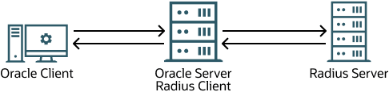
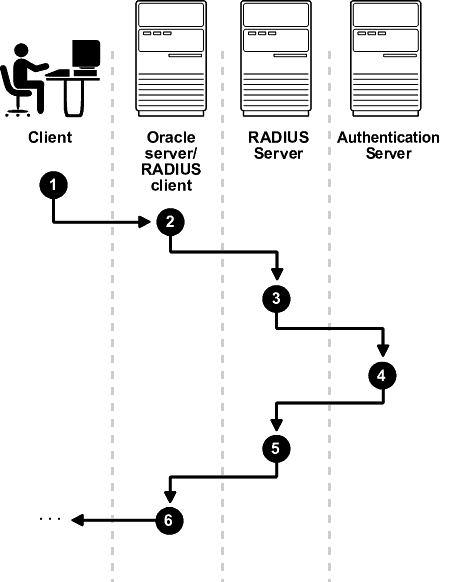
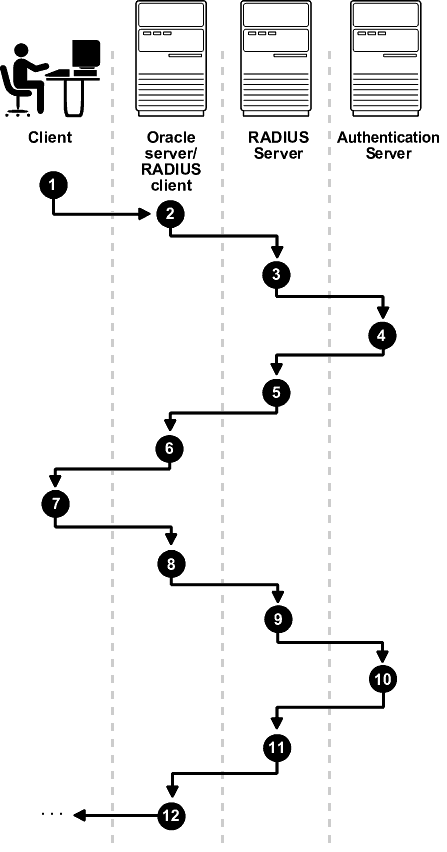
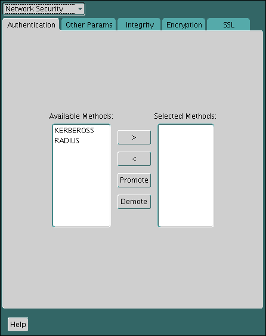
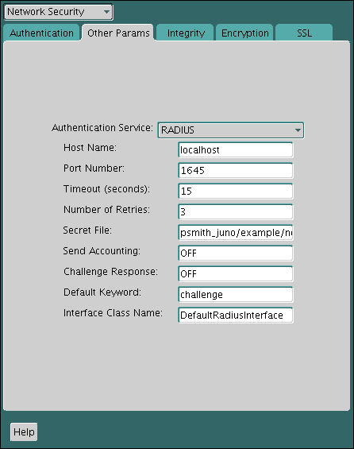

## 24  Configuring RADIUS Authentication

RADIUS is a client/server security protocol widely used to enable remote authentication and access.

- About Configuring RADIUS Authentication
  Oracle Database supports the RADIUS standard for user authentication.
- RADIUS Components
  RADIUS has a set of authentication components that enable you to manage configuration settings.
- RADIUS Authentication Modes
  The RADIUS server can authenticate users using technologies such as FIDO and text message authentication codes. In addition, Oracle Database supports synchronous and challenge-response (`async`) authentication modes.
- RADIUS Parameters
  Oracle provides a set of RADIUS-specific parameters.
- Enabling RADIUS Authentication, Authorization, and Accounting
  You can enable RADIUS authentication, authorization, and accounting from the command line. RADIUS authentication can either by configured through the modern configuration introduced in Oracle Database 19.28 or the legacy configuration.
- Using RADIUS to Log in to a Database
  You can use RADIUS to log into a database by using either synchronous authentication mode or challenge-response mode.

**Parent topic:** [Managing Strong Authentication](part_5.md)

### 24.1 About Configuring RADIUS Authentication

Oracle Database supports the RADIUS standard for user authentication.

RADIUS is frequently used for multi-factor authentication (MFA) when it is used to access an Oracle database. The specific MFA technologies (such as smart cards or biometric cards) depend on the RADIUS server. The database server and client support asynchronous and synchronous challenges for MFA.

You can use any RADIUS server that complies with the Internet Engineering Task Force (IETF) RFC \#2138, Remote Authentication Dial In User Service (RADIUS), and RFC \#2139 RADIUS Accounting standards.

Starting with Oracle Database 19.28, new RADIUS APIs were introduced to support Requests for Comments (RFC) 6613 and 6614 guidelines, and updates to RADIUS security with the latest standards.

From an end user's perspective, the entire authentication process is transparent. When the user seeks access to an Oracle database server, the Oracle database server, acting as the RADIUS client, notifies the RADIUS server. The RADIUS server then:

- Looks up the user's security information

- Passes authentication and authorization information between the appropriate authentication server or servers and the Oracle database server

- Grants the user access to the Oracle database server

- Logs session information, including when, how often, and for how long the user was connected to the Oracle database server

  **Note:**

  Oracle Database does not support RADIUS authentication over database links.

  To configure Oracle Database to use RADIUS, you will modify parameters in the `sqlnet.ora` file. The settings in `sqlnet.ora` apply to all pluggable databases (PDBs).

Figure 24-1 illustrates the Oracle Database-RADIUS environment.

Figure 24-1 RADIUS in an Oracle Environment

[Description of "Figure 24-1 RADIUS in an Oracle Environment"](img_text/asoag003.md)

The Oracle Database server acts as the RADIUS client, passing information between the Oracle client and the RADIUS server. Similarly, the RADIUS server passes information between the Oracle database server and the appropriate authentication servers.

A RADIUS server vendor is often the authentication server vendor as well. In this case authentication can be processed on the RADIUS server.

**Related Topics**

- [Oracle Database Net Services Reference](../netrf/parameters-for-the-sqlnet.ora.md)

**Parent topic:** Configuring RADIUS Authentication

### 24.2 RADIUS Components

RADIUS has a set of authentication components that enable you to manage configuration settings.

Table 24-1 lists the authentication components.

Table 24-1 RADIUS Authentication Components

| Component                            | Stored Information                                                                                                                                                            |
|:-------------------------------------|:------------------------------------------------------------------------------------------------------------------------------------------------------------------------------|
| Oracle client                        | Configuration setting for communicating through RADIUS.                                                                                                                       |
| Oracle database server/RADIUS client | Configuration settings for passing information between the Oracle client and the RADIUS server. The secret key file.                                                       |
| RADIUS server                        | Authentication and authorization information for all users. Each client's name or IP address. Each client's shared secret.                                              |
| Authentication server or servers     | User authentication information such as pass codes and PINs, depending on the authentication method in use. Note: The RADIUS server can also be the authentication server. |

**Parent topic:** Configuring RADIUS Authentication

### 24.3 RADIUS Authentication Modes

The RADIUS server can authenticate users using technologies such as FIDO and text message authentication codes. In addition, Oracle Database supports synchronous and challenge-response (`async`) authentication modes.

- Synchronous Authentication Mode
  In the synchronous mode, the user enters both the password and the second factor in the password field at the same time. This method is preferable when you use a command line interface when a GUI challenge window cannot be opened.
- Challenge-Response (Asynchronous) Authentication Mode
  When the system uses the asynchronous mode, the user does not need to enter a user name and password at the SQL\*Plus CONNECT string.

**Parent topic:** Configuring RADIUS Authentication

#### 24.3.1 Synchronous Authentication Mode

In the synchronous mode, the user enters both the password and the second factor in the password field at the same time. This method is preferable when you use a command line interface when a GUI challenge window cannot be opened.

- Sequence for Synchronous Authentication Mode
  The sequence of synchronous authentication mode is comprised of six steps.
- Example: Synchronous Authentication with Tokens
  With token authentication, each user has a token card that displays a dynamic number that changes every sixty seconds.

**Parent topic:** RADIUS Authentication Modes

##### 24.3.1.1 Sequence for Synchronous Authentication Mode

The sequence of synchronous authentication mode is comprised of six steps.

Figure 24-2 shows the sequence in which synchronous authentication occurs.

Figure 24-2 Synchronous Authentication Sequence

[Description of "Figure 24-2 Synchronous Authentication Sequence"](img_text/asoag010.md)

The following steps describe the synchronous authentication sequence:

1.  A user logs in by entering a connect string, pass code, or other value. The client system passes this data to the Oracle database server. The pass code is frequently the password followed by the numbers in a token or text. Both credential factors are sent at the same time.

2.  The Oracle database server, acting as the RADIUS client, passes the data from the Oracle client to the RADIUS server.

3.  The RADIUS server passes the data to the appropriate authentication server.

4.  The authentication server sends either an Access Accept or an Access Reject message back to the RADIUS server.

5.  The RADIUS server passes this response to the Oracle database server/RADIUS client.

6.  The Oracle database server/RADIUS client passes the response back to the Oracle client.

**Parent topic:** Synchronous Authentication Mode

##### 24.3.1.2 Example: Synchronous Authentication with Tokens

With token authentication, each user has a token card that displays a dynamic number that changes every sixty seconds.

To gain access to the Oracle database server/RADIUS client, the user enters a valid pass code that includes both a personal identification number (PIN) and the dynamic number currently displayed on the user's token. The Oracle database server passes this authentication information from the Oracle client to the RADIUS server, which in this case is the authentication server for validation. The user is now authenticated and able to access the appropriate tables and applications.

**Parent topic:** Synchronous Authentication Mode

#### 24.3.2 Challenge-Response (Asynchronous) Authentication Mode

When the system uses the asynchronous mode, the user does not need to enter a user name and password at the SQL\*Plus CONNECT string.

- Sequence for Challenge-Response (Asynchronous) Authentication Mode
  The sequence for challenge-response (asynchronous) authentication mode is comprised of 12 steps.
- Example: Asynchronous Authentication with Smart Cards
  With smart card authentication, the user logs in by inserting the smart card into a smart card reader that reads the smart card.
- Example: Asynchronous Authentication with Tokens
  One type of token that is used with asynchronous authentication has a keypad and display.

**Parent topic:** RADIUS Authentication Modes

##### 24.3.2.1 Sequence for Challenge-Response (Asynchronous) Authentication Mode

The sequence for challenge-response (asynchronous) authentication mode is comprised of 12 steps.

**Note:**

Challenge-response (Asynchronous) authentication mode is not supported with OCI-C client database clients on the Microsoft Windows platform. This includes all thick clients that use OCI-C clients.

Figure 24-3 shows the sequence in which challenge-response (asynchronous) authentication occurs. If the RADIUS server is the authentication server, then Steps 3, 4, and 5, and Steps 9, 10, and 11 are combined.

Figure 24-3 Asynchronous Authentication Sequence

[Description of "Figure 24-3 Asynchronous Authentication Sequence"](img_text/asoag011.md)

The following steps describe the asynchronous authentication sequence:

1.  A user initiates a connection to an Oracle database server. The client system passes the data to the Oracle database server.

2.  The Oracle database server, acting as the RADIUS client, passes the data from the Oracle client to the RADIUS server.

3.  The RADIUS server passes the data to the appropriate authentication server or authenticates the user against its own local database.

4.  The authentication server sends a challenge, such as a random number, to the RADIUS server.

5.  The RADIUS server passes the challenge to the Oracle database server/RADIUS client.

6.  The Oracle database server/RADIUS client, in turn, passes it to the Oracle client. A graphical user interface presents the challenge to the user. Oracle provides a JAVA GUI code example that you can modify for your use to present the challenge. See the `netradius.jar` and `netradius8.jar` files in the `$ORACLE_HOME/network/jlib` directory. (The `netradius8.jar` file is the latest.)

7.  The user provides a response to the challenge. To formulate a response, the user can, for example, enter the received challenge into the token card. The token card provides a dynamic password that is entered into the graphical user interface. The Oracle client passes the user's response to the Oracle database server/RADIUS client.

8.  The Oracle database server/RADIUS client sends the user's response to the RADIUS server.

9.  The RADIUS server passes the user's response to the appropriate authentication server for validation.

10. The authentication server sends either an Access Accept or an Access Reject message back to the RADIUS server.

11. The RADIUS server passes the response to the Oracle database server/RADIUS client.

12. The Oracle database server/RADIUS client passes the response to the Oracle client.

**Parent topic:** Challenge-Response (Asynchronous) Authentication Mode

##### 24.3.2.2 Example: Asynchronous Authentication with Smart Cards

With smart card authentication, the user logs in by inserting the smart card into a smart card reader that reads the smart card.

The smart card is a plastic card, like a credit card, with an embedded integrated circuit for storing information.

The Oracle client sends the login information contained in the smart card to the authentication server by way of the Oracle database server/RADIUS client and the RADIUS server. The authentication server sends back a challenge to the Oracle client, by way of the RADIUS server and the Oracle database server, prompting the user for authentication information. The information could be, for example, a PIN as well as additional authentication information contained on the smart card.

The Oracle client sends the user's response to the authentication server by way of the Oracle database server and the RADIUS server. If the user has entered a valid number, the authentication server sends an accept packet back to the Oracle client by way of the RADIUS server and the Oracle database server. The user is now authenticated and authorized to access the appropriate tables and applications. If the user has entered incorrect information, the authentication server sends back a message rejecting user's access.

**Parent topic:** Challenge-Response (Asynchronous) Authentication Mode

##### 24.3.2.3 Example: Asynchronous Authentication with Tokens

One type of token that is used with asynchronous authentication has a keypad and display.

When the user seeks access to an Oracle database server by entering a password, the information is passed to the appropriate authentication server by way of the Oracle database server/RADIUS client and the RADIUS server. The authentication server sends back a challenge to the client, by way of the RADIUS server and the Oracle database server. The user types that challenge into the token, and the token displays a number for the user to send in response.

The Oracle client then sends the user's response to the authentication server by way of the Oracle database server and the RADIUS server. If the user has typed a valid number, the authentication server sends an accept packet back to the Oracle client by way of the RADIUS server and the Oracle database server. The user is now authenticated and authorized to access the appropriate tables and applications. If the user has entered an incorrect response, the authentication server sends back a message rejecting the user's access.

**Parent topic:** Challenge-Response (Asynchronous) Authentication Mode

### 24.4 RADIUS Parameters

Oracle provides a set of RADIUS-specific parameters.

- RADIUS Parameters for Clients and Servers
  Oracle Database provides client and server parameters for using RADIUS authentication.
- Minimum RADIUS Parameters
  At minimum, you should use the `SQLNET.AUTHENTICATION_SERVICES` and `SQLNET.RADIUS.AUTHENTICATION` parameters.
- Initialization File Parameter for RADIUS
  For RADIUS, you should set the `OS_AUTHENT_PREFIX` initialization parameter.

**Parent topic:** Configuring RADIUS Authentication

#### 24.4.1 RADIUS Parameters for Clients and Servers

Oracle Database provides client and server parameters for using RADIUS authentication.

The following table lists parameters to insert into the configuration files for clients and servers using RADIUS.

Table 24-2 RADIUS Authentication Parameters

| Parameter                                | Description                                                                                            |
|:-----------------------------------------|:-------------------------------------------------------------------------------------------------------|
| `SQLNET.AUTHENTICATION_SERVICES`         | Enables one or more authentication services                                                            |
| `SQLNET.RADIUS_ALTERNATE`                | Specifies an alternate RADIUS server if the primary server is unavailable                              |
| `SQLNET.RADIUS_ALTERNATE_PORT`           | Specifies the listening port of the alternate RADIUS server                                            |
| `SQLNET.RADIUS_ALTERNATE_RETRIES`        | Specifies the number of times that the database resends messages to alternate RADIUS servers           |
| `SQLNET.RADIUS_ALTERNATE_TIMEOUT`        | Sets the time for an alternate RADIUS server to wait for a response                                    |
| `SQLNET.RADIUS_AUTHENTICATION`           | Specifies a primary RADIUS server location, either by its host name or its IP address                  |
| `SQLNET.RADIUS_AUTHENTICATION_INTERFACE` | Specifies the class that contains the user interface for interacting with users                        |
| `SQLNET.RADIUS_AUTHENTICATION_PORT`      | Specifies the listening port of a primary RADIUS server                                                |
| `SQLNET.RADIUS_AUTHENTICATION_RETRIES`   | Specifies the number of times the database should resend messages to a primary RADIUS server           |
| `SQLNET.RADIUS_AUTHENTICATION_TIMEOUT`   | Specifies the amount of time that the database should wait for a response from a primary RADIUS server |
| `SQLNET.RADIUS_CHALLENGE_KEYWORD`        | Sets the keyword to request a challenge from the RADIUS server                                         |
| `SQLNET.RADIUS_CHALLENGE_RESPONSE`       | Enables or disables challenge responses                                                                |
| `SQLNET.RADIUS_CLASSPATH`                | Sets the path for Java classes and the JDK Java libraries                                              |
| `SQLNET.RADIUS_SECRET`                   | Specifies the location of a RADIUS secret key                                                          |
| `SQLNET.RADIUS_SEND_ACCOUNTING`          | Enable and disables accounting                                                                         |

**Related Topics**

- [Oracle Database Net Services Reference](../netrf/parameters-for-the-sqlnet.ora.md)

**Parent topic:** RADIUS Parameters

#### 24.4.2 Minimum RADIUS Parameters

At minimum, you should use the `SQLNET.AUTHENTICATION_SERVICES` and `SQLNET.RADIUS.AUTHENTICATION` parameters.

Use the following settings:

    sqlnet.authentication_services = (radius)
    sqlnet.radius.authentication   = IP-address-of-RADIUS-server

**Parent topic:** RADIUS Parameters

#### 24.4.3 Initialization File Parameter for RADIUS

For RADIUS, you should set the `OS_AUTHENT_PREFIX` initialization parameter.

For example:

    OS_AUTHENT_PREFIX=""

**Parent topic:** RADIUS Parameters

### 24.5 Enabling RADIUS Authentication, Authorization, and Accounting

You can enable RADIUS authentication, authorization, and accounting from the command line. RADIUS authentication can either by configured through the modern configuration introduced in Oracle Database 19.28 or the legacy configuration.

Oracle Database 23ai introduces an updated RADIUS API based on RFC 6613 and RFC 6614 and has backported this to Oracle Database 19.28. Oracle recommends that you start planning on migrating to use the new RADIUS API as soon as possible. The new API is available by default. These parameters associated with the older RADIUS API are also deprecated:` SQLNET.RADIUS_ALTERNATE`, `SQLNET.RADIUS_ALTERNATE_PORT`, `SQLNET.RADIUS_AUTHENTICATION`, and `SQLNET.RADIUS_AUTHENTICATION_PORT`. Refer to the Radius API documentation for information on changing the default to use the newer RADIUS API.

Modern Configuration: This configuration is available by default. It is recommended to use this configuration method.

Legacy Configuration: This configuration is enabled by default, but the API based on Request for Comments (RFC) 2138 is deprecated starting with Oracle Database 23ai.

To use the deprecated legacy configuration, add the following parameters to the `sqlnet.ora` file: `SQLNET.RADIUS_ALLOW_WEAK_CLIENTS=TRUE` and `SQLNET.RADIUS_ALLOW_WEAK_PROTOCOL=TRUE`.

- Modern Configuration
  Learn how to configure RADIUS authentication using the modern configuration. It is recommended to use this configuration method.
- Legacy Configuration
  Learn how to configure RADIUS authentication using the legacy configuration. The API based on Request for Comments (RFC) 2138 is deprecated starting with Oracle Database 23ai.

**Parent topic:** Configuring RADIUS Authentication

#### 24.5.1 Modern Configuration

Learn how to configure RADIUS authentication using the modern configuration. It is recommended to use this configuration method.

- Step 1: Configure RADIUS Authentication
  To configure RADIUS authentication, you must first configure it on the Oracle client, then the server. Afterward, you can configure additional RADIUS features.
- Step 2: Create a User and Grant Access
  After you complete the RADIUS authentication, you must create an Oracle Database user who is responsible for the RADIUS configuration.
- Step 3: Configure External RADIUS Authorization (Optional)
  You must configure the Oracle server, the Oracle client, and the RADIUS server to RADIUS users who must connect to an Oracle database.
- Step 4: Configure RADIUS Accounting
  RADIUS accounting logs information about access to the Oracle database server and stores it in a file on the RADIUS accounting server.
- Step 5: Add the RADIUS Client Name to the RADIUS Server Database
  The RADIUS server that you select must comply with RADIUS standards.
- Step 6: Configure the Authentication Server for Use with RADIUS
  After you add the RADIUS client name to the RADIUS server database, you can configure the authentication server to use the RADIUS.
- Step 7: Configure the RADIUS Server for Use with the Authentication Server
  After you configure the authentication server for use with RADIUS, you can configure the RADIUS server to use the authentication server.
- Step 8: Configure Mapping Roles
  If the RADIUS server supports vendor type attributes, then you can manage roles by storing them in the RADIUS server.

**Parent topic:** Enabling RADIUS Authentication, Authorization, and Accounting

##### 24.5.1.1 Step 1: Configure RADIUS Authentication

To configure RADIUS authentication, you must first configure it on the Oracle client, then the server. Afterward, you can configure additional RADIUS features.

- Step 1A: Configure RADIUS on the Oracle Client
  You can use `sqlnet.ora` to configure RADIUS on the Oracle client.
- Step 1B: Configure RADIUS on the Oracle Database Server
  You must create a file to hold the RADIUS key and store this file on the Oracle database server. Then you must configure the appropriate parameters in the `sqlnet.ora` file.
- Step 1C: Configure Additional RADIUS Features
  You can change the default settings, configure the challenge-response mode, and set parameters for an alternate RADIUS server.

**Parent topic:** Modern Configuration

###### 24.5.1.1.1 Step 1A: Configure RADIUS on the Oracle Client

You can use `sqlnet.ora` to configure RADIUS on the Oracle client.

1.  Log in to the Oracle Database client that will use RADIUS.
2.  Modify the `SQLNET.AUTHENTICATION_SERVICES` parameter in the `sqlnet.ora` file as follows:
        SQLNET.AUTHENTICATION_SERVICES=(radius)

**Parent topic:** Step 1: Configure RADIUS Authentication

###### 24.5.1.1.2 Step 1B: Configure RADIUS on the Oracle Database Server

You must create a file to hold the RADIUS key and store this file on the Oracle database server. Then you must configure the appropriate parameters in the `sqlnet.ora` file.

- Step 1B (1): Create the RADIUS Secret Key File on the Oracle Database Server
  First, you must create the RADIUS secret key file.
- Step 1B (2): Configure RADIUS Parameters on the Server (sqlnet.ora file)
  After you create RADIUS secret key file, you are ready to configure the appropriate parameters in the `sqlnet.ora` file.
- Step 1B (3): Set Oracle Database Server Initialization Parameters
  After you configure the `sqlnet.ora` file, you must configure the `init.ora` initialization file.

**Parent topic:** Step 1: Configure RADIUS Authentication

###### 24.5.1.1.2.1 Step 1B (1): Create the RADIUS Secret Key File on the Oracle Database Server

First, you must create the RADIUS secret key file.

1.  Obtain the RADIUS secret key from the RADIUS server.
    For each RADIUS client, the administrator of the RADIUS server creates a shared secret key, which must be less than or equal to 16 characters.
2.  On the Oracle database server, create a directory:
    - (UNIX) `$ORACLE_HOME``/network/security`

    - (Windows) `ORACLE_BASE``\``ORACLE_HOME``\network\security`
3.  Create the file `radius.key` to hold the shared secret copied from the RADIUS server. Place the file in the directory you created earlier in this procedure.
4.  Copy the shared secret key and paste it (and nothing else) into the `radius.key` file created on the Oracle database server.
5.  For security purposes, change the file permission of `radius.key` to read only, accessible only by the Oracle owner.
    Oracle relies on the file system to keep this file secret.
    **See Also:**

    The RADIUS server administration documentation, for information about obtaining the secret key

**Parent topic:** Step 1B: Configure RADIUS on the Oracle Database Server

###### 24.5.1.1.2.2 Step 1B (2): Configure RADIUS Parameters on the Server (sqlnet.ora file)

After you create RADIUS secret key file, you are ready to configure the appropriate parameters in the `sqlnet.ora` file.

**Note:**

- Starting with Oracle Database 23ai, users authenticating to the database using the legacy RADIUS API no longer are granted administrative privileges.

  In previous releases, users authenticating with RADIUS API could be granted administrative privileges such as `SYSDBA` or `SYSBACKUP`. In Oracle Database 23ai, Oracle introduces a new RADIUS API that uses the latest standards. To grant administrative privileges to users, ensure the database connection to the database uses the new RADIUS API, and that you are using the Oracle Database 23ai client to connect to the Oracle Database 23ai server.

- Oracle Database 23ai introduces an updated RADIUS API based on RFC 6613 and RFC 6614 and has backported this to Oracle Database 19.28. Oracle recommends that you start planning on migrating to use the new RADIUS API as soon as possible. The new API is available by default. These parameters associated with the older RADIUS API are also deprecated:` SQLNET.RADIUS_ALTERNATE`, `SQLNET.RADIUS_ALTERNATE_PORT`, `SQLNET.RADIUS_AUTHENTICATION`, and `SQLNET.RADIUS_AUTHENTICATION_PORT`. Refer to the Radius API documentation for information on changing the default to use the newer RADIUS API.

1.  Log in to the Oracle Database server that will use RADIUS.
2.  Modify the following parameters in the `sqlnet.ora` file:
        SQLNET.AUTHENTICATION_SERVICES=radius
        SQLNET.RADIUS_TRANSPORT_PROTOCOL=[tls|udp]
        SQLNET.RADIUS_AUTHENTICATION_TLS_HOST=RADIUS_host_name
        SQLNET.RADIUS_AUTHENTICATION_TLS_PORT=Oracle_Database_server_port

    In this specification:

    - `SQLNET.AUTHENTICATION_SERVICES` sets the authentication service to be for RADIUS.
    - `SQLNET.RADIUS_TRANSPORT_PROTOCOL` sets either Transport Layer Security (TLS) or User Datagram Protocol (UDP) as the protocol that the RADIUS server uses. If you omit this value, then TLS is used. If you must use UDP, then you must set the `SQLNET.RADIUS_ALLOW_WEAK_CLIENTS` and `SQLNET.RADIUS_ALLOW_WEAK_PROTOCOL` parameters. Note the following:
      - For database clients to connect to a server using the older protocol: set the `SQLNET.RADIUS_ALLOW_WEAK_CLIENTS` parameter.
      - For an Oracle Database 23ai or later server to connect to a RADIUS server using the older protocol: set the `SQLNET.RADIUS_ALLOW_WEAK_PROTOCOL` parameter.
    - `SQLNET.RADIUS_AUTHENTICATION_TLS_HOST` sets the host name of the RADIUS server. This value is mandatory.
    - `SQLNET.RADIUS_AUTHENTICATION_TLS_PORT` sets the port of the Oracle Database server. The default port is `2083`. If the server uses a different port, then specify that value here.

    If you need to use the earlier, deprecated RADIUS API parameters, then set the `SQLNET.RADIUS_ALLOW_WEAK_CLIENTS` and `SQLNET.RADIUS_ALLOW_WEAK_PROTOCOL` parameters to `TRUE`. The deprecated parameters are:

    - `SQLNET.RADIUS_ALTERNATE`
    - `SQLNET.RADIUS_AUTHENTICATION=RADIUS_SERVER_[``host_name``|``IP_address``]`
    - `SQLNET.RADIUS_ALTERNATE_PORT`
    - `SQLNET.RADIUS_AUTHENTICATION_PORT`

    In this specification:

    - `SQLNET.RADIUS_ALTERNATE` specifies an alternate RADIUS server if the primary server is unavailable.
    - `SQLNET.RADIUS_AUTHENTICATION` specifies the host name or IP address of the RADIUS server. The `IP_address` can either be an Internet Protocol Version 4 (IPv4) or Internet Protocol Version 6 (IPv6) address. The RADIUS adapter supports both IPv4 and IPv6 based servers.
    - `SQLNET.RADIUS_ALTERNATE_PORT` specifies the listening port of the alternate RADIUS server.
    - `SQLNET.RADIUS_AUTHENTICATION` specifies a primary RADIUS server location, either by its host name or its IP address.
    - `SQLNET.RADIUS_AUTHENTICATION_PORT` specifies the listening port of a primary RADIUS server.

This procedure does not configure the Transport Layer Security (TLS) connection between the Oracle Database server and client; additional configuration is required.

**Related Topics**

- [Configuring Transport Layer Security Authentication](configuring-secure-sockets-layer-authentication.md)

**Parent topic:** Step 1B: Configure RADIUS on the Oracle Database Server

###### 24.5.1.1.2.3 Step 1B (3): Set Oracle Database Server Initialization Parameters

After you configure the `sqlnet.ora` file, you must configure the `init.ora` initialization file.

1.  Add the following setting to the `init.ora` file.
        OS_AUTHENT_PREFIX=""

    By default, the `init.ora` file is located in the `ORACLE_HOME``/dbs` directory (or the same location of the data files) on Linux and UNIX systems, and in the `ORACLE_HOME``\database` directory on Windows.
2.  Restart the database.
    For example:

        SQL> SHUTDOWN
        SQL> STARTUP

**Related Topics**

- [Oracle Database Reference](../refrn/initialization-parameters-2.md)

**Parent topic:** Step 1B: Configure RADIUS on the Oracle Database Server

###### 24.5.1.1.3 Step 1C: Configure Additional RADIUS Features

You can change the default settings, configure the challenge-response mode, and set parameters for an alternate RADIUS server.

- Step 1C(1): Change Default Settings
  You can edit the `sqlnet.ora` file to change the default RADIUS settings.
- Step 1C(2): Configure Challenge-Response Mode
  To configure challenge-response mode, you must specify information such as a dynamic password that you obtain from a token card.
- Step 1C(3): Set Parameters for an Alternate RADIUS Server
  If you are using an alternate RADIUS server, then you must set additional parameters.

**Parent topic:** Step 1: Configure RADIUS Authentication

###### 24.5.1.1.3.1 Step 1C(1): Change Default Settings

You can edit the `sqlnet.ora` file to change the default RADIUS settings.

1.  Log in to the Oracle Database server that will use RADIUS.
2.  Modify the following `sqlnet.ora` parameters:
        SQLNET.RADIUS_AUTHENTICATION_PORT=(port)
        SQLNET.RADIUS_AUTHENTICATION_TIMEOUT=(number_of_seconds_to_wait_for_response)
        SQLNET.RADIUS_AUTHENTICATION_RETRIES=(number_of_times_to re-send_to_radius_server)
        SQLNET.RADIUS_SECRET=(path/.radius.key)

    In this specification:

    - `SQLNET.RADIUS_AUTHENTICATION_PORT` specifies the listening port of a primary RADIUS server. The default is `1645`.
    - `SQLNET.RADIUS_AUTHENTICATION_TIMEOUT` specifies the amount of time in seconds that the database should wait for a response from a primary RADIUS server. The default is `5`.
    - `SQLNET.RADIUS_AUTHENTICATION_RETRIES` specifies the number of times that the database should resend messages to a primary RADIUS server. The default is `3`.
    - `SQLNET.RADIUS_SECRET` specifies the location of a file that contains the RADIUS secret key, which is a shared secret between a RADIUS client and server. The default is `radsec`, which points to `ORACLE_HOME/network/security/radius.key`. If you set a different RADIUS secret key file, then ensure that you set `SQLNET.RADIUS_SECRET` on the client as well as the database server. If the RADIUS server uses TLS as the protocol, then you can omit this parameter. For a RADIUS implementation that uses the User Datagram Protocol (UDP), the default parameter value cannot be used. The default value of `radsec` can only be used if you are using RADIUS with TLS over TCP.

**Related Topics**

- Step 4: Configure RADIUS Accounting
- Step 1B (1): Create the RADIUS Secret Key File on the Oracle Database Server

**Parent topic:** Step 1C: Configure Additional RADIUS Features

###### 24.5.1.1.3.2 Step 1C(2): Configure Challenge-Response Mode

To configure challenge-response mode, you must specify information such as a dynamic password that you obtain from a token card.

With the RADIUS adapter, this interface is Java-based to provide optimal platform independence. Note that third-party vendors of authentication devices must customize this graphical user interface to fit their particular device. For example, a smart card vendor would customize the Java interface so that the Oracle client reads data, such as a dynamic password, from the smart card. When the smart card receives a challenge, it responds by prompting the user for more information, such as a PIN.

1.  Log in to the Oracle Database server that will use RADIUS.
2.  If you are using JDK 1.1.7 or JRE 1.1.7, then set the `JAVA_HOME` environment variable to the JRE or JDK location on the system where the Oracle client is run:
    - On UNIX, enter this command at the prompt:

          % setenv JAVA_HOME /usr/local/packages/jre1.1.7B

    - On Windows, select Start, Settings, Control Panel, System, Environment, and set the `JAVA_HOME` variable as follows:

          c:\java\jre1.1.7B

    This step is not required for any other JDK/JRE version.
3.  Modify the following `sqlnet.ora` parameters:
        SQLNET.RADIUS_CHALLENGE_RESPONSE=([on | off])
        SQLNET.RADIUS_CHALLENGE_KEYWORD=(keyword)
        SQLNET.RADIUS_AUTHENTICATION_INTERFACE=(default_RADIUS_interface)

    In this specification:

    - `SQLNET.RADIUS_CHALLENGE_RESPONSE` enables or disables the challenge responses. To enable, enter `on`; to disable, enter `off`. The default is `off`.

    - `SQLNET.RADIUS_CHALLENGE_KEYWORD` enables you to set challenge keyword. The default is `keyword`. The keyword feature is supported by some but not all RADIUS servers. You can use this feature only if the RADIUS server supports it.

      By setting a keyword, you let the user avoid using a password to verify identity. If the user does not enter a password, the keyword you set here is passed to the RADIUS server which responds with a challenge requesting, for example, a driver's license number or birth date. If the user does enter a password, the RADIUS server may or may not respond with a challenge, depending upon the configuration of the RADIUS server.

    - `SQLNET.RADIUS_AUTHENTICATION_INTERFACE` specifies the class that contains the user interface for interacting with users. Enter the name of interface including the package name delimited by the character `/` for the `.` character.

      If other than the default RADIUS interface is used, then you also must edit the `sqlnet.ora` file to enter `SQLNET.RADIUS_CLASSPATH=(location)`, where `location` is the complete path name of the jar file. It defaults to `$``ORACLE_HOME/network/jlib/netradius.jar: ``$``ORACLE_HOME/JRE/lib/vt.jar`

**Related Topics**

- [unresolvable-reference.html](https://docs.oracle.com/en/database/oracle/oracle-database/19/dbseg/unresolvable-reference.html)

**Parent topic:** Step 1C: Configure Additional RADIUS Features

###### 24.5.1.1.3.3 Step 1C(3): Set Parameters for an Alternate RADIUS Server

If you are using an alternate RADIUS server, then you must set additional parameters.

- Set the following parameters in the `sqlnet.ora` file:
      SQLNET.RADIUS_ALTERNATE=(hostname_or_IP_address_of_alternate_RADIUS_server)
      SQLNET.RADIUS_ALTERNATE_PORT=(1812)
      SQLNET.RADIUS_ALTERNATE_TIMEOUT=(number_of_seconds_to_wait_for_response)
      SQLNET.RADIUS_ALTERNATE_RETRIES=(number_of_times_to re-send_to_RADIUS_server)
      SQLNET.RADIUS_ALTERNATE_TLS_HOST=(TLS_host)
      SQLNET.RADIUS_ALTERNATE_TLS_PORT=(TLS_port)

  **Note:**

  Starting with Oracle Database 23ai, the `SQLNET.RADIUS_ALTERNATE` and `SQLNET.RADIUS_ALTERNATE_PORT` parameters are deprecated.

**Parent topic:** Step 1C: Configure Additional RADIUS Features

##### 24.5.1.2 Step 2: Create a User and Grant Access

After you complete the RADIUS authentication, you must create an Oracle Database user who is responsible for the RADIUS configuration.

1.  Connect to the CDB root or to the PDB in which RADIUS is implemented.
    For example:
        CONNECT system@pdb_name;
        Enter password: password
2.  Create the user as a common user if you connected to the CDB root, or as a local user if you connected to a PDB..
        CREATE USER username IDENTIFIED EXTERNALLY;
        GRANT CREATE SESSION TO USER user_name;
3.  Enter the user `username` in the RADIUS server's users file.

**See Also:**

Administration documentation for the RADIUS server

**Parent topic:** Modern Configuration

##### 24.5.1.3 Step 3: Configure External RADIUS Authorization (Optional)

You must configure the Oracle server, the Oracle client, and the RADIUS server to RADIUS users who must connect to an Oracle database.

- Step 3A: Configure the Oracle Server (RADIUS Client)
  You can edit the `init.ora` file to configure an Oracle server for a RADIUS client.
- Step 3B: Configure the Oracle Client Where Users Log In
  Next, you must configure the Oracle client where users log in.
- Step 3C: Configure the RADIUS Server
  To configure the RADIUS server, you must modify the RADIUS server attribute configuration file.

**Parent topic:** Modern Configuration

###### 24.5.1.3.1 Step 3A: Configure the Oracle Server (RADIUS Client)

You can edit the `init.ora` file to configure an Oracle server for a RADIUS client.

To do so, you must modify the `init.ora` file, restart the database, and the set the RADIUS challenge-response mode.

1.  Set the RADIUS challenge-response mode to `ON` for the server if you have not already done so.
2.  Add externally identified users and roles.

**Related Topics**

- Step 1C(2): Configure Challenge-Response Mode

**Parent topic:** Step 3: Configure External RADIUS Authorization (Optional)

###### 24.5.1.3.2 Step 3B: Configure the Oracle Client Where Users Log In

Next, you must configure the Oracle client where users log in.

- Set the RADIUS challenge-response mode to `ON` for the client if you have not already done so.

**Related Topics**

- Step 1C(2): Configure Challenge-Response Mode

**Parent topic:** Step 3: Configure External RADIUS Authorization (Optional)

###### 24.5.1.3.3 Step 3C: Configure the RADIUS Server

To configure the RADIUS server, you must modify the RADIUS server attribute configuration file.

1.  Add the following attributes to the RADIUS server attribute configuration file:
    | ATTRIBUTE NAME    | CODE | TYPE    |
    |:------------------|:-----|:--------|
    | `VENDOR_SPECIFIC` | 26   | Integer |
    | `ORACLE_ROLE`     | 1    | String  |
2.  Assign a Vendor ID for Oracle in the RADIUS server attribute configuration file that includes the SMI Network Management Private Enterprise Code of `111`.
    For example, enter the following in the RADIUS server attribute configuration file:
        VALUE     VENDOR_SPECIFIC     ORACLE     111
3.  Using the following syntax, add the `ORACLE_ROLE` attribute to the user profile of the users who will use external RADIUS authorization:
        ORA_databaseSID_rolename

    In this specification.:

    - `ORA` designates that this role is used for Oracle purposes

    - `databaseSID` is the Oracle system identifier that is configured in the database `init.ora` file.

      By default, the `init.ora` file is located in the `ORACLE_HOME``/dbs` directory (or the same location of the data files) on Linux and UNIX systems, and in the `ORACLE_HOME``\database` directory on Windows.

    - `rolename` is the name of role as it is defined in the data dictionary after you remove the `SYS` prefix.

    Ensure that RADIUS groups that map to Oracle roles adhere to the `ORACLE_ROLE` syntax.

    For example:

        USERNAME     USERPASSWD="user_password",
                     SERVICE_TYPE=login_user,
                     VENDOR_SPECIFIC=ORACLE,
                     ORACLE_ROLE=ORA_oradb_dba

    **See Also:**

    The RADIUS server administration documentation for information about configuring the server.

**Parent topic:** Step 3: Configure External RADIUS Authorization (Optional)

##### 24.5.1.4 Step 4: Configure RADIUS Accounting

RADIUS accounting logs information about access to the Oracle database server and stores it in a file on the RADIUS accounting server.

Use this feature only if both the RADIUS server and authentication server support it.

- Step 4A: Set RADIUS Accounting on the Oracle Database Server
  You can use `sqlnet.ora` to enable RADIUS accounting on the server.
- Step 4B: Configure the RADIUS Accounting Server
  RADIUS Accounting Server resides on the same host as the RADIUS authentication server or on a separate host.

**Parent topic:** Modern Configuration

###### 24.5.1.4.1 Step 4A: Set RADIUS Accounting on the Oracle Database Server

You can use `sqlnet.ora` to enable RADIUS accounting on the server.

1.  Log in to the Oracle Database server that will use RADIUS.
2.  Modify the `SQLNET.RADIUS_SEND_ACCOUNTING` parameter in the `sqlnet.ora` file as follows:
        SQLNET.RADIUS_SEND_ACCOUNTING=on

    When you enable accounting, packets are sent to the active RADIUS server at the listening port number's value plus one.

**Parent topic:** Step 4: Configure RADIUS Accounting

###### 24.5.1.4.2 Step 4B: Configure the RADIUS Accounting Server

RADIUS Accounting Server resides on the same host as the RADIUS authentication server or on a separate host.

- See the administration documentation for the RADIUS server, for information about configuring RADIUS accounting.

**Parent topic:** Step 4: Configure RADIUS Accounting

##### 24.5.1.5 Step 5: Add the RADIUS Client Name to the RADIUS Server Database

The RADIUS server that you select must comply with RADIUS standards.

You can use any RADIUS server that complies with the Internet Engineering Task Force (IETF) RFC \#2138, Remote Authentication Dial In User Service (RADIUS), and RFC \#2139 RADIUS Accounting standards. Because RADIUS servers vary, consult the documentation for your particular RADIUS server for any unique interoperability requirements.

1.  Open the clients file, which is located in `/etc/raddb/clients`.
    The following text and table appear:
        @ (#) clients 1.1 2/21/96 Copyright 1991 Livingston Enterprises Inc
        This file contains a list of clients which are allowed to make authentication requests and
        their encryption key. The first field is a valid hostname. The second field (separated by
        blanks or tabs) is the encryption key.
        Client Name                     Key
2.  In the `CLIENT NAME` column, enter the host name or IP address of the host on which the Oracle database server is running.
    In the `KEY` column, type the shared secret. The value you enter in the `CLIENT NAME` column, whether it is the client's name or IP address, depends on the RADIUS server.
3.  Save and close the clients file.

**See Also:**

Administration documentation for the RADIUS server

**Parent topic:** Modern Configuration

##### 24.5.1.6 Step 6: Configure the Authentication Server for Use with RADIUS

After you add the RADIUS client name to the RADIUS server database, you can configure the authentication server to use the RADIUS.

- Refer to the authentication server documentation for instructions about configuring the authentication servers.

**Parent topic:** Modern Configuration

##### 24.5.1.7 Step 7: Configure the RADIUS Server for Use with the Authentication Server

After you configure the authentication server for use with RADIUS, you can configure the RADIUS server to use the authentication server.

- Refer to the RADIUS server documentation for instructions about configuring the RADIUS server for use with the authentication server.

**Parent topic:** Modern Configuration

##### 24.5.1.8 Step 8: Configure Mapping Roles

If the RADIUS server supports vendor type attributes, then you can manage roles by storing them in the RADIUS server.

The Oracle database server downloads the roles when there is a `CONNECT` request using RADIUS.To use this feature, you must configure roles on both the Oracle database server and the RADIUS server.

1.  Use a text editor to set the `OS_ROLES` parameter in the initialization parameters file on the Oracle database server.
    By default, the `init.ora` file is located in the `ORACLE_HOME``/dbs` directory (or the same location of the data files) on Linux and UNIX systems, and in the `ORACLE_HOME``\database` directory on Windows.
2.  Stop and restart the Oracle database server.
    For example:
        SHUTDOWN
        STARTUP
3.  Create each role that the RADIUS server will manage on the Oracle database server with the value `IDENTIFIED EXTERNALLY`.
    To configure roles on the RADIUS server, use the following syntax:
        ORA_DatabaseName.DatabaseDomainName_RoleName

    In this specification:

    - `DatabaseName` is the name of the Oracle database server for which the role is being created. This is the same as the value of the DB_NAME initialization parameter.

    - `DatabaseDomainName` is the name of the domain to which the Oracle database server belongs. The value is the same as the value of the `DB_DOMAIN` initialization parameter.

    - `RoleName` is name of the role created in the Oracle database server.

    For example:

        ORA_USERDB.US.EXAMPLE.COM_MANAGER
4.  Configure RADIUS challenge-response mode.

**Related Topics**

- Challenge-Response (Asynchronous) Authentication Mode
- Step 1C(2): Configure Challenge-Response Mode

**Parent topic:** Modern Configuration

#### 24.5.2 Legacy Configuration

Learn how to configure RADIUS authentication using the legacy configuration. The API based on Request for Comments (RFC) 2138 is deprecated starting with Oracle Database 23ai.

To use the deprecated legacy configuration, add the following parameters to the `sqlnet.ora` file: `SQLNET.RADIUS_ALLOW_WEAK_CLIENTS=TRUE` and `SQLNET.RADIUS_ALLOW_WEAK_PROTOCOL=TRUE`.

- Step 1: Configure RADIUS Authentication
  To configure RADIUS authentication, you must first configure it on the Oracle client, then the server. Afterward, you can configure additional RADIUS features.
- Step 2: Create a User and Grant Access
  After you complete the RADIUS authentication, you must create an Oracle Database user who is responsible for the RADIUS configuration.
- Step 3: Configure External RADIUS Authorization (Optional)
  You must configure the Oracle server, the Oracle client, and the RADIUS server to RADIUS users who must connect to an Oracle database.
- Step 4: Configure RADIUS Accounting
  RADIUS accounting logs information about access to the Oracle database server and stores it in a file on the RADIUS accounting server.
- Step 5: Add the RADIUS Client Name to the RADIUS Server Database
  The RADIUS server that you select must comply with RADIUS standards.
- Step 6: Configure the Authentication Server for Use with RADIUS
  After you add the RADIUS client name to the RADIUS server database, you can configure the authentication server to use the RADIUS.
- Step 7: Configure the RADIUS Server for Use with the Authentication Server
  After you configure the authentication server for use with RADIUS, you can configure the RADIUS server to use the authentication server.
- Step 8: Configure Mapping Roles
  If the RADIUS server supports vendor type attributes, then you can manage roles by storing them in the RADIUS server.

**Parent topic:** Enabling RADIUS Authentication, Authorization, and Accounting

##### 24.5.2.1 Step 1: Configure RADIUS Authentication

To configure RADIUS authentication, you must first configure it on the Oracle client, then the server. Afterward, you can configure additional RADIUS features.

**Note:**

Unless otherwise indicated, perform these configuration tasks by using Oracle Net Manager or by using any text editor to modify the `sqlnet.ora` file. Be aware that in a multitenant environment, the settings in the `sqlnet.ora` file apply to all pluggable databases (PDBs).

- Step 1A: Configure RADIUS on the Oracle Client
  You can use Oracle Net Manager to configure RADIUS on the Oracle client.
- Step 1B: Configure RADIUS on the Oracle Database Server
  You must create a file to hold the RADIUS key and store this file on the Oracle database server. Then you must configure the appropriate parameters in the `sqlnet.ora` file.
- Step 1C: Configure Additional RADIUS Features
  You can change the default settings, configure the challenge-response mode, and set parameters for an alternate RADIUS server.

**Parent topic:** Legacy Configuration

###### 24.5.2.1.1 Step 1A: Configure RADIUS on the Oracle Client

You can use Oracle Net Manager to configure RADIUS on the Oracle client.

1.  Start Oracle Net Manager.

    - (UNIX) From `$ORACLE_HOME``/bin`, enter the following command at the command line:

          netmgr

    - (Windows) Select Start, Programs, Oracle - HOME_NAME, Configuration and Migration Tools, then Net Manager.

2.  Expand Oracle Net Configuration, and from Local, select Profile.

3.  From the Naming list, select Network Security.

    The Network Security tabbed window appears.

4.  Select the Authentication tab. (It should be selected by default.)

    
    [Description of the illustration radu0001.gif](img_text/radu0001.md)

5.  From the Available Methods list, select RADIUS.

6.  Select the right-arrow (\>) to move RADIUS to the Selected Methods list.

    Move any other methods you want to use in the same way.

7.  Arrange the selected methods in order of required usage by selecting a method in the Selected Methods list, and clicking Promote or Demote to position it in the list.

    For example, put RADIUS at the top of the list for it to be the first service used.

8.  From the File menu, select Save Network Configuration.

    The `sqlnet.ora` file is updated with the following entry:

        SQLNET.AUTHENTICATION_SERVICES=(RADIUS)

**Parent topic:** Step 1: Configure RADIUS Authentication

###### 24.5.2.1.2 Step 1B: Configure RADIUS on the Oracle Database Server

You must create a file to hold the RADIUS key and store this file on the Oracle database server. Then you must configure the appropriate parameters in the `sqlnet.ora` file.

- Step 1B (1): Create the RADIUS Secret Key File on the Oracle Database Server
  First, you must create the RADIUS secret key file.
- Step 1B (2): Configure RADIUS Parameters on the Server (sqlnet.ora file)
  After you create RADIUS secret key file, you are ready to configure the appropriate parameters in the `sqlnet.ora` file.
- Step 1B (3): Set Oracle Database Server Initialization Parameters
  After you configure the sqlnet.ora file, you must configure the `init.ora` initialization file.

**Parent topic:** Step 1: Configure RADIUS Authentication

###### 24.5.2.1.2.1 Step 1B (1): Create the RADIUS Secret Key File on the Oracle Database Server

First, you must create the RADIUS secret key file.

1.  Obtain the RADIUS secret key from the RADIUS server.

    For each RADIUS client, the administrator of the RADIUS server creates a shared secret key, which must be less than or equal to 16 characters.

2.  On the Oracle database server, create a directory:

    - (UNIX) `$ORACLE_HOME``/network/security`

    - (Windows) `ORACLE_BASE``\``ORACLE_HOME``\network\security`

3.  Create the file `radius.key` to hold the shared secret copied from the RADIUS server. Place the file in the directory you created in Step 2.

4.  Copy the shared secret key and paste it (and nothing else) into the `radius.key` file created on the Oracle database server.

5.  For security purposes, change the file permission of `radius.key` to read only, accessible only by the Oracle owner.

    Oracle relies on the file system to keep this file secret.

    **See Also:**

    The RADIUS server administration documentation, for information about obtaining the secret key

**Parent topic:** Step 1B: Configure RADIUS on the Oracle Database Server

###### 24.5.2.1.2.2 Step 1B (2): Configure RADIUS Parameters on the Server (sqlnet.ora file)

After you create RADIUS secret key file, you are ready to configure the appropriate parameters in the `sqlnet.ora` file.

1.  Start Oracle Net Manager.

    - (UNIX) From `$ORACLE_HOME``/bin`, enter the following command at the command line:

          netmgr

    - (Windows) Select Start, Programs, Oracle - HOME_NAME, Configuration and Migration Tools, then Net Manager.

2.  Expand Oracle Net Configuration, and from Local, select Profile.

3.  From the Naming list, select Network Security.

    The Network Security tabbed window appears.

4.  Select the Authentication tab.

5.  From the Available Methods list, select RADIUS.

6.  Move RADIUS to the Selected Methods list by choosing the right-arrow (\>).

7.  To arrange the selected methods in order of desired use, select a method in the Selected Methods list, and select Promote or Demote to position it in the list.

    For example, if you want RADIUS to be the first service used, then put it at the top of the list.

8.  Select the Other Params tab.

9.  From the Authentication Service list, select RADIUS.

10. In the Host Name field, accept the localhost as the default primary RADIUS server, or enter another host name.

    
    [Description of the illustration radu0002.gif](img_text/radu0002.md)

11. Ensure that the default value of the Secret File field is valid.

12. From the File menu, select Save Network Configuration.

    The `sqlnet.ora` file is updated with the following entries:

        SQLNET.AUTHENTICATION_SERVICES=RADIUS
        SQLNET.RADIUS_AUTHENTICATION=RADIUS_server_{hostname|IP_address}

    **Note:**

    The `IP_address` can either be an Internet Protocol Version 4 (IPv4) or Internet Protocol Version 6 (IPv6) address. The RADIUS adapter supports both IPv4 and IPv6 based servers.

**Parent topic:** Step 1B: Configure RADIUS on the Oracle Database Server

###### 24.5.2.1.2.3 Step 1B (3): Set Oracle Database Server Initialization Parameters

After you configure the sqlnet.ora file, you must configure the `init.ora` initialization file.

1.  Add the following setting to the `init.ora` file.

        OS_AUTHENT_PREFIX=""

    By default, the `init.ora` file is located in the `ORACLE_HOME``/dbs` directory (or the same location of the data files) on Linux and UNIX systems, and in the `ORACLE_HOME``\database` directory on Windows.

2.  Restart the database.

    For example:

        SQL> SHUTDOWN
        SQL> STARTUP

**See Also:**

[Oracle Database Reference](../refrn/initialization-parameters-2.md) for information about setting initialization parameters

**Parent topic:** Step 1B: Configure RADIUS on the Oracle Database Server

###### 24.5.2.1.3 Step 1C: Configure Additional RADIUS Features

You can change the default settings, configure the challenge-response mode, and set parameters for an alternate RADIUS server.

- Step 1C(1): Change Default Settings
  You can use Oracle Net Manager to change the default RADIUS settings.
- Step 1C(2): Configure Challenge-Response Mode
  To configure challenge-response mode, you must specify information such as a dynamic password that you obtain from a token card.
- Step 1C(3): Set Parameters for an Alternate RADIUS Server
  If you are using an alternate RADIUS server, then you must set additional parameters.

**Parent topic:** Step 1: Configure RADIUS Authentication

###### 24.5.2.1.3.1 Step 1C(1): Change Default Settings

You can use Oracle Net Manager to change the default RADIUS settings.

1.  Start Oracle Net Manager.

    - (UNIX) From `$ORACLE_HOME``/bin`, enter the following command at the command line:

          netmgr

    - (Windows) Select Start, Programs, Oracle - HOME_NAME, Configuration and Migration Tools, then Net Manager.

2.  Expand Oracle Net Configuration, and from Local, select Profile.

3.  From the Naming list, select Network Security.

    The Network Security tabbed window appears.

4.  Click the Other Params tab.

5.  From the Authentication Service list, select RADIUS.

6.  Change the default setting for any of the following fields:

    - Port Number: Specifies the listening port of the primary RADIUS server. The default value is 1645.

    - Timeout (seconds): Specifies the time the Oracle database server waits for a response from the primary RADIUS server. The default is 15 seconds.

    - Number of Retries: Specifies the number of times the Oracle database server resends messages to the primary RADIUS server. The default is three retries. For instructions on configuring RADIUS accounting, see Step 4: Configure RADIUS Accounting.

    - Secret File: Specifies the location of the secret key on the Oracle database server. The field specifies the location of the secret key file, not the secret key itself. For information about specifying the secret key, see Step 1B (1): Create the RADIUS Secret Key File on the Oracle Database Server.

7.  From the File menu, select Save Network Configuration.

    The `sqlnet.ora` file is updated with the following entries:

        SQLNET.RADIUS_AUTHENTICATION_PORT=(PORT)
        SQLNET.RADIUS_AUTHENTICATION_TIMEOUT=(NUMBER OF SECONDS TO WAIT FOR response)
        SQLNET.RADIUS_AUTHENTICATION_RETRIES=(NUMBER OF TIMES TO RE-SEND TO RADIUS server)
        SQLNET.RADIUS_SECRET=(path/radius.key)

**Parent topic:** Step 1C: Configure Additional RADIUS Features

###### 24.5.2.1.3.2 Step 1C(2): Configure Challenge-Response Mode

To configure challenge-response mode, you must specify information such as a dynamic password that you obtain from a token card.

With the RADIUS adapter, this interface is Java-based to provide optimal platform independence.

**Note:**

Third party vendors of authentication devices must customize this graphical user interface to fit their particular device. For example, a smart card vendor would customize the Java interface so that the Oracle client reads data, such as a dynamic password, from the smart card. When the smart card receives a challenge, it responds by prompting the user for more information, such as a PIN.

To configure challenge-response mode:

1.  If you are using JDK 1.1.7 or JRE 1.1.7, then set the `JAVA_HOME` environment variable to the JRE or JDK location on the system where the Oracle client is run:

    - On UNIX, enter this command at the prompt:

          % setenv JAVA_HOME /usr/local/packages/jre1.1.7B

    - On Windows, select Start, Settings, Control Panel, System, Environment, and set the `JAVA_HOME` variable as follows:

          c:\java\jre1.1.7B

    This step is not required for any other JDK/JRE version.

2.  Start Oracle Net Manager.

    - (UNIX) From `$ORACLE_HOME``/bin`, enter the following command at the command line:

          netmgr

    - (Windows) Select Start, Programs, Oracle - HOME_NAME, Configuration and Migration Tools, then Net Manager.

3.  Expand Oracle Net Configuration, and from Local, select Profile.

4.  From the Naming list, select Network Security.

    The Network Security tabbed window appears.

5.  From the Authentication Service list, select RADIUS.

6.  In the Challenge Response field, enter ON to enable challenge-response.

7.  In the Default Keyword field, accept the default value of the challenge or enter a keyword for requesting a challenge from the RADIUS server.

    The keyword feature is provided by Oracle and supported by some, but not all, RADIUS servers. You can use this feature only if your RADIUS server supports it.

    By setting a keyword, you let the user avoid using a password to verify identity. If the user does not enter a password, the keyword you set here is passed to the RADIUS server which responds with a challenge requesting, for example, a driver's license number or birth date. If the user does enter a password, the RADIUS server may or may not respond with a challenge, depending upon the configuration of the RADIUS server.

8.  In the Interface Class Name field, accept the default value of DefaultRadiusInterface or enter the name of the class you have created to handle the challenge-response conversation.

    If other than the default RADIUS interface is used, then you also must edit the `sqlnet.ora` file to enter `SQLNET.RADIUS_CLASSPATH=(location)`, where `location` is the complete path name of the jar file. It defaults to `$``ORACLE_HOME/network/jlib/netradius.jar: ``$``ORACLE_HOME/JRE/lib/vt.jar`

9.  From the File menu, select Save Network Configuration.

    The `sqlnet.ora` file is updated with the following entries:

        SQLNET.RADIUS_CHALLENGE_RESPONSE=([ON | OFF])
        SQLNET.RADIUS_CHALLENGE_KEYWORD=(KEYWORD)
        SQLNET.RADIUS_AUTHENTICATION_INTERFACE=(name of interface including the package name delimited by "/" for ".")

**See Also:**

[Integrating Authentication Devices Using RADIUS](integrating-authentication-devices-using-radius.md) for information about how to customize the challenge-response user interface

**Parent topic:** Step 1C: Configure Additional RADIUS Features

###### 24.5.2.1.3.3 Step 1C(3): Set Parameters for an Alternate RADIUS Server

If you are using an alternate RADIUS server, then you must set additional parameters.

- Set the following parameters in the `sqlnet.ora` file:

      SQLNET.RADIUS_ALTERNATE=(hostname or ip address of alternate radius server)
      SQLNET.RADIUS_ALTERNATE_PORT=(1812)
      SQLNET.RADIUS_ALTERNATE_TIMEOUT=(number of seconds to wait for response)
      SQLNET.RADIUS_ALTERNATE_RETRIES=(number of times to re-send to radius server)

**Parent topic:** Step 1C: Configure Additional RADIUS Features

##### 24.5.2.2 Step 2: Create a User and Grant Access

After you complete the RADIUS authentication, you must create an Oracle Database user who is responsible for the RADIUS configuration.

1.  Connect to the CDB root or to the PDB in which RADIUS is implemented.
    For example:
        CONNECT system@pdb_name;
        Enter password: password
2.  Create the user as a common user if you connected to the CDB root, or as a local user if you connected to a PDB..
        CREATE USER username IDENTIFIED EXTERNALLY;
        GRANT CREATE SESSION TO USER user_name;
3.  Enter the user `username` in the RADIUS server's users file.

**See Also:**

Administration documentation for the RADIUS server

**Parent topic:** Legacy Configuration

##### 24.5.2.3 Step 3: Configure External RADIUS Authorization (Optional)

You must configure the Oracle server, the Oracle client, and the RADIUS server to RADIUS users who must connect to an Oracle database.

- Step 3A: Configure the Oracle Server (RADIUS Client)
  You can edit the `init.ora` file to configure an Oracle server for a RADIUS client.
- Step 3B: Configure the Oracle Client Where Users Log In
  Next, you must configure the Oracle client where users log in.
- Step 3C: Configure the RADIUS Server
  To configure the RADIUS server, you must modify the RADIUS server attribute configuration file.

**Parent topic:** Legacy Configuration

###### 24.5.2.3.1 Step 3A: Configure the Oracle Server (RADIUS Client)

You can edit the `init.ora` file to configure an Oracle server for a RADIUS client.

To do so, you must modify the `init.ora` file, restart the database, and the set the RADIUS challenge-response mode.

1.  Add the `OS_ROLES` parameter to the `init.ora` file and set this parameter to `TRUE` as follows:

        OS_ROLES=TRUE

    By default, the `init.ora` file is located in the `ORACLE_HOME``/dbs` directory (or the same location of the data files) on Linux and UNIX systems, and in the `ORACLE_HOME``\database` directory on Windows.

2.  Restart the database so that the system can read the change to the `init.ora` file.

    For example:

        SQL> SHUTDOWN
        SQL> STARTUP

3.  Set the RADIUS challenge-response mode to `ON` for the server if you have not already done so by following the steps listed in Step 1C(2): Configure Challenge-Response Mode.

4.  Add externally identified users and roles.

**Parent topic:** Step 3: Configure External RADIUS Authorization (Optional)

###### 24.5.2.3.2 Step 3B: Configure the Oracle Client Where Users Log In

Next, you must configure the Oracle client where users log in.

- Set the RADIUS challenge-response mode to `ON` for the client if you have not already done so by following the steps listed in Step 1C(2): Configure Challenge-Response Mode.

**Parent topic:** Step 3: Configure External RADIUS Authorization (Optional)

###### 24.5.2.3.3 Step 3C: Configure the RADIUS Server

To configure the RADIUS server, you must modify the RADIUS server attribute configuration file.

1.  Add the following attributes to the RADIUS server attribute configuration file:

    | ATTRIBUTE NAME    | CODE | TYPE    |
    |:------------------|:-----|:--------|
    | `VENDOR_SPECIFIC` | 26   | Integer |
    | `ORACLE_ROLE`     | 1    | String  |

2.  Assign a Vendor ID for Oracle in the RADIUS server attribute configuration file that includes the SMI Network Management Private Enterprise Code of `111`.

    For example, enter the following in the RADIUS server attribute configuration file:

    `VALUE     VENDOR_SPECIFIC     ORACLE     111`

3.  Using the following syntax, add the `ORACLE_ROLE` attribute to the user profile of the users who will use external RADIUS authorization:

    `ORA_``databaseSID``_``rolename``[_[A]|[D]]`

    In this specification.:

    - `ORA` designates that this role is used for Oracle purposes

    - `databaseSID` is the Oracle system identifier that is configured in the database `init.ora` file.

      By default, the `init.ora` file is located in the `ORACLE_HOME``/dbs` directory (or the same location of the data files) on Linux and UNIX systems, and in the `ORACLE_HOME``\database` directory on Windows.

    - `rolename` is the name of role as it is defined in the data dictionary.

    - `A` is an optional character that indicates the user has administrator's privileges for this role.

    - `D` is an optional character that indicates this role is to be enabled by default.

    Ensure that RADIUS groups that map to Oracle roles adhere to the `ORACLE_ROLE` syntax.

    For example:

        USERNAME     USERPASSWD="user_password",
                     SERVICE_TYPE=login_user,
                     VENDOR_SPECIFIC=ORACLE,
                     ORACLE_ROLE=ORA_ora920_sysdba

    **See Also:**

    The RADIUS server administration documentation for information about configuring the server.

**Parent topic:** Step 3: Configure External RADIUS Authorization (Optional)

##### 24.5.2.4 Step 4: Configure RADIUS Accounting

RADIUS accounting logs information about access to the Oracle database server and stores it in a file on the RADIUS accounting server.

Use this feature only if both the RADIUS server and authentication server support it.

- Step 4A: Set RADIUS Accounting on the Oracle Database Server
  To set RADIUS accounting on the server, you can use Oracle Net Manager.
- Step 4B: Configure the RADIUS Accounting Server
  RADIUS Accounting Server resides on the same host as the RADIUS authentication server or on a separate host.

**Parent topic:** Legacy Configuration

###### 24.5.2.4.1 Step 4A: Set RADIUS Accounting on the Oracle Database Server

To set RADIUS accounting on the server, you can use Oracle Net Manager.

1.  Start Oracle Net Manager.

    - (UNIX) From `$ORACLE_HOME``/bin`, enter the following command at the command line:

          netmgr

    - (Windows) Select Start, Programs, Oracle - HOME_NAME, Configuration and Migration Tools, then Net Manager.

2.  Expand Oracle Net Configuration, and from Local, select Profile.

3.  From the Naming list, select Network Security.

    The Network Security tabbed window appears.

4.  Select the Other Params tab.

5.  From the Authentication Service list, select RADIUS.

6.  In the Send Accounting field, enter ON to enable accounting or OFF to disable accounting.

7.  From the File menu, select Save Network Configuration.

    The `sqlnet.ora` file is updated with the following entry:

        SQLNET.RADIUS_SEND_ACCOUNTING= ON

**Parent topic:** Step 4: Configure RADIUS Accounting

###### 24.5.2.4.2 Step 4B: Configure the RADIUS Accounting Server

RADIUS Accounting Server resides on the same host as the RADIUS authentication server or on a separate host.

- See the administration documentation for the RADIUS server, for information about configuring RADIUS accounting.

**Parent topic:** Step 4: Configure RADIUS Accounting

##### 24.5.2.5 Step 5: Add the RADIUS Client Name to the RADIUS Server Database

The RADIUS server that you select must comply with RADIUS standards.

You can use any RADIUS server that complies with the Internet Engineering Task Force (IETF) RFC \#2138, Remote Authentication Dial In User Service (RADIUS), and RFC \#2139 RADIUS Accounting standards. Because RADIUS servers vary, consult the documentation for your particular RADIUS server for any unique interoperability requirements.

1.  Open the clients file, which is located in `/etc/raddb/clients`.
    The following text and table appear:
        @ (#) clients 1.1 2/21/96 Copyright 1991 Livingston Enterprises Inc
        This file contains a list of clients which are allowed to make authentication requests and
        their encryption key. The first field is a valid hostname. The second field (separated by
        blanks or tabs) is the encryption key.
        Client Name                     Key
2.  In the `CLIENT NAME` column, enter the host name or IP address of the host on which the Oracle database server is running.
    In the `KEY` column, type the shared secret. The value you enter in the `CLIENT NAME` column, whether it is the client's name or IP address, depends on the RADIUS server.
3.  Save and close the clients file.

**See Also:**

Administration documentation for the RADIUS server

**Parent topic:** Legacy Configuration

##### 24.5.2.6 Step 6: Configure the Authentication Server for Use with RADIUS

After you add the RADIUS client name to the RADIUS server database, you can configure the authentication server to use the RADIUS.

- Refer to the authentication server documentation for instructions about configuring the authentication servers.

**Parent topic:** Legacy Configuration

##### 24.5.2.7 Step 7: Configure the RADIUS Server for Use with the Authentication Server

After you configure the authentication server for use with RADIUS, you can configure the RADIUS server to use the authentication server.

- Refer to the RADIUS server documentation for instructions about configuring the RADIUS server for use with the authentication server.

**Parent topic:** Legacy Configuration

##### 24.5.2.8 Step 8: Configure Mapping Roles

If the RADIUS server supports vendor type attributes, then you can manage roles by storing them in the RADIUS server.

The Oracle database server downloads the roles when there is a `CONNECT` request using RADIUS.To use this feature, you must configure roles on both the Oracle database server and the RADIUS server.

1.  Use a text editor to set the `OS_ROLES` parameter in the initialization parameters file on the Oracle database server.
    By default, the `init.ora` file is located in the `ORACLE_HOME``/dbs` directory (or the same location of the data files) on Linux and UNIX systems, and in the `ORACLE_HOME``\database` directory on Windows.
2.  Stop and restart the Oracle database server.
    For example:
        SHUTDOWN
        STARTUP
3.  Create each role that the RADIUS server will manage on the Oracle database server with the value `IDENTIFIED EXTERNALLY`.
    To configure roles on the RADIUS server, use the following syntax:
        ORA_DatabaseName.DatabaseDomainName_RoleName

    In this specification:

    - `DatabaseName` is the name of the Oracle database server for which the role is being created. This is the same as the value of the DB_NAME initialization parameter.

    - `DatabaseDomainName` is the name of the domain to which the Oracle database server belongs. The value is the same as the value of the `DB_DOMAIN` initialization parameter.

    - `RoleName` is name of the role created in the Oracle database server.

    For example:

        ORA_USERDB.US.EXAMPLE.COM_MANAGER
4.  Configure RADIUS challenge-response mode.

**Related Topics**

- Challenge-Response (Asynchronous) Authentication Mode
- Step 1C(2): Configure Challenge-Response Mode

**Parent topic:** Legacy Configuration

### 24.6 Using RADIUS to Log in to a Database

You can use RADIUS to log into a database by using either synchronous authentication mode or challenge-response mode.

- Start SQL\*Plus and use one of the following ways to log in to the database:
  - If you are using the synchronous authentication mode, first ensure that challenge-response mode is not turned to `ON`, and then enter the following command:

        CONNECT username@database_alias
        Enter password: password

  - If you are using the challenge-response mode, ensure that challenge-response mode is set to `ON` and then enter the following command:

        CONNECT /@database_alias

  The challenge-response mode can be configured for all login cases.

**Parent topic:** Configuring RADIUS Authentication
