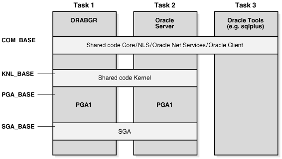

The platform independent concepts and the architecture of Oracle Database are described in [Oracle Database Concepts](../cncpt/introduction-to-oracle-database.md).

This chapter describes the basic concepts of Oracle Database specific to Fujitsu BS2000 systems. It includes the following topics:

- About the BS2000 Operating System

- About File Systems

- About Processes

- Memory Architecture

- BS2000 User Ids

- Oracle Database Programs

- Physical Storage Structures

- Parameter Files

### 1.1 About the BS2000 Operating System

Oracle Database 19c for Fujitsu BS000 runs on the BS2000 operating system. Oracle Database uses both native BS2000 interface and the POSIX interface.

The sections in this chapter describe in detail how Oracle Database uses the program environments, the native BS2000 and POSIX.

### 1.2 About File Systems

The default file system for an Oracle Database program depends on the program environment in which the program is started.

Oracle Database 19c operates on the following file systems:

- BS2000 Data Management System (DMS), which is a flat file system.
- POSIX file system, which is hierarchically structured and consists of directories and files.

If you start an Oracle Database utility in the BS2000 program environment, then a flat file is located in the BS2000 DMS. If you start the same Oracle Database utility in the POSIX shell, then a flat file is located in the POSIX file system.

A file system can be directly addressed independent of the program environment. The prefix `/BS2/` addresses the BS2000 DMS file system. A file name that starts with a valid POSIX path, such as `/home/oracle` addresses the POSIX file system.

As in earlier releases, database files always reside in the BS2000 DMS file system. For example, data files, control files, online redo log files, and archive redo log files.

Starting with Oracle Database 12c Release 1, most of the Oracle supplied SQL scripts are installed in the POSIX file system. To run a SQL script from the `ORACLE_HOME` directory in the BS2000 program environment, you must enter the fully qualified file name.

Automatic Diagnostic Repository (ADR) requires a hierarchical file system to create a file-based repository for database diagnostic data. So, the directories and files of ADR reside in the POSIX file system.

During Oracle Database installation, executables, libraries, and other files are installed in both the BS2000 DMS and in the POSIX file system. You must provide access to the POSIX file system.

**See Also:**

[“Oracle Database Installation and Deinstallation”](oracle-database-installation-and-deinstallation.md) for information about access to the POSIX file system

### 1.3 About Processes

The concepts of Oracle Database processes are not BS2000-specific.

All processes of an Oracle Database instance, for example, server processes and background processes, run as BS2000 tasks.

Oracle Database utilities that are started in the BS2000 program environment are executed in the BS2000 login task. For example, SQL\*Plus.

If you start an Oracle Database utility in the POSIX shell, then a new POSIX process is created.

Client processes running in the POSIX shell connect to an instance in the same way as clients in the BS2000 environment. The dedicated server process starts in the BS2000 program environment as a BS2000 task.

**Related Topics**

- [Oracle Database Concepts](../cncpt/process-architecture.md)

### 1.4 Memory Architecture

The concepts of Oracle Database basic memory architecture are not BS2000-specific.

Oracle Database defines different data areas in the main memory, such as SGA and PGA. On BS2000 systems, the SGA is realized as a shared memory pool to which all background and server processes of an instance have read/write access. The PGA is a local memory that is specific to an Oracle background process or a server process.

Most of the Oracle code binaries are placed in code areas in the main memory, which reside in shared memory pools in the BS2000 user address space. These data and code areas must reside at the same virtual addresses in all the server and background tasks. Typically, the default values provided with Oracle Database are sufficient. Address space planning, that is, explicit placement of Oracle Database code or data areas may be required in some special situations when you encounter address space conflicts. For example, dynamic subsystems may occupy the default address ranges, which may require you to relocate Oracle Database areas.

The following Oracle environment variables control explicit placement of Oracle Database code and data areas:

- `COM_BASE`

- `KNL_BASE`

- `PGA_BASE`

- `SGA_BASE`

The order of the areas in the address space is not significant. The `xxx``_BASE` variable is evaluated only during startup processing.

The first process which realizes that a shared pool does not exist creates this shared pool. All other processes of an Oracle Database instance and server processes attach to the existing shared memory.

The following figure is an example of the placement of data areas:

Figure 1-1 Placement of Data Areas in Background, Server and Utility Tasks

[Description of "Figure 1-1 Placement of Data Areas in Background, Server and Utility Tasks"](img_text/memory_architecture.md)

The `xxx``_BASE` values must be compatible with the BS2000 value SYSBASE (defined by BS2000 generation and delimiting the user address space).

Database application programs use a separate shared code pool for common services such as Core, Globalization Support, and Net Services. The name of this pool is `Client Common Pool` and its placement can be controlled by the `ORAENV` environment variable `CLN_BASE`. The default value for the `CLN_BASE` is set to 200 MB.

`CLN_BASE=200MB`

In general, Oracle Database administrators must be aware of conflicts between Oracle pool placements and other pool placements in the system.

**Related Topics**

- [Oracle Database Concepts](../cncpt/memory-architecture.md)

### 1.5 BS2000 User Ids

The following BS2000 user IDs are required for Oracle Database:

- Installation User ID

- DBA User ID

- Client User IDs

#### 1.5.1 Installation User ID

The installation user ID is required for installing Oracle Database. The POSIX user, which corresponds to the BS2000 installation user ID must be initialized with a unique user number, group number, and a valid home directory.

A separate installation user ID is required for every Oracle Database release. However, multiple databases using the same release must refer to the same installation user ID.

Oracle Database software uses `$ORACINST` as a placeholder for the installation user ID. During installation, `ORACINST` is replaced by the name of the installation user ID. In this guide, `$ORACINST` is used as a proxy for the installation user ID.

The installation procedure installs Oracle Database in the BS2000 file system (DMS) and in the POSIX file system. The BS2000 file system (DMS) contains:

- Executable programs, such as SQL\*Plus.

- Load libraries, in particular, `ORALOAD.LIB`, from which modules are loaded for execution.

- Files and system configuration files specifying default precompiler options.

- Object libraries required to link precompiler applications, such as `PRO.LIB`.

- Platform-specific installation utilities, for example BS2000 command procedures.

- Default configuration files, such as the default `ORAENV` file.

- Files for demo schemas and demo applications.

The POSIX file system contains:

- Oracle supplied SQL scripts.

- Binaries to run Oracle programs, such as SQL\*Plus, in the POSIX shell.

- Shared objects, such as `libclntsh.so`.

- JAVA tools like `loadjava` or `owm`.

- Files for application development.

**Note:**

Starting from Oracle Database 12c Release 1, most of the Oracle supplied SQL scripts reside in the POSIX file system. In earlier Oracle Database releases these scripts resided in the BS2000 DMS file system.

#### 1.5.2 DBA User ID

The DBA user ID is used as the owner of one or more Oracle databases. This user ID owns all the files for a specific Oracle database. The corresponding POSIX user must be initialized with a unique user number, group number, and a valid home directory.

All BS2000 tasks of an Oracle Database instance are executed under the DBA user ID. These tasks refer to the executable programs and libraries, which are available under the installation user ID. These programs and libraries must not be copied into the DBA user ID. You can use the installation user ID as a DBA user ID. However, Oracle strongly recommends that you use separate user IDs.

Multiple databases can be created under the same or different DBA user IDs. If the databases are created under different BS2000 user IDs, then the databases are separated and protected from each other by the BS2000 protection mechanisms.

#### 1.5.3 Client User IDs

The Client user ID allows a normal non-DBA user to access and use the database through Oracle Database utilities, such as SQL\*Plus, and through application programs.

These client programs can run in the BS2000 user IDs, which are different from the DBA user ID. They can connect to Oracle Database through Oracle Net Services facilities.

The corresponding POSIX user must be initialized with a unique user number, group number, and a valid home directory.

### 1.6 Oracle Database Programs

Oracle Database programs are stored in program libraries, known as BS2000 LMS libraries.

The programs are loaded from these libraries for execution. They require a specific program environment, which must be defined before execution.

The following topics are discussed:

- Program Libraries

- Program Environment

#### 1.6.1 Program Libraries

Program libraries are required to run Oracle Database programs.

Oracle Database for Fujitsu BS2000 requires the following program libraries:

- The ORALOAD Library
- The ORAMESG Library

##### The ORALOAD Library

All Oracle Database 19c programs require the `ORALOAD` library, which is `$ORACINST.ORALOAD.LIB` by default. Oracle Database uses this library to load executables and subroutines dynamically. The BS2000 link name `ORALOAD` must identify the `ORALOAD` library before starting any Oracle Database program. If the link name is missing, then you get an error message from the BS2000 loader. This link name is set when running the `ORAENV` procedure in the BS2000 program environment.

BS2000 file links are not visible in the POSIX program environment. Oracle Database programs running in the POSIX shell use an internal mechanism to locate the `ORALOAD` library.

##### The ORAMESG library

The `ORAMESG` library, `$ORACINST.ORAMESG.LIB`, is required for dynamically loading the binaries for the Oracle Database messages by an Oracle Database program when required. The BS2000 link name `ORAMESG` must identify the `ORAMESG` library before starting any Oracle Database program. If the link name is missing, then you get an error message from the BS2000 loader. This link name is set when running the `ORAENV` procedure.

BS2000 file links are not visible in the POSIX program environment. Oracle Database programs running in the POSIX shell use an internal mechanism to locate the `ORAMESG` library.

#### 1.6.2 Program Environment

The program environment for Oracle Database can either be the native BS2000 environment or the POSIX Shell.

The default program environment for server and background tasks is the BS2000 environment. Regardless of the program environment, Oracle Database always requires a running POSIX subsystem.

This section contains the following topics:

- Oracle Environment Variables

- Setting Variables in the BS2000 Program Environment

- Setting Variables in the POSIX Program Environment

##### 1.6.2.1 Oracle Environment Variables

All Oracle Database programs and database applications require environment variables.

[Oracle Environment Variables](oracle-environment-variables.md) contains a list of Oracle Database environment variables that the database administrator can use. The non-DBA users must set a few of these variables. Any DBA-specific variables that are placed in a non-DBA user’s environment are ignored.

##### 1.6.2.2 Setting Variables in the BS2000 Program Environment

Oracle Database utilities and application programs running in the BS2000 program environment use the Oracle Database environment definition file, `ORAENV` for setting up the program environment.

This file is divided into two parts, an executable part to set required BS2000 file links, and a static part for the definition of the environment variables. During program initialization, the environment variables are read from the `ORAENV` file.

The procedure `$ORACINST.INSTALL.P.DBA` automatically creates a template for the `ORAENV` file with the name `sid``.P.ORAENV`, where `sid` is the instance identifier. The generated file provides a default configuration for an Oracle Database instance. You can edit this file to adapt it to your needs. Non-DBA users can also generate an `ORAENV` file specific to their own environment.

To make the environment variables accessible, run a `CALL-PROCEDURE` command on the `ORAENV` file for the instance that you want to use. For example, to specify the environment variables for the instance `DEMO`, run the following BS2000 SDF command:

`/CALL-PROCEDURE DEMO.P.ORAENV`

**Note:**

- The database administrator must not modify the `ORAENV` file while an Oracle Database is running.

- Non-DBA users may modify their `ORAENV` file at any time.

You can run several Oracle Database instances simultaneously on your BS2000 system, even within the same DBA user ID. A unique system identifier provides a globally unique name for the instance so that a user can select a particular instance by assigning the instance identifier `sid` to the `ORACLE_SID` environment variable. This is achieved by calling the corresponding `ORAENV` file `sid``.P.ORAENV`.

Alternatively the structured BS2000 SDF-P system variable `SYSPOSIX` can be used to define the Oracle Database environment variables. The variable `SYSPOSIX` can be declared in the `SYS.SDF.LOGON.USERINCL` file so that it is accessible for all programs and procedures started in the BS2000 login task. Use the following command to declare the variable:

`/DECLARE-VARIABLE SYSPOSIX,TYPE=*STRUCTURE(DEFINITION=*DYNAMIC),SCOPE=*TASK(STATE=*ANY)`

If you want to set an environment variable with an underscore in its name, then you must substitute the underscore with a hyphen. For example, to set `ORACLE_HOME` using the `SYSPOSIX` system variable, use the following command:

`/SET-VARIABLE SYSPOSIX.ORACLE-HOME=’/u01/app/oracle/product/19.3.0/dbhome_1’`

**See Also:**

- C Library Functions for POSIX Applications for more information about the BS2000 SDF-P system variable `SYSPOSIX`

- [“Generating The Environment-Definition File”](oracle-database-utilities.md) for more information

##### 1.6.2.3 Setting Variables in the POSIX Program Environment

Oracle Database utilities and application programs running in the POSIX shell get the environment variables from the POSIX environment.

All Oracle Database and BS2000 specific variables can be set in the POSIX environment. The Oracle Database environment variable `ORACLE_HOME` must be set. To run a utility for a particular instance, you must also set the Oracle Database environment variable `ORACLE_SID`. The operating system environment variable `PATH` must be extended by the path to the Oracle binaries `$ORACLE_HOME/bin`. If you do not set any other Oracle variable in the POSIX program environment, then Oracle Database utilities will use the default values.

The installation procedure creates a profile in the `oracle_home_path` directory which can be executed to set and export the most important environment variables like `ORACLE_HOME`, `PATH` , or `LD_LIBRARY_PATH`. Use the ‘`.`’ (dot) command to execute this profile in the current POSIX shell:

`$ . ``oracle_home_path``/.profile.oracle`

**Note:**

The Oracle Database environment variable `BGJPAR` is marked as a comment after the first installation. So, this variable will not be set when you execute the `.profile.oracle` command file. If you do not set this variable, then the following default value is used:

`BGJPAR=START=IMME,CPU-LIMIT=NO,LOGGING=*NO`

You can change the default value of a variable by setting this variable in the POSIX environment. For example:

    $ NLS_LANG=German_Germany.WE8BS2000
    $ export NLS_LANG

You can also use the `ORAENV` file that you created in the BS2000 file system DMS. Create a file with the name `oraenv``sid` in the `$ORACLE_HOME/dbs` directory describing the location and name of the `ORAENV` file.

For example, to use the `ORAENV` file, `$ORADATA.ORCL.P.ORAENV`, you must create a file with the name `oraenvORCL` in the `$ORACLE_HOME/dbs` directory that contains the name of the BS2000 `ORAENV` file as follows:

    $ ORACLE_HOME=/u01/app/oracle/product/19.3.0/dbhome_1
    $ export ORACLE_HOME
    $ echo '$ORADATA.ORCL.P.ORAENV' > $ORACLE_HOME/dbs/oraenvORCL

Set the Oracle Database environment variable `ORACLE_SID` and call the utility:

    $ ORACLE_SID=ORCL
    $ export ORACLE_SID
    $ $ORACLE_HOME/bin/sqlplus /nolog

Oracle Database utilities and applications running in the POSIX shell handle the variables of the BS2000 `ORAENV` file as lower-ranking variables. If a variable is set in the POSIX environment and the same variable is defined in the `ORAENV` file, then the POSIX variable is not overwritten by the `ORAENV` variable. For example, if the variable, `NLS_LANG` is set to `German_Germany.WE8BS2000` in the POSIX environment and to `American_America.WE8BS2000` in the BS2000 `ORAENV` file, then the variable keeps the value `German_Germany.WE8BS2000` in the environment of the Oracle Database utility running in the POSIX shell.

Consider the following:

- You must set the `ORACLE_HOME` variable.

- You must set the `ORACLE_SID` variable to specify a particular instance.

- To access a BS2000 `ORAENV` file, you must create a file, `oraenv``sid` in the `$ORACLE_HOME/dbs` directory that contains the fully qualified name of your BS2000 `ORAENV` file.

- The `SID` in the file name `oraenv``sid` is case sensitive and must match the `SID` specified in the Oracle Database environment variable `ORACLE_SID`.

- If an `ORAENV` file in the BS2000 file system is assigned to the specified `ORACLE_SID`, then ensure that this file is accessible for the utility.

- In the POSIX environment, the variables of the BS2000 `ORAENV` file are handled as subordinate variables.

### 1.7 Physical Storage Structures

This section describes some features of physical storage structures, which are specific for Fujitsu BS2000. It includes the following topics:

- Files of an Oracle Database

- Oracle Managed Files

- File of a Bigfile Tablespace

**Related Topics**

- [Oracle Database Concepts](../cncpt/introduction-to-oracle-database.md)

#### 1.7.1 Files of an Oracle Database

An Oracle database is a set of operating system files that store data in persistent disk storage.

There are different types of database files:

- data files

- temp files

- control files

- online redo log files

- archive redo log files

The database files always reside in the BS2000 DMS and have the file attribute, `FILE-STRUC=PAM`. Database files cannot reside in the POSIX file system.

Both the BS2000 operating system and Oracle Database perform input and output efficiently in units called blocks. A block is the basic unit of data storage. An Oracle Database block can have the following size depending on the format of the BS2000 DMS pubset:

- 2K, 4K, 6K, 8K, 16K, 32K when using BS2000 2K pubset format

- 4K, 8K, 16K, 32K when using BS2000 4K pubset format

#### 1.7.2 Oracle Managed Files

Oracle Managed Files (OMF) is a file naming strategy that enables you to specify operations in terms of database objects rather than file names.

For example, you can create a tablespace without specifying the names of its data files. In this way, Oracle Managed Files eliminates the need for administrators to directly manage the operating system files in a database.

The following is a list of `INIT.ORA` parameters for Oracle Managed Files:

- `DB_CREATE_FILE_DEST` for data files, temp files, and block change tracking files.

- `DB_CREATE_ONLINE_LOG_DEST_n` for redo log files and control files.

- `DB_RECOVERY_FILE_DEST` for backups, archive log files, and flashback log files.

On BS2000, these parameters are used as a prefix for file names.

Oracle tablespace names can be up to 30 characters long. To associate an OMF created file name with its tablespace, you must use tablespace names that are distinct in the first eight characters. Oracle allows underscore (\_) in tablespace names. Any underscore (\_) that is present is changed to hyphen (-) for use in the generated file name.

File names for Oracle Managed Files have the following format on BS2000:

| File type                                    | Format                        |
|:---------------------------------------------|:------------------------------|
| control files                                | destOMC.tttttttt              |
| log files                                    | destOMLlll.tttttttt           |
| permanent tablespace files, data file copies | destOMD.tsn.tttttttt          |
| temporary tablespace files                   | destOMT.tsn.tttttttt          |
| archive log files                            | destOMA.Tnnn.Snnnnnn.tttttttt |
| data file or archivelog backup piece         | destOMB.Lnnn.tttttttt         |
| rman autobackup piece                        | destOMX.xnnnnnnn.tttttttt     |
| block change tracking files                  | destOMR.tttttttt              |
| flashback log files                          | destOMF.tttttttt              |

where:

- dest is the destination string (\_DEST) in the OMF parameter

- tttttttt is the encoded timestamp (which looks like a random mix of letters and numerals)

- lll is a three-digit log-group number

- tsn is up to eight characters for the tablespace name

- Tnnn is the letter "T" followed by a three-digit thread number

- Snnnnnn is the letter "S" followed by a six-digit sequence number

- Lnnn is the letter "L" followed by a three-digit incremental level

- x is the letter P, if the database has an `SPFILE`, or the letter T if the database does not have an `SPFILE`

- nnnnnnn is a seven-byte timestamp

The maximum length of a BS2000 DMS file name is 54 characters. As a consequence, the preceding OMF file name formats impose a limit of 39 characters on `DB_CREATE_ONLINE_LOG_DEST_n` and `DB_CREATE_FILE_DEST`, and 29 characters on `DB_RECOVERY_FILE_DEST`. This limit includes the BS2000 DMS `catid` and `userid` which can have a maximum length of 16 characters in total.

**See Also:**

[Oracle Database Administrator's Guide](../admin/using-oracle-managed-files.md) for more information about file name formats

#### 1.7.3 Files of a Bigfile Tablespace

A bigfile tablespace contains a single large data file or a temp file.

This single data file or temp file must reside on a BS2000 DMS pubset with the following attributes:

`LARGE_VOLUMES=*ALLOWED` and `LARGE_FILES=*ALLOWED`

**See Also:**

Files and Volumes Larger than 32 GB for more information about handling large objects on BS2000

### 1.8 Parameter Files

The database parameter file `INIT.ORA` is used to define startup parameters for the database and the instance.

By default, this file resides in the BS2000 DMS in the DBA user ID. It is also possible to place this file in the POSIX file system.

In addition to the `INIT.ORA` file, a binary server-side initialization file `SPFILE` can be created by using the `CREATE SPFILE` statement. This file must be created in the BS2000 DMS in the DBA user ID.

**Related Topics**

- [Oracle Database Reference](../refrn/parameter-files.md)
- [Oracle Database Administrator’s Guide](../admin/creating-and-configuring-an-oracle-database.md)
