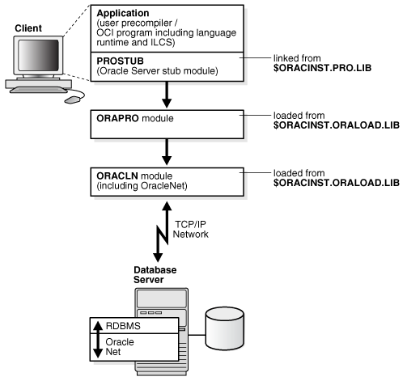

This chapter contains the following topics:

- Overview of Database Applications

- Precompiler Applications

- Oracle Call Interface Applications

- The Object Type Translator

- Oracle Database Applications in POSIX

- openUTM Database Applications

### 14.1 Overview of Database Applications

Oracle Programmatic Interfaces are tools for application designers who want to use SQL statements to access an Oracle database from within high-level language programs. The following types of programmatic interfaces are available:

- The Precompiler Interface, which is a programming tool that enables you to embed SQL statements in high-level language source code.

- The Oracle Call Interface (OCI), that enables to create high-level language applications that use function calls to access an Oracle database and control all phases of SQL statement execution.

On BS2000, the Oracle Database precompilers support programs written in C, C++, and COBOL programming languages.

This section contains the following topics:

- Architecture of the Programmatic Interfaces

- PL/SQL Support

- Building and Running a Programmatic Interface Application

**See Also:**

- [Oracle Database Programmer's Guide to the Oracle Precompilers](../zzpre/getting-acquainted.md) for detailed information about Oracle Precompilers

- [Pro\*C/C++ Programmer's Guide](../lnpcc/introduction.md) or [Pro\*COBOL Programmer's Guide](../lnpcb/precompiler-concepts.md)

#### 14.1.1 Architecture of the Programmatic Interfaces

All precompiler and Oracle Call Interface (OCI) applications are linked with a small stub module. This stub module dynamically loads the SQL runtime system of the Oracle Database precompilers from the `ORALOAD` library. Programs written in the following languages can be combined:

- Pro\*C/C++

- Pro\*COBOL (COBOL85 and COBOL2000)

**Note:**

OCI C and OCI COBOL programs cannot be combined; any attempt to do so results in execution errors. The entries into Oracle Database used by OCI C and OCI COBOL (for example, `OLOGON`) have identical names but different argument lists. For OCI COBOL, all arguments are by reference, that is, the parameter list contains all pointers. For OCI C, the numeric arguments are by value.

Oracle Database precompilers generate different `SQLLIB` function names for different languages. The following names are used:

- `SQ0XXX:` COBOL

- `sq2xxx:` C

#### 14.1.2 PL/SQL Support

The precompilers support PL/SQL. When using PL/SQL, you must specify `SQLCHECK=FULL` or `SQLCHECK=SEMANTICS` on the precompiler option line. The default is `SQLCHECK=NONE`. When requesting `SQLCHECK`, the precompiler must connect to a database. So, ensure that you provide the necessary connection information. (You may also want to set the `DEFAULT_CONNECTION` variable in the `ORAENV` file).

When `SQLCHECK=SEMANTICS` or `SQLCHECK=FULL` is specified, you must also specify `USERID=``username/password`.

**See Also:**

[Oracle Database PL/SQL Language Reference](../lnpls/overview.md)

#### 14.1.3 Building and Running a Programmatic Interface Application

To build and run a programmatic interface application, perform the following steps:

1.  Edit your source code, including embedded SQL, as outlined in the generic precompiler documentation.
2.  Precompile the source with the corresponding precompiler.
    **Note:**

    You must use WE8BS2000 as client character set during precompilation (set in `ORAENV` file). Any other character set might lead to problems with the concatenation sign ("\|\|").

    You do not need to precompile if you build an OCI C or an OCI COBOL application.
3.  Compile the application.
4.  Link the application, including the stub module `PROSTUB` from the `$ORACINST.PRO.LIB` library.
5.  Call the environment definition file. Refer to "[Calling the Environment-Definition File](oracle-database-utilities.md)" for details.
6.  Run the application with the `START-EXECUTABLE` command. The supporting Oracle Database module is dynamically loaded from the `ORALOAD` library.
7.  You can find sample BS2000 procedures for precompiling, compiling, and linking in the installation user ID: `$ORACINST.P.PROC`, `$ORACINST.P.PROCOB`, and `$ORACINST.P.PROLNK`.

Figure 14-1 illustrates the sequence of events outlined in the preceding numbered list and how the programmatic interfaces use the program libraries.

Figure 14-1 Usage of Program Libraries by Programmatic Interfaces

[Description of "Figure 14-1 Usage of Program Libraries by Programmatic Interfaces"](img_text/program_libraries.md)

For more information, see the specific notes for the programmatic interfaces in this chapter.

### 14.2 Precompiler Applications

Learn about precompiler applications in this section. It includes the following topics:

- About Using Precompilers

- Precompiler Pro\*C/C++

- Precompiler Pro\*COBOL

#### 14.2.1 About Using Precompilers

Oracle Database precompilers on BS2000 support LMS libraries for the files mentioned in this section. This section includes the following topics:

- Include Files

- User-Specific Configuration Files

- Input, Output, and List-files

- Additional Remarks About Using Precompilers

This functionality helps saving disk resources and provides clarity by grouping files in different libraries.

All LMS library elements that you use must be of element type "S”. The precompilers generate elements of type "S" if libraries are used. When you use LMS library elements, the precompilers build temporary files with the prefix "#T.”, which are deleted when the preprocessing completes successfully.

When you use LMS library elements, the element name that you specify must be the full element name including the suffix. The precompilers do not append the suffix to the element name.

##### 14.2.1.1 Include Files

All standard include files are shipped in the LMS library, `$ORACINST.PRO.INCLUDE.LIB`. You must specify this LMS library or a user-defined include library for the `EXEC SQL INCLUDE` statements. Use the `INCLUDE` precompiler option, as follows:

    * INCLUDE=$ORACINST.PRO.INCLUDE.LIB \
    * INCLUDE=mylibrary

where `mylibrary` is the BS2000 file name of the user-defined library, such as `PROC.INCLIB`.

**Note:**

The order in which you specify the different `INCLUDE` options affects the performance of precompilation. You should place the commonly used files before the rarely used ones.

##### 14.2.1.2 User-Specific Configuration Files

You can also specify a user-specific configuration file as an LMS-element using the following syntax:

    * CONFIG=my_config_lib[config_element]

where `my_config_lib` is the BS2000 file name of the configuration library and `config_element` is the full name of the element.

You must use brackets when specifying the configuration element, as shown in the following example.

    * CONFIG=CONFIG.LIB[PROCOB.CFG]

##### 14.2.1.3 Input, Output, and List-files

Besides using BS2000 files, you can also use the LMS library elements for precompiler I/O using the `INAME`, `ONAME`, and `LNAME` options.

If you do not specify a library file name and an element, then the Oracle Database precompilers generate BS2000 ISAM files by default. The only option that you must enter is the `INAME` option. This can be either a BS2000 file name, or a library file name and the name of an element from the LMS library.

For example:

    * INAME=my_input_lib[my_element] \
    * ONAME=my_output_lib[my_element] \
    * LNAME=my_list_lib[my_element] \

where `my_input_lib` is the BS2000 file name of the particular library and `my_element` is the name of the element including the specific suffix.

**Note:**

You must use brackets when specifying the LMS library element.

In the following example, Pro\*C generates an output file with the name `SAMPLE.C` as the `ONAME` option has been omitted:

    * INAME=INPUT.LIB[SAMPLE.PC] \
    * LNAME=LIST.LIB[SAMPLE.LST]

##### 14.2.1.4 Additional Remarks About Using Precompilers

The following are some additional remarks on this release of Oracle Database 19c for Fujitsu BS2000:

- Only compilers and compiler versions supporting the ILCS Standard Linkage are supported. If the Oracle Database detects a call from a user program not using the Standard Linkage conventions, then it terminates the task and displays the message number 5002 or 5003.

- If `ONAME` is not specified when starting a precompiler, then the precompiler generates a default name, which consists of the last part of `INAME` with the relevant suffix. For example, if the name of the C program you want to compile is `MYPROG.PERS.TEST.PC`, and if `ONAME` is omitted, then Pro\*C generates an output file with the name `TEST.C`.

- If you work with float variables, then you may encounter rounding problems. The workaround is to declare the float variables as double variables instead.

#### 14.2.2 Precompiler Pro\*C/C++

This section describes the procedure for using Pro\*C/C++. It includes the following topics:

- Starting Pro\*C

- Pro\*C Include, System Configuration and Demo Files

- SQLLIB Calls

- Linking Pro\*C Programs

- The Pro\*C SQLCPR.H Header File

- UTM Applications

##### 14.2.2.1 Starting Pro\*C

To start the Pro\*C precompiler, enter the following:

    /START-EXECUTABLE (*LINK(ORALOAD),PROC)
    * INAME=myprog.PC ONAME=myprog.C [options]

where:

`myprog` is the name of the C program.

`options` specifies Pro\*C options. For a list and description of the valid options, see [Pro\*C/C++ Programmer's Guide](../lnpcc/ANSI-dynamic-SQL.md).

**Note:**

You must use a separate precompiler option `INCLUDE` for each path you want to specify, unlike as described in [Pro\*C/C++ Programmer's Guide](../lnpcc/precompiler-options.md). A list as allowed for the option `SYS_INCLUDE` may cause the precompiler to loop.

##### 14.2.2.2 Pro\*C Include, System Configuration and Demo Files

The Pro\*C include files, demo files, and system configuration files are shipped under:

    $ORACINST.PRO.INCLUDE.LIB
    $ORACINST.C.DEMO.*.PC
    $ORACINST.UTM.DEMO.*.PC
    $ORACINST.CONFIG.PCSCFG.CFG

An example of a BS2000 procedure for precompilation and compilation is included in the Oracle Database software under the name `$ORACINST.P.PROC`.

##### 14.2.2.3 SQLLIB Calls

If you want to program explicit C calls to `SQLLIB` functions, then you must call `sq2``xxx` instead of `sql``xxx`. For example, call `sq2cex` instead of `sqlcex`.

##### 14.2.2.4 Linking Pro\*C Programs

To link a Pro\*C program, you need:

- The common runtime environment, `CRTE`.

- The Pro\* library `$ORACINST.PRO.LIB`, which contains the stub module, `PROSTUB`.

To link your program, you must create your user-specific link procedure. An example of such a link procedure is included in the Oracle Database software with the name, `$ORACINST.P.PROLNK`.

##### 14.2.2.5 The Pro\*C SQLCPR.H Header File

If you are making calls to Pro\*C functions, such as `sq2cls()` or `sq2glm()`, then you can include the `SQLCPR.H` file into the C programs to verify that the functions calls are correct.

In the Pro\*C programs, add the following line:

    EXEC SQL INCLUDE SQLCPR

as you would for `SQLCA` or `SQLDA`.

##### 14.2.2.6 UTM Applications

You can use Pro\*C to write UTM program units.

**See Also:**

openUTM Database Applications

#### 14.2.3 Precompiler Pro\*COBOL

This section describes the procedure for using Pro\*COBOL. It includes the following topics:

- Starting Pro\*COBOL

- Pro\*COBOL Include, System Configuration, and Demo Files

- SQLLIB Calls

- Linking Pro\*COBOL Programs

- openUTM Applications

- Additional Information About Pro\*COBOL Constructs

##### 14.2.3.1 Starting Pro\*COBOL

To start the Pro\*COBOL precompiler, enter the following commands:

    /START-EXECUTABLE (*LINK(ORALOAD),PROCOB)
    * INAME=myprog.PCO ONAME=myprog.COB [options]

where:

`myprog` specifies the COBOL program.

`options` specifies the Pro\*COBOL options.

**Note:**

The Pro\*COBOL option `MAXLITERAL` defaults to 180, and not 256, as shown in the[ Pro\*COBOL Programmer's Guide](../lnpcb/operating-system-dependencies.md). The option `FORMAT=TERMINAL` is not supported.

**See Also:**

[Pro\*COBOL Programmer's Guide](../lnpcb/precompiler-options.md) for PRO\*COBOL options

##### 14.2.3.2 Pro\*COBOL Include, System Configuration, and Demo Files

The Pro\*COBOL include files, demo files, and system configuration files are shipped under:

    $ORACINST.PRO.INCLUDE.LIB
    $ORACINST.COBOL.DEMO.*.PCO
    $ORACINST.UTM.DEMO.*.PCO
    $ORACINST.CONFIG.PCBCFG.CFG

An example of a BS2000 procedure for precompilation and compilation is included in your Oracle Database software under the name `$ORACINST.P.PROCOB2000`.

##### 14.2.3.3 SQLLIB Calls

If you want to program explicit COBOL calls to `SQLLIB` functions, then call `SQ0``XXX` instead of `SQL``XXX`. For example, call `SQ0ADR` instead of `SQLADR`.

##### 14.2.3.4 Linking Pro\*COBOL Programs

To link a Pro\*COBOL program, you need:

- The common runtime environment, `CRTE`.

- The Pro\* Library `$ORACINST.PRO.LIB`, which contains the stub module, `PROSTUB`.

- Unicode, which is only supported with COBOL2000. This might generate calls to the BS2000-Macro `NLSCNV`. To resolve the `GNLCNV` entry, use the BS2000 XHCS library.

**See Also:**

Fujitsu BS2000 manual XHCS for more information about the `GNLCNV` entry

To link your program, you must create your own user-specific link procedure. An example of such a link procedure is included in your Oracle Database software with the name, `$ORACINST.P.PROLNK`.

##### 14.2.3.5 openUTM Applications

You can use Pro\*COBOL to write openUTM (Universal Transaction Monitor) program units. Pro\*C and Pro\*COBOL program units can be combined in an openUTM application.

**See Also:**

openUTM Database Applications for more information

##### 14.2.3.6 Additional Information About Pro\*COBOL Constructs

When using Pro\*COBOL, be careful about the following constructs with paragraphs and `EXEC` statements, because the precompiler generates a paragraph heading for the code generated from these `EXEC` statements:

| Before precompiling | After precompiling |
|:--------------------|:-------------------|
| COB-LABEL1.         | COB-LABEL1.        |
| .                   | .                  |
| .                   | .                  |
| EXEC SQL....        | SQL-LABEL1.        |
| .                   | .                  |
| .                   | .                  |
| COB-LABEL2.         | COB-LABEL2.        |

Before precompiling, the statement `PERFORM COB-LABEL1` runs the code in paragraph `COB-LABEL1` until the `COB-LABEL2` heading is reached. However, the precompiler generates a paragraph heading, `SQL-LABEL1`, for the code generated from the `EXEC SQL` statement.

As a result, after precompiling, `PERFORM COB-LABEL1` runs the code in the paragraph `COB-LABEL1` until the `SQL-LABEL1` heading is reached. The workaround for this problem is to use `SECTIONS` or to run `PERFORM COB-LABEL1 THRU COB-LABEL2`.

A `COPY` statement as the first statement in `WORKING-STORAGE SECTION` may result in a wrong code generation if copied structures must be continued by non-copied code. This is because the precompiler generates its data definitions before the first data definition of the source program. To avoid this, insert a `FILLER` definition as the first line in `WORKING-STORAGE SECTION`, as follows:

    01 FILLER PIC X

### 14.3 Oracle Call Interface Applications

On Fujitsu BS2000, the Oracle Call Interface (OCI) supports the programming languages, C and COBOL.

When you use the set of host language calls that comprise the Oracle Call Interface, you can access the data in an Oracle database by programs written in the C and COBOL programming languages.

**Note:**

The precompiler products from Oracle offer a higher level interface to the Oracle Database. A single precompiler call is translated to several OCI calls. As the precompilers are easy to use, and in a few cases offer more or different functionality than OCI, you may prefer to use the precompilers for some applications.

**See Also:**

[Oracle Call Interface Programmer's Guide](../lnoci/introduction.md) for more information about OCI calls

#### 14.3.1 Linking OCI Applications

To link OCI programs, you need:

- The common runtime environment, CRTE.

- The Pro\* Library `$ORACINST.PRO.LIB`, which contains the stub modules `OCI$COB` and `PROSTUB`.

When linking OCI COBOL programs, `OCI$COB` must always be included before `PROSTUB`.

To link your program, you must create your own user-specific link procedure. An example of such a link procedure is included in your Oracle Database software with the name `$ORACINST.P.PROLNK`.

For example, to link your program, call the BS2000 procedure as follows:

`/CALL-PROCEDURE $ORACINST.P.PROLNK,``dir``,``module``,TYPE=OCIC `

or:

`/CALL-PROCEDURE $ORACINST.P.PROLNK,``dir``,``module``,TYPE=OCICOB`

where, the module to be linked is stored in `dir``.LIB`.

The OCI include files and demo files are shipped under:

    $ORACINST.RDBMS.DEMO.OCI.LIB
    $ORACINST.RDBMS.DEMO.*.C
    $ORACINST.RDBMS.DEMO.*.COB

### 14.4 The Object Type Translator

This section describes how to use the Object Type Translator (OTT) on BS2000. It includes the following topics:

- Starting Object Type Translator

- OTT System Configuration File

#### 14.4.1 Starting Object Type Translator

The Object Type Translator (OTT) is based on Java and can only be started in the POSIX environment. You must use the JDBC thin driver to connect to the database. The connect string is specified in the `url` option, as follows:

    url=jdbc:oracle:thin:@hostname:port:sid

In the following example, OTT will connect to the database with the service identifier `orcl`, on the host `myhost`, that has a TCP/IP listener on port 1521.

For example:

    ott userid=username-for-scott/password-for-scott url=jdbc:oracle:thin:@myhost:1521:orcl intype=demoin.typ outtype=demoout.typ code=c hfile=demo.h

**See Also:**

[Pro\*C/C++ Programmer's Guide](../lnpcc/the-Object-type.md) for more information about Object Type Translator

#### 14.4.2 OTT System Configuration File

The OTT system configuration file is installed with the Oracle Database software, with the following name:

    $ORACLE_HOME/precomp/admin/ottcfg.cfg

### 14.5 Oracle Database Applications in POSIX Program Environment

You can run application programs either in the BS2000 program environment or in the POSIX program environment. This section describes how you can build Oracle database applications that can run in the POSIX program environment.

You must precompile and compile the Pro\* application or OCI application as described in the previous chapters.

When linking the application, you must include the stub module `PROSTUBX` from the `$ORACINST.PROX.LIB` library instead of `PROSTUB` and you must add the following lines in the BS2000 procedure for linking:

    /SET-FILE-LINK BLSLIB01,$.SYSLNK.CRTE.POSIX
    /SET-FILE-LINK BLSLIB02,$.SYSLIB.POSIX-SOCKETS.version_number
    /SET-FILE-LINK BLSLIB03,$.SINLIB.POSIX-BC.version_number

**Note:**

The `$.SYSLNK.CRTE.POSIX` library must be the first library in the search order for the resolution of external references. Oracle recommends a search order as mentioned above.

To start an Oracle Database application in the POSIX environment by using BS2000 SDF commands, set the BS2000 SDF-P variable `SYSPOSIX.PROGRAM-ENVIRONMENT` to `SHELL`.

You can set additional POSIX environment variables by using the BS2000 SDF-P variable `SYSPOSIX`.

The following example shows how to set the SDF-P variable `SYSPOSIX` to run an application in the POSIX environment:

    /DECL-VAR SYSPOSIX,TYPE=*STRUCT(DEF=*DYN),SCOPE=*TASK(STATE=*ANY)
    /SET-VAR SYSPOSIX.PROGRAM-ENVIRONMENT='SHELL'
    /SET-VAR SYSPOSIX.ORACLE-HOME='oracle_home_path'
    /SET-VAR SYSPOSIX.ORACLE-SID='oracle_sid'

### 14.6 openUTM Database Applications

This section describes how to use the BS2000 transaction monitor openUTM for coordinated interoperation with Oracle Database 19c. The following topics are covered:

- Operation of Oracle Database Using openUTM Programs

- Distributed openUTM Files

- DBA Responsibilities

- Developing an Oracle Database/openUTM Application

- Troubleshooting

#### 14.6.1 Operation of Oracle Database Using openUTM Programs

Universal Transaction Monitor (openUTM) controls the execution of user programs that can be used from a large number of terminals at the same time.

An openUTM application consists of a structured sequence of processing stages that are supplied with access rights for the specific user. These stages, in turn, consist of openUTM transactions that are carried out either in their entirety, or not at all.

If several users use openUTM at the same time, then simultaneous access to the shared database is also usually required. The database/data communications system (DB/DC system), Oracle Database/openUTM, synchronizes access by openUTM applications to Oracle Database, and ensures that the database and the transaction monitor are always in a shared consistent state. In the event of a system failure, the DB/DC system performs an automatic recovery, which ensures that the database remains in a consistent state that is synchronized with openUTM.

Synchronization of Oracle Database and openUTM is done through the XA interface. The XA interface is an X/Open interface for the coordination between database systems and transaction monitors.

**See Also:**

[Oracle Database Development Guide](../adfns/xa.md) for a description of the concepts of the XA interface

#### 14.6.2 Distributed openUTM Files

When you install Oracle Database, as described in [Oracle Database Installation and Deinstallation](oracle-database-installation-and-deinstallation.md), openUTM related software and files are installed in the installation user ID. The distributed openUTM files include:

- `XAO.LIB`

  This file contains the connection module for the XA interface.

- The following files provide examples of procedures and programs:

      UTM.DEMO.P.COMPILE.C
      UTM.DEMO.P.COMPILE.COBOL
      UTM.DEMO.P.KDCDEF
      UTM.DEMO.P.KDCROOT
      UTM.DEMO.P.PROBIND
      UTM.DEMO.P.PROSTRT
      UTM.DEMO.CSELEMP.PC
      UTM.DEMO.SELDEP.PCO
      UTM.DEMO.SELEMP.PCO
      UTM.DEMO.UPDEMP.PCO
      UTM.DEMO.ERRSQL.C
      UTM.DEMO.ERRTXT.C

#### 14.6.3 DBA Responsibilities

This section describes the responsibilities of the DBA or the administrator of the openUTM application.

The administrator of the openUTM application must define the open string for the XA interface with help from the application developer. This open string must be included in the openUTM start parameters.

The DBA must ensure that the data dictionary view `DBA_PENDING_TRANSACTIONS` exists. The DBA must also grant the `SELECT` privilege to the data dictionary view `DBA_PENDING_TRANSACTIONS` for all Oracle users specified in the XA open string. Use the following example to grant the `SELECT` privilege to user `scott`:

`grant select on DBA_PENDING_TRANSACTIONS to scott;`

The Oracle users are identified in the open string with the item `Acc`.

**See Also:**

"Defining an Open String" for more information

#### 14.6.4 Developing an Oracle Database/openUTM Application

Oracle Database 19c on BS2000 supports openUTM V6.5 or higher. openUTM supports the XA interface. Oracle Database 19c on BS2000 coordinates with openUTM through this XA interface.

This section includes the following topics:

- How to Build an Oracle Database Application with openUTM

- Defining an Open String

- Using Precompilers with openUTM

- SQL Operations

- openUTM Operations

##### 14.6.4.1 How to Build an Oracle Database Application with openUTM

The main steps involved in developing an Oracle Database application for coordinated inter-operation with openUTM are as follows:

- Building the openUTM program units

- Defining the configuration

- Translating the KDCROOT table module and openUTM program units

- Linking the openUTM application program

- Starting the openUTM application

##### Building the openUTM program units

Refer to the openUTM manual Programming Applications with KDCS for COBOL, C, and C++.

##### Defining the configuration

Refer to the following openUTM manuals:

- Generating Applications

- Administering Applications

An Oracle Database/openUTM application requires the following information for execution:

- Information about the application

- Username/password with access protection

- Information about the terminal and communication partners

- Information about the transaction codes (TAC’s)

These properties collectively form the configuration, which is stored in the `KDCFILE` file. The configuration definition is carried out by the `KDCDEF` utility.

This section gives the descriptions for openUTM `KDCDEF` control statements that are important for connecting to the Oracle database. They are:

- `DATABASE`

  When the Oracle Database/openUTM application is generated, you must specify that openUTM communicates with the Oracle Database. Enter the following command to specify openUTM communication with the database:

      DATABASE TYPE=XA,ENTRY=XAOSWD

  where `TYPE=XA` specifies the use of the XA interface and `ENTRY=XAOSWD` specifies the name of the XA switch for the Oracle database (for dynamic registration).

- `OPTION`

  If you specify the corresponding `GEN` operand in the `OPTION` command, then the `KDCDEF` utility also produces the source-code for the `KDCROOT` table module.

- `MAX`

  Another important operand is `APPLIMODE`, which is specified in the `MAX` command. This determines the restart behavior after a system failure. The syntax of `MAX` is as follows:

      MAX APPLINAME=name[,APPLIMODE={S[ECURE]|F[AST]}]
      [,ASYNTASKS=number][...]

  `APPLIMODE`=`SECURE` means that openUTM continues after an application malfunction with a coordinated warm-start of the openUTM application and the Oracle database.

  If you specify `APPLIMODE`=`FAST`, then openUTM application restart is not executed, as openUTM does not store the restart information. In the event of an error, the application starts from scratch. Transactions that are still open after an openUTM-application malfunction are rolled back automatically.

See the `UTM.DEMO.P.KDCDEF` file for an example procedure for building the `KDCFILE` and the `KDCROOT` table module.

##### Translating the `KDCROOT` table module and openUTM program units

The source of the `KDCROOT` table module must be compiled with the BS2000 Assembler and the openUTM program units must be compiled with the corresponding programming language compilers. See the example procedure `UTM.DEMO.P.KDCROOT` for the compilation of the `KDCROOT` table module.

##### Linking the openUTM application program

The openUTM application program is produced by linking the `KDCROOT` table module with the openUTM program units.

You must include the stub module `XAOSTUB`:

    INC-MOD LIB=$ORACINST.XAO.LIB,ELEM=XAOSTUB

**Note:**

Instead of writing the linking procedure, you should use the example procedure `UTM.DEMO.P.PROBIND` and apply modifications as needed.

To write your own linking procedure, study the example carefully before writing.

##### Starting the openUTM application

An example procedure for starting the openUTM application is in the `UTM.DEMO.P.PROSTRT` file.

When starting the openUTM application, you must specify the start parameters for both openUTM and Oracle Database.

The openUTM start parameters are described in the openUTM manual Using openUTM Applications on BS2000 Systems.

The start parameter for using the XA interface for coordinated inter-operation with Oracle Database is:

    .RMXA RM="Oracle_XA",OS="<ORACLE open string>"

##### 14.6.4.2 Defining an Open String

This section describes how to construct an open string and includes the following topics:

- Required Fields

- Optional Fields

- Examples

The transaction monitor uses this string to connect to the database. The maximum number of characters in an open string is 256. Construct the string as follows:

    Oracle_XA{+required_fields...}[+optional_fields...]

where the `required_fields` are:

- `Acc`=`P/user/access_info`

- `SesTm`=`session_time_limit`

and the `optional_fields` are:

- `DB`=`db_name`

- `MaxCur`=`maximum_no_of_open_cursors`

- `SqlNet`=`connect_string`

- `DbgFl`=`value_from_1_to_15`

**Note:**

- You can enter the required fields and optional fields in any order when constructing the open string.

- All field names are case-insensitive, although their values may or may not be case-sensitive depending on the system.

- You cannot use the "+" character as part of the actual information string.

###### 14.6.4.2.1 Required Fields

The required fields for the open string are:

| Item          | Meaning                                                            |
|:--------------|:-------------------------------------------------------------------|
| `Acc`         | Specifies user access information.                                 |
| `P`           | Indicates that explicit user and password information is provided. |
| `user`        | Specifies the Oracle Database user name.                           |
| `access_info` | Specifies the Oracle Database password.                            |

For example, `Acc`=`P/``username-for-scott``/``password-for-scott` indicates that the user and password information is provided.

Ensure that the user has the `SELECT` privilege on the `DBA_PENDING_TRANSACTIONS` table in the previous example.

**Note:**

For security reasons, openUTM supports the placeholders `*UTMUSER` and `*UTMPASS` for `user` and `access_info`. The values for these openUTM placeholders are specified through the openUTM `KDCDEF` generation. When the `xa_open` call is executed, openUTM replaces these placeholders with the generated values. Using these placeholders is mandatory in openUTM V6.4, but it is optional in openUTM V6.5.

| Item                 | Meaning                                                                                                                                |
|:---------------------|:---------------------------------------------------------------------------------------------------------------------------------------|
| `SesTm`              | Specifies the maximum amount of time a transaction can be inactive before it is automatically deleted by the system.                   |
| `session_time_limit` | Specifies the maximum time limit in seconds between the start of a global transaction and the commit or roll back of this transaction. |

###### 14.6.4.2.2 Optional Fields

Optional fields for the open string are described in the following table:

| Item      | Meaning                                                                                                                                                                                                                                                                                                                                                                                                                                                                                                                                                                                                                                                                                               |
|:----------|:------------------------------------------------------------------------------------------------------------------------------------------------------------------------------------------------------------------------------------------------------------------------------------------------------------------------------------------------------------------------------------------------------------------------------------------------------------------------------------------------------------------------------------------------------------------------------------------------------------------------------------------------------------------------------------------------------|
| `DB`      | Specifies the database name.                                                                                                                                                                                                                                                                                                                                                                                                                                                                                                                                                                                                                                                                          |
| `db_name` | Indicates the name used in Oracle Database precompilers to identify the database. Application programs that use only the default database for the Oracle Database precompiler, that is, application programs that do not use the AT clause in their SQL statements, must omit the `DB`=`db_name` clause in the open string. Note: This default database is specified in the `ORAENV` file by the environment variable `ORASID`. Applications that use explicitly–named databases should indicate that database name in their` DB`=`db_name `field. For example, `DB`=`payroll` indicates that the database name is payroll and that the application program uses that name in AT clauses. |

For more information about precompilers, refer to the section "Using Precompilers with openUTM" later in this chapter.

| Item                         | Meaning                                                                                                                                             |
|:-----------------------------|:----------------------------------------------------------------------------------------------------------------------------------------------------|
| `MaxCur`                     | Specifies the number of cursors to be allocated when the database is opened. It serves the same purpose as the precompiler option `maxopencursors`. |
| `maximum_no_of_open_cursors` | Specifies the number of open cursors.                                                                                                               |

For example, `MaxCur`=`5` indicates that the process should try to keep five open cursors cached.

**See Also:**

[Oracle Database Programmer's Guide to the Oracle Precompilers](../zzpre/running-Oracle-precompilers.md) for more information about `maxopencursors`

| Item             | Meaning                                                                                                                               |
|:-----------------|:--------------------------------------------------------------------------------------------------------------------------------------|
| `SqlNet`         | Specifies the SQL\*Net connect string.                                                                                                |
| `connect_string` | Specifies the string that is used to open a connection to the database. This can be any supported Oracle Net Services connect string. |

For example:

`SqlNet`=`MADRID_FINANCE` indicates an entry in `TNSNAMES.ORA`. For more information, refer to [Oracle Net Services](oracle-net-services.md) in this guide.

| Item    | Meaning                                                                                                                         |
|:--------|:--------------------------------------------------------------------------------------------------------------------------------|
| `DbgFl` | Specifies if debugging should be enabled (debug flag). For more information refer to “About Debugging” section in this chapter. |

###### 14.6.4.2.3 Examples

This section contains examples of open strings for the XA interface.

**Note:**

If the string is longer than one line, then refer to the openUTM documentation for information about how to split the string.

For the bequeath protocol of Oracle Net Services:

    Oracle_XA+Acc=P/username-for-scott/password-for-scott+SesTm=0+DbgFl=15

For other protocols of Oracle Net Services:

    Oracle_XA+SqlNet=MADRID_FINANCE+Acc=P/username-for-scott/password-for-scott+SesTm=0
    Oracle_XA+DB=finance+SqlNet=MADRID_FINANCE+Acc=P/username-for-scott/password-for-scott
    +SesTM=0

The optional fields `LogDir`, `Loose_Coupling`, `SesWT`, and `Threads` are not supported.

**See Also:**

[Oracle Database Development Guide](../adfns/xa.md) for more information about the fields in the open string

##### 14.6.4.3 Using Precompilers with openUTM

You can choose from the following options when interfacing with precompilers:

- Using Pro\*C with the Default Database

- Using Pro\*C with a Named Database

Run all the precompiler programs with the option `release_cursor` set to `no`. Precompiler programs may be written in C or COBOL. The precompiler Pro\*C is used in the examples.

###### 14.6.4.3.1 Using Pro\*C with the Default Database

If Pro\*C applications access the default database, then ensure that the `DB`=`db_name` field used in the open string is not present. The absence of this field indicates the default connection as defined in the `ORAENV` file, and only one default connection is allowed for each process.

The following is an example of an open string identifying a default Pro\*C connection:

    Oracle_XA+SqlNet=MADRID_FINANCE+Acc=P/username-for-scott/password-for-scott+SesTm=0

Here, `DB`=`db_name` is absent, indicating an empty database identifier string.

The following is the syntax of a select statement:

    EXEC SQL SELECT ENAME FROM EMP;

###### 14.6.4.3.2 Using Pro\*C with a Named Database

If Pro\*C applications access a named database, then include the `DB`=`db_name` field in the open string. Any database you refer to must reference the same `db_name` specified in the corresponding open string.

An application may access the default database, as well as one or more named databases, as shown in the following examples.

For example, if you want to update an employee's salary in one database, the department number `deptno` in another, and the manager information in a third database, then you must configure the following open strings in the transaction manager:

`Oracle_XA+SqlNet=MADRID_FINANCE1+Acc=P/``username-for-scott``/``password-for-scott``+SesTm=0 `

`Oracle_XA+DB=MANAGERS+SqlNet=MADRID_FINANCE2+Acc=P/``username-for-scott``/``password-for-scott``+SesTm=0 `

`Oracle_XA+DB=PAYROLL+SqlNet=MADRID_FINANCE3+Acc=P/``username-for-scott``/``password-for-scott``+SesTm=0 `

There is no `DB`=`db_name` field in the first open string.

In the application program, enter declarations such as:

    EXEC SQL DECLARE PAYROLL DATABASE;
    EXEC SQL DECLARE MANAGERS DATABASE;

Again, the default connection corresponding to the first open string that does not contain the `db_name `field, does not require a declaration.

When performing the update, enter statements similar to the following:

    EXEC SQL AT PAYROLL update emp set sal=4500 where empno=7788;
    EXEC SQL AT MANAGERS update emp set mgr=7566 where empno=7788;
    EXEC SQL update emp set deptno=30 where empno=7788;

There is no AT clause in the last statement because it refers to the default database.

You can use a character host variable in the AT clause, as shown in the following example:

    EXEC SQL BEGIN DECLARE SECTION;
    db_name1 CHARACTER(10);
    db_name2 CHARACTER(10)
    EXEC SQL END DECLARE SECTION;
    .
    .
    set db_name1 = 'PAYROLL'
    set db_name2 = 'MANAGERS'
    .
    .
    EXEC SQL AT :db_name1 UPDATE...
    EXEC SQL AT :db_name2 UPDATE...

**See Also:**

[Pro\*COBOL Programmer's Guide](../lnpcb/database-concepts.md) and [Pro\*C/C++ Programmer's Guide](../lnpcc/database-concepts.md) that discusses concurrent logons

**Note:**

- openUTM applications must not create Oracle database connections of their own. Therefore, an openUTM user is not allowed to issue `CONNECT` statements within an openUTM program. Any work performed by them would be outside the global transaction, and may confuse the connection information given by openUTM.

- SQL calls must not occur in the openUTM start exit routine, however may occur in the conversation exit routine “Vorgangs-Exit”.

##### 14.6.4.4 SQL Operations

UTM application program units must use embedded SQL. Calls to the Oracle Call Interface (OCI) are not allowed.

The following SQL operations are discussed:

- CONNECT

- COMMIT

- ROLLBACK

- SAVEPOINT

- Cursor Operations

- Dynamic SQL

- PL/SQL

- Autocommit

###### 14.6.4.4.1 CONNECT

A connection is implicitly established when the UTM task is started. This connection uses the data specified in the open string. Additional explicit `CONNECT` operations issued by the program units are not allowed.

###### 14.6.4.4.2 COMMIT

An explicit `COMMIT` statement is not allowed in UTM program units. The openUTM automatically issues a `COMMIT` statement at `PEND RE`, `PEND FI`, `PEND SP`, or `PEND FC` operation.

###### 14.6.4.4.3 ROLLBACK

An explicit `ROLLBACK` statement is not allowed in UTM program units. The openUTM automatically issues a `ROLLBACK` statement on encountering a `PEND ER`, `PEND RS`, `PEND FR,` or `RSET` operation.

###### 14.6.4.4.4 SAVEPOINT

The `SAVEPOINT` statement is not allowed in UTM program units.

###### 14.6.4.4.5 Cursor Operations

A cursor is valid only until a `PEND` is executed. Because of a possible task change during a `PEND KP`, `PEND PA`, or `PEND PR`, you cannot perform operations on a previously filled cursor such as `OPEN` or `FETCH` after a `PEND KP`, `PEND PA,` or `PEND PR`.

However, you can open and fetch a new cursor after `PEND KP`. The alternative to using `PEND KP` is to use the PGWT-call, which waits until it receives an input from the terminal, or to assign the same `TACCLASS` to subsequent programs after a `PEND PA` or `PR` operation.

**See Also:**

The openUTM manual, Programming Applications with KDCS for COBOL, C and C++

###### 14.6.4.4.6 Dynamic SQL

You may use dynamic SQL as described in[ Oracle Database Programmer's Guide to the Oracle Precompilers](../zzpre/using-dynamic-SQL.md).

###### 14.6.4.4.7 PL/SQL

`COMMIT`, `ROLLBACK`, `CONNECT`, and `SAVEPOINT` statements are not allowed in PL/SQL programs running under UTM.

###### 14.6.4.4.8 Autocommit

Avoid autocommit operations as they violate the synchronization between Oracle Database and UTM transactions. Take precautions when using the DDL operations, as these often contain implicit autocommits.

For example, DDL statements such as, `CREATE TABLE`, `DROP TABLE`, and `CREATE INDEX` are not allowed in a global transaction because they force the pending work to be committed.

##### 14.6.4.5 openUTM Operations

This section describes the Oracle Database-specific points that you must consider when using UTM operations. It describes the effect of the `PEND` (Program Unit End), and `RSET` (Reset) operations of openUTM. These operations represent the common synchronization points between openUTM and the Oracle Database.

The following openUTM operations are discussed:

- RSET and PEND RS

- PEND ER and PEND FR

- PEND KP, PEND PR, and PEND PA

- PEND RE, PEND FI, PEND SP, and PEND FC

When you issue a `PEND` call, UTM calls the Oracle Database internally through the XA interface for synchronization. When the `PEND` takes place:

- The user dialog/transaction is detached from the executing task.

- Any resource that is still attached to the user is released.

###### 14.6.4.5.1 RSET and PEND RS

Resetting a UTM transaction implies rolling back the Oracle Database transaction.

###### 14.6.4.5.2 PEND ER and PEND FR

When using these calls to terminate a UTM transaction, the Oracle Database transaction is also rolled back.

###### 14.6.4.5.3 PEND KP, PEND PR, and PEND PA

These operations only end a UTM dialog step without affecting the corresponding Oracle Database transaction.

###### 14.6.4.5.4 PEND RE, PEND FI, PEND SP, and PEND FC

These `PEND` calls cause an implicit `COMMIT` to be executed. All cursors that are not explicitly closed, are closed.

#### 14.6.5 Troubleshooting

This section discusses how to recover data if there are problems or a system failure. Both trace files and recovering pending transactions are discussed in the following sections:

- Trace Files

- About Debugging

- In-Doubt or Pending Transactions

- Oracle Database Tables of the SYS User

##### 14.6.5.1 Trace Files

The Oracle XA library logs any error and tracing information to its trace file. This information is useful in supplementing the XA error codes. For example, it can indicate whether an open failure is caused by an incorrect open string, failure to find the Oracle Database instance, or a login authorization failure. The trace file is created in the BS2000 user ID, where the openUTM application runs. The name of the trace file is:

    ORAXALOG.pid-db_name-date.TRC

where

`pid` is the process identifier (TSN).

`db_name` is the database name you specified in the open string field `DB`=`db_name`.

`date` is the date when the trace file is created.

###### 14.6.5.1.1 Trace File Examples

Examples of trace files are discussed in this section.

The following example shows a trace file for an application's task with the TSN 1234 that was opened on April 2nd 1999. The `DB` field for this application was not specified in the open string when the resource manager was opened

    ORAXALOG.1234-NULL-990402.TRC

The following example shows a trace file that was created on December 15th 1998 by the BS2000 task with the TSN 5678. The `DB` field was specified as `FINANCE` in the open string when the resource manager was opened.

    ORAXALOG.5678-FINANCE-981215.TRC

Each entry in the trace file contains information that looks similar to:

    1032.2: xa_switch rtn ORA-22

where `1032` is the time when the information is logged, `2` is the resource manager identifier, `xa_switch` is an internal identifier of the Oracle XA library, and `ORA-22` is the returned Oracle database information.

##### 14.6.5.2 About Debugging

You can specify the `DbgFl` (debug flag) in the open string.

Depending on the debugging level (low:`DbgFl=1`, high:`DbgFl=15`), you can get more or less debug entries in the trace file `ORAXALOG`.`pid-db_name-date`.`TRC`.

**See Also:**

[Oracle Database Development Guide](../adfns/xa.md) for more information

##### 14.6.5.3 In-Doubt or Pending Transactions

In-doubt or pending transactions are transactions that have been prepared but not yet committed in the database. Generally, openUTM resolves any in-doubt or pending transaction. However, the Database Administrator may have to override an in-doubt transaction when working with UTM-F, that is, `APPLIMODE`=`FAST`. For example, when the in-doubt transaction is:

- Locking data that is required by other transactions.

- Not resolved in a reasonable amount of time.

**Note:**

Overriding in-doubt transactions can cause inconsistency between openUTM and the database. For example, if the DB transaction is committed by the Database Administrator and the openUTM application rolls back the transaction in the warm-start phase, then the Oracle Database cannot roll this committed transaction back, therefore, causing an inconsistency.

##### 14.6.5.4 Oracle Database Tables of the SYS User

The following tables of the `SYS` user contain transactions generated by regular Oracle Database applications and Oracle Database/openUTM applications:

- `DBA_2PC_PENDING`

- `DBA_2PC_NEIGHBORS`

- `DBA_PENDING_TRANSACTIONS`

- `V$GLOBAL_TRANSACTION`

**See Also:**

For detailed information about how to use these tables, refer to the sections in the [Oracle Database Administrator’s Guide](../admin/managing-distributed-transactions.md) that discuss failures during two-phase commit and manually overriding in-doubt transactions

For transactions generated by Oracle Database/openUTM applications, the following column information applies specifically to the `DBA_2PC_NEIGHBORS` table:

- The `DBID` column is always `xa_orcl`.

- The `DBUSER_OWNER` column is always `db_namexa.oracle.com`.

Remember that the `db_name` is always specified as `DB`=`db_name` in the open string. If you do not specify this field in the open string, then the value of this column is `NULLxa.oracle.com` for transactions that are generated by Oracle Database/openUTM applications.

For example, use the following sample SQL statement to find out more information about in-doubt transactions that are generated by Oracle Database/openUTM applications.

    SELECT * FROM DBA_2PC_PENDING p, DBA_2PC_NEIGHBORS n
    WHERE p.LOCAL_TRAN_ID = n.LOCAL_TRAN_ID AND n.DBID = 'xa_orcl';
