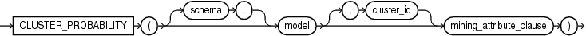
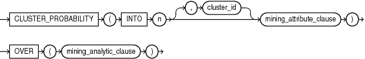
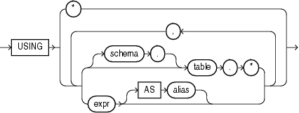
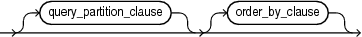

### Syntax

### cluster_probability::=

[Description of the illustration cluster_probability.eps](img_text/cluster_probability.md)

### Analytic Syntax

### cluster_prob_analytic::=

[Description of the illustration cluster_prob_analytic.eps](img_text/cluster_prob_analytic.md)

### mining_attribute_clause::=

[Description of the illustration mining_attribute_clause.eps](img_text/mining_attribute_clause.md)

### mining_analytic_clause::=

[Description of the illustration mining_analytic_clause.eps](img_text/mining_analytic_clause.md)

**See Also:**

"[Analytic Functions](../sqlrf/Analytic-Functions.md)" for information on the syntax, semantics, and restrictions of `mining_analytic_clause`

### Purpose

`CLUSTER_PROBABILITY` returns a probability for each row in the selection. The probability refers to the highest probability cluster or to the specified `cluster_id`. The cluster probability is returned as `BINARY_DOUBLE`.

### Syntax Choice

`CLUSTER_PROBABILITY` can score the data in one of two ways: It can apply a mining model object to the data, or it can dynamically mine the data by executing an analytic clause that builds and applies one or more transient mining models. Choose Syntax or Analytic Syntax:

- Syntax — Use the first syntax to score the data with a pre-defined model. Supply the name of a clustering model.

- Analytic Syntax — Use the analytic syntax to score the data without a pre-defined model. Include `INTO` `n`, where `n` is the number of clusters to compute, and mining_analytic_clause, which specifies if the data should be partitioned for multiple model builds. The `mining_analytic_clause` supports a `query_partition_clause` and an `order_by_clause`. (See "[analytic_clause::=](../sqlrf/Analytic-Functions.md)".)

The syntax of the `CLUSTER_PROBABILITY` function can use an optional `GROUPING` hint when scoring a partitioned model. See [GROUPING Hint](../sqlrf/Comments.md).

### mining_attribute_clause

`mining_attribute_clause` identifies the column attributes to use as predictors for scoring. When the function is invoked with the analytic syntax, these predictors are also used for building the transient models. The `mining_attribute_clause` behaves as described for the `PREDICTION` function. (See "[mining_attribute_clause](../sqlrf/PREDICTION.md)".)

**See Also:**

- [Oracle Data Mining User's Guide](scoring-deployment.md) for information about scoring.

- [Oracle Data Mining Concepts](clustering.md) for information about clustering.

**Note:**

The following example is excerpted from the Data Mining sample programs. For more information about the sample programs, see Appendix A in [Oracle Data Mining User's Guide](../dmprg/data-mining-sample-programs.md).

### Example

The following example lists the ten most representative customers, based on likelihood, of cluster 2.

    SELECT cust_id
      FROM (SELECT cust_id, rank() OVER (ORDER BY prob DESC, cust_id) rnk_clus2
        FROM (SELECT cust_id, CLUSTER_PROBABILITY(km_sh_clus_sample, 2 USING *) prob
              FROM mining_data_apply_v))
    WHERE rnk_clus2 <= 10
    ORDER BY rnk_clus2;

       CUST_ID
    ----------
        100256
        100988
        100889
        101086
        101215
        100390
        100985
        101026
        100601
        100672
