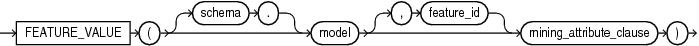
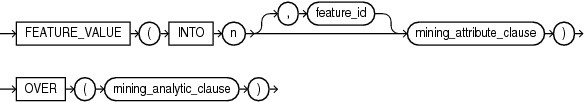
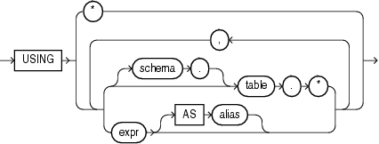
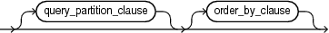

### Syntax

### feature_value::=

[Description of the illustration feature_value.eps](img_text/feature_value.md)

### Analytic Syntax

### feature_value_analytic::=

[Description of the illustration feature_value_analytic.eps](img_text/feature_value_analytic.md)

### mining_attribute_clause::=

[Description of the illustration mining_attribute_clause.eps](img_text/mining_attribute_clause.md)

### mining_analytic_clause::=

[Description of the illustration mining_analytic_clause.eps](img_text/mining_analytic_clause.md)

**See Also:**

"[Analytic Functions](../sqlrf/Analytic-Functions.md)" for information on the syntax, semantics, and restrictions of `mining_analytic_clause`

### Purpose

`FEATURE_VALUE` returns a feature value for each row in the selection. The value refers to the highest value feature or to the specified `feature_id`. The feature value is returned as `BINARY_DOUBLE`.

### Syntax Choice

`FEATURE_VALUE` can score the data in one of two ways: It can apply a mining model object to the data, or it can dynamically mine the data by executing an analytic clause that builds and applies one or more transient mining models. Choose Syntax or Analytic Syntax:

- Syntax — Use the first syntax to score the data with a pre-defined model. Supply the name of a feature extraction model.

- Analytic Syntax — Use the analytic syntax to score the data without a pre-defined model. Include `INTO` `n`, where `n` is the number of features to extract, and `mining_analytic_clause`, which specifies if the data should be partitioned for multiple model builds. The `mining_analytic_clause` supports a `query_partition_clause` and an `order_by_clause`. (See "[analytic_clause::=](../sqlrf/Analytic-Functions.md)".)

The syntax of the `FEATURE_VALUE` function can use an optional `GROUPING` hint when scoring a partitioned model. See [GROUPING Hint](../sqlrf/Comments.md).

### mining_attribute_clause

`mining_attribute_clause` identifies the column attributes to use as predictors for scoring. When the function is invoked with the analytic syntax, this data is also used for building the transient models. The `mining_attribute_clause` behaves as described for the `PREDICTION` function. (See "[mining_attribute_clause](../sqlrf/PREDICTION.md)".)

**See Also:**

- [Oracle Data Mining User's Guide](scoring-deployment.md) for information about scoring.

- [Oracle Data Mining Concepts](feature-selection-extraction.md) for information about feature extraction.

**Note:**

The following example is excerpted from the Data Mining sample programs. For more information about the sample programs, see Appendix A in [Oracle Data Mining User's Guide](../dmprg/data-mining-sample-programs.md).

### Example

The following example lists the customers that correspond to feature 3, ordered by match quality.

    SELECT *
      FROM (SELECT cust_id, FEATURE_VALUE(nmf_sh_sample, 3 USING *) match_quality
              FROM nmf_sh_sample_apply_prepared
              ORDER BY match_quality DESC)
      WHERE ROWNUM < 11;

       CUST_ID MATCH_QUALITY
    ---------- -------------
        100210    19.4101627
        100962    15.2482251
        101151    14.5685197
        101499    14.4186292
        100363    14.4037396
        100372    14.3335148
        100982    14.1716545
        101039    14.1079914
        100759    14.0913761
        100953    14.0799737
