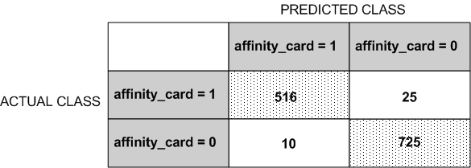
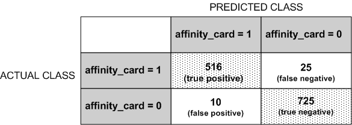
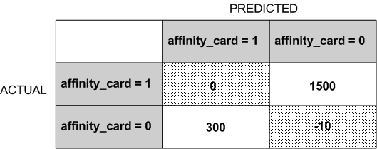

Learn how to predict a categorical target through Classification - the supervised mining function.

- About Classification

- Testing a Classification Model

- Biasing a Classification Model

- Classification Algorithms

**Related Topics**

- [Oracle Data Mining Basics](data-mining-basics.md)

### 4.1 About Classification

Classification is a data mining function that assigns items in a collection to target categories or classes. The goal of classification is to accurately predict the target class for each case in the data. For example, a classification model can be used to identify loan applicants as low, medium, or high credit risks.

A classification task begins with a data set in which the class assignments are known. For example, a classification model that predicts credit risk can be developed based on observed data for many loan applicants over a period of time. In addition to the historical credit rating, the data might track employment history, home ownership or rental, years of residence, number and type of investments, and so on. Credit rating is the target, the other attributes are the predictors, and the data for each customer constitutes a case.

Classifications are discrete and do not imply order. Continuous, floating-point values indicate a numerical, rather than a categorical, target. A predictive model with a numerical target uses a regression algorithm, not a classification algorithm.

The simplest type of classification problem is binary classification. In binary classification, the target attribute has only two possible values: for example, high credit rating or low credit rating. Multiclass targets have more than two values: for example, low, medium, high, or unknown credit rating.

In the model build (training) process, a classification algorithm finds relationships between the values of the predictors and the values of the target. Different classification algorithms use different techniques for finding relationships. These relationships are summarized in a model, which can then be applied to a different data set in which the class assignments are unknown.

Classification models are tested by comparing the predicted values to known target values in a set of test data. The historical data for a classification project is typically divided into two data sets: one for building the model; the other for testing the model.

Applying a classification model results in class assignments and probabilities for each case. For example, a model that classifies customers as low, medium, or high value also predicts the probability of each classification for each customer.

Classification has many applications in customer segmentation, business modeling, marketing, credit analysis, and biomedical and drug response modeling.

### 4.2 Testing a Classification Model

A classification model is tested by applying it to test data with known target values and comparing the predicted values with the known values.

The test data must be compatible with the data used to build the model and must be prepared in the same way that the build data was prepared. Typically the build data and test data come from the same historical data set. A percentage of the records is used to build the model; the remaining records are used to test the model.

Test metrics are used to assess how accurately the model predicts the known values. If the model performs well and meets the business requirements, it can then be applied to new data to predict the future.

#### 4.2.1 Confusion Matrix

A confusion matrix displays the number of correct and incorrect predictions made by the model compared with the actual classifications in the test data. The matrix is n-by-n, where n is the number of classes.

The following figure shows a confusion matrix for a binary classification model. The rows present the number of actual classifications in the test data. The columns present the number of predicted classifications made by the model.

Figure 4-1 Confusion Matrix for a Binary Classification Model

[Description of "Figure 4-1 Confusion Matrix for a Binary Classification Model"](img_text/confusion_matrix.md)

In this example, the model correctly predicted the positive class (also called true positive (TP)) for `affinity_card` 516 times and incorrectly predicted (also called false negative (FN)) it 25 times. The model correctly predicted the negative class (also called true negative (TN)) for `affinity_card` 725 times and incorrectly predicted (also called false positive (FP)) it 10 times. The following can be computed from this confusion matrix:

- The model made 1241 correct predictions, that is, TP + TN, (516 + 725).

- The model made 35 incorrect predictions, that is, FN + FP, (25 + 10).

- There are 1276 total scored cases, (516 + 25 + 10 + 725).

- The error rate is 35/1276 = 0.0274. (FN+FP/Total)

- The overall accuracy rate is 1241/1276 = 0.9725 (TP+TN)/Total).

##### Precision and Recall

Consider the same example, the accuracy rate shows 0.97. However, there are cases where the model has incorrectly predicted. **Precision** (positive predicted value) is the ability of a classification model to return only relevant cases. Precision can be calculated as TP/TP+FP. **Recall** (sensitivity or true positive rate) is the ability of a classification model to return relevant cases. Recall can be calculated as TP/TP+FN. The precision in this example is 516/526 = 0.98. The recall in this example is 516/541 = 0.95. Ideally, the model is good when both precision and recall are 1. This can happen when the numerator and the denominator are equal. That means, for precision, FP is zero and for recall, FN is zero.

#### 4.2.2 Lift

Lift measures the degree to which the predictions of a classification model are better than randomly-generated predictions.

Lift applies to binary classification only, and it requires the designation of a positive class. If the model itself does not have a binary target, you can compute lift by designating one class as positive and combining all the other classes together as one negative class.

Numerous statistics can be calculated to support the notion of lift. Basically, lift can be understood as a ratio of two percentages: the percentage of correct positive classifications made by the model to the percentage of actual positive classifications in the test data. For example, if 40% of the customers in a marketing survey have responded favorably (the positive classification) to a promotional campaign in the past and the model accurately predicts 75% of them, the lift is obtained by dividing .75 by .40. The resulting lift is 1.875.

Lift is computed against quantiles that each contain the same number of cases. The data is divided into quantiles after it is scored. It is ranked by probability of the positive class from highest to lowest, so that the highest concentration of positive predictions is in the top quantiles. A typical number of quantiles is 10.

Lift is commonly used to measure the performance of response models in marketing applications. The purpose of a response model is to identify segments of the population with potentially high concentrations of positive responders to a marketing campaign. Lift reveals how much of the population must be solicited to obtain the highest percentage of potential responders.

**Related Topics**

- Positive and Negative Classes

##### 4.2.2.1 Lift Statistics

Learn the different Lift statistics that Oracle Data Mining can compute.

Oracle Data Mining computes the following lift statistics:

- **Probability threshold** for a quantile n is the minimum probability for the positive target to be included in this quantile or any preceding quantiles (quantiles n-1, n-2,..., 1). If a cost matrix is used, a cost threshold is reported instead. The cost threshold is the maximum cost for the positive target to be included in this quantile or any of the preceding quantiles.

- **Cumulative gain** is the ratio of the cumulative number of positive targets to the total number of positive targets.

- **Target density** of a quantile is the number of true positive instances in that quantile divided by the total number of instances in the quantile.

- **Cumulative target density** for quantile n is the target density computed over the first n quantiles.

- **Quantile lift** is the ratio of the target density for the quantile to the target density over all the test data.

- **Cumulative percentage of records** for a quantile is the percentage of all cases represented by the first n quantiles, starting at the end that is most confidently positive, up to and including the given quantile.

- **Cumulative number of targets** for quantile n is the number of true positive instances in the first n quantiles.

- **Cumulative number of nontargets** is the number of actually negative instances in the first n quantiles.

- **Cumulative lift** for a quantile is the ratio of the cumulative target density to the target density over all the test data.

**Related Topics**

- Costs

#### 4.2.3 Receiver Operating Characteristic (ROC)

ROC is a metric for comparing predicted and actual target values in a classification model.

ROC, like Lift, applies to Binary Classification and requires the designation of a positive class.

You can use ROC to gain insight into the decision-making ability of the model. How likely is the model to accurately predict the negative or the positive class?

ROC measures the impact of changes in the **probability threshold**. The probability threshold is the decision point used by the model for classification. The default probability threshold for binary classification is 0.5. When the probability of a prediction is 50% or more, the model predicts that class. When the probability is less than 50%, the other class is predicted. (In multiclass classification, the predicted class is the one predicted with the highest probability.)

**Related Topics**

- Positive and Negative Classes

##### 4.2.3.1 The ROC Curve

ROC can be plotted as a curve on an X-Y axis. The **false positive rate** is placed on the X axis. The **true positive rate** is placed on the Y axis.

The top left corner is the optimal location on an ROC graph, indicating a high true positive rate and a low false positive rate.

##### 4.2.3.2 Area Under the Curve

The area under the ROC curve (AUC) measures the discriminating ability of a binary classification model. The larger the AUC, the higher the likelihood that an actual positive case is assigned, and a higher probability of being positive than an actual negative case. The AUC measure is especially useful for data sets with unbalanced target distribution (one target class dominates the other).

##### 4.2.3.3 ROC and Model Bias

The ROC curve for a model represents all the possible combinations of values in its confusion matrix.

Changes in the probability threshold affect the predictions made by the model. For instance, if the threshold for predicting the positive class is changed from 0.5 to 0.6, then fewer positive predictions are made. This affects the distribution of values in the confusion matrix: the number of true and false positives and true and false negatives differ.

You can use ROC to find the probability thresholds that yield the highest overall accuracy or the highest per-class accuracy. For example, if it is important to you to accurately predict the positive class, but you don't care about prediction errors for the negative class, then you can lower the threshold for the positive class. This can bias the model in favor of the positive class.

A cost matrix is a convenient mechanism for changing the probability thresholds for model scoring.

**Related Topics**

- Costs

##### 4.2.3.4 ROC Statistics

Oracle Data Mining computes the following ROC statistics:

- **Probability threshold:** The minimum predicted positive class probability resulting in a positive class prediction. Different threshold values result in different hit rates and different false alarm rates.

- **True negatives:** Negative cases in the test data with predicted probabilities strictly less than the probability threshold (correctly predicted).

- **True positives:** Positive cases in the test data with predicted probabilities greater than or equal to the probability threshold (correctly predicted).

- **False negatives:** Positive cases in the test data with predicted probabilities strictly less than the probability threshold (incorrectly predicted).

- **False positives:** Negative cases in the test data with predicted probabilities greater than or equal to the probability threshold (incorrectly predicted).

- **True positive fraction**: Hit rate. (true positives/(true positives + false negatives))

- **False positive fraction:** False alarm rate. (false positives/(false positives + true negatives))

### 4.3 Biasing a Classification Model

Costs, prior probabilities, and class weights are methods for biasing classification models.

#### 4.3.1 Costs

A cost matrix is a mechanism for influencing the decision making of a model. A cost matrix can cause the model to minimize costly misclassifications. It can also cause the model to maximize beneficial accurate classifications.

For example, if a model classifies a customer with poor credit as low risk, this error is costly. A cost matrix can bias the model to avoid this type of error. The cost matrix can also be used to bias the model in favor of the correct classification of customers who have the worst credit history.

ROC is a useful metric for evaluating how a model behaves with different probability thresholds. You can use ROC to help you find optimal costs for a given classifier given different usage scenarios. You can use this information to create cost matrices to influence the deployment of the model.

##### 4.3.1.1 Costs Versus Accuracy

Compares Cost matrix and Confusion matrix for costs and accuracy to evaluate model quality.

Like a confusion matrix, a cost matrix is an n-by-n matrix, where n is the number of classes. Both confusion matrices and cost matrices include each possible combination of actual and predicted results based on a given set of test data.

A confusion matrix is used to measure accuracy, the ratio of correct predictions to the total number of predictions. A cost matrix is used to specify the relative importance of accuracy for different predictions. In most business applications, it is important to consider costs in addition to accuracy when evaluating model quality.

**Related Topics**

- Confusion Matrix

##### 4.3.1.2 Positive and Negative Classes

Discusses the importance of positive and negative classes in a confusion matrix.

The positive class is the class that you care the most about. Designation of a positive class is required for computing Lift and ROC.

In the confusion matrix, in the following figure, the value `1` is designated as the positive class. This means that the creator of the model has determined that it is more important to accurately predict customers who increase spending with an affinity card (`affinity_card`=1) than to accurately predict non-responders (`affinity_card`=0). If you give affinity cards to some customers who are not likely to use them, there is little loss to the company since the cost of the cards is low. However, if you overlook the customers who are likely to respond, you miss the opportunity to increase your revenue.

Figure 4-2 Positive and Negative Predictions

[Description of "Figure 4-2 Positive and Negative Predictions"](img_text/false_pos_neg.md)

The true and false positive rates in this confusion matrix are:

- False positive rate — 10/(10 + 725) =.01

- True positive rate — 516/(516 + 25) =.95

**Related Topics**

- Lift
- Receiver Operating Characteristic (ROC)

##### 4.3.1.3 Assigning Costs and Benefits

In a cost matrix, positive numbers (costs) can be used to influence negative outcomes. Since negative costs are interpreted as benefits, negative numbers (benefits) can be used to influence positive outcomes.

Suppose you have calculated that it costs your business \$1500 when you do not give an affinity card to a customer who can increase spending. Using the model with the confusion matrix shown in Figure 4-2, each false negative (misclassification of a responder) costs \$1500. Misclassifying a non-responder is less expensive to your business. You estimate that each false positive (misclassification of a non-responder) only costs \$300.

You want to keep these costs in mind when you design a promotion campaign. You estimate that it costs \$10 to include a customer in the promotion. For this reason, you associate a benefit of \$10 with each true negative prediction, because you can simply eliminate those customers from your promotion. Each customer that you eliminate represents a savings of \$10. In your cost matrix, you specify this benefit as -10, a negative cost.

The following figure shows how you would represent these costs and benefits in a cost matrix:

Figure 4-3 Cost Matrix Representing Costs and Benefits

[Description of "Figure 4-3 Cost Matrix Representing Costs and Benefits"](img_text/cost_matrix.md)

With Oracle Data Mining you can specify costs to influence the scoring of any classification model. Decision Tree models can also use a cost matrix to influence the model build.

#### 4.3.2 Priors and Class Weights

Learn about Priors and Class Weights in a Classification model to produce a useful result.

With Bayesian models, you can specify **Prior** probabilities to offset differences in distribution between the build data and the real population (scoring data). With other forms of Classification, you are able to specify **Class Weights**, which have the same biasing effect as priors.

In many problems, one target value dominates in frequency. For example, the positive responses for a telephone marketing campaign is 2% or less, and the occurrence of fraud in credit card transactions is less than 1%. A classification model built on historic data of this type cannot observe enough of the rare class to be able to distinguish the characteristics of the two classes; the result can be a model that when applied to new data predicts the frequent class for every case. While such a model can be highly accurate, it is not be very useful. This illustrates that it is not a good idea to rely solely on accuracy when judging the quality of a Classification model.

To correct for unrealistic distributions in the training data, you can specify priors for the model build process. Other approaches to compensating for data distribution issues include stratified sampling and anomaly detection.

**Related Topics**

- [Anomaly Detection](anomaly-detection.md)

### 4.4 Classification Algorithms

Learn different Classification algorithms used in Oracle Data Mining.

Oracle Data Mining provides the following algorithms for classification:

- **Decision Tree**

  Decision trees automatically generate rules, which are conditional statements that reveal the logic used to build the tree.

- Explicit Semantic Analysis

  Explicit Semantic Analysis (ESA) is designed to make predictions for text data. This algorithm can address use cases with hundreds of thousands of classes.

- **Naive Bayes**

  Naive Bayes uses Bayes' Theorem, a formula that calculates a probability by counting the frequency of values and combinations of values in the historical data.

- **Generalized Linear Models (GLM)**

  GLM is a popular statistical technique for linear modeling. Oracle Data Mining implements GLM for binary classification and for regression. GLM provides extensive coefficient statistics and model statistics, as well as row diagnostics. GLM also supports confidence bounds.

- **Random Forest**

  Random Forest is a powerful and popular machine learning algorithm that brings significant performance and scalability benefits.

- **Support Vector Machines (SVM)**

  SVM is a powerful, state-of-the-art algorithm based on linear and nonlinear regression. Oracle Data Mining implements SVM for binary and multiclass classification.

**Note:**

Oracle Data Mining uses Naive Bayes as the default classification algorithm.

**Related Topics**

- [Decision Tree](decision-tree.md)
- [Explicit Semantic Analysis](explicit-semantic-analysis.md)
- [Naive Bayes](naive-bayes.md)
- [Generalized Linear Models](generalized-linear-models.md)
- [Random Forest](random-forest.md)
- [Support Vector Machines](support-vector-machines.md)
