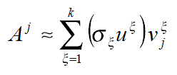
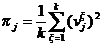
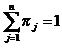
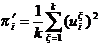

Learn how to use CUR decomposition based algorithm for attribute importance.

- About CUR Matrix Decomposition

- Singular Vectors

- Statistical Leverage Score

- Column (Attribute) Selection and Row Selection

- CUR Matrix Decomposition Algorithm Configuration

### 11.1 About CUR Matrix Decomposition

CUR matrix decomposition is a low-rank matrix decomposition algorithm that is explicitly expressed in a small number of actual columns and/or actual rows of data matrix.

CUR matrix decomposition was developed as an alternative to Singular Value Decomposition (SVD) and Principal Component Analysis (PCA). CUR matrix decomposition selects columns and rows that exhibit high **statistical leverage** or large **influence** from the data matrix. By implementing the CUR matrix decomposition algorithm, a small number of most important attributes and/or rows can be identified from the original data matrix. Therefore, CUR matrix decomposition is an important tool for exploratory data analysis. CUR matrix decomposition can be applied to a variety of areas and facilitates Regression, Classification, and Clustering.

**Related Topics**

- [Data Preparation for SVD](singular-value-decomposition.md)

### 11.2 Singular Vectors

Singular Value Decomposition (SVD) is the first step in CUR matrix decomposition.

SVD returns left and right singular vectors for calculating column and row leverage scores. Perform SVD on the following matrix:

    A ε Rmxn

The matrix is factorized as follows:

    A=UΣVT

where `U = [``u``1`` ``u``2``...``u``m``]` and `V = [v``1`` v``2``...v``n``]` are orthogonal matrices.

`Σ` is a diagonal m × n matrix with non-negative real numbers `σ1,...,σ``ρ`` ` on the diagonal, where `ρ = min {``m``,``n``}` and `σ``ξ` is the `ξ``th` singular value of A.

Let uξ and vξ be the ξth left and right singular vector of A, the jth column of A can thus be approximated by the top k singular vectors and corresponding singular values as:

[Description of the illustration singular_vectors.eps](img_text/singular_vectors.md)

where vξj is the jth coordinate of the ξth right singular vector.

### 11.3 Statistical Leverage Score

The statistical leverage scores represent the column (or attribute) and row importance.

The normalized statistical leverage scores for all columns are computed from the top k right singular vectors as follows:

[Description of the illustration statistical_leverage_score.eps](img_text/statistical_leverage_score.md)

where k is called rank parameter and `j`` = 1,...,``n`. Given that πj\>=0 and

[Description of the illustration statistical_leverage_score_1.eps](img_text/statistical_leverage_score_1.md)

, these scores form a probability distribution over the n columns.

Similarly, the normalized statistical leverage scores for all rows are computed from the top k left singular vectors as:

[Description of the illustration statistical_leverage_score_2.eps](img_text/statistical_leverage_score_2.md)

where `i`` = 1,...,``m`.

### 11.4 Column (Attribute) Selection and Row Selection

Column (Attribute) selection and Row selection is the final stage in CUR matrix decomposition.

Attribute selection: Selects attributes with high leverage scores and reports their names, scores (as importance) and ranks (by importance).

Row selection: Selects rows with high leverage scores and reports their names, scores (as importance) and ranks (by importance).

1.  CUR matrix decomposition first selects the jth column (or attribute) of A with probability `p``j``= min {1,``cπ``j``}` for all `j`` ε {1,...,``n``}`

2.  If users enable row selection, select ith row of A with probability `pˊ``i`` = min {1,``rπˊ``i``}` for all `i`` ε {1,...,``m``}`

3.  Report the name (or ID) and leverage score (as importance) for all selected attributes (if row importance is disabled) or for all selected attributes and rows (if row importance is enabled).

c is the approximated (or expected) number of columns that users want to select, and r is the approximated (or expected) number of rows that users want to select.

To realize column and row selections, you need to calculate the probability to select each column and row.

Calculate the probability for each column as follows:

`p``j`` = min {1,``c``π``j``}`

Calculate the probability for each row as follows:

`pˊ``i`` = min{1, ``c``πˊ``i``}`.

A column or row is selected if the probability is greater than some threshold.

### 11.5 CUR Matrix Decomposition Algorithm Configuration

Learn about configuring CUR Matrix Decomposition algorithm.

Example 11-1 Example

In this example you will understand how to build a CUR Matrix Decomposition algorithm. When the settings table is created and populated with CUR Matrix Decomposition related settings, insert a row in the settings table to specify the algorithm.

    INSERT INTO SETTINGS_TABLE (setting_name, setting_value) VALUES
    ('ALGO_NAME', 'ALGO_CUR_DECOMPOSITION');

Build the model as follows:

    BEGIN
    DBMS_DATA_MINING.CREATE_MODEL(
    model_name              => 'model-name',
    mining_function         => dbms_data_mining.attribute_importance,
    data_table_name         => 'test_table',
    case_id_column_name     => 'id',
    settings_table_name     => 'settings_table');
    END;
    /

#### Row Selection

To use this feature, insert a row in the settings table to specify that the row importance is enabled:

    INSERT INTO SETTINGS_TABLE (setting_name, setting_value) VALUES ('CURS_ROW_IMPORTANCE', 'CURS_ROW_IMP_ENABLE');

**Note:**

The row selection is performed only when users specify that row importance is enabled and the `CASE_ID` column is present.

**Related Topics**

- [Oracle Database PL/SQL Packages and Types Reference](../arpls/DBMS_DATA_MINING.md)
