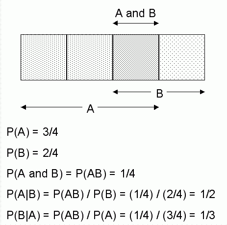

Learn how to use Naive Bayes Classification algorithm that the Oracle Data Mining supports.

- About Naive Bayes

- Tuning a Naive Bayes Model

- Data Preparation for Naive Bayes

**Related Topics**

- [Classification](classification.md)

### 19.1 About Naive Bayes

Learn about Naive Bayes algorithm.

The Naive Bayes algorithm is based on conditional probabilities. It uses Bayes' theorem, a formula that calculates a probability by counting the frequency of values and combinations of values in the historical data.

Bayes' theorem finds the probability of an event occurring given the probability of another event that has already occurred. If `B` represents the dependent event and `A` represents the prior event, Bayes' theorem can be stated as follows.

**Note:**

Prob(B given A) = Prob(A and B)/Prob(A)

To calculate the probability of `B` given `A`, the algorithm counts the number of cases where `A` and `B` occur together and divides it by the number of cases where `A` occurs alone.

Example 19-1 Use Bayes' Theorem to Predict an Increase in Spending

Suppose you want to determine the likelihood that a customer under 21 increases spending. In this case, the prior condition (`A`) is "under 21," and the dependent condition (`B`) is "increase spending."

If there are 100 customers in the training data and 25 of them are customers under 21 who have increased spending, then:

Prob(A and B) = 25%

If 75 of the 100 customers are under 21, then:

Prob(A) = 75%

Bayes' theorem predicts that 33% of customers under 21 are likely to increase spending (25/75).

The cases where both conditions occur together are referred to as **pairwise**. In Example 19-1, 25% of all cases are pairwise.

The cases where only the prior event occurs are referred to as **singleton**. In Example 19-1, 75% of all cases are singleton.

A visual representation of the conditional relationships used in Bayes' theorem is shown in the following figure.

Figure 19-1 Conditional Probabilities in Bayes' Theorem

[Description of "Figure 19-1 Conditional Probabilities in Bayes' Theorem"](img_text/bayes.md)

For purposes of illustration, Example 19-1 and Figure 19-1 show a dependent event based on a single independent event. In reality, the Naive Bayes algorithm must usually take many independent events into account. In Example 19-1, factors such as income, education, gender, and store location might be considered in addition to age.

Naive Bayes makes the assumption that each predictor is conditionally independent of the others. For a given target value, the distribution of each predictor is independent of the other predictors. In practice, this assumption of independence, even when violated, does not degrade the model's predictive accuracy significantly, and makes the difference between a fast, computationally feasible algorithm and an intractable one.

Sometimes the distribution of a given predictor is clearly not representative of the larger population. For example, there might be only a few customers under 21 in the training data, but in fact there are many customers in this age group in the wider customer base. To compensate for this, you can specify **prior probabilities** when training the model.

**Related Topics**

- [Priors and Class Weights](classification.md)

#### 19.1.1 Advantages of Naive Bayes

Learn about the advantages of Naive Bayes.

The Naive Bayes algorithm affords fast, highly scalable model building and scoring. It scales linearly with the number of predictors and rows.

The build process for Naive Bayes supports parallel execution. (Scoring supports parallel execution irrespective of the algorithm.)

Naive Bayes can be used for both binary and multiclass classification problems.

**Related Topics**

- [Oracle Database VLDB and Partitioning Guide](../vldbg/using-parallel.md)

### 19.2 Tuning a Naive Bayes Model

Introduces about probability calculation of pairwise occurrences and percentage of singleton occurrences.

Naive Bayes calculates a probability by dividing the percentage of pairwise occurrences by the percentage of singleton occurrences. If these percentages are very small for a given predictor, they probably do not contribute to the effectiveness of the model. Occurrences below a certain threshold can usually be ignored.

The following build settings are available for adjusting the probability thresholds. You can specify:

- The minimum percentage of pairwise occurrences required for including a predictor in the model.

- The minimum percentage of singleton occurrences required for including a predictor in the model .

The default thresholds work well for most models, so you need not adjust these settings.

**Related Topics**

- [Oracle Database PL/SQL Packages and Types Reference](../arpls/DBMS_DATA_MINING.md)

### 19.3 Data Preparation for Naive Bayes

Learn about preparing the data for Naive Bayes.

Automatic Data Preparation performs supervised binning for Naive Bayes. Supervised binning uses decision trees to create the optimal bin boundaries. Both categorical and numeric attributes are binned.

Naive Bayes handles missing values naturally as missing at random. The algorithm replaces sparse numerical data with zeros and sparse categorical data with zero vectors. Missing values in nested columns are interpreted as sparse. Missing values in columns with simple data types are interpreted as missing at random.

If you choose to manage your own data preparation, keep in mind that Naive Bayes usually requires binning. Naive Bayes relies on counting techniques to calculate probabilities. Columns must be binned to reduce the cardinality as appropriate. Numerical data can be binned into ranges of values (for example, low, medium, and high), and categorical data can be binned into meta-classes (for example, regions instead of cities). Equi-width binning is not recommended, since outliers cause most of the data to concentrate in a few bins, sometimes a single bin. As a result, the discriminating power of the algorithms is significantly reduced

**Related Topics**

- [Preparing the Data](../dmprg/preparing-data.md)
- [Transforming the Data](../dmprg/transforming-data.md)
