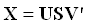
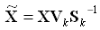
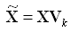
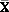

Learn how to use Singular Value Decomposition, an unsupervised algorithm for Feature Extraction.

- About Singular Value Decomposition

- Configuring the Algorithm

- Data Preparation for SVD

**Related Topics**

- [Feature Selection and Extraction](feature-selection-extraction.md)

### 25.1 About Singular Value Decomposition

Singular Value Decomposition (SVD) and the closely-related Principal Component Analysis (PCA) are well established feature extraction methods that have a wide range of applications. Oracle Data Mining implements SVD as a feature extraction algorithm and PCA as a special scoring method for SVD models.

SVD and PCA are orthogonal linear transformations that are optimal at capturing the underlying variance of the data. This property is very useful for reducing the dimensionality of high-dimensional data and for supporting meaningful data visualization.

SVD and PCA have a number of important applications in addition to dimensionality reduction. These include matrix inversion, data compression, and the imputation of unknown data values.

#### 25.1.1 Matrix Manipulation

Singular Value Decomposition (SVD) is a factorization method that decomposes a rectangular matrix X into the product of three matrices:

Figure 25-1 Matrix Manipulation

[Description of "Figure 25-1 Matrix Manipulation"](img_text/x_eq_usv.md)

- The U matrix consists of a set of 'left' orthonormal bases
- The S matrix is a diagonal matrix
- The V matrix consists of set of 'right' orthonormal bases

The values in S are called singular values. They are non-negative, and their magnitudes indicate the importance of the corresponding bases (components). The singular values reflect the amount of data variance captured by the bases. The first basis (the one with largest singular value) lies in the direction of the greatest data variance. The second basis captures the orthogonal direction with the second greatest variance, and so on.

SVD essentially performs a coordinate rotation that aligns the transformed axes with the directions of maximum variance in the data. This is a useful procedure under the assumption that the observed data has a high signal-to-noise ratio and that a large variance corresponds to interesting data content while a lower variance corresponds to noise.

SVD makes the assumption that the underlying data is Gaussian distributed and can be well described in terms of means and covariances.

#### 25.1.2 Low Rank Decomposition

To reduce dimensionality, Singular Value Decomposition (SVD) keeps lower-order bases (the ones with the largest singular values) and ignores higher-order bases (the ones with the smallest singular values). The rationale behind this strategy is that the low-order bases retain the characteristics of the data that contribute most to its variance and are likely to capture the most important aspects of the data.

Given a data set X (nxm), where n is the number of rows and m is the number of attributes, a low-rank SVD uses only k components (k \<= min(m, n)). In typical implementations of SVD, the value of k requires a visual inspection of the ranked singular values associated with the individual components. In Oracle Data Mining, SVD automatically estimates the cutoff point, which corresponds to a significant drop in the explained variance.

SVD produces two sets of orthonormal bases (U and V). Either of these bases can be used as a new coordinate system. In Oracle Data Mining SVD, V is the new coordinate system, and U represents the projection of X in this coordinate system. The algorithm computes the projection of new data as follows:

Figure 25-2 Computing Projection of New Data

[Description of "Figure 25-2 Computing Projection of New Data"](img_text/x_eq_xvs.md)

where X (nxk) is the projected data in the reduced data space, defined by the first k components, and Vk and Sk define the reduced component set.

#### 25.1.3 Scalability

In Oracle Data Mining, Singular Value Decomposition (SVD) can process data sets with millions of rows and thousands of attributes. Oracle Data Mining automatically recommends an appropriate number of features, based on the data, for dimensionality reduction.

SVD has linear scalability with the number of rows and cubic scalability with the number of attributes when a full decomposition is computed. A low-rank decomposition is typically linear with the number of rows and linear with the number of columns. The scalability with the reduced rank depends on how the rank compares to the number of rows and columns. It can be linear when the rank is significantly smaller or cubic when it is on the same scale.

### 25.2 Configuring the Algorithm

Learn about configuring Singular Value Decomposition (SVD).

Several options are available for configuring the SVD algorithm. Among them are settings to control model size and performance, and whether to score with SVD projections or Principal Component Analysis (PCA) projections.

**Related Topics**

- [Oracle Database PL/SQL Packages and Types Reference](../arpls/DBMS_DATA_MINING.md)

#### 25.2.1 Model Size

The U matrix in Singular Value Decomposition has as many rows as the number of rows in the build data. To avoid creating a large model, the U matrix persists only when an algorithm-specific setting is enabled. By default the U matrix does not persist.

#### 25.2.2 Performance

Singular Value Decomposition can use approximate computations to improve performance. Approximation may be appropriate for data sets with many columns. An approximate low-rank decomposition provides good solutions at a reasonable computational cost. The quality of the approximation is dependent on the characteristics of the data.

#### 25.2.3 PCA scoring

Learn about configuring Singular Value Decomposition (SVD) to perform Principal Component Analysis (PCA) projections.

SVD models can be configured to perform PCA projections. PCA is closely related to SVD. PCA computes a set of orthonormal bases (principal components) that are ranked by their corresponding explained variance. The main difference between SVD and PCA is that the PCA projection is not scaled by the singular values. The PCA projection to the new coordinate system is given by:

Figure 25-3 PCA Projection Calculation

[Description of "Figure 25-3 PCA Projection Calculation"](img_text/x_eq_vx.md)

where  (nxk) is the projected data in the reduced data space, defined by the first k components, and Vk defines the reduced component set.

**Related Topics**

- [Oracle Database PL/SQL Packages and Types Reference](../arpls/DBMS_DATA_MINING.md)

### 25.3 Data Preparation for SVD

Learn about preparing the data for Singular Value Decomposition (SVD).

Oracle Data Mining implements SVD for numerical data and categorical data.

When the build data is scored with SVD, Automatic Data Preparation does nothing. When the build data is scored with Principal Component Analysis (PCA), Automatic Data Preparation shifts the numerical data by mean.

Missing value treatment is not needed, because Oracle Data Mining algorithms handle missing values automatically. SVD replaces numerical missing values with the mean and categorical missing values with the mode. For sparse data (missing values in nested columns), SVD replaces missing values with zeros.

**Related Topics**

- [Preparing the Data](../dmprg/preparing-data.md)
- [Transforming the Data](../dmprg/transforming-data.md)
