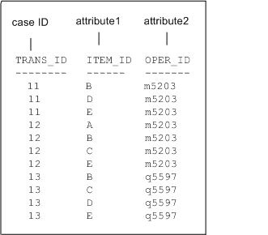

Learn how to discover Association Rules through Association - an unsupervised mining technique.

- About Association

- Transactional Data

- Association Algorithm

**Related Topics**

- [Oracle Data Mining Basics](data-mining-basics.md)

### 8.1 About Association

Association is a data mining technique that discovers the probability of the co-occurrence of items in a collection. The relationships between co-occurring items are expressed as Association Rules.

#### 8.1.1 Association Rules

The results of an Association model are the rules that identify patterns of association within the data. Oracle Data Mining does not support the scoring operation for association modeling.

Association Rules can be applied as follows:

- Support: How often do these items occur together in the data?
- Confidence: How frequently the consequent occurs in transactions that contain the antecedent.
- Value: How much business value is connected to item associations

#### 8.1.2 Market-Basket Analysis

Association rules are often used to analyze sales transactions. For example, it is noted that customers who buy cereal at the grocery store often buy milk at the same time. In fact, association analysis find that 85% of the checkout sessions that include cereal also include milk. This relationship can be formulated as the following rule:

    Cereal implies milk with 85% confidence

This application of association modeling is called **market-basket analysis**. It is valuable for direct marketing, sales promotions, and for discovering business trends. Market-basket analysis can also be used effectively for store layout, catalog design, and cross-sell.

#### 8.1.3 Association Rules and eCommerce

Learn about application of Association Rules in other domains.

Association modeling has important applications in other domains as well. For example, in e-commerce applications, Association Rules may be used for Web page personalization. An association model might find that a user who visits pages A and B is 70% likely to also visit page C in the same session. Based on this rule, a dynamic link can be created for users who are likely to be interested in page C. The association rule is expressed as follows:

    A and B imply C with 70% confidence

**Related Topics**

- [Confidence](apriori.md)

### 8.2 Transactional Data

Learn about transactional data, also known as market-basket data.

Unlike other data mining techniques, Association is transaction-based. In transaction processing, a case includes a collection of items such as the contents of a market basket at the checkout counter. The collection of items in the transaction is an attribute of the transaction. Other attributes might be a timestamp or user ID associated with the transaction.

Transactional data, also known as **market-basket data**, is said to be in **multi-record case** format because a set of records (rows) constitute a case. For example, in the following figure, case 11 is made up of three rows while cases 12 and 13 are each made up of four rows.

Figure 8-1 Transactional Data

[Description of "Figure 8-1 Transactional Data"](img_text/transactional_data.md)

Non transactional data is said to be in a **single-record case** format because a single record (row) constitutes a case. In Oracle Data Mining, association models can be built using either transactional or non transactional or two-dimensional data formats. If the data is non transactional, it is possible to transform to a nested column to make it transactional before association mining activities can be performed. Transactional format is the usual format but, the Association Rules model does accept two-dimensional input format. For non transactional input format, each distinct combination of the content in all columns other than the case ID column is treated as a unique item.

**Related Topics**

- [Oracle Data Mining User’s Guide](../dmprg/preparing-data.md)
- [Data Preparation for Apriori](apriori.md)

### 8.3 Association Algorithm

Oracle Data Mining uses the Apriori algorithm to calculate association rules for items in frequent itemsets.
