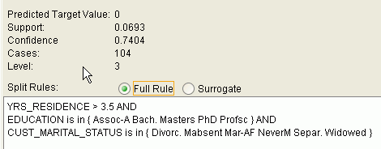
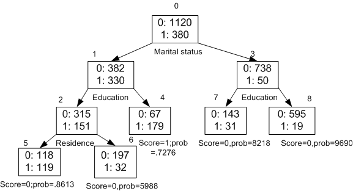

Learn how to use Decision Tree algorithm. Decision Tree is one of the Classification algorithms that the Oracle Data Mining supports.

- About Decision Tree

- Growing a Decision Tree

- Tuning the Decision Tree Algorithm

- Data Preparation for Decision Tree

**Related Topics**

- [Classification](classification.md)

### 13.1 About Decision Tree

The Decision Tree algorithm, like Naive Bayes, is based on conditional probabilities. Unlike Naive Bayes, decision trees generate **rules**. A rule is a conditional statement that can be understood by humans and used within a database to identify a set of records.

In some applications of data mining, the reason for predicting one outcome or another may not be important in evaluating the overall quality of a model. In others, the ability to explain the reason for a decision can be crucial. For example, a Marketing professional requires complete descriptions of customer segments to launch a successful marketing campaign. The Decision Tree algorithm is ideal for this type of application.

Use Decision Tree rules to validate models. If the rules make sense to a subject matter expert, then this validates the model.

#### 13.1.1 Decision Tree Rules

Introduces Decision Tree rules.

Oracle Data Mining supports several algorithms that provide rules. In addition to decision trees, clustering algorithms provide rules that describe the conditions shared by the members of a cluster, and association rules provide rules that describe associations between attributes.

Rules provide **model transparency**, a window on the inner workings of the model. Rules show the basis for the model's predictions. Oracle Data Mining supports a high level of model transparency. While some algorithms provide rules, all algorithms provide **model details**. You can examine model details to determine how the algorithm handles the attributes internally, including transformations and reverse transformations. Transparency is discussed in the context of data preparation and in the context of model building in Oracle Data Mining User’s Guide.

The following figure shows a rule generated by a Decision Tree model. This rule comes from a decision tree that predicts the probability that customers increase spending if given a loyalty card. A target value of 0 means not likely to increase spending; 1 means likely to increase spending.

Figure 13-1 Sample Decision Tree Rule

[Description of "Figure 13-1 Sample Decision Tree Rule"](img_text/tree_rule.md)

The rule shown in the figure represents the conditional statement:

    IF
              (current residence > 3.5 and has college degree and is single)
    THEN
              predicted target value = 0

This rule is a full rule. A surrogate rule is a related attribute that can be used at apply time if the attribute needed for the split is missing.

**Related Topics**

- [Understanding Reverse Transformations](../dmapi/understanding-reverse-transformations.md)
- [Model Detail Views for Decision Tree](../dmprg/model-detail-views.md)
- [Clustering](clustering.md)
- [Association](association.md)

##### 13.1.1.1 Confidence and Support

Confidence and support are properties of rules. These statistical measures can be used to rank the rules and hence the predictions.

**Support**: The number of records in the training data set that satisfy the rule.

**Confidence**: The likelihood of the predicted outcome, given that the rule has been satisfied.

For example, consider a list of 1000 customers (1000 cases). Out of all the customers, 100 satisfy a given rule. Of these 100, 75 are likely to increase spending, and 25 are not likely to increase spending. The **support of the rule** is 100/1000 (10%). The **confidence of the prediction** (likely to increase spending) for the cases that satisfy the rule is 75/100 (75%).

#### 13.1.2 Advantages of Decision Trees

Learn about the advantages of Decision Tree.

The Decision Tree algorithm produces accurate and interpretable models with relatively little user intervention. The algorithm can be used for both binary and multiclass classification problems.

The algorithm is fast, both at build time and apply time. The build process for Decision Tree supports parallel execution. (Scoring supports parallel execution irrespective of the algorithm.)

Decision Tree scoring is especially fast. The tree structure, created in the model build, is used for a series of simple tests, (typically 2-7). Each test is based on a single predictor. It is a membership test: either IN or NOT IN a list of values (categorical predictor); or LESS THAN or EQUAL TO some value (numeric predictor).

**Related Topics**

- [Oracle Database VLDB and Partitioning Guide](../vldbg/using-parallel.md)

#### 13.1.3 XML for Decision Tree Models

Learn about generating XML representation of Decision Tree models.

You can generate XML representing a Decision Tree model; the generated XML satisfies the definition specified in the Data Mining Group Predictive Model Markup Language (PMML) version 2.1 specification.

**Related Topics**

- <https://dmg.org/>

### 13.2 Growing a Decision Tree

Predicting a target value by a sequence of questions to form or grow a Decision Tree.

A Decision Tree predicts a target value by asking a sequence of questions. At a given stage in the sequence, the question that is asked depends upon the answers to the previous questions. The goal is to ask questions that, taken together, uniquely identify specific target values. Graphically, this process forms a tree structure.

Figure 13-2 Sample Decision Tree

[Description of "Figure 13-2 Sample Decision Tree"](img_text/treediagram.md)

The figure is a Decision Tree with nine nodes (and nine corresponding rules). The target attribute is binary: 1 if the customer increases spending, 0 if the customer does not increase spending. The first split in the tree is based on the `CUST_MARITAL_STATUS` attribute. The root of the tree (node 0) is split into nodes 1 and 3. Married customers are in node 1; single customers are in node 3.

The rule associated with node 1 is:

    Node 1 recordCount=712,0 Count=382, 1 Count=330
    CUST_MARITAL_STATUS isIN  "Married",surrogate:HOUSEHOLD_SIZE isIn "3""4-5"

Node 1 has 712 records (cases). In all 712 cases, the `CUST_MARITAL_STATUS` attribute indicates that the customer is married. Of these, 382 have a target of 0 (not likely to increase spending), and 330 have a target of 1 (likely to increase spending).

#### 13.2.1 Splitting

During the training process, the Decision Tree algorithm must repeatedly find the most efficient way to split a set of cases (records) into two child nodes. Oracle Data Mining offers two homogeneity metrics, **gini** and **entropy**, for calculating the splits. The default metric is gini.

Homogeneity metrics asses the quality of alternative split conditions and select the one that results in the most homogeneous child nodes. Homogeneity is also called **purity**; it refers to the degree to which the resulting child nodes are made up of cases with the same target value. The objective is to maximize the purity in the child nodes. For example, if the target can be either yes or no (does or does not increase spending), the objective is to produce nodes where most of the cases either increase spending or most of the cases do not increase spending.

#### 13.2.2 Cost Matrix

Learn about Cost Matrix for Decision Tree.

All classification algorithms, including Decision Tree, support a cost-benefit matrix at apply time. You can use the same cost matrix for building and scoring a Decision Tree model, or you can specify a different cost/benefit matrix for scoring.

**Related Topics**

- [Costs](classification.md)
- [Priors and Class Weights](classification.md)

#### 13.2.3 Preventing Over-Fitting

In principle, Decision Tree algorithms can grow each branch of the tree just deeply enough to perfectly classify the training examples. While this is sometimes a reasonable strategy, in fact it can lead to difficulties when there is noise in the data, or when the number of training examples is too small to produce a representative sample of the true target function. In either of these cases, this simple algorithm can produce trees that over-fit the training examples. Over-fit is a condition where a model is able to accurately predict the data used to create the model, but does poorly on new data presented to it.

To prevent over-fitting, Oracle Data Mining supports automatic **pruning** and configurable **limit conditions** that control tree growth. Limit conditions prevent further splits once the conditions have been satisfied. Pruning removes branches that have insignificant predictive power.

### 13.3 Tuning the Decision Tree Algorithm

Fine tune the Decision Tree algorithm with various parameters.

The Decision Tree algorithm is implemented with reasonable defaults for splitting and termination criteria. However several build settings are available for fine tuning.

You can specify a homogeneity metric for finding the optimal split condition for a tree. The default metric is gini. The entropy metric is also available.

Settings for controlling the growth of the tree are also available. You can specify the maximum depth of the tree, the minimum number of cases required in a child node, the minimum number of cases required in a node in order for a further split to be possible, the minimum number of cases in a child node, and the minimum number of cases required in a node in order for a further split to be possible.

The training data attributes are binned as part of the algorithm's data preparation. You can alter the number of bins used by the binning step. There is a trade-off between the number of bins used and the time required for the build.

**Related Topics**

- [Oracle Database PL/SQL Packages and Types Reference](../arpls/DBMS_DATA_MINING.md)

### 13.4 Data Preparation for Decision Tree

Learn how to prepare data for Decision Tree.

The Decision Tree algorithm manages its own data preparation internally. It does not require pretreatment of the data. Decision Tree is not affected by Automatic Data Preparation.

**Related Topics**

- [Preparing the Data](../dmprg/preparing-data.md)
- [Transforming the Data](../dmprg/transforming-data.md)
