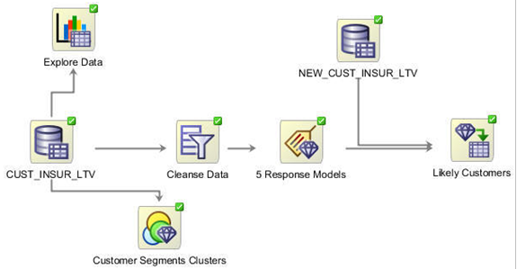

Introduces Oracle Data Mining to perform a variety of mining tasks.

- About Oracle Data Mining

- Data Mining in the Database Kernel

- [Oracle Data Mining with R Extensibility](r-extensibility.md)

- Data Mining in Oracle Exadata

- About Partitioned Model

- Interfaces to Oracle Data Mining

- Overview of Database Analytics

### 2.1 About Oracle Data Mining

Understand the uses of Oracle Data Mining and learn about different mining techniques.

Oracle Data Mining provides a powerful, state-of-the-art data mining capability within Oracle Database. You can use Oracle Data Mining to build and deploy predictive and descriptive data mining applications, to add intelligent capabilities to existing applications, and to generate predictive queries for data exploration.

Oracle Data Mining offers a broad set of in-database algorithms for performing a variety of machine learning tasks, such as classification, regression, anomaly detection, feature extraction, clustering, and market basket analysis. The algorithms can work on standard case data, transactional data, star schemas, and unstructured text data. Oracle Data Mining is uniquely suited to the analysis of very large data sets.

Oracle Data Mining along with Oracle Machine Learning for R are components of Oracle Advanced Analytics Option that provides powerful APIs for in-database data mining, among other features.

**Related Topics**

- [Oracle R Enterprise Documentation Library](https://docs.oracle.com/pls/topic/lookup?ctx=en/database/oracle/oracle-database/19/dmcon&id=ore_lib)

### 2.2 Data Mining in the Database Kernel

Learn about implementation of Data Mining.

Oracle Data Mining is implemented in the Oracle Database kernel. Data Mining models are first class database objects. Oracle Data Mining processes use built-in features of Oracle Database to maximize scalability and make efficient use of system resources.

Data mining within Oracle Database offers many advantages:

- No Data Movement: Some data mining products require that the data be exported from a corporate database and converted to a specialized format for mining. With Oracle Data Mining, no data movement or conversion is needed. This makes the entire mining process less complex, time-consuming, and error-prone, and it allows for the mining of very large data sets.

- Security: Your data is protected by the extensive security mechanisms of Oracle Database. Moreover, specific database privileges are needed for different data mining activities. Only users with the appropriate privileges can define, manipulate, or apply mining model objects.

- Data Preparation and Administration: Most data must be cleansed, filtered, normalized, sampled, and transformed in various ways before it can be mined. Up to 80% of the effort in a data mining project is often devoted to data preparation. Oracle Data Mining can automatically manage key steps in the data preparation process. Additionally, Oracle Database provides extensive administrative tools for preparing and managing data.

- Ease of Data Refresh: Mining processes within Oracle Database have ready access to refreshed data. Oracle Data Mining can easily deliver mining results based on current data, thereby maximizing its timeliness and relevance.

- Oracle Database Analytics: Oracle Database offers many features for advanced analytics and business intelligence. Oracle Data Mining can easily be integrated with other analytical features of the database, such as statistical analysis and OLAP.

- Oracle Technology Stack: You can take advantage of all aspects of Oracle's technology stack to integrate data mining within a larger framework for business intelligence or scientific inquiry.

- Domain Environment: Data mining models have to be built, tested, validated, managed, and deployed in their appropriate application domain environments. Data mining results may need to be post-processed as part of domain specific computations (for example, calculating estimated risks and response probabilities) and then stored into permanent repositories or data warehouses. With Oracle Data Mining, the pre- and post-mining activities can all be accomplished within the same environment.

- Application Programming Interfaces: The PL/SQL API and SQL language operators provide direct access to Oracle Data Mining functionality in Oracle Database.

**Related Topics**

- Overview of Database Analytics

### 2.3 Data Mining in Oracle Exadata

Understand scoring in Oracle Exadata.

Scoring refers to the process of applying a data mining model to data to generate predictions. The scoring process may require significant system resources. Vast amounts of data may be involved, and algorithmic processing may be very complex.

With Oracle Data Mining, scoring can be off-loaded to intelligent Oracle Exadata Storage Servers where processing is extremely performant.

Oracle Exadata Storage Servers combine Oracle's smart storage software and Oracle's industry-standard hardware to deliver the industry's highest database storage performance. For more information about Oracle Exadata, visit the Oracle Technology Network.

**Related Topics**

- [http://www.oracle.com/us/products/database/exadata/index.htm](https://docs.oracle.com/pls/topic/lookup?ctx=en/database/oracle/oracle-database/19/dmcon&id=prod_db_exadata)

### 2.4 About Partitioned Model

Introduces partitioned model to organise and represent multiple models.

Oracle Data Mining supports building of a persistent Oracle Data Mining partitioned model. A partitioned model organizes and represents multiple models as partitions in a single model entity, enabling a user to easily build and manage models tailored to independent slices of data. Persistent means that the partitioned model has an on-disk representation. The product manages the organization of the partitioned model and simplifies the process of scoring the partitioned model. You must include the partition columns as part of the `USING` clause when scoring.

The partition names, key values, and the structure of the partitioned model are visible in the `ALL_MINING_MODEL_PARTITIONS` view.

**Related Topics**

- [Oracle Database Reference](../refrn/ALL_MINING_MODEL_PARTITIONS.md)
- [Oracle Data Mining User’s Guide](../dmprg/partitioned-model.md)

### 2.5 Interfaces to Oracle Data Mining

The programmatic interfaces to Oracle Data Mining are PL/SQL for building and maintaining models and a family of SQL functions for scoring. Oracle Data Mining also supports a graphical user interface, which is implemented as an extension to Oracle SQL Developer.

Oracle Predictive Analytics, a set of simplified data mining routines, is built on top of Oracle Data Mining and is implemented as a PL/SQL package.

#### 2.5.1 PL/SQL API

The Oracle Data Mining PL/SQL API is implemented in the `DBMS_DATA_MINING` PL/SQL package, which contains routines for building, testing, and maintaining data mining models. A batch apply operation is also included in this package.

The following example shows part of a simple PL/SQL script for creating an SVM classification model called SVMC_SH_Clas_sample. The model build uses weights, specified in a weights table, and settings, specified in a settings table. The weights influence the weighting of target classes. The settings override default behavior. The model uses Automatic Data Preparation (`prep_auto_on` setting). The model is trained on the data in mining_data_build_v.

Example 2-1 Creating a Classification Model

    -----------------------  CREATE AND POPULATE A CLASS WEIGHTS TABLE  ------------
    CREATE TABLE svmc_sh_sample_class_wt (
      target_value NUMBER,
      class_weight NUMBER);
    INSERT INTO svmc_sh_sample_class_wt VALUES (0,0.35);
    INSERT INTO svmc_sh_sample_class_wt VALUES (1,0.65);
    COMMIT;
    -----------------------  CREATE AND POPULATE A SETTINGS TABLE ------------------
    CREATE TABLE svmc_sh_sample_settings (
      setting_name  VARCHAR2(30),
      setting_value VARCHAR2(4000));
    BEGIN
    INSERT INTO svmc_sh_sample_settings (setting_name, setting_value) VALUES
      (dbms_data_mining.algo_name, dbms_data_mining.algo_support_vector_machines);
    INSERT INTO svmc_sh_sample_settings (setting_name, setting_value) VALUES
      (dbms_data_mining.svms_kernel_function, dbms_data_mining.svms_linear);
    INSERT INTO svmc_sh_sample_settings (setting_name, setting_value) VALUES
      (dbms_data_mining.clas_weights_table_name, 'svmc_sh_sample_class_wt');
    INSERT INTO svmc_sh_sample_settings (setting_name, setting_value) VALUES
      (dbms_data_mining.prep_auto, dbms_data_mining.prep_auto_on);
    END;
    /
    ------------------------  CREATE THE MODEL -------------------------------------
    BEGIN
      DBMS_DATA_MINING.CREATE_MODEL(
        model_name          => 'SVMC_SH_Clas_sample',
        mining_function     => dbms_data_mining.classification,
        data_table_name     => 'mining_data_build_v',
        case_id_column_name => 'cust_id',
        target_column_name  => 'affinity_card',
        settings_table_name => 'svmc_sh_sample_settings');
    END;
    /

#### 2.5.2 SQL Functions

The Data Mining SQL functions perform prediction, clustering, and feature extraction.

The functions score data by applying a mining model object or by executing an analytic clause that performs dynamic scoring.

The following example shows a query that applies the classification model `svmc_sh_clas_sample` to the data in the view `mining_data_apply_v`. The query returns the average age of customers who are likely to use an affinity card. The results are broken out by gender.

Example 2-2 The PREDICTION Function

    SELECT cust_gender,
           COUNT(*) AS cnt,
           ROUND(AVG(age)) AS avg_age
      FROM mining_data_apply_v
     WHERE PREDICTION(svmc_sh_clas_sample USING *) = 1
    GROUP BY cust_gender
    ORDER BY cust_gender;

    C        CNT    AVG_AGE
    - ---------- ----------
    F         59         41
    M        409         45

**Related Topics**

- [In-Database Scoring](data-mining-basics.md)

#### 2.5.3 Oracle Data Miner

Oracle Data Miner is a graphical interface to Oracle Data Mining. Oracle Data Miner is an extension to Oracle SQL Developer, which is available for download free of charge on the Oracle Technology Network.

Oracle Data Miner uses a work flow paradigm to capture, document, and automate the process of building, evaluating, and applying data mining models. Within a work flow, you can specify data transformations, build and evaluate multiple models, and score multiple data sets. You can then save work flows and share them with other users.

Figure 2-1 An Oracle Data Miner Workflow

[Description of "Figure 2-1 An Oracle Data Miner Workflow"](img_text/odmr.md)

For information about Oracle Data Miner, including installation instructions, visit Oracle Technology Network.

**Related Topics**

- [`Oracle Data Miner`](https://docs.oracle.com/pls/topic/lookup?ctx=en/database/oracle/oracle-database/19/dmcon&id=dataminer_wf)

#### 2.5.4 Predictive Analytics

Predictive analytics is a technology that captures data mining processes in simple routines.

Sometimes called "one-click data mining," predictive analytics simplifies and automates the data mining process.

Predictive analytics uses data mining technology, but knowledge of data mining is not needed to use predictive analytics. You can use predictive analytics simply by specifying an operation to perform on your data. You do not need to create or use mining models or understand the mining techniques and algorithms summarized in "Oracle Data Mining Basics ".

Oracle Data Mining predictive analytics operations are described in the following table:

Table 2-1 Oracle Predictive Analytics Operations

| Operation | Description                                                                                    |
|:----------|:-----------------------------------------------------------------------------------------------|
| `EXPLAIN` | Explains how individual predictors (columns) affect the variation of values in a target column |
| `PREDICT` | For each case (row), predicts the values in a target column                                    |
| `PROFILE` | Creates a set of rules for cases (rows) that imply the same target value                       |

The Oracle predictive analytics operations are implemented in the `DBMS_PREDICTIVE_ANALYTICS` PL/SQL package. They are also available in Oracle Data Miner.

**Related Topics**

- [Oracle Data Mining Basics](data-mining-basics.md)

### 2.6 Overview of Database Analytics

An overview of native analytics supported by Oracle Database.

Oracle Database supports an array of native analytical features. Since all these features are part of a common server it is possible to combine them efficiently. The results of analytical processing can be integrated with Oracle Business Intelligence Suite Enterprise Edition and other BI tools and applications.

The possibilities for combining different analytics are virtually limitless. Example 2-3 shows Oracle Data Mining for SQL and text processing within a single SQL query. The query selects all customers who have a high propensity to attrite (\> 80% chance), are valuable customers (customer value rating \> 90), and have had a recent conversation with customer services regarding a Checking Plus account. The propensity to attrite information is computed using a Oracle Data Mining model called `tree_model`. The query uses the Oracle Text `CONTAINS` operator to search call center notes for references to Checking Plus accounts.

Some of the native analytics supported by Oracle Database are described in the following table:

Table 2-2 Oracle Database Native Analytics

| Analytical Feature                | Description                                                                                                                                                                                                                                                                                                                                                                                                                                                                                                                                                                                                                                                                   | Documented In...                                                                                                                                                 |
|:----------------------------------|:------------------------------------------------------------------------------------------------------------------------------------------------------------------------------------------------------------------------------------------------------------------------------------------------------------------------------------------------------------------------------------------------------------------------------------------------------------------------------------------------------------------------------------------------------------------------------------------------------------------------------------------------------------------------------|:-----------------------------------------------------------------------------------------------------------------------------------------------------------------|
| Complex data transformations      | Data transformation is a key aspect of analytical applications and ETL (extract, transform, and load). You can use SQL expressions to implement data transformations, or you can use the `DBMS_DATA_MINING_TRANSFORM` package. `DBMS_DATA_MINING_TRANSFORM` is a flexible data transformation package that includes a variety of missing value and outlier treatments, as well as binning and normalization capabilities.                                                                                                                                                                                                                                                  | [Oracle Database PL/SQL Packages and Types Reference](../arpls/DBMS_DATA_MINING_TRANSFORM.md)                                                                    |
| Statistical functions             | Oracle Database provides a long list of SQL statistical functions with support for: hypothesis testing (such as t-test, F-test), correlation computation (such as pearson correlation), cross-tab statistics, and descriptive statistics (such as median and mode). The `DBMS_STAT_FUNCS` package adds distribution fitting procedures and a summary procedure that returns descriptive statistics for a column.                                                                                                                                                                                                                                                              | [Oracle Database SQL Language Reference](../sqlrf/Aggregate-Functions.md) and [Oracle Database PL/SQL Packages and Types Reference](../arpls/DBMS_STAT_FUNCS.md) |
| Window and analytic SQL functions | Oracle Database supports analytic and windowing functions for computing cumulative, moving, and centered aggregates. With windowing aggregate functions, you can calculate moving and cumulative versions of `SUM`, `AVERAGE`, `COUNT`, `MAX`, `MIN`, and many more functions.                                                                                                                                                                                                                                                                                                                                                                                                | [Oracle Database Data Warehousing Guide](../dwhsg/sql-analysis-reporting-data-warehouses.md)                                                                     |
| Linear algebra                    | The `UTL_NLA` package exposes a subset of the popular `BLAS` and `LAPACK` (Version 3.0) libraries for operations on vectors and matrices represented as VARRAYs. This package includes procedures to solve systems of linear equations, invert matrices, and compute eigenvalues and eigenvectors.                                                                                                                                                                                                                                                                                                                                                                            | [Oracle Database PL/SQL Packages and Types Reference](../arpls/UTL_NLA.md)                                                                                       |
| OLAP                              | Oracle OLAP supports multidimensional analysis and can be used to improve performance of multidimensional queries. Oracle OLAP provides functionality previously found only in specialized OLAP databases. Moving beyond drill-downs and roll-ups, Oracle OLAP also supports time-series analysis, modeling, and forecasting.                                                                                                                                                                                                                                                                                                                                                 | [Oracle OLAP User’s Guide](../olaug/overview.md)                                                                                                                 |
| Spatial analytics                 | Oracle Spatial provides advanced spatial features to support high-end GIS and LBS solutions. Oracle Spatial's analysis and data mining capabilities include functions for binning, detection of regional patterns, spatial correlation, colocation data mining, and spatial clustering. Oracle Spatial also includes support for topology and network data models and analytics. The topology data model of Oracle Spatial allows one to work with data about nodes, edges, and faces in a topology. It includes network analysis functions for computing shortest path, minimum cost spanning tree, nearest-neighbors analysis, traveling salesman problem, among others. | [Oracle Spatial and Graph Developer's Guide](../spatl/spatial-analysis-mining.md)                                                                                |
| Text Analysis                     | Oracle Text uses standard SQL to index, search, and analyze text and documents stored in the Oracle database, in files, and on the web. Oracle Text also supports automatic classification and clustering of document collections. Many of the analytical features of Oracle Text are layered on top of Oracle Data Mining functionality.                                                                                                                                                                                                                                                                                                                                     | [Oracle Text Application Developer's Guide](../ccapp/understanding-oracle-text-application-development.md)                                                       |

Example 2-3 SQL Query Combining Oracle Data Mining for SQL and Oracle Text

    SELECT A.cust_name, A.contact_info
      FROM customers A
     WHERE PREDICTION_PROBABILITY(tree_model,
                'attrite' USING A.*) > 0.8
       AND A.cust_value > 90
       AND A.cust_id IN
           (SELECT B.cust_id
              FROM call_center B
             WHERE B.call_date BETWEEN '01-Jan-2005'
                                   AND '30-Jun-2005'
             AND CONTAINS(B.notes, 'Checking Plus', 1) > 0);
