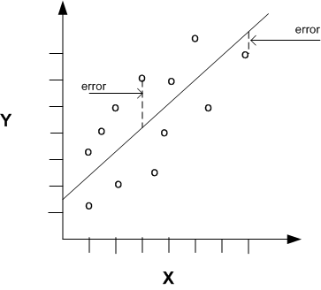
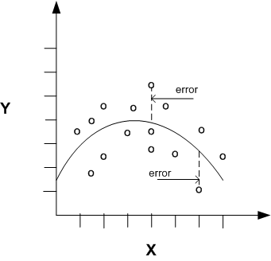
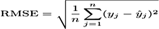
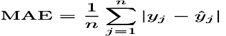

Learn how to predict a continuous numerical target through Regression - the supervised mining technique.

- About Regression

- Testing a Regression Model

- Regression Algorithms

**Related Topics**

- [Oracle Data Mining Basics](data-mining-basics.md)

### 4.1 About Regression

Regression is a data mining technique that predicts numeric values along a continuum. Profit, sales, mortgage rates, house values, square footage, temperature, or distance can be predicted using Regression techniques. For example, a Regression model can be used to predict the value of a house based on location, number of rooms, lot size, and other factors.

A Regression task begins with a data set in which the target values are known. For example, a Regression model that predicts house values can be developed based on observed data for many houses over a period of time. In addition to the value, the data can track the age of the house, square footage, number of rooms, taxes, school district, proximity to shopping centers, and so on. House value can be the target, the other attributes are the predictors, and the data for each house constitutes a case.

In the model build (training) process, a Regression algorithm estimates the value of the target as a function of the predictors for each case in the build data. These relationships between predictors and target are summarized in a model, which can then be applied to a different data set in which the target values are unknown.

Regression models are tested by computing various statistics that measure the difference between the predicted values and the expected values. The historical data for a Regression project is typically divided into two data sets: one for building the model, the other for testing the model.

Regression modeling has many applications in trend analysis, business planning, marketing, financial forecasting, time series prediction, biomedical and drug response modeling, and environmental modeling.

#### 4.1.1 How Does Regression Work?

You do not need to understand the mathematics used in regression analysis to develop and use quality regression models for data mining. However, it is helpful to understand a few basic concepts.

Regression analysis seeks to determine the values of parameters for a function that cause the function to best fit a set of data observations that you provide. The following equation expresses these relationships in symbols. It shows that regression is the process of estimating the value of a continuous target (y) as a function (F) of one or more predictors (x1 , x2 , ..., xn), a set of parameters (θ1 , θ2 , ..., θn), and a measure of error (e).

    y = F(x,θ)  + e

The predictors can be understood as independent variables and the target as a dependent variable. The error, also called the **residual**, is the difference between the expected and predicted value of the dependent variable. The regression parameters are also known as **regression coefficients**.

The process of training a regression model involves finding the parameter values that minimize a measure of the error, for example, the sum of squared errors.

There are different families of regression functions and different ways of measuring the error.

##### 4.1.1.1 Linear Regression

A linear regression technique can be used if the relationship between the predictors and the target can be approximated with a straight line.

Regression with a single predictor is the easiest to visualize. Simple linear regression with a single predictor is shown in the following figure:

Figure 4-1 Linear Regression With a Single Predictor

[Description of "Figure 4-1 Linear Regression With a Single Predictor"](img_text/scatter_plot.md)

Linear regression with a single predictor can be expressed with the following equation.

    y = θ2x   +  θ1  + e

The regression parameters in simple linear regression are:

- The slope of the line (2) — the angle between a data point and the regression line

- The y intercept (1) — the point where x crosses the y axis (x = 0)

##### 4.1.1.2 Multivariate Linear Regression

The term **multivariate linear regression** refers to linear regression with two or more predictors (x1, x2, …, xn). When multiple predictors are used, the regression line cannot be visualized in two-dimensional space. However, the line can be computed simply by expanding the equation for single-predictor linear regression to include the parameters for each of the predictors.

    y = θ1 +  θ2x1  +  θ3x2   + .....  θn  xn-1  + e

##### 4.1.1.3 Regression Coefficients

In multivariate linear regression, the regression parameters are often referred to as coefficients. When you build a multivariate linear regression model, the algorithm computes a coefficient for each of the predictors used by the model. The coefficient is a measure of the impact of the predictor x on the target y. Numerous statistics are available for analyzing the regression coefficients to evaluate how well the regression line fits the data.

##### 4.1.1.4 Nonlinear Regression

Often the relationship between x and y cannot be approximated with a straight line. In this case, a nonlinear regression technique can be used. Alternatively, the data can be preprocessed to make the relationship linear.

Nonlinear regression models define y as a function of x using an equation that is more complicated than the linear regression equation. In the following figure, x and y have a nonlinear relationship.

Figure 4-2 Nonlinear Regression With a Single Predictor

[Description of "Figure 4-2 Nonlinear Regression With a Single Predictor"](img_text/scatter_plot_nonlinear.md)

##### 4.1.1.5 Multivariate Nonlinear Regression

The term **multivariate nonlinear regression** refers to nonlinear regression with two or more predictors (x1, x2, …, xn). When multiple predictors are used, the nonlinear relationship cannot be visualized in two-dimensional space.

##### 4.1.1.6 Confidence Bounds

A Regression model predicts a numeric target value for each case in the scoring data. In addition to the predictions, some Regression algorithms can identify confidence bounds, which are the upper and lower boundaries of an interval in which the predicted value is likely to lie.

When a model is built to make predictions with a given confidence, the confidence interval is produced along with the predictions. For example, a model predicts the value of a house to be \$500,000 with a 95% confidence that the value is between \$475,000 and \$525,000.

### 4.2 Testing a Regression Model

A regression model is tested by applying it to test data with known target values and comparing the predicted values with the known values.

The test data must be compatible with the data used to build the model and must be prepared in the same way that the build data was prepared. Typically the build data and test data come from the same historical data set. A percentage of the records is used to build the model; the remaining records are used to test the model.

Test metrics are used to assess how accurately the model predicts these known values. If the model performs well and meets the business requirements, it can then be applied to new data to predict the future.

#### 4.2.1 Regression Statistics

The Root Mean Squared Error and the Mean Absolute Error are commonly used statistics for evaluating the overall quality of a regression model. Different statistics may also be available depending on the regression methods used by the algorithm.

##### 4.2.1.1 Root Mean Squared Error

The Root Mean Squared Error (RMSE) is the square root of the average squared distance of a data point from the fitted line.

This SQL expression calculates the RMSE.

    SQRT(AVG((predicted_value - actual_value) * (predicted_value - actual_value)))

This formula shows the RMSE in mathematical symbols. The large sigma character represents summation; j represents the current predictor, and n represents the number of predictors.

Figure 4-3 Room Mean Squared Error

[Description of "Figure 4-3 Room Mean Squared Error"](img_text/rmse.md)

##### 4.2.1.2 Mean Absolute Error

The Mean Absolute Error (MAE) is the average of the absolute value of the residuals (error). The MAE is very similar to the RMSE but is less sensitive to large errors.

This SQL expression calculates the MAE.

    AVG(ABS(predicted_value - actual_value))

This formula shows the MAE in mathematical symbols. The large sigma character represents summation; j represents the current predictor, and n represents the number of predictors.

Figure 4-4 Mean Absolute Error

[Description of "Figure 4-4 Mean Absolute Error"](img_text/mae.md)

### 4.3 Regression Algorithms

Oracle Data Mining supports three algorithms for Regression ­ Generalized Linear Models (GLM), Neural Network (NN), and Support Vector Machines (SVM).

Generalized Linear Models (GLM) and Support Vector Machines (SVM) algorithms are particularly suited for mining data sets that have very high dimensionality (many attributes), including transactional and unstructured data.

- **Generalized Linear Models (GLM)**

  GLM is a popular statistical technique for linear modeling. Oracle Data Mining implements GLM for Regression and for binary classification. GLM provides extensive coefficient statistics and model statistics, as well as row diagnostics. GLM also supports confidence bounds.

- **Neural Network**

  Neural networks are powerful algorithms that can learn arbitrary nonlinear regression functions.

- **Support Vector Machines (SVM)**

  SVM is a powerful, state-of-the-art algorithm for linear and nonlinear Regression. Oracle Data Mining implements SVM for Regression, classification, and anomaly detection. SVM Regression supports two kernels: the Gaussian kernel for nonlinear Regression, and the linear kernel for Linear Regression.

**Note:**

Oracle Data Mining uses linear kernel SVM as the default Regression algorithm.

**Related Topics**

- [Generalized Linear Models](generalized-linear-models.md)
- [Support Vector Machines](support-vector-machines.md)
- [Neural Network](neural-network.md)
