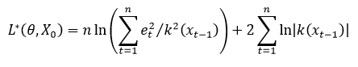
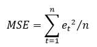
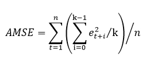

Learn about Time Series as an Oracle Data Mining Regression technique.

- About Time Series

- Choosing a Time Series Model

- Time Series Statistics

- Time Series Algorithm

### 10.1 About Time Series

Time Series is a data mining technique that forecasts target value based solely on a known history of target values. It is a specialized form of Regression, known in the literature as auto-regressive modeling.

The input to time series analysis is a sequence of target values. A case id column specifies the order of the sequence. The case id can be of type `NUMBER` or a date type (date, datetime, timestamp with timezone, or timestamp with local timezone). Regardless of case id type, the user can request that the model include trend, seasonal effects or both in its forecast computation. When the case id is a date type, the user must specify a time interval (for example, month) over which the target values are to be aggregated, along with an aggregation procedure (for example, sum). Aggregation is performed by the algorithm prior to constructing the model.

The time series model provide estimates of the target value for each step of a time window that can include up to 30 steps beyond the historical data. Like other Regression models, Time Series models compute various statistics that measure the goodness of fit to historical data.

Forecasting is a critical component of business and governmental decision making. It has applications at the strategic, tactical and operation level. The following are the applications of forecasting:

- Projecting return on investment, including growth and the strategic effect of innovations

- Addressing tactical issues such as projecting costs, inventory requirements and customer satisfaction

- Setting operational targets and predicting quality and conformance with standards

**Related Topics**

- [Regression](regression.md)

### 10.2 Choosing a Time Series Model

Learn how to select a Time Series model.

Time Series data may contain patterns that can affect predictive accuracy. For example, during a period of economic growth, there may be an upward trend in sales. Sales may increase in specific seasons (bathing suits in summer). To accommodate such series, it can be useful to choose a model that incorporates trend, seasonal effects, or both.

**Trend** can be difficult to estimate, when you must represent trend by a single constant. For example, if there is a grow rate of 10%, then after 7 steps, the value doubles. Local growth rates, appropriate to a few time steps can easily approach such levels, but thereafter drop. **Damped trend** models can more accurately represent such data, by reducing cumulative trend effects. Damped trend models can better represent variability in trend effects over the historical data. Damped trend models are a good choice when the data have significant, but variable trend.

Since modeling attempts to reduce error, how error is measured can affect model predictions. For example, data that exhibit a wide range of values may be better represented by error as fraction of level. An error of a few hundred feet in the measurement of the height of a mountain may be equivalent to an error of an inch or two in the measurement of the height of a child. Errors that are measured relative to value are called **multiplicative errors**. Errors that are the same across values are called **additive errors**. If there are multiplicative effects in the model, then the error type is multiplicative. If there are no explicit multiplicative effects, error type is left to user specification. The type need not be the same across individual effects. For example, trend can be additive while seasonality is multiplicative. This particular mixed type effect combination defines the popular Holt-Winters model.

**Note:**

Multiplicative error is not an appropriate choice for data that contain zeros or negative values. Thus, when the data contains such values, it is best not to choose a model with multiplicative effects or to set error type to be multiplicative.

### 10.3 Time Series Statistics

Learn to evaluate model quality by applying commonly used statistics.

As with other Regression techniques, there are commonly used statistics for evaluating the overall model quality. An expert user can also specify one of these figures of merit as criterion to optimize by the model build process. Choosing an optimization criterion is not required because model-specific defaults are available.

#### 10.3.1 Conditional Log-Likelihood

Log-likelihood is a figure of merit often used as an optimization criterion for models that provide probability estimates for predictions which depend on the values of the model’s parameters.

The model probability estimates for the actual values in the training data then yields an estimate of the likelihood of the parameter values. Parameter values that yield high probabilities for the observed target values have high likelihood, and therefore indicate a good model. The calculation of log-likelihood depends on the form of the model.

Conditional log-likelihood breaks the parameters into two groups. One group is assumed to be correct and the other is assumed the source of any errors. Conditional log-likelihood is the log-likelihood of the latter group conditioned on the former group. For example, Exponential Smoothing models (ESMs) make an estimate of the initial model state. The conditional log-likelihood of an ESM is conditional on that initial model state (assumed to be correct). The ESM conditional log-likelihood is as follows:

[Description of the illustration log-likelihood_timeseries.jpg](img_text/log-likelihood_timeseries.md)

where `e``t` is the error at time `t` and `k(x(t-1) )` is `1` for ESM models with additive errors and is the estimated level at the previous time step in models with multiplicative error.

#### 10.3.2 Mean Square Error (MSE) and Other Error Measures

Another time series figure of merit, that can also be used as an optimization criterion, is Mean Square Error (MSE).

The mean square error is computed as:

[Description of the illustration mse_timeseries.jpg](img_text/mse_timeseries.md)

where the error at time t is the difference between the actual and model one step ahead forecast value at time t for models with additive error and that difference divided by the one-step ahead forecast for models with multiplicative error.

**Note:**

These "forecasts" are for over periods already observed and part of the input time series.

Since time series models can forecast for each of multiple steps ahead, time series can measure the error associated with such forecasts. Average Mean Square Error (AMSE), another figure of merit, does exactly that. For each period in the input time series, it computes a multi-step forecast, computes the error of those forecasts and averages the errors. AMSE computes the individual errors exactly as MSE does taking cognizance of error type (additive or multiplicative). The number of steps, k, is determined by the user (default 3). The formula is as follows:

[Description of the illustration amse_timeseries.jpg](img_text/amse_timeseries.md)

Other figure of merit relatives of MSE include the Residual Standard Error (RMSE), which is the square root of MSE, and the Mean Absolute Error (MAE) which is the average of the absolute value of the errors.

#### 10.3.3 Irregular Time Series

Irregular time series are time series data where the time intervals between observed values are not equally spaced.

One common practice is for the time intervals between adjacent steps to be equally spaced. However, it is not always convenient or realistic to force such spacing on time series. Irregular time series do not make the assumption that time series are equally spaced, but instead use the case id’s date and time values to compute the intervals between observed values. Models are constructed directly on the observed values with their observed spacing. Oracle time series analysis handles irregular time series.

#### 10.3.4 Build Apply

Learn about build and apply operations of Time Series technique.

Many of the Oracle Data Mining techniques have separate build and apply operations, because you can construct and potentially apply a model to many different sets of input data. However, time series input consists of the target value history only. Thus, there is only one set of appropriate input data. When new data arrive, good practice dictates that a new model be built. Since the model is only intended to be used once, the model statistics and forecasts are produced during model build and are available through the model views.

### 10.4 Time Series Algorithm

Oracle Data Mining uses the algorithm Exponential Smoothing to forecast from time series data.

**Related Topics**

- [Exponential Smoothing](expnential-smoothing.md)
