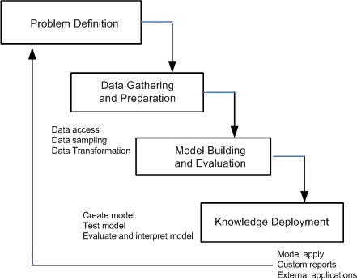

Orientation to data mining technology.

- What Is Data Mining?

- What Can Data Mining Do and Not Do?

- The Data Mining Process

**Note:**

Information about data mining is widely available. No matter what your level of expertise, you can find helpful books and articles on data mining.

**Related Topics**

- [http://en.wikipedia.org/wiki/Data_mining](https://docs.oracle.com/pls/topic/lookup?ctx=en/database/oracle/oracle-database/19/dmcon&id=datamining_wikipedia)

### 1.1 What Is Data Mining?

Learn about Data Mining.

Data mining is a technique that discovers previously unknown relationships in data. Data mining is the practice of automatically searching large stores of data to discover patterns and trends that go beyond simple analysis. Data mining uses sophisticated mathematical algorithms to segment the data and to predict the likelihood of future events based on past events. Data mining is also known as Knowledge Discovery in Data (KDD).

The key properties of data mining are:

- Automatic discovery of patterns

- Prediction of likely outcomes

- Creation of actionable information

- Focus on large data sets and databases

Data mining can answer questions that cannot be addressed through simple query and reporting techniques.

#### 1.1.1 Automatic Discovery

Data mining is performed by a model that uses an algorithm to act on a set of data. Data mining models can be used to mine the data on which they are built, but most types of models are generalizable to new data. The process of applying a model to new data is known as scoring.

#### 1.1.2 Prediction

Many forms of data mining are predictive. For example, a model can predict income based on education and other demographic factors. Predictions have an associated probability (How likely is this prediction to be true?). Prediction probabilities are also known as **confidence** (How confident can I be of this prediction?).

Some forms of predictive data mining generate **rules**, which are conditions that imply a given outcome. For example, a rule can specify that a person who has a bachelor's degree and lives in a certain neighborhood is likely to have an income greater than the regional average. Rules have an associated **support** (What percentage of the population satisfies the rule?).

#### 1.1.3 Grouping

Other forms of data mining identify natural groupings in the data. For example, a model might identify the segment of the population that has an income within a specified range, that has a good driving record, and that leases a new car on a yearly basis.

#### 1.1.4 Actionable Information

Data mining can derive actionable information from large volumes of data. For example, a town planner might use a model that predicts income based on demographics to develop a plan for low-income housing. A car leasing agency might use a model that identifies customer segments to design a promotion targeting high-value customers.

#### 1.1.5 Data Mining and Statistics

There is a great deal of overlap between data mining and statistics. In fact most of the techniques used in data mining can be placed in a statistical framework. However, data mining techniques are not the same as traditional statistical techniques.

Statistical models usually make strong assumptions about the data and, based on those assumptions, they make strong statements about the results. However, if the assumptions are flawed, the validity of the model becomes questionable. By contrast, the machine learning methods used in data mining typically make weak assumptions about the data. As a result, data mining cannot generally make such strong statements about the results. Yet data mining can produce very good results regardless of the data.

Traditional statistical methods, in general, require a great deal of user interaction in order to validate the correctness of a model. As a result, statistical methods can be difficult to automate. Statistical methods rely on testing hypotheses or finding correlations based on smaller, representative samples of a larger population.

Less user interaction and less knowledge of the data is required for data mining. The user does not need to massage the data to guarantee that a method is valid for a given data set. Data mining techniques are easier to automate than traditional statistical techniques.

#### 1.1.6 Data Mining and OLAP

On-Line Analytical Processing (OLAP) can be defined as fast analysis of multidimensional data. OLAP and data mining are different but complementary activities.

OLAP supports activities such as data summarization, cost allocation, time series analysis, and what-if analysis. However, most OLAP systems do not have inductive inference capabilities beyond the support for time-series forecast. Inductive inference, the process of reaching a general conclusion from specific examples, is a characteristic of data mining. Inductive inference is also known as computational learning.

OLAP systems provide a multidimensional view of the data, including full support for hierarchies. This view of the data is a natural way to analyze businesses and organizations.

Data mining and OLAP can be integrated in a number of ways. OLAP can be used to analyze data mining results at different levels of granularity. Data Mining can help you construct more interesting and useful cubes. For example, the results of predictive data mining can be added as custom measures to a cube. Such measures can provide information such as "likely to default" or "likely to buy" for each customer. OLAP processing can then aggregate and summarize the probabilities.

#### 1.1.7 Data Mining and Data Warehousing

Data can be mined whether it is stored in flat files, spreadsheets, database tables, or some other storage format. The important criteria for the data is not the storage format, but its applicability to the problem to be solved.

Proper data cleansing and preparation are very important for data mining, and a data warehouse can facilitate these activities. However, a data warehouse is of no use if it does not contain the data you need to solve your problem.

### 1.2 What Can Data Mining Do and Not Do?

Data mining is a powerful tool that can help you find patterns and relationships within your data. But data mining does not work by itself. It does not eliminate the need to know your business, to understand your data, or to understand analytical methods. Data mining discovers hidden information in your data, but it cannot tell you the value of the information to your organization.

You might already be aware of important patterns as a result of working with your data over time. Data mining can confirm or qualify such empirical observations in addition to finding new patterns that are not immediately discernible through simple observation.

It is important to remember that the predictive relationships discovered through data mining are not causal relationships. For example, data mining might determine that males with incomes between \$50,000 and \$65,000 who subscribe to certain magazines are likely to buy a given product. You can use this information to help you develop a marketing strategy. However, you must not assume that the population identified through data mining buys the product because they belong to this population.

Data mining yields probabilities, not exact answers. It is important to keep in mind that rare events can happen; they just do not happen very often.

#### 1.2.1 Asking the Right Questions

Data mining does not automatically discover information without guidance. The patterns you find through data mining are very different depending on how you formulate the problem.

To obtain meaningful results, you must learn how to ask the right questions. For example, rather than trying to learn how to "improve the response to a direct mail solicitation," you might try to find the characteristics of people who have responded to your solicitations in the past.

#### 1.2.2 Understanding Your Data

To ensure meaningful data mining results, you must understand your data. Data mining algorithms are often sensitive to specific characteristics of the data: outliers (data values that are very different from the typical values in your database), irrelevant columns, columns that vary together (such as age and date of birth), data coding, and data that you choose to include or exclude. Oracle Data Mining can automatically perform much of the data preparation required by the algorithm. But some of the data preparation is typically specific to the domain or the data mining problem. At any rate, you need to understand the data that was used to build the model to properly interpret the results when the model is applied.

### 1.3 The Data Mining Process

The following figure illustrates the phases, and the iterative nature, of a data mining project. The process flow shows that a data mining project does not stop when a particular solution is deployed. The results of data mining trigger new business questions, which in turn can be used to develop more focused models.

Figure 1-1 The Data Mining Process

[Description of "Figure 1-1 The Data Mining Process"](img_text/dmprocess.md)

#### 1.3.1 Problem Definition

This initial phase of a data mining project focuses on understanding the project objectives and requirements. Once you have specified the problem from a business perspective, you can formulate it as a data mining problem and develop a preliminary implementation plan.

For example, your business problem might be: "How can I sell more of my product to customers?" You might translate this into a data mining problem such as: "Which customers are most likely to purchase the product?" A model that predicts who is most likely to purchase the product must be built on data that describes the customers who have purchased the product in the past. Before building the model, you must assemble the data that is likely to contain relationships between customers who have purchased the product and customers who have not purchased the product. Customer attributes might include age, number of children, years of residence, owners/renters, and so on.

#### 1.3.2 Data Gathering, Preparation, and Feature Engineering

Understand how to gather data, prepare data, and engineer features to solve business problems.

The data understanding phase involves data collection and exploration. As you take a closer look at the data, you can determine how well it addresses the business problem. You decide to remove some of the data or add additional data. This is also the time to identify data quality problems and to scan for patterns in the data.

The data preparation phase covers all the tasks involved in creating the table or view that you use to build the model. Data preparation tasks are likely to be performed multiple times, and not in any prescribed order. Tasks can include column selection and the creation of views, as well as data cleansing and transformation. For example, you can transform a `DATE_OF_BIRTH` column to `AGE`; you can insert the median income in cases where the `INCOME` column is null.

Additionally you can add new computed attributes in an effort to tease information closer to the surface of the data oftentimes called Feature Engineering. For example, rather than using the purchase amount, you can create a new attribute: "Number of Times Amount Purchase Exceeds \$500 in a 12 month time period." Customers who frequently make large purchases can also be related to customers who respond or don't respond to an offer.

Thoughtful data preparation and creating new "engineered features" that capture domain knowledge can significantly improve the information that is discovered through data mining. Enabling the data analyst to perform these data assembly, data preparation, data transformations, and feature engineering inside the Oracle Database is a significant distinction for Oracle.

**Note:**

Oracle Data Mining supports Automatic Data Preparation (ADP), which greatly simplifies the process of data preparation.

**Related Topics**

- [Data Preparation](data-mining-basics.md)

#### 1.3.3 Model Building and Evaluation

In this phase, you select and apply various modeling techniques and calibrate the parameters to optimal values. If the algorithm requires data transformations, then you need to step back to the previous phase to implement them.

In preliminary model building, it often makes sense to work with a reduced set of data since the final data set might contain thousands or millions of rows.

At this stage of the project, it is time to evaluate how well the model satisfies the originally-stated business goal (phase 1). If the model is supposed to predict customers who are likely to purchase a product, then does it sufficiently differentiate between the two classes? Is there sufficient lift? Are the trade-offs shown in the confusion matrix acceptable? Can the model be improved by adding text data? Should transactional data such as purchases (market-basket data) be included? Should costs associated with false positives or false negatives be incorporated into the model?

#### 1.3.4 Knowledge Deployment

Knowledge deployment is the use of data mining within a target environment. In the deployment phase, insight and actionable information can be derived from data.

Deployment can involve scoring (the application of models to new data), the extraction of model details (for example the rules of a decision tree), or the integration of data mining models within applications, data warehouse infrastructure, or query and reporting tools.

Because Oracle Data Mining builds and applies data mining models inside Oracle Database, the results are immediately available. BI reporting tools and dashboards can easily display the results of data mining. Additionally, Oracle Data Mining supports scoring in real time: Data can be mined and the results returned within a single database transaction. For example, a sales representative can run a model that predicts the likelihood of fraud within the context of an online sales transaction.
