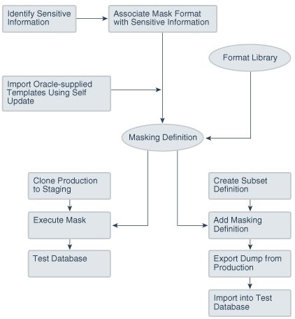

This chapter provides conceptual information about the components that comprise Oracle Data Masking, and procedural information about performing the task sequence, such as creating masking formats and masking definitions. Data masking presupposes that you have created an Application Data Model (ADM) with defined sensitive columns.

The procedures in this chapter are applicable to Oracle Enterprise Manager Cloud Control 12.1 and higher only. You must have the Oracle Data Masking and Subsetting Pack license to use data masking features.

**Note:**

Performing masking on an 11.2.0.3 database that uses Database Plug-in 12.1.0.3 and higher requires that the database patch \#16922826 is applied for masking to run successfully. The Mask-In Export feature (also known as At Source masking) works with Oracle Database 11.1 and higher.

### Overview of Oracle Data Masking

Enterprises run the risk of breaching sensitive information when copying production data into non-production environments for the purposes of application development, testing, or data analysis. Oracle Data Masking helps reduce this risk by irreversibly replacing the original sensitive data with fictitious data so that production data can be shared safely with non-production users. Accessible through Oracle Enterprise Manager, Oracle Data Masking provides end-to-end secure automation for provisioning test databases from production in compliance with regulations.

#### Data Masking Concepts

Data masking (also known as data scrambling and data anonymization) is the process of replacing sensitive information copied from production databases to test non-production databases with realistic, but scrubbed, data based on masking rules. Data masking is ideal for virtually any situation when confidential or regulated data needs to be shared with non-production users. These users may include internal users such as application developers, or external business partners such as offshore testing companies, suppliers and customers. These non-production users need to access some of the original data, but do not need to see every column of every table, especially when the information is protected by government regulations.

Data masking enables organizations to generate realistic and fully functional data with similar characteristics as the original data to replace sensitive or confidential information. This contrasts with encryption or Virtual Private Database, which simply hides data, and the original data can be retrieved with the appropriate access or key. With data masking, the original sensitive data cannot be retrieved or accessed.

Names, addresses, phone numbers, and credit card details are examples of data that require protection of the information content from inappropriate visibility. Live production database environments contain valuable and confidential data—access to this information is tightly controlled. However, each production system usually has replicated development copies, and the controls on such test environments are less stringent. This greatly increases the risks that the data might be used inappropriately. Data masking can modify sensitive database records so that they remain usable, but do not contain confidential or personally identifiable information. Yet, the masked test data resembles the original in appearance to ensure the integrity of the application.

#### Roles of Data Masking Users

The following types of users participate in the data masking process for a typical enterprise:

- Application database administrator or application developer

  This user is knowledgeable about the application and database objects. This user may add additional custom database objects or extensions to packaged applications, such as the Oracle E-Business suite.

- Information security administrator

  This user defines information security policies, enforces security best practices, and also recommends the data to be hidden and protected.

#### Related Oracle Security Offerings

Besides data masking, Oracle offers the following security products:

- Virtual Private Database or Oracle Label Security — Hides rows and data depending on user access grants.

- Transparent Data Encryption — Hides information stored on disk using encryption. Clients see unencrypted information.

- `DBMS_CRYPTO` — Provides server packages that enable you to encrypt user data.

- Database Vault — Provides greater access controls on data.

#### Agent Compatibility for Data Masking

Data masking supports Oracle Database 9i and newer releases. If you have a version prior to 11.1, you can use it by implementing the following workaround.

Replace the following file...

    AGENT_HOME/sysman/admin/scripts/db/reorg/reorganize.pl

... with this file:

    OMS_HOME/sysman/admin/scripts/db/reorg/reorganize.pl

### Format Libraries and Masking Definitions

To mask data, the Data Masking Pack provides two main features:

- Masking format library

  The format library contains a collection of ready-to-use masking formats. The library consists of format routines that you can use for masking. A masking format can either be one that you create, or one from the list of Oracle-supplied default masking formats.

  As a matter of best practice, organizations should create masking formats for all commonly regulated information so that the formats can be applied to the sensitive data regardless of which database the sensitive data resides in. This ensures that all sensitive data is consistently masked across the entire organization.

- Masking definitions

  A masking definition defines a data masking operation to be implemented on one or more tables in a database. Masking definitions associate table columns with formats to use for masking the data. They also maintain the relationship between columns that are not formally declared in the database using related columns.

  You can create a new masking definition or use an existing definition for a masking operation. To create a masking definition, you specify the column of the table for which the data should be masked and the format of masked data. If the columns being masked are involved in unique, primary key, or foreign key constraints, data masking generates the values so that the constraints are not violated. Masking ensures uniqueness per character using decimal arithmetic. For example, a 5-character string generates a maximum of only 99999 unique values. Similarly, a 1-character string generates a maximum of only 9 unique values.

  You would typically export masking definitions to files and import them on other systems. This is important when the test and production sites reside on different Oracle Management Systems or on entirely different sites.

**See Also:**

The online help topic "Creating a Data Masking Definition" as well as the help for each Data Masking page

### Recommended Data Masking Workflow

The following figure shows that the production database is cloned to a staging region and then masked there. During the masking process, the staging and test areas are tightly controlled like a production site.

Figure 4-1 Data Masking Workflow

[Description of "Figure 4-1 Data Masking Workflow"](img_text/data_masking_workflow.md)

Data masking is an iterative and evolving process handled by the security administrator and implemented by the database administrator. When you first configure data masking, try out the masking definition on a test system, then add a greater number of columns to the masking definition and test it to make sure it functions correctly and does not break any application constraints. During this process, you should exercise care when removing all imbedded references to the real data while maintaining referential integrity.

After data masking is configured to your satisfaction, you can use the existing definition to repeatedly mask after cloning. The masking definition, however, would need to evolve as new schema changes require new data and columns to be masked.

After the masking process is complete, you can distribute the database for wide availability. If you need to ship the database to another third-party site, you are required to use the Data Pump Export utility, and then ship the dump file to the remote site. However, if you are retaining the masked data in-house, see "Data Masking Task Sequence".

You can also perform inline, or at the source, data masking while creating a subset definition.

**Related Topics**

- [Creating a Data Subset Definition](data_subsetting.md)

### Data Masking Task Sequence

The task sequence in this section demonstrates the data masking workflow and refers you to additional information about some of the tasks in the sequence. Before reviewing this sequence, note that there are two options for completing this process:

- Exporting/importing to another database

  You can clone the production database to a staging area, mask it, then export/ import it to another database before delivering it to in-house testers or external customers. This is the most secure approach.

- Making the staging area the new test region

  You can clone the production database to a mask staging area, then make the staging area the new test region. In this case, you should not grant testers `SYSDBA` access or access to the database files. Doing so would compromise security. The masked database contains the original data in unused blocks and in the free list. You can only purge this information by exporting/importing the data to another database.

The following basic steps guide you through the data masking process, with references to other sections for supporting information.

1.  Review the application database and identify the sources of sensitive information.
2.  Define mask formats for the sensitive data. The mask formats may be simple or complex depending on the information security needs of the organization.
3.  Create a masking definition to associate table columns and edition view objects to these mask formats. Data masking determines the database foreign key relationships and adds foreign key columns to the mask.
4.  Save the masking definition and generate the masking script.
5.  Verify if the masked data meets the information security requirements. Otherwise, refine the masking definition, restore the altered tables, and reapply the masking definition until the optimal set of masking definitions has been identified.
6.  Clone the production database to a staging area, selecting the masking definition to be used after cloning. Note that you can clone using Oracle Enterprise Manager, which enables you to add masking to the Oracle Enterprise Manager clone workflow. However, if you clone outside of Oracle Enterprise Manager, you must initiate masking from Oracle Enterprise Manager after cloning is complete. The cloned database should be controlled with the same privileges as the production system, because it still contains sensitive production data.
    After cloning, make sure you change the passwords as well as update or disable any database links, streams, or references to external data sources. Back up the cloned database, or minimally the tables that contain masked data. This can help you restore the original data if the masking definition needs to be refined further.
7.  After masking, test all of your applications, reports, and business processes to ensure they are functional. If everything is working, you can export the masking definition to keep it as a back-up.
8.  After masking the staging site, make sure to drop any tables named `MGMT_DM_TT` before cloning to a test region. These temporary tables contain a mapping between the original sensitive column value and the mask values, and are therefore sensitive in nature.
    During masking, Oracle Enterprise Manager automatically drops these temporary tables for you with the default "Drop temporary tables created during masking" option. However, you can preserve these temporary tables by deselecting this option. In this case, you are responsible for deleting the temporary tables before cloning to the test region.
9.  After masking is complete, ensure that all tables loaded for use by the substitute column format or table column format are going to be dropped. These tables contain the mask values that table column or substitute formats will use. It is recommended that you purge this information for security reasons.
10. Clone the database to a test region, or use it as the new test region. When cloning the database to an external or unsecured site, you should use Export or Import. Only supply the data in the database, rather than the database files themselves.
11. As part of cloning production for testing, provide the masking definition to the application database administrator to use in masking the database.

**Related Topics**

- Creating New Masking Formats
- Using Oracle-supplied Predefined Masking Formats
- Masking with an Application Data Model and Workloads
- Cloning the Production Database
- Deterministic Masking Using the Substitute Format

### Defining Masking Formats

A masking definition requires one or more masking formats for any columns included in the masking definition. When adding columns to a masking definition, you can either create masking formats manually or import them from the format library. It is often more efficient to work with masking formats from the format library.

#### Creating New Masking Formats

This section describes how to create new masking formats using Enterprise Manager.

##### To create a masking format in the format library:

1.  From the Enterprise menu, select Quality Management, then Data Masking Formats. Alternatively, if you are in the Database home page, select Data Masking Format Library from the Schema menu.

    The Format Library appears with predefined formats that Oracle Enterprise Manager provides.

2.  Click Create.

    The Create Format page appears, where you can define a masking format.

    **See Also:**

    The online help for information on page user controls

3.  Provide a required name for the new format, select a format entry type from the Add list, then click Go.

    A page appears that enables you to provide input for the format entry you have selected. For instance, if you select Array List, the subsequent page enables you to enter a list of values, such as New York, New Jersey, and New Hampshire.

4.  Continue adding additional format entries as needed.

5.  When done, provide an optional user-defined or post-processing function, then click OK to save the masking format.

    The Format Library page reappears with your newly created format displayed in the Format Library table. You can use this format later to mask a column of the same sensitive type.

    **See Also:**

    The online help for information on the Format Library and Create Format pages

**Related Topics**

- Providing User-Defined and Post-Processing Functions

##### Providing User-defined and Post-processing Functions

If desired, you can provide user-defined and post-processing functions on the Create Format page. A user-defined choice is available in the Add list, and a post-processing function field is available at the bottom of the page.

- User-defined functions

  To provide a user-defined function, select User Defined Function from the Add list, then click Go to access the input fields.

  A user-defined function passes in the original value as input, and returns a mask value. The data type and uniqueness of the output values must be compatible with the original output values. Otherwise, a failure occurs when the job runs. Combinable, a user-defined function is a PL/SQL function that can be invoked in a `SELECT` statement. Its signature is returned as:

      Function udf_func (rowid varchar2, column_name varchar2, original_value varchar2) returns varchar2;

  - `rowid` is the min (rowid) of the rows that contain the value `original_value` 3rd argument.

  - `column_name` is the name of the column being masked.

  - `original_value` is the value being masked.

  That is, it accepts the original value as an input string, and returns the mask value.

  Both input and output values are varchar2. For instance, a user-defined function to mask a number could receive 100 as input, the string representation of the number 100, and return 99, the string representation of the number 99. Values are cast appropriately when inserting to the table. If the value is not castable, masking fails.

- Post-processing functions

  To provide a post-processing function, enter it in the Post Processing Function field.

  A post-processing function has the same signature as a user-defined function, but passes in the mask value the masking engine generates, and returns the mask value that should be used for masking, as shown in the following example:

      Function post_proc_udf_func (rowid varchar2, column_name varchar2, mask_value varchar2) returns varchar2;

  - `rowid` is the min (rowid) of the rows that contain the value `mask_value`.

  - `column_name` is the name of the column being masked.

  - `mask_value` is the value being masked.

##### Using Masking Format Templates

After you have created at least one format, you can use the format definition as a template in the Create Format page, where you can implement most of the format using a different name and changing the entries as needed, rather than needing to create a new format from scratch.

To create a new format similar to an existing format, select a format on the Format Library page and click Create Like. The masking format you select can either be one you have previously defined yourself, or one from the list of out-of-box masking formats. You can use these generic masking format definitions for different applications.

For instructional details about the various Oracle-supplied predefined masking format definitions and how to modify them to suit your needs, see "Using Oracle-supplied Predefined Masking Formats".

##### Providing User-Defined and Post-Processing Functions

If desired, you can provide user-defined and post-processing functions on the Create Format page. A user-defined choice is available in the Add list, and a post-processing function field is available at the bottom of the page.

- User-defined functions

  To provide a user-defined function, select User Defined Function from the Add list, then click Go to access the input fields.

  A user-defined function passes in the original value as input, and returns a mask value. The data type and uniqueness of the output values must be compatible with the original output values. Otherwise, a failure occurs when the job runs. Combinable, a user-defined function is a PL/SQL function that can be invoked in a `SELECT` statement. Its signature is returned as:

      Function udf_func (rowid varchar2, column_name varchar2, original_value varchar2) return varchar2;

  - `rowid` is the min (rowid) of the rows that contain the value `original_value` 3rd argument.

  - `column_name` is the name of the column being masked.

  - `original_value` is the value being masked.

  That is, it accepts the original value as an input string, and returns the mask value.

  Both the input and output values are varchar2. For instance, a user-defined function to mask a number could receive 100 as input, the string representation of the number 100, and return 99, the string representation of the number 99. Values are cast appropriately when inserting to the table. If the value is not castable, masking fails.

- Post-processing functions

  To provide a post-processing function, enter it in the Post Processing Function field.

  A post-processing function has the same signature as a user-defined function, but passes in the mask value the masking engine generates, and returns the mask value that should be used for masking, as shown in the following example:

      Function post_proc_udf_func (rowid varchar2, column_name varchar2, mask_value varchar2) return varchar2;

  - `rowid` is the min (rowid) of the rows that contain the value `mask_value`.

  - `column_name` is the name of the column being masked.

  - `mask_value` is the value being masked.

#### Using Oracle-supplied Predefined Masking Formats

Enterprise Manager provides several out-of-box predefined formats. All predefined formats and built-in formats are random. The following sections discuss the various Oracle-supplied format definitions and how to modify them to suit your needs:

- Patterns of Format Definitions

- Category Definitions

**See Also:**

"Installing the DM_FMTLIB Package" for information on installing the DM_FMTLIB package so that you can use the predefined masking formats

##### Patterns of Format Definitions

All of the format definitions adhere to these typical patterns:

- Generate a random number or random digits.

- Perform post-processing on the above-generated value to ensure that the final result is a valid, realistic value.

For example, a valid credit card number must pass Luhn's check. That is, the last digit of any credit card number is a checksum digit, which is always computed. Also, the first few digits indicate the card type (MasterCard, Amex, Visa, and so forth). Consequently, the format definition of a credit card would be as follows:

- Generate random and unique 10-digit numbers.

- Using a post-processing function, transform the values above to a proper credit card number by adding well known card type prefixes and computing the last digit.

This format is capable of generating 10 billion unique credit card numbers.

##### Category Definitions

The following sections discuss different categories of these definitions:

- Credit Card Numbers

- United States Social Security Numbers

- ISBN Numbers

- UPC Numbers

- Canadian Social Insurance Numbers

- North American Phone Numbers

- UK National Insurance Numbers

- Auto Mask

By default, these mask formats are also available in different format styles, such as a hyphen ( - ) format. If needed, you can modify the format style.

###### Credit Card Numbers

Out of the box, the format library provides many different formats for credit cards. The credit card numbers generated by these formats pass the standard credit card validation tests by the applications, thereby making them appear like valid credit card numbers.

Some of the credit card formats you can use include:

- MasterCard numbers

- Visa card numbers

- American Express card numbers

- Discover Card numbers

- Any credit card number (credit card numbers belong to all types of cards)

You may want to use different styles for storing credit card numbers, such as:

- Pure numbers

- 'Space' for every four digits

- 'Hyphen' ( - ) for every four digits, and so forth

To implement the masked values in a certain format style, you can set the `DM_CC_FORMAT` variable of the `DM_FMTLIB` package. To install the package, see "Installing the DM_FMTLIB Package".

###### United States Social Security Numbers

Out of the box, you can generate valid U.S. Social Security (SSN) numbers. These SSNs pass the normal application tests of a valid SSN.

You can affect the format style by setting the `DM_SSN_FORMAT` variable of the `DM_FMTLIB` package. For example, if you set this variable to ‘-', the typical social security number would appear as ‘123-45-6789'.

###### ISBN Numbers

Using the format library, you can generate either 10-digit or 13-digit ISBN numbers. These numbers adhere to standard ISBN number validation tests. All of these ISBN numbers are random in nature. Similar to other format definitions, you can affect the "style" of the ISBN format by setting values to `DM_ISBN_FORMAT`.

###### UPC Numbers

Using the format library, you can generate valid UPC numbers. They adhere to standard tests for valid UPC numbers. You can affect the formatting style by setting the `DM_UPC_FORMAT` value of the `DM_FMTLIB` package.

###### Canadian Social Insurance Numbers

Using the format library, you can generate valid Canadian Social Insurance Numbers (SINs). These numbers adhere to standard tests of Canadian SINs. You can affect the formatting style by setting the `DM_CN_SIN_FORMAT` value of the `DM_FMTLIB` package.

###### North American Phone Numbers

Out of the box, the format library provides various possible U.S. and Canadian phone numbers. These are valid, realistic looking numbers that can pass standard phone number validation tests employed by applications. You can generate the following types of numbers:

- Any North American phone numbers

- Any Canadian phone number

- Any U.S.A. phone number

###### UK National Insurance Numbers

Using the format library, you can generate valid unique random UK National Insurance Numbers (NINs). These numbers adhere to standard tests of UK NINs. A typical national insurance number would appear as 'GR 12 56 34 RS'.

###### Auto Mask

This format scrambles characters and numbers into masked characters and numbers and while retaining the format and length of the data, including special characters; for example, 'ABCD_343-ddg' masked as 'FHDT_657-tte'.

##### Installing the DM_FMTLIB Package

The predefined masking formats use functions defined in the `DM_FMTLIB` package. This package is automatically installed in the `DBSNMP` schema of your Enterprise Manager repository database. To use the predefined masking formats on a target database (other than the repository database), you must manually install the `DM_FMTLIB` package on that database.

##### To install the DM_FMTLIB package:

1.  Locate the following scripts in your Enterprise Manager installation:

        $PLUGIN_HOME/sql/db/latest/masking/dm_fmtlib_pkgdef.sql
        $PLUGIN_HOME/sql/db/latest/masking/dm_fmtlib_pkgbody.sql

    Where PLUGIN_HOME can be any of the locations returned by the following SQL SELECT statement, executed as SYSMAN:

        select PLUGIN_HOME from gc_current_deployed_plugin where plugin_id='oracle.sysman.db' and destination_type='OMS';

2.  Copy these scripts to a directory in your target database installation and execute them using SQL\*Plus, connected as a user that can create packages in the DBSNMP schema.

    You can now use the predefined masking formats in your masking definitions.

3.  Select and import any predefined masking format into a masking definition by clicking the Import Format button on the Define Column Mask page.

#### Providing a Masking Format to Define a Column

When you create a masking definition ("Masking with an Application Data Model and Workloads"), you will be either importing a format or selecting one from the available types in the Define Column Mask page. Format entry options are as follows:

- Array List

  Accepts a list of values as input and maps each value in the list to a value in the input column. The number of values in the list should be greater than or equal to the number of distinct values in the masked column. The values in the user-provided list are ordered randomly before mapping them to the original column values. For example, if the original column contains values \[10,20,30,40,50\] and the Array List specified by the user is \[99,100,101,102,103\], the first masking run could produce the mapping \[10,101\], \[20,103\], \[30,100\], \[40,99\], \[50,102\] and a different masking run can produce \[10,100\], \[20,99\], \[30,101\], \[40,102\], \[50,103\].

  A mapping table is created. The CTAS that creates the mapping table queries from:

  1.  The original table to fetch the column values being masked and a row number for each column value. The row number is derived from the Oracle-supplied ROW_NUMBER function.

  2.  The user-passed list of values — values in the user-passed array list are converted into a table-like record set using the SQL TABLE function. A row number is also retrieved corresponding to each value in the record set. The row number is derived from the ROWNUM pseudo column. The values in the record set are randomly ordered using DBMS_RANDOM.VALUE function.

  3.  The mapping table CTAS then joins the row numbers in both sub-queries to map the original value (from sub-query in step 1 above) and a value from the user-list (sub-query in step 2 above). Multiple executions of the CTAS will create a mapping table with different original-masked value mappings because of the random ordering of the user list in step 2.

- Delete

  Deletes a row based on a condition. If the condition matches, then the row is deleted on the target. A mapping table is created. The “DELETE_VAL” column in the mapping table is set to 1 for rows that are candidates to be deleted. For example, we are masking the SALARY column and the masking definition has conditions on the EMPID column and formats defined as:

      EMPID < 100
            DELETE
      EMPID < 200
              RANDOM NUMBER [Start Value:1 End Value:100]
      DEFAULT
              PRESERVE

  The mapping table will have the DELETE_VAL column set to 1 for SALARY rows with EMPID \< 100. DELETE_VAL for all other rows is set to 0. The final masking CTAS SQL which joins the original table and the mapping table to create the masked table filters out rows with DELETE_VAL set to 1. Therefore, the rows in the original table that match the join condition are effectively “deleted”.

- Encrypt

  The Encrypt masking format encrypts column data using Triple DES (3DES). The format of the column data after encryption is similar to that of the original values. For example, if you mask nine-digit numbers, the encrypted values also have nine digits. Encrypt is a deterministic and reversible masking format. It is helpful when businesses need to mask and send their data to a third party for analysis, reporting, or any other business processing purpose. After the processed data is received from the third party, the original data can be recovered (decrypted) using the same seed value that was used to encrypt the data.

  You provide a regular expression to mask character or numeric type column. The specified regular expression must match all the original values in the column. If a value does not match the regular expression exactly, the masking format may no longer produce one-to-one mapping. Therefore, to ensure uniqueness, all the values must match the regular expression. The encrypted values also match the specified regular expression. Encrypt supports encryption of strings of fixed widths. It supports a subset of the regular expression language and does not support \* or + syntax in regular expressions.

  You also provide a seed value that is used to generate a key for encryption and decryption. The seed value has to be provided at the time of submitting a data masking job. It can be any string containing alphanumeric characters.

  If your masking definition has a sensitive column using Encrypt, you are shown the decrypt option while submitting a data masking job. Choosing this option, you can decrypt the encrypted column values.

- Fixed Number

  This format does not use a lookup or a mapping table. It assigns a fixed number value to a string/number column.

  The type of column applicable to this entry is a `NUMBER` column or a `STRING` column. For example, if you mask a column that has a social security number, one of the entries can be Fixed Number 900. This format is combinable.

- Fixed String

  This format does not use a lookup or a mapping table. It assigns a fixed string value to a string column.

  The type of column applicable to this entry is a `STRING` column. For example, if you mask a column that has a License Plate Number, one of the entries can be Fixed String CA. This format is combinable.

- Null Value

  Masks the column with a value of NULL. It does not use a lookup or a mapping table.

  **Note:**

  Fixed number/string and null value formats are implemented through mapping tables when a column is masked through multiple formats. For example, mapping table is used when SALARY is masked with fixed number for EMPID\<100 and with random numbers for EMPID\>100. Similar to the encrypt format, no mapping table is created when the column does not have a combination of formats. In the example, no mapping table is created when only fixed number is used to mask SALARY for all EMPID values. In this case, the formats are implemented inline in the final masking SQL.

- Post-Processing Function

  The format allows users to use a custom function to process column values after they are masked using standard data masking formats. For example, the SALARY column can be masked with a SQL expression first, and a post processing function can be applied on the masked values to add a currency symbol, like ‘\$’. The function has a fixed signature:

  function post_proc_func(rowid varchar2, column_name varchar2, mask_value varchar2) returns varchar2;

  The ROWID input allows a user to fetch column values from the masked table. The function could these values to mask the input column value, basically to transform the column further after a standard format is applied on the column. This format creates a mapping table. The post processing function gets invoked as part of the mapping table CTAS SQL. The input to the mask_value argument of the function is the masked value of the original column. For example, say we are masking the SALARY column and the mask definition has conditions on the EMPID column and formats are defined this way:

      EMPID < 100
            RANDOM NUMBERS [START:100000 END: 10000000]
            POST PROCESSING FUNCTION ppf
      EMPID < 200
              FIXED NUMBER 100000
      DEFAULT
              PRESERVE

- Preserve Original Data

  Preserves the original column value. Used in conditional masking with a combination of other formats where only a subset of values needs to be masked based on a condition.

- Random Dates

  The format creates a mapping table. The mapping table CTAS contains code to generate random dates within a user specified date range. A random date is generated using the following logic:

      TO_DATE(start_date','YYYY-DD-MM HH24:MI:SS') +
      mask_util.genrnd(0, <#of days between the specified date range>)

- Random Decimal Numbers

  If used as part of a mixed random string, these have limited usage for generating unique values. This masking format generates unique values within the specified range. For example, a starting value of 5.5 and ending value of 9.99 generates a decimal number ranging from 5.5 to 9.99, both inclusive. This masking format is combinable.

- Random Digits

  This format generates unique values within the specified range. For example, for a random digit with a length of \[5,5\], an integer between \[0, 99999\] is randomly generated, left padded with '0's to satisfy the length and uniqueness requirement. This is a complementary type of random number, which will not be padded. When using random digits, the random digit pads to the appropriate length in a string. It does not pad when used for a number column. This format is combinable.

  Data masking ensures that the generated values are unique, but if you do not specify enough digits, you could run out of unique values in that range.

- Random Numbers

  If used as part of a mixed random string, these have limited usage for generating unique values. This format generates unique values within the specified range. For example, a starting value of 100 and ending value of 200 generates an integer number ranging from 100 to 200, both inclusive. Note that Oracle Enterprise Manager release 10.2.0.4.0 does not support float numbers. This format is combinable.

- Random Strings

  This format generates unique values within the specified range. For example, a starting length of 2 and ending length of 6 generates a random string of 2 - 6 characters in length. This format is combinable.

- Regular Expression

  The format uses a lookup table. No mapping table is created. The PL/SQL function that implements the format is invoked directly from the final CTAS which creates the masked table. The lookup table has two columns to store the regular expression and the replacement value specified by the user. The SQL REGEXP_REPLACE function is used to implement this format.

  The function has the signature:

  regexp_replace(column_value, regex, replacement_val);

  For example, phone numbers in the format` nnn.nnn.nnnn` can be masked using a regex `[1-9]{3}[.][0-9]{3}[.][0-9]{4}` with a replacement value `***.***.****`. The format invokes the regexp_replace for each regexp-replacement value pair. If the phone number column was masked using regular expression:

      EMPID < 100
        Regular Expression    Regex: [1-9]{3}[.][0-9]{3}[.][0-9]{4}  Replacement Value: 999.444.555
        Regular Expression    Regex: [9]{3}[.][4]{3}[.][5]{4}       Replacement Value: ***.***.***

  Each column value matching the first regular expression is first replaced with `999.444.555`, this value then matches the second regular expression and is replaced with` ***.***.***`. The example is not a real world use case. The behavior probably is a side effect of how the format is implemented, the real use case of specifying multiple regular expression formats to mask a column is to handle cases when the data in the column could match multiple regular expressions. For example:

      EMPID < 100
        Regular Expression    Regex: [1-9]{3}[.][0-9]{3}[.][0-9]{4}  Replacement Value: ***.***.****
        Regular Expression    Regex: [1-9]{3}[.][0-9]{3}[.][0-9]{3}  Replacement Value: ***.***.***

  can be used to mask column values that store 10 digit - nnn.nnn.nnnn - or 9 digit - nnn.nnn.nnn - phone numbers.

- Shuffle

  This format does not use a lookup or a mapping table. The final CTAS which creates the mapping table includes a sub query to order the column contents randomly using the DBMS_RANDOM.VALUE function. If shuffle is used with a grouping column, the `PARTITION` clause is used to partition by the grouping column and the column is ordered randomly within each partition. The implementation is similar to that of Array List and Table Column. The random ordering for the shuffle format occurs on the column being “shuffle masked”, whereas in Array List, it is on the user-passed list, and in Table Column, the ordering is on the user-specified column.

- Substitute

  The format creates a mapping table. It uses a user specified “substitution” table as a source for masked values. The format uses the Oracle supplied hash based partitioning function ORA_HASH to map a column value to its mask value in a lookup (substitution) table. Processing involves querying the substitution table to get a count of distinct values in the mask column. This count – say `n` - is then used as the `max_bucket` parameter of ORA_HASH to hash the original column values into n buckets. For example, if we are masking `EMPLOYEE.SALARY` and using `SUBST.SUB_COL` column as the substitution column, we first get the count of distinct values in `SUB_COL`. The mapping table CTAS then queries:

  1.  The original column, `EMPLOYEE.SALARY `

  2.  The user provided substitution table to fetch all the distinct values in `SUBST.SUB_COL` and also fetches the `ROWNUM` associated with each row

  The CTAS SQL then joins 1 and 2 using ORA_HASH and equating its output to the `ROWNUM` from step 2. The `SELECT` part of the CTAS SQL is listed below. `max_bckt` is the count of distinct values in the substitution column `SUBST.SUB_COL`:

      select s.orig_val,
             a0.new_val
      from ( select orig_val
             from (select "SALARY" orig_val
                   from "TESTU"."EMPLOYEE")
             group by orig_val) s,
           (select rownum rn,
                   SUB_COL new_val
            from (select distinct SUB_COL
                  from TESTU.SUBST
                  order by SUB_COL)) a0
       where ora_hash(s.orig_val, max_bckt, seed)+1 = a0.rn

- SQL Expression

  The format does not create a mapping table. It allows a user to use a SQL Expression for masking a column. Data masking uses this expression to generate masked values to replace the original values. The expression is invoked directly from the masking CTAS SQL. The SQL Expression can consist of one or more values, operators, and SQL functions that evaluates to a value. It can also contain substitution columns (columns from the same table as the masked column). Some examples of valid expressions:

      1.   dbms_random.string('u', 8) || '@company.com'
      2.  %first_name% || '.' || %last_name% || '@company.com'
      3.  dbms_lob.empty_clob()
      4.  custom_mask_clob(%CLOB_COL%)
      5.  (case when %PARTY_TYPE%='PERSON' then %PERSON_FIRST_NAME%|| ' ' ||%PERSON_LAST_NAME% else (select dbms_random.string('U', 10) from dual) end)
      6.  select MASK_ZIPCODE from data_mask.DATA_MASK_ADDR where ADDR_SEQ = ora_hash( %ZIPCODE% , 1000, 1234)

- Substring

  The format creates a mapping table. The mapping table CTAS invokes the Oracle SUBSTR function on the input column. The format accepts a start position and length as input, extracts that data from the input column using `SUBSTR`, and uses that as a mask value.

- Table Column

  The format creates a mapping table. The format maps original column values to column values in a user specified table. The processing is similar to the array list format. The values in the user specified table are randomly ordered using `DBMS_RANDOM.VALUE` before mapping each value to the original column. Unlike the Substitute format, the format is not deterministic since the substitution column is randomly ordered.

- Truncate

  The format truncates all rows in a table. It does not create a mapping table. If one of the columns in a table is masked using this format, so no other mask formats can be specified for any of the other columns.

- User Defined Function

  The format creates a mapping table. The return value of the user defined function is used to mask the column. The function is invoked as part of the mapping table CTAS. The function has a fixed signature:

      function userdef_func(rowid varchar2, col_name varchar2, orig_val varchar2) returns varchar2;Function udf_func (rowid varchar2, column_name varchar2, original_value varchar2) return varchar2;

#### Deterministic Masking Using the Substitute Format

You may occasionally need to consistently mask multiple, distinct databases. For instance, if you run HR, payroll, and benefits that have an employee ID concept on three separate databases, the concept may be consistent for all of these databases, in that an employee's ID can be selected to retrieve the employee's HR, payroll, or benefits information. Based on this premise, if you were to mask the employee's ID because it actually contains his/her social security number, you would have to mask this consistently across all three databases.

Deterministic masking provides a solution for this problem. You can use the Substitute format to mask employee ID column(s) in all three databases. The Substitute format uses a table of values from which to substitute the original value with a mask value. As long as this table of values does not change, the mask is deterministic or consistent across the three databases.

**See Also:**

The online help for Define Column Mask page for more information on the Substitute format

### Masking with an Application Data Model and Workloads

Before creating a masking definition, note the following prerequisites and advisory information:

- Ensure that you have the following minimum privileges for data masking:

  - Target Privileges (applicable to all targets):

    - Connect to any viewable target

    - Execute Command Anywhere

    - View Any Target

  - Resource Privileges:

    - Job System

    - Named Credential

    - Oracle Data Masking and Subsetting resource privilege

    **Note:**

    The `EM_ALL_OPERATOR` privilege for Enterprise Manager Cloud Control users includes all of the above privileges.

  - `SELECT_CATALOG_ROLE` for database users

  - `SELECT ANY DICTIONARY` privilege for database users

  - `EXECUTE` privileges for the DBMS_CRYPTO package

- Ensure the format you select does not violate check constraints and does not break any applications that use the data.

- For triggers and PL/SQL packages, data masking recompiles the object.

- Exercise caution when masking partitioned tables, especially if you are masking the partition key. In this circumstance, the row may move to another partition.

- Data Masking does not support clustered tables, masking information in object tables, XML tables, and virtual columns. Relational tables are supported for masking.

- If objects are layered on top of a table such as views, materialized views, and PL/SQL packages, they are recompiled to be valid.

If you plan to mask a test system intended for evaluating performance, the following practices are recommended:

- Try to preserve the production statistics and SQL profiles after masking by adding a pre-masking script to export the SQL profiles and statistics to a temporary table, then restoring after masking completes.

- Run a SQL Performance Analyzer evaluation to understand the masking impact on performance. Any performance changes other than what appears in the evaluation report are usually related to application-specific changes on the masked database.

#### To create a masking definition:

1.  From the Enterprise menu, select Quality Management, then Data Masking Definitions.

    The Data Masking Definitions page appears, where you can create and schedule new masking definitions and manage existing masking definitions.

2.  Click Create to go to the Create Masking Definition page.

    A masking definition includes information regarding table columns and the format for each column. You can choose which columns to mask, leaving the remaining columns intact.

3.  Provide a required Name, Application Data Model, and Reference Database.

    When you click the search icon and select an Application Data Model (ADM) name from the list, the system automatically populates the Reference Database field.

    - Optional: Check Ensure Workload Masking Compatibility if you want to mask Capture files and SQL Tuning Sets.

      When you enable this check box, the masking definition is evaluated to determine if the SQL Expression format or conditional masking is being used. If either is in use when you click OK, the option becomes unchecked and an error message appears asking you to remove these items before selecting this option.

      **Note:**

      Before proceeding to the next step, one or more sensitive columns must already be defined in the Application Data Model. See "[Creating and Managing Custom Sensitive Column Types](data_modeling.md)" for more information.

4.  Click Add to go to the Add Columns page, where you can choose which sensitive columns in the ADM you want to mask.

    The results appear in the Columns table. Primary key and foreign key columns appear below the sensitive columns.

5.  Use filtering criteria to refine sensitive column results. For example, perhaps you want to isolate all columns that have order in the name (column name=order%). You first may have to expose the filter section (Show Filters).

6.  Use the disable feature to exclude certain columns from masking consideration. All columns are enabled by default. You can disable selected or all columns. You can also search for a subset of columns (column name=order%) to disable. The Status column on the right changes to reflect a column's disabled state. Note that a column's disabled state persists on export of a data masking definition.

7.  Optional. Click the edit icon in the Format column to review and edit the masking format.

8.  Expand Show Advanced Options and decide whether the selected default data masking options are satisfactory.

9.  Click OK to save your definition and return to the Data Masking Definitions page.

    At this point, super administrators can see each other's masking definitions.

10. Select the definition and click Generate Script. The schedule job dialog opens. You may have to log in to the database first.

    Complete the schedule job dialog by providing the required information, then click Submit.

11. A message appears denoting that the job was submitted successfully and you return to the Data Masking Definitions page, where the status is "Generating Script." Click View Job Details to open the job summary page.

    When the job completes, click Log Report to check whether sufficient disk space is available for the operation, and to determine the impact on other destination objects, such as users, after masking. If any tables included in the masking definition have columns of data type `LONG`, a warning message may appear.

12. When the status on the Data Masking Definitions page is "Script Generated," select the script and choose from the following actions:

    - Clone Database–to clone and mask the database using the Clone Database wizard (this requires a Database Lifecycle Management Pack license).

    - Save Script–to save the entire PL/SQL script to your desktop.

    - Save Mask Bundle–to download a zip file containing the SQL files generated as part of the At source masking script generation option. You can then extract and execute the script to create a masked dump of the database.

    - View Script–to view the PL/SQL script, which you can edit and save. You can also view errors and warnings, if any, in the impact report.

    - Storage Requirement Report–to view the space required for intermittent objects during masking.

      **Note:**

      For accurate storage estimates, ensure that you use `dbms_stats.gather_table_stats` to gather the stats of all the tables participating in the masking process.

    Click Go to execute the selected action.

13. If you are already working with a test database and want to directly mask the data in this database, click Schedule Job.

    - Provide the requisite information and desired options. You can specify the database at execution time to any database. The system assumes that the database you select is a clone of the source database. By default, the source database from the ADM is selected.

    - Click Submit.

      The Data Masking Definitions page appears. The job has been submitted to Enterprise Manager and the masking process appears. The Status column on this page indicates the current stage of the process.

Note that you can also perform data masking at the source as part of a data subsetting definition. See "[Creating a Data Subset Definition](data_subsetting.md)" for more information.

#### Adding Columns for Masking

Use this page to add one or more columns for masking and automatically add foreign key columns. Select the database columns you want to mask from the corresponding schema. After you select the columns, you specify the format used to mask the data within.

**Note:**

You need to add at least one column in the masking definition. Otherwise, you cannot generate a script that creates an impact report that provides information about the objects and resources examined and lists details of any warnings or errors detected.

1.  Enter search criteria, then click Search.
    The sensitive columns you defined in the ADM appear in the table below.
2.  Either select one or more columns for later formatting on the Create Masking Definition page, or formatting now if the data types of the columns you have selected are identical.
3.  Optional: if you want to mask selected columns as a group, enable Mask selected columns as a group. The columns that you want to mask as a group must all be from the same table.
    Enable this check box if you want to mask more than one column together, rather than separately. When you select two or more columns and then later define the format on the Define Group Mask page, the columns appear together, and any choices you make for format type or masking table apply collectively to all of the columns.

    After you define the group and return to this page, the Column Group column in the table shows an identical number for each entry row in the table for all members of the group. For example, if you have defined your first group containing four columns, each of the four entries in this page will show a number 1 in the Column Group column. If you define another group, the entries in the page will show the number 2, and so forth. This helps you to distinguish which columns belong to which column groups.
4.  Either click Add to add the column to the masking definition, return to the Create Masking Definition page and define the format of the column later, or click Define Format and Add to define the format for the column now.
    The Define Format and Add feature can save you significant time. When you select multiple columns to add that have the same data type, you do not need to define the format for each column as you would when you click Add. For instance, if you search for Social Security numbers (SSN) and the search yields 100 SSN columns, you could select them all, then click Define Format and Add to import the SSN format for all of them.
5.  Do one of the following:
    - If you clicked Add in the previous step:

      You will eventually need to define the format of the column in the Create Masking Definition page before you can continue. When you are ready to do so, click the icon in the page Format column for the column you want to format. Depending on whether you decided to mask selected columns as a group on the Add Columns page, either the Define Column mask or Define Group mask appears. Read further in this step for instructions for both cases.

    - If you clicked Define Format and Add in the previous step and did not check Mask selected columns as a group:

      The Define Column Mask page appears, where you can define the format for the column before adding the column to the Create Masking Definition page, as explained below:

      - Provide a format entry for the required Default condition by either selecting a format entry from the list and clicking Add, or clicking Import Format, selecting a predefined format on the Import Format page, then clicking Import.

        The Import Format page displays the formats that are marked with the same sensitive type as the masked column.

      - Add another condition by clicking Add Condition to add a new condition row, then provide one or more format entries as described in the previous step.

      - When you have finished formatting the column, click OK to return to the Create Masking Definition page.

    - If you clicked Define Format and Add in the previous step and checked Mask selected columns as a group:

      The Define Group Mask page appears, where you can add format entries for group columns that appear in the Create Masking Definition page, as explained below:

      - Select one of the available format types. For complete information on the format types, see the online help for the Defining the Group Masking Format topic.

      - Optionally add a column to the group.

      - When you have finished formatting the group, click OK to return to the Create Masking Definition page.

        The results appear in the Columns table. The sensitive columns you selected earlier now appear on this page. Primary key and foreign key columns appear below the sensitive columns.

#### Selecting Data Masking Advanced Options

The following options on the Masking Definitions page are all checked by default, so you need to uncheck the options that you do not want to enable:

- Data Masking Options

- Random Number Generation

- Pre- and Post-mask Scripts

##### Data Masking Options

The data masking options include:

- Disable redo log generation during masking

  Masking disables redo logging and flashback logging to purge any original unmasked data from logs. However, in certain circumstances when you only want to test masking, roll back changes, and retry with more mask columns, it is easier to uncheck this box and use a flashback database to retrieve the old unmasked data after it has been masked. You can use Enterprise Manager to flashback a database.

  **Note:**

  Disabling this option compromises security. You must ensure this option is enabled in the final mask performed on the copy of the production database.

- Refresh statistics after masking

  If you have already enabled statistics collection and would like to use special options when collecting statistics, such as histograms or different sampling percentages, it is beneficial to turn off this option to disable default statistics collection and run your own statistics collection jobs.

- Drop temporary tables created during masking

  Masking creates temporary tables that map the original sensitive data values to mask values. In some cases, you may want to preserve this information to track how masking changed your data. Note that doing so compromises security. These tables must be dropped before the database is available for unprivileged users.

- Decrypt encrypted columns

  This option decrypts columns that were previously masked using Encrypt format. To decrypt a previously encrypted column, the seed value must be the same as the value used to encrypt.

  Decrypt only recovers the original value if the original format used for the encryption matches the original value. If the originally encrypted value did not conform to the specified regular expression, when decrypted, the encrypted value cannot reproduce the original value.

- Use parallel execution when possible

  Oracle Database can make parallel various SQL operations that can significantly improve their performance. Data Masking uses this feature when you select this option. You can enable Oracle Database to automatically determine the degree of parallelism, or you can specify a value. For more information about using parallel execution and the degree of parallelism, see the [Oracle Database Data Warehousing Guide](../dwhsg/index.md).

- Recompile invalid dependent objects after masking

  The masking process re-creates the table to be masked and as a consequence, all existing dependent objects (packages, procedures, functions, MViews, Views, Triggers) become invalid. You can specify that the masking process recompile these invalid objects after creating the table, by selecting the check box. Otherwise, invalid objects are not recompiled using `utl_comp` procedures at the end of masking.

  If you choose this option, indicate whether to use serial or parallel execution. You can enable Oracle Database to automatically determine the degree, or you can specify a value. For more information about using parallel execution and the degree of parallelism, see the Oracle Database Data Warehousing Guide.

##### Random Number Generation

The random number generation options include:

- Favor Speed

  The `DBMS_RANDOM` package is used for random number generation.

- Favor Security

  The `DBMS_CRYPTO` package is used for random number generation. Additionally, if you use the Substitute format, a seed value is required when you schedule the masking job or database clone job.

##### Pre- and Post-mask Scripts

When masking a test system to evaluate performance, it is beneficial to preserve the object statistics after masking. You can accomplish this by adding a pre-masking script to export the statistics to a temporary table, then restoring them with a post-masking script after masking concludes.

Use the Pre Mask Script text box to specify any user-specified SQL script that must run before masking starts.

Use the Post Mask Script text box to specify any user-specified SQL script that must run after masking completes. Since masking modifies data, you can also perform tasks, such as rebalancing books or calling roll-up or aggregation modules, to ensure that related or aggregate information is consistent.

The following examples show pre- and post-masking scripts for preserving statistics.

This example shows a pre-masking script for preserving statistics.

    variable sts_task  VARCHAR2(64);

    /*Step :1 Create the staging table for statistics*/

    exec dbms_stats.create_stat_table(ownname=>'SCOTT',stattab=>'STATS');

    /* Step 2: Export the table statistics into the staging table. Cascade results
    in all index and column statistics associated with the specified table being
    exported as well. */

    exec
    dbms_stats.export_table_stats(ownname=>'SCOTT',tabname=>'EMP',
    partname=>NULL,stattab=>'STATS',statid=>NULL,cascade=>TRUE,statown=>'SCOTT');
    exec
    dbms_stats.export_table_stats(ownname=>'SCOTT',tabname=>'DEPT',
    partname=>NULL,stattab=>'STATS',statid=>NULL,cascade=>TRUE,statown=>'SCOTT');

    /* Step 3: Create analysis task */
    3. exec :sts_task := DBMS_SQLPA.create_analysis_task(sqlset_name=>
    'scott_test_sts',task_name=>'SPA_TASK', sqlset_owner=>'SCOTT');

    /*Step 4: Execute the analysis task before masking */
    exec DBMS_SQLPA.execute_analysis_task(task_name => 'SPA_TASK',
    execution_type=> 'explain plan', execution_name  => 'pre-mask_SPA_TASK');

This example shows a post-masking script for preserving statistics.

    *Step 1: Import the statistics from the staging table to the dictionary tables*/

    exec
    dbms_stats.import_table_stats(ownname=>'SCOTT',tabname=>'EMP',
    partname=>NULL,stattab=>'STATS',statid=>NULL,cascade=>TRUE,statown=>'SCOTT');
    exec
    dbms_stats.import_table_stats(ownname=>'SCOTT',tabname=>'DEPT',
    partname=>NULL,stattab=>'STATS',statid=>NULL,cascade=>TRUE,statown=>'SCOTT');

    /* Step 2: Drop the staging table */

    exec dbms_stats.drop_stat_table(ownname=>'SCOTT',stattab=>'STATS');

    /*Step 3: Execute the analysis task before masking */
    exec DBMS_SQLPA.execute_analysis_task(task_name=>'SPA_TASK',
    execution_type=>'explain plan', execution_name=>'post-mask_SPA_TASK');

    /*Step 4: Execute the comparison task */
    exec DBMS_SQLPA.execute_analysis_task(task_name =>'SPA_TASK',
    execution_type=>'compare', execution_name=>'compare-mask_SPA_TASK');

**See Also:**

"Masking a Test System to Evaluate Performance" for a procedure that explains how to specify the location of these scripts when scheduling a data masking job

#### Scheduling a Script Generation Job

To schedule a script generation job:

1.  Select the masking definition to generate a script for, then click Generate Script.
2.  Change the default job name to something meaningful, if desired, and provide an optional job description.
3.  Select a reference database from the drop-down list.
4.  Select a script generation option:
    - Mask In-Database–to replace sensitive data in-place with masked data on a specified database (usually copied from production). Use this option only in non-production environments. This differs from the Actions menu option Clone Database, which clones the database and then masks the data.

    - Mask In-Export–to export masked data from the specified source database (usually production) using Oracle Data Pump. This option is safe to run in a production environment as it does not modify customer data. Note, however, that this option creates temporary tables that get dropped when the masking operation completes.

    Note that you can choose both options; that is, a script to mask the database directly and a script to create a masked dump.
5.  Specify credentials to log in to the reference database.
6.  Specify to start the job immediately or at a later specified date and time, then click Submit.
    A message confirms that the job has been scheduled. Refresh the page to see the job results.

#### Scheduling a Data Masking Job

To set up the data masking job and schedule its execution:

1.  Select the masking definition for which a script has been generated, then click Schedule Job.
2.  Change the default job name if desired and enter an optional job description.
3.  Select a database from the drop-down menu and indicate your preference:
    - Mask In-Database–to replace sensitive data in-place with masked data on a specified database (usually copied from production). Use this option only in non-production environments. This differs from the Actions menu option Clone Database, which clones the database and then masks the data.

      **Note:**

      You must enable the check box indicating that the selected target is not a production database in order to proceed.

    - Mask In-Export–to export masked data from the specified source database (usually production) using Oracle Data Pump. This option is safe to run in a production environment as it does not modify customer data. Note, however, that this option creates temporary tables that get dropped when the masking operation completes.

    Your selections affect the check box text that appears below the radio buttons as well as other regions on the page.
4.  Proceed according to your selections in Step 3:
    - Data Mask Options–Provide the requisite information as follows:

      - After script generation completes, the data masking script is stored in the Enterprise Manager repository. By default, the data masking job retrieves the script from the repository and copies it to the `$ORACLE_HOME/dbs` directory on the database host, using a generated file name. The Script File Location and Name fields enable you to override the default location and generated file name.

      - Workloads–Select options to mask SQL tuning sets and capture files, as appropriate. Browse to the file location where you want to capture the files.

      - Detect SQL Plan Changes Due to Masking–Run the SQL Performance Analyzer to assess the impact of masking. Provide a task name and browse to the corresponding SQL tuning set.

    - Data Export Options–Provide the requisite information as follows:

      - Specify a directory where to save the mask dump. The drop-down list consists of directory objects that you can access. Alternatively, you can select a custom directory path. Click the check box if you want to speed the process by using an external directory. Recommended default: `DATA_FILE_DIR`.

      - Specify appropriate values if you want to override the defaults: enter a name for the export file; specify a maximum file size in megabytes; specify the maximum number of threads of active execution operating on behalf of the export job. This enables you to consider trade-offs between resource consumption and elapsed time.

      - Specify whether to export only the masked data or the entire database along with the masked data.

      - Select whether to enable dump file compression and encryption. Enter and confirm an encryption password, if appropriate. Log file generation is selected by default.
5.  Specify credentials to log in to the database host.
6.  Specify credentials to log in to the reference database.
7.  Choose one of the following options to create temporary objects:
    - Optimize storage using default settings — compresses the temporary objects and stores it

    - Optimize storage using recommended settings — creates a temporary tablespace to store the compressed mapping tables

    - Optimize storage using custom setting

      Create temporary objects in a custom tablespace — creates the temporary objects in the tablespace that is specified in Step 8.

      Create temporary objects and copy of table being masked in a custom tablespace — creates the temporary objects and a copy of the original table that is being masked in the tablespace specified in step 8.

      **Note:**

      This option might increase the masking time considerably as it requires to make a copy of the original table, and then move both the temporary objects and the copy of the original table to the custom tablespace.
8.  If you chose custom settings in Step 5, select a custom tablespace where the objects must be created.
9.  Specify to start the job immediately or at a later specified date and time, then click Submit.
    A message confirms that the job has been scheduled. Refresh the page to see the job results.

#### Estimating Space Requirements for Masking Operations

Here are some guidelines for estimating space requirements for masking operations. These estimates are based on a projected largest table size of 500GB. In making masking space estimates, assume a "worst-case scenario."

- For in-place masking:

  - 2 \* 500GB for the mapping table (the mapping table stores both the original and the masked columns. Worse case is every column is to be masked).

  - 2 \* 500GB to accommodate both the original and the masked tables (both exist in the database at some point during the masking process).

  - 2 \* 500GB for temporary tablespace (needed for hash joins, sorts, and so forth).

  Total space required for the worst case: 3TB.

- For at-source masking:

  - 2 \* 500GB for the mapping table (as for in-place masking).

  - 2 \* 500GB for temporary tablespace (as for in-place masking).

  - Sufficient file system space to accommodate the dump file.

  Total space required for the worst case: 2TB plus the necessary file system space.

In either case, Oracle recommends that you set the temp and undo tablespaces to auto extend.

You can specify a tablespace for mapping tables during script generation. If you do not specify a tablespace, the tables are created in the tablespace of the executing user. Note that space estimations are provided during script generation, with resource warnings as appropriate. There are some situations, for example when using the shuffle format, that do not require a mapping table. In these cases, updates to the original table happen in-line.

#### Adding Dependent Columns

Dependent columns are defined by adding them to the Application Data Model. The following prerequisites apply for the column to be defined as dependent:

- A valid dependent column should not already be included for masking.

- The column should not be a foreign key column or referenced by a foreign key column.

- The column data should conform to the data in the parent column.

If the column does not meet these criteria, an "Invalid Dependent Columns" message appears when you attempt to add the dependent column.

#### Masking Dependent Columns for Packaged Applications

The following procedure explains how to mask data across columns for packaged applications in which the relationships are not defined in the data dictionary.

##### To mask dependent columns for packaged applications:

1.  Go to Data Discovery and Modeling and create a new Application Data Model (ADM) using metadata collection for your packaged application suite.

    When metadata collection is complete, edit the newly created ADM.

2.  Manually add a referential relationship:

    1.  From the Referential Relationships tab, open the Actions menu, then select Add Referential Relationship.

        The Add Referential Relationship pop-up window appears.

    2.  Select the requisite Parent Key and Dependent Key information.

    3.  In the Columns Name list, select a dependent key column to associate with a parent key column.

    4.  Click OK to add the referential relationship to the ADM.

        The new dependent column now appears in the referential relationships list.

3.  Perform sensitive column discovery.

    When sensitive column discovery is complete, review the columns found by the discovery job and mark them sensitive or not sensitive as needed.

    When marked as sensitive, any discovery sensitive column also marks its parent and the other child columns of the parent as sensitive. Consequently, it is advisable to first create the ADM with all relationships. ADM by default, or after running drivers, may not contain denormalized relationships. You need to manually add these.

    For more information about sensitive column discovery, see [Performing Sensitive Data Discovery](data_modeling.md).

4.  Go to Data Masking and create a new masking definition.

5.  Select the newly created ADM and click Add, then Search to view this ADM's sensitive columns.

6.  Select columns based on your search results, then import formats for the selected columns.

    Enterprise Manager displays formats that conform to the privacy attributes.

7.  Select the format and generate the script.

8.  Execute the masking script.

    Enterprise Manager executes the generated script on the target database and masks all of your specified columns.

#### Importing a Data Masking Template

You can import and re-use a previously exported data masking definition saved as an XML file to the current Enterprise Manager repository. You also can import an Oracle-supplied data masking definition from the Software Library.

##### Importing a Previously Exported Masking Definition

Note the following advisory information:

- The XML file format must be compliant with the masking definition XML format.

- Verify that the name of the masking definition to be imported does not already exist in the repository, and the source database name identifies a valid Enterprise Manager target.

- Verify that the value in the XML file to be imported refers to a valid database target.

1.  From the Data Masking Definitions page, click Import.

    The Import Masking Definition page appears.

2.  Specify a name for the masking definition and select the ADM to associate with the template. The Reference Database is automatically provided.

3.  Browse for the XML file, or specify the name of the XML file, then click Continue.

    The Data Masking Definitions Page reappears and displays the imported definition in the table list for subsequent viewing and masking.

##### Importing a Data Masking Template from the Software Library

The Self Update feature ensures that the latest Oracle-supplied data masking templates are available in the Software Library. You can also check for updates. Go to the Self Update page and check for Test Data Management updates. If present, download and apply them so that they are available in the Software Library.

1.  On the Data Masking Definitions page, click Import from Software Library.

    The Import Masking Definition page appears.

2.  Select a masking template in the Software Library list.

3.  Specify a name for the masking definition and select the ADM to associate with the template. The Reference Database is automatically provided.

4.  Click Continue.

    The Data Masking Definitions Page reappears and displays the imported definition in the table list for subsequent viewing and masking.

You can also export a data masking definition from the Software Library.

1.   On the Data Masking Definitions page, click Export from Software Library.
2.  Select a masking template in the Software Library list.
3.  Click Export.
    Save the template file for import into a different repository.

#### Cloning the Production Database

When you clone and mask the database, a copy of the masking script is saved in the Enterprise Manager repository and then retrieved and executed after the clone process completes. Therefore, it is important to regenerate the script after any schema changes or modifications to the production database.

##### To clone and optionally mask the masking definition's target database:

1.  From the Data Masking Definitions page, select the masking definition you want to clone, select Clone Database from the Actions list, then click Go.

    The Clone Database: Source Type page appears.

    The Clone Database wizard appears, where you can create a test system to run the mask.

2.  Specify the type of source database backup to be used for the cloning operation, then click Continue.

3.  Proceed through the wizard steps as you ordinarily would to clone a database. For assistance, refer to the online help for each step.

4.  In the Database Configuration step of the wizard, add a masking definition, then select the Run SQL Performance Analyzer option as well as other options as desired or necessary.

5.  Schedule and then run the clone job.

### Masking a Test System to Evaluate Performance

After you have created a data masking definition, you may want to use it to analyze the performance impact from masking on a test system. The procedures in the following sections explain the process for this task for masking only, or cloning and masking.

#### Using Only Masking for Evaluation

##### To use only masking to evaluate performance:

1.  From the Data Masking Definitions page, select the masking definition to be analyzed, then click Schedule Job.

    The Schedule Data Masking Job page appears.

2.  At the top of the page, provide the requisite information.

    The script file location pertains to the masking script, which also contains the pre- and post-masking scripts you created in "Pre- and Post-mask Scripts".

3.  In the Encryption Seed section, provide a text string that you want to use for encryption.

    This section only appears for masking definitions that use the Substitute or Encrypt formats. The seed is an encryption key used by the encryption/hash-based substitution APIs, and makes masking more deterministic instead of being random.

4.  In the Workloads section:

    1.  Select the Mask SQL Tuning Sets option, if desired.

        If you use a SQL Tuning Set that has sensitive data to evaluate performance, it is beneficial to mask it for security, consistency of data with the database, and to generate correct evaluation results.

    2.  Select the Capture Files option, if desired, then select a capture directory.

        When you select this option, the contents of the directory is masked. The capture file masking is executed consistently with the database.

5.  In the Detect SQL Plan Changes Due to Masking section, leave the Run SQL Performance Analyzer option unchecked.

    You do not need to enable this option because the pre- and post-masking scripts you created, referenced in step 2, already execute the analyzer.

6.  Provide credentials and scheduling information, then click Submit.

    The Data Masking Definitions page reappears, and a message appears stating that the Data Masking job has been submitted successfully.

    During masking of any database, the AWR bind variable data is purged to protect sensitive bind variables from leaking to a test system.

7.  When the job completes successfully, click the link in the SQL Performance Analyzer Task column to view the executed analysis tasks and Trial Comparison Report, which shows any changes in plans, timing, and so forth.

#### Using Cloning and Masking for Evaluation

Using both cloning and masking to evaluate performance is very similar to the procedure described in the previous section, except that you specify the options from the Clone Database wizard, rather than from the Schedule Data Masking Job page.

##### To use both cloning and masking to evaluate performance:

1.  From the Data Masking Definitions page, select the masking definition you want to clone, select Clone Database from the Actions list, then click Go.

    The Clone Database: Source Type page appears.

    The Clone Database wizard appears, where you can create a test system to run the mask.

2.  Specify the type of source database backup to be used for the cloning operation, then click Continue.

3.  Proceed through the wizard steps as you ordinarily would to clone a database. For assistance, refer to the online help for each step.

4.  In the Database Configuration step of the wizard, add a masking definition, then select the Run SQL Performance Analyzer option as well as other options as desired or necessary.

    **Note:**

    The format of the Database Configuration step appears different from the Schedule Data Masking Job page discussed in "Using Only Masking for Evaluation", but select options as you would for the Schedule Data Masking Job page.

5.  Continue with the wizard steps to complete and submit the cloning and masking job.

### Upgrade Considerations

Upgrading data masking definitions from 10 or 11 Grid Control to 12c Cloud Control assumes that you have completed the following tasks:

- Upgraded Enterprise Manager to 12c

- Downloaded the latest database plug-in using Self Update and deployed the plug-in to OMS and Management Agent

Completing these tasks automatically upgrades the masking definitions and creates for each a shell Application Data Model (ADM) that becomes populated with the sensitive columns and their dependent column information from the legacy mask definition. The ADM, and hence data masking, then remains in an unverified state, because it is missing the dictionary relationships.

Proceed as follows to complete the masking definition upgrade:

1.  From the Enterprise menu, select Quality Management, then select Data Discovery and Modeling.

2.  For each shell ADM (verification status is Needs Upgrade), do the following:

    1.  Select the ADM in the table.

    2.  From the Actions menu, select Upgrade and Verify.

    3.  Schedule and submit the job.

        When the job completes, verification status should be Valid.

3.  From the Enterprise menu, select Quality Management, then select Data Masking Definitions.

4.  For each upgraded masking definition, do the following:

    1.  Open the masking definition for editing.

    2.  In Advanced Options, select the "Recompile invalid dependent objects after masking" option, with Parallel and Default settings.

    3.  Click OK to save your changes.

5.  Next, schedule a script generation job for each upgraded masking definition.

You can now resume masking with the upgraded data masking definitions.

**See Also:**

"Adding Dependent Columns" for information on dependent columns

Consider these other points regarding upgrades:

- You can combine multiple upgraded ADMs by exporting an ADM and performing an Import Content into another ADM.

- An upgraded ADM uses the same semantics as for upgrading a legacy mask definition (discussed above), in that you would need to perform a validation.

- An 11.1 Grid Control E-Business Suite (EBS) masking definition based on an EBS masking template shipped from Oracle is treated as a custom application after the upgrade. You can always use the approach discussed in the first bulleted item above to move into a newly created EBS ADM with all of the metadata in place. However, this is not required.

### Using the Shuffle Format

A shuffle format is available that does not preserve data distribution when the column values are not unique and also when it is conditionally masked. For example, consider the Original Table (Table 4-1) that shows two columns: EmpName and Salary. The Salary column has three distinct values: 10, 90, and 20.

Table 4-1 Original Table (Non-preservation)

| EmpName | Salary |
|:--------|:-------|
| A       | 10     |
| B       | 90     |
| C       | 10     |
| D       | 10     |
| E       | 90     |
| F       | 20     |

If you mask the Salary column with this format, each of the original values is replaced with one of the values from this set. Assume that the shuffle format replaces 10 with 20, 90 with 10, and 20 with 90 (Table 4-2).

Table 4-2 Mapping Table (Non-preservation)

| EmpName | Salary |
|:--------|:-------|
| 10      | 20     |
| 90      | 10     |
| 20      | 90     |

The result is a shuffled Salary column as shown in the Masked Table (Table 4-3), but the data distribution is changed. While the value 10 occurs three times in the Salary column of the Original Table, it occurs only twice in the Masked Table.

Table 4-3 Masked Table (Non-preservation)

| EmpName | Salary |
|:--------|:-------|
| A       | 20     |
| B       | 10     |
| C       | 20     |
| D       | 20     |
| E       | 10     |
| F       | 90     |

If the salary values had been unique, the format would have maintained data distribution.

### Using Group Shuffle

Group shuffle enables you to perform a shuffle within discrete units, or groups, where there is a relationship among the members of the group. Consider the case of shuffling the salaries of employees. Table 4-4 illustrates the group shuffle mechanism, where employees are categorized as managers (M) or workers (W), and salaries are shuffled within job category.

Table 4-4 Group Shuffle Using Job Category

| Employee | Job Category | Salary | Shuffled Salary |
|:---------|:-------------|:-------|:----------------|
| Alice    | M            | 90     | 88              |
| Bill     | M            | 88     | 90              |
| Carol    | W            | 72     | 70              |
| Denise   | W            | 57     | 45              |
| Eddie    | W            | 70     | 57              |
| Frank    | W            | 45     | 72              |

### Using Conditional Masking

To demonstrate how conditional masking can handle duplicate values, add to Table 4-4 another job category, assistant (A), where the employee in this category, George, earns the same as Frank. Assume the following conditions:

- If job category is M, replace salary with a random number between 1 and 10.

- If job category is W, set salary to a fixed number (01).

- Default is to preserve the existing value.

Applying these conditions results in the masked values shown in Table 4-5:

Table 4-5 Using Job Category for Group Shuffle

| Employee | Job Category | Salary | Conditional Result |
|:---------|:-------------|:-------|:-------------------|
| Alice    | M            | 90     | 5                  |
| Bill     | M            | 88     | 7                  |
| Carol    | W            | 72     | 01                 |
| Denise   | W            | 57     | 01                 |
| Eddie    | W            | 70     | 01                 |
| Frank    | W            | 45     | 01                 |
| George   | A            | 45     | 45                 |

Conditional masking works when there are duplicate values provided there are no dependent columns or foreign keys. If either of these is present, a "bleeding condition" results in the first of two duplicate values becoming the value of the second. So, in the example, George's salary is not preserved, but becomes 01.

### Using Data Masking with LONG Columns

When data masking script generation completes, an impact report appears. If the masking definition has tables with columns of data type LONG, the following warning message is displayed in the impact report:

    The table <table_name> has a LONG column. Data Masking uses "in-place" UPDATE
    to mask tables with LONG columns. This will generate undo information and the
    original data will be available in the undo tablespaces during the undo
    retention period. You should purge undo information after masking the data.
    Any orphan rows in this table will not be masked.
