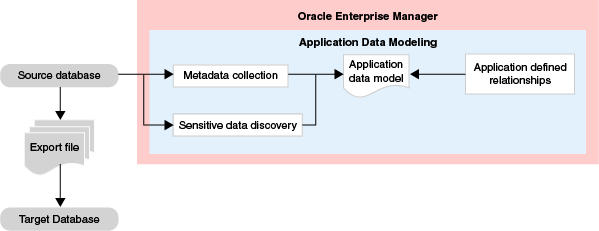
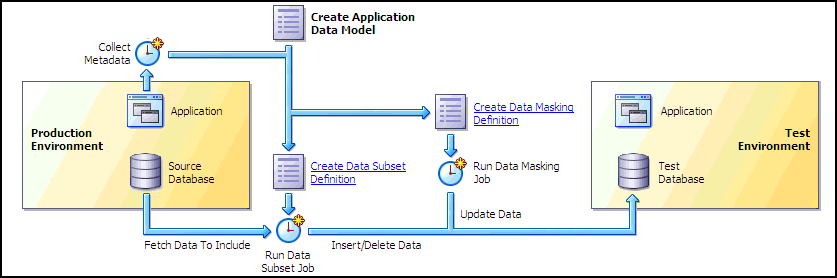

Secure Test Data Management provides Enterprise Manager the capability to enable operations such as sensitive data discovery, data subsetting, and data masking. These capabilities enable scanning and tagging of sensitive data and modeling of data relationships incorporated within an Application Data Model (ADM). You must have the Oracle Data Masking and Subsetting Pack license to use test data management features.

The following figure shows the workflow associated with an Application Data Model.

Figure 3-1 Workflow of an Application Data Model

[Description of "Figure 3-1 Workflow of an Application Data Model "](img_text/adm_workflow.md)

The ADM stores the list of applications, tables, and relationships between table columns that are either declared in the data dictionary, imported from application metadata, or user-specified. The ADM maintains sensitive data types and their associated columns, and is used by test data operations, such as data subsetting and data masking, to securely produce test data. Creating an ADM is a prerequisite for data subsetting and data masking operations.

The following figure shows the Application Data Model's relationship to other test data management components as well as the production and test environments.

Figure 3-2 Test Data Management Architecture

[Description of "Figure 3-2 Test Data Management Architecture"](img_text/create_adm.md)

You can perform several tasks related to Application Data Modeling, including the following tasks discussed in this chapter:

- Creating an Application Data Model

- Creating and Managing Custom Sensitive Column Types

- Associating a Database to an Existing ADM

- Verifying or Synchronizing an ADM

- Importing and Exporting an ADM

- Assigning Privileges to an Existing ADM

**Note:**

The procedures described in this chapter are applicable to Oracle Enterprise Manager Cloud Control 12.1 and higher only.

**See Also:**

- Data Subsetting, for information about data subsetting

- Masking Sensitive Data, for information about data masking

### Creating an Application Data Model

Before proceeding, ensure that you have the following privileges:

- Target Privileges (applicable to all targets):

  - Connect to any viewable target

  - Execute Command Anywhere

  - View Any Target

- Resource Privileges:

  - Job System

  - Named Credential

  - Oracle Data Masking and Subsetting resource privilege

  **Note:**

  The `EM_ALL_OPERATOR` privilege for Enterprise Manager Cloud Control users includes all of the above privileges.

- `SELECT_CATALOG_ROLE` for database users

- `SELECT ANY DICTIONARY` privilege for database users

- `EXECUTE` privileges for the DBMS_CRYPTO package

**Note:**

When you create an Application Data Model, the PL/SQL metadata collection packages are automatically deployed on the target database. The Database user must have DBA privileges to auto-deploy the packages.

We recommend that you create an Application Data Model for the first time with a highly privileged user so that all the necessary packages are deployed. Subsequently, all other Application Data Models can be created with a less privileged user.

#### Creating an ADM

To create an Application Data Model:

1.  From the Application Data Modeling page, view the diagram that explains how you can create a database for a test environment.
2.  Click Create.
    A pop-up window requesting general properties information appears.
3.  Specify a name for the ADM to be created.
4.  Select the Source Database by clicking the Select Database Target icon.
    The Source Database is the source from which the metadata is extracted.
5.  Select an Application Suite:
    - If you select Custom Application Suite:

      - By default, metadata collection is enabled for creating the ADM.

      - If "Create One Application For Each Schema" is not selected, a shell ADM is created. You must later edit the ADM to add applications and tables to it. Also, please note that metadata collection job is not submitted, like how it is done for the default choice.

    - If you select Oracle Application Suite:

      - Oracle E-Business Suite– Provide the database credentials for APPS user (or equivalent) , and click Submit to create the ADM.

      - Oracle Fusion Applications– Provide database credentials for FUSION user (or equivalent), and click Submit to create the ADM.

    Note the following points about metadata collections:

    - The metadata collection for the selected application suite populates the ADM with the applications and tables in the suite.

    - The ADM can collect metadata for one or more schemas. An ADM application typically represents a schema. Each schema you select becomes an ADM application, and the ADM becomes populated with the tables in the schema, particularly in the case of custom applications. However, please note that multiple applications can also map to a single schema, as in the case of Fusion Applications. The actual mapping depends on the application metadata discovered by the metadata collection job.
6.  Select the following:
    - Discover Dictionary Based Relationships— identifies dictionary based referential relationships. These are referential relationships that are defined in the Oracle data dictionary.

    - Discover Non-Dictionary Based Relationships

      - By Sampling Column Names — identifies the potential parent-child relationships that are not defined as referential integrity constraints (primary key and foreign key) in the data dictionary by matching the column name. Column name patterns can be specified using a regular expression.

      - By Sampling Column Values — identifies the potential parent-child relationships that are not defined as referential integrity constraints (primary key and foreign key) in the data dictionary by matching the values or value patterns of a column.

        Users can choose from the available value patterns or specify a custom data pattern that uses a regular expression. Oracle Data Masking and Subsetting will match the values in the column to identify the potential primary key and foreign key using the data pattern specified by the user, and return the results.

        The potential foreign keys are verified for containment within the potential primary key column, that is, the values of potential foreign key must already be present in the potential primary key. A containment test is done to meet 90% accuracy, that is, if the foreign key column is 90% contained in the primary key, a match is flagged. This test is done to include any orphan rows that might be present in applications such as Oracle's E-Business Suite and Oracle Fusion Applications.

        **Note:**

        For accurate results, ensure that you use `dbms_stats.gather_table_stats` to gather the stats of all the tables.
7.  Click Continue.
    If you selected Custom Application Suite in Step 5, a Schemas pop-up is displayed. From the Available list, select the schemas you want to include as applications in the ADM being created.
8.  Click Continue.
9.  If you selected Discover Non-Dictionary Based Relationships in Step 6, click the + icon, and specify the primary key and foreign key columns that must be matched.
10. Click Continue.
11. Specify the parameters for scheduling the metadata collection job.
    You can chose to either run the metadata collection job immediately or schedule it to start at a later time.
12. Click Submit to submit the metadata collection job.
    The ADM you created appears in the Application Data Modeling page.
13. Click View Job Details to view the status and details of the metadata collection process.
14. Review the Most Recent Job Status table column to monitor the status of the metadata collection job.
    The application data model is locked and cannot be edited when the metadata is being collected. You must wait until the status indicates that the job is complete.

#### Editing an ADM to View the Application Schemas and Tables

To view and edit application tables:

1.  From the Application Data Modeling page, view the diagram that explains how you can create a database for a test environment.
2.  Select the Application Data Model you previously created, and then click Edit.
    The Applications and Objects subpage appears, displaying the applications discovered during the metadata collection process.
    To view the tables associated with an application, click the Expand ( \> ) icon.
3.  To edit an application, select the application, open the Actions menu, then select Add Application.
    The Add Application pop-up window appears.
4.  Specify a name for the application, a nick name/short name, description for the application, and click the search icon to search a schema.
5.  Select a schema from the list, and click OK.
6.  Click OK to add the application table to the data model.
    The table now appears in the Applications and Tables view.
7.  To discover non-dictionary based referential relationships, click the Referential Relationships tab, and then click Discover Non-Dictionary Based Relationships.

#### Adding and Removing Tables From the Application Schema

To add or remove tables from the application schema:

1.  From the Application Data Modeling page, select the Application Data Model you previously created, and then click Edit.
    The Applications and Objects subpage appears, displaying the applications and objects found during metadata collection.
    To see the tables for an application, click the expand ( \> ) icon.
2.  To add a table, click Add Application.
    The Add Application pop-up window appears.
3.  Specify a name for the application, a nick name/short name, description for the application, and click the search icon to search a schema.
    The Search and Select pop-up appears, displaying all of the tables from the selected schema that are not assigned to an application.
4.  Select an unassigned table, then click OK.
    The table name now appears in the Add Application pop-up.
5.  After selecting a Table Type, click OK.
    The table now appears in the Applications and Objects view.
6.  To remove a table, select the table from the Application and Objects view, and click Remove.

#### Viewing the Referential Relationships

To view referential relationships:

1.  From the Application Data Modeling page, select the model you created, then click Edit.
    The Applications and Objects subpage appears, displaying the applications found during metadata collection.
    To view the tables for an application, click the expand ( \> ) icon.
2.  Click the Referential Relationships tab.
    The following types of referential relationships are supported:

    - Dictionary-defined

      This is the referential relationship that the metadata collection extracted, resulting from primary key and foreign key relationship. You can remove relationship from the ADM if desired.

    - Non-Dictionary Based

      This is the referential relationship that is not defined in the Oracle data dictionary, and is achieved by matching the column names and column values of potential foreign keys with column names and column values of potential primary keys along with their data types. You must evaluate the potential non-dictionary based referential relationships listed here, and if you consider these relationships valid, select the relationship, and click Add to ADM to add it to the Application Data Model.

    - Imported from template

      If there are application templates available from the vendor of the enterprise application, for example, Oracle Fusion Applications or Oracle E-Business Suite, then the ADM can be created from the application vendor-supplied template by using the Import action on the ADM home page.

    - User-defined
3.  Open an application view by selecting it, then use the chevron icon (\>) to view the parent and dependent key relationships, or select Expand All from the View menu to view all relationships.

#### Adding and Removing Referential Relationships

To manually add a referential relationship:

1.  From the Application Data Modeling page, select the model you created, then click Edit.
    The Applications and Objects subpage appears, displaying the applications and objects found during metadata collection.
    To view the tables and objects for an application, click the expand ( \> ) icon.
2.  From the Referential Relationships tab, open the Actions menu, then select Add Referential Relationship.
    The Add Referential Relationship pop-up window appears.
3.  Select the requisite Parent Key and Dependent Key information.
4.  In the Columns Name list, select a dependent key column to associate with a parent key column.
5.  Click OK to add the referential relationship to the ADM.
    The new dependent column now appears in the referential relationships list.

#### Performing Sensitive Data Discovery

To discover sensitive columns:

1.  From the Application Data Modeling page, select the model you created, then click the Edit .

    The Applications and Objects subpage appears, displaying the applications and objects found during metadata collection. To view the tables for an application, click the expand ( \> ) icon.

2.  From the Sensitive Columns tab, open the Actions menu, then select Create Sensitive Column Discovery Job.

    The Parameters pop-up appears.

3.  Select the applications and sensitive column types.

    The sensitive column types you select is processed for each application to search for columns that match the type.

4.  Click Continue.

    The schedule pop-up window appears.

5.  Specify the required information, schedule the job, then click Submit when you have finished.

    The Sensitive Columns subpage reappears.

6.  Click Save and Return to return to the Application Data Modeling home page.

##### Modifying the Sensitive Column Type

To modify the sensitive column type:

1.  From the Application Data Modeling page, select the model you created, then click the Edit.

    The Applications and Objects subpage appears, displaying the applications and objects found during metadata collection. To view the tables for an application, click the expand ( \> ) icon.

2.  Click the Sensitive Columns tab.

    This view shows the sensitive columns that have already been identified.

3.  Select the sensitive column for which you want to change the type.

4.  Open the Actions menu, then select Set Sensitive Column Type.

    The Set Sensitive Column Type pop-up window appears.

5.  Select the new type and click OK.

##### Viewing the Discovery Results

To view the sensitive column discovery results:

1.  From the Application Data Modeling page, select the model you created, then click Edit.
    The Applications and Objects subpage appears, displaying the applications found during metadata collection.
    To view the tables for an application, click the expand ( \> ) icon.
2.  Select the Sensitive Columns tab, then click Discovery Results to view the discovery results.

##### Setting Sensitive Status on the Discovery Results

To set sensitive status on the discovery results:

1.  When the Most Recent Job Status column indicates that the job is Successful, select the ADM, then click Edit.

2.  Select the Sensitive Columns tab, then click Discovery Results to view the job results.

3.  To set the sensitive status of any column, select the row for the column you want to define, open the Set Status menu, then select either Sensitive or Not Sensitive.

4.  Click OK to save and return to the Sensitive Columns tab.

    The sensitive columns you defined in the previous step now appear in the list.

5.  Click Save and Return to return to the Application Data Modeling page.

##### Adding and Removing Sensitive Columns

To add/remove sensitive columns:

1.  From the Application Data Models page, select an ADM, then click Edit.
2.  Select the Sensitive Columns tab, then click Add.
    The Add Sensitive Column pop-up appears.
3.  Provide the required information and an optional Sensitive Column Type, then click OK.
    The sensitive column now appears in the table for the Sensitive Columns tab.

### Creating and Managing Custom Sensitive Column Types

After you have successfully created an ADM, the next task is to create either a new sensitive column type or one based on an existing type.

#### To create a sensitive column type:

1.  From the Actions menu of the Application Data Models page, select Sensitive Column Types.

    The Sensitive Column Types page appears.

2.  Click Create.

    The Create Sensitive Column Type pop-up appears.

3.  Specify a required name and regular expressions for the Column Name, Column Comment, and Column Data search patterns.

    - The Or Search Type means that any of the patterns can match for a candidate sensitive column.

    - The And Search Type means that all of the patterns must match for a candidate sensitive column.

    If you do not provide expressions for any of these parameters, the system does not search for the entity.

4.  Click OK.

    The sensitive column appears in the table in the Sensitive Column Types page.

#### To create a sensitive column type based on an existing type:

1.  From the Actions menu of the Application Data Models page, select Sensitive Column Types.

    The Sensitive Column Types page appears.

2.  Select either a sensitive column type you have already defined, or select one from the out-of-box types that the product provides.

3.  Click Create Like.

    The Create Sensitive Column Type pop-up appears.

4.  Specify a required name and alter the existing expressions for the Column Name, Column Comment, and Column Data search patterns to suit your needs.

5.  Click OK.

    The sensitive column appears in the table in the Sensitive Column Types page.

### Associating a Database to an Existing ADM

After you have created an Application Data Model (ADM), you can select additional databases to be associated databases of an ADM, as explained in the following procedure.

#### To associate a database to an ADM:

1.  From the Application Data Models page, select an ADM, select Actions, then Associated Databases.

    This dialog lists all of the databases associated with this ADM and the schemas assigned to each application per database. You can add more databases that give you a choice of data sources when subsetting and databases to mask during masking.

2.  Click Add, then select a database from the pop-up.

    The selected database now appears in the Database section of the Associated Databases dialog.

3.  To change a schema, select the associated database on the left, select the application on the right for which the schema is to be changed, then click Select Schema.

4.  Select the missing schema from the list in the pop-up, then click Select.

**Related Topics**

- Creating an ADM

### Verifying or Synchronizing an ADM

After you have created an Application Data Model (ADM), the Source Database Status column can indicate Valid, Invalid, Needs Verification, or Needs Upgrade.

- Invalid status–Verify the source database to update the referential relationships in the application data model with those found in the data dictionary, and to also determine if each item in the application data model has a corresponding object in the database.

- Needs Verification status–You have imported an Oracle supplied template and you must verify the ADM before you can use it. This is to ensure that necessary referential relationships from data dictionary are pulled into the ADM.

- Needs Upgrade status–You have imported a pre-12c masking definition, so you now need to upgrade the ADM.

#### To verify a source database:

1.  Select the ADM to be verified, indicated with an Invalid status.

2.  From the Actions menu, select Verify.

3.  Select the source database with the Invalid status, then click Create Verification Job.

4.  Specify job parameters in the Create Verification Job pop-up, then click Submit.

5.  After the job completes successfully, click the source database and note the object problems listed.

6.  Fix the object problems, rerun the Verification Job, then check that the Source Database Status is now Valid.

### Importing and Exporting an ADM

You can share Application Data Models (ADM) with other Enterprise Manager environments that use a different repository by exporting an ADM, which can subsequently be imported into the new repository.

An exported ADM is by definition in the XML file format required for import. You can edit an exported ADM XML file prior to import. When exporting an ADM for subsequent import, it is best to have one that uses most or all of the features—applications, tables, table types, referential relationships, sensitive columns. This way, if you are going to edit the exported file prior to import, it is clear which XML tags are required and where they belong in the file.

- Importing an ADM

- Exporting an ADM

**Note:**

There are EMCLI verbs to export and import an ADM if you want to perform these operations remotely or script them.

#### Importing an ADM

There are two methods of import:

- Importing an ADM XML File from your Desktop

- Importing an ADM XML file from the Software Library

##### Importing an ADM XML File from your Desktop

1.  From the Application Data Models page, select the ADM you want to import.

2.  From the Actions menu, select Import, then select File from Desktop.

3.  In the pop-up that appears, specify a name for the ADM, the source database you want to assign to the ADM, and location on your desktop from which you want to import the ADM.

4.  Click OK.

    The ADM now appears on the Application Data Models page.

##### Importing an ADM XML file from the Software Library

1.  From the Application Data Models page, select the ADM you want to import.
2.  From the Actions menu, select Import, then select File from Software Library.
3.  In the Export File from Software Library pop-up that appears, select the desired ADM XML file on the left, then specify a name and the source database you want to assign to the ADM on the right.
4.  Click Import.
    The ADM now appears on the Application Data Models page.

After importing an ADM, you may want to discover sensitive columns or run a verification job. In the process of performing these tasks, the PL/SQL metadata collection packages are automatically deployed on the target database. The Database user must have DBA privileges to auto-deploy the packages.

#### Exporting an ADM

There are three methods of export:

- Exporting an ADM as an XML File to Your Desktop

- Exporting an ADM

- Exporting an ADM to a Transparent Sensitive Data Protection Catalog

##### Exporting an ADM as an XML File to Your Desktop

1.  From the Application Data Models page, select the ADM you want to export.

2.  From the Actions menu, select Export, then select Selected Application Data Model.

3.  In the File Download pop-up that appears, click Save.

4.  In the Save As pop-up that appears, navigate to a file location and click Save.

    The system converts the ADM into an XML file that now appears at the specified location on your desktop.

##### Exporting an ADM

1.  From the Actions menu, select Export, then select File from Software Library.

2.  From the Actions menu, select Export, then select File from Software Library.

3.  In the Export File from Software Library pop-up that appears, select the desired ADM and click Export.

4.  In the File Download pop-up that appears, click Save.

5.  In the Save As pop-up that appears, navigate to a file location and click Save.

    The system converts the ADM into an XML file that now appears at the specified location on your desktop.

##### Exporting an ADM to a Transparent Sensitive Data Protection Catalog

1.  From the Application Data Models page, select the ADM you want to export.
2.  From the Actions menu, select Export, then select Export to TSDP Catalog.
3.  The Application Data Models page displays a table of associated databases. Select a database and click the Export Sensitive Data button.
4.  In the Export Sensitive Data pop-up that appears, provide credentials for the selected database and click OK.
    A message appears on the Application Data Models page confirming that the sensitive data was copied to the database.

For detailed information on TSDP, see Oracle Database Security Guide.

### Assigning Privileges to an Existing ADM

You can grant privileges on an Application Data Model that you create so that others can have access. To do so, you must be an Enterprise Manager Administrator with at least Designer privileges on the ADM.

To assign privileges to an existing ADM:

1.  From the Enterprise menu, select Quality Management, then select Application Data Models.
2.  Select the ADM to which you want to grant privileges.
3.  From the Actions menu, select Grant, then select one of the following:
    - Operator–to grant Operator privileges on the ADM to selected roles or administrators, which means the grantees can view and copy but not edit and delete the definition.

    - Designer–to grant Designer privileges on the ADM to selected roles or administrators, which means the grantees can view, edit, and delete the definition.
4.  In the dialog that opens, select the type (administrator or role, or both). Search by name, if desired. Make your selections and click Select.
    The selected names now have privileges on the ADM.
5.  Use the Revoke action if you want to deny any privileges that were previously granted.
