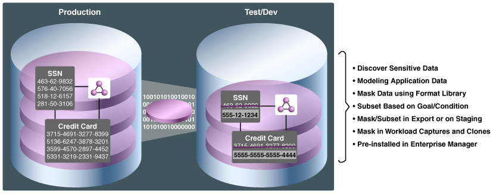
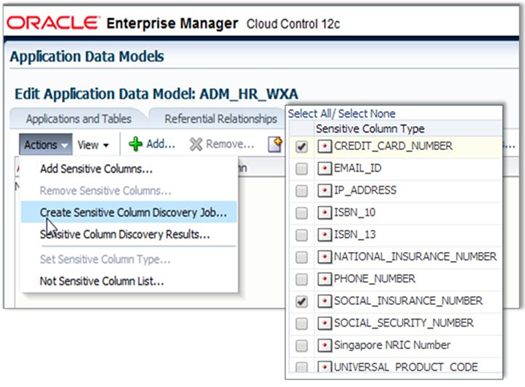
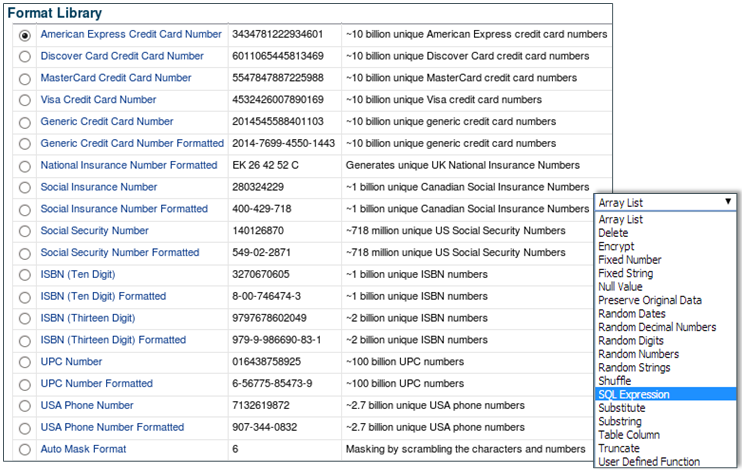
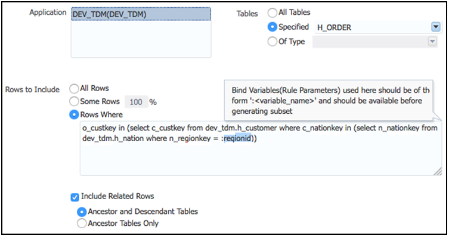
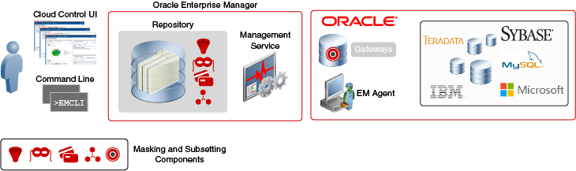
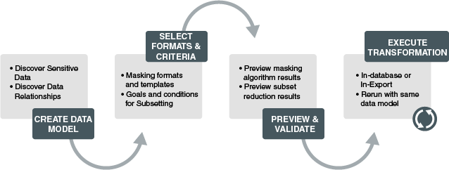

This chapter explains the basics of Oracle Data Masking and Subsetting pack by providing an overview on:

- The Need to Mask and Subset Data

- Challenges Organization Face for Masking and Subsetting Data

- How Oracle Data Masking and Subsetting Addresses Masking/Subsetting Challenge

- Major Components of Oracle Data Masking and Subsetting

- Architecture

- Deployment Options

- Methodology

- Workflow

It is recommended that you understand the above concepts of Oracle Data Masking and Subsetting prior to the implementation. If you are already aware of these concepts or want to start masking and subsetting data, please refer to the chapters below this chapter:

- Start with the [Before You Begin](before_you_begin.md) chapter to understand the privileges, roles, and storage requirements.
- Refer to the [Application Data Modeling](data_modeling.md) chapter to discover and model sensitive columns.
- Refer to the [Data Masking](data_masking.md) chapter to define and execute masking criteria.
- Refer to the [Data Subsetting](data_subsetting.md) chapter to define and execute subsetting criteria.

**Note:**

For Oracle Data Masking and Subsetting licensing information, please refer to [Oracle Database Licensing Guide](../dblic/Licensing-Information.md).

### The Need to Mask and Subset Data

The reasons to mask and subset data include the following:

- Limit sensitive data proliferation: The growing security threats have increased the need to limit exposure of sensitive information. At the same time, copying production data for non-production purposes such as test and development is proliferating sensitive data, expanding the security and compliance boundary, and increasing the likelihood of data breaches.

- Share what is necessary: Often, companies have to share a production data set with internal and external parties for various reasons. For example, a Cloud application provider may have to extract and share information specific to their individual subscribers on demand. Another example is a company serving a court order must extract and share a subset of production data with the court. In several cases, it is efficient to extract and share a portion or subset of information instead of sharing the entire production dataset.

- Comply with data privacy laws and standards: Data privacy standards such as PCI-DSS and European Union (EU) General Data Protection Regulation (GDPR) emphasize on protecting sensitive information in non-production environments because these environments are typically not as protected or monitored as production systems. EU GDPR also mandates an individual’s right to be forgotten, erasure, portability or rectification which requires identifying and processing a subset of information.

- Minimize storage costs: Using the entire production data for test, development, and QA purposes will incur additional storage costs and prolong the test and development cycles, increasing the overall storage and operational cost.

Masking and subsetting data addresses the above use cases. Data Masking is the process of replacing sensitive data with fictitious yet realistic looking data. Data Subsetting is the process of downsizing either by discarding or extracting data. Masking limits sensitive data proliferation by anonymizing sensitive production data. Subsetting helps to minimize storage costs by deleting data or extracting a subset of data for sharing or archival. Data Masking is also known as Static Data Masking, and Data Subsetting is also known as Test Data Management.

### Challenges Organization Face for Masking and Subsetting Data

Organizations typically mask and subset data using custom scripts or solutions. While these in-house solutions might work for few columns, they may not cater to large applications with distributed databases and thousands of columns, and result in challenges such as:

- How to locate sensitive data in the midst of numerous applications, databases, and environments?

- How to accurately protect sensitive data as data has different shapes and forms such as VISA, AMEX, Discoverer, Master, Social Security Numbers, and more?

- Is the protected data usable to developers, testers, and applications?

- Will the applications continue to work after masking and subsetting is done?

In addition to the above challenges, organizations may not have the resources to develop and maintain such a solution in this ever-changing IT landscape.

### How Oracle Data Masking and Subsetting Addresses Masking/Subsetting Challenge

Oracle Data Masking and Subsetting addresses the above challenges by providing an automated, flexible, and easy-to-use solution that masks and subsets sensitive production data, thereby allowing data to be shared safely across non-production environments.

The Oracle Data Masking and Subsetting (DMS) pack of the Oracle Enterprise Manager (EM) helps:

- maximize the business value of data by masking sensitive information

- minimize the compliance boundary by not proliferating the sensitive production information

- lower the storage costs on test and development environments by subsetting data

- automate the discovery of sensitive data and parent-child relationships

- provide a comprehensive library of masking formats, masking transformations, subsetting techniques, and select application templates

- mask and subset data in-Database or on-the-file by extracting the data from a source database

- mask and subset both Oracle and non-Oracle databases

- mask and subset Oracle Databases hosted on the Oracle cloud

- preserve data integrity during masking and subsetting and offers many more unique features

- integrate with select Oracle testing, security, and integration products.

Figure 1-1 Oracle Data Masking and Subsetting Used in a Production and Test Database Setup

[Description of "Figure 1-1 Oracle Data Masking and Subsetting Used in a Production and Test Database Setup"](img_text/dms_test_production_database.md)

### Major Components of Oracle Data Masking and Subsetting

Oracle Data Masking and Subsetting consists of the following major components.

- Application Data Modeling

- Data Masking Format Library

- Data Masking Transformations

- Data Subsetting

- Application Templates

#### Application Data Modeling

The Application Data Modeling module of the Oracle Data Masking and Subsetting pack simplifies the effort of sensitive data discovery through automated discovery procedures and sensitive column types. These procedures not only discover columns holding sensitive information, but also discover the parent-child relationships between these columns that are defined in the database.

A sensitive column type creates forensics of sensitive data elements, such as national insurance numbers, using a combination of data patterns in column names, column data, and columns comments. Automated discovery procedures leverage sensitive column types to sample data in the database table columns while scanning the database for sensitive information.

Application Data Modeling provides several out-of-the-box sensitive columns types such as credit card numbers, social security numbers, phone numbers. Customer-sensitive column types can be easily created using regular expressions.

Figure 1-2 Editing an Application Data Model

[Description of "Figure 1-2 Editing an Application Data Model"](img_text/edit_adm.md)

**Related Topics**

- Application Data Modeling

#### Data Masking Format Library

While Application Data Modeling automates the task of sensitive data discovery and modeling, a comprehensive library of masking formats and transformations simplify the effort of defining a masking criteria on the sensitive columns that are discovered.

One of the key aspects of the data masking exercise is to replace the sensitive information with fake data, without breaking the semantics and structure of the data element. The masked data must be realistic and pass format-specific checks such as Luhn check. For example, a masked credit card number must not only be a valid credit card number, but also a valid VISA, Master, American Express or Discover card number. Failing to maintain this data integrity will affect the development or test processes and may break the corresponding application.

Oracle Data Masking and Subsetting is packed with a comprehensive library of masking formats that covers most of the Personally Identifiable Information (PII) and Payment Card Information (PCI). Different types of credit card numbers or national identifiers of different countries or bank account numbers, the masking format library will meet the enterprise needs.

In addition to the several out-of-the-box masking formats, the product provides various built-in tools to easily create custom-masking formats. There are simple tools that generate fixed or random numbers, strings, and dates. There are tools that facilitate substitution from lookup tables. There are tools such as SQL Expression and User Defined Function to accommodate complex user-defined masking logic.

Figure 1-3 Data Masking Format Library

[Description of "Figure 1-3 Data Masking Format Library"](img_text/data_format_library.md)

#### Data Masking Transformations

Data Masking format library and application templates accelerate the task of defining masking rules and preserving the integrity and structure of data elements.

Depending on the business use cases, organizations may have different requirements while mapping masking formats to sensitive columns. For example, one of the requirements in a large distributed database environment is to generate consistent masked outputs for the given input across multiple databases. Oracle Data Masking and Subsetting provides sophisticated masking transformations that fit into broader business context. If masking formats are considered as building blocks of a data masking definition, then masking transformations align these masking formats according to the different business requirements.

##### Conditional Masking

Conditional transformation provides an ability to arrange masking formats according to different conditions. For example, consider masking a column containing unique person identifiers. Identifiers that belong to country USA can be masked using Social Security Number format and that belong to country UK can be masked using National Insurance Number format.

##### Compound Masking

Compound transformation (also known as grouping option), masks related columns as a group, ensuring the masked data across the related columns retain the same relationship. For example, consider masking address fields such as city, state, and postal codes. These values must be consistent after masking.

##### Deterministic/Consistent Masking

Deterministic transformation generates consistent outputs for a given input across databases. This transformation will be helpful to maintain data integrity across multiples applications and preserve system integrity in a single sign-on environment. For example, consider three applications: a human capital management application, a customer relationship management application, and a sales data warehouse. These three applications may have key common fields such as EMPLOYEE ID that must be masked consistently across these applications. Substitute and Encrypt masking formats provide deterministic masking transformation.

##### Shuffle

Shuffle transformation shuffles fields within a column in a random fashion. This transformation is helpful in breaking one-to-one mapping between sensitive data elements. For example, columns containing personal health records can be shuffled while masking health care information.

##### Key Based Reversible Masking (Encrypt Format)

This transformation encrypts and decrypts the original data using a secure key string. The input data format is preserved during encryption and decryption. This transformation uses powerful industry-standard 3DES algorithm. This transformation is helpful when businesses need to mask and send their data to a third-party for analysis, reporting, or any other business processing purpose. After the processed data is received from the third-party, the original data can be recovered using the same key string that was used to encrypt the data.

##### Format Preserving Randomization (Auto Mask Format)

This transformation randomizes the data, preserving the input length, position of the characters and numbers, case of the character (upper or lower), and special characters in the input.

#### Data Subsetting

Subsetting modern enterprise class applications is a challenging task. Oracle Data Masking and Subsetting simplifies this effort through its easy-to-define goal and condition-based subsetting techniques. Data can be subsetted based on different goals. A goal can be relative table size, for example, extracting 1% subset of a table containing 1 million rows. Data can also be subsetted based on different conditions. A condition can be based on time, for example, discarding all user records created prior to a particular year. A condition can be based on region, for example, extracting Asia Pacific information for a new application development. The conditions are specified using “SQL where clause”. The “SQL where clause” also supports bind variables.

Figure 1-4 Subsetting based on a condition

[Description of "Figure 1-4 Subsetting based on a condition"](img_text/data-subsetting-ui.md)

Data Subsetting generates a real-time dynamic view of the application schema with before and after storage size and the percentage of data within the tables being subsetted, including the dependent tables. Administrators can use this view to validate the subsetting criteria even before subsetting the data.

#### Application Templates

Oracle Data Masking Application Templates deliver pre-identified sensitive columns, their relationships, and industry-standard best practice masking techniques out-of-the box for packaged applications such as Oracle E-Business Suite and Oracle Fusion Applications. Use the Self Update feature to get the latest masking and subsetting templates available from Oracle.

### Architecture

Oracle Data Masking and Subsetting is part of the Oracle Enterprise Manager infrastructure. Organizations using Oracle Enterprise Manager do not need to download and install the Oracle Data Masking and Subsetting Pack separately. Oracle Enterprise Manager provides unified browser-based user interface for administration. All Data Masking and Subsetting objects are centrally located in the Oracle Enterprise Manager repository, which facilitates centralized creation and administration of Application Data Models, Data Masking and Subsetting rules or definitions. In addition to its intuitive cloud control Graphical User Interface (GUI), Oracle Enterprise Manager also provides Command Line Interface (EMCLI) to automate select Data Masking and Subsetting tasks.

Figure 1-5 Architecture of the Oracle Data Masking and Subsetting

[Description of "Figure 1-5 Architecture of the Oracle Data Masking and Subsetting "](img_text/dms_architecture.md)

For more details on Oracle Enterprise Manager Architecture, please refer to the [Oracle Enterprise Manager Introduction Guide](http://docs.oracle.com/cd/E63000_01/EMCON/overview.htm#CJAIFJGH).

### Deployment Options

Oracle Data Masking and Subsetting provides the following modes for masking and subsetting data:

-  In-Database mode directly masks and subsets data within a non-production database with minimal or zero impact on production environments. As In-Database mode permanently changes the data in a database, it is recommended for non-production environments such as staging, test or development databases instead of production databases.

- In-Export mode masks and subsets the data in near real-time while extracting the data from a database. The masked and subsetted data that is extracted is written to data pump export files, which can be further imported into test, development or QA databases. In general, In-Export mode is used for production databases. In-Export method of masking and subsetting is a unique offering from Oracle that sanitizes sensitive information within the product perimeter.

- Heterogeneous mode Oracle Data Masking and Subsetting can mask and subset data in non-Oracle databases. Target production data is first copied from the non-Oracle environment into Oracle Database using an Oracle Database Gateway, and is then masked and subsetted within the Oracle Database, and is finally copied back to the non-Oracle environment. This approach is very similar to the steps used in various ETL (Extract, Transform, and Load) tools, except that the Oracle Database is the intermediary that transforms the data. Oracle Database Gateways enable Oracle Data Masking and Subsetting to operate on data from Oracle MySQL, Microsoft SQLServer, Sybase SQLServer, IBM DB2 (UDB, 400, z/OS), IBM Informix, and Teradata.

**Note:**

For information on licensing, please refer to [Oracle Database Licensing Guide](../dblic/Licensing-Information.md).

### Methodology

Oracle Data Masking and Subsetting uses the following methodology to secure non-production database and replace sensitive data with fictitious, but relevant data that meets compliance requirements.

- Creating an Application Data Model— Discover sensitive data and data relationships, and then create or assign an Application Data Model

- Selecting Masking Formats and Criteria— Create data masking definition and masking format types and templates based on the sensitive data that is discovered

- Previewing and Validating — Secure sensitive data by previewing the masking algorithm results and the subset reduction results

- Executing Masking Transformations— Execute In-Database or In-Export masking and subsetting transformations and validate the data that is masked

The following figure describes the methodology used in Oracle Data Masking and Subsetting.

Figure 1-6 Methodology

[Description of "Figure 1-6 Methodology"](img_text/dms_methodology.md)

### Workflow

The following diagram explains the Oracle Data Masking and Subsetting workflow.

Figure 1-7 Oracle Data Masking and Subsetting Workflow

The following steps describe the Oracle Data Masking and Subsetting Workflow:

1.  Create an Application Data Model — To begin using Oracle Data Masking and Subsetting, you must create an Application Data Model (ADM). ADMs capture application metadata, referential relationships, and discover sensitive data from the source database.

2.  Create a Data Masking Definition — After an ADM is created, the next step is to create a data masking definition. A masking definition includes information regarding the table columns and the masking format for each of these columns. The mask can be created by writing the masked data to the export file.

3.  Create a Data Subsetting Definition — Create a data subsetting definition to define the table rules and rule parameters. The subset can be created by writing the subset data to the export file.
