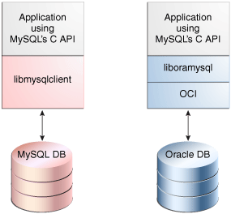

Consider the specifics of MySQL Client Library Driver for Oracle Database, and its use in migrating applications from MySQL to Oracle.

**See Also:**

[API Reference for Oracle MySQL Client Library Driver](API-ref-for-oracle-MySQL-client-library.md) for more information about MySQL programmatic support

### Introduction to MySQL Client Library Driver for Oracle

MySQL Client Library Driver for Oracle Database 12c, `liboramysql`, is a drop-in replacement for MySQL Commercial Connector/C 6.0 client library. The `liboramysql` driver implements a similar API, enabling C-based applications and tools developed for MySQL to connect to Oracle Database. The driver may be used to migrate applications from MySQL to Oracle Database with minimal changes to the application code.

The `liboramysql` driver uses Oracle Call Interface (OCI) to connect to Oracle Database.

Figure 6-1 MySQL Application Code Using liboramysql Driver to Connect to Oracle

[Description of "Figure 6-1 MySQL Application Code Using liboramysql Driver to Connect to Oracle"](img_text/liboramysql_arch.md)

The C code snippet in Example 6-1 demonstrates how to connect to MySQL and how to insert a row into a table. After updating the connection credentials, this code can run unchanged against Oracle Database when the executable is linked using the `liboramysql` library, instead of the `libmysqlclient` library.

Although the database schema and data must be migrated to Oracle separately, and although the `liboramysql` library does not translate SQL statements, considerable amount of effort is conserved when migrating to Oracle Database because no changes have to be made to the application code.

Custom C applications can use the `liboramysql` library to easily migrate to Oracle Database.

Additionally, you can migrate applications using programming languages that abstract the use of the `libmysqlclient` library and provide MySQL extensions or adapters. These languages include PHP, Perl, Python, and Ruby. Although native Oracle adapters already exist for many programming languages implemented in C, migrating an application to a native Oracle adapter often requires extensive application code changes.

#### Connecting to MySQL

Example 6-1 Connecting to MySQL and Inserting a New Row

    c = mysql_init(NULL);
    mysql_real_connect(c, "myhost", "myun", "mypw", "mydb", 0, NULL, 0);
    mysql_query(c, "insert into mytable values (1,2)");
    mysql_close(c);

### Installation and First Use of MySQL Client Library Driver for Oracle

The MySQL Client Library Driver for Oracle is provided as a file in the `liboramysql.so` shared library for Linux and as the `oramysql.dll` dynamic link library (DLL) for Windows. The driver is also packaged as part of the Oracle Instant Client `Basic` and `Basic Lite` packages for download from OTN. See [`http://www.oracle.com/technetwork/topics/linuxsoft-082809.html`](http://www.oracle.com/technetwork/topics/linuxsoft-082809.html) and [`http://www.oracle.com/technetwork/topics/winsoft-085727.html`](http://www.oracle.com/technetwork/topics/winsoft-085727.html).

The driver must be installed in the same directory as the Oracle Client Shared Library, that is, `libclntsh.so` for Linux and `oci.dll` for Windows. Typically, you must set the operating system environment variable (`LD_LIBRARY_PATH` on Linux or `PATH` on Windows) to include this installation directory.

For `ORACLE_HOME` installations, the driver library is installed in the `$ORACLE_HOME/lib` directory for Linux and the `%ORACLE_HOME%\bin` directory for Windows. For Instant Client ZIP files, the library is in the `instantclient_12_1` directory. For Instant Client RPM installations, the library is in the `/usr/lib/oracle/12.1/client/lib` or `/usr/lib/oracle/12.1/client64/lib` directory on 32-bit and 64-bit Linux platforms, respectively.

### Overview of Migration with MySQL Client Library Driver for Oracle

Migrating a C-based MySQL application to Oracle Database involves the following steps:

1.  Confirm that the application runs against MySQL Database.
    This ensures that the migration process starts at a known baseline of functionality.
2.  Replace the `libmysqlclient` library with the `liboramysql` library.
    The application must be relinked to use the `liboramysql` library instead of the `libmysqlclient` library.
3.  Migrate the application schema to Oracle Database.
    The schema must be migrated to use Oracle DDL and types. Oracle SQL Developer assists in this process.

    See Oracle SQL Developer User's Guide for further details.
4.  Review all SQL statements used by the application.
    If necessary, change the SQL statements of the application to use Oracle syntax, or implement a SQL Translator to automatically perform the conversion at application run time. Rewrite any logic that depends on MySQL features that are not supported by Oracle Database.

    See [SQL Translation of JDBC and ODBC Applications](SQL-translation-JDBC-ODBC-applications.md) .
5.  Update the connection string of the application to connect to Oracle Database.
    Use Oracle Easy Connect syntax or a `tnsnames.ora` connect identifier in the `host` parameter of the connection call.
6.  Test the application with Oracle Database.
    Verify the application against Oracle Database.

### Using MySQL Client Library Driver for Oracle

The `liboramysql` API is compatible with MySQL Commercial Connector/C 6.0. MySQL Driver for Oracle Database, liboramysql, translates MySQL API calls to Oracle Call Interface (OCI) calls, and between Oracle and MySQL data types.

Existing MySQL-based applications may be relinked to use the `liboramysql` driver, making Oracle Database the new data source. Note that the `liboramysql` driver supports connections only to Oracle Database. Simultaneous connections to both MySQL Database and Oracle Database in the same application are not possible.

See [API Reference for Oracle MySQL Client Library Driver](API-ref-for-oracle-MySQL-client-library.md) for details on data type mapping and API compatibility. Additional information may also be found in Oracle SQL Developer User's Guide.

The `liboramysql` driver does not translate SQL statements. You must rewrite the statements that are not valid for Oracle Database. You can do this directly in the application, or by using a SQL Translator. The application schema and data must also be migrated separately. Oracle SQL Developer automates this process.

Whenever cross-version OCI connectivity exists for older versions of Oracle Database, you can use the `liboramysql` driver to connect to these older versions.

#### Relinking the Application with the liboramysql Driver

The fundamental step of using the `liboramysql` library is to relink the application to use the new library. The `liboramysql` library is compatible with the `libmysqlclient.so` library from MySQL Commercial Connector/C 6.0.2 package, so you must build and verify version-sensitive applications with MySQL Commercial Connector/C 6.0.2 before migrating to Oracle Database.

The installation scripts of public software compiled from source code typically expect MySQL components to follow a predefined system directory structure. You can use the `setuporamysql.sh` script in the `demo` directory of Instant Client SDK to achieve this.

Depending on the application, you can use one or more of the following ways to relink the application with the `liboramysql` library:

- Build directly with the `liboramysql` library.

  You can update your build scripts to use the `liboramysql` library and build custom applications directly with this Oracle library.

- Use the `liboramysql` library to emulate a MySQL Commercial Connector/C directory

  The `setuporamysql.sh` library in the Instant Client SDK shows how a directory structure emulating a MySQL Commercial Connector/C installation can be created. You may build applications using this emulated directory.

- Use the `LD_PRELOAD` environment variable.

  Preconfigured programs may be able to use the `LD_PRELOAD` environment variable to link with the `liboramysql` library. However, changing the value of this environment variable may not work if the program uses the `dlopen()` method.

- Duplicate the `liboramysql` library.

  Perform the following steps to rename the `liboramysql` library to the MySQL client library name used by the application:

  1.  Use the `ldd` command to identify the MySQL library with which the application is linked:

          $ ldd yourprogram
          ...
          libmysqlclient.so.16 => /usr/lib/libmysqlclient.so.16 (0x00007f9004e7f000)
          ...

  2.  Create the following symbolic link as the Oracle software owner user:

          $ ln -s $ORACLE_HOME/lib/liboramysql12.so $ORACLE_HOME/lib/libmysqlclient.so.16

  3.  Add `$ORACLE_HOME/lib` to the `LD_LIBRARY_PATH` environment variable for any application that formerly used the `libmysqlclient` library:

          $ export LD_LIBRARY_PATH=$ORACLE_HOME/lib

- Replace the system MySQL client library.

  Rename the target system MySQL client library and link the new library in its place. Because this option affects every application on the system that uses MySQL, and should be done only if absolutely necessary.

      # mv /usr/lib64/libmysqlclient.so.16 /usr/lib64/libmysqlclient.so.16.backup
      # ln -s $ORACLE_HOME/lib/liboramysql12.so /usr/lib64/libmysqlclient.so.16

If MySQL applications are not rebuilt from the source code, then you must first link the applications against the `libmysqlclient.so` library from MySQL Commercial Connector/C 6.0.2 package. This ensures binary compatibility with the data structures in the `liboramysql` library.

#### Connecting to Oracle Database

To connect to Oracle Database with the `liboramysql` library, use Oracle Easy Connect syntax or a `tnsnames.ora` connect identifier in the `host` parameter of the connection call:

    mysql_real_connect(c, "localhost/pdborcl", "myun", "mypw", NULL, 0, NULL, 0);

#### Supported Platforms

MySQL Client Library Driver for Oracle is available on platforms that support the Oracle Instant Client.

See the list of supported platforms on the Oracle Support Certification site: [`https://support.oracle.com`](https://support.oracle.com)

#### Error Handling

All errors generated by OCI client code or the Oracle server are passed to the application when either the `mysql_errno()` method or the `mysql_error()` method is invoked after an error.

#### Globalization

The date format expected by the application may be set using `NLS_DATE_FORMAT` environment variable of Oracle Database, or changed with the equivalent `ALTER SESSION` command after connecting. The `NLS_DATE_FORMAT` environment variable is only used if `NLS_LANG` is also set in the environment.

#### Expected Differences

Some APIs in the `liboramysql` library necessarily return different results because of the underlying differences between MySQL Database and Oracle Database. Existing applications that use these APIs may require logic changes. For details of these differences, see [API Reference for Oracle MySQL Client Library Driver](API-ref-for-oracle-MySQL-client-library.md) .
