The SQL Translation Framework may be installed and configured using Oracle SQL Developer, or from the command line interface. In either case, the user must have the necessary permissions to install SQL Translator.

### Installing and Configuring SQL Translation Framework with Oracle SQL Developer

You can use the DBA Navigator in Oracle SQL Developer 3.2 to install and manage the translator and translation profile.

#### Overview of Oracle SQL Developer Migration Support

The SQL Translation framework is installed as part of Oracle Database installation. However, it must be configured to recognize the non-Oracle SQL dialect of the application and you must install at least one translator to fully utilize the framework.

Before using the SQL Translation feature, you must migrate your data, schema, stored procedures, triggers, and views. Oracle implements database schema migration and data migration through Oracle SQL Developer functionality. Oracle SQL Developer simplifies the process of migrating a non-Oracle database to an Oracle Database through the use of Migration Wizard. The Migration wizard provides convenient and comprehensive guidance through the phases involved in migrating a database.

Oracle SQL Developer captures information from the source non-Oracle database and displays it in a captured model, which is a representation of the structure of the source database. This representation is stored in a migration repository, which is a collection of schema objects that Oracle SQL Developer uses to store migration information.

The information in the repository is used to generate the converted model, which is a representation of the structure of the destination database as it will be implemented in the Oracle database. You can then use the information in the captured model and the converted model to compare database objects, identify conflicts with Oracle reserved words, and manage the migration progress. When you are ready to migrate, generate the Oracle schema objects, and then migrate the data.

This section describes how to perform the subsequent tasks that enable automatic run-time migration. These examples use SQL Translator with a JDBC application that runs against a Sybase database; they can be easily adapted for other client/database configurations. Note that Oracle SQL Developer is shipped with an installed Sybase translator.

See Oracle SQL Developer User's Guide for more information.

#### Setting Up Oracle SQL Developer 3.2 for Windows

Oracle SQL Developer 3.2 is shipped with Oracle Database 11g JDBC drivers and there is no client for Windows in this release. If you are using a Windows system, then you must enable Oracle SQL Developer 3.2 to use Oracle Database 12c JDBC driver, so that all the features of the current release are enabled. Perform the following steps to achieve this:

- Rename the `sqldeveloper\jdbc\lib` folder to `sqldeveloper\jdbc\lib_11g`.

- Create a new empty folder as `sqldeveloper\jdbc\lib`.

- Unzip Oracle Database 12c JDBC JAR files into the new `sqldeveloper\jdbc\lib` folder.

  See [Oracle Database JDBC Developer's Guide](../jjdbc/JDBC-getting-started.md) for more information about Oracle Database 12c JDBC files.

##### Setting Up Oracle SQL Developer 3.2 Startup

Oracle SQL Developer automatically uses JDBC drivers found in any `ORACLE_HOME\client` directory. To override this behavior and make Oracle SQL Developer use JDBC drivers in the `sqldeveloper\jdbc\lib` directory, create a new `sqldeveloper.bat` file in the `sqldeveloper` directory:

    set ORACLE_HOME=%CD%
    start sqldeveloper.exe

##### Starting Oracle SQL Developer

Run the `sqldeveloper.bat` file to run Oracle SQL Developer.

To check the JDBC driver configuration:

1.  Select About from Help menu.
2.  Select Properties. It must display the configuration as shown in Figure 3-1:
    Figure 3-1 Checking JDBC Configuration for Oracle SQL Developer

    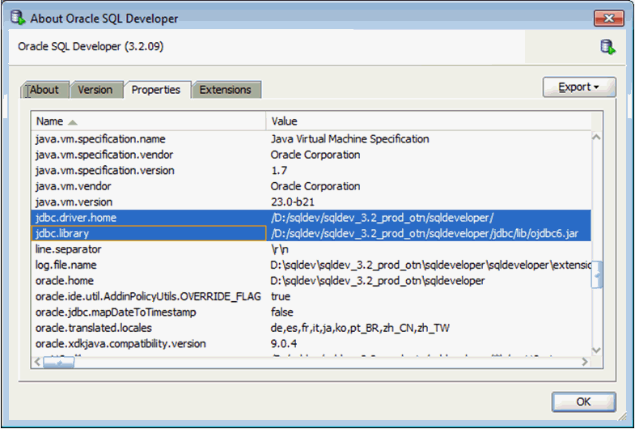
    [Description of "Figure 3-1 Checking JDBC Configuration for Oracle SQL Developer"](img_text/startsqldevwin.md)

#### Creating a Connection to Oracle Database

Create a connection to the Database with the credentials as shown in Figure 3-2:

Figure 3-2 Creating an Oracle Database Connection

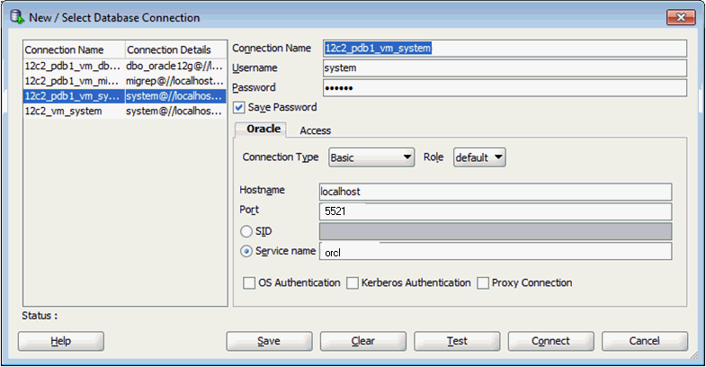
[Description of "Figure 3-2 Creating an Oracle Database Connection"](img_text/createconorcl.md)

You can use the following command to check the database you are connected to and the JDBC driver being used:

    show jdbc

##### Setting Up Migration Preferences

You must set up the migration preferences in the following way:

1.  Select Preferences from the Tools menu.
2.  Select Generation Options from Migration option on the left panel, as shown in Figure 3-3.

Figure 3-3 Setting Up Migration Preferences in Oracle SQL Developer

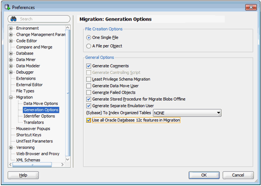
[Description of "Figure 3-3 Setting Up Migration Preferences in Oracle SQL Developer"](img_text/setuppref.md)

#### Testing SQL Translation

Perform the following steps to determine whether Sybase SQL Translator is properly installed or not:

1.  Open Oracle SQL Developer.
2.  From the Tools menu, select Migration, and then select Translation Scratch Editor.
    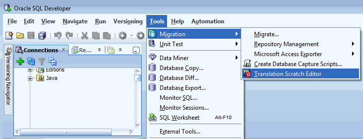
    [Description of the illustration sql_dev_01.gif](img_text/sql_dev_01.md)
3.  In the Scratch Editor toolbar, select Sybase T_SQL To PL/SQL option, which is the Sybase translator.
    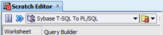
    [Description of the illustration sql_dev_02.gif](img_text/sql_dev_02.md)
4.  In the left panel of the Scratch Editor, enter the following query in Sybase SQL dialect:
        select top 10 * from dual
5.  Click the Translate icon.
    The translated query text is displayed in the right panel of the editor.

    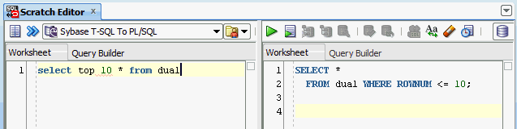
    [Description of the illustration sql_dev_03.gif](img_text/sql_dev_03.md)

#### Creating a Translation Profile and Installing SQL Translator

Oracle SQL Developer is installed with Oracle Database 12c. It loads Java classes of the Sybase Translator, approximately 15 MB, into Oracle Database. Due to the size and the number of Java classes loaded, Oracle recommends you to install the translator locally, and not over a WAN.

If the translator is installed under a user profile that has a pre-existing migration repository, the translator picks up the context of the database, such as name changes. Therefore, you must create a new user with the following specifications:

- `CONNECT`, `RESOURCE`, and `CREATE VIEW` privileges

- Access to storage in the `SYSTEM` and/or `USER` tablespace

##### Installing SQL Translator

To install SQL Translator:

1.  Log into the database using `ADMIN` privileges.
2.  At the command line, enter the following commands.
        GRANT CONNECT, RESOURCE, CREATE VIEW TO TranslUser identified by TranslUser;
        ALTER USER TranslUser QUOTA UNLIMITED ON SYSTEM;
3.  From the View menu, select DBA.
    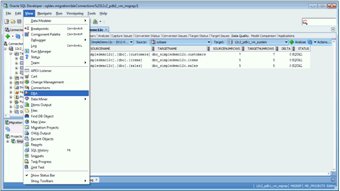
    [Description of the illustration sql_dev_04.gif](img_text/sql_dev_04.md)
4.  In the DBA Navigator, right-click Connections and select Add Connection.
    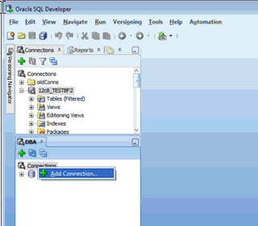
    [Description of the illustration sql_dev_05.gif](img_text/sql_dev_05.md)
5.  In the Select Connection box, select the connection if you want to use an existing connection. If you want to create a new connection, then add the information for `transluser` discussed in step 2.
    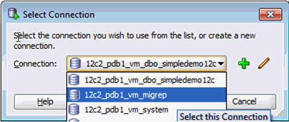
    [Description of the illustration sql_dev_06.gif](img_text/sql_dev_06.md)
6.  Click Connect.
7.  In the DBA navigator, right-click the connection created in the preceding steps, and select Install SQL Translator.
    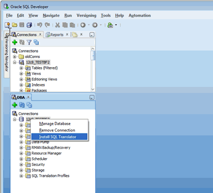
    [Description of the illustration sql_dev_07.gif](img_text/sql_dev_07.md)
    The Install SQL Translator dialog box opens.

    You must have special permissions to install the SQL Translator and create a SQL Translation Profile. You will be prompted to provide the `SYS` password, so that these privileges can be granted. Refer to "Granting Necessary Permissions for Installing the SQL Translator" for more information about these privileges.
8.  Create a SQL Translation Profile, following steps described in "Creating a Translation Profile ".
9.  Verify that the user has sufficient privileges to run the translation profile.
    You may have to login as `SYS` user to grant additional privileges.

    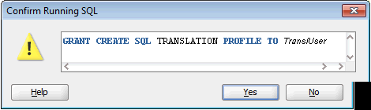
    [Description of the illustration sql_dev_09.gif](img_text/sql_dev_09.md)
10. Install SQL Translator.
    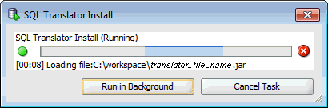
    [Description of the illustration sql_dev_10.gif](img_text/sql_dev_10.md)
11. To ensure that both the Profile and Translator are properly installed, verify whether the appropriate package and Java class files are present or not in the Connections pane.
    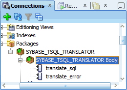
    [Description of the illustration sql_dev_11.gif](img_text/sql_dev_11.md)

##### Creating a Translation Profile

To create a translation profile:

1.  From the SQL Translator drop-down box, select Sybase or SQL Translator.
2.  Check Create New Profile.
3.  Enter `SYBASE_PROFILE` in Profile Name field.
4.  In Profile Schema, select the name of the user created in section "Creating a Translation Profile and Installing SQL Translator".
5.  Click Apply.

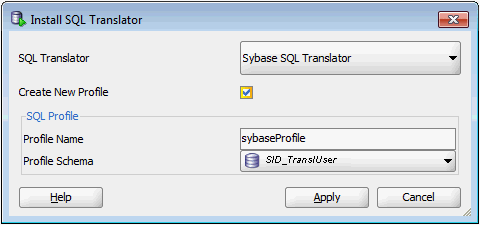
[Description of the illustration sql_dev_08.gif](img_text/sql_dev_08.md)

#### Using the SQL Translator Profile

To test the SQL Translation Profile, use SQL Worksheet:

1.  Right-click the `SYBASE_PROFILE` node.
2.  Select Open SQL Worksheet with Profile.
3.  Enter a T-SQL statement that you want to translate.
    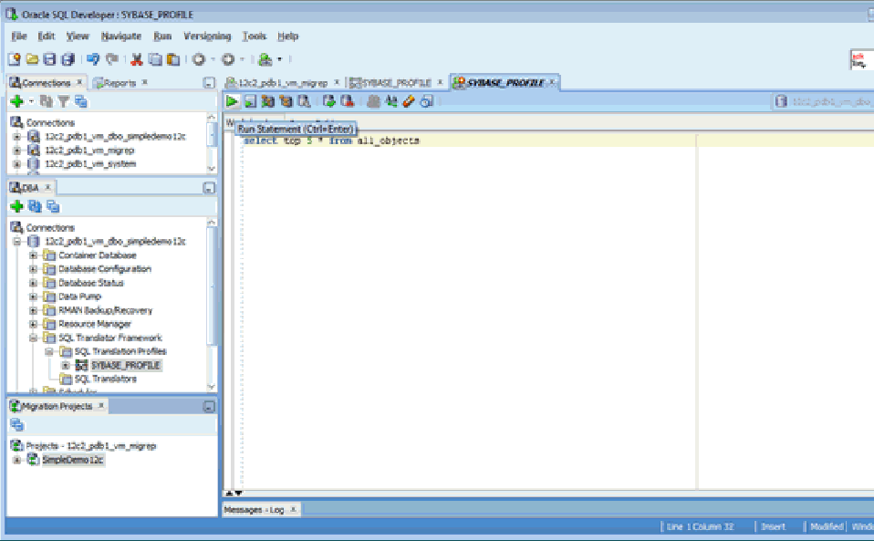
    [Description of the illustration sql_dev_17.gif](img_text/sql_dev_17.md)
4.  Click `SYBASE_PROFILE` and select the SQL Translation tab to inspect the profile and view the translated statement.
    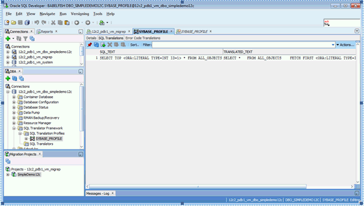
    [Description of the illustration sql_dev_14.gif](img_text/sql_dev_14.md)
    An alternative way to view the profile SQL in a better way when you double-click on it, the fingerprint and template open in a Translation Scratch Editor as shown in the following images:

    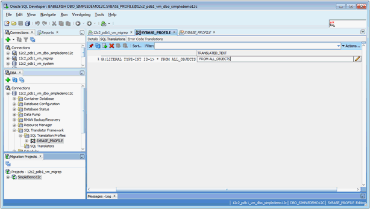
    [Description of the illustration sql_dev_15.gif](img_text/sql_dev_15.md)
    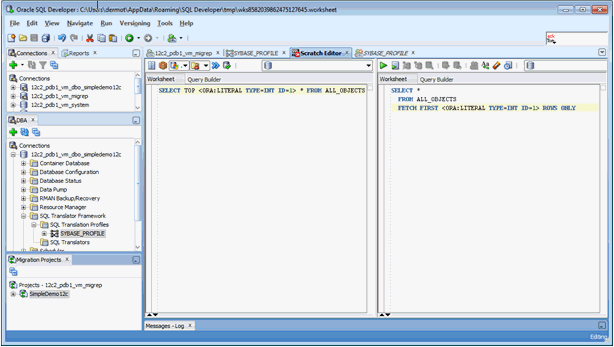
    [Description of the illustration sql_dev_16.gif](img_text/sql_dev_16.md)

### Installing and Configuring SQL Translation Framework from Command Line

There are several processes that you must complete to successfully install and configure the SQL Translation Framework from command line interface.

#### Installing Oracle Sybase Translator

To install Oracle Sybase Translator, Use Oracle SQL Developer as described in "Installing and Configuring SQL Translation Framework with Oracle SQL Developer".

#### Setting up a SQL Translation Profile

Perform the following steps to set up a SQL Translation Profile through a command-line interface:

1.  Login as a `system` user.
        > sqlplus system/<password>
2.  Grant create privileges to the standard user.
    This allows the standard user to create a SQL Translation Profile.

         SQL> grant create sql translation profile to <user>;
3.  Login as a standard user.
        sqlplus <user>/<password>
4.  Invoke the methods of `DBMS_SQL_TRANSLATOR` PL/SQL package to create and configure the translation profile.
        SQL> exec dbms_sql_translator.create_profile('sybase_profile')
        SQL> exec dbms_sql_translator.set_attribute('sybase_profile',
             dbms_sql_translator.attr_translator,
             'migration_repo.sybase_tsql_translator')
5.  Grant all privileges for the SQL Translation Profile to Oracle Sybase translation schema.
        SQL> grant all on sql translation profile sybase_profile to migration_repo;

#### Setting Up a Database Service to Use the SQL Translation Profile

This section describes how to add a database service in a standard environment and in an Oracle Real Application Clusters environment.

##### Setting Up a Database Service in a Standard Environment

To set up a database service in a standard environment:

1.  Login as a DBA
2.  Issue the following commands to use the `DBMS_SERVICE` PL/SQL package to create and invoke the database service:
        SQL> declare
          params dbms_service.svc_parameter_array;
        begin
          params('SQL_TRANSLATION_PROFILE') := 'user.sybase_profile';
          dbms_service.create_service('sybase_service', 'network_name', params);
          dbms_service.start_service('sybase_service');
        end;
        /

##### Setting Up a Database Service in Oracle Real Application Clusters

To set up a database service in Oracle Real Application Clusters:

1.   Add the database service:
        srvctl add service -db db_name -service sybase_service
        -sql_translation_profile user.sybase_profile

2.  Start the database service:
        srvctl start service -db db_name -service sybase_service

#### Testing Sybase SQL Translation Using the SQL Translation Profile

Perform the following steps to test the translation:

1.  Login as a standard user:
        sqlplus user/password
2.  Specify the SQL Translation Profile at the SQL prompt:
        SQL> alter session set sql_translation_profile = sybase_profile;
3.  Force the database to treat SQL\*Plus as a foreign SQL application:
        SQL> alter session set events = '10601 trace name context forever, level 32';
4.  Run a SQL query that uses Sybase SQL dialect. For example:
        select top 3 * from emp;
5.  The query returns the following results:
        EMPNO   ENAME    JOB        MGR   HIREDATE       SAL    COMM    DEPTNO
        ----------------------------------------------------------------------
        7369    SMITH     CLERK     7902  17-DEC-80      800                20
        7499    ALLEN     SALESMAN  7698  20-FEB-81     1600     300        30
        7521    WARD      SALESMAN  7698  22-FEB-81     1250     500        30

### Granting Necessary Permissions for Installing the SQL Translator

This section discusses the privileges that you must have to install the SQL Translator. The `SYBASE_PROFILE` created here has the following two users:

- `MIGREP`, where the translator is installed

- `TARGET_USER`, where the profile is installed

To grant privileges necessary for installing the SQL Translator:

1.  Connect as `SYS` to grant the required privileges:
        connect sys/oracle as sysdba
2.  Allow `MIGREP` to create a view and have access to unlimited quota:
        GRANT connect, resource, create view to MIGREP;
        ALTER USER MIGREP QUOTA UNLIMITED ON USERS;
3.  Allow `TARGET_USER` to create a view and have access to unlimited quota:
        GRANT connect, resource, create view to TARGET_USER;
        ALTER USER MIGREP QUOTA UNLIMITED ON TARGET_USER;
4.  Allow `MIGREP` to load a SQL Translator:
        BEGIN
          DBMS_JAVA.GRANT_PERMISSION(UPPER('MIGREP'), 'SYS:java.lang.RuntimePermission', 'getClassLoader', '');
        END;
        /
5.  Allow `TARGET_USER` to create profiles:
        GRANT CREATE SQL TRANSLATION PROFILE TO TARGET_USER;
6.  Allow `TARGET_USER` to explicitly alter the session to use a profile:
        GRANT ALTER SESSION TO TARGET_USER;

    This privilege is not granted in SQL Developer by default.
7.  Allow the translator to make reference to the profile:
        CONNECT TARGET_USER/TARGET_USER;
        GRANT ALL ON SQL TRANSLATION PROFILE SYBASE_PROFILE TO MIGREP;
8.  Allow the profile to make reference to the translator:
        CONNECT MIGREP/MIGREP;
        GRANT EXECUTE ON SYBASE_TSQL_TRANSLATOR TO TARGET_USER;
