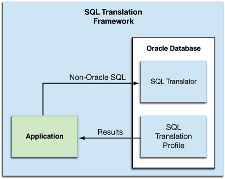

Various client-side applications, designed to work with non-Oracle Databases, cannot be used with Oracle Database without significant alterations. This is because SQL dialect varies among vendors of database technologies and different vendors use different syntaxes to express SQL queries and statements.

Starting with Oracle Database 12c, there is a new mechanism called SQL Translation Framework. It translates the SQL statements of a client program from a foreign (non-Oracle) SQL dialect into the SQL dialect used by the Oracle Database SQL compiler.

In addition to translating non-Oracle SQL statements, the SQL Translation Framework may be used to substitute an Oracle SQL statement with another Oracle statement to address a semantic or performance issue. In this way, you can address an application issue without patching the client application.

The SQL translation framework consists of two basic components: SQL Translator, and SQL Translation Profile.

### The SQL Translator

The SQL Translator is a software component, provided by Oracle or third-party vendors, which can be installed in Oracle Database. It translates the SQL statements of a client program before they are processed by the Oracle Database SQL compiler. If an error results from translated SQL statement execution, then Oracle Database SQL compiler generates an Oracle error message.

The SQL Translator automatically translates non-Oracle SQL to Oracle SQL, thereby enabling the existing client-side application code to run largely unchanged against an Oracle Database. This reduces the cost of migration to Oracle Database storage significantly. As a corollary, the translation feature may be used in other scenarios, where it may be expedient to intervene between the original SQL statement submitted by the client and its actual execution.

### The SQL Translation Profile

The SQL Translation Profile is a database object that contains the set of captured non-Oracle SQL statements, and their translations or translation errors. The SQL Translation Profile is used to review, approve, and modify translations. A profile is associated to a single translator. However, a translator can be used in one or more SQL Translation Profiles. Typically, there is one SQL Translation Profile per application, otherwise applications can share translated queries. You can export profiles among various databases.

The following figure illustrates the run-time overview the SQL Translation Framework.

Figure 2-1 SQL Translation Framework at Runtime

[Description of "Figure 2-1 SQL Translation Framework at Runtime"](img_text/drdaa_vm_001.md)

### Architecture of SQL Translation Framework

The key component of SQL Translation Framework is the SQL Translation Profile. The profile is a collection of non-Oracle statements that are processed through the translator. The application determines which profile to use when connecting to the Oracle Database. The translator handles the actual translation work.

In most cases, the non-Oracle SQL statements and errors are translated by a SQL Translator registered in the profile. The translator may be supplied by Oracle or by a third-party vendor. If the translator does not have a translation for a particular SQL statement or error, then you may register your own custom translation. You may also wish to register your own custom translation to override the default translator and to customize your translation results.

### How to Use SQL Translation Framework

Perform the following steps to use SQL Translation Framework:

1.  Install a SQL Translator, either from Oracle or a third-party vendor, in Oracle Database.
2.  Create a SQL Translation Profile and register the SQL Translator with the profile.
3.  Create a Database service and specify the SQL Translation Profile as a service attribute to which the application can connect.
    Note that setting the SQL Translation Profile at the service level ensures that everything running through that listener service is translated automatically.

    The translator can also be activated at connection level by using the `ALTER SESSION` statement or the `LOGON` triggers.
4.  Link the application with an Oracle driver to connect the application to Oracle Database. You must also change the connection settings to connect to the Database service with the SQL Translation Profile.
5.  Test all functionality of the application against Oracle Database. As the application runs, the SQL Translation Profile translates SQL statements of the application from the third-party SQL dialect to semantically-equivalent Oracle syntax and register them in the profile.
    If the translator does not have a translation for a particular SQL statement or error, then you may register your own translation to fill its place.
6.  Verify the custom translations and edit them, if required. Alternatively, register new ones to ensure that the application performs as intended, until testing is complete.
    Oracle recommends establishing a test environment and rigorously testing the application, ideally through a regression test suite.
7.  Set up the server-side application objects and data in the production Oracle Database for deployment to a production environment.
8.  Create a database service with the profile set as a service attribute and change the connection settings of the application, so that it connects to the database service in the production database. The application is expected to run as tested.

Oracle recommends that the application be monitored to guard against the possibility of errors due to unavailability of translation of any SQL statement. You must first disable the automatic translation of new and unseen SQL statements in the profile; when any such statement is encountered, it raises an error that is logged. In cases of alerts for mis-translation, you must make adjustments to the profile.

**See Also:**

- The new `DBMS_SQL_TRANSLATOR` PL/SQL package and updated `DBMS_SQL` and `DBMS_SERVICE` PL/SQL packages in the [Oracle Database PL/SQL Packages and Types Reference](../arpls/DBMS_SQL_TRANSLATOR.md).

- Updated `GRANT` and `REVOKE` statements and new system privileges in the [Oracle Database SQL Language Reference](../sqlrf/GRANT.md).

- [Oracle Database PL/SQL Packages and Types Reference](../arpls/DBMS_SQL_TRANSLATOR.md)

- [Oracle Database Administrator's Guide](../admin/configuring-automatic-restart-of-an-oracle-database.md)

### When to Use SQL Translation Framework

Use SQL Translation to migrate a client application that uses SQL statements with vendor-proprietary SQL syntax.

Currently, SQL Translators are available only for Sybase and SQL Server, and there is limited support for DB2.

SQL Translation Framework is designed for use with open API applications, such as ODBC or JDBC, and applications that use SQL statements that may be translated into semantically-equivalent Oracle syntax. These applications must relink to the Oracle ODBC or JDBC driver and then execute through the translation service.

Following are the possible scenarios for the connection mechanism:

- If the application uses ODBC, JDBC, OLE DB or .NET driver, or data provider to connect to the database, then the driver or data provider for Oracle must be replaced.

- If the application uses MySQL client library to connect to MySQL, then the library with Mysql Client Library Driver for Oracle must be replaced.

- No direct translator is available for DB2. For more information, refer to "[Migration Support for Other Database Vendors](intro-to-tools-and-products-supporting-migraiton.md)".

  If the application uses IBM DRDA network protocol to connect to DB2, then the database connection settings must be changed to connect to Oracle through DRDA Application Server for Oracle.

- If the application uses a vendor-proprietary C client API (the case of Sybase), then the API calls must be replaced with appropriate Oracle OCI APIs.
