Consider an example of migrating a Sybase JDBC Application, and the information contained in the migration reports: how it may be used to tune the migration for optimal results.

### Migrating a Sybase JDBC Application

Figure 5-1 illustrates how an application that is coded to query a Sybase database may use SQL Translation Framework to query information stored in Oracle Database instead.

Figure 5-1 Sybase Application Running Against Oracle Database

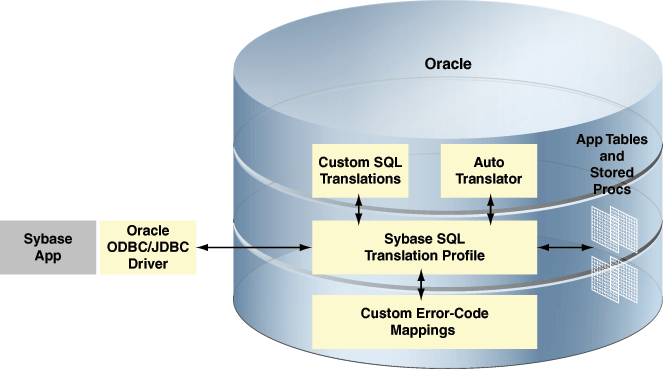
[Description of "Figure 5-1 Sybase Application Running Against Oracle Database"](img_text/sybase_migration.md)

#### Application Overview

The Sybase database used in this example has three tables and five procedures and includes the following features:

- `IDENTITY` columns

- `INSERT` statements into tables with `IDENTITY` columns

- `VARCHAR` columns with size greater than `4000` characters

- Multiple implicit result sets returned from procedures

A Java application connects to this Sybase database using JDBC.

#### Setting Up Migration

The migration process has four phases - Capture, Convert, Generate, and Data Move. It is best practice to complete each phase of the migration process, review any issues on the Summary page, and then continue to the next phase. The Migration Wizard enables you to complete each step in turn and then return back to the wizard to complete further steps. To do this, after completing each phase, select the Proceed to Summary Page check box and click Next.

Perform the following steps to set up migration:

1.  Download the JDBC driver JTDS 1.2.

2.  Add JTDS as a third-party JDBC driver as follows:

    1.  Select Preferences from the Tools menu.

    2.  Select Third Party JDBC Driver from the Database option on the right panel, as shown in Figure 5-2.

        Figure 5-2 Setting JTDS JDBC Driver

        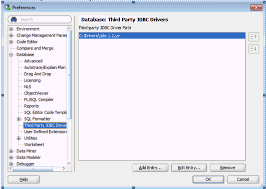

3.  Click Add Entry.

    The Select Path Entry box is displayed.

4.  Select the `jtds-1.2.jar` file and click Select.

5.  Click OK.

6.  Connect to the Oracle Database where you want to migrate the information.

7.  Verify that the connection is using Oracle Database 12c JDBC drivers, with the following command:

        show jdbc

8.  Create a new user `migrep` in Oracle database, for the migration repository, with the following command:

        GRANT CONNECT,RESOURCE,CREATE VIEW to migrep INDENTIFIED BY migrep;
        ALTER USER migrep QUOTA UNLIMITED to users;

9.  Connect to the database as the `migrep` user and associate the migration repository with the user, as shown in Figure 5-3.

    Figure 5-3 Associating a User with Migration Repository

    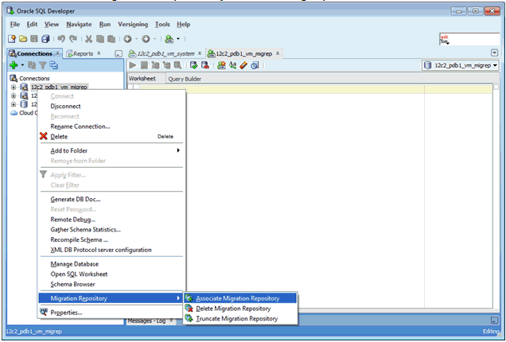

10. Create a connection to the Sybase database, in this example, `simpledemo12c`, as shown in Figure 5-4.

    Figure 5-4 Creating a Connection to the Sybase Database

    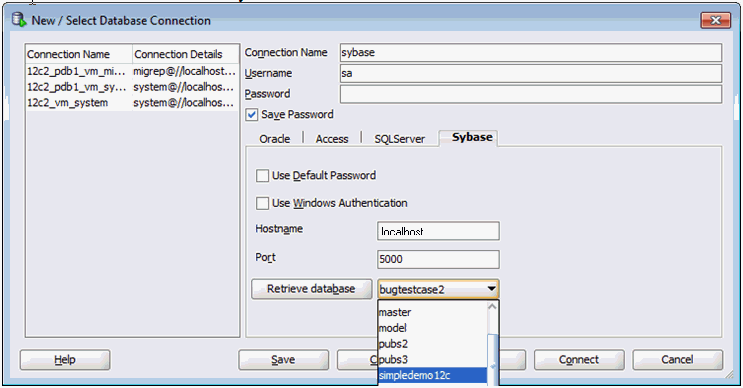

#### Capturing Migration

Perform the following steps to capture migration:

1.  Right-click on the `simpledemo12c Sybase` database and select the Migrate to Oracle option, as shown in Figure 5-5.
    Figure 5-5 Starting Capture Phase of Migration Process

    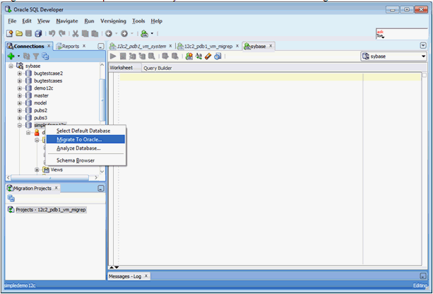
    This opens the Migration Wizard, as shown in Figure 5-6.

    Click Next.

    Figure 5-6 Migration Wizard Introduction Screen

    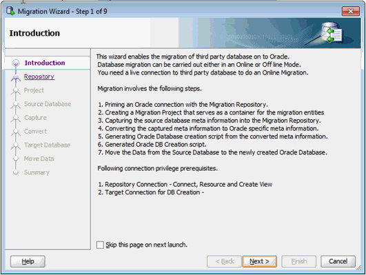
2.  Choose the Migration Repository, as shown in Figure 5-7.
    Click Next.

    Figure 5-7 Choosing the Migration Repository

    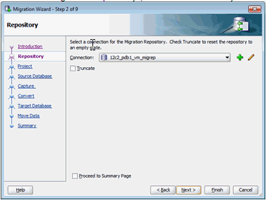
3.  Enter a project name and specify an output directory to place files, as shown in Figure 5-8.
    Click Next.

    Figure 5-8 Specifying Project Name and Output Directory

    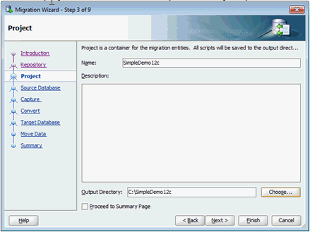
4.  Select the database connection and the mode, as shown in Figure 5-9.
    Click Next.

    Figure 5-9 Selecting the Database Connection and Mode

    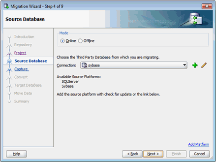
5.  Select the database, in this case, `simpledemo12c`, by moving it from Available Databases to Selected Databases, as shown in Figure 5-10.
    Click Proceed to Summary Page to review the Capture phase before moving to the next phase of the migration process.

    Click Next.

    Figure 5-10 Selecting the Database to be Migrated

    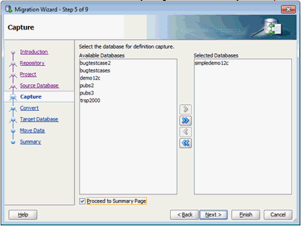

The capture phase saves a snapshot of the selected database at this point of time. Only the object definitions are captured, not the actual table data. This captured snapshot can be viewed in the Migration Projects navigator.

Note that the snapshot is not a connection to the database, and it only enables you to browse through the information saved in the Migration Repository.

#### Setting Migration Preferences

Before starting the conversion phase, you must set the migration preferences. Perform the following steps to achieve this:

1.  From the Tools menu, select Preferences, then Migration, and then Translators. Select the Generate Compound Triggers option.
    Figure 5-11 Setting Migration Preferences

    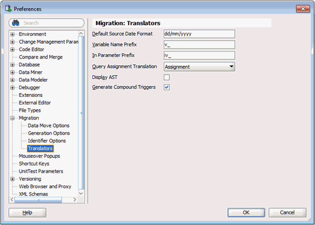
2.  From the Tools menu, select Preferences, then Migration, and then Generation Options. Select the Use all Oracle Database 12c features in Migration option.
    Figure 5-12 Setting Migration Preferences

    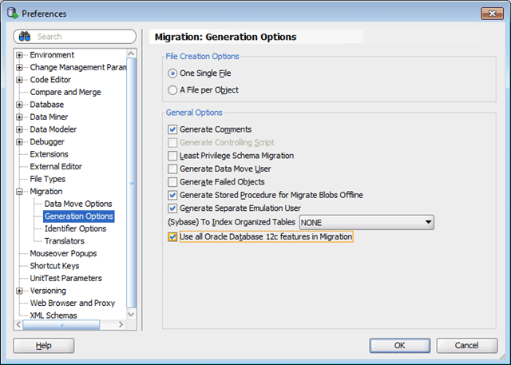

#### Converting Migration

Perform the following steps to start convert phase of the migration process:

1.  Right-click the Capture Model node and choose Convert, as shown in Figure 5-13.
    Figure 5-13 Starting Convert Phase of Migration Process

    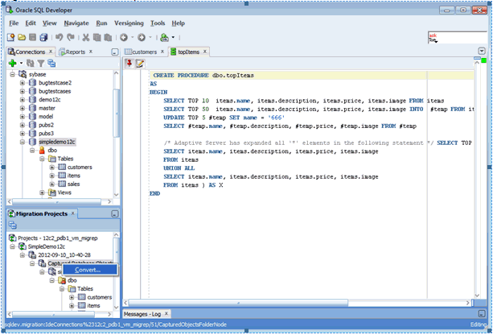
    The Migration Wizard is opened at the Convert phase, as shown in Figure 5-14.

    Figure 5-14 Converting the Migrated Data

    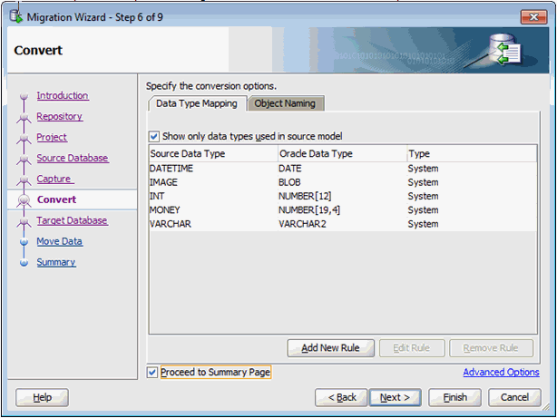
2.  Select Proceed to Summary Page and click Next.
3.  Click Finish.

During the convert phase, object names are resolved to valid Oracle names. Data types are converted to Oracle Database types and T-SQL defined objects like stored procedures, views, and so on are converted to Oracle PL/SQL. A converted model is created that can be browsed in the Migration Projects navigator. The converted procedures can be reviewed in the converted model.

Note that the converted model is not an actual Oracle database, but a prototype of an Oracle Database. The information is still stored only in the Migration Repository tables.

#### Generating a Migration

The migration generation phase creates the objects in the target Oracle Database. A script is created and it is run against a selected Oracle connection in the following two ways:

- In `offline` mode, the script is opened in a SQL Worksheet and you have to select the connection and run it manually.

- In `online` mode, you must provide the target connection in the wizard and the wizard runs the script automatically.

The following steps demonstrate how to perform the generate phase of the migration process in `offline` mode:

1.  Right-click on Converted Database Objects in the Migration Projects panel and select Generate Target.
2.  Select `offline` as the database mode in the Migration Wizard, as shown in Figure 5-15.
    Click Next.

    Figure 5-15 Selecting the Database Mode

    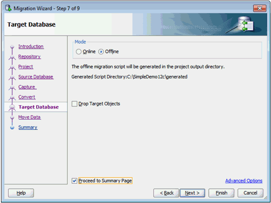
3.  Choose a connection in the target Oracle Database, as shown in Figure 5-16.
    Figure 5-16 Creating Oracle Database Connection for Target User dbo_simpledemo12c

    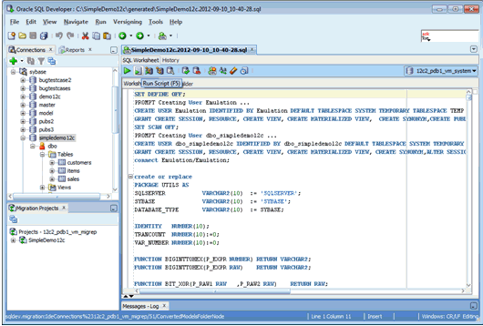
    The database objects are not created under the connection selected in this step. However, this connection must have enough privileges to create other users and objects.

##### Creating a Target Oracle User

Create a connection to the newly created user (described in step 3), as shown in Figure 5-17. At this point, the Sybase database objects are migrated to Oracle Database, but the data is not migrated till now.

Figure 5-17 Targeting an Oracle User

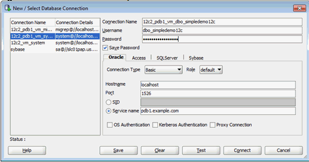
[Description of "Figure 5-17 Targeting an Oracle User"](img_text/migrwizscrn12.md)

#### Moving the Data

Perform the following steps to move the data to Oracle Database:

1.  Right-click the Converted Database Objects node and select Move Data, as shown in Figure 5-18.
    Click Next.

    Figure 5-18 Moving the Data from Sybase Database to Oracle Database

    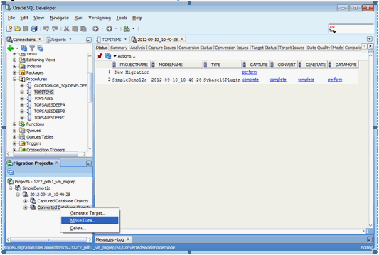
2.  Select `online` as the data move mode in the Move Data screen.
    You can select `offline` as the data move mode if the migration process involves large amount of data.
3.  Click Next. The Summary screen appears.
4.  Click Finish.
    You can browse the database objects to verify the data is moved to Oracle database.

    **See Also:**

    Oracle SQL Developer User's Guide

### Generating Migration Reports

Oracle SQL Developer provides a number of reports on the migration process to help identify tasks and issues to resolve. Click or double-click on the migrated project in the Migration Projects navigator. A report will appear on the right panel with a number of tabs and children reports, as shown in Figure 5-19.

Figure 5-19 Generating Migration Reports

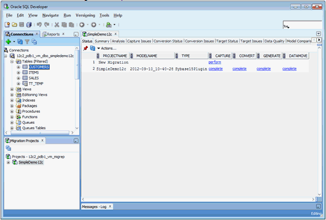

The Analysis report provides information about the size of the migrated database like the number of objects, line sizes, and so on, as shown in Figure 5-20.

Figure 5-20 Migration Analysis Report

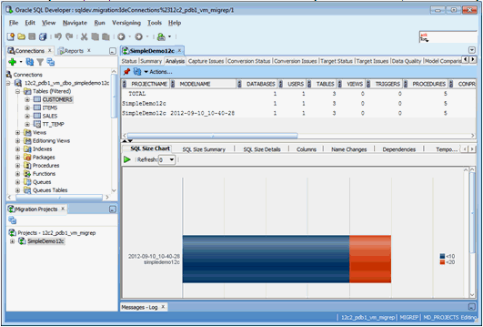

The Target Status report provides information about the status of the migrated objects in the Target database. First, select a target connection with enough privileges to view the status of other schema objects and then select refresh. Objects that are present in the converted model, but are missing from the target Oracle Database, are listed as missing. These objects can be either valid or invalid.

Figure 5-21 Target Status Report

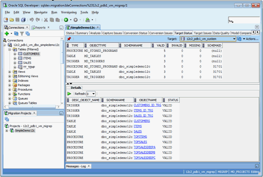

The Data Quality tab provides information about the number of rows in the target Oracle Database compared with the source database. Perform the following steps to compare the databases:

1.  Select a converted model, a source connection, and a target connection.
2.  Click Analyse.
3.  Click Refresh.
    This performs a `count(*)` function on each table in the source and the target database. So, it is advisable not to perform this operation on production data.
