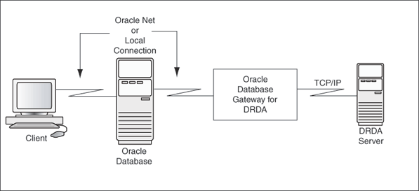

The following sections provide information about the architecture, uses, and features of the Oracle Database Gateway for DRDA:

- Overview ofthe Oracle Database Gateway for DRDA

- Gateway Capabilities

- Terms

- Architecture

- Implementation

- How the Gateway Works

- Oracle Tools and the Gateway

- Features

### Overview ofthe Oracle Database Gateway for DRDA

The Oracle Database Gateway for DRDA gives you access to your Oracle data and DB2 data with a single set of applications while you continue to use existing IBM applications to access your DB2 data. The gateway enables you to:

- Integrate heterogeneous database management systems so that they appear as a single homogeneous database system.

- Read and write data from Oracle applications to data in DB2 UDB for z/OS, DB2 Universal Database™ for iSeries™ (DB2 UDB for iSeries), and DB2 Universal Database.

Oracle Database 12c Release 2 (12.2) provides the foundation for the next generation of the Oracle Database Gateways, which delivers enhanced integration capabilities by exploiting Oracle Database Heterogeneous Services.

As an integrated component of the Oracle database, Heterogeneous Services can take advantage of the powerful SQL parsing and distributed optimization capabilities of the Oracle database. This integration also ensures that the gateway can immediately take advantage of any enhancements made to future releases of the Oracle database. For detailed information on Oracle Heterogeneous Services, refer to [Oracle Database Heterogeneous Connectivity User's Guide.](../heter/index.md)

The gateways are even more tightly integrated with Oracle Database 12c Release 2 (12.2) than previous versions, enabling improved performance and enhanced functionality while still providing transparent integration of Oracle and non-Oracle data. For example, connection initialization information is available in the local Oracle database, reducing the number of round trips and the amount of data sent over the network. SQL execution is also faster, because, statements issued by an application are parsed and translated once and can then be reused by multiple applications.

### Gateway Capabilities

Oracle Database Gateway for DRDA enables you to integrate your heterogeneous system into a single, seamless environment. If data is moved from a DRDA database to an Oracle database, then no changes in application design or function are needed. The gateway handles all differences in both data types and SQL functions between the application and the database. As a result, end users and application programmers are not required to know either the physical location or the storage characteristics of the data.

This transparency not only enables you to integrate heterogeneous data seamlessly, it also simplifies your gateway implementation, application development, and maintenance. The gateway capabilities are as follows:

- Transparency at All Levels

- Extended Database Services

- Extended Advanced Networking\_ Internet and Intranet Support

- Dynamic Dictionary Mapping

- SQL

- Data Definition Language

- Data Control Language

- Passthrough and Native DB2 SQL

- Stored Procedures

- Languages

- Oracle Database Technology and Tools

- SQL\*Plus

- Two-Phase Commit and Multi-Site Transactions

- Site Autonomy

- Migration and Coexistence

- Security

- DRDA UDB Server Encryption support

#### Transparency at All Levels

Oracle Database Gateway for DRDA gives you transparency at the following levels:

- Location

  Users can access tables by name and do not need to know the physical location of the tables.

- Network

  The gateway exploits the Oracle Net technology to allow users to access data across multiple networks without concern for the network architecture. TCP/IP protocol is supported. This release supports IPV4 and IPV6 between Oracle database and the gateway, and also between the gateway and the DB2 server.

- Operating System

  Users can access data stored under multiple operating systems without being aware of the operating systems that hold the data.

- Data Storage

  The gateway provides the ability for data to be accessed regardless of the database or file format.

- Access Method

  You can utilize a single dialect of SQL for any data store, eliminating the need to code for database-specific access methods or SQL implementations.

#### Extended Database Services

Following are some of the Oracle database services available through the gateway:

- SQL functions

  Your application can access all your data using Oracle SQL. The method by which the gateways are integrated with the Oracle database ensures that the latest features of each database release are always available immediately to the gateway.

- Distributed capabilities

  Heterogeneous data can be integrated seamlessly because Oracle distributed capabilities, such as `JOIN` and `UNION`, can be applied against non-Oracle data without any special programming or mapping.

- Distributed query optimization

  The Oracle database can utilize its advanced query optimization techniques to ensure that SQL statements are executed efficiently against any of your data. The data distribution and storage characteristics of local and remote data are equally considered.

- Two-phase commit protection

  The Oracle database two-phase commit mechanism provides consistency across data stores by ensuring that a transaction that spans data stores is still treated as a single unit of work. Changes are not committed (or permanently stored) in any data store unless the changes can be committed in all data stores that will be affected.

- Stored procedures and database triggers

  The same Oracle stored procedures and database triggers can be used to access all of your data, thereby ensuring uniform enforcement of your business rules across the enterprise.

#### Extended Advanced Networking, Internet and Intranet Support

The gateway integration with the Oracle database extends the benefits of the Oracle Internet and Oracle Net software to non-Oracle data and extends the benefits of the Oracle client/server and server/server connectivity software. These features include:

- Application server support

  Any Internet or intranet application that can access data in the Oracle database can also incorporate information from data stores accessible through the gateways. Web browsers can connect to the Oracle database using any application server product that supports Oracle software.

- Implicit protocol conversion

  Oracle and Oracle Net can work together as a protocol converter, allowing applications to transparently access other data stores on platforms that do not support the clients network protocol. An Oracle database can use TCP/IP to communicate with the gateway and another data store.

- Advanced Security

  Non-Oracle data can be protected from unauthorized access or tampering during transmission to the client. You can do this by using the hardware-independent and protocol-independent encryption and checksum services of Advanced Security.

- Wireless communication

  Oracle Mobile Agents, an Oracle industry-leading mobile technology, enables wireless communication to Oracle database or to any databases that are accessible through the gateways. This gives your field personnel direct access to enterprise data from mobile laptop computers.

#### Dynamic Dictionary Mapping

The simple setup of the gateway does not require any additional mapping. Before an application can access any information, the application must be told the structure of the data, such as the columns of a table and their lengths. Many products require administrators to manually define that information in a separate data dictionary stored in a hub. Applications then access the information using the hub dictionary instead of the native dictionaries of each database. This approach requires a great deal of manual configuration and maintenance on your part. As administrators, you must update the data dictionary in the hub whenever the structure of a remote table is changed.

Inefficient duplication is not necessary with Oracle Database Gateway for DRDA. The gateway uses the existing native dictionaries of each database. Your applications access data using the dictionaries designed specifically for each database, which means no redundant dictionary ever needs to be created or maintained.

#### SQL

Oracle Database Gateways ease your application development and maintenance by allowing you to access any data using a uniform set of SQL. Changes to the location, storage characteristics, or table structure do not require any changes to your applications. ANSI and ISO standard SQL are supported, along with powerful Oracle extensions.

#### Data Definition Language

Oracle Applications can create tables in target data stores by using native data definition language (DDL) statements.

#### Data Control Language

You can issue native data control language (DCL) statements from an Oracle environment, allowing central administration of user privileges and access levels for heterogeneous data stores.

#### Passthrough and Native DB2 SQL

Execution of native DB2 SQL can be passed through the gateway for execution directly against DB2. This enables applications to send statements, such as a DB2 `CREATE TABLE`, to the gateway for execution on a target DB2 system.

#### Stored Procedures

The gateway enables you to exploit both Oracle and non-Oracle stored procedures, leveraging your investments in a distributed, multi-database environment. Oracle stored procedures can access multiple data stores easily, without any special coding for heterogeneous data access.

##### Oracle Stored Procedures

Oracle stored procedures enable you to access and update DB2 data using centralized business rules stored in the Oracle database. Using Oracle stored procedures can increase your database performance by minimizing network traffic. Instead of sending individual SQL statements across the network, an application can send a single `EXECUTE` command to begin an entire PL/SQL routine.

##### Native DB2 Stored Procedures

The gateway can execute DB2 stored procedures using standard Oracle PL/SQL. The Oracle application executes the DB2 stored procedure as if it were an Oracle remote procedure.

#### Languages

Any application or tool that supports the Oracle database can access over thirty different data sources through the Oracle gateways. A wide variety of open system tools from Oracle Corporation and third-party vendors can be used, even if the data is stored in legacy, proprietary formats. Hundreds of tools are supported, including ad hoc query tools, Web browsers, turnkey applications, and application development tools.

#### Oracle Database Technology and Tools

The gateway is integrated into the Oracle database technology, which provides global query optimization, transaction coordination for multi-site transactions, and support for all Oracle Net configurations. Tools and applications that support the Oracle database can be used to access heterogeneous data through the gateway.

#### SQL\*Plus

You can use SQL\*Plus for moving data between databases. This product gives you the ability to copy data from your department databases to corporate Oracle database instances.

#### Two-Phase Commit and Multi-Site Transactions

The gateway can participate as a partner in multi-site transactions and two-phase commit. How this occurs depends on the capabilities of the underlying data source, meaning that the gateway can be implemented as any one of the following:

- Full two-phase commit partner

- Commit point site

- Single-site update partner

- Read-only partner

The deciding factors for the implementation of the gateway are the locking and transaction-handling capabilities of your target database.

Oracle Database Gateway for DRDA by default is configured as a commit point site, that is, commit confirm protocol. Optionally, you can configure the gateway as read-only if you choose to enforce read-only capability through the gateway. Other protocols are not supported.

#### Site Autonomy

All Oracle database products, including gateways, supply site autonomy. For example, administration of a data source remains the responsibility of the original system administrator. Site autonomy also functions such that gateway products do not override the security measures established by the data source or operating environment.

#### Migration and Coexistence

The integration of a data source through the gateway does not require any changes to be made to applications at the data source. The result is that the Oracle database technology is non-intrusive, providing coexistence and an easy migration path.

#### Security

The gateway does not bypass existing security mechanisms. Gateway security coexists with the security mechanisms already used in the operating environment of the data source.

Functionally, gateway security is identical to that of an Oracle database, as described in the [Oracle Database Security Guide](../dbseg/introduction-to-oracle-database-security.md). Oracle database security is mapped to the data dictionary of the data source.

#### DRDA UDB Server Encryption support

This release of Gateway for DRDA provides complete UDB server Encryption support. Refer to the following new parameters for various options:

- [HS_FDS_AUTHENTICATE_USER](database-gateway-drda-initialization-parameters.md)

- [HS_FDS_ENCRYPT_SESSION](database-gateway-drda-initialization-parameters.md)

- [HS_FDS_TRUSTSTORE_FILE](database-gateway-drda-initialization-parameters.md)

- [HS_FDS_TRUSTSTORE_PASSWORD](database-gateway-drda-initialization-parameters.md)

### Terms

The terms used in this guide do not necessarily conform to the IBM terminology. The following list presents several terms and their meanings as used within this guide:

DRDA data is, generically, any database data accessed through DRDA.

DRDA database is the collection of data that belongs to a DRDA server

DRDA server is a database server that can be accessed through DRDA. IBM terminology for a DRDA server is a DRDA Application Server, or AS.

DRDA server type is a specific database product or program that can act as a DRDA server.

Oracle database is any Oracle Database 12c Release 2 (12.2) instance that communicates with the Oracle Database Gateway for DRDA to distribute database access operations to a DRDA server. The Oracle database can also be used for non-gateway applications.

DB2 Universal Database is a generic name for all implementations of IBM's DB2 Database product. DB2/UDB is frequently used as an abbreviation for the DB2 Universal Database for Unix, Linux, and Windows product.

### Architecture

The Oracle Database Gateway for DRDA works with the Oracle database to shield most of the differences of the non-Oracle database from Oracle applications.

The architecture consists of the following main components:

- Client

  The client is an Oracle application or tool.

- Oracle database

  The gateway instance is accessed by an Oracle database with procedural and distributed options. Usually, the Oracle database is installed on the same host as the gateway, but this is not a requirement. The Oracle database and the gateway communicate in the normal Oracle database-to-server manner.

  If the Oracle database is not on the host where the gateway resides, then you must install the correct Oracle networking software on the platform where the server resides. For Oracle database, you must install Oracle Net on the Oracle database machine.

- Oracle Database Gateway for DRDA

  The gateway must be installed on hosts that are running the appropriate operating system.

  If the Oracle database is not on the same host, then you must also install Oracle Net so that the gateway and Oracle database can communicate.

- DRDA server

  The DRDA server must be on a system accessible to the host via a network.

Multiple Oracle databases can access the same gateway.

Figure 1-1 illustrates the gateway architecture.

Figure 1-1 The Gateway Architecture

[Description of "Figure 1-1 The Gateway Architecture"](img_text/ch01_01.md)

### Implementation

When the gateway is installed on your host, it has some of the same components as an Oracle database instance on your host. The gateway has the following components:

- A base file directory, similar to the one associated with an Oracle instance `ORACLE_HOME` environment variable

- A gateway system identifier (SID), comparable to an Oracle instance ` ORACLE_SID`

- Oracle Net to support communication between the Oracle database and the Oracle Database Gateway for DRDA

The gateway does not have:

- Control, redo log, or database files

- The full set of subdirectories and ancillary files that are associated with an installed Oracle database

Because the gateway does not have background processes and does not need a management utility, such as Oracle Enterprise Manager, you do not need to start the gateway product. Each Oracle database user session that accesses a particular gateway creates an independent process on the host. This process runs the gateway session and executes network operations to communicate with a DRDA server.

### How the Gateway Works

The gateway has no database functions of its own. Instead, it provides an interface by which an Oracle database can direct part or all of a SQL operation to a DRDA database.

The gateway that is supporting the DRDA server is identified to the Oracle database using a database link. The database link is the same construct that is used to identify other Oracle databases. Tables on the DRDA server are referenced in SQL as:

    table_name@dblink_name

or

    owner.table_name@dblink_name

If you create synonyms or views in the Oracle database, then you can refer to tables on the DRDA server by using simple names as though the table were local to the Oracle database.

When the Oracle database encounters a reference to a table that is on the DRDA server, the applicable portion of the SQL statement is sent to the gateway for processing. Any host variables that are associated with the SQL statement are bound to the gateway and, therefore, to the DRDA server.

The gateway is responsible for sending these SQL statements to the DRDA server for execution and for fielding and returning responses. The responses are either data or messages. Any conversions between Oracle data types and DRDA data types are performed by the gateway. Both the Oracle database and the application read and process only Oracle data types.

#### SQL Differences

Not all SQL implementations are the same. The Oracle database supports a larger set of built-in functions than the databases that are currently accessed through the gateway. The Oracle database and the gateway work together to convert SQL to a form that is compatible with the specific DRDA server.

During this conversion, an Oracle database function can be converted to a function that is recognizable to the specific DRDA server. For example, the Oracle database `NVL` function is converted to the DB2 `VALUE` function.

Alternatively, the Oracle database withholds functions that are not executable by the DRDA server and performs them after rows are fetched from the DRDA database. This processing only applies to `SELECT` statements. The Oracle database and the gateway cannot perform this kind of manipulation on `UPDATE`, `INSERT`, or `DELETE` statements because doing so changes transaction semantics.

### Oracle Tools and the Gateway

Use the Oracle Database Gateway to run applications, such as Oracle database tools, that read and write data that is stored in DRDA databases.

While the Oracle Database Gateway for DRDA provides no new application or development facilities, it extends the reach of existing Oracle database tools to include data in non-Oracle databases that support DRDA.

Using the Oracle Database Gateway for DRDA with other Oracle products can greatly extend the capabilities of the stand-alone gateway.

#### SQL\*Plus

Use SQL\*Plus and the Oracle Database Gateway for DRDA to create a distributed database system, providing an easy-to-use transfer facility for moving data between the distributed databases. One possible use is to distribute the data in your corporate Oracle database to departmental DRDA databases. You can also distribute data in your corporate DRDA database to departmental Oracle databases.

### Features

Following is a list of important features that characterize Oracle Database Gateway for DRDA:

- Heterogeneous Services Architecture

- Performance Enhancements

- Fetch Reblocking

- Oracle Database Passthrough Supported

- Retrieving Result Sets Through Passthrough

- Support for TCP/IP

- Native Semantics

- Columns Supported in a Result Set

- EXPLAIN_PLAN Improvement

- Heterogeneous Database Integration

- Minimum Impact on Existing Systems

- Application Portability

- Remote Data Access

- Support for Distributed Applications

- Application Development and End User Tools

- Password Encryption Utility

- Support for DB2 UDB for z/OS Stored Procedures

- IBM DB2 Universal Database Support

- DB2 z/OS ASCII and UNICODE Table Support

- Read-Only Support

- Support for Graphic and Multi-byte Data

- Support for DB2 Universal Database on Intel Hardware

- Data Dictionary Support for DB2 Universal Database

#### Heterogeneous Services Architecture

Oracle Database Gateway for DRDA utilizes the Oracle Heterogeneous Services component within the Oracle database. Heterogeneous Services is the building block for the next generation of Oracle database gateways.

For detailed information about heterogeneous services, refer to [Oracle Database Heterogeneous Connectivity User's Guide](../heter/index.md).

#### Performance Enhancements

Oracle Database Gateway for DRDA contains several internal performance enhancements. This product has shown major improvements in response time and CPU utilization for all relevant address spaces for a variety of workloads compared to version 10 gateways. The actual performance improvement at your site might vary, depending on your installation type and workload.

#### Fetch Reblocking

The array size of the application for `SELECT` is effective between the application and the Oracle database. However, the array blocksize and the block fetch between the Oracle database and the gateway are controlled by two Heterogeneous Services initialization parameters: `HS_RPC_FETCH_SIZE` and `HS_RPC_FETCH_REBLOCKING`. These parameters are specified in the gateway initialization file. Refer to [Oracle Database Heterogeneous Connectivity User's Guide](../heter/initialization-parameters.md) for more information.

#### Oracle Database Passthrough Supported

You can use the Oracle database `DBMS_HS_PASSTHROUGH.EXECUTE_IMMEDIATE` method to pass commands or statements available in your DRDA server through the gateway.

#### Retrieving Result Sets Through Passthrough

Oracle Database Gateway for DRDA provides a facility to retrieve result sets from a `SELECT` statement issued with passthrough. Refer to "[Retrieving Results Sets Through Passthrough](developing-applications.md)" for additional information.

#### Support for TCP/IP

This release of the gateway only supports the TCP/IP communication protocol between the gateway and the DRDA server. Refer to [Oracle Database Gateway Installation and Configuration Guide for IBM AIX on POWER Systems (64-Bit), Linux x86-64, Oracle Solaris on SPARC (64-Bit), Oracle Solaris on x86-64 (64-Bit) and HP-UX Itanium](../otgis/config-drda-gateway.md), or [Oracle Database Gateway Installation and Configuration Guide for Microsoft Windows](../otgiw/config-gateway-drda.md) depending on your platform.

#### Native Semantics

This release of the gateway supports the ability to selectively enable or disable post-processing of various SQL functions by the DRDA server. Refer to "[Native Semantics](developing-applications.md)" for further information.

#### Columns Supported in a Result Set

Oracle Database Gateway for DRDA supports up to 1000 columns in a result set.

#### EXPLAIN_PLAN Improvement

The `EXPLAIN_PLAN` table contains the actual SQL statements passed to the DRDA server from the Oracle database through the gateway.

#### Heterogeneous Database Integration

The gateway support for ANSI-standard SQL enables read/write access to DRDA databases. Even if your data exists on different platforms in different applications, new applications can use all data, regardless of location.

#### Minimum Impact on Existing Systems

The gateway does not require installation of additional Oracle software on your OS/390 (MVS), AS/400, UNIX based, or Microsoft Windows target system. The database interface that it uses is provided by IBM and is built into the DRDA database products and network facilities that already exist on these platforms.

Configuring an IBM system for DRDA access typically consists of defining the network resources involved and establishing access security definitions specific to the target database.

#### Application Portability

The gateway's ability to interface with heterogeneous databases makes it possible to develop a single set of portable applications that can be used against both Oracle and IBM databases, and any other databases for which Oracle provides gateways.

#### Remote Data Access

Location flexibility is maximized because the gateway architecture permits network connections between each of the components. The application can use the Oracle client-server capability to connect to a remote Oracle database through Oracle Net. The Oracle database can connect to a remote gateway using a database link. The gateway connects to a DRDA server through network facilities.

The benefits of remote access are:

- Provides a means to allocate the appropriate resource to a given task

  You can, for example, move application development off expensive processors and onto cost-efficient workstations or microcomputers.

- Expands the number of available data sources

  Without remote access, you are limited to the data available in the local environment. With remote access, only your networks limit your data sources.

- Provides a means to tailor an application environment to a given user

  For example, some users prefer a block-mode terminal environment, while others prefer a bit-mapped, graphics driven terminal environment. Remote access can satisfy both because you are not constrained by the interface environment imposed by the location of your data.

#### Support for Distributed Applications

Because the gateway gives your application direct access to DRDA data, you eliminate the need to upload and download large quantities of database data to other processors. Instead, you can access data where it is, when you want it, without having to move the data between machines and risk unsynchronized and inconsistent data. Avoiding massive data replication can also reduce aggregate disk storage requirements over all your systems.

However, if your system design requires moving data among the machines in a network, SQL\*Plus and the gateway can simplify the data transfer. With a single SQL\*Plus command, you can move entire sets of data from one node of the network to another and from one database to another.

You can pass commands and statements specific to your DRDA database through the gateway to be executed by the DRDA database. For example, you can pass native DB2 SQL through the gateway for DB2 to execute. You can also execute stored procedures defined in non-Oracle databases.

#### Application Development and End User Tools

Through the gateway, Oracle extends the range of application development and end-user tools you can use to access your IBM databases. These tools increase application development and user productivity by reducing prototype, development, and maintenance time. Current Oracle database users do not have to learn a new set of tools to access data stored in DRDA databases. Instead, they can access Oracle database and DRDA data with a single set of tools.

With the gateway and the application development tools available from Oracle you can develop a single set of applications to access Oracle database and DRDA data. Users can use the decision support tools available from Oracle to access Oracle database and DRDA data. These tools can run on remote machines connected through Oracle Net to the Oracle database.

When designing applications, keep in mind that the gateway is designed for retrieval and relatively light transaction loads. The gateway is not currently designed to be a heavy transaction processing system.

#### Password Encryption Utility

Oracle Database Gateway for DRDA includes a utility to support encryption of plain-text passwords in the Gateway Initialization File. Refer to Chapter 15, "Security Considerations" in [Oracle Database Gateway Installation and Configuration Guide for IBM AIX on POWER Systems (64-Bit), Linux x86-64, Oracle Solaris on SPARC (64-Bit), Oracle Solaris on x86-64 (64-Bit) and HP-UX Itanium](../otgis/drda-gateway-security-consideration.md) or [Oracle Database Gateway Installation and Configuration Guide for Microsoft Windows](../otgiw/security-consideration-drda-gateway.md) for details.

#### Support for DB2 UDB for z/OS Stored Procedures

Oracle Database Gateway for DRDA supports the native stored procedures.

#### IBM DB2 Universal Database Support

Oracle Database Gateway for DRDA supports IBM DB2 Universal Database.

#### DB2 z/OS ASCII and UNICODE Table Support

Oracle Database Gateway for DRDA supports EBCDIC, ASCII, and UNICODE table for DB2 z/OS. The character set selection is defined during table creation.

#### Read-Only Support

The current release enables the gateway to be configured as a read-only gateway. In this mode, the user will not be able to modify data or call remote procedures at the DRDA database.

#### Support for Graphic and Multi-byte Data

The current release of the gateway adds support for DB2 `GRAPHIC` and `VARGRAPHIC` data types. Refer to [Developing Applications](developing-applications.md) for more information.

#### Support for DB2 Universal Database on Intel Hardware

The current release of the gateway adds support for DRDA servers running on Microsoft Windows and Linux on Intel hardware.

#### Data Dictionary Support for DB2 Universal Database

The current release of the gateway also provides Oracle data dictionary support for DB2 UDB.
