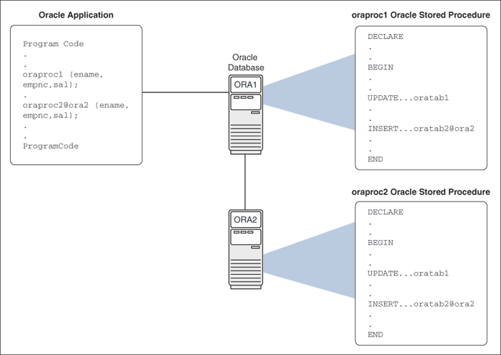
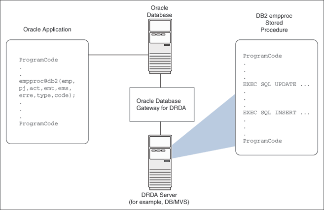

The following sections provide information that is specific to the Oracle Database Gateway for DRDA.

- Gateway Appearance to Application Programs

- Using Oracle Stored Procedures with the Gateway

- Using DRDA Server Stored Procedures with the Gateway

- Database Link Behavior

- Oracle Database SQL Construct Processing

- Native Semantics

- DRDA Data type to Oracle Data type Conversion

- Passing Native SQL Statements through the Gateway

- Oracle Data Dictionary Emulation on a DRDA Server

### Gateway Appearance to Application Programs

An application that is written to access information in a DRDA database interfaces with an Oracle database. When developing applications, keep the following information in mind:

- You must define the DRDA database to the application by using a database link that is defined in the Oracle database. Your application should specify tables that exist on a DRDA database by using the name that is defined in the database link. For example, assume that a database link is defined so that it names the DRDA database link `DRDA`, and also assume that an application needs to retrieve data from an Oracle database and from the DRDA database. Use the following SQL statement joining two tables together in your application:

      SELECT EMPNO, SALARY
      FROM EMP L, EMPS@DRDA R
      WHERE L.EMPNO = R.EMPNO

  In this example, `EMP`` `is a table on an Oracle database, and `EMPS` is a table on a DRDA server. You can also define a synonym or a view on the DRDA server table, and access the information without the database link suffix.

- You can read and write data to a defined DRDA database. `SELECT`, `INSERT`, `UPDATE`, and `DELETE` are all valid operations.

- A single transaction can write to one DRDA database and to multiple Oracle databases.

- Single SQL statements, using `JOIN`s, can refer to tables in multiple Oracle databases, in multiple DRDA databases, or in both.

#### Fetch Reblocking

Oracle database supports fetch reblocking with the `HS_RPC_FETCH_REBLOCKING` parameter.

When the value of this parameter is set to `ON` (the default), the array size for `SELECT` statements is determined by the `HS_RPC_FETCH_SIZE` value. The `HS_RPC_FETCH_SIZE` parameter defines the number of bytes sent with each buffer from the gateway to the Oracle database. The buffer may contain one or more qualified rows from the DRDA server. This feature can provide significant performance enhancements, depending on your application design, installation type, and workload.

The array size between the client and the Oracle database is determined by the Oracle application. Refer to [Oracle Database Gateway Installation and Configuration Guide for IBM AIX on POWER Systems (64-Bit), Linux x86-64, Oracle Solaris on SPARC (64-Bit), Oracle Solaris on x86-64 (64-Bit) and HP-UX Itanium](../otgis/config-drda-gateway.md) or [Oracle Database Gateway Installation and Configuration Guide for Microsoft Windows](../otgiw/config-gateway-drda.md) , depending on your platform, for more information.

### Using Oracle Stored Procedures with the Gateway

The gateway stored procedure support is an extension of Oracle stored procedures. An Oracle stored procedure is a schema object that logically groups together a set of SQL and other PL/SQL programming language statements to perform a specific task. Oracle stored procedures are stored in the database for continued use. Applications use standard Oracle PL/SQL to call stored procedures.

Oracle stored procedures can be located in a local instance of Oracle database and in a remote instance. Figure 4-1 illustrates two stored procedures:` oraproc1 `is a procedure stored in the `ORA1 `Oracle instance, and` oraproc2 `is a procedure stored in the `ORA2` Oracle instance.

Figure 4-1 Calling Oracle Stored Procedures in a Distributed Oracle Environment

[Description of "Figure 4-1 Calling Oracle Stored Procedures in a Distributed Oracle Environment "](img_text/ch14_01.md)

To maintain location transparency in the application, a synonym can be created:

    CREATE SYNONYM oraproc2 FOR oraproc2@ora2;

After this synonym is created, the application no longer needs to use the database link specification to call the stored procedure in the remote Oracle instance.

In Figure 4-1, the second statement in `oraproc1` is used to access a table in the `ORA2` instance. In the same way, Oracle stored procedures can be used to access DB2 tables through the gateway.

### Using DRDA Server Stored Procedures with the Gateway

The procedural feature of the gateway enables invocation of native DRDA server stored procedures. After the stored procedure is defined to the DRDA server, the gateway is able to use the existing DRDA server definition to run the procedure. The gateway does not require special definitions to call the DB2 stored procedure. Standard Oracle PL/SQL is used by the Oracle application to run the stored procedure.

In Figure 4-2, an Oracle application calls the` empproc `stored procedure that is defined to the DRDA server (for example, DB2 UDB for z/OS).

Figure 4-2 Running DRDA Server Stored Procedures

[Description of "Figure 4-2 Running DRDA Server Stored Procedures"](img_text/ch14_02.md)

From the perspective of the application, running the DB2 stored procedure is no different from invoking a stored procedure at a remote Oracle database instance.

#### Oracle Application and DRDA Server Stored Procedure Completion

For an Oracle application to call a DB2 stored procedure, it is first necessary to create the DB2 stored procedure on the DB2 system by using the procedures documented in the IBM reference document for DB2 SQL.

After the stored procedure is defined in DB2, the gateway is able to access the data using a standard PL/SQL call. For example, an employee name, `John Smythe`, is passed to the DB2 stored procedure `REVISE_SALARY`. The DB2 stored procedure retrieves the salary value from the DB2 database in order to calculate a new yearly salary for `John Smythe`. The revised salary that is returned as result is used to update the `EMP` table of Oracle database:

    DECLARE
      INPUT VARCHAR2(15);
      RESULT NUMBER(8,2);
    BEGIN
      INPUT := ‘JOHN SMYTHE';
      REVISE_SALARY@DB2(INPUT, RESULT);
      UPDATE EMP SET SAL = RESULT WHERE ENAME = INPUT;
    END;

When the gateway receives a call to run a stored procedure on the DRDA server, it first does a lookup of the procedure name in the server catalog. The information that defines a stored procedure is stored in different forms on each DRDA server. For example, DB2 UDB for iSeries uses the tables `QSYS2.SYSPROCS` and `QSYS2.SYSPARMS`. The gateway has a list of known catalogs to search, depending on the DRDA server that is being accessed.

The search order of the catalogs is dependent on whether the catalogs support Location designators (such as `LUNAME` in `SYSIBM.SYSPROCEDURES`), and authorization or owner IDs (such as `AUTHID` in `SYSIBM.SYSPROCEDURES` or `OWNER` in `SYSIBM.SYSROUTINES`).

Some DRDA servers allow blank or public authorization qualifiers. If the DRDA server that is currently connected supports this form of qualification, then the gateway will apply those naming rules when searching for a procedure name in the catalog.

The matching rules will first search for a public definition, and then an owner qualified procedure name. For more detailed information, refer to the IBM reference document for DB2 SQL.

#### Procedural Feature Considerations with DB2

The following are special considerations for using the procedural feature with the gateway:

- PL/SQL records cannot be passed as parameters when invoking a DB2 stored procedure.

- The gateway supports the `GENERAL` and `DB2SQL` linkage conventions of DB2 stored procedures. Both linkage conventions require that the parameters that are passed to and from the DB2 stored procedure cannot be null.

#### Result Sets and Stored Procedures

The Oracle Database Gateway for DRDA provides support for stored procedures that return result sets. By default, all stored procedures and functions do not return a result set to the user. To enable result sets, set the `HS_FDS_RESULTSET_SUPPORT` parameter in the initialization parameter file.

**See Also:**

[Initialization Parameters](database-gateway-drda-initialization-parameters.md) for information about editing the initialization parameter file and the `HS_FDS_RESULTSET_SUPPORT` parameter. For further information about Oracle support for result sets in non-Oracle databases see [Oracle Database Heterogeneous Connectivity User's Guide](../heter/using-heterogeneous-services-agents.md).

**Note:**

If you set the `HS_FDS_RESULTSET_SUPPORT` gateway initialization parameter, you must change the syntax of the procedure execute statement for all existing stored procedures or errors will occur.

When accessing stored procedures with result sets through the Oracle Database Gateway for DRDA, you will be in the sequential mode of Heterogeneous Services. The gateway returns the following information to Heterogeneous Services during procedure description:

- All the input arguments of the remote stored procedure

- None of the output arguments

- One out argument of type ref cursor (corresponding to the first result set returned by the stored procedure)

Client programs have to use the virtual package function `DBMS_HS_RESULT_SET.GET_NEXT_RESULT_SET` to get the ref cursor for subsequent result sets. The last result set returned is the out argument from the procedure.

The limitations of accessing result sets are as follows:

- Result sets returned by a remote stored procedure have to be retrieved in the order in which they were placed on the wire.

- On execution of a stored procedure, all result sets returned by a previously executed stored procedure will be closed, regardless of whether the data has been completely retrieved or not.

In the following example, the UDB stored procedure is executed to fetch the contents of the `EMP` and `DEPT` tables from UDB:

    CREATE PROCEDURE REFCURPROC (IN STRIN VARCHAR(255), OUT STROUT VARCHAR(255) )
      RESULT SETS 3  LANGUAGE SQL
    BEGIN
      DECLARE TEMP CHAR (20);
     DECLARE C1 CURSOR WITH RETURN TO CALLER FOR
          SELECT * FROM TKHOEMP;
      DECLARE C2 CURSOR WITH RETURN TO CALLER FOR
         SELECT * FROM TKHODEPT;
     OPEN C1;
     OPEN C2;
     SET STROUT = STRIN;
     END

##### OCI Program Fetching from Result Sets in Sequential Mode

The following example shows OCI program fetching from result sets in sequential mode:

    OCIEnv *ENVH;
    OCISvcCtx *SVCH;
    OCIStmt *STMH;
    OCIError *ERRH;
    OCIBind *BNDH[3];
    OraText arg1[20];
    OraText arg2[255];
    OCIResult *rset;
    OCIStmt *rstmt;
    ub2 rcode[3];
    ub2 rlens[3];
    sb2 inds[3];
    OraText *stmt = (OraText *) "begin refcurproc@UDB(:1,:2,:3); end;";
    OraText *n_rs_stm = (OraText *)
      "begin :ret := DBMS_HS_RESULT_SET.GET_NEXT_RESULT_SET@UDB; end;";

    /* Prepare procedure call statement */

    /* Handle Initialization code skipped */
    OCIStmtPrepare(STMH, ERRH, stmt, strlen(stmt), OCI_NTV_SYNTAX, OCI_DEFAULT);

    /* Bind procedure arguments */
    inds[0] = 0;
    strcpy((char *) arg1, "Hello World");
    rlens[0] = strlen(arg1);
    OCIBindByPos(STMH, &BNDH[0], ERRH, 1, (dvoid *) arg1, 20, SQLT_CHR,
                 (dvoid *) &(inds[0]), &(rlens[0]), &(rcode[0]), 0, (ub4 *) 0,
                 OCI_DEFAULT);

    inds[1] = -1;
    OCIBindByPos(STMH, &BNDH[1], ERRH, 1, (dvoid *) arg2, 20, SQLT_CHR,
                 (dvoid *) &(inds[1]), &(rlens[1]), &(rcode[1]), 0, (ub4 *) 0,
                 OCI_DEFAULT);

    inds[2] = 0;
    rlens[2] = 0;
    OCIDescriptorAlloc(ENVH, (dvoid **) &rset, OCI_DTYPE_RSET, 0, (dvoid **) 0);
    OCIBindByPos(STMH, &BNDH[2], ERRH, 2, (dvoid *) rset, 0, SQLT_RSET,
                 (dvoid *) &(inds[2]), &(rlens[2]), &(rcode[2]),
                 0, (ub4 *) 0, OCI_DEFAULT);

    /* Execute procedure */
    OCIStmtExecute(SVCH, STMH, ERRH, 1, 0, (CONST OCISnapshot *) 0,
                   (OCISnapshot *) 0, OCI_DEFAULT);

    /* Convert result set to statement handle */
    OCIResultSetToStmt(rset, ERRH);
    rstmt = (OCIStmt *) rset;

    /* After this the user can fetch from rstmt */
    /* Issue get_next_result_set call to get handle to next_result set */
    /* Prepare Get next result set procedure call */

    OCIStmtPrepare(STMH, ERRH, n_rs_stm, strlen(n_rs_stm), OCI_NTV_SYNTAX,
                   OCI_DEFAULT);

    /* Bind return value */
    OCIBindByPos(STMH, &BNDH[1], ERRH, 1, (dvoid *) rset, 0, SQLT_RSET,
                 (dvoid *) &(inds[1]), &(rlens[1]), &(rcode[1]),
                 0, (ub4 *) 0, OCI_DEFAULT);

    /* Execute statement to get next result set*/
    OCIStmtExecute(SVCH, STMH, ERRH, 1, 0, (CONST OCISnapshot *) 0,
                   (OCISnapshot *) 0, OCI_DEFAULT);

    /* Convert next result set to statement handle */
    OCIResultSetToStmt(rset, ERRH);
    rstmt = (OCIStmt *) rset;

    /* Now rstmt will point to the second result set returned by the
    remote stored procedure */

    /* Repeat execution of get_next_result_set to get the output arguments */

##### PL/SQL Program Fetching from Result Sets in Sequential Mode

Assume that the table `LOC_EMP` is a local table exactly like the UDB EMP table. The same assumption applies for `LOC_DEPT`. `OUTARGS` is a table with columns corresponding to the out arguments of the SQL Server stored procedure.

    create or replace package rcpackage is  type RCTYPE is ref cursor;end rcpackage;/
    declare
      rc1 rcpackage.rctype;
      rec1 loc_emp%rowtype;
      rc2 rcpackage.rctype;
      rec2 loc_dept%rowtype;
      rc3 rcpackage.rctype;
      rec3 outargs%rowtype;
      out_arg varchar2(255);

    begin

      -- Execute procedure
      out_arg := null;
      refcurproc@UDB('Hello World', out_arg, rc1);

      -- Fetch 20 rows from the remote emp table and insert them into loc_emp
      for i in 1 .. 20 loop
        fetch rc1 into rec1;
        insert into loc_emp (rec1.empno, rec1.ename, rec1.job,
        rec1.mgr, rec1.hiredate, rec1.sal, rec1.comm, rec1.deptno);
      end loop;

      -- Close ref cursor
      close rc1;

      -- Get the next result set returned by the stored procedure
      rc2 := dbms_hs_result_set.get_next_result_set@UDB;

      -- Fetch 5 rows from the remote dept table and insert them into loc_dept
      for i in 1 .. 5 loop
        fetch rc2 into rec2;
        insert into loc_dept values (rec2.deptno, rec2.dname, rec2.loc);
      end loop;

      --Close ref cursor
      close rc2;

      -- Get the output arguments from the remote stored procedure
      -- Since we are in sequential mode, they will be returned in the
      -- form of a result set
      rc3 := dbms_hs_result_set.get_next_result_set@UDB;

      -- Fetch them and insert them into the outarguments table
      fetch rc3 into rec3;
      insert into outargs (rec3.outarg, rec3.retval);

      -- Close ref cursor
      close rc3;

    end;
    /

### Database Link Behavior

A connection to the gateway is established through a database link when it is first used in an Oracle database session. In this context, a connection refers to both the connection between the Oracle database and the gateway and to the DRDA network connection between the gateway and the target DRDA database. The connection remains established until the Oracle database session ends. Another session or user can access the same database link and get a distinct connection to the gateway and DRDA database.

### Oracle Database SQL Construct Processing

One of the most important features of the Oracle Database Gateways products is providing SQL transparency to the user and to the application programmer. Foreign SQL constructs can be categorized into four areas:

- Compatible

- Translated

- Compensated

- Native semantics

#### Compatible SQL Functions

Oracle database automatically forwards compatible SQL functions to the DRDA database, where SQL constructs with the same syntax and meaning are on both Oracle database and the DRDA database. These SQL constructs are forwarded unmodified. All of the compatible functions are column functions. Functions that are not compatible are either translated to an equivalent DRDA SQL function or are compensated (post-processed) by Oracle database after the data is returned from the DRDA database.

#### Translated SQL Functions

Translated functions have the same meaning but different names between the Oracle database and the DRDA database. But all applications must use the Oracle function name. These SQL constructs that are supported with different syntax (different function names) by the DRDA database, are automatically translated by the Oracle database and then forwarded to the DRDA database. Oracle database changes the function name before sending it to the DRDA database, in a manner that is transparent to your application.

#### Compensated SQL Functions

Some advanced SQL constructs that are supported by Oracle database may not be supported in the same manner, by the DRDA database. Compensated functions are those SQL functions that are either not recognized by the DRDA server or are recognized by the DRDA server but the semantics of the function are interpreted differently when comparing the DRDA server with the Oracle database. If a `SELECT` statement containing one of these functions is passed from the Oracle database to the gateway, then the gateway removes the function before passing the SQL statement to the DRDA server. The gateway passes the selected DRDA database rows to Oracle database. Oracle database applies the function.

##### Post-Processing

Oracle database can compensate for a missing or incompatible function by automatically excluding the incompatible SQL construct from the SQL request that is forwarded to the DRDA database. Oracle database then retrieves the necessary data from the DRDA database and applies the function. This process is known as post-processing.

The gateway attempts to pass all SQL functions to DRDA databases. However when a DRDA database does not support a function that is represented in the computation, the gateway changes that function. For example, if a program runs the following query against a DB2 UDB for z/OS database:

    SELECT COS(X_COOR) FROM TABLE_X;

Because the database does not support many of the `COS` functions, the gateway changes the query to the following:

    SELECT X_COOR FROM TABLE_X;

All data in the` X_COOR `column of` TABLE_X `is passed from the DB2 UDB for z/OS database to the Oracle database. After the data is moved to the Oracle database, the `COS` function is performed.

If you are performing operations on large amounts of data that are stored in a DRDA database, then keep in mind that some functions require post-processing.

#### Native Semantic SQL Functions

Some SQL functions that are normally compensated may also be overridden, through the Native Semantics facility. If a SQL function has been enabled for Native Semantics, then the function may be passed on to the DRDA database for processing, instead of being compensated. The SQL function is then processed natively in the DRDA database. Refer to "Native Semantics" for more information.

#### DB2 UDB for z/OS SQL Compatibility

Table 4-1 describes how Oracle database and the gateway handle SQL functions for a DB2 UDB for z/OS.

Table 4-1 SQL Compatibility, by Oracle SQL function

| Oracle SQL Function        | Compatible | Translated | Compensated | Native Semantics Candidate |
|:---------------------------|:-----------|:-----------|:------------|:---------------------------|
| `ABS`                      |  -         |  -         | Yes         | Yes                        |
| `ACOS`                     | -          | -          | Yes         | Yes                        |
| `ADD_MONTHS`               |  -         |  -         | Yes         |                            |
| `ASCII`                    |  -         | -          | Yes         | Yes                        |
| `ASIN`                     |  -         | \-         | Yes         | Yes                        |
| `ATAN`                     |  -         | -          | Yes         | Yes                        |
| `ATAN2`                    | -          |  -         | Yes         | Yes                        |
| `AVG`                      | Yes        | -          | \-          |  -                         |
| `BITAND`                   | \-         | \-         | Yes         | Yes                        |
| `CAST`                     | -          |  -         | Yes         | Yes                        |
| `CEIL`                     | -          |  `CEILING` | \-          | Yes                        |
| `CHARTOROWID`              |  -         |  -         | Yes         |  -                         |
| `CHR`                      |  -         |  -         | Yes         | Yes                        |
| `CONCAT`                   | Yes        |  -         |  -          |  -                         |
| `CONVERT`                  |  -         |  -         | Yes         | Yes                        |
| `COS`                      |  -         |  -         | Yes         | Yes                        |
| `COSH`                     | -          | \-         | Yes         | Yes                        |
| `COUNT(*)`                 | Yes        |  -         |  -          |  -                         |
| `COUNT (DISTINCT colname)` | Yes        | \-         | \-          | \-                         |
| `COUNT (ALL colname)`      | Yes        | \-         | \-          | `COUNTCOL`                 |
| `COUNT (column)`           | Yes        | \-         | \-          | `COUNTCOL`                 |
| `DECODE`                   |  -         | \-         | Yes         | Yes                        |
| `DUMP`                     |  -         |  -         | Yes         | Yes                        |
| `EXP`                      |  -         |  -         | Yes         | Yes                        |
| `FLOOR`                    |  Yes       |  -         | \-          | Yes                        |
| `GREATEST`                 |  -         |  -         | Yes         | Yes                        |
| `HEXTORAW`                 |  -         |  -         | Yes         | Yes                        |
| `INITCAP`                  |  -         |  -         | Yes         | Yes                        |
| `INSTR`                    |  -         |  -         | Yes         | Yes                        |
| `INSTRB`                   | \-         |  -         | Yes         | Yes                        |
| `LAST_DAY`                 |  -         |  -         | Yes         | -                          |
| `LEAST`                    |  -         |  -         | Yes         | Yes                        |
| `LENGTH`                   |  -         |  -         | Yes         | Yes                        |
| `LENGTHB`                  |  -         |  -         | Yes         | Yes                        |
| `LN`                       |  -         |  -         | Yes         | Yes                        |
| `LOG`                      |  -         |  -         | Yes         | Yes                        |
| `LOWER`                    | Yes        |  -         | \-          | `LCASE`                    |
| `LPAD`                     |  -         |  -         | Yes         | Yes                        |
| `LTRIM`                    |  -         |  -         | Yes         | Yes                        |
| `MAX`                      | Yes        | \-         |  -          |  -                         |
| `MIN`                      | Yes        |  -         |  -          | \-                         |
| `MOD`                      |  -         |  -         | Yes         | Yes                        |
| `MONTHS_BETWEEN`           |  -         |  -         | Yes         |  -                         |
| `NEW_TIME`                 |  -         |  -         | Yes         |  -                         |
| `NEXT_DAY`                 |  -         |  -         | Yes         |  -                         |
| `NLS_INITCAP`              |  -         |  -         | Yes         | Yes                        |
| `NLS_LOWER`                |  -         |  -         | Yes         | Yes                        |
| `NLS_UPPER`                |            |  -         | Yes         | Yes                        |
| `NLSSORT`                  |  -         |  -         | Yes         | Yes                        |
| `NVL`                      |            | `VALUE`    |             |                            |
| `NVL2`                     | \-         |  -         | Yes         | Yes                        |
| `POWER`                    |  -         |  -         | Yes         | Yes                        |
| `RAWTOHEX`                 |  -         |  -         | Yes         | Yes                        |
| `REPLACE`                  |  -         |  -         | Yes         | Yes                        |
| `REVERSE`                  |  -         |  -         | Yes         | Yes                        |
| `ROUND`                    |  -         |  -         | Yes         | Yes                        |
| `ROWIDTOCHAR`              |  -         |  -         | Yes         |  -                         |
| `RPAD`                     | \-         |  -         | Yes         | Yes                        |
| `RTRIM`                    |  -         |  -         | Yes         | Yes                        |
| `SIGN`                     |  -         |  -         | Yes         | Yes                        |
| `SIN`                      |  -         |  -         | Yes         | Yes                        |
| `SINH`                     | \-         |  -         | Yes         | Yes                        |
| `SOUNDEX`                  |            |  -         | Yes         |  -                         |
| `SQRT`                     |  -         |  -         | Yes         | Yes                        |
| `STDDEV`                   |  -         | \-         | Yes         | Yes                        |
| `SUBSTR`                   |  -         |  -         | Yes         | Yes                        |
| `SUBSTRB`                  |  -         |  -         | Yes         | Yes                        |
| `SUM`                      | Yes        |  -         |  -          |  -                         |
| `SYSDATE`                  |  -         |  -         | Yes         |                            |
| `TAN`                      |  -         |  -         | Yes         | Yes                        |
| `TANH`                     |  -         |  -         | Yes         | Yes                        |
| `TO_CHAR`                  |  -         |  -         | Yes         |  -                         |
| `TO_DATE`                  |  -         |  -         | Yes         |  -                         |
| `TO_MULTI_BYTE`            |  -         |  -         | Yes         |  -                         |
| `TO_NUMBER`                |  -         | `DECIMAL`  |  -          | Yes                        |
| `TO_SINGLE_BYTE`           |  -         |  -         | Yes         |  -                         |
| `TRANSLATE`                |  -         |  -         | Yes         | Yes                        |
| `TRIM`                     |  -         | `STRIP`    | Yes         | Yes                        |
| `TRUNC`                    |  -         |  -         | Yes         | Yes                        |
| `UID`                      |  -         |  -         | Yes         |  -                         |
| `UPPER`                    |  Yes       |  -         | \-          | `UCASE`                    |
| `USER`                     |  -         |  -         | Yes         |  -                         |
| `USERENV`                  |  -         |  -         | Yes         |  -                         |
| `VARIANCE`                 |  -         |  -         | Yes         | Yes                        |
| `VSIZE`                    |  -         |  -         | Yes         | Yes                        |

#### DB2 UDB for Unix, Linux, and Windows Compatibility

Table 4-2 describes how Oracle database and the gateway handle SQL functions for a DB2/UDB database.

Table 4-2 DB2 UDB for Unix, Linux, and Windows Compatibility, by Oracle SQL Function

| Oracle SQL Function        | Compatible | Translated | Compensated | Native Semantics Candidate |
|:---------------------------|:-----------|:-----------|:------------|:---------------------------|
| `ABS`                      | Yes        |  -         |  -          | Yes                        |
| `ACOS`                     |  -         |  -         | Yes         | Yes                        |
| `ADD_MONTHS`               |  -         |  -         | Yes         |  -                         |
| `ASCII`                    |  -         |  -         | Yes         | Yes                        |
| `ASIN`                     |  -         |  -         | Yes         | Yes                        |
| `ATAN`                     |  -         |  -         | Yes         | Yes                        |
| `ATAN2`                    |  -         |  -         | Yes         | Yes                        |
| `AVG`                      | Yes        |  -         |  -          |  -                         |
| `BITAND`                   | \-         | \-         | Yes         | Yes                        |
| `CAST`                     |  -         |  -         | Yes         | Yes                        |
| `CEIL`                     | \-         |  CEILING   |  -          | Yes                        |
| `CHARTOROWID`              |  -         |  -         | Yes         |  -                         |
| `CHR`                      | Yes        |  -         |  -          | Yes                        |
| `CONCAT`                   | Yes        |  -         |  -          |  -                         |
| `CONVERT`                  |  -         |  -         | Yes         | Yes                        |
| `COS`                      | Yes        |  -         |  -          | Yes                        |
| `COSH`                     |  -         |  -         | Yes         | Yes                        |
| `COUNT`(\*)                | Yes        |  -         |  -          |  -                         |
| `COUNT` (DISTINCT colname) | Yes        | \-         | \-          | \-                         |
| `COUNT` (ALL colname)      | Yes        | \-         | \-          | COUNTCOL                   |
| `COUNT` (column)           | Yes        | \-         | \-          | COUNTCOL                   |
| `DECODE`                   |  -         |  -         | Yes         | Yes                        |
| `DUMP`                     |  -         |  -         | Yes         | Yes                        |
| `EXP`                      | Yes        |  -         |  -          | Yes                        |
| `FLOOR`                    | Yes        |  -         |  -          | Yes                        |
| `GREATEST`                 |  -         |  -         | Yes         | Yes                        |
| `HEXTORAW`                 |  -         |  -         | Yes         | Yes                        |
| `INITCAP`                  |  -         |  -         | Yes         | Yes                        |
| `INSTR`                    |  -         |  -         | Yes         | Yes                        |
| `INSTRB`                   |  -         |  -         | Yes         | Yes                        |
| `LAST_DAY`                 | \-         |  -         | Yes         |  -                         |
| `LEAST`                    |  -         |  -         | Yes         | Yes                        |
| `LENGTH`                   |  -         |  -         | Yes         | Yes                        |
| `LENGTHB`                  | \-         |  -         | Yes         | Yes                        |
| `LN`                       | Yes        |  -         |  -          | Yes                        |
| `LOG`                      |  -         |  -         | Yes         | Yes                        |
| `LOWER`                    | Yes        | \-         |  -          | `LCASE`                    |
| `LPAD`                     |            |  -         | Yes         | Yes                        |
| `LTRIM`                    |  -         |  -         | Yes         | Yes                        |
| `MAX`                      | Yes        |  -         |  -          |  -                         |
| `MIN`                      | Yes        |  -         |  -          |  -                         |
| `MOD`                      | Yes        |  -         |  -          | Yes                        |
| `MONTHS_BETWEEN`           |  -         |  -         | Yes         |  -                         |
| `NEW_TIME`                 |  -         |  -         | Yes         |  -                         |
| `NEXT_DAY`                 | Yes        |  -         | Yes         |  -                         |
| `NLS_INITCAP`              |  -         |  -         | Yes         | Yes                        |
| `NLS_LOWER`                |  -         | \-         | Yes         | Yes                        |
| `NLS_UPPER`                |            |            | Yes         | Yes                        |
| `NLSSORT`                  |  -         |  -         | Yes         | Yes                        |
| `NVL`                      |  -         | VALUE      |  -          |  -                         |
| `NVL2`                     |  -         |  -         | Yes         | Yes                        |
| `POWER`                    | Yes        |  -         |  -          | Yes                        |
| `RAWTOHEX`                 |  -         |  -         | Yes         | Yes                        |
| `REPLACE`                  | Yes        |  -         |  -          | Yes                        |
| `REVERSE`                  |  -         |  -         | Yes         | Yes                        |
| `ROUND`                    | Yes        |  -         |  -          | Yes                        |
| `ROWIDTOCHAR`              |            |  -         | Yes         |  -                         |
| `RPAD`                     |            |            | Yes         | Yes                        |
| `RTRIM`                    |  -         |  -         | Yes         | Yes                        |
| `SIGN`                     | Yes        |  -         |  -          | Yes                        |
| `SIN`                      | Yes        |  -         |  -          | Yes                        |
| `SINH`                     |  -         | \-         | Yes         | Yes                        |
| `SOUNDEX`                  |  -         |  -         | Yes         |  -                         |
| `SQRT`                     | Yes        | \-         |  -          | Yes                        |
| `STDDEV`                   |  -         |  -         | Yes         | Yes                        |
| `SUBSTR`                   |  -         |  -         | Yes         | Yes                        |
| `SUBSTRB`                  |  -         |  -         | Yes         | Yes                        |
| `SUM`                      | Yes        |  -         |  -          |  -                         |
| `SYSDATE`                  |  -         |  -         | Yes         |  -                         |
| `TAN`                      | Yes        |  -         |  -          | Yes                        |
| `TANH`                     |  -         |  -         | Yes         | Yes                        |
| `TO_CHAR`                  |  -         |  -         | Yes         |  -                         |
| `TO_DATE`                  |  -         |  -         | Yes         |  -                         |
| `TO_MULTI_BYTE`            |  -         | \-         | Yes         |  -                         |
| `TO_NUMBER`                | \-         | DECIMAL    |  -          | Yes                        |
| `TO_SINGLE_BYTE`           |  -         |  -         | Yes         |  -                         |
| `TRANSLATE`                |  -         | \-         | Yes         | Yes                        |
| `TRIM`                     |  -         |  -         | Yes         | Yes                        |
| `TRUNC`                    | Yes        | \-         |  -          | Yes                        |
| `UID`                      |  -         |  -         | Yes         |  -                         |
| `UPPER`                    | Yes        | \-         |  -          | `UCASE`                    |
| `USER`                     | \-         |  -         | Yes         |  -                         |
| `USERENV`                  | \-         | \-         | Yes         |  -                         |
| `VARIANCE`                 | \-         |  -         | Yes         | Yes                        |
| `VSIZE`                    | \-         |  -         | Yes         | Yes                        |

#### DB2 UDB for iSeries Compatibility

Table 4-3 describes how Oracle database and the gateway handle SQL functions for a DB2 UDB for iSeries database.

Table 4-3 DB2 UDB for iSeries Compatibility, by Oracle SQL Function

| Oracle SQL Function        | Compatible | Translated | Compensated | Native Semantics Candidate |
|:---------------------------|:-----------|:-----------|:------------|:---------------------------|
| `ABS`                      |  -         | ABSVAL     | \-          | Yes                        |
| `ACOS`                     |  -         |  -         | Yes         | Yes                        |
| `ADD_MONTHS`               |  -         |  -         | Yes         |  -                         |
| `ASCII`                    |  -         |  -         | Yes         | Yes                        |
| `ASIN`                     |  -         |  -         | Yes         | Yes                        |
| `ATAN`                     |  -         |  -         | Yes         | Yes                        |
| `ATAN2`                    |  -         |  -         | Yes         | Yes                        |
| `AVG`                      | Yes        |  -         |  -          |  -                         |
| `BITAND`                   | \-         | \-         | Yes         | Yes                        |
| `CAST`                     |  -         |  -         | Yes         | Yes                        |
| `CEIL`                     |  -         |  CEILING   | \-          | Yes                        |
| `CHARTOROWID`              |  -         | \-         | Yes         | \-                         |
| `CHR`                      |  -         |  -         | Yes         | Yes                        |
| `CONCAT`                   | Yes        |  -         |  -          |  -                         |
| `CONVERT`                  |  -         |  -         | Yes         | Yes                        |
| `COS`                      | Yes        |  -         |  -          | Yes                        |
| `COSH`                     | Yes        |  -         |  -          | Yes                        |
| `COUNT`(\*)                | Yes        |  -         |  -          |  -                         |
| `COUNT` (DISTINCT colname) | Yes        | \-         | \-          | \-                         |
| `COUNT` (ALL colname)      | Yes        | \-         | \-          | COUNTCOL                   |
| `COUNT` (column)           | Yes        | \-         | \-          | COUNTCOL                   |
| `DECODE`                   |  -         |  -         | Yes         | Yes                        |
| `DUMP`                     |  -         |  -         | Yes         | Yes                        |
| `EXP`                      | Yes        |  -         |  -          | Yes                        |
| `FLOOR`                    |  Yes       |  -         | \-          | Yes                        |
| `GREATEST`                 |  -         |  -         | Yes         | Yes                        |
| `HEXTORAW`                 |  -         |  -         | Yes         | Yes                        |
| `INITCAP`                  |  -         |  -         | Yes         | Yes                        |
| `INSTR`                    |  -         |  -         | Yes         | Yes                        |
| `INSTRB`                   |  -         |  -         | Yes         | Yes                        |
| `LAST_DAY`                 | \-         |  -         | Yes         |  -                         |
| `LEAST`                    |  -         |  -         | Yes         | Yes                        |
| `LENGT`H                   |  -         |  -         | Yes         | Yes                        |
| `LENGTHB`                  |  -         |  -         | Yes         | Yes                        |
| `LN`                       | Yes        |  -         |  -          | Yes                        |
| `LOG`                      |  -         |  -         | Yes         | Yes                        |
| `LOWER`                    |  Yes       |  -         | No          | `LCASE`                    |
| `LPAD`                     |  -         |  -         | Yes         | Yes                        |
| `LTRIM`                    |  -         |  -         | Yes         | Yes                        |
| `MAX`                      | Yes        | \-         | \-          | \-                         |
| `MIN`                      | Yes        |  -         |  v          |  -                         |
| `MOD`                      |  -         |  -         | Yes         | Yes                        |
| `MONTHS_BETWEEN`           |  -         |  -         | Yes         |                            |
| `NEW_TIME`                 |  -         |  -         | Yes         |                            |
| `NEXT_DAX`                 | \-         |  -         | Yes         |                            |
| `NLS_INITCAP`              |  -         |  -         | Yes         | Yes                        |
| `NLS_LOWER`                |  -         |  -         | Yes         | Yes                        |
| `NLS_UPPER`                |  -         |  -         | Yes         | Yes                        |
| `NLSSORT`                  |  -         |  -         | Yes         | Yes                        |
| `NVL`                      |  -         | VALUE      |  -          |  -                         |
| `NVL2`                     |  -         |  -         | Yes         | Yes                        |
| `POWER`                    |  -         |  --        | Yes         | Yes                        |
| `RAWTOHEX`                 |  -         |  -         | Yes         | Yes                        |
| `REPLACE`                  |  -         |  -         | Yes         | Yes                        |
| `REVERSE`                  |  -         |  -         | Yes         | Yes                        |
| `ROUND`                    |  -         |  -         | Yes         | Yes                        |
| `ROWIDTOCHAR`              |  -         |  -         | Yes         |  -                         |
| `RPAD`                     |  -         |  -         | Yes         | Yes                        |
| `RTRIM`                    |  -         |  -         | Yes         | Yes                        |
| `SIGN`                     |  -         |  -         | Yes         | Yes                        |
| `SIN`                      | Yes        |  -         |  -          | Yes                        |
| `SINH`                     | Yes        |  -         |  -          | Yes                        |
| `SOUNDEX`                  |  -         |  -         | Yes         | \-                         |
| `SQRT`                     | Yes        | \-         |  -          | Yes                        |
| `STDDEV`                   | Yes        |  v         |  -          | Yes                        |
| `SUBSTR`                   |  -         |  -         | Yes         | Yes                        |
| `SUBSTRB`                  |  -         |  -         | Yes         | Yes                        |
| `SUM`                      | Yes        |  -         |  -          |  -                         |
| `SYSDATE`                  |  -         |  -         | Yes         |  -                         |
| `TAN`                      | Yes        |  -         |  -          | Yes                        |
| `TANH`                     | Yes        |  -         |  -          | Yes                        |
| `TO_CHAR`                  |  -         |  -         | Yes         |  -                         |
| `TO_DATE`                  |  -         |  -         | Yes         |  -                         |
| `TO_MULTI_BYTE`            |  -         |  -         | Yes         |  -                         |
| `TO_NUMBER`                |  -         |  DECIMAL   | \-          | Yes                        |
| `TO_SINGLE_BYTE`           |  -         |  -         | Yes         |  -                         |
| `TRANSLATE`                |  -         |  -         | Yes         | Yes                        |
| `TRIM`                     |  -         |  -         | Yes         | Yes                        |
| `TRUN``C`                  |  -         |  -         | Yes         | Yes                        |
| `UID`                      |  -         |  -         | Yes         |  -                         |
| `UPPER`                    |  -         | TRANSLATE  |  -          | UCASE                      |
| `USER`                     |  -         |  -         | Yes         |  -                         |
| `USERENV`                  |  -         |  -         | Yes         |  -                         |
| `VARIANCE`                 |  -         | VAR        |  -          | Yes                        |
| `VSIZE`                    |  -         |  -         | Yes         | Yes                        |

### Native Semantics

Some of the advanced SQL constructs that are supported by Oracle database may not be supported in the same manner by the DRDA database. In this case, the Oracle database compensates for the missing or incompatible functionality by post-processing the DRDA database data with Oracle database functionality

**See Also:**

"Oracle Database SQL Construct Processing" for more information

This feature provides maximum transparency, but may impact performance. In addition, new versions of a particular DRDA database may implement previously unsupported functions or capabilities, or they may change the supported semantics as to make them more compatible with Oracle database functions.

Some of DRDA servers also provide support for user-defined functions. The user may choose to implement Oracle database functions natively in the DRDA database. This enables the DRDA server to pass the function to the underlying database implementation (for example, DB2). Native Semantics provides a method of enabling specific capabilities to be processed natively by the DRDA server.

#### Native Semantics Considerations

Various considerations must be taken into account when enabling the Native Semantic feature of a particular function because Native Semantics has advantages and disadvantages, which are typically a trade-off between transparency and performance.

- One such consideration is the transparency of data coercions. Oracle database provides coercion (implicit data conversion) for many SQL functions. This means that if the supplied value for a particular function is not correct, then Oracle database will coerce the value (change it to the correct value type) before processing it. However, with the Native Semantic feature enabled, the value, exactly as provided, will be passed to the DRDA server for processing. In many cases, the DRDA server will not be able to coerce the value to the correct type and will generate an error.

- Another consideration involves the compatibility of parameters to a particular SQL function. For instance, Oracle database implementation of `SUBSTR` allows negative values for the string index, whereas most DRDA server implementations of `SUBSTR` do not allow negative values for the string index. However, if the application is implemented to invoke `SUBSTR` in a manner that is compatible with the DRDA server, then the function will behave the same in either Oracle database or the DRDA server.

- Another consideration is that the processing of a function at the DRDA server may not be desirable due to resource constraints in that environment.

Refer to the "[HS_FDS_CAPABILITY](database-gateway-drda-initialization-parameters.md)" for details on enabling or disabling these capabilities. Refer to the [Oracle Database SQL Language Reference](../sqlrf/index.md) for Oracle database format of the following capabilities.

#### SQL Functions That Can Be Enabled

The following list contains SQL functions that are disabled (`OFF`) by default. They can be enabled (turned `ON`) as an option:

|               |             |
|---------------|-------------|
| `ABS`         | `ACOS`      |
| `ASCII`       | `ASIN`      |
| `ATAN`        | `ATAN2`     |
| `BITAND`      | `CAST`      |
| `CEIL`        | `CHR`       |
| `CONVERT`     | `COS`       |
| `COSH`        | `COUNTCOL`  |
| `DECODE`      | `DUMP`      |
| `EXP`         | `FLOOR`     |
| `GREATEST`    | `HEXOTRAW`  |
| `INITCAP`     | `INSTR`     |
| `INSTRB`      | `LEAST`     |
| `LENGTH`      | `LENGTHB`   |
| `LN`          | `LOG`       |
| `LOWER`       | `LPAD`      |
| `LTRIM`       | `MOD`       |
| `NLS_INITCAP` | `NLS_UPPER` |
| `NLS_LOWER`   | `NLSSORT`   |
| `NVL2`        | `POWER`     |
| `RAWTOHEX`    | `REPLACE`   |
| `REVERSE`     | `ROUND`     |
| `RPAD`        | `RTRIM`     |
| `SIGN`        | `SIN`       |
| `SINH`        | `SQRT`      |
| `STDDEV`      | `SUBSTR`    |
| `SUBSTRB`     | `TAN`       |
| `TANH`        | `TO_NUMBER` |
| `TRANSLATE`   | `TRIM`      |
| `TRUNC`       | `UPPER`     |
| `VARIANCE`    | `VSIZE`     |

#### SQL Functions That Can Be Disabled

The following SQL functions are enabled (`ON`) by default:

- `GROUPBY`

- `HAVING`

- `ORDERBY`

- `WHERE`

`ORDERBY` controls sort order, which may differ at various sort locations. For example, with `ORDERBY` `ON`, a DB2 sort would be based on Extended Binary Coded Decimal Interchange Code (`EBCDIC)` sorting order, whereas with `ORDERBY` `OFF`, an Oracle database sort would be based on ASCII sorting order.

The other three functions, `GROUPBY`, `HAVING`, and `WHERE`, can take additional processing time. If you need to minimize the use of expensive resources, then you should choose the settings of these functions so that the processing is performed with cheaper resource. The above listed functions can also be disabled.

#### SQL Set Operators and Clauses

The `WHERE` and `HAVING` clauses are compatible for all versions of the DRDA server. This means that these clauses are passed unchanged to the DRDA server for processing. Whether clauses `GROUP BY` and `ORDER BY` are passed to the DRDA server, or compensated by Oracle database, is determined by the Native Semantics Parameters (see the previous section).

The set operators `UNION` and `UNION ALL` are compatible for all versions of the DRDA server, meaning that they are passed unchanged to the DRDA server for processing. The set operators `INTERSECT` and `MINUS` are compensated on all versions of the DRDA server except DB2/UDB. For DB2/UDB, `INTERSECT` is compatible and `MINUS` is translated to `EXCEPT`.

### DRDA Data type to Oracle Data type Conversion

To move data between applications and the database, the gateway binds data values from a host variable or literal of a specific data type to a data type understood by the database. Therefore, the gateway maps values from any version of the DRDA server into appropriate Oracle data types before passing these values back to the application or Oracle tool.

Table 4-4 lists the data type mapping and restrictions. The DRDA server data types that are listed in the table are general. Refer to documentation for your DRDA database for restrictions on data type size and value limitations.

Table 4-4 Data Type Mapping and Restrictions

| DRDA server                    | Oracle External          | Criteria                                     | If Oracle uses large varchar (32k) |
|:-------------------------------|:-------------------------|:---------------------------------------------|:-----------------------------------|
| `CHAR(N)`                      | `CHAR(N)`                | `N` \< = `2000`                              |                                    |
| `VARCHAR (N)`                  | `VARCHAR2(N)` `LONG`  | `N` \< = `4000` `4000` \< `N`             | `N` \<= `32767` `32767` \< `N`  |
| `LONG VARCHAR(N)`              | `VARCHAR2(N)`            | `N`  `4000`                                  | `N` \<= `32767`                    |
| `LONG VARCHAR(N)`              | `LONG`                   | `4000` \< `N`                                | `32767` \< `N`                     |
| `CHAR(N) FOR BIT DATA`         | `RAW(N)`                 | `N`  `255`                                   |                                    |
| `VARCHAR(N) FOR BIT DATA`      | `RAW(N)`                 | `1` `N`  `2000`                              | `1` \<= `N` \<= `32767`            |
| `VARCHAR(N) FOR BIT DATA`      | `LONG RAW`               | `2000` \< `N`                                | `N` \< `32767`                     |
| `LONG VARCHAR(N) FOR BIT DATA` | `RAW(N)`                 | `1` \<= `N` \<= `2000`                       | `1` \<= `N` \<= `32767`            |
| `LONG VARCHAR(N) FOR BIT DATA` | `LONG RAW`               | `2000` \< `N`                                | `N` \< `32767`                     |
| `DATE`                         | `DATE`                   | Refer to Performing Date and Time Operations |                                    |
| `TIME`                         | `CHAR(8)`                | See Performing Date and Time Operations      |                                    |
| `TIMESTAMP`                    | `CHAR(26)`               | See Performing Date and Time Operations      |                                    |
| `GRAPHIC`                      | `CHAR(2N)`               | `N` \<= `1000`                               |                                    |
| `VARGRAPHIC`                   | `VARCHAR2(2N)` `LONG` | `N` \<= `2000` `2000` \<= `N`             | `N` \<= `16370` `16370` \< `N`  |
| `LONG VARGRAPHIC`              | `VARCHAR2(2N)` `LONG` | `N` \<= `2000` `2000` \< `N`              | `N` \<=`16370` `16370` \< `N`   |
| `Floating Point Single`        | `FLOAT(24)`              | n/a                                          |                                    |
| `Floating Point Double`        | `FLOAT(53)`              | n/a                                          |                                    |
| `Decimal (P, S)`               | `NUMBER(P,S)`            | n/a                                          |                                    |
| `CLOB`                         | `LONG`                   | n/a                                          |                                    |
| `BLOB`                         | `LONG RAW(N)`            | n/a                                          |                                    |
| `DBLOB`                        | `LONG`                   | n/a                                          |                                    |
| `SMALLINT`                     | `NUMBER(5)`              | n/a                                          |                                    |
| `INTEGER`                      | `NUMBER(10)`             | n/a                                          |                                    |

#### Performing Character String Operations

The gateway performs all character string comparisons, concatenations, and sorts using the data type of the referenced columns, and determines the validity of character string values passed by applications using the gateway. The gateway automatically converts character strings from one data type to another and converts between character strings and dates when needed.

Frequently, DRDA databases are designed to hold non-character binary data in character columns. Applications executed on DRDA systems can generally store and retrieve data as though it contained character data. However, when an application accessing this data runs in an environment that uses a different character set, inaccurate data may be returned.

With the gateway running on the host, character data retrieved from a DB2 UDB for iSeries or DB2 UDB for z/OS host is translated from EBCDIC to ASCII. When character data is sent to DB2 UDB for iSeries or DB2 UDB for z/OS from the host, ASCII data is translated to EBCDIC. When the characters are binary data in a character column, this translation causes the application to receive incorrect information or errors. To resolve these errors, character columns on DB2 UDB for iSeries or DB2 UDB for z/OS that hold non-character data must be created with the `FOR BIT DATA` option. In the application, the character columns holding non-character data should be processed using the Oracle data types `RAW` and `LONG RAW`. The `DESCRIBE` information for a character column defined with `FOR BIT DATA` on the host always indicates `RAW` or `LONG RAW`.

#### Converting Character String Data types

The gateway binds character string data values from host variables as fixed-length character strings. The bind length is the length of the character string data value. The gateway performs this conversion on every bind.

The `DRDA VARCHAR` data type can be between `1` and `32767` characters in length if the Oracle database is configured to use maximum `VARCHAR2` size of `32767`. Otherwise, the limit is `4000`. If the `DRDA VARCHAR` data type is greater than the Oracle configured `VARCHAR2` limit size, then it is converted to an Oracle `LONG` data type.

The `DB2 VARCHAR` data type can be no longer than `32767` bytes, which is much shorter than the maximum size for the Oracle `LONG` data type. If you define an Oracle `LONG` data type larger than `32767` bytes in length, then you receive an error message when it is mapped to the `DB2 VARCHAR` data type.

#### Performing Graphic String Operations

DB2 `GRAPHIC` data types store only double-byte string data. Sizes for DB2 `GRAPHIC` data types typically have maximum sizes that are half that of their character counterparts. For example, the maximum size of a `CHAR` may be 255 characters, whereas the maximum size of a `GRAPHIC` may be 127 characters.

Oracle database does not have a direct matching data type, and the gateway therefore converts between Oracle character data types to DB2 Graphic data types. Oracle database character data types may contain single, mixed, or double-byte character data. The gateway converts the string data into appropriate double-byte-only format depending upon whether the target DB2 column is a `Graphic` type and whether Gateway Initialization parameters are set to perform this conversion. For more configuration information, refer to [Initialization Parameters](database-gateway-drda-initialization-parameters.md).

#### Performing Date and Time Operations

The implementation of date and time data differs significantly in IBM DRDA databases and Oracle database. Oracle database has a single date data type, `DATE`, which can contain both calendar date and time of day information.

IBM DRDA databases support the following three distinct date and time data types:

`DATE` is the calendar date only.

`TIME` is the time of day only.

`TIMESTAMP` is a numerical value combining calendar date and time of day with microsecond resolution in the internal format of the IBM DRDA database.

##### Processing TIME and TIMESTAMP Data

There is no built-in mechanism that translates the IBM `TIME` and `TIMESTAMP` data to Oracle `DATE` data. An application must process `TIME` data types to the Oracle `CHAR` format with a length of eight bytes. An application must process the `TIMESTAMP` data type in the Oracle `CHAR` format with a length of 26 bytes.

An application reads `TIME` and `TIMESTAMP` functions as character strings and converts or subsets portions of the string to perform numerical operations. `TIME` and `TIMESTAMP` values can be sent to a DRDA server as character literals or bind variables of the appropriate length and format.

##### Processing DATE Data

Oracle and IBM `DATE` data types are mapped to each other. If an IBM `DATE` is queried, then it is converted to an Oracle `DATE` with a zero (midnight) time of day. If an Oracle `DATE` is processed against an IBM `DATE` column, then the date value is converted to the IBM `DATE` format, and any time value is discarded.

Character representations of dates are different in Oracle format and IBM DRDA format. When an Oracle application SQL statement contains a date literal, or conveys a date using a character bind variable, the gateway must convert the date to an IBM DRDA compatible format.

The gateway does not automatically recognize when a character value is being processed against an IBM `DATE` column. Applications are required to distinguish character date values by enclosing them with Oracle `TO_DATE` function notation. For example, if` EMP `is a synonym or view that accesses data on an IBM DRDA database, then you should not use the following SQL statement:

    SELECT * FROM EMP WHERE HIREDATE = '03-MAR-81'

you should use the following:

    SELECT * FROM EMP WHERE HIREDATE = TO_DATE('03-MAR-81')

In a programmatic interface program that uses a character bind variable for the qualifying date value, you must use this SQL statement:

    SELECT * FROM EMP WHERE HIREDATE = TO_DATE(:1)

The above SQL notation does not affect SQL statement semantics when the statement is executed against an Oracle database table. The statement remains portable across Oracle and IBM DRDA-accessed data stores.

Any date literal other than insert value is checked to match the Oracle `NLS_DATE_FORMAT` before sending to DB2 for processing. TG4DB2 v10.2 does not check to match the `NLS_DATE_FORMAT` format. If such compatibility is desired, then you need to specify `NODATECHK/ON` value as part of `HS_FDS_CAPABILITY` parameter. You can then use any DB2 acceptable date formats:

- `YYYY-MM-DD `(ISO/JIS)

- `DD.MM.YYYY` (European)

- `MM/DD/YYYY` (USA)

For example:

    SELECT * FROM EMP WHERE HIREDATE = '1981-03-03'

The `TO_DATE` requirement also does not pertain to input bind variables that are in Oracle date 7-byte binary format. The gateway recognizes such values as dates. For DB2 UDB for z/OS, if you install the gateway supplied `DATE EXIT`, then you can also use two additional Oracle date formats: DD-MON-RR and DD-MON-YYYY

##### Performing Date Arithmetic

The following forms of SQL expression generally do not work correctly with the gateway:

    date + number
    number + date
    date - number
    date1 - date2

The date and number addition and subtraction` (date + number,number + date,date - number) `forms are sent through to the DRDA server, where they are rejected. The supported servers do not permit number addition or subtraction with dates.

Because of differing interpretations of date subtraction in the supported servers, subtracting two dates` (date1 - date2) `gives results that vary by server.

**Note:**

Avoid date arithmetic expressions in all gateway SQL until date arithmetic problems are resolved.

#### Dates

Date handling has two categories: 

- Two-digit year dates, which are treated as occurring 50 years before or 50 years after the year 2000.

- Four-digit year dates, which are not ambiguous with regard to the year 2000.

Use one of the following methods to enter twenty-first century dates:

- The `TO_DATE` function

  Use any date format including a four-character year field. Refer to the [Oracle Database SQL Language Reference](../sqlrf/index.md) for the available date format string options.

  For example, `TO_DATE`('`2008-07-23', 'YYYY-MM-DD`') can be used in any `SELECT`, `INSERT`, `UPDATE`, or `DELETE` statement.

- The `NLS_DATE_FORMAT` parameter

  `ALTER SESSION SET NLS_DATE_FORMAT` should be used to set the date format used in SQL.

#### NLS_DATE_FORMAT Support

The following table lists the four patterns that can be used for the `NLS_DATE_FORMAT` in `ALTER SESSION SET NLS_DATE_FORMAT`:

| DB2 Date Format | Pattern    | Example    |
|:----------------|:-----------|:-----------|
| EUR             | DD.MM.YYYY | 30.10.1994 |
| ISO             | YYYY-MM-DD | 1994-10-30 |
| JIS             | YYYY-MM-DD | 1994-10-30 |
| USA             | MM/DD/YYYY | 10/30/1994 |

The Oracle database default format of '`DD-MON-YY`' is not permitted with DB2.

The following example demonstrates how to enter and select date values in the twenty-first century:

    ALTER SESSION SET NLS_DATE_FORMAT = 'YYYY-MM-DD';
    INSERT INTO EMP (HIREDATE) VALUES ('2008-07-23');
    SELECT * FROM EMP WHERE HIREDATE = '2008-07-23';
    UPDATE EMP SET HIREDATE = '2008-07-24'
       WHERE HIREDATE = '2008-07-23';
    DELETE FROM EMP WHERE HIREDATE = '2008-07-24';

#### Oracle TO_DATE Function

The Oracle `TO_DATE` function is preprocessed in SQL `INSERT`, `UPDATE`, `DELETE`, and `SELECT` `WHERE` clauses. `TO_DATE` functions in `SELECT` result lists are not preprocessed.

The `TO_DATE` function is often needed to provide values to update or compare with date columns. Therefore, the gateway replaces the information included in the `TO_DATE` clause with an acceptable value before the SQL statement is sent to DB2.

Except for the `SELECT` result list, all `TO_DATE` functions are preprocessed and turned into values that are the result of the `TO_DATE` function. Only `TO_DATE`(`literal`) or `TO_DATE``(:bind_variable) `is permitted. Except in `SELECT` result lists, the `TO_DATE``(column_name) `function format is not supported.

The preprocessing of the Oracle `TO_DATE` functions into simple values is useful in an `INSERT` `VALUES` clause because DB2 does not allow functions in the `VALUES` clause. In this case, DB2 receives a simple value in the `VALUES` list. All forms of the `TO_DATE` function (with one, two, or three operands) are supported.

#### Performing Numeric data type Operations

IBM versions of the DRDA server perform automatic conversions to the numeric data type of the destination column (such as integer, double-precision floating point, or decimal). The user has no control over the data type conversion, and this conversion can be independent of the data type of the destination column in the database.

For example, if` PRICE `is an integer column of the` PRODUCT `table in an IBM DRDA database, then the update shown in the following example inaccurately sets the price of an ice cream cone to \$1.00 because the IBM DRDA server automatically converts a floating point to an integer:

    UPDATE PRODUCT
    SET PRICE = 1.50
    WHERE PRODUCT_NAME = 'ICE CREAM CONE    ';

Because` PRICE `is an integer, the IBM DRDA server automatically converts the decimal data value of 1.50 to 1.

#### Mapping the COUNT Function

Oracle database supports the following four operands for the `COUNT` function:

- `COUNT(*)`

- `COUNT(DISTINCT colname)`

- `COUNT(ALL colname)`

- `COUNT(colname)`

Some DRDA servers do not support all forms of `COUNT`, specifically `COUNT(colname)` and `COUNT(ALL colname)`. In those cases the `COUNT` function and its arguments are translated into `COUNT`(\*). This may not yield the desired results, especially if the column being counted contains `NULL`s.

For those DRDA servers that do not support the above forms, it may be possible to achieve equivalent functionality by adding a `WHERE` clause. For example,

    SELECT COUNT(colname) FROM table@dblink WHERE colname IS NOT NULL

or

    SELECT COUNT(ALL colname) FROM table@dblink WHERE colname IS NOT NULL

You can also use native semantics to indicate support for all `COUNT` functions with the following parameter in your gateway initialization file:

    HS_FDS_CAPABILITY=(COUNTCOL=YES)

Refer to [SQL Limitations](database-gateway-drda-release-information.md) for known DRDA servers that do not support all forms of `COUNT`.

#### Performing Zoned Decimal Operations

A zoned decimal field is described as packed decimal on Oracle database. However, an Oracle application such as a Pro\*C program can insert into a zoned decimal column using any supported Oracle numeric data type. The gateway converts this number into the most suitable data type. Data can be fetched from a DRDA database into any Oracle data type, provided that it does not result in a loss of information.

### Passing Native SQL Statements through the Gateway

The passthrough SQL feature enables an application developer to send a SQL statement directly to the DRDA server without the statement being interpreted by Oracle database. `DBMS_HS_PASSTHROUGH`.`EXECUTE_IMMEDIATE` SQL passthrough statements that are supported by the gateway are limited to nonqueries (`INSERT`, `UPDATE`, `DELETE`, and DDL statements) and cannot contain bind variables. The gateway can run native SQL statements using ` DBMS_HS_PASSTHROUGH`.`EXECUTE_IMMEDIATE`.

`DBMS_HS_PASSTHROUGH`.`EXECUTE_IMMEDIATE` is a built-in gateway function. This function receives one input argument and returns the number of rows affected by the SQL statement. For data definition language (DDL) statements, the function returns zero.

`DBMS_HS_PASSTHROUGH.EXECUTE_IMMEDIATE` are reserved names of the gateway and are used specifically for running native SQL.

The 12c Release 2 (12.2) of Oracle Database Gateway for DRDA enables retrieval of result sets from queries issued with passthrough. The syntax is different from the `DBMS_HS_PASSTHROUGH.EXECUTE_IMMEDIATE` function. Refer to "Retrieving Results Sets Through Passthrough" for more information.

#### Processing DDL Statements through Passthrough

As noted above, SQL statements that are processed through the `DBMS_HS_PASSTHROUGH.EXECUTE_IMMEDIATE `function are not interpreted by the Oracle database. As a result, the Oracle database will not know if such statements are making any modifications to the DRDA server. This means that unless you keep the cached information of the Oracle database up to date after changes to the DRDA server, the database may continue to rely upon inaccurate or outdated information in subsequent queries within the same session.

An example of this occurs when you alter the structure of a table by either adding or removing a column. When an application references a table through the gateway (for example, when you perform a query on it), the Oracle database caches the table definition. Now, suppose that within the same session, the application subsequently alters the table's form, by using `DBMS_HS_PASSTHROUGH.EXECUTE_IMMEDIATE` to add a column. Then, the next reference to the table by the application will return the old column definitions of the table and will ignore the table's new column. This is because the Oracle database did not process the statement and, so, has no knowledge of the alteration. Because the database does not know of the alteration, it has no reason to requery the table form, and, so, it will use the already-cached form to handle any new queries.

In order for the Oracle database to acquire the new form of the table, the existing session with the gateway must be closed and a new session must be opened. This can be accomplished in either of two ways:

- By ending the application session with the Oracle database and starting a new session after modifications have been made to the DRDA server; or

- By running the `ALTER SESSION CLOSE DATABASE LINK` command after making any modifications to the DRDA server.

Either of the above actions will void the cached table definitions and will force the Oracle database to acquire new definitions on the next reference.

#### Using DBMS_HS_PASSTHROUGH.EXECUTE_IMMEDIATE

To run a passthrough SQL statement using `DBMS_HS_PASSTHROUGH.EXECUTE_IMMEDIATE`, use the following syntax:

    number_of_rows = DBMS_HS_PASSTHROUGH.EXECUTE_IMMEDIATE@dblink ('native_DRDA_sql');

where:

`number_of_rows `is a variable that is assigned the number of rows affected by the passthrough SQL completion. For DDL statements, a zero is returned for the number of rows affected.

`dblink` is the name of the database link used to access the gateway.

`native_DRDA_sql `is a valid nonquery SQL statement (except `CONNECT`, `COMMIT`, and `ROLLBACK`). The statement cannot contain bind variables. The DRDA server rejects native SQL statements that cannot be dynamically prepared. The SQL statement passed by the `DBMS_HS_PASSTHROUGH.EXECUTE_IMMEDIATE` function must be a character string. For more information regarding valid SQL statements, refer to the SQL Reference for the particular DRDA server.

##### Examples

1.  Insert a row into a DB2 table using `DBMS_HS_PASSTHROUGH.EXECUTE_IMMEDIATE`:
        DECLARE
          num_rows integer;
        BEGIN
        num_rows:=DBMS_HS_PASSTHROUGH.EXECUTE_IMMEDIATE@dblink
        ('INSERT  INTO SCOTT.DEPT VALUES (10,''PURCHASING'',''PHOENIX'')');
        END;
        /
2.  Create a table in DB2 using `DBMS_HS_PASSTHROUGH.EXECUTE_IMMEDIATE`:
        DECLARE
          num_rows integer;
        BEGIN
          num_rows:=DBMS_HS_PASSTHROUGH.EXECUTE_IMMEDIATE@dblink
          ('CREATE TABLE MYTABLE (COL1 INTEGER, COL2 INTEGER, COL3 CHAR(14),
          COL4 VARCHAR(13))');
        END;
        /

#### Retrieving Results Sets Through Passthrough

Oracle Database Gateway for DRDA provides a facility to retrieve results sets from a `SELECT` SQL statement entered through passthrough. Refer to [Oracle Database Heterogeneous Connectivity User's Guide](../heter/index.md) for additional information.

##### Example

    DECLARE
      CRS binary_integer;
      RET binary_integer;
      VAL VARCHAR2(10)
    BEGIN
      CRS:=DBMS_HS_PASSTHROUGH.OPEN_CURSOR@gtwlink;
      DBMS_HS_PASSTHROUGH.PARSE@gtwlink(CRS,'SELECT NAME FROM PT_TABLE');
    BEGIN
      RET:=0;
      WHILE (TRUE)
      LOOP
        RET:=DBMS_HS_PASSTHROUGH.FETCH_ROW@gtwlink(CRS,FALSE);
        DBMS_HS_PASSTHROUGH.GET_VALUE@gtwlink(CRS,1,VAL);
        INSERT INTO PT_TABLE_LOCAL VALUES(VAL);
      END LOOP;
      EXCEPTION
        WHEN NO_DATA_FOUND THEN
          BEGIN
            DBMS_OUTPUT.PUT_LINE('END OF FETCH');
            DBMS_HS_PASSTHROUGH.CLOSE_CURSOR@gtwlink(CRS);
          END;
        END;
    END;
    /

### Oracle Data Dictionary Emulation on a DRDA Server

The gateway optionally augments the DRDA database catalogs with data dictionary views modeled on the Oracle data dictionary. These views are based on the dictionary tables in the DRDA database, presenting that catalog information in views familiar to Oracle users. The views created during the installation of the gateway automatically limit the data dictionary information presented to each user based on the privileges of that user.

#### Using the Gateway Data Dictionary

The gateway data dictionary views provide users with an Oracle-like interface to the contents and use of the DRDA database. Oracle products require some of these views. The gateway supports the DB2 UDB for z/OS, DB2 UDB for iSeries, and DB2/UDB catalog views.

You can query the gateway data dictionary views to see the objects in the DRDA database and to determine the authorized users of the DRDA database. The Oracle Database Gateway for DRDA supports many Oracle catalog views. Refer to [Oracle DB2 Data Dictionary Views](db2-data-dictionary.md) for descriptions of Oracle DB2 catalog views. These views are completely compatible with the gateway.

#### Using the DRDA Catalog

Each DRDA database has its own catalog tables and views, which you might find useful. Refer to the appropriate IBM documentation for descriptions of these catalogs.
