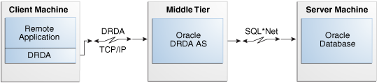

Consider the architecture of Oracle Database Provider for DRDA.

For more information about DRDA in DB2, see DB2 Version 9.1 for z/OS Information Center at [`http://www.ibm.com`](http://www.ibm.com). More specifically, see [`http://www.redbooks.ibm.com/redbooks/pdfs/sg246952.pdf`](http://www.redbooks.ibm.com/redbooks/pdfs/sg246952.pdf).

### 2.1 Protocol Considerations

DRDA is a data protocol with some similarities to Oracle's SQL\*Net data protocol. While DRDA is designed to move relational data between a client and a server, it lacks the more robust management and routing controls of SQL\*Net. The primary difference between DRDA and SQL\*Net is the language of the protocol itself. DRDA and SQL\*Net are not compatible, so it is not possible to use a SQL\*Net client to connect to a DRDA server, or vice versa.

The terminology used with DRDA is also similar to SQL\*Net, and general concepts translate to conventional Oracle definitions, as demonstrated by the following examples:

- An application requester (AR) is an interface that client programs use to create and send SQL-based requests to an application server.

- An application server (AS) is a server and database-side program that accepts such requests on behalf of the client, executes database operations, and returns resulting data back to the client.

### 2.2 Two-Phase Commit and Transaction Recovery

DRDA and DB2 implement two command sets that enable commit and rollback of transactions. They ensure that data integrity is maintained during updates of a transaction, and that these updates may be recovered if either the connection or applications fail at the time that the transaction is being committed. DRDA supports commands that implement both SingleSite and TwoPhase commit protocols. At a minimum, the AS must support SingleSite commitment.

- Single Site commit protocol consists of a simple operation that has no ability to coordinate between nodes that may be involved in a distributed transaction. It is the basic mechanism for committing data, and it is used by most common applications.

- Two Phase commit protocol enables the coordination of multiple transactions, either on the same node or on separately networked nodes.

### 2.3 Autonomy of Service

The Application Server is external to the Oracle Database server. Because of this, the application has a wide range of location options.

In a typical configuration, the AS runs on the same machine as the Oracle Database, as described in the DRDA Connectivity Model, under section Remote DB2 Applications. Because the AS is not tightly integrated into the Oracle Database, it may be installed into its own Oracle Home, or on a machine separate from either the client or the database, as illustrated in Figure 2-1. This middle tier configuration enables the separation of service resources. It also allows for better scaling of service because separate machine resources can be dedicated to both AS and Database.

Figure 2-1 AS Middle Tier Configuration

Additionally, the separation of the AS from the Client and Server tiers provides an extra layer of security and reliability. If the AS crashes, the Oracle Database instance is not impacted. Database integrity is maintained, and Oracle Database recovers the state of the transaction.

**Related Topics**

- [Remote DB2 Applications](intro-oracle-database-provider-for-DRDA.md)

### 2.4 Packages

The resources associated with DRDA application are known as packages. More specifically, the application requester utilizes a package as a reference to what the application does: the package is where the statements are stored. The application refers to the statement through a section number. There are two general classes of application statements: static and dynamic.

- Static statements contain hard-coded SQL, statements where the SQL text does not change during the run of the application. They are very quick to execute, and are often optimized prior to run-time to achieve high performance. Because it is predefined, static SQL has a shorter execution time at first invocation.

- Dynamic statements are primarily empty placeholders, and are sometimes called generic cursors. They have no SQL text before run-time, and the application constructs the actual SQL statements it needs during operation and optimizes them at runtime. After the first invocation, processed dynamic SQL statements are typically cached, so subsequent execution time of the same statement is comparable to static SQL statements of similar complexity.

The packages are constructed through proprietary tools. For example, in a DB2 application environment, a developer often writes an application that contains embedded SQL statements. The application source is processed by the SQL PreCompiler, which is analogous to Oracle's Pro\*C precompiler. The output is typically post-processed into a source module, along with an on-disk resource form of the statements used in the source program. In DB2 terminology, this creates a Database Request Module, or DBRM. Most implementations that create this file store it externally in a proprietary format.

The contents of the DBRM must be either loaded into the remote database or otherwise made available to the AS at the time of execution. However, loading data that is in proprietary format has many challenges. DRDA addresses this by providing a set of Command Requests to remotely upload the resource definition into a target AS. Most AR implementations provide an option or tool to upload the resource, either before or during the application's SQL session. This process is called binding a package.

After the resource definition (DBRM) is bound as a package to the remote database, the AS may load it in advance for better performance.

### 2.5 SQL Dialect

While Oracle is partially ANSI SQL compliant, as are most SQL-based database systems today, there are some exceptions. Database vendors implemented the ANSI SQL standard differently; this resulted in SQL 'dialects' that present some challenges during statement execution. Because the original target database used with DRDA is DB2, the applications that are discussed here use the DB2-specific dialect of SQL.

Much of Data Manipulation Language (DML) and some Data Definition Language (DDL) has been standardized in ANSI SQL for commonly used objects such as tables, views, indexes, simple procedures, or function definitions. However, each database vendor will still have its own set of product-specific extensions to both DDL and DML. The DRDA protocol treats SQL statements as database-specific entities that the database must handle; it indicates to Oracle Database that its SQL is in a DB2 dialect, and that it must have a translation service to handle it. This translation is supplied by the SQL Translation Framework feature, fully described in Oracle Database SQL Translation and Migration Guide.
