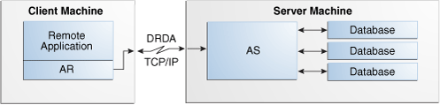
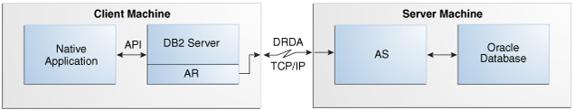
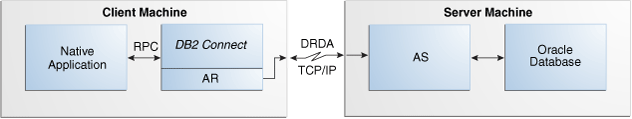
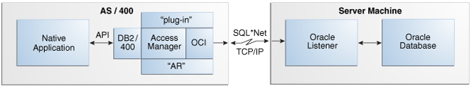
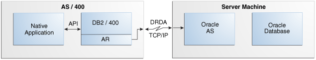

Consider some of the basic concepts of Oracle Database Provider for DRDA technology.

### 1.1 What is Oracle Database Provider for DRDA?

The Oracle Database Provider for DRDA is a network front-end that enables client programs to connect to Oracle Database using the Distributed Relational Database Architecture (DRDA) protocol.

Oracle Database Provider for DRDA implements a large subset of the full DRDA Version 4 specification, and several aspects of other DRDA server products (such as IBM's DB2) for compatibility. It is a database-independent protocol, and it provides only the functionality available from Oracle Database. Oracle Database Provider for DRDA product enables existing DB2 application customers to leverage their current investment in application technology while migrating from DB2 server.

Client programs or systems that use the DRDA protocol are called Application Requesters (ARs). Server programs or systems that provide DRDA protocol services, such as Oracle Database Provider for DRDA, are called Application Servers (AS).

Applications that are written to use the DRDA protocol, either as direct ARs or through an intermediate interface (such as embedded SQL), generally do not need to change their existing code to connect to Oracle Database through Oracle Database Provider for DRDA. Only minimal application configuration changes, such as retargeting, are necessary to successfully change the client application environment to use Oracle Database.

### 1.2 Release Information

Oracle Database Provider for DRDA is a network front-end that enables client programs to connect to Oracle Database using the Distributed Relational Database Architecture (DRDA) protocol. DRDA is a database-independent protocol. It provides only the functionality available from Oracle Database. Oracle Database Provider for DRDA enables existing DB2 application customers to leverage their current investment in application technology while migrating from DB2 server.

### 1.3 DB2 Client Applications

There are two general classes of DB2 applications:

- Remote DB2 Applications

- Native DB2 Applications

#### 1.3.1 Remote DB2 Applications

Remote applications use the DRDA data protocol to communicate with a target server database. The protocol's architecture is an example of a client/server model that includes the following, as illustrated in Figure 1-1:

- Client component, DRDA Application Requester (AR)

- Network substrate, such as a TCP/IP network or an SNA/APPC network

- Server component, Application Server (AS)

Figure 1-1 DRDA Connectivity Model

The application uses the AR to communicate with an AS, which in turn communicates with the database. In this configuration, applications are indirectly aware of the network because the AR connects to the network. The application does not require direct knowledge of the network connectivity.

Typically, DRDA AR implementations provide a directly callable API that may be coded by an application writer, such as ODBC. This API may also be invoked as part of a language pre-processor that translates source code with embedded SQL statements into equivalent embedded API calls. This is similar in concept to Oracle's OCI API and Oracle's Pro\*C preprocessor products. In both cases, the application is agnostic with respect to the actual database connectivity; only specific API calls attach the application to the database.

Within a network, client/server architecture has cross-platform interoperability: the client and the server may run on any supported computer platform. For example, IBM makes DB2 Database server product available on AS/400, z/OS, VM, VSE, Linux, several Unix platforms, as well as Microsoft Windows. IBM also makes clients, such as IBM's DB2 Connect product, available on several platforms. This arrangement enables the client to communicate with several servers and to be easily redirected to a different server, which may be on the same or different remote host.

Examples of remote applications include:

- ODBC-based applications

- Java/JDBC-based applications

- DB2 Database, used for remote database-to-database connections

- DB2 Connect, used to redirect native applications

- Custom applications that use one of several available AR implementations

ODBC- and JDBC-enabled applications may be retargeted to use Oracle Database Provider for DRDA with little or no change to the application itself.

IBM's DB2 products have native support for DRDA, where DB2 may be a requester, a server, or both. This book only discusses the scenarios where DB2 is a requester to the Oracle Server.

[Oracle Call Interface Programmer's Guide](../lnoci/introduction.md)

[Pro\*C/C++ Programmer's Guide](../lnpcc/introduction.md)

#### 1.3.2 Native DB2 Applications

Native Applications are supported by Oracle Database Provider for DRDA, but they require an existing DB2 database server to redirect the network. This is because native DB2 applications are more tightly intertwined with the DB2 server. This class of application communicates directly with a specific DB2 server using a local and proprietary API. While such applications cannot directly connect to other databases, they can use a remote node connectivity mechanism to connect indirectly to a remote database. This is illustrated in Figure 1-2.

Figure 1-2 Native Application Remote Connectivity Model

This is not an ideal approach, because using a full DB2 server merely to provide remote access to native applications is very cost-prohibitive. This is both because of a licensing model's "per processor" structure, and the disk and memory footprint.

A more attractive alternative to a full multiprocessor DB2 server is to use a local application, such as DB2 Connect, to provide remote connectivity. In such cases, the applications' access can be converted to network connectivity through DRDA, as illustrated in Figure 1-3.

Figure 1-3 DB2 Connect Replacement of DB2 Server Connectivity Model

In some cases, it is not possible to replace the DB2 database server with an alternative native application enabler. Such applications include the following:

- CICS DB2-connected applications on z/OS

- DB2/400 native applications

- DB2 for z/OS native applications

- DB2 for Linux, Unix, and Windows native applications

In these situations, the application can connect, by proxy, through the local DB2 database server. While this is not an ideal approach, it reduces the investment in DB2 server products. If an application does not use the DB2 database product, the number of DB2 servers may be reduced to the DB2 instances that are necessary as application proxies.

### 1.4 Usage Scenarios for Oracle Database Provider for DRDA

Sections Remote DB2 Applications and Native DB2 Applications describe some possible usage scenarios for an Oracle Database Provider for DRDA. Obviously, both remote and native applications may be retargeted to use Oracle Database through Oracle Database Provider for DRDA.

Because Oracle Database Provider for DRDA is a network solution, the network infrastructure should have sufficient excess capacity to accommodate increased load when retargeting native applications. In cases of remote applications the data flow between the client and the server does not change significantly.

While most scenarios revolve around a standard AR, usually supplied by IBM, there is a case where the Application Server replaces Oracle Access Manager for AS/400, which has been discontinued. Access Manager is a client-side product that enables native DB2/400 applications to connect to Oracle Database as if it were a remote DB2 database. The Access Manager runs on the AS/400 as a DB2/400 API plug-in and uses an OCI method to connect to Oracle Database, as illustrated in Figure 1-4.

Figure 1-4 Access Manager Plug-in Architecture Connectivity Model

DB2/400's plug-in interface API behaves like DRDA, and appears to the system as an application requester that uses OCI and SQL\*Net internally to connect to an Oracle Database. Customers who must connect a native application from the AS/400 to an Oracle Database will find Oracle Database Provider for DRDA a more cost-effective solution. This approach is illustrated in Figure 1-5.

Figure 1-5 DB2/400 Native DRDA Usage Connectivity Model

The example of the Access Manager is just one such scenario where a native application can be retargeted to an Oracle Database instance through the Application Server.

All of the scenarios discussed here can use Oracle Database Provider for DRDA to connect to Oracle Database.

**Related Topics**

- Remote DB2 Applications
- Native DB2 Applications
