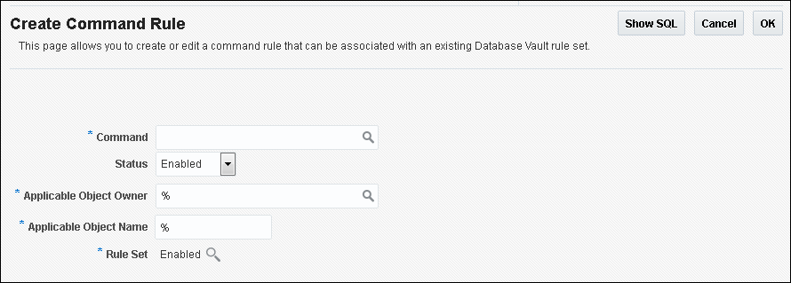

You can create command rules or use the default command rules to protect DDL and DML statements.

- What Are Command Rules?
  A command rule applies Oracle Database Vault protections with an Oracle Database SQL statement, such as `ALTER SESSION`.
- Default Command Rules
  Oracle Database Vault provides default command rules, based on commonly used SQL statements.
- SQL Statements That Can Be Protected by Command Rules
  You can protect a large number of SQL statements by using command rules.
- Creating a Command Rule
  You can create a command rule in Oracle Database Vault Administrator.
- Modifying the Enablement Status of a Command Rule
  You can enable or disable a command rule in Oracle Database Vault Administrator.
- Deleting a Command Rule
  Before you delete a command rule, you can locate the various references to it by querying the command rule-related Oracle Database Vault views.
- How Command Rules Work
  Command rules follow a set of steps to check their associated components.
- Tutorial: Using a Command Rule to Control Table Creations by a User
  In this tutorial, you create a simple local command rule to control whether users can create tables in the `SCOTT` schema.
- Guidelines for Designing Command Rules
  Oracle provides guidelines for designing command rules.
- How Command Rules Affect Performance
  The performance of a command rule depends on the complexity of the rules in the rule set associated with the command rule.
- Command Rule Related Reports and Data Dictionary View
  Oracle Database Vault provides reports and a data dictionary view that are useful for analyzing command rules.

### 6.1 What Are Command Rules?

A command rule applies Oracle Database Vault protections with an Oracle Database SQL statement, such as `ALTER SESSION`.

- About Command Rules
  A command rule protects Oracle Database SQL statements that affect one or more database objects.
- Command Rules in a Multitenant Environment
  In a multitenant environment, you can create common and local command rules in either the CDB root or the application root.
- Types of Command Rules
  In addition to command rules for many SQL statements, you can create command rules specifically for the `CONNECT`, `ALTER SYSTEM`, and `ALTER SESSION` SQL statements.

**Parent topic:** Configuring Command Rules

#### 6.1.1 About Command Rules

A command rule protects Oracle Database SQL statements that affect one or more database objects.

These statements can include `SELECT`, `ALTER SYSTEM`, database definition language (DDL), and data manipulation language (DML) statements.

To customize and enforce the command rule, you associate it with a rule set, which is a collection of one or more rules. The command rule is enforced at run time. Command rules affect anyone who tries to use the SQL statements it protects, regardless of the realm in which the object exists.

You can use command rules to protect a wide range of SQL statements, in addition to basic Oracle Database DDL and DML statements. For example, you can protect statements that are used with Oracle Flashback Technology.

A command rule has the following attributes, in addition to associating a command rule to a command:

- SQL statement the command rule protects

- Owner of the object the command rule affects

- Database object the command rule affects

- Whether the command rule is enabled

- An associated rule set

Command rules can be categorized as follows:

- Command rules that have a system-wide scope. With this type, in most cases, you can only create one command rule for each database instance. For example, `CONNECT` or `ALTER SYSTEM` command rules are enforced system-wide.

- Command rules that are schema specific. An example of a schema-specific command rule is a command rule for the `DROP TABLE` statement. You can create only one CONNECT command rule for each schema.

- Command rules that are object specific. An example is creating a command rule for the `DROP TABLE` statement with a specific table included in the command rule definition.

When a user runs a statement affected by a command rule, Oracle Database Vault checks the realm authorization first. If it finds no realm violation and if the associated command rules are enabled, then Database Vault evaluates the associated rule sets. If all the rule sets evaluate to `TRUE`, then the statement is authorized for further processing. If any of the rule sets evaluate to `FALSE`, then the statement is not allowed to be run and a command rule violation is raised.

You can define a command rule that uses factors for the `CONNECT` event to permit or deny sessions after the usual steps–user authentication process, factor initialization, and Oracle Label Security integration–are complete. In addition, you can configure a command rule that allows DDL statements such as `CREATE TABLE`, `DROP TABLE`, and `ALTER TABLE` in the `BIZAPP` schema to be authorized after business hours, but not during business hours.

You can run reports on the command rules by using the data dictionary views or the reports included in Oracle Enterprise Manager.

You cannot create command rules that block `SYS` from executing `SYS`-owned procedures. Instead, you should minimize your use of the `SYS` database user and, instead, create named accounts with the appropriate privileges. The `SYS` account should be reserved for installation, database creation, and database patching..

**Related Topics**

- [Oracle Database Vault Command Rule APIs](oracle-database-vault-command-rule-apis.md)
- [Configuring Rule Sets](configuring-rule-sets.md)
- SQL Statements That Can Be Protected by Command Rules

**Parent topic:** What Are Command Rules?

#### 6.1.2 Command Rules in a Multitenant Environment

In a multitenant environment, you can create common and local command rules in either the CDB root or the application root.

Common command rules can be associated only with common realms, rule sets, and rules. Local command rules can be associated only with local realm, rule sets, and rules.

To apply these command rules to the entire multitenant environment, you must execute the command rule procedures from the CDB root or application root as a common user who has been granted the `DVADM` or `DVOWNER` role. A common command rule that is created in the CDB root will be applied to all PDBs in that CDB environment. A common command rule that is created in the application root will only be applied to the PDBs that are associated with this application root. To propagate the command rule to the PDBs that are associated with the CDB root or application root, you must synchronize the PDB. For example, to synchronize an application root called `saas_sales_app` to its application PDBs:

    ALTER PLUGGABLE DATABASE APPLICATION saas_sales_app SYNC;

To synchronize a common command rule in the CDB root to a PDB:

    ALTER PLUGGABLE DATABASE APPLICATION APP$CDB$SYSTEM SYNC;

You can check a user’s roles by querying the `USER_ROLE_PRIVS` data dictionary view. To find information about command rules, query the `DBA_DV_COMMAND_RULE` data dictionary view.

**Parent topic:** What Are Command Rules?

#### 6.1.3 Types of Command Rules

In addition to command rules for many SQL statements, you can create command rules specifically for the `CONNECT`, `ALTER SYSTEM`, and `ALTER SESSION` SQL statements.

- CONNECT Command Rule
  The `DBMS_MACADM.CREATE_CONNECT_CMD_RULE` procedure creates a user-specific CONNECT command rule.
- ALTER SESSION and ALTER SYSTEM Command Rules
  You can create different kinds of `ALTER SESSION` and `ALTER SYSTEM` command rules that provide fine-grained control for these SQL statements.

**Parent topic:** What Are Command Rules?

##### 6.1.3.1 CONNECT Command Rule

The `DBMS_MACADM.CREATE_CONNECT_CMD_RULE` procedure creates a user-specific CONNECT command rule.

This type of command rule specifies a user, an associated rule set, an enablement status, and for a multitenant environment, where to execute the CONNECT command rule. You can enable or disable the CONNECT command rule, or you can set it to use simulation mode. In simulation mode, violations to the command rule are logged in a designated log table with sufficient information to describe the error, such as the user name or SQL statement used.

In a multitenant environment, you can create the CONNECT command rule in either the application root or in a specific PDB. The associated rule set must be consistent with the CONNECT command rule: if the CONNECT command rule is in the application root, then the rule set and rules must also be in the application root. You run the CONNECT command rule procedures from the CDB root as a common user. If the CONNECT command rule is local to a pluggable database (PDB), then you must run the CONNECT command rule creation command in that PDB, and the rule set and rules must be local.

The following example shows a CONNECT command rule definition that creates a local, enabled CONNECT command rule for the `HR` user. The rule set that is associated with this command rule is local to the current PDB.

    BEGIN
    DBMS_MACADM.CREATE_CONNECT_COMMAND_RULE(
     rule_set_name   => 'Enabled',
     user_name       => 'HR',
     enabled         => DBMS_MACUTL.G_YES,
     scope           => DBMS_MACUTL.G_SCOPE_LOCAL);
    END;
    /

**Related Topics**

- [CREATE_COMMAND_RULE Procedure](oracle-database-vault-command-rule-apis.md)
- [Using Simulation Mode for Logging Realm and Command Rule Activities](using-training-mode-to-log-realm-and-command-rule-activities.md)

**Parent topic:** Types of Command Rules

##### 6.1.3.2 ALTER SESSION and ALTER SYSTEM Command Rules

You can create different kinds of `ALTER SESSION` and `ALTER SYSTEM` command rules that provide fine-grained control for these SQL statements.

The procedures to create these types of command rules are as follows:

- `DBMS_MACADM.CREATE_COMMAND_RULE` creates ALTER SESSION and ALTER SYSTEM command rules that use clauses from the corresponding SQL statement, such as `ADVISE`, `CLOSE DATABASE LINK`, `COMMIT IN PROCEDURE`, and `SET` for `ALTER SESSION`, or `ARCHIVE_LOG`, `CHECK DATAFILES`, `CHECKPOINT`, and `SET` for `ALTER SYSTEM`.

- `DBMS_MACADM.CREATE_SESSION_EVENT` creates a command rule that is specific to the `ALTER SESSION SET EVENTS` SQL statement

- `DBMS_MACADM_CREATE_SYSTEM_EVENT` creates a command rule that is specific to the `ALTER SYSTEM SET EVENTS` SQL statement.

To create these command rules, you use the appropriate Database Vault procedure to specify the clause and if applicable, the parameter of the clause, in the creation statement. If the ALTER SESSION or ALTER SYSTEM command rule use the `SET EVENTS` setting, then you can use special parameters to specify events, components, and actions.

For example, for an ALTER SYSTEM command rule, you could specify the `SECURITY` clause and its `RESTRICTED SESSION` parameter from the `ALTER SYSTEM` SQL statement. To specify whether `RESTRICTED SESSION` is `TRUE` or `FALSE`, you must create a Database Vault rule and rule set, which can test for the validity of this sequence number.

To understand how this concept works, first create the following rule and rule set, which are designed to check if the `RESTRICTED SESSION` parameter is set to `TRUE`:

    EXEC DBMS_MACADM.CREATE_RULE('RESTRICTED SESSION TRUE', 'UPPER(PARAMETER_VALUE) = ''TRUE''');

    BEGIN
     DBMS_MACADM.CREATE_RULE_SET(
      rule_set_name    => 'Check RESTRICTED SESSION for TRUE',
      description      => 'Checks if restricted session is true',
      enabled          => DBMS_MACUTL.G_YES,
      eval_options     => DBMS_MACUTL.G_RULESET_EVAL_ALL,
      audit_options    => DBMS_MACUTL.G_RULESET_AUDIT_FAIL + DBMS_MACUTL.G_RULESET_AUDIT_SUCCESS,
      fail_options     => DBMS_MACUTL.G_RULESET_FAIL_SILENT,
      fail_message     => 'RESTRICTED SESSION is not TRUE',
      fail_code        => 20461,
      handler_options  => DBMS_MACUTL.G_RULESET_HANDLER_FAIL,
      handler          => '',
      is_static        => false);
    END;
    /
    EXEC DBMS_MACADM.ADD_RULE_TO_RULE_SET(Check RESTRICTED SESSION for TRUE', 'RESTRICTED SESSION TRUE');

With the rule and rule set in place, you are ready to create an ALTER SYSTEM command rule that will check if the `RESTRICTED SESSION` parameter:

    BEGIN
    DBMS_MACADM.CREATE_COMMAND_RULE(
     command         => 'ALTER SYSTEM',
     rule_set_name   => 'Check RESTRICTED SESSION for TRUE',
     object_owner    => '%',
     object_name     => '%',
     enabled         => DBMS_MACUTL.G_YES,
     clause_name     => 'SECURITY',
     parameter_name  => 'RESTRICTED SESSION',
     scope           => DBMS_MACUTL.G_SCOPE_LOCAL);
    END;
    /

In this example:

- `rule_set_name` checks whether `RESTRICTED SESSION` is set to `TRUE` or `FALSE`. In a multienant environment, you must create the rule set and rule in the same location as the command rule: either in the application root or locally in a PDB.

- `object_owner` and `object_name` must always be set to `%` for this kind of `ALTER SESSION` or `ALTER SYSTEM` command rule.

- `enabled` enables you to enable or disable the command rule, or to use simulation mode to log violations to the command rule to a designated log table. The log data describes the error, such as the user name or SQL statement used.

- `clause_name` specifies the `SECURITY` clause of the `ALTER SYSTEM` SQL statement

- `parameter_name` specifies the `RESTRICTED SESSION` parameter from the `SECURITY` clause

- `scope` sets the command rule to be local to the current PDB. The associated rule set and rule must also be local to the current PDB. If you want to create the command rule in the application root, then as a common user, you would set `scope` to `DBMS_MACUTL.G_SCOPE_COMMON` and run the procedure (and its accompanying rule set and rule creation procedures) from the application root.

**See Also:**

- [CREATE_COMMAND_RULE Procedure](oracle-database-vault-command-rule-apis.md) about the `DBMS_MACADM.CREATE_COMMAND_RULE` procedure

- [CREATE_SESSION_EVENT_CMD_RULE Procedure](oracle-database-vault-command-rule-apis.md) about the `DVS.DBMS_MACADM.CREATE_SESSION_EVENT_CMD_RULE` procedure

- [CREATE_SYSTEM_EVENT_CMD_RULE Procedure](oracle-database-vault-command-rule-apis.md) for more information about the `DBMS_MACADM.CREATE_SYSTEM_EVENT_CMD_RULE` procedure

- [DBA_DV_COMMAND_RULE View](oracle-database-vault-data-dictionary-views.md) for information about the `DBA_DV_COMMAND_RULE` data dictionary view

- [Oracle Database SQL Language Reference](../sqlrf/ALTER-SESSION.md) for information about the `ALTER SESSION` SQL statement

- [Oracle Database SQL Language Reference](../sqlrf/ALTER-SYSTEM.md) for information about the `ALTER SYSTEM` SQL statement

**Parent topic:** Types of Command Rules

### 6.2 Default Command Rules

Oracle Database Vault provides default command rules, based on commonly used SQL statements.

Table 6-1 lists the default Database Vault command rules.

Table 6-1 Default Command Rules

| SQL Statement     | Rule Set Name                                   |
|:------------------|:------------------------------------------------|
| `CREATE USER`     | Can Maintain Accounts/Profiles                  |
| `ALTER USER`      | Can Maintain Own Account                        |
| `DROP USER`       | Can Maintain Accounts/Profiles                  |
| `CREATE PROFILE`  | Can Maintain Accounts/Profiles                  |
| `ALTER PROFILE`   | Can Maintain Accounts/Profiles                  |
| `DROP PROFILE`    | Can Maintain Accounts/Profiles                  |
| `ALTER SYSTEM`    | Allow Fine Grained Control of System Parameters |
| `CHANGE PASSWORD` | Can Maintain Own AccountFoot 1       |

Footnote 1

The actual SQL statement that the Can Maintain Own Account rule refers to is `PASSWORD`.

The following set of command rules helps you to achieve separation of duty for user management:

- `ALTER PROFILE`

- `ALTER USER`

- `CREATE PROFILE`

- `CREATE USER`

- `DROP PROFILE`

- `DROP USER`

To grant a user the ability to use these commands, you can grant the user the role that the rule set checks. For example, the `CREATE USER` command rule ensures that a user who tries to run a `CREATE USER` statement has the `DV_ACCTMGR` role.

**Note:**

To find information about the default command rules, query the `DBA_DV_COMMAND_RULE` data dictionary view.

**Parent topic:** Configuring Command Rules

### 6.3 SQL Statements That Can Be Protected by Command Rules

You can protect a large number of SQL statements by using command rules.

The SQL statements that you can protect are as follows:

| SQL Statements A-A            | SQL Statements A-D                               | SQL Statements C-U                                 |
|:------------------------------|:-------------------------------------------------|:---------------------------------------------------|
| `ALTER CLUSTER`               | `ASSOCIATE STATISTICS`                           | `CREATE TABLE`                                     |
| `ALTER DIMENSION`             | `AUDIT`                                          | `CREATE TABLESPACE`                                |
| `ALTER FLASHBACK ARCHIVE`     | `AUDIT POLICY` (to audit unified audit policies) | `CREATE TRIGGER`                                   |
| `ALTER FUNCTION`              | `CHANGE PASSWORD`                                | `CREATE TYPE`                                      |
| `ALTER INDEX`                 | `COMMENT`                                        | `CREATE TYPE BODY`                                 |
| `ALTER INDEXTYPE`             | `CONNECT`                                        | `CREATE VIEW`                                      |
| `ALTER JAVA`                  | `CREATE AUDIT POLICY`                            | `DELETE`                                           |
| `ALTER LIBRARY`               | `CREATE EDITION`                                 | `DISASSOCIATE STATISTICS`                          |
| `ALTER OPERATOR`              | `CREATE FLASHBACK ARCHIVE`                       | `DROP CLUSTER`                                     |
| `ALTER OUTLINE`               | `CREATE USER`                                    | `DROP CONTEXT`                                     |
| `ALTER MATERIALIZED VIEW`     | `CREATE CLUSTER`                                 | `DROP DATABASE LINK`                               |
| `ALTER MATERIALIZED VIEW LOG` | `CREATE CONTEXT`                                 | `DROP EDITION`                                     |
| `ALTER PACKAGE`               | `CREATE DATABASE LINK`                           | `DROP DIMENSION`                                   |
| `ALTER PACKAGE BODY`          | `CREATE DIMENSION`                               | `DROP DIRECTORY`                                   |
| `ALTER PLUGGABLE DATABASE`    | `CREATE DIRECTORY`                               | `DROP FLASHBACK ARCHIVE `                          |
| `ALTER PROCEDURE`             | `CREATE FUNCTION`                                | `DROP FUNCTION`                                    |
| `ALTER PROFILE`               | `CREATE INDEX`                                   | `FLASHBACK TABLE`                                  |
| `ALTER RESOURCE COST`         | `CREATE INDEXTYPE`                               | `EXECUTE`                                          |
| `ALTER ROLE`                  | `CREATE JAVA`                                    | `GRANT`                                            |
| `ALTER ROLLBACK SEGMENT`      | `CREATE LIBRARY`                                 | `INSERT`                                           |
| `ALTER SEQUENCE`              | `CREATE OPERATOR`                                | `NOAUDIT`                                          |
| `ALTER SESSION`               | `CREATE OUTLINE`                                 | `NOAUDIT POLICY` (for unified audit policies only) |
| `ALTER SYNONYM`               | `CREATE PACKAGE`                                 | `PURGE DBA_RECYCLEBIN`                             |
| `ALTER SYSTEM`                | `CREATE PACKAGE BODY`                            | `PURGE INDEX`                                      |
| `ALTER TABLE`                 | `CREATE PLUGGABLE DATABASE`                      | `RENAME`                                           |
| `ALTER TABLESPACE`            | `CREATE PROCEDURE`                               | `PURGE RECYCLEBIN`                                 |
| `ALTER TRIGGER`               | `CREATE PROFILE`                                 | `PURGE TABLE`                                      |
| `ALTER TYPE`                  | `CREATE ROLE`                                    | `PURGE TABLESPACE`                                 |
| `ALTER TYPE BODY`             | `CREATE ROLLBACK SEGMENT`                        | `REVOKE`                                           |
| `ALTER USER`                  | `CREATE SCHEMA`                                  | `SELECT`                                           |
| `ALTER VIEW`                  | `CREATE SEQUENCE`                                | `TRUNCATE CLUSTER`                                 |
| `ANALYZE CLUSTER`             | `CREATE MATERIALIZED VIEW`                       | `TRUNCATE TABLE`                                   |
| `ANALYZE INDEX`               | `CREATE MATERIALIZED VIEW LOG`                   | `UPDATE`                                           |
| `ANALYZE TABLE`               | `CREATE SYNONYM`                                 | \-                                                 |

**See Also:**

Command Rules in a Multitenant Environment for information about using `CREATE PLUGGABLE DATABASE`, `ALTER PLUGGABLE DATABASE`, and `DROP PLUGGABLE DATABASE` in a multitenant container database (CDB)

**Parent topic:** Configuring Command Rules

### 6.4 Creating a Command Rule

You can create a command rule in Oracle Database Vault Administrator.

1.  Log in to Oracle Database Vault Administrator from Cloud Control as a user who has been granted the `DV_OWNER` or `DV_ADMIN` role and the `SELECT ANY DICTIONARY` privilege. [Logging in to Oracle Database Vault from Oracle Enterprise Cloud Control](getting-started-with-oracle-database-vault.md) explains how to log in.
2.  In the Administration page, under Database Vault Components, click Command Rules.
3.  In the Command Rules page:
    - To create a new command rule, click Create to display the Create Command Rule page.

      
      [Description of the illustration create_command_rule122.png](img_text/create_command_rule122.md)
4.  In the Create Command Rule page, enter the following settings:
    - Command: Select the SQL statement or operation for which you want to create a command rule. This attribute is mandatory.

      If you plan to create a command rule for a unified audit policy object, then ensure that you specify `AUDIT POLICY` or `NOAUDIT POLICY`, not `AUDIT` or `NOAUDIT`, as the command.

    - Status: Select either Enabled, Disabled, or Simulation, which will apply to the command rule during run time. This attribute is mandatory.

    - Applicable Object Owner: From the list, select the owner of the object the command rule affects. You can use wildcard character `%` to select all owners. (However, you cannot use wildcard characters with text, such as `EM%` to select all owners whose names begin in `EM`.) This attribute is mandatory for all SQL statements that operate on objects within a specific schema. See SQL Statements That Can Be Protected by Command Rules for a list of supported SQL statements.

      Note that the `SELECT`, `INSERT`, `UPDATE`, `DELETE`, and `EXECUTE` statements are not allowed for a selection of all (%) or the `SYS` and `DVSYS` schemas.

    - Applicable Object Name: Enter the name of the database object that the command rule affects, or specify % to select all database objects, which can include tables, procedures, views, unified audit policies, and so on. This attribute is mandatory, if you selected an object owner from the Object Owner list.

      You can run Oracle Database Vault reports on objects that the command rule affects. See the Command Rule Related Reports and Data Dictionary View for more information.

    - Rule Set: From the list, select the rule set that you want to associate with the command rule. This attribute is mandatory.

      If the rule set evaluates to true, then the SQL statement succeeds. If it evaluates to false, the statement fails, and then Oracle Database Vault raises a command rule violation. (You can track rule violations by using the Command Rule Configuration Issues Report, discussed in [Oracle Database Vault Reports](oracle-database-vault-reports.md).) Any auditing and custom event handling associated with the rule set occurs as a part of the command rule processing.

      See [Configuring Rule Sets](configuring-rule-sets.md), for more information about rule sets.
5.  Click OK.

**Related Topics**

- [Propagating Oracle Database Vault Configurations to Other Databases](dba-operations-in-an-oracle-database-vault-environment.md)

**Parent topic:** Configuring Command Rules

### 6.5 Modifying the Enablement Status of a Command Rule

You can enable or disable a command rule in Oracle Database Vault Administrator.

1.  Log in to Oracle Database Vault Administrator from Cloud Control as a user who has been granted the `DV_OWNER` or `DV_ADMIN` role and the `SELECT ANY DICTIONARY` privilege. [Logging in to Oracle Database Vault from Oracle Enterprise Cloud Control](getting-started-with-oracle-database-vault.md) explains how to log in.
2.  In the Administration page, under Database Vault Components, click Command Rules.
3.  In the Command Rules page, select the command rule that you want to enable or disable, and then select Edit.
4.  In the Edit Command Rule page, select the status that you want from the Status menu:
    - Enabled
    - Disabled
    - Simulation
5.  Click OK.

**Parent topic:** Configuring Command Rules

### 6.6 Deleting a Command Rule

Before you delete a command rule, you can locate the various references to it by querying the command rule-related Oracle Database Vault views.

1.  Log in to Oracle Database Vault Administrator from Cloud Control as a user who has been granted the `DV_OWNER` or `DV_ADMIN` role and the `SELECT ANY DICTIONARY` privilege. [Logging in to Oracle Database Vault from Oracle Enterprise Cloud Control](getting-started-with-oracle-database-vault.md) explains how to log in.
2.  In the Oracle Database Vault Administration page, select Command Rules.
3.  In the Command Rules page, select the command rule that you want to remove.
4.  Click Delete.
5.  In the Confirmation window, click Yes.

**Related Topics**

- [Oracle Database Vault Data Dictionary Views](oracle-database-vault-data-dictionary-views.md)

**Parent topic:** Configuring Command Rules

### 6.7 How Command Rules Work

Command rules follow a set of steps to check their associated components.

[How Realms Work](configuring-realms.md) describes what happens when a database account issues a `SELECT`, DDL, or DML statement that affects objects within a realm.

The following actions take place when `SELECT`, DDL, or DML statement is issued:

1.  Oracle Database Vault queries all the command rules that need to be applied.

    For `SELECT`, DDL, and DML statements, multiple command rules may apply because the object owner and object name support wildcard notation.

    You can associate rule sets with both command rules and realm authorizations. Oracle Database Vault evaluates the realm authorization rule set first, and then it evaluates the rule sets that apply to the command type being evaluated.

2.  For each command rule that applies, Oracle Database Vault evaluates its associated rule set.

3.  If the associated rule set of any of the applicable command rules returns false or errors, Oracle Database Vault prevents the command from executing. Otherwise, the command is authorized for further processing. The configuration of the rule set with respect to auditing and event handlers dictates the auditing or custom processing that occurs.

    Command rules override object privileges. That is, even the owner of an object cannot access the object if the object is protected by a command rule. You can disable either a command rule or the rule set of a command. If you disable a command rule, then the command rule does not perform the check it is designed to handle. If you disable a rule set, then the rule set always evaluates to `TRUE`. However, if you want to disable a command rule for a particular command, then you should disable the command rule because the rule set may be associated with other command rules or realm authorizations.

**Parent topic:** Configuring Command Rules

### 6.8 Tutorial: Using a Command Rule to Control Table Creations by a User

In this tutorial, you create a simple local command rule to control whether users can create tables in the `SCOTT` schema.

- Step 1: Create a Table
  First, user `SCOTT` must create a table.
- Step 2: Create a Command Rule
  After the table has been created in the `SCOTT` schema, you can create a command rule.
- Step 3: Test the Command Rule
  Next, you are ready to test the CREATE TABLE local command rule.
- Step 4: Remove the Components for this Tutorial
  You can remove the components that you created for this tutorial if you no longer need them.

**Parent topic:** Configuring Command Rules

#### 6.8.1 Step 1: Create a Table

First, user `SCOTT` must create a table.

1.  Log into the database instance as user `SCOTT`.
        sqlplus scott
        Enter password: password

    In a multitenant environment, you must log in to the appropriate PDB. For example:

        sqlplus scott@hrpdb
        Enter password: password

    To find the available pluggable databases (PDBs), query the `DBA_PDBS` data dictionary view. To check the current PDB, run the `show con_name` command.

    If the `SCOTT` account is locked and expired, then log in as the Database Vault Account Manager and unlock `SCOTT` and create a new password. For example:

        sqlplus accts_admin_ace --Or, sqlplus accts_admin_ace@hrpdb
        Enter password: password

        ALTER USER SCOTT ACCOUNT UNLOCK IDENTIFIED BY password;

    Follow the guidelines in [Oracle Database Security Guide](../dbseg/configuring-authentication.md) to replace `password` with a password that is secure.

        CONNECT SCOTT --Or, sqlplus SCOTT@hrpdb
        Enter password: password
2.  As user `SCOTT`, create a table.
        CREATE TABLE t1 (num NUMBER);
3.  Now drop the table.
        DROP TABLE t1;

At this stage, user `SCOTT` can create and drop tables. Do not exit SQL\*Plus yet, and remain connected as `SCOTT`. You must use it later on when `SCOTT` tries to create another table.

**Parent topic:** Tutorial: Using a Command Rule to Control Table Creations by a User

#### 6.8.2 Step 2: Create a Command Rule

After the table has been created in the `SCOTT` schema, you can create a command rule.

1.  Log in to Oracle Database Vault Administrator from Cloud Control as a user who has been granted the `DV_OWNER` or `DV_ADMIN` role and the `SELECT ANY DICTIONARY` privilege. [Logging in to Oracle Database Vault from Oracle Enterprise Cloud Control](getting-started-with-oracle-database-vault.md) explains how to log in.
2.  In the Oracle Database Vault Administrator Administration page, click Command Rules.
    The Command Rules page appears.
3.  Click Create.
    The Create Command Rule page appears.
4.  Enter the following settings:
    - Command: Select CREATE TABLE

    - Status: Set to Enabled so that the command rule is active.

    - Applicable Object Owner: Select SCOTT.

    - Applicable Object Name: Set to % so that it applies to all objects in the `SCOTT` schema.

    - Rule Set: Select Disabled so that no one can create tables in the `SCOTT` schema.
5.  Click OK.
    Do not exit Database Vault Administrator

Command rules take effect immediately. Right away, user `SCOTT` is prevented from creating tables, even though he is still in the same user session he was in a moment ago, before you created the CREATE TABLE command rule.

**Parent topic:** Tutorial: Using a Command Rule to Control Table Creations by a User

#### 6.8.3 Step 3: Test the Command Rule

Next, you are ready to test the CREATE TABLE local command rule.

1.  In SQL\*Plus, ensure that you are logged on as user `SCOTT`.

        CONNECT SCOTT --Or, CONNECT SCOTT@hrpdb
        Enter password: password

2.  Try to create a table.

        CREATE TABLE t1 (num NUMBER);

    The following output should appear:

        ORA-47400: Command Rule violation for create table on SCOTT.T1

    As you can see, `SCOTT` is no longer allowed to create tables, even in his own schema.

3.  In Oracle Database Vault Administrator, do the following:

    1.  In the Command Rules page, select the CREATE TABLE command rule and then click Edit.

    2.  In the Edit Command Rule page, select Enabled from the Rule Set list.

    3.  Click OK.

4.  In SQL\*Plus, as user `SCOTT`, try creating the table again.

        CREATE TABLE t1 (num NUMBER);

        Table created.

Now that the `CREATE TABLE` command rule is set to Enabled, user `SCOTT` is once again permitted to create tables. (Do not exit SQL\*Plus.)

**Parent topic:** Tutorial: Using a Command Rule to Control Table Creations by a User

#### 6.8.4 Step 4: Remove the Components for this Tutorial

You can remove the components that you created for this tutorial if you no longer need them.

1.  In Oracle Database Vault Administrator, remove the CREATE TABLE command rule as follows:

    1.  Return to the Command Rules page.

    2.  Select the CREATE TABLE local command rule and then click Delete.

    3.  In the Confirmation window, click Yes.

2.  Log into the database instance as user `SCOTT` and remove the `t1` table.

        DROP TABLE t1;

3.  If you no longer need the `SCOTT` account to be available, then connect as the Database Vault Account Manager and enter the following `ALTER USER` statement:

        CONNECT accts_admin_ace --Or, CONNECT accts_admin_ace@hrpdb
        Enter password: password

        ALTER USER SCOTT ACCOUNT LOCK PASSWORD EXPIRE;

**Parent topic:** Tutorial: Using a Command Rule to Control Table Creations by a User

### 6.9 Guidelines for Designing Command Rules

Oracle provides guidelines for designing command rules.

- Create finer-grained command rules, because they are far easier to maintain.

  For example, if you want to prevent `SELECT` statements from occurring on specific schema objects, then design multiple command rules to stop the `SELECT` statements on those specific schema objects, rather than creating a general command rule to prevent `SELECT` statements in the schema level.

- When designing rules for the `CONNECT` event, be careful to include logic that does not inadvertently lock out any required user connections. If any account has been locked out accidentally, ask a user who has been granted the `DV_ADMIN` or `DV_OWNER` role to log in and correct the rule that is causing the lock-out problem. The `CONNECT` command rule does not apply to users with the `DV_OWNER` and `DV_ADMIN` roles. This prevents improperly configured `CONNECT` command rules from causing a complete lock-out.

  If the account has been locked out, you can disable Oracle Database Vault, correct the rule that is causing the lock-out problem, and then reenable Oracle Database Vault. Even when Oracle Database Vault is disabled, you still can use Database Vault Administrator and the Database Vault PL/SQL packages.

- If you must temporarily relax an enabled command rule for an administrative task, then consider switching the command rule to simulation mode. Note that this will not capture activity that meets the rule set criteria, only activity that would have violated it.

- When designing command rules, be careful to consider automated processes such as backup where these procedures may be inadvertently disabled. You can account for these tasks by creating rules that allow the command when a series of Oracle Database Vault factors is known to be true (for example, the program being used), and the account being used or the computer or network on which the client program is running.

- You can test the development phase of a command rule by using simulation mode, which enables the command rule but writes detailed information about it to a log file.

**Related Topics**

- [Using Simulation Mode for Logging Realm and Command Rule Activities](using-training-mode-to-log-realm-and-command-rule-activities.md)

**Parent topic:** Configuring Command Rules

### 6.10 How Command Rules Affect Performance

The performance of a command rule depends on the complexity of the rules in the rule set associated with the command rule.

For example, suppose a rule set invokes a PL/SQL function that takes 5 seconds to run. In this case, a command rule that uses that rule set would take 5 seconds to grant access for the command statement to run.

You can check the system performance by running tools such as Oracle Enterprise Manager (including Oracle Enterprise Manager Cloud Control, which is installed by default with Oracle Database), Automatic Workload Repository (AWR), and `TKPROF`.

**See Also:**

- [Oracle Database Performance Tuning Guide](../tgdba/performance-tuning-overview.md) to learn how to monitor database performance

- [Oracle Database SQL Tuning Guide](../tgsql/performing-application-tracing.md) to monitor the performance of individual SQL and PL/SQL statements

**Parent topic:** Configuring Command Rules

### 6.11 Command Rule Related Reports and Data Dictionary View

Oracle Database Vault provides reports and a data dictionary view that are useful for analyzing command rules.

Table 6-2 lists the Oracle Database Vault report. See [Oracle Database Vault Reports](oracle-database-vault-reports.md), for information about how to run these reports.

Table 6-2 Reports Related to Command Rules

| Report                                                                       | Description                                                                                              |
|:-----------------------------------------------------------------------------|:---------------------------------------------------------------------------------------------------------|
| [Command Rule Audit Report](oracle-database-vault-reports.md)                | Lists audit records generated by command rule processing operations                                      |
| [Command Rule Configuration Issues Report](oracle-database-vault-reports.md) | Tracks rule violations, in addition to other configuration issues the command rule may have              |
| [Object Privilege Reports](oracle-database-vault-reports.md)                 | Lists object privileges that the command rule affects                                                    |
| [Sensitive Objects Reports](oracle-database-vault-reports.md)                | Lists objects that the command rule affects                                                              |
| [Rule Set Configuration Issues Report](oracle-database-vault-reports.md)     | Lists rules sets that have no rules defined or enabled, which may affect the command rules that use them |

You can use the `DBA_DV_COMMAND_RULE` data dictionary view to find the SQL statements that are protected by command rules. See [DBA_DV_COMMAND_RULE View](oracle-database-vault-data-dictionary-views.md) for more information.

**Parent topic:** Configuring Command Rules
